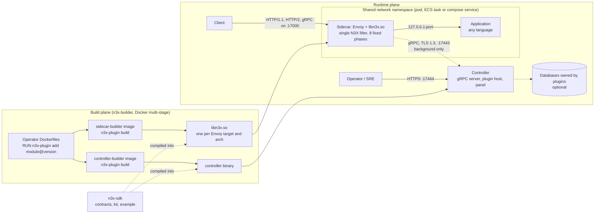
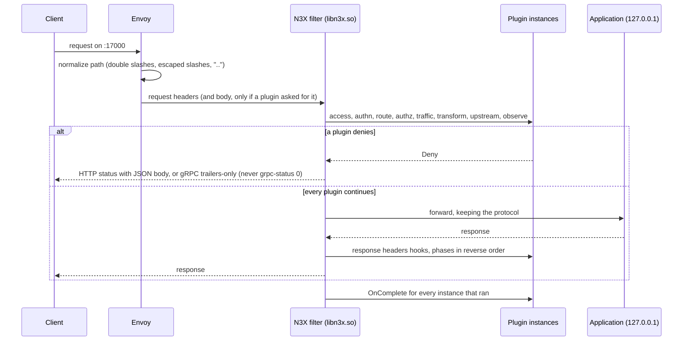
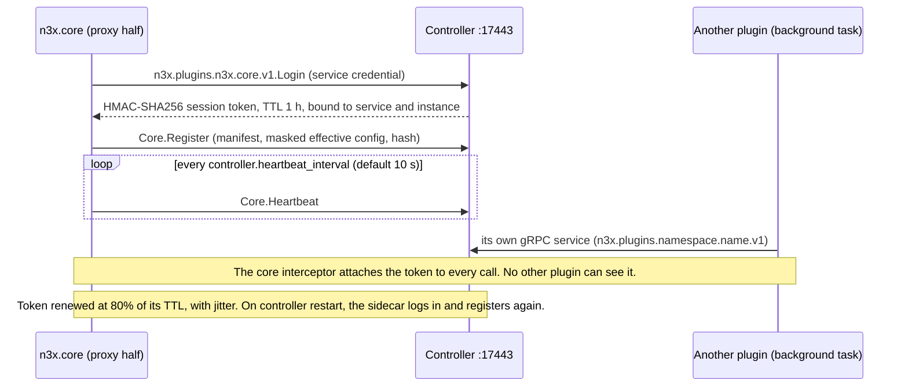
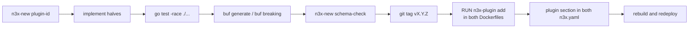
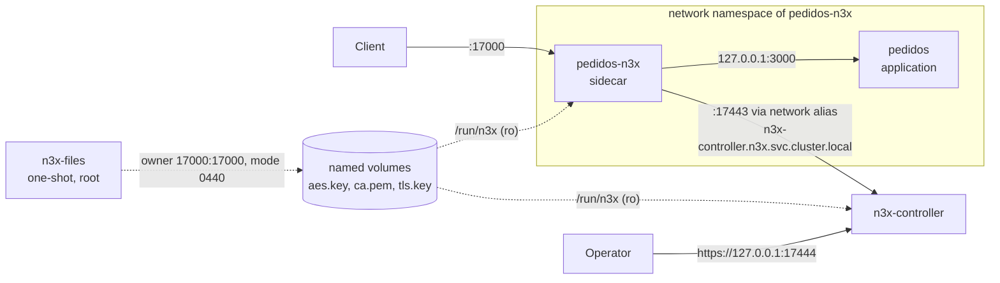
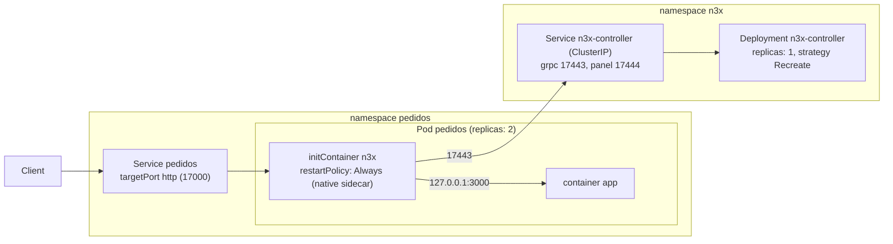
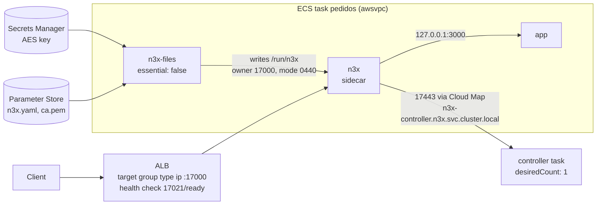

# n3x-sdk

The Go SDK for writing **N3X** plugins: the stable contracts every plugin implements, the test kit, the example plugin, the plugin generator and the reference deployments of the N3X platform.

> **Project status: design phase.** This repository currently holds only design documents (PRD, HLDs, ADRs and 16 FDDs). There is no Go code, no `deploy/` directory and no release yet. Everything below describes the approved v1 design. Packages, commands and files are **planned**, and the first code will ship as `v0.x` pre-releases. The implementation order is in [`specs/README.md`](specs/README.md).

---

## Table of contents

1. [What is N3X](#what-is-n3x)
2. [The problem it solves](#the-problem-it-solves)
3. [How it works](#how-it-works)
4. [What this repository delivers](#what-this-repository-delivers)
5. [Who uses it](#who-uses-it)
6. [Core concepts](#core-concepts)
7. [Writing a plugin](#writing-a-plugin)
8. [Building the images](#building-the-images)
9. [Configuration (`n3x.yaml`)](#configuration-n3xyaml)
10. [Deployment](#deployment)
    - [Common rules for every topology](#common-rules-for-every-topology)
    - [Docker Compose](#docker-compose)
    - [Kubernetes without Istio (including kind)](#kubernetes-without-istio-including-kind)
    - [Kubernetes with Istio](#kubernetes-with-istio)
    - [Amazon ECS](#amazon-ecs)
    - [Standalone sidecar (no controller)](#standalone-sidecar-no-controller)
11. [Observability](#observability)
12. [Security model](#security-model)
13. [Testing and CI](#testing-and-ci)
14. [Versioning and compatibility](#versioning-and-compatibility)
15. [Out of scope for v1](#out-of-scope-for-v1)
16. [Documentation map](#documentation-map)
17. [License](#license)

---

## What is N3X

**N3X** (Network Navigation Node eXtensible, pronounced "Nex") is an extensible network middleware. It works as an override layer on top of an **Envoy** proxy deployed as a **sidecar**:

- Every application gets a sidecar next to it, and the sidecar becomes the application's **only entry point**.
- Network behaviors are **plugins** written in Go. All plugins are compiled together into a single Envoy dynamic module (`libn3x.so`) and run by a single N3X filter.
- Every sidecar connects to a central **controller**. The controller only **observes**: it shows the inventory, the effective config and the drift of each sidecar in a web panel. It also exposes a gRPC server whose services grow as plugins are added.
- Each service owns its configuration in its own `n3x.yaml`, including the plugin settings. To change a behavior, you edit that file and redeploy. The application code never changes.

N3X does not depend on any language or orchestrator. It runs wherever containers run: Kubernetes, Amazon ECS or Docker Compose. The same image also works inside an Istio mesh, which is a compatibility requirement, not a runtime requirement.

The v1 platform has five repositories:

| Repository | Role |
| --- | --- |
| `n3x-sidecar` | Runtime image (Envoy 1.40 or Istio proxyv2 1.31), Go supervisor entrypoint and the core of `libn3x.so` (chain executor, per-target adapter, shared gRPC connection, per-plugin fault containment) |
| `n3x-controller` | gRPC server, plugin host and web panel (Echo v5 + templ + htmx), with no storage of its own |
| **`n3x-sdk`** (this repo) | Plugin contracts, panel widgets, isolated memory, `secret` package, test kit, example plugin, generator, deployment examples and cross-repo CI |
| `n3x-builder` | Build images per target and architecture, the `n3x-plugin` tool and the target catalog |
| `n3x-plugin-core` | Mandatory plugin that logs each sidecar in, registers it, sends heartbeats, effective config and events, and powers the panel's inventory |

## The problem it solves

Teams keep rebuilding the same network behaviors (rate limiting, forwarding, redirects, observability and more) in every service, every language and every platform. The usual alternatives do not fix this:

- **Per-service libraries** mean the same work again for every language.
- **A service mesh such as Istio** is heavy and requires Kubernetes.
- **API gateways** are hard to extend with custom logic, or only cover the edge.

N3X moves these behaviors into plugins that sit in front of any HTTP/1.1, HTTP/2 or gRPC application, written in any language. The v1 goals are:

| Goal | Target |
| --- | --- |
| Put a new service behind N3X, registered and visible in the panel | Up to 30 minutes, with no application code change |
| Turn a plugin on or off, or reconfigure it | Zero application code lines; only the service's `n3x.yaml` and a redeploy |
| Keep the infrastructure light | Controller, sidecar and application from a single Docker Compose file, without Kubernetes, in up to 5 minutes (base images already pulled) |
| Stay language-agnostic | Same example-plugin behavior on HTTP and gRPC services in at least 2 languages |

**What the SDK itself solves.** It puts the platform's hard guarantees into the plugin contract, so they do not depend on each author's discipline:

- **Stability.** Plugins never import Envoy's Go SDK, which has no tagged versions. The N3X SDK gives one stable contract across Envoy targets.
- **Testability.** Plugins are tested without Envoy and without a controller.
- **Isolation.** Memory, session token, gRPC namespace and panel routes are isolated per plugin by the API itself.
- **Performance.** The common paths make zero allocations, and the plugin mechanism adds a small, fixed number of Envoy→Go crossings per request.
- **A consistent panel.** Plugin screens are widget trees, so no plugin author writes HTML. Look, accessibility (WCAG 2.1 AA) and security (CSP, escaping, CSRF) are guaranteed in one place.

## How it works

N3X has two planes: a **build plane** that compiles the chosen plugins into the images, and a **runtime plane** where the sidecar serves traffic and the controller observes.



### Request path

The sidecar runs every enabled plugin inside one N3X filter, in eight fixed phases. The response goes back through the phases in reverse order.



Every request finishes. A panic in a plugin is contained and follows that instance's failure policy:
- `open`: the chain continues.
- `closed`: the request is denied, for example 503 or `UNAVAILABLE`.

### Control path (always in the background)

The controller is never on the request path. If it is down, traffic and plugins keep working with the local config.



## What this repository delivers

The SDK is a **Go library with no runtime of its own**. Its code runs inside two processes it does not own: the sidecar's `libn3x.so` (proxy half) and the controller binary (controller half). Planned module: `github.com/giustech/n3x-sdk`.

| Package / directory | Purpose |
| --- | --- |
| `plugin/` | Plugin ID, phases, failure policies, `n3x-plugin.yaml` manifest, schema from struct tags, `plugin.Secret` |
| `yamlconv/` | YAML→JSON conversion; the only package with a third-party YAML dependency (`go.yaml.in/yaml/v3`) |
| `schemagen/` | Helper used by the build to generate config schemas |
| `proxy/` | Proxy contract: `Define`, hooks, `Stream`, `RouteStream`, deny responses, `Go()`, `Env` |
| `telemetry/` | Metrics, log handler and `request_id` |
| `memory/` | Per-plugin isolated typed maps with a quota |
| `secret/` | The `ENC[v1:...]` format (AES-256-GCM). Platform only; **plugins must not import it** |
| `chain/` | Pure chain logic, shared with the sidecar executor (a platform package, not for plugins) |
| `controller/` (package `ctrl`) | Controller contract: `Define`, capabilities, `Caller`, plugin state, inter-plugin API |
| `controller/ui` | Panel widget catalog and renderer (HTML written directly, htmx, server-side SVG); `uitest` |
| `controller/hostrules` | Rules the controller host applies at registration |
| `internal/` | `clock`, `lifecycle`, `privileged`, `scaffold`, `schemadiff` |
| `sdktest/` | Proxy test kit: no Envoy, no controller |
| `sdktest/conformance`, `sdktest/ctrltest`, `sdktest/hostconformance` | Conformance suites, fake controller host and in-memory gRPC (`bufconn`) |
| `example/` | Example plugin `n3x.example` with both halves (nested module `github.com/giustech/n3x-sdk/example`) |
| `cmd/n3x-new` | Plugin generator and the `schema-check` config-evolution check |
| `deploy/` | Reference deployments (Compose, Kubernetes, ECS, Istio), `deploytool`, the `n3x-e2e` harness and the cross-repo CI |
| `docs/` | PRD, HLDs, ADRs and FDDs today; operator guide (`docs/operador/`) and author guide (`docs/autor/`) planned |

Nested modules with their own prefixed tags: `example/`, `deploy/tools`, `deploy/e2e` (with `plugins/faults`) and `deploy/apps/eco`.

## Who uses it

| User | How they use the SDK |
| --- | --- |
| **Plugin authors** | Write the proxy and controller halves, test with `sdktest`, start a repo with `n3x-new`. In v1, only the project owner writes plugins; third-party plugins are out of scope. |
| **`n3x-sidecar`** | Implements `proxy.Env` and `proxy.Stream` on each Envoy target's adapter; uses `plugin/`, `secret/` and `chain/` |
| **`n3x-controller`** | Implements the plugin host, registrars and panel; uses `controller/`, `controller/ui` and `secret/` |
| **`n3x-builder`** | Checks each plugin's `sdk` range, generates schemas and the plugin registry, and enforces the static-analysis rules the SDK defines |
| **`n3x-plugin-core`** | First client of the contract and the only owner of the privileged capabilities |
| **Platform / SRE operators** | Use `deploy/` and the operator guide to run controller and sidecars |
| **Product teams** | Put the sidecar next to their application without touching its code |
| **CI of every N3X repo** | Cross-repo end-to-end tests are orchestrated from `deploy/` |

## Core concepts

### Two halves per plugin

A plugin has up to two halves, each registered by a function that the builder calls (there is no `init()` and no global registry):

- **Proxy half** (`agent.Plugin()`): runs inside `libn3x.so`. There is one instance per `instance` entry in the service's `n3x.yaml`. Optional hooks: `OnRequestHeaders`, `OnRequestBody` (whole body, read-only, 1 MiB by default), `OnResponseHeaders` and `OnComplete`.
- **Controller half** (`controller.Plugin()`): runs inside the controller binary, one instance per plugin. Optional capabilities: `Start`, `Stop`, `GRPC`, `PluginAPI`, `Routes`, `Cards` and `Validate`.

Hooks and capabilities are optional interfaces detected by type assertion, so an unimplemented hook costs nothing. Config is typed with generics: `Define[C](New)` receives a struct that is already decoded and validated.

### Phases and failure policies

- Eight fixed phases, in this order: `access`, `authn`, `route`, `authz`, `traffic`, `transform`, `upstream`, `observe`. Responses run in reverse order.
- Only `access`, `authn` and `route` can change the route: `SetRoute` exists only on `proxy.RouteStream`, which you get by type assertion.
- Failure policies: `open` (continue) and `closed` (deny). The manifest declares a default, and each instance in `n3x.yaml` can override it.

### Plugin ID and derived names

The ID format is `<namespace>.<name>`. Each part matches `^[a-z][a-z0-9_]{1,31}$`. Every other name is derived from the ID mechanically:

| Where | Rule | Example |
| --- | --- | --- |
| `n3x.yaml` (service and controller) | The full ID | `giustech.ratelimit` |
| gRPC service | `n3x.plugins.<namespace>.<name>.v<major>` | `n3x.plugins.giustech.ratelimit.v1` |
| Panel routes | `/plugins/<namespace>/<name>/` | `/plugins/giustech/ratelimit/` |
| Plugin metrics | `n3x_<namespace>_<name>_<metric>` | `n3x_giustech_ratelimit_blocked_total` |

Reserved namespaces:
- `n3x`: only for modules under `github.com/giustech/`, for example `n3x.core` and `n3x.example`.
- `plugin`, `controller`, `sidecar`, `build` and `config`: reserved for platform metric families.

A duplicate ID fails the build.

### Manifest: `n3x-plugin.yaml`

Each plugin repository has its manifest at the root. The name `n3x.yaml` is used only for the operator's files.

```yaml
id: giustech.ratelimit
version: 1.0.0
sdk: ">=1.0.0 <2.0.0"          # accepted SDK range, strict grammar ">=X.Y.Z <A.B.C"; checked by the build
halves: [proxy, controller]
proxy:
  phases: [traffic]             # phases allowed in the service n3x.yaml
  default_phase: traffic
  default_order: 50
  default_failure: open         # open | closed
controller:
  required: false
  depends_on: []                # plugin IDs; the build fails if one is missing
```

### Typed config, schema and secrets

- The config schema is generated from the Go structs in `types/`, using these tags:
  - `json`: explicit, snake_case;
  - `n3x`: `required`, `min`, `max`, `enum`;
  - `desc`: mandatory;
  - `default`.
- The generated schema validates the `n3x.yaml`, masks secrets in the config sent to the controller, and labels fields in the panel.
- Decoding is strict: an unknown field is an error. Durations are Go duration strings, and sizes use base 1024.
- Sensitive fields use `plugin.Secret`. It prints `***` in logs, `fmt`, JSON and errors. Only `.Reveal()` returns the real value.
- Secret values in `n3x.yaml` are `ENC[v1:...]` envelopes (AES-256-GCM), bound to their owner by the AAD:
  - `n3x:v1:<service>` on the sidecar;
  - `n3x:v1:controller:<plugin id>` on the controller.
- The AES key always comes from a mounted file, never from an environment variable.
- Config evolves by **addition only** within a plugin major, checked in the plugin CI with `n3x-new schema-check`.

### Isolated memory

`memory.NewMap[K, V](env.Memory(), "name")` gives a typed map whose handle is bound to the plugin ID.
- There is no global accessor, so a plugin cannot reach another plugin's memory.
- Quota per plugin: 16 MiB on the sidecar and 64 MiB on the controller, adjustable with `runtime.plugin_limits["<id>"].memory.max_bytes`.
- When the quota is full, approximate least-recently-used (CLOCK) eviction keeps the hot path free of errors.

### Controller only in the background

| Connection | During a request (`s.Go()`) | In the background (`env.Background()`) |
| --- | --- | --- |
| Controller (`env.Controller()`, shared connection) | Forbidden: returns `proxy.ErrRequestPath` at once, without touching the network | Allowed, only to the plugin's own gRPC namespace, 5 s per call |
| Plugin's own connection (`env.Dial()`, e.g. a local Redis replica) | Allowed, within the `Go()` deadline (200 ms by default) | Allowed |

Per-plugin limits: 8 background tasks and 16 `Dial()` connections, adjustable in `runtime.plugin_limits["<id>"]`. Every I/O has a deadline.

### Panel screens as widget trees

Plugins build pages and overview cards as trees of SDK widgets. The SDK renderer writes the HTML.

| Group | Widgets |
| --- | --- |
| Layout | `Page`, `Column`, `Row`, `Grid`, `Section`, `Tabs` |
| Content | `Text`, `Stat`, `Badge`, `Table`, `Chart` (line and bar, SVG), `Detail`, `Code` (text, YAML, JSON, diff), `Pipeline` (+ `Stage`), `Empty` |
| Interaction | `Refresh` (htmx polling), `Link`, `Form`, `Action` (automatic CSRF; root required unless stated otherwise) |

Table export (CSV/JSON) requires root by default. Polling does not extend the session. Times are shown in UTC.

### Callers, roles and the privileged core

- On every call, the controller hands the plugin a `ctrl.Caller(ctx)` with the caller's role:
  - `root` and read-only (`RoleRead`) for panel users;
  - `sidecar` for calls from sidecars;
  - the internal `RolePlugin` for in-process calls between plugins, allowed only for dependencies declared in `depends_on`.
- Some capabilities are privileged: the public login route, the session authenticator, the user directory, the connection interceptor and `CoreEnv`.
- They are accepted only from `n3x.core`, from module `github.com/giustech/n3x-plugin-core`. Startup is refused for any other plugin that declares them.

## Writing a plugin

### Plugin repository layout

```text
n3x-plugin-ratelimit/                 github.com/giustech/n3x-plugin-ratelimit
├── LICENSE           Apache 2.0, copied by default (--license none disables it)
├── n3x-plugin.yaml   manifest
├── agent/            proxy half: Plugin(), New and hooks
├── controller/       controller half: Plugin(), New and capabilities
├── types/            config structs (schema source) and shared types
├── proto/            .proto in n3x.plugins.<namespace>.<name>.v1 and generated stubs
├── connectors/       plugin clients (e.g. a Redis replica), when needed
└── Makefile          test, generate (buf) and lint
```

A plugin with only one half leaves out the other half's folder. A plugin that never talks to the controller drops `proto/` (`n3x-new --no-proto`).

### Proxy half (sketch from the SDK HLD)

```go
package agent

type Config = types.ProxyConfig // struct in types/, source of the schema

func Plugin() proxy.Plugin { return proxy.Define[Config](New) } // called by the generated registry

func New(cfg Config, env proxy.Env) (proxy.Instance, error) {
    i := &Example{cfg: cfg, denies: env.Metrics().Counter("denies_total", "Negações", "path")}
    // Optional: report to the controller half, only from a background task.
    return i, nil
}

func (i *Example) OnRequestHeaders(s proxy.Stream) proxy.Action {
    if strings.HasPrefix(s.Path(), i.cfg.DenyPath) {
        i.denies.With(i.cfg.DenyPath).Inc()
        return s.Deny(proxy.Forbidden("bloqueado")) // HTTP 403 with JSON body, or gRPC PERMISSION_DENIED trailers-only
    }
    s.Headers().Set(i.cfg.Header, "1")
    return proxy.Continue
}
```

### Controller half: an overview card (sketch from the SDK HLD)

```go
func (p *Example) Cards(c ctrl.Cards) {
    c.Add("negacoes", ctrl.RoleRead, func(ctx context.Context) (ui.Widget, error) {
        return ui.Stat{Label: "Negações", Value: strconv.FormatInt(p.total(), 10)}, nil
    })
}
```

### Testing without Envoy or controller

```go
func TestNegaPath(t *testing.T) {
    p := sdktest.NewProxy(t, agent.Plugin(), `{"header":"X-N3X","deny_path":"/admin"}`)
    p.Request(sdktest.GET("/admin")).AssertDenied(t, 403)
    p.Request(sdktest.GRPC("/pedidos.v1.Pedidos/Criar")).AssertHeader(t, "X-N3X", "1")
}

func TestRespeitaCancelamento(t *testing.T) { sdktest.AssertHonorsCancel(t, agent.Plugin(), cfg) }
```

The kit provides:
- fake requests, config, metrics and logs;
- a deterministic scheduler for `Go()` and `Background()` (no `time.Sleep`);
- `AssertZeroAllocs` and `AssertHonorsCancel` gates;
- a secret-leak check on every captured output;
- simulated `envoy-1.40` and `istio-1.31` targets;
- a fake controller host (`ctrltest.NewHost`) and `bufconn` to connect both halves in one test.

Everything runs with `go test -race`.

### The example plugin `n3x.example`

The example plugin has both halves. It is the template for `n3x-new` and the workload of the platform's integration tests.
- **Proxy half:** adds a header (`X-N3X: 1` by default) and denies a configurable `deny_path`, over HTTP and gRPC. A denied gRPC call reaches the client as `PERMISSION_DENIED`, never as `OK`.
- **Reporting:** a background task counts the denials and sends the absolute, idempotent total per instance to the controller.
- **Controller half:** shows the total in a card and on a page.

### Author workflow



```bash
# 1. Create the repository from the example (in the 0.x series use an exact tag or @latest)
go run github.com/giustech/n3x-sdk/cmd/n3x-new@<version> giustech.ratelimit --halves proxy,controller

# 2. Test, generate stubs and check proto and config evolution
go test -race ./...
buf generate && buf breaking
n3x-new schema-check --against latest      # or --against <tag>

# 3. Tag (must match "version" in n3x-plugin.yaml) and add it to the images
git tag v0.1.0 && git push --tags
#   Dockerfile (sidecar and controller): RUN n3x-plugin add github.com/giustech/n3x-plugin-ratelimit@v0.1.0
```

Main `n3x-new` flags:
- `--halves` (default `proxy,controller`);
- `--no-proto`;
- `--module`;
- `--phase` (default `transform`);
- `--version` (default `0.1.0`);
- `--license apache-2.0|none`;
- `--ci github|none`.

The generator never overwrites existing files: it writes the whole tree or nothing.

## Building the images

Plugins are added only through Docker multi-stage builds, using the `n3x-builder` images. The sidecar and controller Dockerfiles must list the **same plugins**. The plugin core is always included and cannot be removed.

```dockerfile
# syntax=docker/dockerfile:1
FROM --platform=$BUILDPLATFORM ghcr.io/giustech/n3x/sidecar-builder:<semver>-envoy-1.40@sha256:<digest> AS build
RUN --mount=type=cache,target=/go/pkg/mod \
    n3x-plugin add github.com/giustech/n3x-sdk/example@<version>
ARG TARGETARCH
RUN --mount=type=secret,id=git_auth \
    --mount=type=cache,target=/go/pkg/mod \
    --mount=type=cache,target=/root/.cache \
    n3x-plugin build

FROM scratch AS out
COPY --from=build /out/ /

FROM ghcr.io/giustech/n3x/sidecar:<semver>-envoy-1.40@sha256:<digest>
COPY --from=build /out/libn3x.so /usr/lib/n3x/libn3x.so
```

- **Targets:** `envoy-1.40` and `istio-1.31`, on amd64 and arm64 (`docker buildx`).
- **Controller images:** `controller-builder:<semver>` and `controller:<semver>`, with no target suffix.
- **What `n3x-plugin build` does:**
  - checks each plugin's `sdk` range against the image's SDK;
  - runs the static analysis and `govulncheck` (warnings only);
  - verifies the `.so` symbols against the target Envoy and produces a reproducible `libn3x.so` (same input, same hash);
  - embeds a manifest with plugins, versions, target and hash.
- **Private plugins:** use `ARG GOPRIVATE` and a BuildKit secret (`--secret id=git_auth,env=GITHUB_TOKEN`). The credential never lands in the final image.
- **Pinning:** images are always referenced by digest.

## Configuration (`n3x.yaml`)

The service file and the controller file are both called `n3x.yaml`. **No N3X behavior is configured through environment variables.**

Service file (the same file, byte for byte, in Compose, Kubernetes and ECS):

```yaml
version: 1
service: "pedidos"
controller:
  address: "n3x-controller.n3x.svc.cluster.local:17443"
  ca_file: "/run/n3x/ca.pem"
  secret: "ENC[v1:...]"           # service credential, encrypted with AAD n3x:v1:pedidos
keys:
  aes_file: "/run/n3x/aes.key"
app:
  address: "127.0.0.1:3000"
  protocol: "http1"
  health:
    type: "http"
    path: "/healthz"
runtime:
  drain_timeout: 20s
plugins:
  - id: "n3x.example"
    instance: "add-header"
    config:
      header: "X-N3X"
      deny_path: "/admin"
```

Controller file:

```yaml
version: 1
tls:
  cert_file: "/run/n3x/tls.crt"
  key_file: "/run/n3x/tls.key"
keys:
  aes_file: "/run/n3x/aes.key"
root:
  user: "admin"
  password_hash: "$2b$12$..."     # bcrypt, cost >= 12
services:
  pedidos:
    secret_hash: "$2b$12$..."     # bcrypt hash of the service credential
runtime:
  shutdown_timeout: 20s
plugins:
  n3x.core:
    session:
      hmac_key: "ENC[v1:...]"     # optional, recommended in production
    users:
      - name: "leitura"
        password_hash: "$2b$12$..."
  n3x.example:
    retention: 24h
```

- **Sidecar tools:** `n3x keygen` and `n3x encrypt --service <name>`.
- **Controller tools:** `n3x-controller hash`, `credential new`, `keygen` and `encrypt --plugin <id>`.
- `encrypt` always requires an explicit scope (`--service` or `--plugin`).
- Development shortcut: the planned `deploy/config/bootstrap.sh` generates all keys, credentials, hashes, a development certificate and both files.

## Deployment

Reference examples for every topology will live in `deploy/`. The same sidecar image and the same service `n3x.yaml` must work in all of them.

### Common rules for every topology

| Port | Owner | Use |
| --- | --- | --- |
| `17000` | sidecar | Entry point (HTTP/1.1, HTTP/2, gRPC) |
| `17021` | sidecar | Health: `/live`, `/ready`, `POST /drain` |
| `17090` | sidecar | Prometheus metrics |
| `17443` | controller | gRPC (TLS 1.3); `n3x.plugins.n3x.core.v1.Login` is the only call allowed without a session |
| `17444` | controller | Web panel (HTTPS) |
| `17091` | controller | Metrics and health |

- **Admin API:** the Envoy admin API is only on the internal socket `/tmp/n3x/admin.sock`, never on a loopback port. Ports `17001` and `17090` are reserved, and plugins cannot dial them.
- **Application exposure:** the application is never exposed. Outside Istio, it listens only on `127.0.0.1`.
- **File paths inside containers:**
  - service file: `/etc/n3x/n3x.yaml` (`/run/n3x/n3x.yaml` on ECS);
  - controller file: `/etc/n3x/controller.yaml`;
  - secrets and certificates: `/run/n3x/` (`aes.key`, `ca.pem`, `tls.crt`, `tls.key`).
  - Never mount a whole directory over `/etc/n3x`.
- **Controller address:** fixed in every topology, `n3x-controller.n3x.svc.cluster.local:17443`.
- **Single controller:** one instance per environment, scaled vertically only. The controller has no storage: in v1 the plugin core keeps inventory, configs and events in memory, and sidecars rebuild them after a controller restart.
- **Memory limits:** the sidecar refuses to start without a container memory limit. `GOMEMLIMIT` and `GOMAXPROCS` are computed by the processes, never set by you.
- **Drain:** on SIGTERM, the sidecar marks itself not ready and drains for `runtime.drain_timeout` (20 s by default) before stopping Envoy.

### Docker Compose

The lightest setup: controller, sidecar and application from one Compose file (Docker Engine 24 with BuildKit, Compose v2.20 or later).



- **Services:**
  - `n3x-files`: one-shot `busybox`; fixes owner and mode of the key volumes;
  - `n3x-controller`;
  - `pedidos-n3x`: the sidecar;
  - `pedidos`: the application.
  - The `observabilidade` profile adds Prometheus and Grafana.
- **Networking:**
  - the application uses `network_mode: "service:pedidos-n3x"`, has no `ports`, and listens on `127.0.0.1:3000`;
  - only `17000` (sidecar) and `127.0.0.1:17444` (panel) are published on the host;
  - `17443` and `17091` stay on the project network.
- **Secrets:** the AES keys and `tls.key` live in named volumes (`n3x-exemplo-sidecar-run`, `n3x-exemplo-controller-run`), not on the host. Both N3X services wait for `n3x-files` with `service_completed_successfully`.
- **Health:**
  - sidecar: `n3x probe live`;
  - controller: `n3x-controller probe ready`;
  - the application waits for the sidecar with `service_healthy`.
- **Limits and hardening:**
  - sidecar 256 MB, 1 CPU, `/tmp` tmpfs of 16 MB;
  - controller 512 MB, 1 CPU; application 128 MB;
  - `read_only`, `cap_drop: [ALL]`, `no-new-privileges`, no swap.
- **Stop grace periods:** sidecar 30 s, application 25 s, controller 40 s.
- **TLS:** the example uses a 30-day self-signed `dev-cert`. Your browser will warn when you open the panel. Use your own PKI in production.

```bash
cd deploy/compose && docker compose build
../config/bootstrap.sh --out .n3x
docker compose up -d --wait

curl -si localhost:17000/eco      # 200, response carries x-n3x: 1
curl -si localhost:17000/admin    # 403 {"code":403,"message":"bloqueado"}

# read the generated root password, then open https://localhost:17444 and log in as admin
docker run --rm -v n3x-exemplo-senhas:/k:ro busybox cat /k/root-password.txt

docker compose --profile observabilidade up -d   # optional Prometheus and Grafana
docker compose down
```

To onboard your own service:
1. Run `bootstrap.sh --service <name>`.
2. Set `app.address` in the service `n3x.yaml`.
3. Swap the application image in `compose.yaml`.

### Kubernetes without Istio (including kind)

Requires Kubernetes 1.29 or later. Manifests use kustomize, with overlays `kind` (local/CI) and `exemplo` (images from your registry, pinned by digest).



- **Native sidecar:** the `n3x` container is in `initContainers` with `restartPolicy: Always`. It starts before the application and stops after it.
- **Ports and probes:**
  - named ports: `http` 17000, `health` 17021, `n3x-metrics` 17090;
  - `startupProbe` and `livenessProbe` on `/live`, `readinessProbe` on `/ready` (never `/ready` in the startup probe).
- **Config and secrets (only in the `n3x` container):**
  - `n3x.yaml` comes from the ConfigMap `pedidos-n3x`, mounted with `subPath`;
  - the AES key comes from the Secret `pedidos-n3x-key`, and the CA from the ConfigMap `n3x-ca`;
  - key and CA are mounted together as a `projected` volume at `/run/n3x`, with `defaultMode: 0440` and pod `fsGroup: 17000`;
  - this applies to kind too: no `n3x-files` step on Kubernetes;
  - changing the config requires a rollout.
- **Security:**
  - pod: `runAsNonRoot` and seccomp `RuntimeDefault`;
  - `n3x` container: `runAsUser`/`runAsGroup` 17000, read-only root filesystem, no privilege escalation, all capabilities dropped;
  - the application keeps its own UID.
- **Resources:** the sidecar requests 250m CPU and 256Mi, with limits of 1 CPU and 256Mi. Without `limits.memory`, the sidecar exits.
- **Draining:**
  - the application gets SIGTERM first and calls `POST 127.0.0.1:17021/drain`;
  - for applications you cannot change, an optional `preStop` runs `curl -fsS -X POST http://127.0.0.1:17021/drain; sleep 20`;
  - `terminationGracePeriodSeconds` must cover application stop + `drain_timeout` + 10 s (45 s in the example).
- **Controller:**
  - `replicas: 1`, `strategy: Recreate`, no PodDisruptionBudget;
  - probes on port `ops` 17091;
  - its `n3x.yaml` is a Secret (it contains bcrypt hashes);
  - TLS comes from a `kubernetes.io/tls` Secret.
- **Network policies:**
  - namespace `pedidos`: ingress only on 17000, and on 17090 from monitoring;
  - namespace `n3x`: 17443 only from pods labeled `n3x.io/sidecar: "true"` in namespaces labeled `n3x.io/sidecars: "true"`.
- **Exposure outside the cluster:**
  - `17443` only through an L4 load balancer that preserves the client IP (`externalTrafficPolicy: Local` or an NLB with IP preservation), never through an L7 Ingress without `grpc.trusted_proxies`;
  - the panel through an Ingress with an HTTPS backend.

```bash
kubectl -n pedidos create configmap pedidos-n3x --from-file=n3x.yaml=.n3x/sidecar.yaml
docker run --rm -v n3x-exemplo-sidecar-run:/k:ro busybox cat /k/aes.key \
  | kubectl -n pedidos create secret generic pedidos-n3x-key --from-file=aes.key=/dev/stdin
kubectl -n pedidos create configmap n3x-ca --from-file=ca.pem=.n3x/ca.pem
kubectl apply -k deploy/kubernetes/overlays/kind && kubectl -n pedidos rollout status deploy/pedidos
```

The controller objects (`n3x-controller-config`, `n3x-controller-aes`, `n3x-controller-tls`) are created the same way, piping each value from its volume so it never touches the host disk.

### Kubernetes with Istio

> **Not ready yet.** Istio support is a v1.0.0 release blocker. Its content (the `EnvoyFilter`, the pod annotations and the CI environment) belongs to a design in the `n3x-sidecar` repository that has not been produced yet. Until then, `deploy/istio/` only lists the pending items.

What is already decided:
- **Istio stays in charge.** The injected `proxyv2` image is replaced by an N3X image built on top of it, with `libn3x.so` inside (target `istio-1.31`).
- **Traffic path:** traffic enters through Istio's own listeners and ports. A static `EnvoyFilter`, the same for the whole mesh, inserts the N3X filter.
- **Ports and lifecycle:** N3X does not open `17000` or `17021`. Health, draining and lifecycle are Istio's. N3X only adds what is its own, such as the `.so` metrics.
- **Config:** the service `n3x.yaml` is the same file, mounted in the pod; its `listener` and `app` sections are ignored with a warning.
- **Startup:** the entrypoint applies the Go runtime settings and hands control to `pilot-agent`.
- **Controller connection:** it goes out directly, because Istio does not intercept the proxy's own traffic.
- **Planned files:** `deploy/istio/envoyfilter.yaml`, a byte-for-byte copy of the canonical file in `n3x-sidecar`, plus `kustomization.yaml`, `pedidos-deployment.yaml` and `mesh-config.yaml`. They are validated in a `kind-istio` CI environment.
- **Fallback:** if a mesh cannot run the N3X filter, that service runs the N3X sidecar without Istio.

### Amazon ECS

Uses `awsvpc` networking. Fargate (platform 1.4.0) and EC2 (agent with metadata v4) are both supported. The ECS example is validated by a guided manual run before each release.



- **Why `n3x-files`:** ECS only delivers secrets as environment variables, which N3X forbids for the key. So a non-essential `n3x-files` container (AWS CLI image, pinned by digest) uses the task role to read:
  - the key from Secrets Manager;
  - the `n3x.yaml` and the CA from Parameter Store (`Advanced` tier, up to 8 KiB; above that, S3).
  - It writes them to an ephemeral `/run/n3x` volume with owner 17000 and mode 0440, then exits.
- **Start order:** `n3x` waits for `n3x-files` with `SUCCESS`; the application waits for `n3x` with `HEALTHY`. ECS stops them in reverse order.
- **Sidecar container:**
  - `command: ["run", "--config", "/run/n3x/n3x.yaml"]`;
  - user `17000:17000`, read-only root filesystem, all capabilities dropped;
  - `memory: 256`, `stopTimeout: 30`;
  - health check `n3x probe live` (never `probe ready` in a health check used by `dependsOn`).
- **Task size (Fargate):** `cpu: "1024"`, `memory: "2048"`.
- **`/tmp`:** Fargate does not accept `tmpfs`, so `/tmp` is an ephemeral volume and a `tmp_not_tmpfs` warning is expected. On EC2, use `linuxParameters.tmpfs` and `maxSwap: 0`.
- **Load balancer:**
  - ALB target group of type `ip` on 17000, health check on `17021/ready`, deregistration delay 15 s;
  - the security group accepts 17000 and 17021 only from the ALB, and 17090 only from the metrics collector.
- **Controller:**
  - its own task with the same `n3x-files` pattern (config, key and TLS from Secrets Manager);
  - `desiredCount: 1`, `maximumPercent: 100`, `minimumHealthyPercent: 0`;
  - discovered through a private Cloud Map namespace named `n3x.svc.cluster.local`, which you must create;
  - never put Service Connect in front of `17443`: it hides the caller IP that the login rate limit relies on.
- **IAM:** least privilege, with no resource wildcards. Allow `secretsmanager:GetSecretValue` on the key ARN and `ssm:GetParameter` on the two parameters. Add `kms:Decrypt` with `kms:ViaService` only for a custom KMS key.
- **Accepted residual risk:** the task role is shared by every container in the task, so the application can also read the key. This is documented. The optional hardening is an EFS access point (UID 17000) mounted only in `n3x`, with no Secrets Manager permission on the task.
- **Registering and logs:** register the task definitions with `aws ecs register-task-definition --cli-input-json file://deploy/ecs/pedidos-task.json`. Logs go to CloudWatch through `awslogs`, as JSON.

### Standalone sidecar (no controller)

If the service `n3x.yaml` has no controller configured, the sidecar runs alone: traffic and plugins work with the local config, and there is no panel or inventory. The same holds when the controller is down: traffic is never affected.
- Calls to the controller wait in a small bounded buffer, which drops the oldest items when full.
- The sidecar reconnects with backoff.
- When the controller comes back, the sidecar logs in and registers again.

## Observability

- **Logs:** structured JSON on stderr. Fixed fields: `ts`, `level`, `service`, `instance`, `plugin_id`, and `request_id` when there is a request. Secrets and tokens never appear.
- **Metrics:** Prometheus format.
  - Sidecar metrics on `17090`, from Envoy stats. Sidecar histograms have `_bucket` and `_count` but no `_sum`, because of an Envoy stats limitation.
  - Controller metrics on `17091`.
  - Plugin metrics are prefixed `n3x_<namespace>_<name>_` and get an automatic `instance` label.
- **Metrics published by the SDK:** `n3x_plugin_duration_seconds` per hook, plus memory, eviction, background-task and dial metrics (`n3x_plugin_*`).
- **Cardinality:** there is no cardinality limit on labels. Keep request values out of labels.
- **Tracing:** no distributed tracing in v1. Sidecar and controller logs are correlated through `request_id`, carried in gRPC metadata.
- **Panel:** per-plugin banners (`degraded`, `failed`), the sidecar inventory, config diffs between instances of the same service, and plugin cards.
- **Planned in `deploy/`:** scrape configs, Prometheus alert rules with a runbook per alert, and Grafana dashboards.
- **Scope:** observability of application traffic (per-request metrics, access logs) is out of scope for v1.

## Security model

- **Sidecar authentication:** TLS 1.3 between sidecar and controller. The sidecar authenticates with a per-service credential:
  - the sidecar's `n3x.yaml` holds it encrypted;
  - the controller's `n3x.yaml` holds only its bcrypt hash;
  - the credential travels only at login, which returns a per-instance HMAC-SHA256 session token (TTL 1 h).
- **Hashing and keys:**
  - bcrypt (cost ≥ 12) for everything that is only verified: root, read-only users and service credentials;
  - AES-256-GCM for secrets that must be read, with the key in a mounted file.
- **Panel:**
  - cookies are `HttpOnly`, `Secure` and `SameSite=Strict`;
  - CSRF protection on every action;
  - CSP restricted to the panel's own origin, with no external JavaScript;
  - 5 failed logins lock that user and IP for 15 minutes.
- **Static analysis at build time** rejects plugins that use:
  - raw `go`, `os.Exit`, `log.Fatal` or side-effect `init()`;
  - `unsafe` or `reflect` on SDK types;
  - cgo, or imports of Envoy's Go SDK or of `secret/`;
  - `context.Background()`, `time.Sleep`, `net.Dial` or `http.Get`;
  - `.Reveal()` inside a log call.
- **Authorization** is applied by the controller before any plugin handler runs. A plugin can register gRPC services and routes only inside its own namespace.

## Testing and CI

- **Unit level:**
  - `go test -race` everywhere;
  - table, property and golden tests, including a golden of `go doc -all` for the public API;
  - native fuzzing, 5 minutes per target, nightly;
  - benchmarks with zero-allocation gates.
- **Coverage:** at least 90% for SDK packages; 85% for `example/` and `cmd/n3x-new`.
- **Conformance:** the same scenarios (continue, stop, resume, deny, panic) run against the test kit and the real hosts. They run on every PR with the fake executor adapter, and nightly and before releases against real proxies.
- **Cross-repo end-to-end matrix**, orchestrated from `deploy/` with the `n3x-e2e` harness:

| Tier | Environment | When |
| --- | --- | --- |
| `pr` | Docker Compose, amd64, `envoy-1.40` | Every PR |
| `nightly` | Compose on amd64 and arm64, kind on amd64 | Nightly |
| `prerelease` | Both architectures, Compose and kind, including a 4 h soak test | Before each release |
| `istio` | `kind-istio` | Once the Istio content exists (v1.0.0 blocker) |
| `manual` | ECS guided run, plus the "new service in 30 minutes" and "new plugin from the docs only" runs | Before releases touching `deploy/` or the guides |

- **Release gates:**
  - a release is blocked if a gRPC denial ever reaches the client as `grpc-status 0`;
  - the gate also requires every blocking scenario to pass on amd64 and arm64.

## Versioning and compatibility

- **Semver:** strict semver, stable from `v1.0.0`, with no experimental `x/` packages. Patch fixes, minor only adds (new widget, hook or capability), and major breaks.
- **Pre-1.0:** `v0.x` pre-releases are validated with the core plugin, the example plugin and a rate-limit prototype before `v1.0.0`.
- **Deprecation:** an API marked `// Deprecated:` keeps working until the next major, for at least 6 months. The build only warns.
- **SDK range check:** each builder image ships one SDK version and rejects plugins whose `sdk` range does not include it.
- **Evolution by addition only:** plugin config, checked by `n3x-new schema-check`, and plugin protos, checked by `buf breaking`, may only add within a major.
- **Go:** 1.26 or later, matching the builder images; the minimum is raised only in a minor release.
- **Runtime images:** a runtime image accepts a `.so` or binary built with the same major and an equal or lower minor of `core/` or `host/`.

## Out of scope for v1

- Traffic-behavior plugins (rate limiting, forwarding rules, redirects, headers, JWT, CORS, observability), apart from the example plugin.
- Response-body hooks (`OnResponseBody` will be added later, by addition).
- Changing sidecar config from the controller or the panel, egress traffic, iptables interception and automatic sidecar injection.
- Distributed tracing, an audit trail (planned for v2) and user management from the panel.
- Third-party plugins, a plugin catalog, a build CLI, lockfiles, artifact signing and SBOM.
- Helm charts, a Kubernetes operator, Terraform and CloudFormation; Windows without WSL2.

## Documentation map

| Document | Path |
| --- | --- |
| Product requirements (PRD v1.6) | [`docs/prd/PRD-N3X.md`](docs/prd/PRD-N3X.md) |
| SDK high-level design (v1.2) | [`docs/HLD.md`](docs/HLD.md) |
| Platform high-level design (v1.2) | [`docs/HLD-plataforma.md`](docs/HLD-plataforma.md) |
| Architecture decision records | [`docs/adr/README.md`](docs/adr/README.md) |
| Feature design documents (SDK-01 to SDK-16) | [`docs/fdd/`](docs/fdd/) |
| Specification plan (Spec Kit) | [`specs/README.md`](specs/README.md) |
| Project constitution (v1.0.0, binding rules for every spec, plan and task) | [`.specify/memory/constitution.md`](.specify/memory/constitution.md) |
| Draft input used to write the constitution | [`DRAFT_CONSTITUITION.md`](DRAFT_CONSTITUITION.md) |

The design documents are written in Brazilian Portuguese, and the `.md` files are the source of truth. The `.json` copies next to them are outdated duplicates.

## License

[Apache License 2.0](LICENSE).
