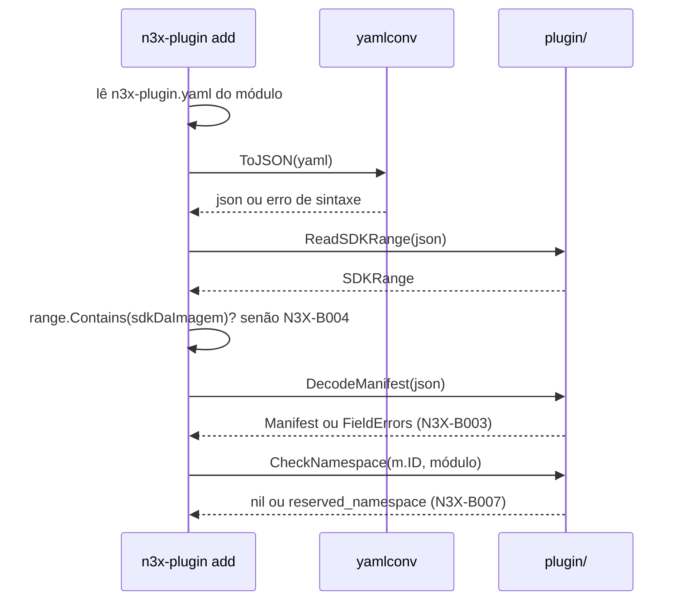
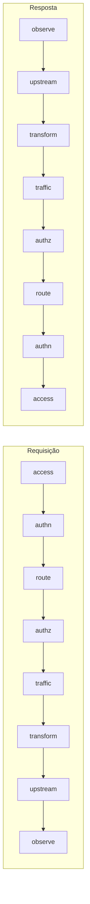

### FDD: Identidade do plugin, fases, políticas de falha e manifesto `n3x-plugin.yaml` (SDK-01)

Versão: 1.0
Data: 2026-10-20
Responsável: Guilherme Giusti

---

### 1. Contexto e motivação técnica

**Problema técnico.** O ID de um plugin aparece em seis lugares: no `n3x.yaml` do serviço, no `n3x.yaml` do controller, no nome do serviço gRPC, nas rotas do painel, nas métricas e nos logs. Os documentos anteriores usavam três formatos de ID (`n3x.example/header`, `n3x.core` e `core`) e três arquivos chamados `n3x.yaml`. O ADR-012 e o ADR-013 do `n3x-sdk` unificaram o formato e o nome do manifesto, mas não fixaram o comportamento verificável: a expressão regular exata, as mensagens de erro, a gramática da faixa `sdk`, a forma de representar uma metade de proxy sem fase e o que acontece com campos desconhecidos. Se cada repositório derivar o ID do seu jeito, o isolamento por namespace (gRPC, rotas e métricas) quebra em silêncio.

**Encaixe no HLD.** Esta FDD especifica o núcleo do pacote `plugin/` do módulo `github.com/giustech/n3x-sdk` (HLD do `n3x-sdk`, linha `plugin/` de "Componentes e responsabilidades"). É o vocabulário base que todos os outros pacotes e repositórios importam:

- `proxy/` e o executor do sidecar usam `Phase`, a ordem das fases e `FailurePolicy` (FDDs 05 e 17)
- `controller/` e o host do controller usam o ID e as derivações de serviço gRPC e rotas para recusar registros fora do namespace (FDDs 08 e 32)
- `n3x-plugin add` e `n3x-plugin build` leem e validam o manifesto e aplicam as regras de build (FDDs 19 e 20)
- `n3x-new` gera o manifesto e o confere (FDD 14)
- o entrypoint e o `.so` do sidecar validam a seção `plugins` do `n3x.yaml` contra o manifesto embutido (FDDs 15 e 22)
- o plugin core registra o manifesto no controller (FDD 42)

**Atores.** Autor de plugin (escreve o `n3x-plugin.yaml`), builder (`n3x-plugin add` e checagens de build), sidecar e controller (validam o `n3x.yaml` contra o manifesto embutido), plugin core (envia o manifesto no registro) e mantenedor do SDK (evolui o formato por minor).

**Limites.** O pacote é uma biblioteca pura: não lê arquivos, não abre rede, não loga e não tem estado global. Ele recebe bytes JSON ou strings e devolve tipos validados ou erros com o caminho do campo. Quem lê o arquivo YAML e quem decide o que fazer com o erro é o chamador.

**Suposições**
- O Go 1.26 ou superior é o toolchain de todas as imagens do builder (ADR-021 do `n3x-sdk`)
- O `n3x-plugin.yaml` cabe em poucos KiB; o limite de 64 KiB é folga de segurança contra entrada maliciosa (hipótese)
- O manifesto embutido no `.so` e no binário do controller guarda o `n3x-plugin.yaml` inteiro em JSON, no campo `plugins[].manifest` (HLD do `n3x-builder`)

**Restrições**
- `plugin/` usa só a biblioteca padrão (HLD do `n3x-sdk`), porque entra no `libn3x.so` e no binário do controller
- Sem cgo (ADR-011 do `n3x-sdk`)
- Contrato estável desde a `v1.0.0`; antes disso, pré-releases `v0.x` (ADR-021 do `n3x-sdk`)
- Documentação e mensagens de erro em pt-BR; identificadores de código em inglês

**Rastreabilidade**
- PRD 1.5: FR-004 (oito fases e ordem inversa na resposta), FR-011 e FR-015 (ID duplicado e namespace reservado como regra de build), FR-012 (manifesto, fases permitidas, posição e política padrão), FR-013 (ID, dependências e obrigatoriedade)
- ADRs do `n3x-sdk`: ADR-011, ADR-012, ADR-013, ADR-015 e ADR-021; ADR-008 do `n3x-plugin-core` (core sem fase)
- Lacunas do README fechadas aqui: L-10 (formato do manifesto para metade de proxy sem fase), L-34 (convenção de escrita de caminhos com ID), L-46 (onde mora a leitura de YAML), L-47 (faixa `sdk` sem biblioteca de semver) e L-48 (início das partes do ID e origem do `<major>` gRPC)

---

### 2. Objetivos técnicos

- **Um único parser de ID para toda a plataforma.** Medida: builder, sidecar, controller, plugin core e `n3x-new` chamam `plugin.ParseID`; nenhum outro repositório tem expressão regular de ID (conferido em revisão e por busca na CI).
- **Derivações sempre válidas no destino.** Invariante: para todo ID aceito, `GRPCPackage(n)` é um pacote proto válido, `MetricPrefix()` casa com `^[a-zA-Z_:][a-zA-Z0-9_:]*$` (nome de métrica do Prometheus) e `RoutePrefix()` é um caminho limpo. Conferido por teste de propriedade sobre o fuzzing do parser.
- **Ida e volta sem perda.** Invariante: `ParseID(id.String()) == id` e `DecodeManifest(json.Marshal(m)) == m` para todo valor válido.
- **Validação completa numa passada.** Medida: `DecodeManifest` devolve todos os problemas do manifesto de uma vez, em ordem determinística, cada um com caminho do campo, regra e texto; nunca para no primeiro.
- **Mensagens estáveis.** Invariante: o código da regra (`Rule`) de cada problema não muda dentro da major do SDK; o texto pode melhorar em patch.
- **Sem custo no caminho quente.** Medida: `ParsePhase`, `Phase.String`, `Phase.CanSetRoute`, `Phases`, `ResponsePhases`, `ID.String`, `ID.Namespace` e `ID.Name` com 0 alocações por operação (`testing.AllocsPerRun`).
- **Parse seguro contra entrada hostil.** Medida: fuzzing de `ParseID`, `ParseVersion`, `ParseSDKRange` e `DecodeManifest` por no mínimo 5 minutos cada na CI noturna, sem panic e sem estouro de tempo (hipótese para a duração).

---

### 3. Escopo e exclusões

**Incluído**
- Tipo `plugin.ID`: parse, validação, `String()`, partes, derivações (`GRPCPackage`, `RoutePrefix`, `MetricPrefix`, rótulo `plugin`) e checagens de posse (`OwnsGRPCService`, `OwnsRoute`)
- Função `plugin.CheckNamespace` para o builder conferir o namespace `n3x` contra o caminho do módulo Go
- Tipo `plugin.Phase` com as oito fases, ordem de requisição, ordem inversa de resposta e a informação de quais fases alteram rota, exposta como dado
- Tipo `plugin.FailurePolicy` (`open` e `closed`) com parse e serialização
- Tipos `plugin.Version` (semver 2.0.0) e `plugin.SDKRange` (faixa `sdk` com gramática restrita), com parser próprio só na biblioteca padrão
- Struct `plugin.Manifest` com todos os campos do ADR-013, decodificação estrita a partir de JSON (`DecodeManifest`), leitura tolerante só da faixa `sdk` (`ReadSDKRange`) e validação semântica (`Validate`)
- Representação da metade de proxy só de fundo (sem fase), caso do plugin core (L-10, parte do formato)
- Tipo de erro `plugin.FieldError` e lista `plugin.FieldErrors`, com caminho, regra e texto, reaproveitados pela FDD 02 na validação de config
- Convenção de escrita de caminhos de campo com chaves que contêm ponto (L-34)
- Pacote auxiliar `yamlconv` do SDK, fora de `plugin/`, com a conversão de YAML para JSON usada por quem lê o `n3x-plugin.yaml` (L-46) (hipótese de nome e de biblioteca)

**Excluído**
- Config tipada, tags e geração do JSON Schema: FDD 02 (SDK-02)
- `plugin.Secret` e `ENC[...]`: FDD 03 (SDK-03)
- Checagem de estrutura do repositório (pastas das metades): FDD 19 (BLD-01)
- Regras que dependem do conjunto de plugins (IDs e serviços duplicados, prefixos de métrica iguais, `depends_on` em ciclo ou faltando, faixa `sdk` contra a imagem, presença do core): FDD 20 (BLD-02)
- Comportamento do executor por fase, grupos paralelos e aplicação da política de falha: FDD 17 (SID-03)
- Quantas instâncias de uma metade só de fundo existem e quem as cria: FDDs 09 (SDK-09) e 36 (CORE-01)
- Validação do campo `order` do `n3x.yaml` (usa as constantes desta FDD, mas é da FDD 15)
- Gerador `n3x-new`: FDD 14 (SDK-14)

---

### 4. Fluxos detalhados e diagramas

**Fluxo principal: leitura do `n3x-plugin.yaml` pelo builder ou pelo `n3x-new`**
- O chamador lê o arquivo `n3x-plugin.yaml` do repositório do plugin
- O chamador converte YAML em JSON com `yamlconv.ToJSON`, que recusa múltiplos documentos, chaves repetidas, chaves que não são texto e tags explícitas (hipótese)
- O chamador lê só a faixa com `plugin.ReadSDKRange(json)`, que ignora os outros campos; se a faixa não contém o SDK da imagem, o builder já falha com `N3X-B004` (recomendação para a FDD 19), antes de reclamar de um campo novo que a imagem antiga não conhece
- O chamador chama `plugin.DecodeManifest(json)`:
  - confere o tamanho (até 64 KiB) e que a raiz é um objeto
  - decodifica de forma estrita: campo desconhecido em qualquer nível vira problema `unknown_field`
  - converte `id`, `version`, `sdk`, fases e políticas pelos tipos do pacote, registrando cada falha com o caminho do campo
  - roda `Manifest.Validate()` com as regras semânticas (coerência de `halves` com os blocos, `default_phase` dentro de `phases`, faixa de `default_order`, metade só de fundo, `depends_on`)
  - devolve o `Manifest` ou `FieldErrors` com todos os problemas, na ordem dos campos do manifesto
- O chamador confere o namespace reservado com `plugin.CheckNamespace(m.ID, caminhoDoModulo)`
- O chamador usa as derivações (`GRPCPackage`, `RoutePrefix`, `MetricPrefix`) para as checagens de conjunto da FDD 20 e para gerar código (FDDs 14 e 21)

**Fluxo de runtime: manifesto embutido**
- O sidecar, o controller ou o plugin core leem o manifesto embutido (formato da FDD 22) e chamam `plugin.DecodeManifest` sobre cada `plugins[].manifest`, que já é JSON
- O entrypoint e o `.so` conferem cada item de `plugins` do `n3x.yaml` contra o manifesto: `phase` dentro de `Proxy.Phases`, `failure` vazio cai em `Proxy.DefaultFailure` e `order` vazio cai em `Proxy.DefaultOrder` (regras aplicadas pela FDD 15)
- O executor monta a cadeia com `plugin.Phases()` na requisição e `plugin.ResponsePhases()` na resposta, e só entrega `SetRoute` às instâncias cuja fase tem `CanSetRoute()` verdadeiro (FDDs 05 e 17)

**Fluxo de derivação no controller**
- O host recebe o registro gRPC de um plugin e confere `id.OwnsGRPCService(nomeCompletoDoServico)`; recusa na subida se for falso (FDD 32)
- O host confere cada rota com `id.OwnsRoute(padrao)`; recusa na subida se for falso (FDDs 08 e 32)
- O SDK prefixa as métricas com `id.MetricPrefix()` e põe o rótulo `plugin` com `id.String()` (FDD 06)

**Fluxos alternativos e exceções**
- **Manifesto com campo desconhecido:** `DecodeManifest` devolve `unknown_field` com o caminho (por exemplo, `proxy.default_fase`). O builder informa `N3X-B003` (FDD 19)
- **Faixa `sdk` que exclui o SDK da imagem:** detectada por `ReadSDKRange` antes da decodificação estrita; o builder informa `N3X-B004` com a faixa exigida e a versão disponível
- **Metade de proxy só de fundo (plugin core):** `halves` contém `proxy`, o bloco `proxy` existe e `proxy.phases` é a lista vazia `[]`. Nesse caso `default_phase`, `default_order` e `default_failure` precisam estar ausentes, e `Manifest.BackgroundOnly()` devolve verdadeiro. O plugin não pode aparecer com `phase` no `n3x.yaml` do serviço, porque não há fase permitida. Quem cria a instância é decidido nas FDDs 09 e 36
- **Plugin só de controller:** `halves: [controller]`, sem bloco `proxy`; o bloco `controller` pode faltar e assume `required: false` e `depends_on: []`
- **Plugin só de proxy:** `halves: [proxy]`, sem bloco `controller`; um bloco `controller` presente é erro `block_unexpected`
- **ID no namespace `n3x` vindo de módulo de fora de `github.com/giustech/`:** `CheckNamespace` devolve `reserved_namespace`; o builder informa `N3X-B007` (FDD 20)
- **Entrada hostil (arquivo enorme, aninhamento profundo, texto não UTF-8):** recusada com `size` ou `syntax`, sem panic

**Diagramas**

Sequência da leitura do manifesto no `n3x-plugin add` (o comportamento do builder é da FDD 19; aqui só a ordem das chamadas ao SDK):



Ordem das fases na requisição e na resposta:



`CanSetRoute()` é verdadeiro só para `access`, `authn` e `route`.

---

### 5. Contratos públicos (assinaturas, endpoints, headers, exemplos)

**Contrato 1: `plugin.ID`**
- Tipo: sdk (API Go)
- Assinatura/Rota:
  ```go
  package plugin

  type ID struct{ /* valor comparável; guarda o texto inteiro e a posição do ponto */ }

  func ParseID(s string) (ID, error)
  func MustParseID(s string) ID                    // para constantes e testes; panic se inválido
  func (id ID) String() string                     // "giustech.ratelimit"; 0 alocações
  func (id ID) Namespace() string                  // "giustech"; 0 alocações
  func (id ID) Name() string                       // "ratelimit"; 0 alocações
  func (id ID) IsZero() bool
  func (id ID) GRPCPackage(major int) string       // "n3x.plugins.giustech.ratelimit.v1"; panic se major < 1
  func (id ID) OwnsGRPCService(fullName string) bool
  func (id ID) RoutePrefix() string                // "/plugins/giustech/ratelimit/"
  func (id ID) OwnsRoute(pattern string) bool
  func (id ID) MetricPrefix() string               // "n3x_giustech_ratelimit_"
  func (id ID) MarshalText() ([]byte, error)
  func (id *ID) UnmarshalText(b []byte) error

  func CheckNamespace(id ID, modulePath string) error

  const (
      ReservedNamespace    = "n3x"
      OfficialModulePrefix = "github.com/giustech/"
  )

  // Identidade do plugin core (acréscimo pedido pela FDD 09; contrato 1 dela)
  const CoreModule = "github.com/giustech/n3x-plugin-core"

  func CoreID() ID                                 // n3x.core; função, não variável; 0 alocações
  func IsCoreOrigin(id ID, module string) bool
  ```
- Método: n/a (chamada local)
- Semântica:
  - Formato: `<namespace>.<nome>`, exatamente um ponto. Cada parte casa com `^[a-z][a-z0-9_]{1,31}$`: começa com letra minúscula (L-48, exigido por pacote proto), tem de 2 a 32 caracteres e usa só letras minúsculas, dígitos e `_` (ADR-012)
  - O texto de entrada não é normalizado: maiúsculas, espaços nas pontas e hífen são erro, não são convertidos
  - `GRPCPackage(major)`: `n3x.plugins.<namespace>.<nome>.v<major>`. O `<major>` é a major do pacote `.proto` do plugin, independente da `version` do plugin (L-48). Um plugin pode subir de major por mudança de config sem renomear o pacote gRPC, e o proto só muda de major quando quebra o contrato gRPC
  - `OwnsGRPCService(nome)`: verdadeiro se `nome` tem a forma `n3x.plugins.<namespace>.<nome>.v<N>.<Servico>`, com `N` inteiro maior ou igual a 1 sem zero à esquerda e `<Servico>` sem ponto. Exemplo: `n3x.plugins.n3x.core.v1.Core` pertence a `n3x.core`
  - `RoutePrefix()`: `/plugins/<namespace>/<nome>/`
  - `OwnsRoute(padrao)`: verdadeiro se `padrao` começa com `RoutePrefix()` e não tem segmento `.` ou `..`, barra dupla, `%`, `?` nem `#`
  - `MetricPrefix()`: `n3x_<namespace>_<nome>_`; o rótulo `plugin` é sempre `id.String()` (ADR-012 e ADR-022)
  - `CheckNamespace`: se o namespace é `n3x` e o caminho do módulo não começa com `github.com/giustech/` (comparação exata, sensível a maiúsculas), devolve um erro com `FieldError{Path: "id", Rule: "reserved_namespace"}` que satisfaz `errors.Is(err, ErrReservedNamespace)` (embrulho do contrato 6)
  - `CoreID()` e `IsCoreOrigin` (definidos pela FDD 09, que é a dona da regra de origem das capacidades privilegiadas): `IsCoreOrigin` é verdadeiro se, e só se, `id == CoreID()` e `module` é exatamente `CoreModule` ou `CoreModule + "/v<N>"` com `N` inteiro maior ou igual a 2, sem zero à esquerda; comparação sensível a maiúsculas, sem normalizar
- Limites: ID com no máximo 65 caracteres (32 + 1 + 32)

**Exemplo de requisição**
```json
{ "ParseID": "giustech.ratelimit", "GRPCPackage": 1 }
```

**Exemplo de resposta**
```json
{
  "String": "giustech.ratelimit",
  "Namespace": "giustech",
  "Name": "ratelimit",
  "GRPCPackage": "n3x.plugins.giustech.ratelimit.v1",
  "RoutePrefix": "/plugins/giustech/ratelimit/",
  "MetricPrefix": "n3x_giustech_ratelimit_",
  "OwnsGRPCService(\"n3x.plugins.giustech.ratelimit.v1.RateLimit\")": true,
  "OwnsGRPCService(\"n3x.plugins.giustech.other.v1.RateLimit\")": false
}
```

Derivações de referência, conferidas em teste golden:

| ID | `GRPCPackage(1)` | `RoutePrefix()` | `MetricPrefix()` |
| --- | --- | --- | --- |
| `n3x.core` | `n3x.plugins.n3x.core.v1` | `/plugins/n3x/core/` | `n3x_n3x_core_` |
| `n3x.example` | `n3x.plugins.n3x.example.v1` | `/plugins/n3x/example/` | `n3x_n3x_example_` |
| `giustech.ratelimit` | `n3x.plugins.giustech.ratelimit.v1` | `/plugins/giustech/ratelimit/` | `n3x_giustech_ratelimit_` |

IDs recusados de referência: `Giustech.ratelimit` (maiúscula), `giustech-ratelimit` (sem ponto), `giustech.rate-limit` (hífen), `g.ratelimit` (parte com 1 caractere), `giustech.1ratelimit` (parte começa com dígito), `giustech._x` (parte começa com `_`), `a.b.c` (dois pontos), parte com 33 caracteres.

---

**Contrato 2: `plugin.Phase`**
- Tipo: sdk (API Go)
- Assinatura/Rota:
  ```go
  type Phase uint8

  const (
      PhaseAccess Phase = iota + 1
      PhaseAuthn
      PhaseRoute
      PhaseAuthz
      PhaseTraffic
      PhaseTransform
      PhaseUpstream
      PhaseObserve
  )

  const NumPhases = 8

  func ParsePhase(s string) (Phase, error)   // "access" ... "observe"; 0 alocações
  func (p Phase) String() string             // 0 alocações; "" para o valor zero
  func (p Phase) Valid() bool
  func (p Phase) CanSetRoute() bool          // access, authn e route
  func Phases() [NumPhases]Phase             // ordem da requisição; cópia por valor, 0 alocações
  func ResponsePhases() [NumPhases]Phase     // ordem inversa, para a resposta
  func (p Phase) MarshalText() ([]byte, error)
  func (p *Phase) UnmarshalText(b []byte) error
  ```
- Método: n/a
- Semântica:
  - O valor numérico segue a ordem da requisição, então `a < b` significa "a roda antes de b" na requisição
  - O valor zero não é fase válida; serve para "não informado"
  - A lista de fases que alteram rota é exposta como dado (`CanSetRoute`), usado pelo contrato de proxy (FDD 05), pelo executor (FDD 17) e pelo kit de testes (FDD 07)
  - As oito fases são fixas na major: acrescentar, remover ou reordenar fase exige major nova do SDK

**Exemplo de requisição**
```json
{ "ParsePhase": "transform" }
```

**Exemplo de resposta**
```json
{ "Phase": 6, "String": "transform", "CanSetRoute": false }
```

---

**Contrato 3: `plugin.FailurePolicy`**
- Tipo: sdk (API Go)
- Assinatura/Rota:
  ```go
  type FailurePolicy uint8

  const (
      FailOpen   FailurePolicy = iota + 1 // "open": a cadeia segue
      FailClosed                          // "closed": 503 em HTTP ou UNAVAILABLE em gRPC
  )

  func ParseFailurePolicy(s string) (FailurePolicy, error)
  func (f FailurePolicy) String() string
  func (f FailurePolicy) Valid() bool
  func (f FailurePolicy) MarshalText() ([]byte, error)
  func (f *FailurePolicy) UnmarshalText(b []byte) error
  ```
- Método: n/a
- Semântica: o valor zero significa "não informado" e, no `n3x.yaml`, cai no `default_failure` do manifesto. O que cada política faz em runtime é do executor (FDDs 17 e 18); este tipo só nomeia

**Exemplo de requisição**
```json
{ "ParseFailurePolicy": "closed" }
```

**Exemplo de resposta**
```json
{ "FailurePolicy": 2, "String": "closed" }
```

---

**Contrato 4: `plugin.Version` e `plugin.SDKRange`**
- Tipo: sdk (API Go)
- Assinatura/Rota:
  ```go
  type Version struct {
      Major, Minor, Patch uint64
      Pre                 string // sem o "-"; vazio se não for pré-release
      Build               string // sem o "+"; ignorado na comparação
  }

  func ParseVersion(s string) (Version, error)   // semver 2.0.0, sem prefixo "v"
  func (v Version) String() string
  func (v Version) Compare(o Version) int        // precedência do semver 2.0.0

  type SDKRange struct{ /* limites inferior e superior */ }

  func ParseSDKRange(s string) (SDKRange, error)
  func (r SDKRange) Contains(v Version) bool
  func (r SDKRange) Lower() Version
  func (r SDKRange) Upper() Version
  func (r SDKRange) String() string             // forma canônica ">=X.Y.Z <A.B.C"
  ```
- Método: n/a
- Semântica (L-47, parser próprio só com a biblioteca padrão):
  - `version` do manifesto: semver 2.0.0 estrito, sem `v`, sem zero à esquerda
  - Gramática aceita da faixa: exatamente `>=<versão> <<versão>`, com um espaço entre os dois comparadores. Não há `||`, `^`, `~`, curingas, `=` nem `<=` (hipótese: gramática restrita de propósito, porque toda faixa útil de SDK cabe nela)
  - O limite superior não tem pré-release nem build
  - O limite inferior precisa ser menor que o superior
  - A faixa não pode atravessar uma major: com major inferior maior ou igual a 1, o superior é no máximo `<major+1>.0.0`; com major 0, no máximo `0.<minor+1>.0`, porque na série `v0.x` uma minor pode quebrar (ADR-021)
  - `Contains(v)`: `v` maior ou igual ao inferior pela precedência do semver, e `MAJOR.MINOR.PATCH` de `v`, sem a pré-release, menor que o superior. Assim `2.0.0-rc.1` fica fora de `<2.0.0` e `1.3.0-rc.1` fica dentro de `>=1.0.0 <2.0.0`

**Exemplo de requisição**
```json
{ "ParseSDKRange": ">=1.0.0 <2.0.0", "Contains": ["1.4.2", "2.0.0-rc.1", "0.9.0"] }
```

**Exemplo de resposta**
```json
{ "String": ">=1.0.0 <2.0.0", "Contains": { "1.4.2": true, "2.0.0-rc.1": false, "0.9.0": false } }
```

Faixas recusadas de referência: `^1.0.0`, `>=1.0.0`, `>=1.0.0 <3.0.0` (atravessa major), `>=0.3.0 <1.0.0` (atravessa minor da série 0), `>=2.0.0 <1.0.0`, `>=1.0 <2.0`, `>= 1.0.0 < 2.0.0`.

---

**Contrato 5: `plugin.Manifest`, `DecodeManifest` e `ReadSDKRange`**
- Tipo: sdk (API Go)
- Assinatura/Rota:
  ```go
  type Half string

  const (
      HalfProxy      Half = "proxy"
      HalfController Half = "controller"
  )

  type Manifest struct {
      ID         ID                  `json:"id"`
      Version    Version             `json:"version"`
      SDK        SDKRange            `json:"sdk"`
      Halves     []Half              `json:"halves"`
      Proxy      *ProxyManifest      `json:"proxy,omitempty"`
      Controller *ControllerManifest `json:"controller,omitempty"`
  }

  type ProxyManifest struct {
      Phases         []Phase       `json:"phases"`                    // [] = metade só de fundo
      DefaultPhase   Phase         `json:"default_phase,omitempty"`
      DefaultOrder   *int          `json:"default_order,omitempty"`
      DefaultFailure FailurePolicy `json:"default_failure,omitempty"`
  }

  type ControllerManifest struct {
      Required  bool `json:"required"`
      DependsOn []ID `json:"depends_on"`
  }

  const (
      MinOrder        = 0
      MaxOrder        = 1000
      MaxManifestSize = 64 << 10
      MaxDependsOn    = 32
  )

  func DecodeManifest(data []byte) (Manifest, error) // JSON estrito + Validate
  func ReadSDKRange(data []byte) (SDKRange, error)   // lê só "sdk", tolera o resto
  func (m Manifest) Validate() error                 // regras semânticas; FieldErrors
  func (m Manifest) Has(h Half) bool
  func (m Manifest) BackgroundOnly() bool            // metade de proxy sem fase
  ```
- Método: n/a
- Semântica:
  - A entrada é JSON; o YAML é convertido antes pelo chamador com `yamlconv` (L-46). `plugin/` não importa biblioteca de YAML
  - A serialização com `encoding/json` é determinística e preserva a ordem declarada das listas; é ela que vai para `plugins[].manifest` no manifesto embutido
  - `MinOrder` e `MaxOrder` valem também para o campo `order` do `n3x.yaml` do serviço (aplicado pela FDD 15) (hipótese: faixa de 0 a 1000)

Regras de validação, na ordem em que são conferidas:

| # | Caminho | Regra (`Rule`) | Condição de erro |
| --- | --- | --- | --- |
| 1 | (raiz) | `size` | Entrada maior que 64 KiB |
| 2 | (raiz) | `syntax` | JSON inválido ou raiz que não é objeto |
| 3 | qualquer | `unknown_field` | Campo que não existe no formato |
| 4 | qualquer | `type` | Tipo JSON errado (por exemplo, número em `id`) |
| 5 | `id` | `required`, `id_format`, `id_part_length`, `id_part_start` | Ausente, sem exatamente um ponto, caractere inválido, parte fora de 2 a 32, parte sem letra no início |
| 6 | `version` | `required`, `version_format` | Ausente ou fora do semver 2.0.0 |
| 7 | `sdk` | `required`, `sdk_range_format`, `sdk_range_bounds` | Ausente, fora da gramática, inferior maior ou igual ao superior, ou atravessando major |
| 8 | `halves` | `required`, `enum`, `duplicate` | Ausente, vazio, valor fora de `proxy` e `controller`, valor repetido |
| 9 | `proxy` | `block_missing`, `block_unexpected` | `proxy` em `halves` sem bloco, ou bloco sem `proxy` em `halves` |
| 10 | `controller` | `block_unexpected` | Bloco sem `controller` em `halves` (o bloco ausente é permitido e assume os padrões) |
| 11 | `proxy.phases` | `required`, `enum`, `duplicate` | Chave ausente (use `[]` para metade só de fundo), fase desconhecida, fase repetida |
| 12 | `proxy.default_phase` | `required`, `not_in_phases` | Com fases: ausente ou fora de `phases` |
| 13 | `proxy.default_order` | `required`, `range` | Com fases: ausente ou fora de 0 a 1000 |
| 14 | `proxy.default_failure` | `required`, `enum` | Com fases: ausente ou diferente de `open` e `closed` |
| 15 | `proxy.default_*` | `background_only` | Sem fases (`phases: []`): qualquer `default_*` presente |
| 16 | `controller.depends_on[i]` | `id_*`, `duplicate`, `self_dependency`, `max_items` | ID inválido, repetido, igual ao próprio `id`, ou mais de 32 itens |

Os erros saem na ordem dos campos do formato (tabela acima) e, dentro de uma lista, pelo índice. Um campo com erro de tipo ou formato não gera erros derivados (por exemplo, `default_phase` não é comparada com `phases` se `phases` estiver inválido).

**Exemplo de requisição** (manifesto do plugin core, já convertido de YAML para JSON)
```json
{
  "id": "n3x.core",
  "version": "1.0.0",
  "sdk": ">=1.0.0 <2.0.0",
  "halves": ["proxy", "controller"],
  "proxy": { "phases": [] },
  "controller": { "required": true, "depends_on": [] }
}
```

**Exemplo de resposta**
```json
{ "valid": true, "BackgroundOnly": true, "Has(proxy)": true, "Has(controller)": true }
```

**Exemplo de requisição** (manifesto com erros)
```json
{
  "id": "giustech.ratelimit",
  "version": "v1.0.0",
  "sdk": ">=1.0.0 <2.0.0",
  "halves": ["proxy"],
  "proxy": { "phases": ["traffic"], "default_phase": "observe", "default_order": 50, "default_fase": "traffic" }
}
```

**Exemplo de resposta** (texto de `err.Error()`, uma linha por problema)
```text
proxy.default_fase: campo desconhecido [unknown_field]
version: "v1.0.0" não é semver 2.0.0 sem prefixo v [version_format]
proxy.default_phase: "observe" não está em proxy.phases [traffic] [not_in_phases]
proxy.default_failure: campo obrigatório quando proxy.phases não é vazio [required]
```

---

**Contrato 6: `plugin.FieldError` e `plugin.FieldErrors`**
- Tipo: sdk (API Go)
- Assinatura/Rota:
  ```go
  type FieldError struct {
      Path   string // caminho do campo, ex.: "proxy.default_phase", "controller.depends_on[1]"
      Rule   string // código estável da regra, ex.: "not_in_phases"
      Detail string // texto em pt-BR para pessoas
  }

  func (e FieldError) Error() string   // "<Path>: <Detail> [<Rule>]"

  type FieldErrors []FieldError

  func (e FieldErrors) Error() string  // uma linha por FieldError

  var (
      ErrInvalidID         = errors.New("plugin: ID inválido")
      ErrInvalidManifest   = errors.New("plugin: manifesto inválido")
      ErrReservedNamespace = errors.New("plugin: namespace n3x reservado a github.com/giustech/")
  )
  ```
- Método: n/a
- Semântica:
  - As funções do pacote devolvem um erro embrulhado (tipo não exportado com `Unwrap() []error`) que carrega a sentinela do domínio e a lista. `errors.Is(err, ErrInvalidManifest)` é verdadeiro para todo erro de `DecodeManifest` e de `Validate`, `errors.Is(err, ErrInvalidID)` para todo erro de `ParseID`, e `errors.As(err, &fe)`, com `var fe plugin.FieldErrors`, dá a lista. `FieldError` e `FieldErrors` não têm método `Is`: o domínio vem só da sentinela, então um erro de config (FDD 02, `ErrInvalidConfig`) nunca casa com `ErrInvalidManifest`
  - `Rule` é estável na major; `Detail` pode mudar em patch, por isso os chamadores e os testes conferem `Path` e `Rule`, nunca o texto
  - No manifesto, `Detail` pode citar o valor recebido, porque nada nele é sensível. A FDD 02 reaproveita os tipos para a config e lá o valor nunca aparece
  - **Convenção de caminho (L-34):** chave simples separada por ponto (`proxy.default_phase`), índice de lista entre colchetes (`controller.depends_on[1]`) e chave que contém ponto ou caractere fora de `[a-z0-9_]` entre colchetes e aspas duplas. Exemplo: a lista de usuários do core no `n3x.yaml` do controller se escreve `plugins["n3x.core"].users[0].password_hash`, nunca `plugins.n3x.core.users`. A mesma convenção vale para documentação, mensagens de erro e logs de todos os repositórios

**Exemplo de requisição**
```json
{ "CheckNamespace": { "id": "n3x.metrics", "module": "github.com/outra-org/n3x-metrics" } }
```

**Exemplo de resposta**
```json
{ "Path": "id", "Rule": "reserved_namespace", "Detail": "namespace n3x é reservado a módulos github.com/giustech/; módulo github.com/outra-org/n3x-metrics" }
```

---

**Contrato 7: `yamlconv.ToJSON`** (pacote auxiliar do SDK, fora de `plugin/`) (hipótese de nome e de biblioteca)
- Tipo: sdk (API Go)
- Assinatura/Rota:
  ```go
  package yamlconv // github.com/giustech/n3x-sdk/yamlconv

  func ToJSON(yaml []byte) ([]byte, error)
  ```
- Método: n/a
- Semântica:
  - Converte um único documento YAML em JSON com a biblioteca `go.yaml.in/yaml/v3` (hipótese), que segue o YAML 1.2 nos booleanos (`yes` e `no` continuam texto)
  - Recusa: mais de um documento, chave repetida no mesmo mapa, chave que não é texto, tag explícita (`!!binary` e outras), âncora usada mais de 100 vezes (proteção contra expansão exponencial, hipótese)
  - Erros são tipados e citam só linha e coluna do YAML, nunca um trecho do arquivo, porque o mesmo pacote lê o `n3x.yaml`, que pode ter segredo em claro (ajuste pedido pela FDD 15)
  - Existe para que builder, `n3x-new` e, se as FDDs 02, 15 e 30 confirmarem, o sidecar e o controller convertam YAML do mesmo jeito. O pacote não é proibido aos plugins, mas não faz parte do contrato de plugin

**Exemplo de requisição**
```yaml
id: n3x.example
version: 1.0.0
sdk: ">=1.0.0 <2.0.0"
halves: [proxy, controller]
proxy: { phases: [transform], default_phase: transform, default_order: 50, default_failure: open }
controller: { required: false, depends_on: [] }
```

**Exemplo de resposta**
```json
{"id":"n3x.example","version":"1.0.0","sdk":">=1.0.0 <2.0.0","halves":["proxy","controller"],"proxy":{"phases":["transform"],"default_phase":"transform","default_order":50,"default_failure":"open"},"controller":{"required":false,"depends_on":[]}}
```

---

### 6. Erros, exceções e fallback

**Matriz de erros previstos e tratamentos**

| Condição | Tratamento | Observações |
| --- | --- | --- |
| ID fora do formato | `ParseID` devolve erro com `FieldError` de regra `id_format`, `id_part_length` ou `id_part_start`, que satisfaz `errors.Is(err, ErrInvalidID)` | Nunca normaliza; o autor corrige o texto |
| Namespace `n3x` fora de `github.com/giustech/` | `CheckNamespace` devolve `reserved_namespace` | O builder mapeia para `N3X-B007` (FDD 20) |
| Manifesto com JSON inválido ou maior que 64 KiB | `DecodeManifest` devolve `syntax` ou `size` e não tenta mais nada | O builder mapeia para `N3X-B003` (FDD 19) |
| Campo desconhecido | `unknown_field` com o caminho; a decodificação continua para achar os outros problemas | Pega erro de digitação (`default_fase`) |
| Faixa `sdk` fora da gramática | `sdk_range_format` em `DecodeManifest` e erro em `ReadSDKRange` | `ReadSDKRange` só falha se `sdk` estiver ausente ou inválido |
| Faixa `sdk` que exclui o SDK da imagem | Não é erro do pacote: `Contains` devolve falso e o chamador decide | O builder mapeia para `N3X-B004` |
| Regras semânticas (tabela do contrato 5) | `FieldErrors` com todos os problemas, na ordem do formato | Sem erros derivados de um campo já inválido |
| `GRPCPackage` com major menor que 1 | panic com mensagem clara | Erro de programação de quem chama, nunca dado de entrada |
| `MustParseID` com texto inválido | panic | Só para constantes e testes |
| YAML com vários documentos, chave repetida ou tag | `yamlconv.ToJSON` devolve erro com linha e coluna | Antes de chegar a `plugin/` |

**Estratégias de resiliência:** não se aplicam a timeouts, retries, backoff ou circuit breaker, porque o pacote não faz I/O. A resiliência aqui é: limite de tamanho da entrada, parse sem recursão ilimitada, nenhum panic por dado de entrada (provado por fuzzing) e nenhum estado global mutável.

**Política de fallback:** não há fallback silencioso. Valor inválido nunca é trocado por um padrão; só um campo ausente e opcional recebe o padrão documentado (bloco `controller` ausente vira `required: false` e `depends_on: []`).

**Invariantes**
- Todo `ID` com `IsZero()` falso foi validado; não existe `ID` inválido construído pela API pública
- `ParseID(id.String())` devolve o mesmo `id`
- `Phases()[i]` e `ResponsePhases()[NumPhases-1-i]` são a mesma fase para todo `i`
- `CanSetRoute()` é verdadeiro exatamente para `PhaseAccess`, `PhaseAuthn` e `PhaseRoute`
- `Manifest` devolvido sem erro por `DecodeManifest` passa em `Validate()`
- `BackgroundOnly()` verdadeiro implica `Has(HalfProxy)`, `Proxy.Phases` vazio e nenhum `default_*` preenchido
- Nenhuma função do pacote lê arquivo, variável de ambiente ou rede

---

### 7. Observabilidade

**Métricas**
- O pacote não emite métricas. Ele define a convenção usada por todas as métricas de plugin: prefixo `MetricPrefix()` (`n3x_<namespace>_<nome>_`) e rótulo `plugin` com `id.String()` (ADR-012 e ADR-022 do `n3x-sdk`). Quem registra é o SDK (FDD 06), o sidecar e o controller
- Na CI do SDK: relatório de cobertura do pacote e resultado dos benchmarks com `-benchmem` (0 alocações nas funções listadas no objetivo)

**Logs**
- O pacote não loga. A superfície observável são os erros: `FieldError` com `Path`, `Rule` e `Detail`
- Quem loga deve emitir um registro por problema, com os campos `path`, `rule` e `detail`, além dos campos fixos do componente. Exemplo no builder (FDD 19): `{"level":"error","code":"N3X-B003","plugin_module":"github.com/giustech/n3x-plugin-ratelimit","path":"proxy.default_phase","rule":"not_in_phases","detail":"\"observe\" não está em proxy.phases [traffic]"}`
- Caminhos escritos sempre pela convenção da seção 5 (L-34)

**Tracing**
- Sem tracing (ADR-009 de plataforma). Não há spans neste pacote

**Dashboards e alertas**
- Não se aplicam a uma biblioteca pura. O efeito operacional aparece nos alertas de quem usa o pacote (falhas de build `N3X-B003`, `N3X-B004` e `N3X-B007` na CI do operador)

---

### 8. Dependências e compatibilidade

| Componente | Versão mínima | Observações |
| --- | --- | --- |
| Go | 1.26 | Toolchain das imagens do builder; o mínimo só sobe em minor do SDK (ADR-021) |
| Biblioteca padrão | (a do Go) | `plugin/` importa só `encoding/json`, `errors`, `strconv`, `strings` e similares; conferido na CI com `go list -deps ./plugin` |
| `go.yaml.in/yaml/v3` | v3.0.4 (hipótese) | Só no pacote `yamlconv`, nunca em `plugin/`, `proxy/` ou `memory/` |
| `n3x-builder` (`n3x-plugin add` e `build`) | consumidor | Chama `ReadSDKRange`, `DecodeManifest`, `CheckNamespace` e as derivações; não reimplementa regra (FDDs 19 e 20) |
| `n3x-sidecar` e `n3x-controller` | consumidores | Usam `Phase`, `FailurePolicy`, `ID` e `DecodeManifest` sobre o manifesto embutido (FDDs 15, 17, 22 e 32) |
| `n3x-plugin-core` | consumidor | Manifesto com metade de proxy só de fundo (FDD 36) |

**Garantias de compatibilidade**
- Semver estrito do módulo `github.com/giustech/n3x-sdk` desde a `v1.0.0`; antes disso, `v0.x` pode mudar este contrato (ADR-021)
- As derivações do ID (`GRPCPackage`, `RoutePrefix`, `MetricPrefix` e rótulo `plugin`), a regex das partes e as oito fases ficam congeladas na major
- Os códigos de regra (`Rule`) de `FieldError` não mudam na major; regra nova só entra em minor e só para campo novo
- O formato do manifesto só cresce por adição de campos opcionais, em minor do SDK. Um plugin que usa um campo novo precisa declarar `sdk` com limite inferior na minor que trouxe o campo. Assim, uma imagem de build antiga falha com `N3X-B004` (faixa) via `ReadSDKRange`, e não com um `unknown_field` confuso (recomendação para a FDD 19: conferir a faixa antes da decodificação estrita)
- Valores novos de `FailurePolicy` só em minor; como o executor do sidecar é compilado com a mesma versão do SDK, não há descompasso em runtime
- O JSON gerado de um `Manifest` é estável entre patches e minors (mesma entrada, mesmos bytes), exigência do build reproduzível (ADR-007 do `n3x-builder`)

---

### 9. Critérios de aceite técnicos

- Testes de tabela de `ParseID` cobrem, no mínimo: os 3 IDs válidos de referência, partes com 2 e 32 caracteres (aceitas), partes com 1 e 33 caracteres (recusadas), maiúscula, hífen, espaço, ponto extra, ausência de ponto, parte começando com dígito e com `_`; cada caso confere `Rule`
- Teste golden das derivações para `n3x.core`, `n3x.example` e `giustech.ratelimit`, incluindo `n3x.plugins.n3x.core.v1` e `OwnsGRPCService("n3x.plugins.n3x.core.v1.Core")` verdadeiro
- Teste de propriedade sobre o corpus do fuzzing: todo ID aceito gera pacote proto válido (`^[a-z][a-z0-9_]*(\.[a-z][a-z0-9_]*)*$`), prefixo de métrica válido no Prometheus e prefixo de rota limpo; e `ParseID(id.String()) == id`
- `OwnsRoute` recusa `/plugins/giustech/ratelimit/../core/`, `/plugins/giustech/ratelimit//x`, `/plugins/giustech/ratelimitx/` e `/plugins/giustech/ratelimit/%2e%2e/`
- `Phases()` e `ResponsePhases()` devolvem as 8 fases em ordem e em ordem inversa; `CanSetRoute` verdadeiro só para as 3 primeiras
- `ParseSDKRange`: as faixas válidas e recusadas de referência da seção 5 dão o resultado esperado; `Contains` confere `1.4.2` (dentro), `2.0.0-rc.1` (fora), `1.3.0-rc.1` em `>=1.0.0 <2.0.0` (dentro) e `1.3.0-rc.1` em `>=1.3.0 <2.0.0` (fora)
- `DecodeManifest` aceita o manifesto do core (duas metades, `controller.required: true`, `phases: []`) com `BackgroundOnly()` verdadeiro, e o do `n3x.example`
- `DecodeManifest` recusa `default_phase` fora de `phases` com `Path` `proxy.default_phase` e `Rule` `not_in_phases`, e devolve todos os 4 problemas do exemplo com erros da seção 5, na ordem mostrada
- Cada uma das 16 linhas da tabela de regras tem pelo menos um caso de teste que produz exatamente aquele `Path` e aquela `Rule`
- Fuzzing (`FuzzParseID`, `FuzzParseVersion`, `FuzzParseSDKRange`, `FuzzDecodeManifest`, `FuzzToJSON`) roda 5 minutos por alvo na CI noturna sem panic (hipótese de duração); o corpus inicial inclui os exemplos desta FDD
- Benchmarks com `-benchmem` mostram 0 alocações em `ParsePhase`, `Phase.String`, `Phase.CanSetRoute`, `Phases`, `ResponsePhases`, `ID.String`, `ID.Namespace` e `ID.Name`
- `go list -deps ./plugin` só lista pacotes da biblioteca padrão; `go vet` e `go test -race ./plugin/... ./yamlconv/...` passam
- Serialização: `json.Marshal` do mesmo `Manifest` dá os mesmos bytes em 100 execuções seguidas
- Cobertura de linhas do pacote `plugin/` de no mínimo 90% (hipótese)

---

### 10. Riscos e mitigação

### Contrato congelado na `v1.0.0` com erro de design no ID ou no manifesto

- **Probabilidade:** média
- **Impacto:** major nova do SDK cedo, com todos os plugins recompilados e todos os `n3x-plugin.yaml` revisados
- **Mitigação:**
    - Pré-releases `v0.x` validadas pelo plugin core, pelo `n3x.example` e por um protótipo de rate limit antes da `v1.0.0` (ADR-021)
    - Revisão do contrato inteiro do pacote antes da tag, com esta FDD como checklist
- **Plano de contingência:** `v2` com camada de compatibilidade para ler manifestos da `v1` durante uma major

### Prefixo de métrica igual para IDs diferentes

- **Probabilidade:** baixa
- **Impacto:** `giustech_x.ratelimit` e `giustech.x_ratelimit` geram o mesmo prefixo `n3x_giustech_x_ratelimit_`, e as métricas dos dois plugins se misturam ou colidem no registro
- **Mitigação:**
    - A FDD 20 (BLD-02) passa a recusar no build dois plugins com o mesmo `MetricPrefix()`, junto com IDs e serviços gRPC duplicados (`N3X-B005`)
    - O registro de métricas do SDK (FDD 06) recusa nome de métrica repetido entre plugins na subida
- **Plano de contingência:** renomear um dos plugins (major dele) ou tirá-lo da imagem

### ID aceito pelo SDK e inválido como pacote proto, rota ou nome de métrica

- **Probabilidade:** baixa
- **Impacto:** build ou subida falham longe do autor, com mensagem confusa
- **Mitigação:**
    - Partes do ID obrigatoriamente começando com letra (L-48)
    - Teste de propriedade que valida as três derivações sobre todo o corpus do fuzzing
- **Plano de contingência:** patch do SDK restringindo a regex; como restringir é quebra, só é aceitável antes da `v1.0.0` ou para IDs que já não funcionavam

### Validação divergente entre SDK, builder, sidecar e controller

- **Probabilidade:** média
- **Impacto:** manifesto aceito no `add` e recusado na subida, ou o contrário
- **Mitigação:**
    - Todos os repositórios chamam as funções deste pacote; nenhum reimplementa regex ou regra
    - Conversão de YAML centralizada em `yamlconv`
    - Busca na CI de cada repositório por expressões regulares de ID fora do SDK (hipótese)
- **Plano de contingência:** corrigir o repositório divergente para chamar o SDK e publicar patch

### Gramática da faixa `sdk` restrita demais para os autores

- **Probabilidade:** baixa
- **Impacto:** autor não consegue expressar uma compatibilidade real e abre issue
- **Mitigação:**
    - Gramática cobre o caso comum (uma major, a partir de uma minor) e é documentada no guia do autor com exemplos
    - Gerador `n3x-new` já escreve a faixa correta (FDD 14)
- **Plano de contingência:** aceitar novos comparadores em minor do SDK, o que é adição compatível

### Biblioteca de YAML com comportamento inesperado

- **Probabilidade:** baixa
- **Impacto:** valores convertidos de forma diferente entre ferramentas, ou expansão de âncoras consumindo memória no build
- **Mitigação:**
    - Uma única conversão (`yamlconv`), com limites de âncoras e recusa de chave repetida e de tags
    - Fuzzing de `ToJSON`
- **Plano de contingência:** trocar a biblioteca atrás da mesma função, sem mudar o contrato
