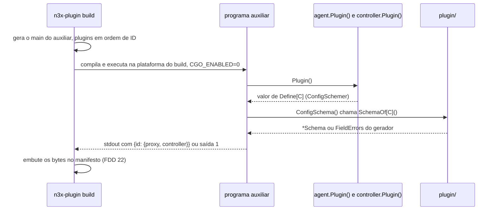
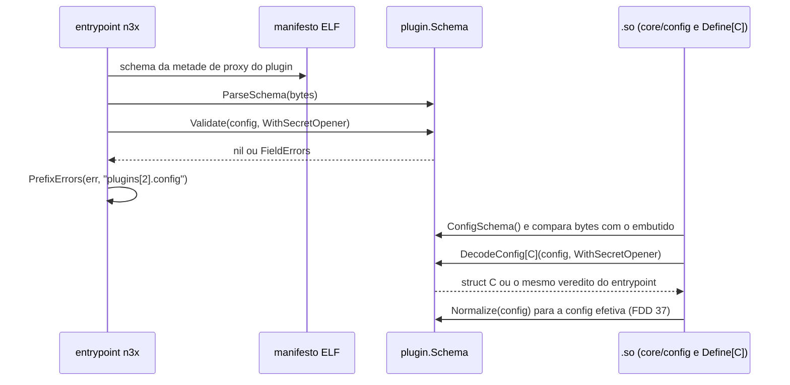
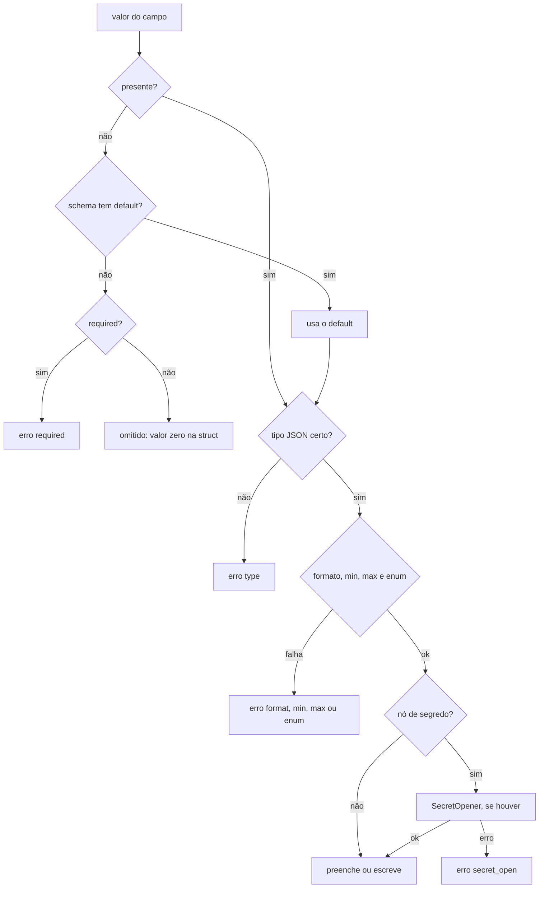

### FDD: Config tipada, schema gerado da struct e decodificação estrita (SDK-02)

Versão: 1.0
Data: 2026-10-20
Responsável: Guilherme Giusti

---

### 1. Contexto e motivação técnica

**Problema técnico.** A config de cada plugin é escrita pelo operador em YAML, validada em processos diferentes e entregue ao plugin como struct Go. O ADR-020 do `n3x-sdk` decidiu que a struct é a fonte única do schema, mas não fixou o subconjunto de tipos aceitos, o dialeto do JSON Schema, a gramática exata das tags, o que acontece com um campo ausente, a ordem entre `default`, validação e segredo, nem o formato do erro. O mesmo schema serve a consumidores que não têm o código do plugin:

- o entrypoint `n3x` do sidecar valida a seção `plugins` sem carregar o `.so`, só com o schema do manifesto embutido (HLD do `n3x-sidecar`, passo 3 da subida)
- o `.so` decodifica a `config` de cada instância na struct `C` (ADR-007 do `n3x-sidecar` e ADR-015 do `n3x-sdk`)
- o host do controller valida e decodifica a seção de cada plugin no `n3x.yaml` do controller (HLD do `n3x-controller`)
- o plugin core mascara os segredos e o painel rotula os campos pelo schema (ADR-006 do `n3x-plugin-core` e FR-007)

Se o entrypoint aceitar uma config que o `.so` recusa, o container passa na validação e o Envoy não sobe. Se o schema mudar de bytes entre duas execuções, o build reproduzível (ADR-007 do `n3x-builder`) quebra. Se uma mensagem de erro ecoar o valor, um segredo ainda não tipado vaza no log.

**Encaixe no HLD.** Esta FDD especifica a parte de config do pacote `plugin/` do módulo `github.com/giustech/n3x-sdk` (HLD do `n3x-sdk`, linha `plugin/`: "geração do JSON Schema a partir das tags; decodificação estrita da config") e o pacote auxiliar `schemagen`, usado pelo builder para gerar o schema. Consumidores:

- FDDs 05 e 08: `proxy.Define[C]` e `ctrl.Define[C]` chamam `DecodeConfig[C]` e expõem `ConfigSchema()`
- FDD 03: acrescenta `plugin.Secret` pelo ponto de extensão de tipos conhecidos
- FDD 07: o `sdktest` decodifica a config de teste com as mesmas regras
- FDD 14: o `schema-check` lê schemas com `ParseSchema` e a API de leitura
- FDDs 15 e 30: `core/config` do sidecar e `host/config` do controller validam a seção de cada plugin pelo schema embutido
- FDDs 21 e 22: o builder gera os schemas com `schemagen` e os embute no manifesto
- FDD 37: a config efetiva usa `Normalize` e `MaskSecrets`
- FDDs 44 e 45: o painel rotula os campos com `Walk` e `Node`

**Atores.** Autor de plugin (escreve a struct e as tags), builder (gera e embute o schema), entrypoint e `.so` do sidecar e host do controller (validam e decodificam), plugin core (mascara pelo schema), painel (mostra nome e descrição) e operador (lê as mensagens de erro).

**Limites.** `plugin/` é biblioteca pura: não lê arquivo, não abre rede, não loga, não tem estado global mutável e não conhece o formato `ENC[...]` nem a chave AES. Recebe bytes JSON e devolve struct, JSON normalizado ou erros com caminho e regra. Quem lê o YAML, quem decifra e quem decide o que fazer com o erro é o chamador.

**Suposições**
- Todos os alvos e arquiteturas da v1 são de 64 bits (amd64 e arm64); `int` e `uint` têm 64 bits
- A config de uma instância cabe com folga em 1 MiB (hipótese)
- `agent.Plugin()` e `controller.Plugin()` não têm efeito colateral (ADR-015), então um programa auxiliar do build pode chamá-los
- O builder roda a análise estática (passo 4) antes da geração (passo 5) (HLD do `n3x-builder`)
- O tipo `C` mora, por convenção, em `types/` do repositório do plugin (ADR-020); o gerador obtém o tipo pelo `Define[C]`, não pela pasta

**Restrições**
- `plugin/` usa só a biblioteca padrão e não importa biblioteca de YAML (HLD do `n3x-sdk`; L-46 fechada na FDD 01)
- Sem cgo (ADR-011)
- Só o subconjunto do JSON Schema expressável por tags (ADR-020)
- Campo desconhecido é erro e `default` é aplicado (HLD do `n3x-sdk`); não existe `map[string]any` no contrato (ADR-015)
- Nenhum valor de config aparece em mensagem de erro (ASSUNTO; critério de aceite do PRD para `n3x.yaml` inválido)
- Contrato estável desde a `v1.0.0`; antes disso, pré-releases `v0.x` (ADR-021)
- Documentação e mensagens em pt-BR; identificadores de código em inglês

**Rastreabilidade**
- PRD 1.5: FR-012 (config tipada e validada, schema gerado da struct), FR-001 (seção `plugins` validada contra o schema do manifesto; mensagem que indica o campo), FR-007 (painel com nome e descrição; mascaramento pelos campos marcados como segredo), FR-013 (schema da config no controller), FR-014 (checagem de schema na CI do plugin), FR-016 (config efetiva no registro); critérios "`n3x.yaml` inválido impede a subida com mensagem que aponta o campo e sem segredo no log" e "fuzzing nos parsers"
- ADRs: ADR-011, ADR-015, ADR-020 e ADR-021 do `n3x-sdk`; ADR-007 do `n3x-sidecar`; ADR-003, ADR-006 e ADR-007 do `n3x-builder`; ADR-006 do `n3x-plugin-core`
- Lacunas do README:
  - **L-58 fechada aqui:** o schema é gerado por um programa auxiliar com reflexão, montado pelo builder com o pacote `schemagen` e alimentado por `ConfigSchema()` de cada `Define[C]`. A análise estática com `go/types` foi descartada. A FDD 21 só aplica (contrato 9)
  - **L-46 aplicada:** o decodificador recebe bytes JSON; o YAML é convertido pelo chamador com `yamlconv.ToJSON` (FDD 01)
  - **L-34 aplicada:** caminhos de erro e de `Walk` seguem a convenção da FDD 01, agora também em código (`PathKey` e `PathIndex`)
  - **Apoio à L-07 (fechada na FDD 37):** `Normalize` e `MaskSecrets` preservam o texto `ENC[...]` recebido, que é o que a impressão digital exige

**Decisões aprovadas na clarificação**
- A tag `desc` é obrigatória em todo campo da config (`desc_missing` no build quando faltar)
- A tag `json` é obrigatória, explícita e em snake_case (`^[a-z][a-z0-9_]{0,63}$`); campo sem ela falha com `json_name`
- Formatos confirmados: duração só como texto Go (`200ms`; número é recusado) com forma canônica de `time.Duration.String()`; tamanho em base 1024 com `Ki`/`Mi`/`Gi`/`Ti` ou `KiB`/`MiB`/`GiB`/`TiB`, ou inteiro em bytes, com sufixos decimais (`k`, `M`, `G`, `KB`, `MB`) recusados
- O código de build `N3X-B014` (config do plugin sem schema válido) é aceito; a faixa de códigos do PRD FR-015 passa a ser `N3X-B001` a `N3X-B014` e o PRD deve ser ajustado. A confirmação final do código continua na FDD 21 do `n3x-builder`
- O pacote `schemagen` fica no módulo do SDK (`github.com/giustech/n3x-sdk/schemagen`, só biblioteca padrão e `plugin/`); o HLD do `n3x-sdk` precisa listar `schemagen/` (e `yamlconv/`, da FDD 01) na árvore de pacotes

**Pendências não bloqueantes**
- Seguem como hipótese: dialeto JSON Schema 2020-12, limites numéricos (config de 1 MiB, schema de 256 KiB, profundidade 32, chave de map de 1 a 128 caracteres, corpus de 200 entradas, orçamentos de 500 µs e 50 ms, fuzzing de 5 minutos, cobertura de 90%), regras por item de lista fora da v1 e o conjunto de flags e o prazo de 60 s do programa auxiliar do build
- Dependem de outros repositórios: execução do `schemagen` e embutimento no manifesto (FDDs 21 e 22), comparação byte a byte do schema no `.so` (FDDs 15 e 17) e uso de `ParseSchema`/`Validate` no entrypoint e no controller (FDDs 15 e 30)

---

### 2. Objetivos técnicos

- **Um veredito só para a mesma config.** Invariante: para toda struct aceita pelo gerador e toda entrada, `DecodeConfig[C]` e `ParseSchema(bytes do schema).Validate` devolvem a mesma lista de problemas (`Path` e `Rule`), na mesma ordem. Medida: teste diferencial com pelo menos 200 entradas por struct de referência (hipótese) e fuzzing diferencial sem divergência.
- **Schema determinístico.** Invariante: a mesma struct gera os mesmos bytes em qualquer execução, máquina e arquitetura. Medida: golden files iguais em 100 execuções seguidas e nas CIs amd64 e arm64.
- **Ida e volta sem perda.** Invariante: `ParseSchema(b).MarshalJSON()` devolve exatamente `b` para todo `b` produzido pelo gerador.
- **Validação completa numa passada.** Medida: todos os problemas (até 100) numa chamada, em ordem determinística, cada um com caminho e regra; nenhum erro derivado de um campo já inválido.
- **Nenhum valor em mensagem.** Medida: teste de canário (seção 9) com 0 ocorrência de valor recebido em `Error()`, em `Detail` e no tratamento do erro do `SecretOpener`.
- **Parse seguro contra entrada hostil.** Medida: fuzzing de `DecodeConfig`, `ParseSchema`, `Normalize`, `ParseSize` e do teste diferencial por 5 minutos cada na CI noturna, sem panic (hipótese de duração, igual à FDD 01).
- **Custo de subida desprezível.** Medida: `DecodeConfig` de uma config de 10 KiB em até 500 µs por operação e de 1 MiB em até 50 ms no runner da CI (hipótese).

---

### 3. Escopo e exclusões

**Incluído**
- Gramática das tags `json`, `n3x` (`required`, `min`, `max`, `enum`), `desc` e `default`
- Tipos Go aceitos, mapeamento de cada um para o JSON Schema e lista de tipos proibidos
- Reconhecimento direto de `time.Duration` (formato Go, `200ms`) e tipo novo `plugin.Size` (formato Kubernetes e IEC, `256Mi` e `128MiB`), com `ParseDuration` e `ParseSize`
- Documento de schema: dialeto, palavras-chave do subconjunto, extensões `x-n3x-*`, ordem fixa e versão do subconjunto (`x-n3x-schema`)
- Gerador `SchemaOf[C]` determinístico e serialização `MarshalJSON`
- Leitor `ParseSchema` para validar sem a struct, e API de leitura (`Root`, `Node`, `Walk`) para o painel, o core e o `schema-check`
- Validação pelo schema (`Validate`), normalização com defaults (`Normalize`) e troca dos segredos (`MaskSecrets`)
- Decodificador estrito `DecodeConfig[C]`, com a opção `WithSecretOpener`
- Semântica de ausência: defaults explícitos e implícitos, ponteiro como campo opcional, `null` recusado
- Erros de config, do gerador e da leitura de schema, todos como `plugin.FieldError` (FDD 01), com códigos estáveis; `PrefixErrors`, `PathKey` e `PathIndex`
- Ponto de extensão de tipos conhecidos e marca de segredo `x-n3x-secret` (o tipo `plugin.Secret` é da FDD 03)
- Interface `plugin.ConfigSchemer` e pacote `schemagen`, com o contrato do programa auxiliar do build (L-58)

**Excluído**
- Tipo `plugin.Secret`, formato `ENC[...]`, pacote `secret/` e a implementação do `SecretOpener` do sidecar e do controller: FDD 03 (SDK-03)
- `proxy.Define[C]` e `ctrl.Define[C]`, que implementam `ConfigSchemer` e chamam `DecodeConfig`: FDDs 05 (SDK-05) e 08 (SDK-08)
- Comparação de schemas entre versões (`schema-check`): FDD 14 (SDK-14)
- Execução do programa auxiliar no `n3x-plugin build`, código de erro do build e compilação: FDD 21 (BLD-03)
- Formato do manifesto embutido, campo dos schemas e leitor do manifesto: FDD 22 (BLD-04)
- Schema do `n3x.yaml` do sidecar e do controller fora da seção de cada plugin: FDDs 15 (SID-01) e 30 (CTL-01)
- JSON canônico RFC 8785, impressão digital `***:<hex>` e hash da config efetiva: FDD 37 (CORE-02)
- Telas do painel que mostram a config: FDDs 44 (CORE-08) e 45 (CORE-09)
- Validação cruzada entre campos (ex.: `redis` obrigatório quando `mode` é `redis`): fica no `New` do plugin ou na capacidade `Validate` do controller (FDD 08)
- Regras por item de lista (`item_min`, `item_max`, `item_enum`), `pattern`, `oneOf` e `$ref`: fora da v1; entram por adição numa versão 2 do subconjunto (hipótese)

---

### 4. Fluxos detalhados e diagramas

**Fluxo de build: geração do schema (L-58)**
1. O autor declara a struct da config (por convenção em `types/`) com as tags e a passa a `proxy.Define[C]` ou `ctrl.Define[C]`.
2. Na CI do plugin, o `sdktest` gera o schema e decodifica a config de teste; tag ou tipo inválido já falha no `go test` (pedido à FDD 07).
3. No passo 5 do `n3x-plugin build`, depois da análise estática, o builder gera um programa auxiliar com uma entrada por plugin e metade, em ordem de ID.
4. O programa chama `agent.Plugin()` e `controller.Plugin()`, pede `ConfigSchema()` a cada valor e escreve no stdout, com `schemagen.Run`, o JSON `{id: {proxy, controller}}`.
5. `ConfigSchema()` chama `plugin.SchemaOf[C]()`, que percorre o tipo por reflexão, confere tipos e tags, valida cada default (explícito ou implícito) e monta o `*Schema`.
6. Se algum tipo ou tag for inválido, o programa sai com código diferente de zero e lista todos os problemas; o builder informa um código próprio (proposta `N3X-B014`, decidida na FDD 21).
7. O builder embute os bytes de cada schema, sem reformatar, no manifesto, um por metade (proposta `plugins[].schemas.proxy` e `plugins[].schemas.controller`, decidida na FDD 22).

**Fluxo de subida no sidecar**
1. O entrypoint lê o `n3x.yaml` e o converte com `yamlconv.ToJSON` (recomendação para a FDD 15).
2. Para cada item `plugins[i]`, pega o schema da metade de proxy do plugin no manifesto ELF e chama `plugin.ParseSchema`.
3. Chama `schema.Validate(config, plugin.WithSecretOpener(abrir))`, onde `abrir` decifra com `secret/` (FDD 03). Uma passada confere estrutura, defaults, regras e segredos.
4. Prefixa os erros com `plugin.PrefixErrors(err, "plugins[2].config")`, junta os de todos os plugins, loga um registro por problema e encerra com código diferente de zero se houver algum.
5. O `.so` repete a validação no `core/config` (ADR-007 do `n3x-sidecar`) e, para cada instância, chama o `Define[C]`, que roda `DecodeConfig[C](config, WithSecretOpener(abrir))` e entrega a struct ao `New`.
6. O `.so` confere que `ConfigSchema()` gera exatamente os bytes embutidos e recusa subir se divergir (recomendação para as FDDs 15 e 17; hipótese).
7. Para a config efetiva, o core do sidecar chama `schema.Normalize(config)` sem opener: o resultado tem os defaults e os textos `ENC[...]` originais. A FDD 37 troca os segredos com `schema.MaskSecrets` e calcula o hash.

**Fluxo de subida no controller**
1. O `host/config` lê o `n3x.yaml` do controller e converte com `yamlconv.ToJSON` (recomendação para a FDD 30).
2. Para cada chave de `plugins`, pega o schema da metade de controller no manifesto do binário, chama `Validate` com o opener do controller e prefixa os erros com `plugin.PrefixErrors(err, plugin.PathKey("plugins", "n3x.core"))`, que dá `plugins["n3x.core"]` (a seção do plugin é a própria config, sem chave `config`).
3. O `ctrl.Define[C]` decodifica com `DecodeConfig[C]` e o host chama `Validate` do plugin e `New` (FDDs 08 e 32).

**Fluxo de leitura no painel e no core**
- O core recebe a config efetiva já mascarada (FDD 37) e o painel tem os schemas no manifesto do controller.
- O painel chama `schema.Walk(config, fn)`: para cada valor, recebe o caminho e o `Node` (nome, descrição, default, se é segredo) e monta a exibição. Valor sem nó conhecido (versões diferentes entre sidecar e controller) chega com `Node.Known()` falso e é mostrado como texto bruto.

**Pipeline de um campo** (mesma ordem em `Validate`, `Normalize` e `DecodeConfig`)
1. Presença: campo ausente recebe o `default` do schema; sem `default`, `required` vira erro e os demais ficam omitidos (valor zero na struct). Só ponteiros e segredos ficam sem `default`, porque o gerador escreve um default implícito nos outros campos não obrigatórios
2. Tipo JSON: `null` e coerção são recusados (`type`)
3. Formato (duração e tamanho), `min`, `max` e `enum`
4. Nó de segredo: chama o `SecretOpener`, se houver, só se os passos 2 e 3 passaram
5. Preenche a struct (`DecodeConfig`) ou escreve a saída normalizada (`Normalize`, `MaskSecrets`)

Segredos não aceitam `default`, `min`, `max` nem `enum` (regra do ponto de extensão), então o veredito dos passos 1 a 3 não depende de decifrar. Isso permite validar sem a chave AES e garante o mesmo veredito com e sem opener nesses passos.

**Ordem dos problemas**
- Em cada objeto: primeiro as chaves desconhecidas, em ordem de bytes; depois as propriedades na ordem de declaração da struct
- Em cada lista: pelo índice; em cada map: pela chave, em ordem de bytes
- Um campo com erro de presença, tipo ou formato não gera erros derivados (nem dos filhos)
- Acima de 100 problemas, a lista para e termina com um item `truncated`

**Fluxos alternativos e exceções**
- **`config` ausente, vazia ou `null` na raiz:** tratada como `{}`; os `required` da raiz viram erro
- **`null` em qualquer outro lugar:** `type`, inclusive em campo ponteiro (ausente é a forma de dizer "não informado")
- **Número em campo de texto** (ex.: `value: 1` no YAML para um `string`): `type`, sem coerção; o operador põe aspas
- **Número com fração ou expoente em campo inteiro:** `type`
- **Chave repetida no mesmo objeto:** `duplicate` (o `yamlconv` já recusa no YAML; a regra cobre JSON vindo de outra origem, como o `sdktest`)
- **Maiúsculas no nome do campo** (`Limit` em vez de `limit`): `unknown_field`; a comparação é exata
- **`SecretOpener` falha:** `secret_open` com texto fixo, ou a regra e o texto do `FieldError` devolvido pelo opener; o texto original do erro nunca é usado
- **Schema embutido com versão maior que a do leitor** (`x-n3x-schema` acima de `SchemaVersion`): `ParseSchema` recusa com `schema_version`; o entrypoint diz que a imagem do sidecar é mais antiga que o SDK do `.so`
- **Tipo ou tag inválidos na struct:** `SchemaOf` devolve `ErrInvalidSchema` com o caminho Go do campo; o build falha (fluxo de build, passo 6)
- **Entrada hostil** (maior que 1 MiB, aninhamento acima de 32, UTF-8 inválido): `size` ou `syntax`, sem panic

**Diagramas**

Sequência do build (passo 5 do `n3x-plugin build`; o comportamento do builder é da FDD 21):



Sequência da subida no sidecar:



Pipeline de um campo:



---

### 5. Contratos públicos (assinaturas, endpoints, headers, exemplos)

**Contrato 1: tags da struct de config**
- Tipo: sdk (tags de struct Go)
- Assinatura/Rota:
  ```text
  json    = nome [ ",omitempty" ]   ; nome casa com ^[a-z][a-z0-9_]{0,63}$ ; "-" ignora o campo
  n3x     = opcao { "," opcao }      ; sem espaços
  opcao   = "required" | "min=" valor | "max=" valor | "enum=" valor { "|" valor }
  desc    = texto de 1 a 512 caracteres, sem quebra de linha ; obrigatória em todo campo
  default = valor no formato do tipo do campo
  ```
- Método: n/a (lido por reflexão em `SchemaOf`)
- Semântica:
  - `json`: todo campo exportado precisa de tag `json` com nome explícito em snake_case (confirmado). `omitempty` é aceito e ignorado; a opção `string` é recusada. Campo com `json:"-"` e campo não exportado ficam fora do schema e mantêm o valor zero
  - `required`: a chave precisa estar presente. Não combina com `default` nem com ponteiro
  - `min` e `max`: valor numérico para inteiros e `float64` (`minimum` e `maximum`); quantidade de caracteres Unicode para texto (`minLength` e `maxLength`); quantidade de itens para lista (`minItems` e `maxItems`); quantidade de entradas para map (`minProperties` e `maxProperties`); duração no formato Go para `time.Duration` (`min=1ms`); tamanho para `plugin.Size` (`max=10Mi`)
  - `enum`: só em texto e inteiro; valores separados por `|`, sem `,` nem `|` dentro do valor, sem repetição, na ordem escrita
  - `desc`: obrigatória, porque o painel mostra nome e descrição de cada campo (FR-007) (confirmado). Texto simples; o renderizador escapa
  - `default`: só em texto, inteiro, `float64`, `bool`, duração e tamanho. Precisa passar nas regras do próprio campo
  - Tag desconhecida fora de `json`, `n3x`, `desc` e `default` é ignorada (pode ser de outra biblioteca); opção desconhecida dentro de `n3x` é erro
  - Regras não expressáveis por tag (dependência entre campos, formato de URL) ficam no `New` do plugin ou no `Validate` do controller

**Exemplo de requisição** (struct do protótipo de rate limit, em `types/`)
```go
package types

type ProxyConfig struct {
    Limit    int            `json:"limit" n3x:"required,min=1,max=100000" desc:"Requisições permitidas por janela"`
    Window   time.Duration  `json:"window" n3x:"min=1s,max=1h" default:"1m" desc:"Tamanho da janela"`
    Mode     string         `json:"mode" n3x:"enum=local|redis" default:"local" desc:"Onde o contador fica"`
    MaxBody  plugin.Size    `json:"max_body" n3x:"max=10Mi" default:"1Mi" desc:"Maior corpo inspecionado"`
    Paths    []string       `json:"paths" n3x:"max=64" desc:"Prefixos de path cobertos"`
    PerRoute map[string]int `json:"per_route" n3x:"max=256" desc:"Limite por serviço gRPC"`
    Redis    *Redis         `json:"redis" desc:"Réplica Redis, usada com mode redis"`
}

type Redis struct {
    Address  string        `json:"address" n3x:"required,min=3,max=255" desc:"Endereço host:porta"`
    Password plugin.Secret `json:"password" desc:"Senha do Redis"`
    Timeout  time.Duration `json:"timeout" n3x:"min=1ms,max=5s" default:"50ms" desc:"Prazo por comando"`
}
```

**Exemplo de resposta** (schema gerado; o JSON real é compacto, sem espaços, formatado aqui só para leitura)
```json
{
  "$schema": "https://json-schema.org/draft/2020-12/schema",
  "x-n3x-schema": 1,
  "type": "object",
  "properties": {
    "limit": { "type": "integer", "description": "Requisições permitidas por janela", "minimum": 1, "maximum": 100000 },
    "window": { "type": "string", "description": "Tamanho da janela", "x-n3x-format": "duration", "x-n3x-minimum": "1s", "x-n3x-maximum": "1h0m0s", "default": "1m0s" },
    "mode": { "type": "string", "description": "Onde o contador fica", "enum": ["local", "redis"], "default": "local" },
    "max_body": { "type": ["integer", "string"], "description": "Maior corpo inspecionado", "x-n3x-format": "size", "x-n3x-minimum": "0", "x-n3x-maximum": "10Mi", "default": "1Mi" },
    "paths": { "type": "array", "description": "Prefixos de path cobertos", "maxItems": 64, "items": { "type": "string" }, "default": [] },
    "per_route": { "type": "object", "description": "Limite por serviço gRPC", "maxProperties": 256, "propertyNames": { "minLength": 1, "maxLength": 128 }, "additionalProperties": { "type": "integer", "minimum": -9223372036854775808, "maximum": 9223372036854775807 }, "default": {} },
    "redis": {
      "type": "object",
      "description": "Réplica Redis, usada com mode redis",
      "properties": {
        "address": { "type": "string", "description": "Endereço host:porta", "minLength": 3, "maxLength": 255 },
        "password": { "type": "string", "description": "Senha do Redis", "x-n3x-secret": true },
        "timeout": { "type": "string", "description": "Prazo por comando", "x-n3x-format": "duration", "x-n3x-minimum": "1ms", "x-n3x-maximum": "5s", "default": "50ms" }
      },
      "required": ["address"],
      "additionalProperties": false
    }
  },
  "required": ["limit"],
  "additionalProperties": false
}
```

---

**Contrato 2: mapeamento de tipos Go para o JSON Schema**
- Tipo: sdk (regra do gerador)
- Assinatura/Rota: tabela abaixo
- Método: n/a
- Semântica:

| Tipo Go | `Kind` | Schema gerado | `min` e `max` viram | `enum` | `default` por tag | Default implícito |
| --- | --- | --- | --- | --- | --- | --- |
| `string` e tipos nomeados de `string` | `KindString` | `{"type":"string"}` | `minLength`, `maxLength` | sim | sim | `""` |
| `int`, `int8` a `int64`, `uint`, `uint8` a `uint64` (e nomeados) | `KindInteger` | `{"type":"integer","minimum":..,"maximum":..}`, sempre com os limites | `minimum`, `maximum` (dentro da faixa do tipo) | sim | sim | `0` |
| `float64` | `KindNumber` | `{"type":"number"}` | `minimum`, `maximum` | não | sim | `0` |
| `bool` | `KindBoolean` | `{"type":"boolean"}` | não | não | sim | `false` |
| `time.Duration` | `KindDuration` | `{"type":"string","x-n3x-format":"duration","x-n3x-minimum":"0s"}` | `x-n3x-minimum`, `x-n3x-maximum` | não | sim | `"0s"` |
| `plugin.Size` | `KindSize` | `{"type":["integer","string"],"x-n3x-format":"size","x-n3x-minimum":"0"}` | `x-n3x-minimum`, `x-n3x-maximum` | não | sim | `"0"` |
| `[]T` | `KindArray` | `{"type":"array","items":<T>}` | `minItems`, `maxItems` | não | não | `[]` |
| `map[string]T` | `KindMap` | `{"type":"object","propertyNames":{"minLength":1,"maxLength":128},"additionalProperties":<T>}` | `minProperties`, `maxProperties` | não | não | `{}` |
| struct | `KindObject` | `{"type":"object","properties":{..},"required":[..],"additionalProperties":false}` | não | não | não | `{}` |
| `*T` (T escalar ou struct) | o de `T` | schema de `T`, sem `default` | os de `T` | os de `T` | não | nenhum (ausente = `nil`) |
| `plugin.Secret` (FDD 03) | `KindString` | `{"type":"string","x-n3x-secret":true}` | não | não | não | nenhum |

  - **Default implícito:** todo campo que não é ponteiro, não é segredo e não é `required` recebe no schema um `default`: o da tag ou o valor zero da tabela. Assim o schema descreve sozinho a config efetiva, e o caminho só pelo schema chega ao mesmo resultado que a struct
  - **Ponteiro:** é a única forma de campo opcional sem default. Ausente fica `nil` e fora da saída normalizada; presente é validado como `T`
  - **Todo default passa no próprio schema:** o gerador valida cada default, explícito ou implícito, com o mesmo validador do runtime. Um `int` com `min=1` sem `required`, sem `default` e sem ponteiro é erro de build (`default_invalid`), porque o valor zero viola o mínimo. O mesmo vale para struct não ponteiro cujos campos obrigatórios fariam `{}` falhar
  - **Inteiros:** o schema sempre traz `minimum` e `maximum`, da tag ou da faixa do tipo Go, então o caminho só pelo schema recusa o mesmo estouro que a struct recusaria
  - **Listas e maps** decodificados nunca são `nil`: ausente ou vazio vira lista ou map vazio
  - **Chaves de map:** texto Unicode de 1 a 128 caracteres (hipótese)
  - **Profundidade:** no máximo 32 níveis de objeto, lista ou map (hipótese)
  - **Plataforma:** `int` e `uint` são tratados como 64 bits; o schema é igual em amd64 e arm64

**Exemplo de requisição**
```go
type Exemplo struct {
    Nivel  int8              `json:"nivel" desc:"Nível"`
    Peso   *float64          `json:"peso" n3x:"min=0" desc:"Peso opcional"`
    Rotulos map[string]string `json:"rotulos" desc:"Rótulos livres"`
}
```

**Exemplo de resposta**
```json
{"$schema":"https://json-schema.org/draft/2020-12/schema","x-n3x-schema":1,"type":"object","properties":{"nivel":{"type":"integer","description":"Nível","minimum":-128,"maximum":127,"default":0},"peso":{"type":"number","description":"Peso opcional","minimum":0},"rotulos":{"type":"object","description":"Rótulos livres","propertyNames":{"minLength":1,"maxLength":128},"additionalProperties":{"type":"string"},"default":{}}},"additionalProperties":false}
```

---

**Contrato 3: `time.Duration` e `plugin.Size`**
- Tipo: sdk (API Go)
- Assinatura/Rota:
  ```go
  package plugin

  func ParseDuration(s string) (time.Duration, error) // time.ParseDuration, recusa negativo

  type Size int64 // bytes

  const (
      KiB Size = 1 << 10
      MiB Size = 1 << 20
      GiB Size = 1 << 30
      TiB Size = 1 << 40
  )

  func ParseSize(s string) (Size, error)
  func (s Size) Bytes() int64
  func (s Size) String() string // forma canônica: "256Mi", "1536", "0"
  func (s Size) MarshalText() ([]byte, error)
  func (s *Size) UnmarshalText(b []byte) error
  ```
- Método: n/a
- Semântica:
  - **Duração:** o SDK não cria `plugin.Duration`; o gerador reconhece `time.Duration` pelo tipo e o trata como texto no formato Go (`200ms`, `1m30s`, `0`), aceito por `time.ParseDuration`. Negativo é recusado (`min`, com mínimo implícito `0s`). Número JSON é recusado (`type`), porque `5` não diz a unidade. Forma canônica: `time.Duration.String()` (`1m0s`, `50ms`, `0s`) (confirmado)
  - **Tamanho:** texto com inteiro decimal sem sinal e sufixo opcional `Ki`, `Mi`, `Gi`, `Ti` (Kubernetes, como `256Mi` no `n3x.yaml` do sidecar) ou `KiB`, `MiB`, `GiB`, `TiB` (IEC, como `128MiB` no `n3x.yaml` do controller), sempre base 1024. Também aceita número JSON inteiro, em bytes. Recusa sufixos decimais (`k`, `M`, `G`, `KB`, `MB`), fração e sinal, para não haver dúvida entre 1000 e 1024 (confirmado)
  - Forma canônica de `Size`: o maior sufixo entre `Ti`, `Gi`, `Mi` e `Ki` que divide o valor exatamente; senão, os bytes em decimal; zero é `"0"`
  - Estouro de `int64` é `format`
  - As FDDs 15 e 30 devem usar `ParseDuration` e `ParseSize` nos campos de duração e tamanho do próprio `n3x.yaml`, para a plataforma ter um formato só (recomendação)

**Exemplo de requisição**
```json
{ "ParseSize": ["256Mi", "128MiB", "1536", 4096, "0", "256M", "1.5Gi", "-1"], "ParseDuration": ["200ms", "1m30s", "0", "-1s", "5"] }
```

**Exemplo de resposta**
```json
{
  "ParseSize": {
    "256Mi": { "bytes": 268435456, "canonica": "256Mi" },
    "128MiB": { "bytes": 134217728, "canonica": "128Mi" },
    "1536": { "bytes": 1536, "canonica": "1536" },
    "4096": { "bytes": 4096, "canonica": "4Ki" },
    "0": { "bytes": 0, "canonica": "0" },
    "256M": "format",
    "1.5Gi": "format",
    "-1": "format"
  },
  "ParseDuration": { "200ms": "200ms", "1m30s": "1m30s", "0": "0s", "-1s": "min", "5": "format" }
}
```

---

**Contrato 4: documento de schema (formato mínimo lido pelo painel, pelo core e pelo entrypoint)**
- Tipo: sdk (formato JSON)
- Assinatura/Rota: JSON Schema draft 2020-12, restrito ao subconjunto abaixo, com extensões `x-n3x-*`
- Método: n/a
- Semântica:
  - **Dialeto:** `$schema` é `https://json-schema.org/draft/2020-12/schema` (hipótese). Todas as palavras-chave padrão usadas têm o mesmo significado no draft-07, então editores com qualquer um dos dois funcionam para autocompletar. O validador normativo é o do SDK, não uma biblioteca externa
  - **Versão do subconjunto:** a raiz traz `x-n3x-schema` (inteiro). A v1 do SDK escreve e lê a versão 1. Palavra-chave nova no subconjunto só entra com versão nova; o gerador escreve a menor versão que cobre as palavras usadas pela struct, para um plugin que não usa recurso novo continuar legível por imagens antigas
  - **Extensões:** `x-n3x-format` (`duration` ou `size`; não se usa `format` porque o draft 2020-12 define `duration` como ISO 8601), `x-n3x-minimum` e `x-n3x-maximum` (limites de duração e tamanho em forma canônica) e `x-n3x-secret` (marca de segredo, reservada aqui e ligada ao `plugin.Secret` pela FDD 03)
  - **Ordem fixa das palavras-chave em cada nó**, igual à da tabela abaixo; propriedades e `required` na ordem de declaração da struct; JSON compacto, sem espaços; números como o `encoding/json` escreve
  - **Leitura pelos consumidores:** painel usa nome da propriedade, `description` e `default`; core usa `x-n3x-secret`; entrypoint e controller usam o documento inteiro. Todos leem por `ParseSchema` e pela API de leitura (contrato 5), nunca com parser próprio (recomendação para as FDDs 15, 30, 37, 44 e 45)
  - O builder embute os bytes como estão (`json.RawMessage`); reformatar ou reordenar quebra a comparação byte a byte do `.so` e a ida e volta

| Palavra-chave (ordem de escrita) | Onde | Significado no validador do SDK |
| --- | --- | --- |
| `$schema` | raiz | Dialeto declarado |
| `x-n3x-schema` | raiz | Versão do subconjunto; leitor recusa versão maior que `SchemaVersion` |
| `type` | todo nó | `object`, `array`, `string`, `integer`, `number`, `boolean` ou `["integer","string"]` (tamanho); `null` nunca é aceito |
| `description` | todo nó com `desc` | Texto do painel |
| `x-n3x-format` | duração e tamanho | Formato do texto |
| `x-n3x-secret` | texto | Campo segredo: sem `default`, `enum`, `minLength` nem `maxLength` |
| `enum` | texto e inteiro | Lista fechada, comparação exata |
| `minimum`, `maximum` | inteiro e número | Limites inclusivos |
| `x-n3x-minimum`, `x-n3x-maximum` | duração e tamanho | Limites inclusivos em forma canônica |
| `minLength`, `maxLength` | texto | Caracteres Unicode |
| `minItems`, `maxItems` | lista | Itens |
| `items` | lista | Schema de cada item |
| `minProperties`, `maxProperties` | map | Entradas |
| `propertyNames` | map | Só `minLength` e `maxLength` da chave |
| `properties` | struct | Propriedades, na ordem de declaração |
| `required` | struct | Nomes obrigatórios, na ordem de declaração |
| `additionalProperties` | struct e map | `false` na struct; schema do valor no map |
| `default` | nó não obrigatório, fora ponteiro e segredo | Valor usado quando a chave falta, já em forma canônica |

**Exemplo de requisição** (`ParseSchema` sobre um schema de imagem mais nova)
```json
{"$schema":"https://json-schema.org/draft/2020-12/schema","x-n3x-schema":2,"type":"object","properties":{},"additionalProperties":false}
```

**Exemplo de resposta**
```text
x-n3x-schema: versão 2 do subconjunto é maior que a suportada (1); use uma imagem com SDK mais novo [schema_version]
```

---

**Contrato 5: `plugin.Schema`, `Node` e as operações sobre a config**
- Tipo: sdk (API Go)
- Assinatura/Rota:
  ```go
  package plugin

  type Schema struct{ /* imutável; seguro para uso concorrente */ }

  func SchemaOf[C any]() (*Schema, error)        // gera da struct C por reflexão
  func ParseSchema(data []byte) (*Schema, error) // lê o documento embutido, estrito

  func (s *Schema) MarshalJSON() ([]byte, error) // compacto e determinístico
  func (s *Schema) Version() int                 // x-n3x-schema
  func (s *Schema) Root() Node
  func (s *Schema) Validate(config []byte, opts ...DecodeOption) error
  func (s *Schema) Normalize(config []byte, opts ...DecodeOption) ([]byte, error)
  func (s *Schema) MaskSecrets(config []byte, mask func(path, text string) string) ([]byte, error)
  func (s *Schema) Walk(config []byte, fn func(path string, n Node, value json.RawMessage) error) error

  type Kind uint8

  const (
      KindObject Kind = iota + 1 // struct: propriedades fixas
      KindMap                    // map[string]T
      KindArray                  // []T
      KindString
      KindInteger
      KindNumber
      KindBoolean
      KindDuration               // time.Duration
      KindSize                   // plugin.Size
  )

  func (k Kind) String() string // "object", "map", "array", "string", ...

  type Node struct{ /* referência imutável a um nó; valor zero = nó desconhecido */ }

  func (n Node) Known() bool
  func (n Node) Kind() Kind
  func (n Node) Name() string                     // nome JSON, só em propriedade de struct
  func (n Node) Desc() string
  func (n Node) Required() bool
  func (n Node) Secret() bool
  func (n Node) Default() (json.RawMessage, bool) // forma canônica
  func (n Node) Min() (json.RawMessage, bool)     // valor, tamanho ou quantidade mínima
  func (n Node) Max() (json.RawMessage, bool)
  func (n Node) Enum() []json.RawMessage
  func (n Node) Fields() []Node                   // KindObject, ordem de declaração; cópia
  func (n Node) Field(name string) (Node, bool)
  func (n Node) Elem() Node                       // KindArray e KindMap

  const (
      SchemaDialect   = "https://json-schema.org/draft/2020-12/schema"
      SchemaVersion   = 1
      MaxConfigSize   = 1 << 20   // 1 MiB por config de instância
      MaxSchemaSize   = 256 << 10 // 256 KiB por schema
      MaxConfigDepth  = 32
      MaxConfigErrors = 100
      MaxDescLength   = 512
      MaxMapKeyLength = 128
  )
  ```
- Método: n/a
- Semântica:
  - `SchemaOf[C]`: `C` precisa ser struct (não ponteiro). Não guarda cache global; quem chama várias vezes guarda o resultado (o `Define[C]` guarda o seu)
  - `ParseSchema`: aceita só o subconjunto da versão que conhece; palavra-chave fora do subconjunto, valor de tipo errado, `required` sem a propriedade, `minimum` maior que `maximum` ou `default` que não passa nas regras são erros. Preserva a ordem das propriedades do texto
  - `Validate` e `Normalize` aplicam o pipeline da seção 4 e devolvem os mesmos erros. `Normalize` devolve a config com todos os defaults, propriedades na ordem de declaração, chaves de map ordenadas, duração e tamanho em forma canônica e o texto dos segredos como recebido (com ou sem opener). `Normalize` é idempotente
  - `MaskSecrets`: normaliza e troca o texto de cada segredo presente por `mask(caminho, texto recebido)`. É o ponto onde a FDD 37 aplica `***:<impressão digital>` ou `***:plain`
  - `Walk`: tolerante, para exibição. Visita cada valor do JSON (raiz com caminho vazio), na ordem da seção 4, com o `Node` correspondente; valor sem nó no schema chega com `Known()` falso. Só falha com JSON inválido ou erro devolvido por `fn`
  - Caminhos seguem a convenção da L-34 (contrato 7)

**Exemplo de requisição** (`Normalize` sobre a config de uma instância, schema do contrato 1)
```json
{"limit": 100, "paths": ["/api/"], "redis": {"address": "redis:6379", "password": "ENC[v1:q8Jr...]"}}
```

**Exemplo de resposta**
```json
{"limit":100,"window":"1m0s","mode":"local","max_body":"1Mi","paths":["/api/"],"per_route":{},"redis":{"address":"redis:6379","password":"ENC[v1:q8Jr...]","timeout":"50ms"}}
```

**Exemplo de requisição** (`Walk` sobre uma seção do core já mascarada, para o painel)
```json
{"users":[{"name":"ana","password_hash":"***:51e0c3aa9b12","disabled":false}]}
```

**Exemplo de resposta** (chamadas de `fn`, uma por linha: caminho, `Kind`, nome, segredo)
```text
""                         object  -               false
users                      array   users           false
users[0]                   object  -               false
users[0].name              string  name            false
users[0].password_hash     string  password_hash   true
users[0].disabled          boolean disabled        false
```

---

**Contrato 6: `plugin.DecodeConfig` e o `SecretOpener`**
- Tipo: sdk (API Go)
- Assinatura/Rota:
  ```go
  package plugin

  // Abre o texto de um campo segredo (ex.: decifra ENC[...]). Implementado pelo sidecar e pelo controller (FDD 03).
  type SecretOpener func(path, text string) (string, error)

  type DecodeOption func(*decodeOptions)

  func WithSecretOpener(open SecretOpener) DecodeOption

  // Gera o schema de C, valida (pipeline da seção 4) e preenche C.
  func DecodeConfig[C any](data []byte, opts ...DecodeOption) (C, error)

  // Implementada pelos valores de proxy.Define[C] e ctrl.Define[C] (FDDs 05 e 08).
  type ConfigSchemer interface {
      ConfigSchema() (*Schema, error)
  }
  ```
- Método: n/a
- Semântica:
  - Entrada: bytes JSON (L-46). `nil`, vazio, só espaços ou `null` valem `{}`. A raiz precisa ser objeto. Até `MaxConfigSize`; UTF-8 inválido é `syntax`
  - Decodificação exata: nomes comparados byte a byte, sem coerção de tipo, sem `null`, sem chave repetida, sem campo desconhecido
  - O veredito é o de `SchemaOf[C]().Validate(data, opts...)`, na mesma ordem; só depois a struct é preenchida. Por construção, `DecodeConfig[C](Normalize(x))` é igual a `DecodeConfig[C](x)`
  - **`SecretOpener`:** chamado uma vez por valor de segredo presente, na ordem do pipeline, só se o valor passou no tipo e nas regras. Recebe o caminho e o texto recebido; devolve o texto aberto. Sem opener, o texto recebido é usado como está (caso do `sdktest`)
  - Erro do opener: se for (ou embrulhar) um `plugin.FieldError`, valem a `Rule` e o `Detail` dele, com o `Path` trocado pelo do campo; senão, `Rule` `secret_open` e texto fixo. O texto original do erro é descartado, porque pode conter material sensível
  - **Ponto de extensão de tipos conhecidos:** `plugin/` tem uma tabela fixa, não exportada e imutável, de tipos tratados pelo nome: `time.Duration`, `plugin.Size` e, pela FDD 03, `plugin.Secret`. Cada entrada define o nó do schema e como construir o valor. Para um tipo marcado como segredo, o construtor recebe o texto recebido e o texto aberto, e a FDD 03 decide o que o `plugin.Secret` guarda (inclusive o que a L-07 precisar). Tipo de segredo não aceita `default`, `min`, `max` nem `enum`
  - Nenhuma decodificação própria: tipo fora da tabela que implementa `json.Unmarshaler` ou `encoding.TextUnmarshaler` é recusado pelo gerador, porque o caminho só pelo schema não conseguiria reproduzir a lógica dele

**Exemplo de requisição**
```json
{"limit": 100, "paths": ["/api/"], "redis": {"address": "redis:6379", "password": "ENC[v1:q8Jr...]"}}
```

**Exemplo de resposta** (struct entregue ao `New`)
```go
types.ProxyConfig{
    Limit: 100, Window: time.Minute, Mode: "local", MaxBody: plugin.MiB,
    Paths: []string{"/api/"}, PerRoute: map[string]int{},
    Redis: &types.Redis{Address: "redis:6379", Password: /* plugin.Secret com o texto aberto pelo opener */, Timeout: 50 * time.Millisecond},
}
```

---

**Contrato 7: erros de config e caminhos**
- Tipo: sdk (API Go)
- Assinatura/Rota:
  ```go
  package plugin

  var (
      ErrInvalidConfig = errors.New("plugin: config inválida")
      ErrInvalidSchema = errors.New("plugin: schema inválido") // gerador e ParseSchema
  )

  func PathKey(base, key string) string        // ("plugins", "n3x.core") -> plugins["n3x.core"]; ("", "limit") -> limit
  func PathIndex(base string, i int) string    // ("plugins", 2) -> plugins[2]
  func PrefixErrors(err error, prefix string) error
  ```
- Método: n/a
- Semântica:
  - Reaproveita `plugin.FieldError{Path, Rule, Detail}` e `plugin.FieldErrors` da FDD 01. As funções desta FDD devolvem um erro cujo `Error()` é o de `FieldErrors` (uma linha por problema), que satisfaz `errors.Is(err, ErrInvalidConfig)` (ou `ErrInvalidSchema`) e do qual `errors.As(err, &fe)`, com `var fe plugin.FieldErrors`, extrai a lista. Implementação: tipo não exportado com `Unwrap() []error`
  - **`Detail` nunca cita o valor recebido** nem trecho da entrada. Cita só dado do schema (limites, lista do `enum`, formato esperado) e o tipo JSON recebido. Erro de sintaxe cita só a posição em bytes
  - `Path` relativo à raiz da config; o chamador prefixa com `PrefixErrors`, que junta pelas regras da L-34 (ponto antes de chave simples, nada antes de colchete, só o prefixo quando o caminho é vazio) e preserva a sentinela. Erro sem `FieldErrors` volta como está
  - `PathKey` usa ponto quando a chave casa com `^[a-z0-9_]+$`; senão, colchetes com a chave escrita como texto JSON (aspas e escapes)
  - Códigos de regra estáveis na major (FDD 01): testes conferem `Path` e `Rule`, nunca o texto

| `Rule` | Condição | `Detail` (modelo) |
| --- | --- | --- |
| `size` | Entrada maior que 1 MiB | `config maior que 1 MiB` |
| `syntax` | JSON inválido, UTF-8 inválido, raiz que não é objeto, aninhamento acima de 32 | `JSON inválido perto do byte 120`; `a config precisa ser um objeto` |
| `duplicate` | Chave repetida no mesmo objeto | `chave repetida` |
| `unknown_field` | Chave fora das propriedades da struct | `campo desconhecido` |
| `type` | Tipo JSON errado, `null`, fração ou expoente em inteiro | `esperado inteiro, recebido texto` |
| `required` | Chave obrigatória ausente | `campo obrigatório` |
| `min` | Abaixo do mínimo; texto, lista ou map pequeno demais; duração negativa | `abaixo do mínimo 1`; `menos de 3 caracteres` |
| `max` | Acima do máximo; texto, lista ou map grande demais | `acima do máximo 100000`; `mais de 64 itens` |
| `enum` | Valor fora da lista | `fora da lista permitida: local, redis` |
| `format` | Duração ou tamanho mal escritos, estouro | `tamanho inválido; use bytes ou os sufixos Ki, Mi, Gi e Ti (ex.: 256Mi)` |
| `key_length` | Chave de map vazia ou com mais de 128 caracteres (caminho do map, sem a chave) | `chave vazia ou com mais de 128 caracteres` |
| `secret_open` | `SecretOpener` falhou sem `FieldError` próprio | `segredo não pôde ser aberto` |
| `truncated` | Mais de 100 problemas (caminho vazio) | `mais de 100 problemas; os demais foram omitidos` |

**Exemplo de requisição** (`plugins[2].config` no `n3x.yaml` do serviço, schema do contrato 1, `Validate` sem opener)
```json
{"limt": 5, "limit": 0, "window": "10ms", "mode": "global", "max_body": "20M", "per_route": {"pedidos.v1.Pedidos": "dez"}, "redis": {"password": "ENC[v1:Zk9...]"}}
```

**Exemplo de resposta** (`PrefixErrors(err, "plugins[2].config").Error()`)
```text
plugins[2].config.limt: campo desconhecido [unknown_field]
plugins[2].config.limit: abaixo do mínimo 1 [min]
plugins[2].config.window: abaixo do mínimo 1s [min]
plugins[2].config.mode: fora da lista permitida: local, redis [enum]
plugins[2].config.max_body: tamanho inválido; use bytes ou os sufixos Ki, Mi, Gi e Ti (ex.: 256Mi) [format]
plugins[2].config.per_route["pedidos.v1.Pedidos"]: esperado inteiro, recebido texto [type]
plugins[2].config.redis.address: campo obrigatório [required]
```

---

**Contrato 8: erros do gerador e da leitura de schema**
- Tipo: sdk (API Go; erros de `SchemaOf` e `ParseSchema`)
- Assinatura/Rota: `FieldErrors` com `errors.Is(err, ErrInvalidSchema)`
- Método: n/a
- Semântica:
  - No gerador, `Path` é o caminho Go: nome do tipo raiz e nomes Go dos campos, `[]` para item de lista e `[*]` para valor de map (ex.: `types.ProxyConfig.Redis.Timeout`, `types.CoreController.Users[].Name`)
  - Na leitura, `Path` é o caminho dentro do documento de schema, pela convenção da L-34 (ex.: `properties.limit.minimum`)
  - Todos os problemas numa passada, na ordem de declaração

| `Rule` | Origem | Condição |
| --- | --- | --- |
| `unsupported_type` | gerador | Interface (inclusive `any` e `error`), canal, função, complexo, `uintptr`, `unsafe.Pointer`, array de tamanho fixo, `[]byte`, `float32`, map com chave que não é `string`, ponteiro para ponteiro, lista ou map, tipo com `UnmarshalJSON` ou `UnmarshalText` próprio fora da tabela de tipos conhecidos, raiz que não é struct |
| `embedded` | gerador | Campo embutido (anônimo) |
| `recursive` | gerador | Tipo que contém a si mesmo |
| `depth` | gerador | Mais de 32 níveis |
| `json_name` | gerador | Campo exportado sem tag `json`, nome vazio, opção `string`, nome fora de `^[a-z][a-z0-9_]{0,63}$` |
| `json_duplicate` | gerador | Dois campos com o mesmo nome JSON |
| `tag_syntax` | gerador | Tag `n3x` com espaço, opção vazia ou repetida, `=` sem valor |
| `tag_unknown` | gerador | Opção fora de `required`, `min`, `max` e `enum` |
| `tag_conflict` | gerador | `required` com `default`; `required` ou `default` em ponteiro; `default` em lista, map, struct ou segredo; `min`, `max` ou `enum` em segredo; `enum` fora de texto e inteiro; `min` ou `max` em `bool` ou struct |
| `tag_value` | gerador | Valor de `min`, `max`, `enum` ou `default` que não é do tipo do campo ou sai da faixa do tipo; `min` maior que `max`; `enum` repetido |
| `default_invalid` | gerador | Default explícito ou implícito que não passa nas regras do campo |
| `desc_missing` | gerador | Campo sem `desc` |
| `desc_length` | gerador | `desc` com mais de 512 caracteres ou com quebra de linha |
| `size`, `syntax` | leitura | Schema maior que 256 KiB, JSON inválido |
| `schema_version` | leitura | `x-n3x-schema` ausente ou maior que `SchemaVersion` |
| `schema_keyword` | leitura | Palavra-chave fora do subconjunto ou fora do lugar |
| `schema_value` | leitura | Valor de palavra-chave com tipo errado ou incoerente (`required` sem propriedade, mínimo maior que máximo, default inválido, segredo com `default`) |

**Exemplo de requisição**
```go
type Ruim struct {
    Hosts   []string    `json:"hosts" n3x:"enum=a|b" desc:"Hosts"`
    Porta   int         `json:"porta" n3x:"min=1,max=65535" desc:"Porta"`
    Extra   any         `json:"extra" desc:"Livre"`
    Timeout time.Duration `json:"timeout" n3x:"mn=1s" desc:"Prazo"`
}
```

**Exemplo de resposta**
```text
types.Ruim.Hosts: enum só vale para texto e inteiro [tag_conflict]
types.Ruim.Porta: o valor zero viola min=1; marque required, dê um default ou use ponteiro [default_invalid]
types.Ruim.Extra: tipo any não é aceito na config [unsupported_type]
types.Ruim.Timeout: opção desconhecida "mn" na tag n3x [tag_unknown]
```

---

**Contrato 9: `schemagen` e o programa auxiliar do build (L-58)**
- Tipo: sdk (API Go) e contrato com o builder
- Assinatura/Rota:
  ```go
  package schemagen // github.com/giustech/n3x-sdk/schemagen; só biblioteca padrão e plugin/

  type Entry struct {
      ID     string               // ID do plugin, conferido com plugin.ParseID
      Half   plugin.Half          // plugin.HalfProxy ou plugin.HalfController
      Plugin plugin.ConfigSchemer // agent.Plugin() ou controller.Plugin()
  }

  // Escreve em w {"<id>":{"proxy":<schema>,"controller":<schema>}} e uma quebra de linha.
  // Com qualquer erro, não escreve nada e devolve todos os problemas.
  func Run(w io.Writer, entries []Entry) error
  ```
- Método: n/a
- Semântica (contrato que a FDD 21 aplica sem decidir de novo):
  - **Por que reflexão e não `go/types`:** o schema e a decodificação saem do mesmo modelo construído por reflexão sobre o `C` do `Define[C]`, então não existem duas implementações que possam divergir. A análise estática teria de resolver a instância genérica de `Define`, reconhecer os tipos conhecidos pelo nome e reimplementar as regras, sem garantia de bater com o decodificador
  - **Quando:** passo 5 do `n3x-plugin build`, depois da análise estática do passo 4, que já recusou `init()` com efeito colateral e os demais riscos de executar código do plugin
  - **Como:** o builder gera `main.go` do auxiliar (formatado com `go/format`, entradas em ordem de ID e, em cada ID, `proxy` antes de `controller`), compila e executa com o toolchain da imagem, `CGO_ENABLED=0`, `GOOS` e `GOARCH` da máquina de build, o mesmo `go.mod` e `go.sum` do workspace, `-mod=readonly`, sem rede (`GOPROXY=off`, módulos já baixados no passo 2) e prazo de 60 s (hipóteses de flags e prazo)
  - **Saída:** stdout com um objeto JSON compacto; IDs em ordem de bytes; em cada ID, só as metades que o plugin tem; cada schema exatamente como `MarshalJSON` escreveu. O builder embute cada schema sem reformatar
  - **Erro:** saída 1 e stderr com uma linha por problema, prefixada por `<id> <metade>:`; o builder informa um código novo (proposta `N3X-B014`, "config do plugin sem schema válido", decidida na FDD 21)
  - Os dois artefatos (sidecar e controller) recebem os schemas das duas metades de todos os plugins, porque o painel rotula a config de proxy dentro do controller (FR-007)
  - `ID` repetido com a mesma metade, ID inválido ou `Plugin` nulo são erros de `Run`
  - O `n3x-new schema-check` (FDD 14) pode usar o mesmo pacote para gerar o schema de uma versão

**Exemplo de requisição** (programa gerado pelo builder)
```go
// Code generated by n3x-plugin build. DO NOT EDIT.
package main

import (
    "os"

    ratelimitagent "github.com/giustech/n3x-plugin-ratelimit/agent"
    ratelimitctrl "github.com/giustech/n3x-plugin-ratelimit/controller"
    coreagent "github.com/giustech/n3x-plugin-core/agent"
    corectrl "github.com/giustech/n3x-plugin-core/controller"
    "github.com/giustech/n3x-sdk/plugin"
    "github.com/giustech/n3x-sdk/schemagen"
)

func main() {
    err := schemagen.Run(os.Stdout, []schemagen.Entry{
        {ID: "giustech.ratelimit", Half: plugin.HalfProxy, Plugin: ratelimitagent.Plugin()},
        {ID: "giustech.ratelimit", Half: plugin.HalfController, Plugin: ratelimitctrl.Plugin()},
        {ID: "n3x.core", Half: plugin.HalfProxy, Plugin: coreagent.Plugin()},
        {ID: "n3x.core", Half: plugin.HalfController, Plugin: corectrl.Plugin()},
    })
    if err != nil {
        os.Stderr.WriteString(err.Error() + "\n")
        os.Exit(1)
    }
}
```

**Exemplo de resposta** (stdout, schemas encurtados com `...` só aqui)
```json
{"giustech.ratelimit":{"proxy":{"$schema":"https://json-schema.org/draft/2020-12/schema","x-n3x-schema":1,"type":"object","properties":{...}},"controller":{...}},"n3x.core":{"proxy":{...},"controller":{...}}}
```

---

### 6. Erros, exceções e fallback

**Matriz de erros previstos e tratamentos**

| Condição | Tratamento | Observações |
| --- | --- | --- |
| Struct com tipo ou tag inválidos | `SchemaOf` devolve `ErrInvalidSchema` com todos os problemas (contrato 8) | Pego no `go test` do autor (FDD 07) e no build (proposta `N3X-B014`, FDD 21) |
| Default explícito ou implícito que viola o campo | `default_invalid` no gerador | Nunca chega ao runtime |
| Config com campo desconhecido, tipo errado, ausente ou fora das regras | `ErrInvalidConfig` com a lista completa (contrato 7) | Sidecar e controller não sobem (FR-001) |
| Config maior que 1 MiB, JSON inválido, aninhamento acima de 32 | `size` ou `syntax`, sem tentar mais nada | Sem panic |
| Mais de 100 problemas | Lista com 100 itens e um `truncated` | Evita inundar o log |
| `SecretOpener` falha | `secret_open` ou a regra do `FieldError` do opener | Texto original do erro descartado |
| Schema embutido de versão maior | `schema_version` em `ParseSchema` | Operador usa imagem de sidecar ou controller mais nova |
| Schema embutido malformado ou editado à mão | `schema_keyword` ou `schema_value` | Leitor estrito; só aceita o que o gerador produziria |
| Schema gerado no `.so` diferente do embutido | O `.so` recusa subir (recomendação para as FDDs 15 e 17) | Prova de que entrypoint e `.so` usam o mesmo schema |
| `C` não é struct ou é ponteiro | `unsupported_type` | Erro de programação do autor |

**Estratégias de resiliência:** timeouts, retries, backoff e circuit breaker não se aplicam, porque o pacote não faz I/O. A resiliência aqui é: limite de tamanho da entrada e do schema, limite de profundidade, parse iterativo sem recursão ilimitada, nenhum panic por dado de entrada (provado por fuzzing), limite de 100 problemas e nenhum estado global mutável.

**Política de fallback:** não há fallback silencioso.
- Valor inválido nunca é trocado pelo default; só a chave ausente recebe o default declarado no schema
- Não há coerção de tipo (número para texto, texto para booleano)
- `null` nunca vale "ausente", exceto na raiz da config
- Sem opener, o texto do segredo é usado como recebido (o sidecar e o controller sempre passam opener; o `sdktest` não)

**Invariantes**
- Para todo `C` aceito e toda entrada `x`: a lista de problemas de `DecodeConfig[C](x)` é igual à de `ParseSchema(SchemaOf[C]().MarshalJSON()).Validate(x)`, na mesma ordem
- `ParseSchema(b).MarshalJSON()` devolve `b` para todo `b` gerado; `SchemaOf[C]` dá os mesmos bytes em qualquer execução e arquitetura
- `Normalize(Normalize(x))` é igual a `Normalize(x)`; `DecodeConfig[C](Normalize(x))` é igual a `DecodeConfig[C](x)` (com `reflect.DeepEqual`)
- Todo default do schema passa no próprio schema
- Nenhum `Detail` nem `Error()` contém valor recebido, trecho da entrada ou texto de erro do opener
- Listas e maps decodificados nunca são `nil`
- O `SecretOpener` só é chamado em nó de segredo cujo valor passou no tipo e nas regras, uma vez por valor, em ordem
- Nenhuma função do pacote lê arquivo, variável de ambiente ou rede

---

### 7. Observabilidade

**Métricas**
- O pacote não emite métricas. Ele roda só na subida (sidecar e controller) e no build; uma falha encerra o processo antes de existir endpoint de métricas, então não há o que contar. O sinal operacional é o container que não sobe (reinício pelo orquestrador)
- Na CI do SDK: cobertura do pacote, benchmarks com `-benchmem` (`BenchmarkDecodeConfig`, `BenchmarkSchemaOf`, `BenchmarkParseSchema`) e resultado do fuzzing noturno

**Logs**
- O pacote não loga. A superfície observável são os erros `FieldError` com `Path`, `Rule` e `Detail`
- Quem loga emite um registro por problema, com os campos `path`, `rule` e `detail` da FDD 01, mais `plugin_id` e `instance` quando houver. Exemplo no entrypoint do sidecar (FDD 15):
  `{"ts":"2026-10-20T14:00:00Z","level":"error","component":"config","msg":"config de plugin inválida","plugin_id":"giustech.ratelimit","instance":"rl-api","path":"plugins[2].config.limit","rule":"min","detail":"abaixo do mínimo 1"}`
- Exemplo no build (FDD 21): `erro N3X-B014: giustech.ratelimit proxy: types.ProxyConfig.Window: opção desconhecida "mn" na tag n3x [tag_unknown]`
- **Proteção de dados:** nenhum valor de config entra em mensagem, nem de campo que ainda não é `plugin.Secret`. Garantido pelo teste de canário (seção 9) e pelos modelos de `Detail` do contrato 7. Chave de map aparece no caminho; o guia do autor avisa para nunca usar segredo como chave

**Tracing**
- Sem tracing (ADR-009 de plataforma). Não há spans neste pacote

**Dashboards e alertas**
- Não se aplicam a uma biblioteca de subida. O efeito aparece em sinais de quem usa: container em reinício (CrashLoopBackOff no Kubernetes) com a mensagem de config no log, e build reprovado com o código da FDD 21 na CI do operador

---

### 8. Dependências e compatibilidade

| Componente | Versão mínima | Observações |
| --- | --- | --- |
| Go | 1.26 | Generics, `reflect` e `Unwrap() []error` (ADR-021) |
| Biblioteca padrão | (a do Go) | `plugin/` e `schemagen` importam só `encoding/json`, `reflect`, `strconv`, `time`, `unicode/utf8`, `errors`, `io` e similares; conferido com `go list -deps` |
| `plugin/` da FDD 01 | mesma versão do SDK | `FieldError`, `FieldErrors`, `Half`, `ParseID` e a convenção de caminho (L-34) |
| `yamlconv` da FDD 01 | mesma versão do SDK | Usado pelos chamadores para converter YAML; nunca importado por `plugin/` |
| FDD 03 (`plugin.Secret`) | mesma versão do SDK | Entra pelo ponto de extensão; a marca `x-n3x-secret` já faz parte da versão 1 do subconjunto |
| FDDs 05 e 08 (`Define[C]`) | consumidores | Implementam `ConfigSchemer` e chamam `DecodeConfig` |
| `n3x-builder` (FDDs 21 e 22) | consumidor | Gera e roda o auxiliar com `schemagen`; embute os bytes sem reformatar |
| `n3x-sidecar` (FDDs 15 e 17) e `n3x-controller` (FDDs 30 e 32) | consumidores | `ParseSchema`, `Validate`, `DecodeConfig` e `PrefixErrors` |
| `n3x-plugin-core` (FDDs 36 e 37) e painel (FDDs 44 e 45) | consumidores | `Normalize`, `MaskSecrets`, `Walk` e `Node` |

**Garantias de compatibilidade**
- Semver estrito do módulo desde a `v1.0.0`; antes disso, `v0.x` pode mudar este contrato (ADR-021)
- Mesma struct, mesmos bytes de schema em toda a major do SDK (exigência do build reproduzível e da comparação no `.so`). Mudança no mapeamento de tipos, na ordem das palavras-chave ou nas formas canônicas exige major
- Formas canônicas da saída de `Normalize` (duração, tamanho, números, ordem) congeladas na major, porque entram no hash da config efetiva (FDD 37); mudar uma delas faria todo sidecar parecer com config nova
- Gramática das tags e subconjunto só crescem por adição, em minor do SDK. Opção nova de tag é erro numa imagem antiga (`tag_unknown`), então o plugin que a usa sobe o limite inferior da faixa `sdk` do manifesto e a imagem antiga falha antes com `N3X-B004` (mesma regra da FDD 01)
- Palavra-chave nova no subconjunto vem com `x-n3x-schema` novo; o gerador escreve a menor versão necessária; o leitor recusa versão maior que a sua com `schema_version`
- Códigos de regra (`Rule`) estáveis na major
- Evolução da config do plugin só por adição dentro da major do plugin (ADR-020): campo novo é opcional por construção (default implícito ou ponteiro) a menos que seja `required`, caso que o `schema-check` da FDD 14 recusa

---

### 9. Critérios de aceite técnicos

- **Testes de tabela por regra de config:** cada uma das 13 linhas da tabela do contrato 7 tem pelo menos um caso que produz exatamente aquele `Path` e aquela `Rule`, para cada `Kind` em que a regra se aplica
- **Testes de tabela do gerador:** cada linha da tabela do contrato 8 tem pelo menos um caso; cada tipo proibido listado em `unsupported_type` tem o seu
- **Mapeamento:** golden do schema de cada linha da tabela do contrato 2, incluindo os limites implícitos de `int8`, `uint16`, `int64` e `uint64`
- **Golden das structs de referência** em `plugin/testdata/schema/`: `ratelimit` (contrato 1), `core_controller` (imita a seção do core no `n3x.yaml` do controller, com `memory_limit: 128MiB` e `users[].password_hash` como segredo), `allkinds` (todos os tipos aceitos) e `empty` (`struct{}`). Bytes iguais em 100 execuções seguidas e nas CIs amd64 e arm64
- **Ida e volta:** para cada golden, `ParseSchema(b).MarshalJSON()` é igual a `b`
- **Equivalência:** corpus com pelo menos 200 entradas por struct de referência (válidas, uma por regra violada e combinações) dá a mesma lista de `Path` e `Rule`, na mesma ordem, por `DecodeConfig[C]` e por `ParseSchema(...).Validate`, e a mesma saída de `Normalize`. `FuzzEquivalence` roda 5 minutos na CI noturna sem divergência
- **Idempotência:** `Normalize(Normalize(x)) == Normalize(x)` e `DecodeConfig(Normalize(x))` igual a `DecodeConfig(x)` com `reflect.DeepEqual`, sobre todo o corpus
- **Canário:** cada texto e chave do corpus é trocado por um marcador aleatório de 16 caracteres, inclusive os segredos e o texto de erro devolvido por um opener de teste; nenhum `Error()` nem `Detail` contém qualquer marcador (0 ocorrência)
- **Defaults:** campo ausente recebe o default; `required` com `default`, default fora do `enum` e `int` com `min=1` sem default, sem `required` e sem ponteiro são recusados no gerador
- **Exemplo de erros da seção 5:** a entrada do contrato 7 produz exatamente as 7 linhas mostradas, na ordem
- **Estrito:** `Limit` em vez de `limit` dá `unknown_field`; `"1"` em campo inteiro e `1` em campo de texto dão `type`; `100.5` em inteiro dá `type`; `null` em ponteiro dá `type`; chave repetida dá `duplicate`; raiz `null` e entrada vazia valem `{}`
- **Tamanho e duração:** as entradas de referência do contrato 3 dão o resultado mostrado; `9007199254740993Ti` dá `format`
- **Opener:** um opener de teste é chamado exatamente uma vez por segredo presente e válido, com o caminho certo e em ordem, e nunca para segredo com tipo errado
- **Limites:** entrada de 1 MiB mais 1 byte dá `size`; aninhamento 33 dá `syntax`; 150 problemas dão 100 itens mais `truncated`; schema de 256 KiB mais 1 byte dá `size` em `ParseSchema`; `x-n3x-schema: 2` dá `schema_version`
- **`schemagen`:** a entrada do contrato 9 com plugins falsos gera stdout igual ao golden; uma entrada com tag inválida não escreve nada em `w` e devolve todos os problemas
- **Fuzzing:** `FuzzDecodeConfig`, `FuzzParseSchema`, `FuzzNormalize`, `FuzzParseSize` e `FuzzEquivalence` rodam 5 minutos por alvo na CI noturna sem panic (hipótese de duração); o corpus inicial inclui os exemplos desta FDD
- **Desempenho:** `BenchmarkDecodeConfig` com a struct `ratelimit` e entrada de 10 KiB em até 500 µs por operação, e com 1 MiB em até 50 ms, no runner da CI (hipótese)
- **Dependências:** `go list -deps ./plugin ./schemagen` só lista pacotes da biblioteca padrão e do próprio SDK; `go vet` e `go test -race ./plugin/... ./schemagen/...` passam
- **Cobertura:** no mínimo 90% de linhas nos arquivos de config de `plugin/` (hipótese, igual à FDD 01)

---

### 10. Riscos e mitigação

### Divergência entre a validação só pelo schema (entrypoint) e a decodificação pela struct (`.so`)

- **Probabilidade:** média
- **Impacto:** o entrypoint aceita e o `.so` recusa (o Envoy não sobe depois de o container passar na validação), ou o contrário
- **Mitigação:**
    - Um validador só: `DecodeConfig` roda o mesmo `Validate` sobre o schema gerado e só depois preenche a struct
    - Defaults implícitos e limites de inteiro escritos no schema, para o schema descrever tudo que a struct impõe
    - Decodificação própria (`UnmarshalJSON`) proibida na config
    - Teste de ida e volta, corpus de equivalência e fuzzing diferencial
    - Comparação byte a byte, no `.so`, do schema gerado com o embutido (recomendação para as FDDs 15 e 17)
- **Plano de contingência:** patch do SDK corrigindo o validador; como os dois lados usam o mesmo código, a correção vale para os dois na próxima imagem

### Schema não determinístico quebra o build reproduzível

- **Probabilidade:** baixa
- **Impacto:** o mesmo Dockerfile gera `.so` com manifesto diferente, e a comparação no `.so` falha sem motivo real
- **Mitigação:**
    - Ordem de declaração dos campos, ordem fixa das palavras-chave, nenhuma iteração sobre map do Go, números no formato do `encoding/json`
    - Golden files em 100 execuções e nas duas arquiteturas
    - Builder embute os bytes sem reformatar
- **Plano de contingência:** patch do gerador; até lá, a comparação no `.so` pode ser desligada por uma flag de build (hipótese, decidir na FDD 17)

### Subconjunto pequeno demais para um plugin real

- **Probabilidade:** média
- **Impacto:** o autor não consegue expressar uma regra e a valida no `New`, com mensagem fora do padrão; ou espera uma minor do SDK
- **Mitigação:**
    - Protótipo de rate limit e plugin core validados com pré-releases `v0.x` antes da `v1.0.0` (ADR-021)
    - Ponteiro para opcional, map com chave livre, struct aninhada, duração e tamanho já na versão 1
    - Erro do `New` também aponta o campo, pelo guia do autor
- **Plano de contingência:** versão 2 do subconjunto em minor do SDK (regras por item, `pattern`), por adição

### Segredo vazando em mensagem de erro

- **Probabilidade:** baixa
- **Impacto:** valor sensível no log do sidecar ou do controller, inclusive de campo que o autor esqueceu de tipar como `plugin.Secret`
- **Mitigação:**
    - `Detail` sem valor em todas as regras, inclusive `syntax` (só a posição)
    - Erro do opener descartado ou trocado por `FieldError` da FDD 03
    - Teste de canário em toda a matriz de erros
- **Plano de contingência:** patch do SDK e rotação do segredo exposto pelo operador

### Execução de código do plugin no programa auxiliar do build

- **Probabilidade:** baixa
- **Impacto:** um plugin com inicialização de variável de pacote que faz I/O ou trava atrasa ou contamina o build
- **Mitigação:**
    - Análise estática (passo 4) antes do auxiliar (passo 5), com `init()` com efeito colateral já recusado
    - `Plugin()` sem efeito colateral (ADR-015)
    - Auxiliar sem rede e com prazo de 60 s (hipótese, aplicada na FDD 21)
- **Plano de contingência:** endurecer a análise estática para inicialização de variáveis de pacote, na FDD 24

### Rigidez incomoda o operador

- **Probabilidade:** média
- **Impacto:** `value: 1` sem aspas, `timeout: 5` sem unidade ou `memory: 256M` viram erros que parecem implicância
- **Mitigação:**
    - Mensagens com o formato esperado e exemplo (`ex.: 256Mi`)
    - Aceitar as duas grafias reais da plataforma para tamanho (`Mi` e `MiB`) e número inteiro em bytes
    - Exemplos de `n3x.yaml` com aspas nos guias (FDD 47)
- **Plano de contingência:** aceitar novos formatos por adição em minor do SDK, sem mudar a forma canônica

### Mudança de config efetiva a cada atualização de plugin

- **Probabilidade:** alta
- **Impacto:** um plugin que ganha campo novo com default muda o hash da config efetiva sem o operador mudar o `n3x.yaml`, e o painel mostra uma versão nova
- **Mitigação:**
    - Comportamento correto e documentado: a config em uso de fato mudou (novo default em vigor)
    - Formas canônicas congeladas na major, para só mudanças reais alterarem o hash
- **Plano de contingência:** nenhum; o diff do painel (FDD 44) mostra exatamente o campo novo
