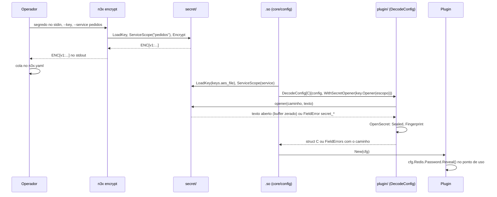
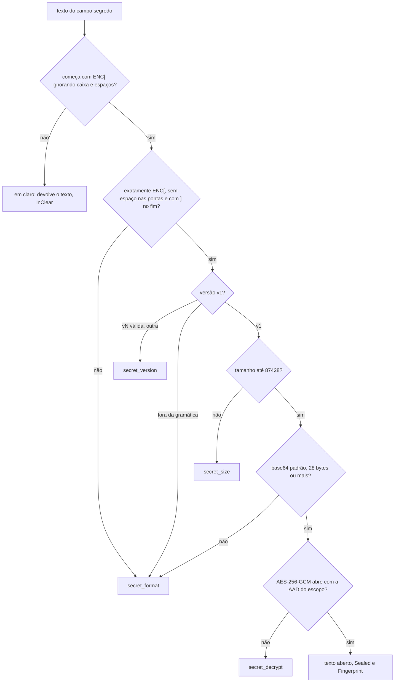

### FDD: Segredos: tipo `plugin.Secret` e pacote `secret` (`ENC[...]`) (SDK-03)

Versão: 1.0
Data: 2026-10-20
Responsável: Guilherme Giusti

---

### 1. Contexto e motivação técnica

**Problema técnico.** Um segredo do N3X passa por quatro mãos: o operador cifra o valor, o entrypoint e o `.so` do sidecar (ou o host do controller) decifram, o plugin usa e o plugin core mascara o que vai para o controller. O HLD do `n3x-sidecar` definiu o envelope `ENC[v1:...]`, o ADR-014 do `n3x-sdk` moveu o código para o pacote `secret/` e o ADR-020 criou o tipo `plugin.Secret`. Faltava o comportamento verificável:

- a gramática exata do envelope, a variante do base64 e o que fazer com `ENC[v2:...]`
- a AAD dos valores do `n3x.yaml` do controller, que não tem `service` (lacuna L-05), e como o `encrypt` recebe o serviço
- o que acontece com um campo `plugin.Secret` escrito sem `ENC[...]`, como o `password_hash` bcrypt do core (lacuna L-64)
- o que o `plugin.Secret` carrega para o mascaramento da FDD 37 sem expor o cifrado ao plugin (lacuna L-07)
- o formato e a permissão do arquivo de chave
- a garantia de não vazamento por cada caminho de saída do Go

O último ponto não é trivial. Um experimento com Go 1.26.5 (87 saídas de `fmt`, `encoding/json`, `encoding/xml`, `log/slog`, erros, `panic` e `text/template`, com um valor canário) mostrou que um `Secret` com `String()` e `Format()` ainda vaza em 21 das 87 saídas quando o valor fica num campo de texto, mesmo atrás de ponteiro para struct: o `fmt` ignora os métodos em campo não exportado e, num verbo inválido (`%s` sobre um ponteiro), desreferencia o ponteiro para struct e imprime os campos por reflexão. Com o valor atrás de um ponteiro para `string` (tipo não composto), as 87 saídas ficaram sem o canário. Essa é a base da representação do contrato 1.

**Encaixe no HLD.** Esta FDD especifica duas linhas de "Componentes e responsabilidades" do HLD do `n3x-sdk`:

- `plugin/`: o tipo `plugin.Secret`, a entrada dele na tabela de tipos conhecidos da FDD 02 e a marca `x-n3x-secret` no schema
- `secret/`: `ENC[v1:...]` com AES-256-GCM e AAD por escopo, `Encrypt`, `Decrypt` e `KeyGen`, leitura da chave e zeragem de buffers por melhor esforço

Consumidores:

- FDD 15 (SID-01): `core/config` do sidecar e os subcomandos `n3x encrypt` e `n3x keygen`
- FDD 17 (SID-03): o `.so` decifra e entrega a config tipada ao `New`
- FDD 30 (CTL-01): `host/config` do controller e os subcomandos `encrypt` e `keygen`
- FDDs 36, 37, 39 e 40: plugin core (mascaramento, `session.hmac_key`, `password_hash`)
- FDD 24 (BLD-06): recusa do import de `secret/` e de `.Reveal()` em log
- FDDs 07, 12 e 48: checagem de segredos nos logs e varredura na CI

**Atores.** Operador (gera a chave, cifra os valores e monta o arquivo), entrypoint e `.so` do sidecar (conferem e decifram), host do controller (decifra as seções de plugin), autor de plugin (recebe `plugin.Secret` e chama `.Reveal()`), plugin core (mascara e decide avisos dos próprios campos), builder (só recusa o import, nunca vê a chave) e mantenedor do SDK.

**Limites.**
- `plugin/` continua biblioteca pura, só com a biblioteca padrão, e não conhece o formato `ENC[...]` nem a chave (FDD 02). O `Secret` sabe só se o texto aberto é diferente do recebido
- `secret/` é o único código do formato. Não loga, não lê variável de ambiente, não abre rede e não tem estado global. O único arquivo que lê é o caminho passado a `LoadKey`
- Nenhum dos dois pacotes decide política: avisos, eventos e mascaramento do envio são de quem chama (FDDs 15, 30, 37 e 42)

**Suposições**
- Go 1.26 ou superior (ADR-021 do `n3x-sdk`); `cipher.NewGCMWithRandomNonce` existe desde o Go 1.24 e tem o mesmo leiaute do envelope (nonce de 12 bytes, texto cifrado e tag de 16 bytes)
- Segredos de config são pequenos (senhas, tokens, chaves em base64); 64 KiB por valor é folga (hipótese)
- Uma chave cifra poucas centenas de valores ao longo da vida, longe do limite de 2^32 cifragens com nonce aleatório
- Containers Linux; a chave chega como arquivo montado (Secret do Kubernetes, volume no ECS e no docker compose)
- O nome do serviço do `n3x.yaml` do sidecar não contém `:` (a gramática é da FDD 15; aqui a regra mínima é imposta por `ServiceScope`)

**Restrições**
- `secret/` importa só a biblioteca padrão e `plugin/`, que também só usa a biblioteca padrão (mesmo padrão do `schemagen` da FDD 02); `plugin/` nunca importa `secret/`
- Código de plugin não importa `secret/` (ADR-014 e ADR-011)
- Chave em arquivo, nunca em variável de ambiente (requisitos de segurança do PRD)
- Uma chave por processo; a v1 não aceita duas chaves ao mesmo tempo (HLD do `n3x-sidecar`)
- Nenhum valor aberto, envelope, payload ou material de chave em mensagem de erro (FR-001 e FDD 02)
- Contrato estável desde a `v1.0.0` do SDK; o formato `ENC[...]` segue o semver do SDK (ADR-014)
- Documentação e mensagens em pt-BR; identificadores de código em inglês

**Rastreabilidade**
- PRD 1.5: FR-001 (decifra `ENC[...]` com chave de arquivo; valor que não decifra encerra sem logar o valor), FR-007 (campos `plugin.Secret` mascarados; segredo sem `ENC[...]` vira `***:plain` com alerta), FR-009 (`password_hash` como campo segredo no schema), FR-012 (`plugin.Secret` nunca em log, erro ou JSON; plugin que importa `secret` é recusado); segurança (AES-256-GCM, chave em arquivo, nenhum segredo em log, erro ou config enviada); critérios "`ENC[...]` que não decifra impede a subida sem segredo no log" e "teste automatizado de que nenhum segredo aparece"
- ADRs: ADR-011, ADR-014, ADR-020 e ADR-021 do `n3x-sdk`; ADR-003 e ADR-007 do `n3x-sidecar`; ADR-009 do `n3x-controller`; ADR-004 e ADR-006 do `n3x-plugin-core`
- Lacunas do README:
  - **L-05 fechada aqui:** AAD `n3x:v1:<service>` no sidecar e `n3x:v1:controller:<plugin_id>` em cada seção de plugin do controller; `n3x encrypt` recebe `--service` e `n3x-controller encrypt` recebe `--plugin`, ambos obrigatórios (contratos 3 e 7). As FDDs 15 e 30 só aplicam
  - **L-64 fechada aqui:** todo campo `plugin.Secret` aceita valor sem `ENC[...]` nos dois processos; o decodificador nunca recusa. O `Secret` informa `InClear()`. No sidecar, a FDD 37 mascara como `***:plain` e a FDD 42 emite `secret_in_clear`; no controller não há aviso genérico, e o `password_hash` bcrypt em claro é o caso normal (contrato 1). As FDDs 36 e 40 aplicam
  - **L-07 com a porta aberta (fechada na FDD 37 com a interface da FDD 09):** o `Secret` carrega `Sealed()`, `InClear()` e `Fingerprint()` (12 caracteres hex do SHA-256 do texto recebido, só quando veio cifrado), e `plugin.SecretFingerprint(text)` é a implementação única da regra do ADR-006 para quem tem o texto do envelope
  - **Pedidos da FDD 02 atendidos:** `plugin.Secret` entra na tabela de tipos conhecidos com `x-n3x-secret: true`; o construtor recebe o texto recebido e o aberto (`OpenSecret`); `ENC[...]` em campo que não é segredo passa a ser erro dos hosts (`secret_unexpected`)

---

### 2. Objetivos técnicos

- **Nenhum vazamento pelo tipo.** Medida: teste de canário com pelo menos 80 caminhos de saída (todos os verbos e flags do `fmt`, struct com campo exportado e não exportado, ponteiro, lista, map, `encoding/json`, `encoding/xml`, `log/slog` JSON e texto, `fmt.Errorf`, `panic`, `text/template`) com 0 ocorrência do valor. Linha de base: 87 saídas, 0 vazamentos no experimento com Go 1.26.5.
- **Ida e volta e integridade.** Invariante: `Decrypt(s, Encrypt(s, p))` devolve `p` para todo `p` de 0 a 64 KiB. Medida: 100% das mutações de 1 bit no payload, de 1 byte na AAD e de 1 bit na chave falham com `secret_decrypt`.
- **Separação de escopos.** Invariante: nenhuma AAD de serviço é igual a uma AAD de controller, e um envelope de um escopo nunca abre em outro, com a mesma chave. Medida: teste de propriedade sobre o corpus de nomes.
- **Um veredito por texto.** Invariante: todo texto recebido num campo segredo dá exatamente um resultado (em claro, aberto, ou um erro com uma única `Rule`), na ordem fixa da seção 5, igual no `Opener`, no `Verifier` e no `CheckEnvelope`. Medida: fuzzing diferencial sem divergência.
- **Mensagens sem material.** Medida: 0 ocorrência de texto aberto, envelope, payload em base64 ou texto da chave em `Error()` e `Detail`, por teste de canário.
- **Custo desprezível na subida.** Medida: `Decrypt` de um segredo de 64 bytes em até 5 µs por operação; `LoadKey` em até 1 ms; `Reveal`, `IsZero`, `Sealed`, `InClear`, `Fingerprint`, `String` e `LogValue` com 0 alocações (hipótese das metas).
- **Parse seguro contra entrada hostil.** Medida: fuzzing de `Decrypt`, `CheckEnvelope`, `ParseKey`, `OpenSecret` e da formatação do `Secret` por 5 minutos cada na CI noturna, sem panic (hipótese de duração, igual às FDDs 01 e 02).

---

### 3. Escopo e exclusões

**Incluído**
- Tipo `plugin.Secret`: representação, construtores (`NewSecret`, `OpenSecret`), `.Reveal()`, comparação em tempo constante (`Equal`), valor vazio (`IsZero`), origem (`Sealed`, `InClear`), impressão digital (`Fingerprint`) e o comportamento em cada caminho de saída
- Entrada de `plugin.Secret` na tabela de tipos conhecidos da FDD 02 e a marca `x-n3x-secret` no schema, inclusive em ponteiro, lista e map
- Função `plugin.SecretFingerprint`, implementação única da regra de impressão digital do ADR-006
- Formato do envelope `ENC[v1:...]`: gramática, base64, limites, versão e ordem de conferência
- Escopos da AAD (`ServiceScope` e `ControllerScope`) e a decisão da L-05 sobre como os subcomandos recebem o escopo
- Pacote `secret/`: `KeyGen`, `ParseKey`, `LoadKey`, `Encrypt`, `Decrypt`, `Opener`, `Verifier`, `FormatChecker`, `IsEnvelope`, `CheckEnvelope` e `Wipe`
- Formato do arquivo de chave e a regra de permissão (`0440`), com a informação devolvida ao chamador
- Erros tipados com código estável, que citam o caminho do campo e nunca o valor
- Zeragem de buffers por melhor esforço, com o que ela garante e o que não garante
- Fixtures de teste em `secret/secrettest` (chave de teste, vetores e canários) para as varreduras de segredo
- Decisão da L-64 (valor sem `ENC[...]`) e o que o tipo carrega para a L-07

**Excluído**
- Subcomandos `n3x encrypt`, `n3x keygen` e `n3x validate` do sidecar (argumentos, stdin, códigos de saída): FDD 15 (SID-01); aqui só a regra de escopo (L-05)
- Subcomandos `encrypt`, `keygen` e `credential new` do controller: FDD 30 (CTL-01); aqui só a regra de escopo (L-05)
- JSON canônico, formato `***:<impressão digital>` e `***:plain` no envio, e o canal que entrega ao core os dados dos plugins: FDD 37 (CORE-02), com a interface da FDD 09 (SDK-09)
- Emissão do evento `secret_in_clear`: FDD 42 (CORE-06)
- Regras de análise estática (import de `secret/`, `.Reveal()` em log): FDD 24 (BLD-06)
- Checagem de segredo vazado em log no kit de testes: FDDs 07 (SDK-07) e 12 (SDK-12)
- Varredura de segredos na CI cruzada: FDD 48 (SDK-16)
- Validação do bcrypt do `password_hash` e uso da `session.hmac_key`: FDDs 39 (CORE-03) e 40 (CORE-04)
- Rotação com duas chaves ao mesmo tempo e rotação sem restart: fora da v1 (README, "Fora da v1")
- Cache de valores decifrados: fora por decisão (seção 4)

**Decisões aprovadas na clarificação**
- A AAD dos valores do `n3x.yaml` do controller é `n3x:v1:controller:<plugin_id>`, um escopo por seção de plugin (L-05)
- `n3x encrypt --service` e `n3x-controller encrypt --plugin` são obrigatórios e o escopo nunca é inferido do `n3x.yaml`
- Os valores de desempenho, tamanho, permissão de chave (`0440` bit a bit), duração de fuzzing e cobertura marcados como hipótese ficam aceitos como padrão, sem bloqueio

**Pendências não bloqueantes**
- Dependem de outros repositórios: uso de `Verifier` no entrypoint e `Opener` no `.so` (FDDs 15 e 17), `secret_unexpected` nos hosts (FDDs 15 e 30), mascaramento `***:plain`/`***:<impressão digital>` e evento `secret_in_clear` (FDDs 37 e 42), análise estática de `secret/` e `.Reveal()` (FDD 24) e varredura da CI (FDD 48)
- Divergência a tratar no Workflow 3: o PRD FR-001 diz que o entrypoint "decifra" os valores `ENC[...]`, mas esta FDD faz o entrypoint só conferir (`Verifier`, sem criar `string`) e o `.so` decifrar

---

### 4. Fluxos detalhados e diagramas

**Fluxo do operador: gerar a chave e cifrar**
1. O operador roda `n3x keygen` (imagem do sidecar) ou `n3x-controller keygen`. O CLI chama `secret.KeyGen()`, que devolve 32 bytes de `crypto/rand` em base64 padrão com padding e uma quebra de linha.
2. O operador grava a saída num arquivo e o monta no container com permissão `0440` (no Kubernetes, Secret com `defaultMode: 0440` e `fsGroup` do usuário do sidecar).
3. Para um valor do sidecar, roda `n3x encrypt --key <arquivo> --service pedidos` com o segredo no stdin. O CLI chama `secret.LoadKey`, `secret.ServiceScope("pedidos")` e `key.Encrypt`, imprime `ENC[v1:...]` e zera o buffer lido com `secret.Wipe`.
4. Para um valor do controller, roda `n3x-controller encrypt --key <arquivo> --plugin n3x.core`, que usa `secret.ControllerScope(n3x.core)`.
5. O operador cola o envelope no campo do `n3x.yaml` correspondente.

**Fluxo de subida no sidecar (entrypoint e `.so`)**
1. O `core/config` lê o `n3x.yaml`, valida os campos de topo e o `service` antes de qualquer segredo (FDD 15).
2. Chama `secret.LoadKey(keys.aes_file)` uma vez por processo. Se `KeyFileInfo.TooOpen`, o chamador loga um aviso e segue (seção 7).
3. Monta o escopo com `secret.ServiceScope(service)`. Todo `ENC[...]` do arquivo (`controller.secret` e a `config` de todos os plugins) usa esse escopo.
4. **Entrypoint:** chama `schema.Validate(config, plugin.WithSecretOpener(key.Verifier(scope)))` para cada plugin. O `Verifier` decifra para conferir, zera o buffer e devolve o texto recebido; nenhum texto aberto vira `string` no processo que fica vivo como supervisor.
5. **`.so`:** chama `DecodeConfig[C](config, plugin.WithSecretOpener(key.Opener(scope)))`. Para cada nó de segredo que passou no tipo, o decodificador chama `plugin.OpenSecret(caminho, texto, opener)`:
   - texto que não é envelope (`secret.IsEnvelope` falso): o opener o devolve igual, e o `Secret` fica `InClear()`
   - envelope: `key.Decrypt` confere a gramática, a versão e o tamanho, abre com a AAD e devolve os bytes; o opener converte em `string`, zera os bytes e devolve
   - o `OpenSecret` marca `Sealed()` quando o texto aberto difere do recebido e guarda `SecretFingerprint(texto recebido)`
6. O `controller.secret` chega ao core como `plugin.Secret` por `plugin.OpenSecret("controller.secret", texto, opener)` (canal da FDD 09).
7. O plugin recebe a struct e chama `cfg.Redis.Password.Reveal()` só no ponto de uso (ex.: autenticar no Redis).
8. A config efetiva (FDD 37) é montada a partir do texto recebido e do schema (`Normalize` e `MaskSecrets` da FDD 02) ou dos `Secret` (contrato 1); a escolha é da FDD 37 com a FDD 09.

**Fluxo de subida no controller**
1. O `host/config` lê o `n3x.yaml`, chama `secret.LoadKey(keys.aes_file)` uma vez e loga o aviso de permissão, se houver.
2. Para cada chave de `plugins`, monta `secret.ControllerScope(id)` e valida e decodifica a seção com `key.Opener(escopo)` (FDD 30).
3. O core recebe `session.hmac_key` e cada `users[i].password_hash` como `plugin.Secret`. O `password_hash` em claro (bcrypt) é o caso normal e não gera aviso; o core pode avisar no próprio `Validate` quando a `hmac_key` vier em claro (recomendação para a FDD 39).

**Decisão: chave lida uma vez por processo, sem cache de valores**
- O entrypoint e o `.so` decifram cada valor uma vez cada (ADR-007 do `n3x-sidecar`). O custo de abrir um envelope é de microssegundos, e um cache guardaria texto aberto por mais tempo, sem ganho
- `Key` é imutável depois de criada e pode ser usada por várias goroutines
- Se o Envoy criar a config do filtro mais de uma vez (L-45), o `.so` lê o arquivo de novo; o resultado é o mesmo

**Fluxos alternativos e exceções**
- **Valor sem `ENC[...]` num campo segredo (L-64):** aceito nos dois processos; `InClear()` verdadeiro. Sidecar: `***:plain` e `secret_in_clear` (FDDs 37 e 42) e log `warn` com o caminho, também no modo standalone (recomendação para as FDDs 15 e 17). Controller: aceito sem aviso genérico
- **Valor vazio (`""`) num campo segredo:** aceito; `IsZero()` verdadeiro e `InClear()` falso, porque não há o que proteger (recomendação para a FDD 37: não emitir `secret_in_clear` para vazio)
- **Campo segredo ausente:** `Secret` zero (`IsZero()` verdadeiro); para distinguir ausente de vazio, o autor usa `*plugin.Secret`
- **Envelope cifrado para outro serviço, outro plugin ou com outra chave:** `secret_decrypt`, com o escopo esperado no texto do erro; o processo não sobe
- **Envelope de versão desconhecida (`ENC[v2:...]`):** `secret_version`; o operador usa uma imagem mais nova ou cifra de novo
- **Envelope malformado** (espaço em volta, sem `]`, base64 com quebra de linha, `enc[` com outra caixa): `secret_format`
- **`ENC[...]` num campo que não é segredo:** o host recusa com `secret_unexpected` (recomendação para as FDDs 15 e 30), porque o plugin receberia o texto cifrado como valor
- **Sem opener (kit de testes):** o texto é o valor; `InClear()` verdadeiro
- **`n3x validate` sem a chave:** `secret.FormatChecker()` confere só a gramática e a versão (decisão de uso na FDD 15, P-07 da FDD 02)
- **Arquivo de chave ausente, ilegível ou fora do formato:** `key_read` ou `key_format`; o host decide se a chave é obrigatória quando não há nenhum `ENC[...]` (FDDs 15 e 30)

**Diagramas**

Sequência da cifragem pelo operador e da abertura no `.so`:



Decisão sobre o texto de um campo segredo:



---

### 5. Contratos públicos (assinaturas, endpoints, headers, exemplos)

**Contrato 1: `plugin.Secret`**
- Tipo: sdk (API Go)
- Assinatura/Rota:
  ```go
  package plugin

  // Valor de segredo da config. Não comparável com == e inválido como chave de map.
  type Secret struct {
      _      [0]func() // impede == e uso como chave de map
      v      *string   // texto aberto, atrás de ponteiro para tipo não composto
      fp     string    // impressão digital do envelope; "" quando não veio cifrado
      sealed bool      // veio em envelope e foi aberto
  }

  const SecretFingerprintLen = 12

  func NewSecret(value string) Secret                                  // valor em claro (testes e código do host)
  func OpenSecret(path, text string, open SecretOpener) (Secret, error) // usado pelo decodificador e pelos hosts
  func SecretFingerprint(text string) string                           // 12 hex do SHA-256 do texto do envelope

  func (s Secret) Reveal() string      // único caminho para o valor
  func (s Secret) IsZero() bool        // valor vazio (ausente ou "")
  func (s Secret) Equal(o Secret) bool // compara só o valor, em tempo constante para o mesmo tamanho
  func (s Secret) Sealed() bool        // veio em ENC[...] e foi aberto
  func (s Secret) InClear() bool       // não vazio e não veio cifrado
  func (s Secret) Fingerprint() string // "" quando não Sealed

  func (s Secret) String() string                // "***"
  func (s Secret) GoString() string              // "***"
  func (s Secret) Format(f fmt.State, verb rune) // "***" em qualquer verbo e flag
  func (s Secret) MarshalJSON() ([]byte, error)  // "\"***\""
  func (s Secret) MarshalText() ([]byte, error)  // "***"
  func (s Secret) LogValue() slog.Value          // slog.StringValue("***")
  ```
- Método: n/a (chamada local)
- Semântica:
  - **Representação** (hipótese, confirmada pelo experimento da seção 1): o valor fica atrás de `*string`. O `fmt` nunca desreferencia ponteiro para `string`, então um `Secret` em campo não exportado de outra struct, ou impresso com verbo inválido (`%p`), mostra só o endereço. Ponteiro para struct, slice, array ou map seria desreferenciado e vazaria
  - **Saída sempre igual:** toda forma de formatação e serialização devolve exatamente `***`, inclusive para o valor zero e para `""`. A saída não revela tamanho nem se o valor existe
  - **Sem decodificação própria:** não há `UnmarshalJSON` nem `UnmarshalText`. `json.Unmarshal` para um `Secret` falha com `cannot unmarshal`; os únicos construtores são `NewSecret`, `OpenSecret` e o decodificador da FDD 02. Assim um `***` serializado nunca volta como valor
  - **`OpenSecret(path, text, open)`:** com `open` nulo, o valor é `text` (em claro). Com `open`, chama `open(path, text)`. Se o texto aberto difere do recebido, marca `Sealed` e guarda `SecretFingerprint(text)`. Um envelope válido é sempre mais longo que o texto que guarda (48 caracteres para 0 bytes, `8 + 4*ceil((28+n)/3)` para `n` bytes), então um envelope aberto nunca é igual ao texto recebido. Erro do opener vira o mesmo erro que o decodificador produz para o campo: satisfaz `errors.Is(err, ErrInvalidConfig)`, e `errors.As` com `plugin.FieldErrors` devolve um item com `Path = path` e a `Rule` e o `Detail` do opener (ou `secret_open`, regra da FDD 02); o texto original do erro é descartado. Assim os hosts usam `PrefixErrors` também no `controller.secret`
  - **`Equal`:** compara byte a byte com acumulação por XOR, sem converter para `[]byte` (sem cópia do valor); tempo independente do conteúdo quando os tamanhos são iguais, e retorno imediato quando diferem (mesmo comportamento do `crypto/subtle`). Ignora origem e impressão digital. `NewSecret("")` é igual ao `Secret` zero
  - **Origem e impressão digital (L-07, porta aberta):** `Sealed`, `InClear` e `Fingerprint` existem para quem recebe um `Secret` mascarar sem ver o cifrado (caso do `controller.secret` entregue ao core pela FDD 09). `Fingerprint` nunca é calculada sobre texto em claro, só sobre o texto do envelope, como manda o ADR-006 do `n3x-plugin-core`. O formato `***:<impressão digital>` e `***:plain` é da FDD 37
  - **`SecretFingerprint(text)`:** primeiros 12 caracteres hex minúsculos do SHA-256 dos bytes exatos do texto recebido (com `ENC[` e `]`). É a implementação única da regra do ADR-006; a FDD 37 a usa ou usa `Secret.Fingerprint()`, nunca uma terceira
  - **L-64:** o tipo aceita qualquer texto. Valor sem `ENC[...]` nunca é erro do SDK. A política (`***:plain`, evento, aviso) é do chamador
  - **Memória isolada:** por ter um campo ponteiro, `plugin.Secret` é recusado por `memory.NewMap` (FDD 04). O autor guarda o `Secret` num campo da instância
  - **Limite da garantia:** ferramentas que leem memória por `unsafe` ou seguem ponteiros por reflexão profunda (ex.: dumpers de depuração), core dumps e swap ficam fora. A análise estática (FDD 24) e o kit de testes (FDDs 07 e 12) cobrem o uso de `.Reveal()` em log

Garantia por caminho de saída (conferida por teste, seção 9):

| Caminho | Mecanismo | Saída |
| --- | --- | --- |
| `fmt` com qualquer verbo e flag (`%v`, `%+v`, `%#v`, `%s`, `%q`, `%x`, `%X`, `%d`, `%10.3v`) | `Format` | `***` |
| `%T` | nome do tipo | `plugin.Secret` |
| `%p` e verbo inválido sobre struct que contém `Secret` | reflexão do `fmt` | endereço do ponteiro, nunca o valor |
| `Secret` em campo exportado de struct, lista, map ou ponteiro | `Format` | `***` |
| `Secret` em campo não exportado de struct | reflexão do `fmt` | endereço do ponteiro |
| `encoding/json` (struct, map, lista, `any`) | `MarshalJSON` | `"***"` |
| `encoding/xml`, YAML e outros `TextMarshaler` | `MarshalText` | `***` |
| `log/slog` JSON e texto, como atributo, em grupo e dentro de struct | `LogValue`, `MarshalJSON`, `Format` | `***` |
| `fmt.Errorf`, `errors.Join` | `Format` | `***` |
| `panic(s)` sem recuperação | `String()` no runtime | `panic: ***` |
| `text/template` e `html/template` | `fmt` | `***` |
| `encoding/gob` | sem campos exportados | erro do gob, sem valor |
| `json.Unmarshal` para `Secret` | sem `UnmarshalJSON` | erro `cannot unmarshal` |
| `a == b`, `map[Secret]T` | campo `[0]func()` | erro de compilação |
| `reflect.DeepEqual` | segue o ponteiro | compara valor, origem e impressão digital |

**Exemplo de requisição**
```go
opener := key.Opener(scopePedidos) // secret.ServiceScope("pedidos")
s, _ := plugin.OpenSecret("redis.password",
    "ENC[v1:oKGio6SlpqeoqaqrlSsSRXHmZtBPF+K3bgm3Tay7UBrZroDKT/dOy+2Q]", opener)
fmt.Printf("%v %+v %#v %q %x\n", s, s, s, s, s)
b, _ := json.Marshal(map[string]any{"password": s})
slog.New(slog.NewJSONHandler(os.Stdout, nil)).Info("conectando", "password", s)
fmt.Println(s.Sealed(), s.InClear(), s.Fingerprint(), s.Reveal())

h, _ := plugin.OpenSecret("users[0].password_hash", "$2b$12$abc...", opener)
fmt.Println(h.Sealed(), h.InClear(), h.Fingerprint() == "")
```

**Exemplo de resposta**
```text
*** *** *** *** ***
{"password":"***"}
{"time":"2026-10-20T14:00:00Z","level":"INFO","msg":"conectando","password":"***"}
true false 5403f82244f0 s3nh4-do-redis
false true true
```

---

**Contrato 2: marca de segredo no schema e entrada na tabela de tipos conhecidos**
- Tipo: sdk (regra do gerador e do leitor de schema da FDD 02)
- Assinatura/Rota: entrada `plugin.Secret` da tabela fixa, não exportada, de tipos conhecidos de `plugin/` (contrato 6 da FDD 02)
- Método: n/a
- Semântica:
  - O gerador reconhece o tipo exato `plugin.Secret` e escreve `{"type":"string","description":"...","x-n3x-secret":true}`, na ordem de palavras-chave da FDD 02. `Node.Kind()` é `KindString` e `Node.Secret()` é verdadeiro
  - `x-n3x-secret` só aparece com o valor `true`; ausência significa "não é segredo". `ParseSchema` recusa `x-n3x-secret: false`, `x-n3x-secret` fora de nó `string` e nó de segredo com `default`, `enum`, `minLength` ou `maxLength` (`schema_value` e `schema_keyword` da FDD 02)
  - Formas aceitas: `plugin.Secret`, `*plugin.Secret` (presença distinguível), `[]plugin.Secret` (marca em `items`) e `map[string]plugin.Secret` (marca em `additionalProperties`; as chaves não são segredo e aparecem nos caminhos)
  - `n3x:"required"` é aceito; `default`, `min`, `max` e `enum` dão `tag_conflict` (FDD 02). Segredo sem `required` não recebe default implícito: ausente vira `Secret` zero
  - Tipo definido a partir de `plugin.Secret` (`type Senha plugin.Secret`) perde os métodos e é recusado com `unsupported_type` (hipótese); o autor usa `plugin.Secret` direto
  - Construção do valor pelo decodificador: só depois de o nó passar no tipo (`string`), chamando `OpenSecret(caminho, texto recebido, opener)`. JSON que não é texto (número, `null`) dá `type`, sem chamar o opener
  - Leitores da marca: plugin core (mascaramento, FDD 37), painel (exibe só o valor mascarado que recebe, FDDs 44 e 45) e `n3x-new schema-check` (FDD 14)

**Exemplo de requisição**
```go
type Redis struct {
    Address  string                   `json:"address" n3x:"required,min=3,max=255" desc:"Endereço host:porta"`
    Password plugin.Secret            `json:"password" n3x:"required" desc:"Senha do Redis"`
    Replica  *plugin.Secret           `json:"replica_password" desc:"Senha da réplica, se diferente"`
    Tokens   []plugin.Secret          `json:"tokens" n3x:"max=8" desc:"Tokens aceitos"`
    PerHost  map[string]plugin.Secret `json:"per_host" desc:"Senha por host"`
}
```

**Exemplo de resposta** (`SchemaOf[Redis]()`, formatado para leitura; o real é compacto)
```json
{
  "$schema": "https://json-schema.org/draft/2020-12/schema",
  "x-n3x-schema": 1,
  "type": "object",
  "properties": {
    "address": { "type": "string", "description": "Endereço host:porta", "minLength": 3, "maxLength": 255 },
    "password": { "type": "string", "description": "Senha do Redis", "x-n3x-secret": true },
    "replica_password": { "type": "string", "description": "Senha da réplica, se diferente", "x-n3x-secret": true },
    "tokens": { "type": "array", "description": "Tokens aceitos", "maxItems": 8, "items": { "type": "string", "x-n3x-secret": true }, "default": [] },
    "per_host": { "type": "object", "description": "Senha por host", "propertyNames": { "minLength": 1, "maxLength": 128 }, "additionalProperties": { "type": "string", "x-n3x-secret": true }, "default": {} }
  },
  "required": ["address", "password"],
  "additionalProperties": false
}
```

---

**Contrato 3: envelope `ENC[v1:...]` e escopo da AAD (L-05)**
- Tipo: sdk (formato de texto e regra de AAD)
- Assinatura/Rota:
  ```text
  envelope = "ENC[" versao ":" carga "]"
  versao   = "v" digito-1-a-9 *2digito         ; v1 a v999; só v1 existe na major 1 do SDK
  carga    = base64 padrão (RFC 4648, seção 4), com padding, sem espaço nem quebra de linha
  carga v1 = nonce (12 bytes) || texto cifrado (n bytes) || tag (16 bytes), com 0 <= n <= 65536

  AAD de serviço    = "n3x:v1:" service             ; ex.: n3x:v1:pedidos
  AAD de controller = "n3x:v1:controller:" plugin_id ; ex.: n3x:v1:controller:n3x.core
  ```
- Método: n/a
- Semântica:
  - Cifra: AES-256-GCM, nonce aleatório de 96 bits por cifragem (implementação sugerida: `cipher.NewGCMWithRandomNonce`, cujo leiaute é o da carga v1). Cifrar o mesmo valor duas vezes dá envelopes diferentes (trade-off do ADR-006 do `n3x-plugin-core`)
  - Tamanhos: envelope de 48 caracteres (0 bytes) a 87.428 caracteres (64 KiB); carga decodificada de 28 a 65.564 bytes
  - **Escopo do sidecar:** `n3x:v1:<service>` para todo `ENC[...]` do `n3x.yaml` do serviço, inclusive `controller.secret` (ADR-014; decisão tomada). `ServiceScope` recusa serviço vazio, com mais de 253 bytes, com `:` ou com byte fora de ASCII visível (0x21 a 0x7E)
  - **Escopo do controller (L-05):** `n3x:v1:controller:<plugin_id>` para cada valor da seção `plugins["<id>"]`, com o ID do plugin dono da seção (confirmado). Motivos:
    - o controller não tem `service` e há um controller por ambiente (ADR-001 do `n3x-sdk`)
    - nenhum nome de serviço tem `:`, então as AADs de serviço e de controller nunca coincidem, mesmo com a mesma chave
    - um valor da seção de um plugin não abre se for copiado para a seção de outro (ex.: a `session.hmac_key` do core colada na config de um plugin de terceiro que a logaria)
    - o host já conhece o ID ao decifrar cada seção, então não há campo novo no `n3x.yaml`
  - O `v1` da AAD é a versão do formato, não a do SDK; um envelope v2 teria regra própria
  - Não há AAD por caminho de campo: mover um valor entre dois campos do mesmo escopo funciona (decisão do ADR-014 mantida)
  - A gramática e as AADs ficam congeladas na major do SDK

**Exemplo de requisição** (vetores de teste: chave `00 01 ... 1f`, nonce fixo `a0 a1 ... ab`, só em teste)
```json
[
  { "scope": "n3x:v1:pedidos", "plaintext": "s3nh4-do-redis" },
  { "scope": "n3x:v1:pedidos", "plaintext": "credencial-do-servico-pedidos" },
  { "scope": "n3x:v1:controller:n3x.core", "plaintext": "AAECAwQFBgcICQoLDA0ODxAREhMUFRYXGBkaGxwdHh8=" },
  { "scope": "n3x:v1:pedidos", "plaintext": "" }
]
```

**Exemplo de resposta**
```json
[
  { "envelope": "ENC[v1:oKGio6SlpqeoqaqrlSsSRXHmZtBPF+K3bgm3Tay7UBrZroDKT/dOy+2Q]", "length": 64, "fingerprint": "5403f82244f0" },
  { "envelope": "ENC[v1:oKGio6SlpqeoqaqrhWoZSSClYdYDCaq3aFezuwLaMHP9mjIJ+GdC6QyJnFO/ZQ+b5cM41CaHLENk]", "length": 84, "fingerprint": "b619a75cdb48" },
  { "envelope": "ENC[v1:oKGio6Slpqeoqaqrp1k5bgS8U/kgAuSaRCuvkjTtaV/WzwM+2WZr0zn5LFmVNCye6FokWRf0PPV2QTMDO8hbyJIRmKzT6XoF]", "length": 104, "fingerprint": "20beb43a581b" },
  { "envelope": "ENC[v1:oKGio6Slpqeoqaqr2AbaEzDVX0pMl04tToZ1fQ==]", "length": 48 }
]
```

O primeiro envelope aberto com o escopo `n3x:v1:estoque`, ou com `n3x:v1:controller:n3x.core`, falha com `secret_decrypt`.

---

**Contrato 4: pacote `secret/`**
- Tipo: sdk (API Go; proibida aos plugins)
- Assinatura/Rota:
  ```go
  package secret // github.com/giustech/n3x-sdk/secret; importa só a biblioteca padrão e plugin/

  const (
      KeySize          = 32
      NonceSize        = 12
      TagSize          = 16
      Prefix           = "ENC["
      Version          = "v1"
      MinEnvelopeSize  = 48
      MaxPlaintextSize = 64 << 10
      MaxEnvelopeSize  = 87428
      MaxKeyFileSize   = 1 << 10
      KeyFileMaxPerm   fs.FileMode = 0o440
  )

  type Scope struct{ /* texto da AAD; valor zero inválido */ }

  func ServiceScope(service string) (Scope, error)  // "n3x:v1:<service>"
  func ControllerScope(id plugin.ID) (Scope, error) // "n3x:v1:controller:<id>"
  func (s Scope) String() string                    // a AAD; não é segredo
  func (s Scope) IsZero() bool

  type Key struct{ /* só o AEAD; nunca guarda a chave crua */ }

  func KeyGen() []byte                                  // base64 padrão de 32 bytes aleatórios + "\n"
  func ParseKey(text []byte) (*Key, error)
  func LoadKey(path string) (*Key, KeyFileInfo, error)

  func (k *Key) Encrypt(s Scope, plaintext []byte) (string, error)
  func (k *Key) Decrypt(s Scope, envelope string) ([]byte, error)
  func (k *Key) Opener(s Scope) plugin.SecretOpener   // abre envelopes; devolve texto em claro igual
  func (k *Key) Verifier(s Scope) plugin.SecretOpener // abre para conferir, zera e devolve o texto recebido
  func (k *Key) String() string                       // "secret.Key(***)"
  func (k *Key) Format(f fmt.State, verb rune)        // "secret.Key(***)"
  func (k *Key) LogValue() slog.Value                 // "secret.Key(***)"

  type KeyFileInfo struct {
      Path    string
      Mode    fs.FileMode // permissão do arquivo, depois de seguir links simbólicos
      TooOpen bool        // algum bit de permissão fora de 0440
  }

  func IsEnvelope(text string) bool           // texto, sem espaços nas pontas, começa com ENC[ (sem diferenciar caixa)
  func CheckEnvelope(text string) error       // gramática, versão e tamanho, sem a chave
  func FormatChecker() plugin.SecretOpener    // CheckEnvelope nos envelopes; devolve o texto igual
  func Wipe(b []byte)                         // clear(b) e runtime.KeepAlive(b)
  ```
- Método: n/a
- Semântica:
  - **`KeyGen`:** 32 bytes de `crypto/rand` (que nunca devolve erro no Go 1.26) em base64 padrão com padding, mais `"\n"`: 45 bytes prontos para gravar. Também serve para a `session.hmac_key` do core, que é cifrada depois com o escopo do controller (FDD 39 decodifica o base64)
  - **`ParseKey` e `LoadKey`:** formato no contrato 5. `LoadKey` lê o arquivo uma vez, constrói o AEAD e zera o buffer do arquivo e o da chave decodificada. `Key` nunca guarda a chave crua; o material fica só dentro do AEAD da biblioteca padrão, que não pode ser zerado
  - **`Encrypt`:** recusa escopo zero (`scope`) e texto acima de 64 KiB (`secret_size`); aceita texto vazio (a recusa de stdin vazio é do CLI). Escreve sempre `v1` na major 1 do SDK
  - **`Decrypt`:** confere na ordem: espaço nas pontas ou prefixo com outra caixa (`secret_format`), `]` final (`secret_format`), versão (`secret_format` fora da gramática, `secret_version` se válida e diferente de `v1`), tamanho (`secret_size`), alfabeto, padding e comprimento da carga (`secret_format`; o decodificador base64 da biblioteca padrão ignora `\r` e `\n`, por isso o alfabeto é conferido antes), carga com pelo menos 28 bytes (`secret_format`) e abertura com a AAD (`secret_decrypt`). Zera a carga decodificada; o chamador zera o texto aberto com `Wipe`
  - **`Opener(s)`:** se `IsEnvelope(texto)` é falso, devolve o texto igual (em claro, L-64); senão, `Decrypt`, converte em `string`, zera os bytes e devolve. Nunca altera um texto que não é envelope. Usado pelo `.so` e pelo controller com `DecodeConfig`
  - **`Verifier(s)`:** igual ao `Opener`, mas devolve o texto recebido em vez do aberto, sem criar `string` com o valor. Usado com `Validate`, onde nenhum `Secret` é construído (entrypoint e `n3x validate` com a chave). Nunca deve ser usado com `DecodeConfig`
  - **`FormatChecker()`:** `CheckEnvelope` nos envelopes e o texto igual em tudo. Para validar sem a chave; nunca com `DecodeConfig`
  - Os erros de `Decrypt` e `CheckEnvelope` levam um `plugin.FieldError` com `Path` vazio, que o decodificador da FDD 02 completa com o caminho do campo (contrato 6)
  - `Key` e `Scope` são imutáveis e seguros para uso concorrente (conferido com `-race`)
  - O pacote não loga, não lê variável de ambiente e não tem estado global

**Exemplo de requisição**
```go
key, info, err := secret.LoadKey("/run/n3x/aes.key")
scope, _ := secret.ServiceScope("pedidos")
env, _ := key.Encrypt(scope, []byte("s3nh4-do-redis"))
pt, _ := key.Decrypt(scope, env)
defer secret.Wipe(pt)
estoque, _ := secret.ServiceScope("estoque")
_, errOutro := key.Decrypt(estoque, env)
_, errScope := secret.ServiceScope("controller:n3x.core")
fmt.Println(info.Mode, info.TooOpen, secret.IsEnvelope(env), string(pt), errOutro, errScope)
```

**Exemplo de resposta**
```json
{
  "info": { "Path": "/run/n3x/aes.key", "Mode": "-r--r-----", "TooOpen": false },
  "env": "ENC[v1:<nonce aleatório>...]",
  "IsEnvelope": true,
  "Decrypt": "s3nh4-do-redis",
  "errOutro": "secret: ENC[...] não decifrou com a chave e o escopo n3x:v1:estoque (chave errada, valor cifrado para outro serviço ou plugin, ou alterado) [secret_decrypt]",
  "errScope": "secret: serviço inválido para a AAD: vazio, com ':' ou com caractere fora de ASCII visível [scope]"
}
```

---

**Contrato 5: arquivo de chave**
- Tipo: sdk (formato de arquivo lido por `ParseKey` e `LoadKey`)
- Assinatura/Rota: arquivo regular em `keys.aes_file` (sidecar e controller), montado pelo orquestrador
- Método: n/a
- Semântica:
  - Conteúdo: exatamente 32 bytes em base64 padrão (RFC 4648, seção 4) com padding, ou seja, 44 caracteres terminados em `=`, decodificados no modo estrito (hipótese: uma variante só, a mesma do `openssl rand -base64 32` e do `n3x keygen`)
  - Aceita espaços ASCII nas pontas (`" "`, `\t`, `\r`, `\n`), para tolerar a quebra de linha final do `keygen`, do `echo` e do Windows. Dentro dos 44 caracteres não há espaço nem quebra
  - Recusa: base64 URL, sem padding, chave crua de 32 bytes binários, 16 ou 24 bytes (AES-128 e AES-192), duas chaves no mesmo arquivo (a v1 não aceita duas chaves) e arquivo maior que 1 KiB (`key_format` ou `key_read`)
  - `LoadKey` segue links simbólicos (`os.Stat`), como o Secret montado do Kubernetes (`..data/aes.key`), e exige arquivo regular
  - **Permissão:** `TooOpen` é verdadeiro quando algum bit de `Mode.Perm()` está fora de `0440` (regra bit a bit, hipótese). `0400` e `0440` passam; `0444`, `0600`, `0640` e `0644` geram aviso. O aviso nunca impede a subida (HLD do `n3x-sidecar`)
  - A chave nunca vem de variável de ambiente nem de argumento de linha de comando

**Exemplo de requisição** (conteúdo do arquivo de teste de `secrettest`, permissão `0644`)
```text
AAECAwQFBgcICQoLDA0ODxAREhMUFRYXGBkaGxwdHh8=

```

**Exemplo de resposta**
```json
{ "key": "secret.Key(***)", "info": { "Path": "/run/n3x/aes.key", "Mode": "-rw-r--r--", "TooOpen": true }, "err": null }
```

---

**Contrato 6: erros do `secret/` e regras que atravessam o decodificador**
- Tipo: sdk (API Go)
- Assinatura/Rota:
  ```go
  package secret

  var (
      ErrMalformed          = errors.New("secret: ENC[...] fora do formato")
      ErrUnsupportedVersion = errors.New("secret: versão do ENC[...] não suportada")
      ErrTooLarge           = errors.New("secret: segredo maior que o limite")
      ErrDecrypt            = errors.New("secret: ENC[...] não decifrou")
      ErrInvalidKey         = errors.New("secret: chave AES inválida")
      ErrInvalidScope       = errors.New("secret: escopo inválido")
  )
  ```
- Método: n/a
- Semântica:
  - Toda função devolve um erro não exportado com `Unwrap() []error` que leva a sentinela e um `plugin.FieldError{Path: "", Rule, Detail}` (mesmo padrão das FDDs 01 e 02). `errors.Is(err, secret.ErrDecrypt)` e `errors.As(err, &fe)`, com `var fe plugin.FieldError`, funcionam. `Error()` é `secret: <Detail> [<Rule>]`. Erros de leitura de arquivo também embrulham o erro do sistema (`errors.Is(err, fs.ErrNotExist)`)
  - No decodificador (FDD 02), o opener devolve esse erro, e valem a `Rule` e o `Detail` com o `Path` do campo; a sentinela e o texto original são descartados
  - `Detail` nunca cita texto aberto, envelope, carga, chave nem conteúdo do arquivo. Pode citar o escopo (`n3x:v1:pedidos`), o caminho do arquivo e os limites
  - Códigos estáveis na major (FDD 01): testes conferem `Path` e `Rule`

| `Rule` | Sentinela | Condição | `Detail` (modelo) |
| --- | --- | --- | --- |
| `secret_format` | `ErrMalformed` | Envelope com espaço nas pontas, prefixo com outra caixa, sem `]`, versão fora de `v1` a `v999`, carga fora do base64 padrão com padding, carga com menos de 28 bytes | `valor começa com ENC[ mas não segue ENC[v1:<base64 padrão>]` |
| `secret_version` | `ErrUnsupportedVersion` | Versão válida na gramática e diferente de `v1` | `versão do ENC[...] não suportada; esta imagem lê só v1` |
| `secret_size` | `ErrTooLarge` | Envelope acima de 87.428 caracteres ou texto acima de 64 KiB no `Encrypt` | `segredo maior que 64 KiB` |
| `secret_decrypt` | `ErrDecrypt` | AES-GCM recusou: chave errada, escopo errado ou envelope alterado | `ENC[...] não decifrou com a chave e o escopo n3x:v1:pedidos (chave errada, valor cifrado para outro serviço ou plugin, ou alterado)` |
| `key_read` | `ErrInvalidKey` | Arquivo ausente, sem permissão de leitura, não regular ou maior que 1 KiB | `arquivo de chave não pode ser lido: sem permissão de leitura` |
| `key_format` | `ErrInvalidKey` | Conteúdo que não é base64 padrão de exatamente 32 bytes | `a chave precisa ser 32 bytes em base64 padrão com padding, uma por arquivo (gere com n3x keygen)` |
| `scope` | `ErrInvalidScope` | Serviço vazio, com `:`, com byte fora de 0x21 a 0x7E ou com mais de 253 bytes; ID de plugin zero; `Scope` zero no `Encrypt` ou `Decrypt` | `serviço inválido para a AAD: vazio, com ':' ou com caractere fora de ASCII visível` |
| `secret_unexpected` | (dos hosts) | `ENC[...]` em campo que não é segredo no schema (aplicado pelas FDDs 15 e 30 com `Walk` e `IsEnvelope`) | `ENC[...] em campo que não é segredo; o plugin receberia o texto cifrado` |

**Exemplo de requisição** (`plugins[2].config` no `n3x.yaml` do serviço `pedidos`, `DecodeConfig` com `key.Opener`)
```json
{
  "address": "redis:6379",
  "password": "ENC[v1:oKGio6SlpqeoqaqrlSsSRXHmZtBPF+K3bgm3Tay7UBrZroDKT/dOy+2Q]",
  "replica_password": "ENC[v2:AAAA]",
  "tokens": [" ENC[v1:oKGio6Slpqeoqaqr2AbaEzDVX0pMl04tToZ1fQ==]", "token-em-claro"],
  "per_host": { "redis-b": "ENC[v1:oKGio6SlpqeoqaqrlSsSRXHmZtBPF+K3bgntvJtmUndvGXMSSsZEsK3Ls0A=]" }
}
```
(chave de teste de `secrettest`; o envelope de `per_host` foi cifrado com a mesma chave, mas para o serviço `estoque`)

**Exemplo de resposta** (`PrefixErrors(err, "plugins[2].config").Error()`)
```text
plugins[2].config.replica_password: versão do ENC[...] não suportada; esta imagem lê só v1 [secret_version]
plugins[2].config.tokens[0]: valor começa com ENC[ mas não segue ENC[v1:<base64 padrão>] [secret_format]
plugins[2].config.per_host["redis-b"]: ENC[...] não decifrou com a chave e o escopo n3x:v1:pedidos (chave errada, valor cifrado para outro serviço ou plugin, ou alterado) [secret_decrypt]
```
O `tokens[1]` em claro é aceito (`InClear()`), e o `password` abre normalmente.

---

**Contrato 7: escopo nos subcomandos `encrypt` (decisão da L-05, aplicada nas FDDs 15 e 30)**
- Tipo: sdk (regra para os CLIs do sidecar e do controller)
- Assinatura/Rota:
  ```text
  n3x encrypt --key <arquivo> --service <serviço>         # sidecar; ServiceScope
  n3x-controller encrypt --key <arquivo> --plugin <id>    # controller; ControllerScope
  n3x keygen | n3x-controller keygen                      # KeyGen, sem argumentos
  ```
- Método: processo, stdin e stdout
- Semântica:
  - `--service` e `--plugin` são obrigatórios (confirmado). Sem eles, o CLI recusa com erro de uso, porque um envelope sem escopo explícito não abriria em lugar nenhum
  - Não há leitura do serviço a partir do `n3x.yaml`: uma forma só, que funciona na CI sem o arquivo (confirmado)
  - O segredo vem só do stdin; a saída é uma linha com o envelope. Recomendações para as FDDs 15 e 30: remover uma única quebra de linha final (`\n` ou `\r\n`), recusar entrada vazia, recusar acima de 64 KiB, zerar o buffer com `Wipe` e nunca ecoar a entrada
  - O `credential new <serviço>` do controller continua imprimindo o segredo para o operador cifrar no lado do sidecar com `n3x encrypt --service <serviço>`; imprimir o envelope direto com `--key` é decisão da FDD 30
  - Os códigos de saída e o texto de uso são das FDDs 15 e 30

**Exemplo de requisição**
```text
$ printf '%s' 's3nh4-do-redis' | docker run --rm -i -v $PWD/aes.key:/k:ro \
    ghcr.io/giustech/n3x/sidecar:<versão>-envoy-1.40 encrypt --key /k --service pedidos
$ printf '%s' "$HMAC" | n3x-controller encrypt --key /run/n3x/aes.key --plugin n3x.core
$ n3x keygen
```

**Exemplo de resposta** (cargas encurtadas; o nonce é aleatório a cada execução)
```text
ENC[v1:<56 caracteres base64: nonce, 14 bytes cifrados e tag; AAD n3x:v1:pedidos>]
ENC[v1:<96 caracteres base64: nonce, 44 bytes cifrados e tag; AAD n3x:v1:controller:n3x.core>]
nCBwy+F1b01zQ6QjtNtcbftpsbAsFwKuGftmjmx42lc=
```

---

**Contrato 8: fixtures de teste `secret/secrettest`**
- Tipo: sdk (pacote de apoio a testes; uso por SDK, sidecar, controller e testes de ponta a ponta)
- Assinatura/Rota:
  ```go
  package secrettest // github.com/giustech/n3x-sdk/secret/secrettest

  const CanaryPrefix = "n3x-canary-"

  func KeyText() []byte        // AAECAwQFBgcICQoLDA0ODxAREhMUFRYXGBkaGxwdHh8= e "\n"; NUNCA em produção
  func Key() *secret.Key
  func Vectors() []Vector      // vetores fixos do contrato 3 e casos inválidos do contrato 6
  func Canary() string         // CanaryPrefix + 16 hex aleatórios
  func Leaks(output []byte, markers ...string) []string // marcadores encontrados na saída

  type Vector struct {
      Scope     string // texto da AAD
      Plaintext string
      Envelope  string
      Rule      string // "" se abre; senão a Rule esperada
  }
  ```
- Método: n/a
- Semântica:
  - Os vetores usam nonce fixo, gerado por uma função interna só de teste; o código de produção nunca aceita nonce do chamador
  - `Leaks` procura, na saída capturada (logs, erros, config enviada), os marcadores dados e, por padrão, `CanaryPrefix`, o texto da chave de teste e a carga base64 de cada envelope de `Vectors()`. Serve à varredura de segredos do PRD (FDD 48) e aos testes dos hosts (FDDs 15 e 30)
  - O kit de testes de plugin (FDDs 07 e 12) não importa este pacote, porque fica sob `secret/`; ele gera canários com o mesmo prefixo `n3x-canary-` e os passa como `plugin.NewSecret`
  - A chave de teste é pública e reconhecível (bytes 0 a 31); a varredura de produção (FDD 48) falha se ela aparecer em qualquer imagem ou config de exemplo que não seja de teste (hipótese)

**Exemplo de requisição**
```go
c := secrettest.Canary()
logs := capturaLogs(func() { slog.Info("x", "senha", plugin.NewSecret(c)) })
achados := secrettest.Leaks(logs, c)
```

**Exemplo de resposta**
```json
{ "canary": "n3x-canary-9f1c04b2e7a35d60", "logs": "{\"level\":\"INFO\",\"msg\":\"x\",\"senha\":\"***\"}", "achados": [] }
```

---

### 6. Erros, exceções e fallback

**Matriz de erros previstos e tratamentos**

| Condição | Tratamento | Observações |
| --- | --- | --- |
| Envelope malformado | `secret_format` com o caminho; o processo não sobe | Inclui `enc[` com outra caixa e espaço nas pontas, para não virar "segredo em claro" por engano |
| Envelope de versão desconhecida (`ENC[v2:...]`) | `secret_version`, distinto do formato | O operador usa imagem mais nova ou cifra de novo com `v1` |
| Envelope grande demais | `secret_size` | Antes de decodificar o base64 |
| Chave errada, escopo errado ou envelope alterado | `secret_decrypt`, com o escopo esperado no texto | O GCM não distingue os três casos; a mensagem lista os três |
| Valor sem `ENC[...]` em campo segredo | Aceito; `InClear()` verdadeiro (L-64) | Sidecar: `***:plain`, `secret_in_clear` e log `warn`; controller: sem aviso genérico |
| `ENC[...]` em campo que não é segredo | `secret_unexpected` nos hosts (FDDs 15 e 30) | Evita entregar o cifrado como valor ao plugin |
| Arquivo de chave ausente, ilegível, não regular ou maior que 1 KiB | `key_read`, com o caminho em `keys.aes_file` | Embrulha o erro do sistema |
| Arquivo de chave fora do formato | `key_format` | Mensagem indica o `n3x keygen` |
| Permissão da chave mais aberta que `0440` | `KeyFileInfo.TooOpen`; o chamador loga `warn` e segue | Nunca impede a subida |
| Serviço inválido para a AAD ou ID zero | `scope` | O `service` já é validado antes pela FDD 15 |
| Opener devolve erro sem `FieldError` | `secret_open` da FDD 02, texto fixo | Não acontece com os openers deste pacote |
| `json.Unmarshal` para `plugin.Secret` | Erro `cannot unmarshal` | Só o decodificador constrói `Secret` a partir de config |
| Comparação com `==` ou `Secret` como chave de map | Erro de compilação | Use `Equal` |
| `Secret` num `memory.Map` | panic no `NewMap` (campo ponteiro, FDD 04) | Guarde o `Secret` num campo da instância |

**Estratégias de resiliência:** timeouts, retries, backoff e circuit breaker não se aplicam: o pacote roda na subida e nos CLIs, com I/O só na leitura de um arquivo local de até 1 KiB. A resiliência aqui é:
- limites de tamanho conferidos antes de decodificar (envelope, texto e arquivo)
- ordem de conferência fixa, um único erro por texto, sem panic por dado de entrada (provado por fuzzing)
- nenhum estado global; `Key` e `Scope` imutáveis
- nenhum retry de decifragem: o resultado do GCM é determinístico

**Política de fallback:** não há fallback silencioso.
- Envelope que não abre nunca vira "texto em claro": o processo não sobe
- Texto que parece envelope (prefixo com outra caixa ou espaço) é erro, não valor em claro
- Sem a chave, o host não tenta adivinhar; `FormatChecker` só existe para validação explícita sem a chave
- Sem segunda chave: não há tentativa com chave anterior

**Zeragem de buffers (melhor esforço, sem promessa no contrato)**
- Garante: o pacote sobrescreve com zeros, antes de soltar, o buffer do arquivo de chave, a chave decodificada, a carga decodificada e (no `Opener` e no `Verifier`) os bytes abertos. `Wipe` usa `clear` seguido de `runtime.KeepAlive`, para o compilador não remover a escrita
- Não garante: o material expandido da chave dentro do AEAD da biblioteca padrão (não exposto); a `string` com o valor dentro do `plugin.Secret`, que vive até o fim da instância e é imutável no Go; cópias feitas pelo runtime (crescimento de pilha, buffers internos de E/S); memória liberada que o coletor não zera; swap e core dump
- Por isso o entrypoint, que fica vivo como supervisor, usa o `Verifier`, que nunca cria `string` com o valor
- Se a biblioteca padrão ganhar apagamento garantido, o pacote adota em patch, sem mudar o contrato (hipótese)

**Invariantes**
- Toda saída de formatação, serialização e log de um `plugin.Secret` é `***` ou o endereço do ponteiro; nunca o valor, o tamanho ou a presença
- `Reveal()` é o único caminho para o valor
- `Fingerprint()` só não é vazia quando `Sealed()`; nunca é calculada sobre texto em claro
- `Decrypt(s, Encrypt(s, p))` é `p`; com escopo, chave ou carga diferentes, sempre `secret_decrypt`
- AADs de serviço e de controller são disjuntas
- Um envelope válido é sempre mais longo que o texto que guarda, então `Sealed()` por "texto aberto diferente do recebido" é exato
- O `Opener`, o `Verifier` e o `FormatChecker` nunca alteram um texto que não é envelope
- Nenhum erro contém texto aberto, envelope, carga, chave ou conteúdo do arquivo de chave
- `secret/` não lê variável de ambiente, não loga e só lê o arquivo passado a `LoadKey`; `plugin/` não conhece o formato `ENC[...]`
- Uma chave por processo

---

### 7. Observabilidade

**Métricas**
- Os pacotes não emitem métricas. Eles rodam na subida e nos CLIs; uma falha encerra o processo antes de existir endpoint de métricas, e um contador de "segredos decifrados" não indica saúde de nada em regime
- O sinal operacional de segredo em claro é o evento `secret_in_clear` no controller (FDD 42) e o cartão de alertas do painel (FDD 45)
- Na CI do SDK: cobertura, benchmarks com `-benchmem` (`BenchmarkDecrypt`, `BenchmarkLoadKey`, `BenchmarkOpenSecret`, `BenchmarkSecretFormat`) e resultado do fuzzing noturno

**Logs**
- Os pacotes não logam. A superfície observável são os erros (contrato 6) e o `KeyFileInfo`
- **Aviso de permissão (quem emite e nível):** o chamador que carrega a chave (entrypoint e `.so` do sidecar, host do controller) loga em `warn`, uma vez por processo, com `key_file`, `mode` e `max_mode`. Exemplo no entrypoint:
  `{"ts":"2026-10-20T14:00:00Z","level":"warn","component":"entrypoint","service":"pedidos","msg":"chave AES com permissão mais aberta que 0440","key_file":"/run/n3x/aes.key","mode":"0644","max_mode":"0440"}`
- **Erro de segredo:** um registro por problema, com os campos `path`, `rule` e `detail` da FDD 01, mais `plugin_id` e `instance` quando houver. Exemplo:
  `{"ts":"2026-10-20T14:00:00Z","level":"error","component":"entrypoint","service":"pedidos","msg":"config de plugin inválida","plugin_id":"giustech.ratelimit","instance":"rl-api","path":"plugins[2].config.redis.password","rule":"secret_decrypt","detail":"ENC[...] não decifrou com a chave e o escopo n3x:v1:pedidos (chave errada, valor cifrado para outro serviço ou plugin, ou alterado)"}`
- **Erro de chave:** `{"level":"error","component":"host","msg":"chave AES inválida","path":"keys.aes_file","key_file":"/run/n3x/aes.key","rule":"key_format","detail":"a chave precisa ser 32 bytes em base64 padrão com padding, uma por arquivo (gere com n3x keygen)"}`
- **Segredo em claro no sidecar:** `warn` por caminho, sem valor, também no modo standalone (recomendação para as FDDs 15 e 17): `{"level":"warn","component":"core","msg":"segredo sem ENC[...]","plugin_id":"giustech.ratelimit","instance":"rl-api","path":"plugins[2].config.tokens[1]"}`
- **Resumo da subida** (recomendação para as FDDs 15 e 30, hipótese): `info` com `secrets_sealed` e `secrets_in_clear`, só contagens
- **Proteção de dados:** nunca entram em log, erro, evento ou métrica: texto aberto, envelope, carga em base64, chave, conteúdo do arquivo de chave e impressão digital de texto em claro. O escopo (`n3x:v1:pedidos`) e o caminho do arquivo podem aparecer. Garantido pelo teste de canário e por `secrettest.Leaks`

**Tracing**
- Sem tracing (ADR-009 de plataforma). Não há spans nestes pacotes

**Dashboards e alertas**
- Painel: alerta de segredo em claro por serviço, alimentado pelo `secret_in_clear` (FDDs 42 e 45)
- Alertas sugeridos no guia do operador (FDD 47), sobre o coletor de logs: container em reinício com `rule="secret_decrypt"` ou `rule="key_format"` no log (chave ou escopo errados no deploy); qualquer ocorrência de `msg="chave AES com permissão mais aberta que 0440"` em produção

---

### 8. Dependências e compatibilidade

| Componente | Versão mínima | Observações |
| --- | --- | --- |
| Go | 1.26 | `cipher.NewGCMWithRandomNonce` (desde 1.24), `crypto/rand.Read` sem erro, `clear`, `log/slog` (ADR-021) |
| Biblioteca padrão | (a do Go) | `crypto/aes`, `crypto/cipher`, `crypto/rand`, `crypto/sha256`, `encoding/base64`, `encoding/hex`, `errors`, `fmt`, `io/fs`, `log/slog`, `os`, `runtime`, `strings`; conferido com `go list -deps` |
| `plugin/` das FDDs 01 e 02 | mesma versão do SDK | `FieldError`, `ErrInvalidConfig`, `SecretOpener`, `ID`, tabela de tipos conhecidos e `x-n3x-secret` |
| `memory/` da FDD 04 | mesma versão do SDK | Recusa `plugin.Secret` por ter ponteiro; nenhuma mudança na FDD 04 |
| `n3x-sidecar` (FDDs 15, 17, 37 e 42) | consumidor | `LoadKey`, `ServiceScope`, `Verifier` no entrypoint, `Opener` no `.so`, `OpenSecret` para `controller.secret` |
| `n3x-controller` (FDD 30) | consumidor | `LoadKey`, `ControllerScope`, `Opener`; subcomandos com `--plugin` |
| `n3x-plugin-core` (FDDs 36, 37, 39 e 40) | consumidor | Recebe `plugin.Secret`; usa `Sealed`, `InClear`, `Fingerprint`, `SecretFingerprint`; nunca importa `secret/` |
| `n3x-builder` (FDD 24) | referência | Recusa o import de `secret/` e de `secret/secrettest` em código de plugin; o builder não importa `secret/` nem vê a chave |
| Kit de testes (FDDs 07 e 12) e CI cruzada (FDD 48) | consumidores | Prefixo `n3x-canary-`; `secrettest` nos testes dos hosts e na CI |

**Garantias de compatibilidade**
- Semver estrito do módulo desde a `v1.0.0`; antes disso, `v0.x` pode mudar este contrato (ADR-021)
- O formato `ENC[v1:...]`, as duas regras de AAD e o formato do arquivo de chave ficam congelados na major do SDK (ADR-014). Um envelope gerado por qualquer versão `1.x` abre em qualquer outra `1.x`
- Uma versão nova de envelope pode entrar em minor só para leitura, mantendo a leitura de `v1`; `Encrypt` escreve `v1` em toda a major 1. Imagem antiga diante de envelope novo falha com `secret_version`, nunca com `secret_format`
- Aceitar variantes novas no arquivo de chave (ex.: base64 URL) é adição em minor; recusar uma variante aceita exige major
- `plugin.Secret`: a saída `***` e a ausência de `==` e de decodificação própria ficam congeladas na major; métodos novos entram em minor
- `x-n3x-secret` faz parte da versão 1 do subconjunto de schema (FDD 02)
- Códigos de regra (`secret_*`, `key_*`, `scope`) estáveis na major
- A regra de impressão digital (12 hex do SHA-256 do texto do envelope) é a do ADR-006 do `n3x-plugin-core`; mudar exige formato novo da config efetiva (FDD 37)

---

### 9. Critérios de aceite técnicos

- **Ida e volta:** `Decrypt(s, Encrypt(s, p))` igual a `p` para textos de 0, 1, 14, 1.024 e 65.536 bytes; 65.537 bytes dão `secret_size` no `Encrypt`
- **Vetores fixos:** os quatro envelopes do contrato 3 abrem com a chave de teste e o escopo indicado, e `SecretFingerprint` dá `5403f82244f0`, `b619a75cdb48` e `20beb43a581b`; a cifragem com o nonce fixo de teste reproduz os mesmos bytes
- **Integridade:** para o primeiro vetor, cada uma das 336 mutações de 1 bit na carga (42 bytes), a troca de cada byte da AAD e a troca de 1 bit em cada um dos 32 bytes da chave dão `secret_decrypt` (100%)
- **Separação de escopos:** com a mesma chave, envelope de `n3x:v1:pedidos` falha em `n3x:v1:estoque` e em `n3x:v1:controller:n3x.core`, e o contrário; `ServiceScope` recusa `""`, `controller:n3x.core`, `a b`, texto com byte acima de 0x7E e 254 bytes; teste de propriedade: nenhum serviço aceito gera AAD que começa com `n3x:v1:controller:`
- **Gramática:** cada linha da tabela do contrato 6 tem pelo menos um caso que produz exatamente aquela `Rule`; os casos de referência incluem `ENC[v2:AAAA]` (`secret_version`), `ENC[v01:...]`, `ENC[V1:...]`, `enc[v1:...]`, `" ENC[v1:...]"`, `ENC[v1:...` sem `]`, carga com `\n` no meio, base64 URL, carga sem padding e carga de 27 bytes (`secret_format`)
- **Truncamento:** os prefixos do primeiro vetor de 0 a 3 caracteres dão "em claro" e os de 4 a 63 dão `secret_format`; a carga encurtada em múltiplos de 4 caracteres, com o `]` mantido, dá `secret_decrypt` enquanto tiver 28 bytes ou mais e `secret_format` abaixo disso; nenhum caso dá panic nem mais de uma regra
- **Arquivo de chave:** 44 caracteres com `\n`, com `\r\n` e com espaços nas pontas são aceitos; 43 caracteres, base64 URL, sem padding, 32 bytes binários, 16 e 24 bytes, duas linhas de chave, arquivo de 1.025 bytes, diretório e arquivo ausente dão `key_format` ou `key_read`; o ausente satisfaz `errors.Is(err, fs.ErrNotExist)`
- **Permissão:** `0400` e `0440` dão `TooOpen` falso; `0444`, `0600`, `0640`, `0644` e `0660` dão verdadeiro; link simbólico conta a permissão do destino
- **Canário do tipo:** com `plugin.NewSecret(canário)` e com um `Secret` aberto de envelope, pelo menos 80 saídas (os verbos `v`, `+v`, `#v`, `s`, `q`, `x`, `X`, `d`, `p`, `t`, `e`, `c`, `U`, `b`, `o` com e sem largura e flags; o `Secret` sozinho, em struct com campo exportado e não exportado, em ponteiro para struct, em lista e em map; `fmt.Sprint` e `Sprintln`; `json.Marshal`; `xml.Marshal`; `slog` JSON e texto com atributo, grupo e `any`; `fmt.Errorf` com `%v` e `%w`; `errors.Join`; `panic` recuperado e não recuperado; `text/template`) com 0 ocorrência do canário
- **Tipo:** `reflect.TypeFor[plugin.Secret]().Comparable()` é falso; `json.Unmarshal` para `Secret` falha; `gob` falha sem o valor; `Equal` é verdadeiro para o mesmo valor com origens diferentes e falso para valores diferentes; `NewSecret("")` é igual ao zero; `memory.NewMap[string, plugin.Secret]` dá panic
- **Origem (L-07 e L-64):** com `key.Opener`, um envelope dá `Sealed` verdadeiro e `Fingerprint` igual a `SecretFingerprint` do texto; texto em claro dá `InClear` verdadeiro e `Fingerprint` vazio; `""` dá `IsZero` verdadeiro e `InClear` falso; sem opener, todo texto dá `InClear` verdadeiro; o `password_hash` `$2b$12$...` é aceito sem erro
- **Decodificador:** golden do schema do exemplo do contrato 2; `DecodeConfig` da entrada do contrato 6 produz exatamente as 3 linhas mostradas, na ordem; segredo com número ou `null` dá `type` sem chamar o opener
- **Mensagens sem material:** troca de cada texto aberto, envelope e da chave por canários; nenhum `Error()` nem `Detail` de `secret/`, de `OpenSecret` e do decodificador contém canário, carga em base64 ou texto da chave (0 ocorrência), verificado com `secrettest.Leaks`
- **`Verifier` e `FormatChecker`:** devolvem o texto recebido para envelope válido e em claro, e os mesmos erros do `Opener` (o `FormatChecker` sem `secret_decrypt`); teste diferencial no corpus do fuzzing
- **Fuzzing:** `FuzzDecrypt`, `FuzzCheckEnvelope`, `FuzzParseKey`, `FuzzOpenSecret` e `FuzzSecretFormat` rodam 5 minutos por alvo na CI noturna sem panic; o corpus inicial inclui os vetores e os casos desta FDD (hipótese de duração)
- **Desempenho:** `BenchmarkDecrypt` com segredo de 64 bytes em até 5 µs por operação e `BenchmarkLoadKey` em até 1 ms no runner da CI; `Reveal`, `IsZero`, `Sealed`, `InClear`, `Fingerprint`, `String` e `LogValue` com 0 alocações (`testing.AllocsPerRun`) (hipótese das metas)
- **Concorrência:** `Opener` e `Decrypt` chamados por 16 goroutines sobre a mesma `Key` passam com `-race`
- **Dependências:** `go list -deps ./secret ./secret/secrettest` só lista a biblioteca padrão e `plugin/`; `go list -deps ./plugin` não lista `secret`; nenhum literal de texto `"ENC["` aparece em código Go do SDK fora de `secret/`, de arquivos `_test.go` e de `testdata/` (busca na CI); `go vet` e `go test -race ./plugin/... ./secret/...` passam
- **Cobertura:** no mínimo 90% de linhas em `secret/` e nos arquivos de segredo de `plugin/` (hipótese, igual às FDDs 01 e 02)

---

### 10. Riscos e mitigação

### Segredo vazando por um caminho de saída não coberto pelo tipo

- **Probabilidade:** média
- **Impacto:** valor sensível em log, erro, painel ou config enviada, sem o autor perceber
- **Mitigação:**
    - Valor atrás de `*string`, que o `fmt` nunca desreferencia; `Format` em todos os verbos; `MarshalJSON`, `MarshalText` e `LogValue` com `***`
    - Sem decodificação própria e sem `==`, para não haver caminho de volta nem comparação ingênua
    - Teste de canário com pelo menos 80 caminhos, que roda também em cada Go novo da CI (o comportamento do `fmt` pode mudar)
    - Análise estática para `.Reveal()` em log (FDD 24) e checagem de segredos no kit de testes (FDDs 07 e 12)
- **Plano de contingência:** patch do SDK com o caminho novo coberto e teste de regressão; o operador troca o segredo exposto

### Ferramenta de depuração que lê memória por reflexão profunda ou `unsafe`

- **Probabilidade:** baixa
- **Impacto:** valor aparece num dump de depuração ou num diff de teste do autor
- **Mitigação:**
    - Guia do autor (FDD 47) lista as ferramentas fora da garantia e recomenda `Equal` em vez de diff de structs com segredo
    - `unsafe` proibido em código de plugin (HLD do `n3x-sdk`, FDD 24)
- **Plano de contingência:** nenhum técnico; é limite documentado do contrato

### Escopo errado na cifragem (L-05) derruba o deploy

- **Probabilidade:** média
- **Impacto:** o operador cifra com `--service` errado, ou cola um valor do controller no sidecar, e o container não sobe
- **Mitigação:**
    - `--service` e `--plugin` obrigatórios, sem valor padrão
    - Mensagem `secret_decrypt` com o escopo esperado (`n3x:v1:pedidos`)
    - `n3x validate` na CI do serviço pega o erro antes do deploy (FDD 15)
- **Plano de contingência:** cifrar de novo com o escopo certo e redeployar; o tráfego antigo segue nas instâncias da versão anterior

### Zeragem de buffer com efeito menor do que parece

- **Probabilidade:** alta
- **Impacto:** cópias do valor ficam na memória do processo (string do `Secret`, material interno do AES, memória liberada)
- **Mitigação:**
    - Documentado como melhor esforço, sem promessa no contrato (seção 6)
    - `Verifier` no entrypoint, que nunca cria `string` com o valor
    - Processos sem core dump e contêineres sem swap, recomendados no guia de deploy (FDD 47)
- **Plano de contingência:** adotar apagamento garantido da biblioteca padrão em patch, se existir

### Aviso de permissão vira ruído no Kubernetes

- **Probabilidade:** alta
- **Impacto:** o `defaultMode` padrão do Secret (`0644`) gera aviso em todo pod, e o operador passa a ignorar avisos
- **Mitigação:**
    - Exemplos de deploy com `defaultMode: 0440` e `fsGroup` do usuário do sidecar (FDD 47)
    - Aviso uma vez por processo, com o modo encontrado e o esperado
- **Plano de contingência:** se a regra bit a bit se mostrar estrita demais (ex.: `0600` com dono certo), relaxar em minor para só leitura e escrita de outros (hipótese)

### Formato `ENC[...]` preso à major do SDK

- **Probabilidade:** baixa
- **Impacto:** uma mudança de algoritmo ou de AAD exigiria recifrar todos os valores
- **Mitigação:**
    - Versão no envelope e na AAD; leitura de versão nova por adição em minor, mantendo `v1`
    - `secret_version` distinto, para a imagem antiga dizer o que fazer
- **Plano de contingência:** major nova do SDK com leitura de `v1` durante toda a major e ferramenta de recifragem

### Segredo em claro esquecido em produção

- **Probabilidade:** média
- **Impacto:** valor sensível em ConfigMap ou arquivo legível, sem o cifrado
- **Mitigação:**
    - Sidecar: `***:plain`, evento `secret_in_clear` e alerta no painel (FDDs 37, 42 e 45), mais `warn` no log mesmo sem controller
    - Controller: o próprio plugin decide avisar nos campos sensíveis (recomendação à FDD 39 para a `session.hmac_key`)
- **Plano de contingência:** cifrar o valor, trocar o segredo exposto e redeployar

### Colisão de nonce aleatório

- **Probabilidade:** baixa
- **Impacto:** dois envelopes com o mesmo nonce e a mesma chave enfraquecem o GCM
- **Mitigação:**
    - Nonce de 96 bits de `crypto/rand`; uso real de centenas de cifragens por chave, muito abaixo do limite de 2^32 da biblioteca padrão
    - Rotação da chave documentada (HLD do `n3x-sidecar`)
- **Plano de contingência:** gerar chave nova, recifrar e redeployar
