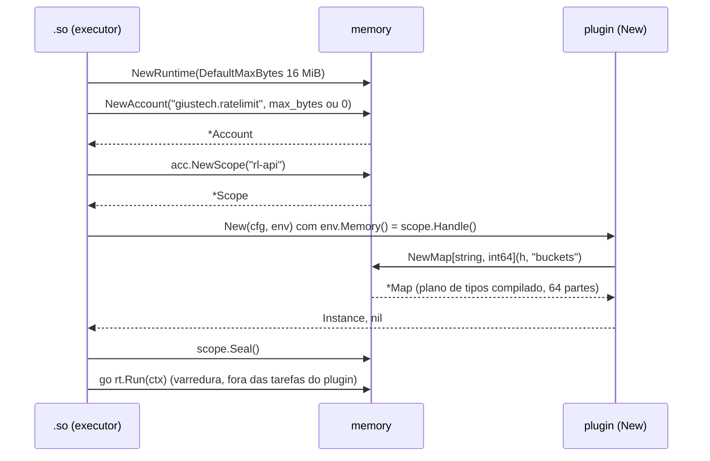
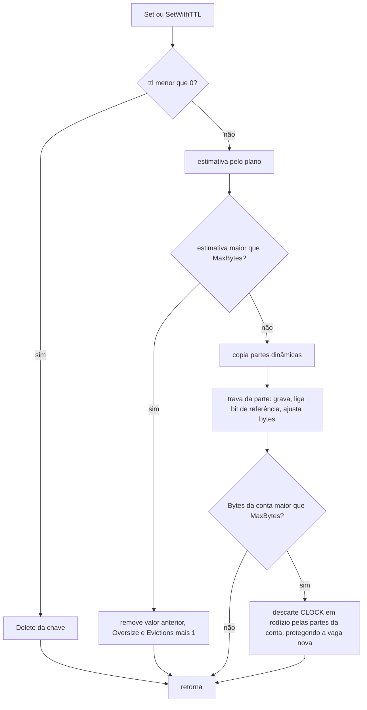
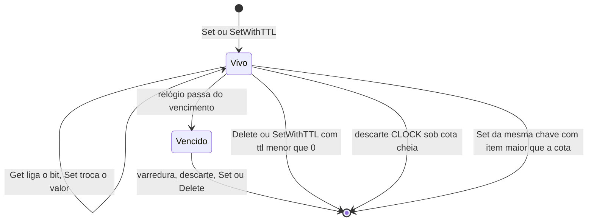

### FDD: Memória isolada por plugin (SDK-04)

Versão: 1.0
Data: 2026-10-20
Responsável: Guilherme Giusti

---

### 1. Contexto e motivação técnica

**Problema técnico.** Plugins precisam guardar valores voláteis (contadores, resultados de consulta, estado de tarefas de fundo) no sidecar e no controller. O ADR-005 exigiu um espaço de memória por plugin, preso ao ID e sem acessor global. O ADR-017 fixou a API (`memory.NewMap[K, V](env.Memory(), "nome")` com `Get`, `Set` com TTL opcional, `Delete` e `Len`), a cota (16 MiB no sidecar e 64 MiB no controller, por plugin) e o descarte do mais antigo quando a cota enche. Faltava o comportamento verificável:

- o que é o handle, quem o cria e qual é o escopo dele (plugin inteiro ou instância)
- quando `NewMap` pode ser chamado e o que acontece com nomes repetidos
- quais tipos `K` e `V` são aceitos e como estimar o tamanho de um item sem `reflect` no caminho quente
- como o descarte estilo CLOCK funciona com 64 partes e vários mapas sob uma única cota
- quando um item com TTL deixa de existir e quem roda a varredura
- onde o operador ajusta a cota (lacuna L-51) e o que acontece com um item maior que a cota inteira

Há um problema novo, achado nesta entrevista: os acessores do `Stream` não copiam (`s.Path()`, `Headers().Get`, HLD do `n3x-sdk`). Se um plugin grava `s.Path()` como chave e o mapa guarda a string sem copiar, a chave passa a apontar para um buffer reaproveitado pela próxima requisição. O resultado é chave corrompida ou leitura de memória já liberada. O mapa precisa copiar as partes dinâmicas na gravação.

**Encaixe no HLD.** Esta FDD especifica o pacote `memory/` do módulo `github.com/giustech/n3x-sdk` (HLD do `n3x-sdk`: linha `memory/` de "Componentes e responsabilidades", "Considerações de escalabilidade" com 64 partes e CLOCK, "Segurança" com isolamento por handle, e "Observabilidade"). É o único cache oferecido aos plugins, igual nas duas metades:

- `proxy.Env.Memory()` entrega o handle à metade de proxy (FDD 06)
- `ctrl.Env.Memory()` entrega o handle à metade de controller (FDD 08)
- o executor do sidecar cria a conta de cada plugin, o escopo de cada instância e roda a varredura (FDD 17); a telemetria do `.so` publica as métricas (FDD 16)
- o host do controller faz o mesmo com a cota de 64 MiB (FDD 32)
- o kit de testes usa a implementação real com relógio falso (FDDs 07 e 12)
- o plugin de exemplo conta negações num mapa (FDD 13)
- o plugin core não guarda o Store do controller aqui (ADR-001 do `n3x-plugin-core`, FDD 41) e decide onde guarda o token na FDD 39

**Atores.** Autor de plugin (cria mapas no `New` e usa nos hooks e tarefas), runtime do sidecar (`.so`) e host do controller (criam contas e escopos, aplicam a cota, rodam a varredura e publicam métricas), kit de testes, operador (ajusta a cota no `n3x.yaml` e acompanha as métricas) e mantenedor do SDK.

**Limites.** O pacote é uma biblioteca: não faz I/O, não loga, não tem estado global e não cria goroutine. Quem cria o `Runtime`, chama a varredura e lê as estatísticas é o processo hospedeiro. Nada é persistido; os dados somem no restart (ADR-005).

**Suposições**
- Go 1.26 ou superior em todas as imagens do builder (ADR-021 do `n3x-sdk`); `hash/maphash.Comparable` existe desde o Go 1.24
- Uso típico: chaves pequenas (até algumas centenas de bytes) e valores de tamanho fixo ou strings curtas; caches maiores ficam na metade de controller
- O executor do sidecar e o host do controller chamam o `New` de cada instância sob `recover` e tratam um panic como erro do `New` (FDDs 17 e 32)
- Os workers do Envoy chamam o Go em paralelo e `GOMAXPROCS` é maior ou igual ao número de workers (ADR-008 do `n3x-sidecar`)

**Restrições**
- `memory/` importa só a biblioteca padrão (HLD do `n3x-sdk`, ADR-011); não importa `plugin/`, `proxy/`, `controller/` nem grpc-go
- Sem cgo (ADR-011)
- O plugin nunca recebe erro no caminho quente (ADR-017)
- Contrato estável desde a `v1.0.0`; antes disso, pré-releases `v0.x` (ADR-021)
- Dados voláteis, sem compartilhamento entre réplicas nem entre processos (ADR-005)
- Documentação e mensagens em pt-BR; identificadores em inglês

**Rastreabilidade**
- PRD 1.5: FR-012 (espaço de memória preso ao ID, cota padrão de 16 MiB no sidecar e 64 MiB no controller, descarte do mais antigo, sem acesso ao espaço de outro plugin), FR-013 (memória isolada na metade de controller); requisitos não funcionais de desempenho (0 alocações nos caminhos comuns do SDK), confiabilidade (`GOMEMLIMIT` contra OOM) e testes (benchmarks com `-benchmem`)
- ADRs do `n3x-sdk`: ADR-005 (memória isolada, de plataforma), ADR-011, ADR-017, ADR-021 e ADR-022; ADR-001 e ADR-009 do `n3x-plugin-core`; ADR-007 e ADR-008 do `n3x-sidecar`
- Lacunas do README:
  - **L-51 fechada na parte de memória:** a cota fica em `runtime.plugin_limits["<id>"].memory.max_bytes`, por ID de plugin, nos dois `n3x.yaml`, fora da `config` tipada e fora do item de instância (hipótese). A mesma regra vale para os limites de tarefas e conexões, que a FDD 06 aplica (contrato 5)
  - **L-09 recebe insumo:** não há modo "fixo" na v1 (hipótese); a recomendação para a FDD 39 é guardar o token num campo privado da instância do core
  - **L-15 não é impedida:** o pacote só contabiliza o que passa por `memory.Map`; o Store do core, com estruturas próprias e teto de 128 MiB, fica fora da cota. A confirmação e o registro da exceção são da FDD 41

---

### 2. Objetivos técnicos

- **Isolamento por construção.** Invariante: nenhum símbolo exportado de `memory/` recebe um ID, um nome de instância ou um nome de mapa e devolve dados; não há estado global. Medida: teste golden da superfície pública (`go doc -all ./memory`) e teste com duas contas no mesmo processo.
- **0 alocações no caminho quente.** Medida com `testing.AllocsPerRun(1000, ...)`: `Get` (acerto e falha) com qualquer tipo aceito, `Delete`, `Len` e `Set` que sobrescreve chave existente com `K` e `V` de tamanho fixo dão 0 alocações por operação.
- **Cota respeitada.** Invariante: ao fim de cada `Set` sem concorrência, `Stats().Bytes <= Stats().MaxBytes`. Com `Set` concorrentes, o excesso momentâneo é no máximo a soma dos itens em gravação simultânea e some quando as gravações terminam.
- **Contabilidade exata da própria estimativa.** Invariante: `Stats().Bytes` é igual à soma das estimativas dos itens presentes em todos os mapas da conta, conferida no fuzzing e no teste de concorrência depois que tudo para.
- **Estimativa honesta.** Medida: nos quatro tipos de referência da seção 9, o heap real ocupado pelos itens fica entre 0,5 e 2,0 vezes `Stats().Bytes` (hipótese).
- **O novo item é sempre aceito.** Invariante: um item com estimativa menor ou igual à cota nunca é descartado pelo próprio `Set` que o gravou; um `Get` logo depois, na mesma goroutine e sem `Delete` concorrente, encontra o valor.
- **Seguro entre os workers do Envoy.** Medida: teste com 16 goroutines e `go test -race` sem corrida. Operações sobre a mesma chave são linearizáveis.
- **Nenhum código de plugin sob trava.** Invariante: o pacote não chama função do plugin (sem callback, sem interface de tamanho), então um panic ou um bloqueio do plugin nunca acontece com uma trava do pacote segurada.
- **Mesmo comportamento nas duas metades.** Invariante: sidecar e controller usam o mesmo código; só a cota padrão muda.

---

### 3. Escopo e exclusões

**Incluído**
- Tipo `memory.Handle`, opaco, preso a um escopo (ID do plugin e instância), entregue em `env.Memory()`
- `memory.NewMap[K, V]`: momento permitido (só enquanto o `New` da instância roda), nome único no escopo, limite de mapas por escopo, tipos aceitos e panics de uso indevido
- `memory.Map[K, V]` com `Get`, `Set`, `SetWithTTL`, `Delete` e `Len`, inclusive leitura de item expirado
- Regras de tipos de `K` e `V`, fórmula da estimativa de bytes e cópia das partes dinâmicas na gravação
- Cota por plugin compartilhada entre todos os mapas e todas as instâncias do plugin no processo
- Descarte aproximado estilo CLOCK com 64 partes e trava por parte; recusa do item maior que a cota inteira
- TTL com relógio monotônico: verificado na leitura e removido por varredura incremental que o runtime conduz
- API do runtime: `Runtime`, `Account`, `Scope`, `Stats`, `Sweep` e `Run`, com as constantes de cota
- Forma e regras do bloco `runtime.plugin_limits["<id>"].memory.max_bytes` nos dois `n3x.yaml` (L-51)
- Contrato das métricas `n3x_plugin_memory_bytes`, `n3x_plugin_memory_evictions_total` e `n3x_plugin_memory_max_bytes` (valores vindos de `Stats`; publicação pelos runtimes)

**Excluído**
- Como `proxy.Env` e `ctrl.Env` entregam o handle: FDDs 06 (SDK-06) e 08 (SDK-08)
- Validação do bloco `runtime.plugin_limits` nos parsers do `n3x.yaml`: FDD 15 (SID-01) no sidecar e FDD 30 (CTL-01) no controller, aplicando as regras do contrato 5
- Criação de contas e escopos, selo após o `New`, goroutine da varredura e publicação das métricas: FDDs 17 (SID-03) e 16 (SID-02) no sidecar; FDD 32 (CTL-03) no controller
- Limites de tarefas de fundo e de conexões: FDD 06 (SDK-06), que aplica a regra de configuração da L-51 definida aqui
- Store em memória do plugin core, com teto de 128 MiB fora desta cota: FDD 41 (CORE-05)
- Onde o core guarda o token de sessão no sidecar: FDD 39 (CORE-03)
- Regra de análise estática contra `unsafe` e `reflect` sobre tipos do SDK: FDD 24 (BLD-06)
- Persistência: o banco é sempre do plugin, fora do SDK
- Fora da v1, por adição em minor quando houver caso real (hipótese): iteração (`Range`), limpeza total (`Clear`), modo fixo fora do descarte, interface de tamanho informado pelo tipo, ponteiros e maps como valor, métricas de acerto e falha por mapa

---

### 4. Fluxos detalhados e diagramas

**Fluxo principal: subida e uso no sidecar**
- O entrypoint e o `.so` validam `runtime.plugin_limits` junto com o resto do `n3x.yaml` (FDD 15; o `.so` lê o próprio arquivo, ADR-007 do `n3x-sidecar`)
- O `.so` cria um único `memory.Runtime` por processo, com `DefaultMaxBytes: memory.DefaultProxyMaxBytes` (FDD 17)
- Para cada plugin com pelo menos uma instância no `n3x.yaml`, e sempre para o `n3x.core`, o `.so` chama `rt.NewAccount(id.String(), maxBytes)`, com `maxBytes` vindo de `runtime.plugin_limits["<id>"].memory.max_bytes` ou 0 (padrão)
- Para cada instância, o `.so` chama `acc.NewScope(instance)` e monta o `proxy.Env` com `env.Memory()` devolvendo `scope.Handle()` (FDD 06)
- O `.so` chama `New(cfg, env)` sob `recover`. Dentro do `New`, o plugin chama `memory.NewMap[K, V](env.Memory(), "nome")`:
  - confere o handle (valor zero é panic), o selo do escopo, o nome, a unicidade no escopo e o limite de 64 mapas
  - compila, uma vez e com `reflect`, o plano de tamanho e de cópia de `K` e de `V`; tipo fora das regras é panic
  - aloca as 64 partes e registra o mapa na conta
- Quando o `New` retorna (com sucesso, erro ou panic), o `.so` chama `scope.Seal()`. Erro ou panic no `New` faz o Envoy não subir (FR-004)
- O `.so` roda `rt.Run(ctx)` numa goroutine própria do runtime, com `recover`, fora do limite de tarefas de fundo do plugin, e publica as métricas a partir de `acc.Stats()` (FDD 16)
- Na requisição e nas tarefas de fundo, o plugin chama `Get`, `Set`, `SetWithTTL`, `Delete` e `Len`. Nenhuma dessas chamadas devolve erro
- No desligamento, o `ctx` de `Run` é cancelado; os dados somem com o processo

**Fluxo do `Get`**
- Calcula o hash da chave com `hash/maphash` e a semente do mapa e escolhe a parte (`hash & 63`)
- Pega a trava de leitura da parte, procura a chave no índice da parte
- Ausente: devolve `(zero, false)`
- Presente com TTL vencido pelo relógio monotônico: devolve `(zero, false)` sem remover (a remoção fica com a varredura, o descarte ou o próximo `Set` ou `Delete`)
- Presente e válido: marca o bit de referência do CLOCK com escrita atômica (só se estiver zerado) e devolve uma cópia rasa do valor
- Solta a trava. Não aloca e não chama código do plugin

**Fluxo do `Set` e do `SetWithTTL`**
- Calcula a estimativa do item novo pelo plano de tamanho (seção 5, contrato 3)
- Estimativa maior que `MaxBytes` da conta: remove o valor anterior da chave, se houver, soma 1 em `Oversize` e em `Evictions`, guarda o nome do mapa em `LastOversizeMap` e retorna sem gravar
- `SetWithTTL` com `ttl < 0`: equivale a `Delete(key)` (item já nasce vencido); com `ttl == 0`: equivale a `Set` (sem expiração)
- Copia as partes dinâmicas de `V` (strings e slices) e, se a chave for nova, as de `K`
- Pega a trava de escrita da parte:
  - chave existente: troca o valor inteiro, a estimativa, o vencimento (`Set` sem TTL limpa um vencimento anterior) e liga o bit de referência
  - chave nova: ocupa uma vaga livre da parte (ou acrescenta uma), grava no índice e liga o bit de referência
  - ajusta os bytes da parte e soma a diferença no contador atômico da conta
- Solta a trava. Se a conta passou da cota, chama o descarte, protegendo a vaga recém-gravada

**Fluxo do descarte (CLOCK por conta)**
- Lê sem trava a lista imutável das partes de todos os mapas da conta (troca atômica de ponteiro a cada `NewMap`)
- Começa na parte apontada pelo cursor da conta (incremento atômico) e percorre as partes em rodízio, uma trava por vez, nunca duas ao mesmo tempo
- Em cada parte, avança o ponteiro do relógio por no máximo duas voltas na parte:
  - vaga livre ou vaga protegida: pula
  - item vencido: remove e soma em `Expired`
  - bit de referência ligado: desliga e segue (segunda chance)
  - bit desligado: remove e soma em `Evictions`
- Para assim que `Bytes <= MaxBytes`, ou depois de uma volta completa por todas as partes sem nenhuma remoção
- "Mais antigo" é o menos usado recentemente, pela aproximação do CLOCK; itens vencidos saem primeiro

**Fluxo da varredura de TTL**
- O runtime chama `rt.Sweep()` a cada `SweepInterval` (padrão de 1 s) por meio de `rt.Run(ctx)`; no kit de testes, `Sweep` é chamado à mão com o relógio falso
- Para cada mapa com pelo menos um item com TTL, e para cada parte dele, pega a trava de escrita, examina até 256 vagas a partir do cursor de varredura da parte, remove as vencidas (somando em `Expired`) e solta a trava
- Uma parte com até 256 vagas é varrida inteira em cada passada; uma parte maior completa a volta em várias passadas

**Fluxos alternativos e exceções**
- **Controller:** igual ao sidecar, com `DefaultMaxBytes: memory.DefaultControllerMaxBytes`, uma conta por plugin com metade de controller e um único escopo por plugin, com instância `""` (FDD 32). O `ctrl.Env.Memory()` devolve esse handle (FDD 08)
- **Kit de testes:** o `sdktest` cria um `Runtime` por teste com relógio falso e chama `Sweep` de forma determinística; a cota pode ser reduzida para testar descarte (FDD 07)
- **Cota cheia:** o item novo é aceito e o descarte remove os menos usados de qualquer mapa ou instância do mesmo plugin; outros plugins não são afetados
- **Item maior que a cota:** não é gravado; o valor anterior da chave some, para nenhum `Get` devolver um valor mais antigo que o último `Set`
- **Leitura de item vencido:** `(zero, false)`, igual a chave ausente
- **`NewMap` depois do `New`:** panic. Num hook, o executor contém o panic e aplica a política de falha (FDD 18); numa tarefa de fundo, a tarefa reinicia com backoff (FDD 06); num handler do controller, a resposta é 500 ou `INTERNAL` (FDD 32)
- **`NewMap` com tipo recusado ou nome repetido dentro do `New`:** panic convertido em erro do `New`; o sidecar ou o controller não sobe, com mensagem que cita plugin, instância, mapa e tipo
- **Duas instâncias do mesmo plugin com o mesmo nome de mapa:** mapas distintos, um por escopo, dividindo a mesma cota
- **Plugin sem mapas:** a conta existe com 0 bytes, e as métricas saem com 0
- **Restart do processo:** todos os dados se perdem (ADR-005); o plugin trata isso como cache vazio

**Diagramas**

Sequência da subida no sidecar (as chamadas do runtime são das FDDs 06 e 17; aqui só a ordem das chamadas ao pacote):



Fluxo do `Set`:



Estados de um item:



Estados de um escopo: `aberto` (criado por `NewScope`, aceita `NewMap`) e `selado` (depois de `Seal`, recusa `NewMap` com panic). Não há volta.

---

### 5. Contratos públicos (assinaturas, endpoints, headers, exemplos)

**Contrato 1: `memory.Handle` e `memory.NewMap`**
- Tipo: sdk (API Go para autores de plugin)
- Assinatura/Rota:
  ```go
  package memory // github.com/giustech/n3x-sdk/memory

  // Handle identifica o escopo de memória de uma instância de plugin.
  // O valor zero é inválido. Não existe função que devolva o Handle de outro escopo.
  type Handle struct{ /* ponteiro não exportado para o escopo */ }

  // NewMap cria um mapa tipado no escopo do handle. Só pode ser chamado
  // enquanto o escopo está aberto (durante o New da instância). Faz panic em uso indevido.
  func NewMap[K comparable, V any](h Handle, name string) *Map[K, V]

  const (
      NumShards       = 64 // partes por mapa
      MaxMapsPerScope = 64 // mapas por escopo
  )
  ```
- Método: n/a (chamada local)
- Semântica:
  - **Escopo (hipótese):** cada instância recebe o próprio handle. No sidecar, um escopo por `instance` do `n3x.yaml`; no controller, um escopo por plugin, com instância `""`. Todos os escopos de um plugin no mesmo processo dividem a mesma conta, e portanto a mesma cota. Mapas de escopos diferentes são distintos mesmo com o mesmo nome. Motivo: cada `New` começa com estado próprio, como os campos da instância, e duas instâncias do `n3x.example` não somam a mesma contagem
  - **Momento (hipótese):** permitido enquanto o escopo está aberto. O runtime sela o escopo quando o `New` retorna. Uma tarefa de fundo iniciada no `New` que chame `NewMap` antes do selo também é aceita. Motivo: cada mapa aloca 64 partes fora da cota, e criar mapas por requisição vazaria memória sem contabilidade
  - **Nome (hipótese):** casa com `^[a-z][a-z0-9_]{0,31}$` e é único no escopo. Aparece em mensagens de panic e no campo `map` do log de item recusado; nunca é rótulo de métrica
  - **Panics** (mensagem sempre começa com `memory:` e cita plugin, instância e mapa, nunca chave ou valor):
    - handle de valor zero
    - escopo selado
    - nome fora do formato
    - nome repetido no mesmo escopo
    - mais de `MaxMapsPerScope` mapas no escopo
    - `K` ou `V` fora das regras do contrato 3
  - **Custo:** roda uma vez por mapa, fora do caminho quente. Compila com `reflect` o plano de tamanho e de cópia dos tipos e aloca as 64 partes (cerca de 10 KiB por mapa vazio, fora da cota; hipótese de ordem de grandeza)

**Exemplo de requisição**
```go
func New(cfg Config, env proxy.Env) (proxy.Instance, error) {
    i := &RateLimit{cfg: cfg}
    i.buckets = memory.NewMap[string, int64](env.Memory(), "buckets")
    i.seen = memory.NewMap[[16]byte, Seen](env.Memory(), "seen") // Seen{Hits int64; Last time.Time}
    return i, nil
}
```

**Exemplo de resposta**
```json
{
  "buckets": { "aceito": true, "escopo": "giustech.ratelimit/rl-api", "partes": 64 },
  "seen": { "aceito": true, "escopo": "giustech.ratelimit/rl-api", "partes": 64 },
  "NewMap(\"buckets\") de novo no mesmo New": "panic: memory: mapa \"buckets\" já existe (plugin \"giustech.ratelimit\", instância \"rl-api\")",
  "NewMap dentro de OnRequestHeaders": "panic: memory: escopo selado; crie mapas só no New (plugin \"giustech.ratelimit\", instância \"rl-api\", mapa \"tmp\")"
}
```

---

**Contrato 2: `memory.Map[K, V]`**
- Tipo: sdk (API Go para autores de plugin)
- Assinatura/Rota:
  ```go
  type Map[K comparable, V any] struct{ /* 64 partes; nenhum campo exportado */ }

  func (m *Map[K, V]) Get(key K) (V, bool)
  func (m *Map[K, V]) Set(key K, val V)
  func (m *Map[K, V]) SetWithTTL(key K, val V, ttl time.Duration)
  func (m *Map[K, V]) Delete(key K)
  func (m *Map[K, V]) Len() int
  ```
- Método: n/a
- Semântica:
  - `Get`: devolve o valor e `true` se a chave existe e não venceu; senão, o valor zero e `false`. Item vencido e ainda não removido é tratado como ausente
  - `Set`: grava sem expiração; sobrescreve o valor e limpa um vencimento anterior. Nunca devolve erro. Cota cheia descarta outros itens do mesmo plugin; item maior que a cota inteira não é gravado e o valor anterior da chave some (seção 6)
  - `SetWithTTL` (hipótese de convenção, a mesma de bibliotecas de cache conhecidas): `ttl > 0` vence em `agora + ttl` no relógio monotônico do runtime; `ttl == 0` é igual a `Set`; `ttl < 0` é igual a `Delete`. Sem teto de TTL
  - `Delete`: remove a chave; chave ausente é operação vazia
  - `Len`: número de itens gravados no mapa, somando as 64 partes sem trava global. Inclui itens vencidos que a varredura ainda não removeu; sob concorrência, é aproximado
  - **Concorrência:** todos os métodos são seguros entre goroutines (workers do Envoy, tarefas de fundo e handlers do controller). Operações sobre a mesma chave são linearizáveis. A espera máxima é a de outra operação na mesma parte; nada bloqueia por I/O
  - **Trava (hipótese):** `sync.RWMutex` por parte, com o bit de referência do CLOCK em escrita atômica para o `Get` funcionar sob trava de leitura; pode virar `sync.Mutex` se o benchmark mostrar ganho, sem mudar o contrato
  - **Cópia na gravação:** `Set` copia as strings e slices de `V` (e de `K`, quando a chave é nova). É seguro gravar `s.Path()` ou um header sem cópia vindo do `Stream`. Strings e slices devolvidos pelo `Get` apontam para a cópia interna e são somente leitura; o pacote nunca altera no lugar um valor já gravado
  - **Chave `NaN`** em `float32` ou `float64` nunca é encontrada, como num `map` do Go; o item sai pelo descarte ou pela varredura
- Alocações por operação:

| Operação | Alocações |
| --- | --- |
| `Get` (acerto ou falha), qualquer tipo aceito | 0 |
| `Delete` e `Len` | 0 |
| `Set` ou `SetWithTTL` sobrescrevendo chave existente, `K` e `V` de tamanho fixo | 0 |
| `Set` de chave nova, `K` e `V` de tamanho fixo | 0 em regime, reaproveitando vagas; crescimento do índice interno amortizado (hipótese) |
| `Set` com partes dinâmicas | 1 por string ou slice não vazio copiado, mais a cópia da chave quando ela é nova e dinâmica |

**Exemplo de requisição**
```go
m := memory.NewMap[string, int64](env.Memory(), "buckets") // no New
m.Set("10.0.0.7", 3)
m.SetWithTTL("10.0.0.8", 1, 30*time.Second)
v, ok := m.Get("10.0.0.7")
m.Delete("10.0.0.7")
_, ok2 := m.Get("10.0.0.7")
// 31 s depois, no relógio monotônico:
_, ok3 := m.Get("10.0.0.8")
n := m.Len() // antes da varredura
```

**Exemplo de resposta**
```json
{ "v": 3, "ok": true, "ok2": false, "ok3": false, "n": 1, "erros": 0, "alocacoes_no_Get": 0 }
```

---

**Contrato 3: tipos aceitos e estimativa de bytes**
- Tipo: sdk (regra do `NewMap` e fórmula usada pelo `Set`)
- Assinatura/Rota: `K` precisa ser `comparable` (compilador) e passar pelas regras abaixo; `V` passa pelas mesmas regras. A conferência é feita uma vez, no `NewMap`
- Método: n/a
- Semântica (hipótese: forma escolhida para a estimativa ser honesta sem `reflect` no caminho quente):

| Forma do tipo | Aceita | Tamanho raso | Parte dinâmica |
| --- | --- | --- | --- |
| `bool`, inteiros, `uintptr`, `float*`, `complex*` | sim | `Type.Size()` | 0 |
| `time.Time` (exceção explícita) | sim | 24 | 0 |
| `string` | sim | 16 | `len(s)` |
| `[]T`, com `T` aceito (inclui `[]byte`) | sim | 24 | `len(s) * raso(T)` mais a parte dinâmica de cada elemento |
| `[N]T` e `struct`, com todos os elementos e campos aceitos | sim | `Type.Size()` | soma das partes dinâmicas dos elementos e campos |
| ponteiro, `unsafe.Pointer`, `map`, `chan`, `func`, interface (inclusive `any` e `error`) | não | | |
| tipo recursivo (por exemplo, `type T []T`) e struct com campo recusado | não | | |

- Estimativa de um item: `32 + 2 * raso(K) + raso(V) + dinamico(K) + dinamico(V)`
  - 32 bytes cobrem os metadados da vaga (estimativa, vencimento, bit de referência) e a folga do índice (hipótese, calibrada pelo teste de memória real)
  - `raso(K)` conta duas vezes porque a chave fica na vaga e no índice da parte; a parte dinâmica da chave é uma só, compartilhada
  - A fórmula não é contrato: pode ser recalibrada em patch; o contrato é a cota, o descarte e as métricas
- No caminho quente, o `Set` de tipo fixo usa uma constante calculada no `NewMap`. Tipo com parte dinâmica percorre o plano compilado no `NewMap`, lendo cabeçalhos de string e slice por deslocamento (uso interno de `unsafe`, que continua proibido aos plugins, FDD 24)
- `time.Time` é aceito porque o ponteiro para `*time.Location` aponta para um objeto compartilhado e imutável; a cópia rasa é segura
- Overhead fixo de cada mapa (as 64 partes vazias) fica fora da cota

**Exemplo de requisição**
```json
[
  { "NewMap": "Map[int64, int64]", "Set": [42, 7] },
  { "NewMap": "Map[string, int64]", "Set": ["/admin", 1] },
  { "NewMap": "Map[string, []byte]", "Set": ["0123456789", "100 bytes"] },
  { "NewMap": "Map[[16]byte, struct{Hits int64; Last time.Time}]", "Set": ["16 bytes", { "Hits": 1 }] },
  { "NewMap": "Map[string, *Sessao]" },
  { "NewMap": "Map[string, map[string]int]" }
]
```

**Exemplo de resposta**
```json
[
  { "estimativa_bytes": 56 },
  { "estimativa_bytes": 78 },
  { "estimativa_bytes": 198 },
  { "estimativa_bytes": 96 },
  { "panic": "memory: tipo V *Sessao não aceito: ponteiro (plugin \"giustech.ratelimit\", instância \"rl-api\", mapa \"sessoes\")" },
  { "panic": "memory: tipo V map[string]int não aceito: map (plugin \"giustech.ratelimit\", instância \"rl-api\", mapa \"tabela\")" }
]
```

Conta das estimativas: `56 = 32 + 2*8 + 8`; `78 = 32 + 2*16 + 8 + 6`; `198 = 32 + 2*16 + 24 + 10 + 100`; `96 = 32 + 2*16 + 32`.

---

**Contrato 4: API do runtime (`Runtime`, `Account`, `Scope` e `Stats`)**
- Tipo: sdk (API Go para o executor do sidecar, o host do controller e o kit de testes; plugins não chamam)
- Assinatura/Rota:
  ```go
  type RuntimeOptions struct {
      DefaultMaxBytes int64                // 0 = DefaultProxyMaxBytes
      SweepInterval   time.Duration        // 0 = DefaultSweepInterval
      Clock           func() time.Duration // relógio monotônico; nil = relógio real
  }

  type Runtime struct{ /* sem estado global; um por processo */ }

  func NewRuntime(opts RuntimeOptions) *Runtime
  func (r *Runtime) NewAccount(owner string, maxBytes int64) (*Account, error) // owner = id.String(); maxBytes 0 = padrão
  func (r *Runtime) Sweep()                  // uma passada incremental em todas as contas
  func (r *Runtime) Run(ctx context.Context) // chama Sweep a cada SweepInterval até o ctx ser cancelado

  type Account struct{ /* cota e contadores de um plugin */ }

  func (a *Account) NewScope(instance string) (*Scope, error) // "" no controller
  func (a *Account) Stats() Stats                              // leituras atômicas; 0 alocações

  type Scope struct{ /* escopo de uma instância */ }

  func (s *Scope) Handle() Handle
  func (s *Scope) Seal() // idempotente

  type Stats struct {
      Owner           string // ID do plugin
      MaxBytes        int64
      Bytes           int64  // soma das estimativas dos itens presentes
      Items           int64
      Maps            int
      Evictions       uint64 // descartes por cota, incluindo os itens recusados por tamanho
      Oversize        uint64 // itens recusados por serem maiores que a cota inteira
      Expired         uint64 // itens removidos por TTL
      LastOversizeMap string // nome do último mapa com item recusado
  }

  const (
      DefaultProxyMaxBytes      = 16 << 20 // sidecar (ADR-017)
      DefaultControllerMaxBytes = 64 << 20 // controller (ADR-017)
      MinMaxBytes               = 1 << 20  // hipótese
      MaxMaxBytes               = 1 << 30  // hipótese
      DefaultSweepInterval      = time.Second // hipótese
  )

  var (
      ErrInvalidOwner    = errors.New("memory: dono vazio")
      ErrDuplicateOwner  = errors.New("memory: plugin já tem conta neste runtime")
      ErrInvalidMaxBytes = errors.New("memory: max_bytes fora da faixa de 1 MiB a 1 GiB")
      ErrDuplicateScope  = errors.New("memory: instância já tem escopo neste plugin")
  )
  ```
- Método: n/a
- Semântica:
  - Um `Runtime` por processo, criado pelo `.so` (FDD 17) ou pelo host do controller (FDD 32); o kit de testes cria um por teste. Dois `Runtime` são totalmente independentes; não há registro global, então criar outro `Runtime` não dá acesso aos dados do primeiro
  - `NewAccount`: uma conta por plugin; `owner` repetido devolve `ErrDuplicateOwner`; `maxBytes` igual a 0 usa `DefaultMaxBytes`; fora de `[MinMaxBytes, MaxMaxBytes]` devolve `ErrInvalidMaxBytes`. O pacote recebe o ID como texto para não importar `plugin/`; quem chama já validou o ID com `plugin.ParseID`
  - `NewScope`: um escopo por instância; nome repetido devolve `ErrDuplicateScope`
  - `Seal`: o runtime chama sempre depois do `New` da instância, com `defer`, inclusive quando o `New` falha ou dá panic
  - `Run`: bloqueia até o `ctx` ser cancelado. O runtime roda numa goroutine própria, com `recover`, rótulo de pprof `component=memory` e fora do limite de tarefas de fundo do plugin (a FDD 06 não conta esta goroutine em nenhum plugin)
  - `Stats`: barato (leituras atômicas e cópia de struct), para o runtime ler a cada publicação de métricas
  - A API do runtime é exportada porque sidecar, controller e kit de testes ficam em outros repositórios ou pacotes. Plugins não a chamam; a FDD 24 pode recusar no build o uso de `memory.NewRuntime` por código de plugin (hipótese). Mesmo sem essa regra, o isolamento se mantém, porque um `Runtime` criado pelo plugin é vazio e separado

**Exemplo de requisição**
```go
rt := memory.NewRuntime(memory.RuntimeOptions{DefaultMaxBytes: memory.DefaultProxyMaxBytes})
acc, _ := rt.NewAccount("giustech.ratelimit", 32<<20) // runtime.plugin_limits["giustech.ratelimit"].memory.max_bytes: 32Mi
sc, _ := acc.NewScope("rl-api")
inst, err := callNewWithRecover(plugin, cfg, envWith(sc.Handle()))
sc.Seal()
go runWithRecover(func() { rt.Run(ctx) })
_, errDup := rt.NewAccount("giustech.ratelimit", 0)
_, errMax := rt.NewAccount("giustech.outro", 512<<10)
```

**Exemplo de resposta**
```json
{
  "acc.Stats()": {
    "Owner": "giustech.ratelimit",
    "MaxBytes": 33554432,
    "Bytes": 1048576,
    "Items": 13443,
    "Maps": 2,
    "Evictions": 0,
    "Oversize": 0,
    "Expired": 120,
    "LastOversizeMap": ""
  },
  "errDup": "memory: plugin já tem conta neste runtime",
  "errMax": "memory: max_bytes fora da faixa de 1 MiB a 1 GiB"
}
```

---

**Contrato 5: bloco `runtime.plugin_limits` nos dois `n3x.yaml` (L-51)**
- Tipo: config (contrato de arquivo; o schema completo dos arquivos é das FDDs 15 e 30, que aplicam estas regras)
- Assinatura/Rota: `runtime.plugin_limits["<id>"].memory.max_bytes`
- Método: n/a
- Semântica (hipótese de lugar e de forma; o nome `memory.max_bytes` vem do ADR-017):
  1. Limites de runtime de um plugin (memória aqui; tarefas de fundo e conexões na FDD 06) valem por ID de plugin e por processo. Nunca ficam na `config` tipada do plugin, porque não são config de domínio, não devem entrar no schema nem no `schema-check` e não pertencem a uma instância. Também não ficam no item de instância de `plugins`, porque o plugin pode ter várias instâncias e o core nem aparece ali
  2. Ficam em `runtime.plugin_limits["<id>"]`, com a mesma forma no `n3x.yaml` do serviço e no do controller. Cada recurso tem um sub-bloco com o nome do recurso: `memory.max_bytes` aqui; a FDD 06 acrescenta os seus no mesmo bloco (sugestão: `background.max_tasks` e `dial.max_conns`)
  3. Bloco, chave ou campo ausente: vale o padrão do SDK (`DefaultProxyMaxBytes` no sidecar, `DefaultControllerMaxBytes` no controller)
  4. A chave precisa ser um ID válido (`plugin.ParseID`) de um plugin presente no manifesto embutido e com a metade daquele processo (proxy no sidecar, controller no controller). No sidecar, `n3x.core` é aceito mesmo sem aparecer em `plugins`, porque é implícito. Plugin presente no manifesto sem nenhuma instância configurada: aceito e sem efeito
  5. `max_bytes`: tamanho no mesmo formato dos outros tamanhos do arquivo (por exemplo, `32Mi`; inteiro sem unidade é bytes), entre 1 MiB e 1 GiB (`MinMaxBytes` e `MaxMaxBytes`)
  6. Campo desconhecido dentro do bloco é erro, como no resto do `n3x.yaml`
  7. Erros citam o caminho pela convenção da L-34: `runtime.plugin_limits["giustech.ratelimit"].memory.max_bytes`
  8. Nenhum valor vem de variável de ambiente (FR-001); mudar a cota exige redeploy
  9. Validado por `n3x validate`, `n3x run` e pelo `.so` (FDD 15) e pelo controller (FDD 30); aplicado no `NewAccount` (FDDs 17 e 32)
- Códigos de regra propostos para as FDDs 15 e 30 (reaproveitando `plugin.FieldError` da FDD 01): `unknown_plugin`, `half_missing`, `size_format`, `range` e `unknown_field` (hipótese)

**Exemplo de requisição**
```yaml
# n3x.yaml do serviço (sidecar)
runtime:
  drain_timeout: 20s
  plugin_limits:                 # opcional; por ID, vale para todas as instâncias do plugin neste processo
    giustech.ratelimit:
      memory:
        max_bytes: 32Mi          # padrão no sidecar: 16Mi
    n3x.core:
      memory:
        max_bytes: 4Mi
    giustech.cors:               # não está no manifesto
      memory:
        max_bytes: 8Mi
    n3x.example:
      memory:
        max_bytes: 512Ki         # abaixo de 1 MiB
        max_byte: 2Mi            # erro de digitação
---
# n3x.yaml do controller
runtime:
  plugin_call_timeout: 10s
  plugin_limits:
    giustech.ratelimit:
      memory:
        max_bytes: 128Mi         # padrão no controller: 64Mi
```

**Exemplo de resposta** (erros do `n3x validate` no `n3x.yaml` do serviço, uma linha por problema)
```text
runtime.plugin_limits["giustech.cors"]: plugin não está no manifesto do .so [unknown_plugin]
runtime.plugin_limits["n3x.example"].memory.max_bytes: fora da faixa de 1Mi a 1Gi [range]
runtime.plugin_limits["n3x.example"].memory.max_byte: campo desconhecido [unknown_field]
```

---

**Contrato 6: métricas de memória**
- Tipo: métrica (valores vindos de `Account.Stats()`; publicação pelos runtimes: FDD 16 no sidecar, em stats do Envoy na `17090`; FDD 32 no controller, em Prometheus na `17091`)
- Assinatura/Rota:

| Métrica | Tipo | Rótulos | Fonte em `Stats` |
| --- | --- | --- | --- |
| `n3x_plugin_memory_bytes` | gauge | `plugin` | `Bytes` |
| `n3x_plugin_memory_max_bytes` | gauge | `plugin` | `MaxBytes` (nova, hipótese) |
| `n3x_plugin_memory_evictions_total` | counter | `plugin` | `Evictions` (inclui `Oversize`) |

- Método: n/a
- Semântica:
  - Rótulo só `plugin`, com `id.String()` (hipótese): a cota é por plugin, e o nome do mapa é escolhido pelo autor e não precisa virar série. Uma série por plugin por métrica
  - `n3x_plugin_memory_max_bytes` é nova (hipótese): permite o uso "em relação à cota" que o HLD de plataforma pede, sem o operador conhecer o `n3x.yaml`
  - Remoção por TTL não é descarte e não conta em `evictions_total`
  - O sidecar atualiza os valores a cada 1 s (hipótese, detalhe da FDD 16); o controller lê `Stats()` no scrape (FDD 32)
  - Nenhum rótulo com chave, valor ou nome de mapa

**Exemplo de requisição**
```text
GET http://127.0.0.1:17090/stats/prometheus
```

**Exemplo de resposta**
```text
n3x_plugin_memory_bytes{plugin="giustech.ratelimit"} 1048576
n3x_plugin_memory_max_bytes{plugin="giustech.ratelimit"} 33554432
n3x_plugin_memory_evictions_total{plugin="giustech.ratelimit"} 0
n3x_plugin_memory_bytes{plugin="n3x.core"} 0
n3x_plugin_memory_max_bytes{plugin="n3x.core"} 4194304
n3x_plugin_memory_evictions_total{plugin="n3x.core"} 0
```

---

### 6. Erros, exceções e fallback

**Matriz de erros previstos e tratamentos**

| Condição | Tratamento | Observações |
| --- | --- | --- |
| `NewMap` com handle de valor zero | panic `memory: handle inválido` | Erro de programação; só acontece fora do `env.Memory()` |
| `NewMap` com escopo selado | panic citando plugin, instância e mapa | Num hook vira panic contido com política de falha (FDD 18); em tarefa de fundo, reinício com backoff (FDD 06); no controller, 500 ou `INTERNAL` (FDD 32) |
| Nome de mapa fora do formato ou repetido no escopo | panic no `New` | O runtime converte em erro do `New`; o processo não sobe (FR-004) |
| Mais de 64 mapas no escopo | panic no `New` | Protege o overhead fixo fora da cota |
| `K` ou `V` fora das regras | panic no `New` com o tipo e o motivo | Mensagem sugere guardar como `string` ou `[]byte` serializado |
| `NewAccount` com dono vazio ou repetido | `ErrInvalidOwner` ou `ErrDuplicateOwner` | Erro do runtime, não do plugin |
| `maxBytes` fora de 1 MiB a 1 GiB | `ErrInvalidMaxBytes` | Já barrado antes pela validação do `n3x.yaml` (contrato 5) |
| `NewScope` com instância repetida | `ErrDuplicateScope` | Instância é única no serviço (HLD do `n3x-sidecar`) |
| `Set` com cota cheia | Aceita o novo, descarta os menos usados do mesmo plugin, `Evictions` sobe | Nunca devolve erro (ADR-017) |
| `Set` de item maior que a cota inteira | Não grava, remove o valor anterior da chave, `Oversize` e `Evictions` sobem, guarda `LastOversizeMap` | Truncar não existe para valor tipado; aceitar sozinho apagaria todo o plugin (hipótese) |
| `SetWithTTL` com `ttl < 0` | Igual a `Delete` | `ttl == 0` é igual a `Set` |
| `Get` de chave vencida ou ausente | `(zero, false)` | O plugin trata falha de leitura como caso normal |
| `Delete` de chave ausente | Operação vazia | |
| Método chamado em `*Map` nulo | panic do próprio Go | Erro de programação |
| Bug interno na varredura | O runtime recupera o panic de `Run` e reinicia a goroutine com backoff (FDDs 17 e 32) | O pacote não roda código de plugin, então só um bug do SDK causaria isso |
| `runtime.plugin_limits` inválido | Erro de validação com caminho e regra; o processo não sobe | FDDs 15 e 30 |

**Estratégias de resiliência:** timeouts, retries, backoff e circuit breaker não se aplicam, porque o pacote não faz I/O. A resiliência é estrutural:
- trava por parte segurada por tempo curto e limitado, sem I/O e sem código do plugin dentro
- nunca duas travas de parte ao mesmo tempo, o que exclui deadlock entre partes
- descarte limitado a duas voltas por parte e a uma volta sem remoção pela conta
- varredura com no máximo 256 vagas por trava
- cotas independentes entre plugins: um plugin que enche a própria cota não descarta dados de outro

**Política de fallback:** não há fallback escondido. A perda de item é parte do contrato de cache: descarte por cota, recusa por tamanho, vencimento e restart. Em todos os casos o `Get` devolve `(zero, false)`. Dado que não pode sumir fica fora deste pacote: no banco do plugin ou em campo privado da instância (recomendação para a FDD 39, L-09).

**Invariantes**
- Nenhum símbolo exportado devolve dados a partir de um ID, instância ou nome; não há estado global
- `Stats().Bytes` é igual à soma das estimativas dos itens presentes
- Ao fim de um `Set` sem concorrência, `Bytes <= MaxBytes`
- Item com estimativa menor ou igual à cota nunca é descartado pelo próprio `Set` que o gravou
- `Get` nunca devolve item vencido nem valor mais antigo que o último `Set` ou `Delete` concluído da mesma chave
- O pacote nunca altera no lugar um valor gravado; `Set` troca o valor inteiro
- Nenhum código de plugin roda com trava do pacote segurada
- Contas diferentes não interferem: descarte, contagem e varredura de uma não tocam a outra
- Nenhuma função do pacote faz I/O, loga, lê variável de ambiente ou cria goroutine

---

### 7. Observabilidade

**Métricas**
- `n3x_plugin_memory_bytes` (gauge, rótulo `plugin`): soma das estimativas dos itens do plugin no processo (ADR-017 e ADR-022)
- `n3x_plugin_memory_evictions_total` (counter, rótulo `plugin`): itens perdidos por cota, incluindo os recusados por tamanho (ADR-017 e ADR-022)
- `n3x_plugin_memory_max_bytes` (gauge, rótulo `plugin`): cota efetiva do plugin no processo (nova, hipótese)
- Cardinalidade: 3 séries por plugin por processo; nenhum rótulo com chave, valor, nome de mapa ou instância
- O pacote só expõe `Stats`; a publicação é dos runtimes (FDD 16 no sidecar, FDD 32 no controller). `Expired` e `Oversize` ficam em `Stats` para testes e logs, sem métrica própria na v1
- Na CI do SDK: resultados dos benchmarks com `-benchmem` e relatório de cobertura do pacote

**Logs**
- O pacote não loga. Os runtimes emitem, em JSON, com os campos fixos do componente (`ts`, `level`, `component`, `service`, `instance`, `plugin_id`):
  - na subida, um registro por plugin: `{"level":"info","component":"core","msg":"memory_quota","plugin_id":"giustech.ratelimit","max_bytes":33554432,"source":"n3x.yaml"}` (`source` é `default` ou `n3x.yaml`) (hipótese)
  - quando `Oversize` sobe, no máximo um registro por minuto por plugin: `{"level":"warn","component":"core","msg":"memory_oversize","plugin_id":"giustech.ratelimit","map":"buckets","count":3,"max_bytes":33554432}` (hipótese)
  - panic de `NewMap` no `New` aparece no erro de subida com `plugin_id`, `instance` e a mensagem do panic
- Nunca registra chave, valor ou tamanho de um item específico; o nome do mapa é escolhido pelo autor e não é dado de usuário

**Tracing**
- Sem tracing distribuído na v1 (ADR-009 de plataforma). Não há spans neste pacote
- A goroutine de `Run` leva o rótulo de pprof `component=memory`, para aparecer separada no perfil de goroutines

**Dashboards e alertas**
- Alerta sugerido no guia do operador (HLD do `n3x-sdk`): `rate(n3x_plugin_memory_evictions_total[5m]) > 0` por 15 minutos, aviso de cota apertada
- Alerta informativo (hipótese): `n3x_plugin_memory_bytes / n3x_plugin_memory_max_bytes > 0.9` por 30 minutos
- Painel de referência em `n3x-sdk/deploy/` (FDD 47): uso por plugin em relação à cota e taxa de descartes, no sidecar e no controller

---

### 8. Dependências e compatibilidade

| Componente | Versão mínima | Observações |
| --- | --- | --- |
| Go | 1.26 | Generics e `hash/maphash.Comparable` (Go 1.24 ou superior); mínimo das imagens do builder (ADR-021) |
| Biblioteca padrão | (a do Go) | `sync`, `sync/atomic`, `hash/maphash`, `time`, `context`, `errors`, `fmt` (só nas mensagens de panic), `reflect` (só no `NewMap`) e `unsafe` (só na medição e na cópia das partes dinâmicas); conferido com `go list -deps ./memory` |
| `plugin/` do SDK | não importa | O pacote recebe o ID como texto, para ficar só com a biblioteca padrão |
| `proxy/` (FDD 06) | consumidor | `env.Memory()` devolve `memory.Handle` |
| `controller/` (FDD 08) | consumidor | `ctrl.Env.Memory()` devolve `memory.Handle` |
| `sdktest` (FDDs 07 e 12) | consumidor | `Runtime` real com relógio falso e `Sweep` manual |
| `n3x-sidecar` (FDDs 15, 16 e 17) | runtime | Valida o bloco, cria conta e escopos, sela, roda `Run` e publica métricas |
| `n3x-controller` (FDDs 30 e 32) | runtime | O mesmo, com a cota de 64 MiB |
| `n3x-plugin-core` (FDDs 39 e 41) | consumidor parcial | Store fora da cota (L-15); token fora do mapa (recomendação para a L-09) |
| `n3x-builder` (FDD 24) | análise estática | `unsafe` e `reflect` sobre tipos do SDK proibidos ao código de plugin, não ao SDK |

**Garantias de compatibilidade**
- Semver estrito do módulo desde a `v1.0.0`; antes disso, `v0.x` pode mudar este contrato (ADR-021)
- Congelados na major: `Handle`, `NewMap`, os cinco métodos de `Map`, a semântica de TTL, a cópia na gravação, as constantes `NumShards`, `DefaultProxyMaxBytes` e `DefaultControllerMaxBytes`, os nomes e rótulos das métricas e a forma do bloco `runtime.plugin_limits`
- Crescimento só por adição em minor: aceitar novas formas de tipo (ponteiros, maps, interface de tamanho), métodos novos (`Range`, `Clear`, modo fixo) e campos novos em `Stats`. Passar a recusar um tipo hoje aceito é quebra e só cabe numa major
- A fórmula da estimativa e a sobrecarga de 32 bytes podem ser recalibradas em patch; não fazem parte do contrato
- Mudar a cota padrão é mudança de comportamento: só em minor, com nota de versão (hipótese)
- O bloco `runtime.plugin_limits` cresce por adição dentro do `version: 1` dos dois `n3x.yaml`
- Sidecar e controller compilam o mesmo pacote na mesma versão do SDK (ADR-011), então não há descompasso de comportamento entre as metades

---

### 9. Critérios de aceite técnicos

- `testing.AllocsPerRun(1000, ...)` dá 0 para `Get` com acerto e com falha em `Map[int64, int64]`, `Map[string, int64]`, `Map[[16]byte, struct{Hits int64; Last time.Time}]` e `Map[string, string]`; para `Delete` e `Len`; e para `Set` sobrescrevendo chave existente em `Map[int64, int64]`
- `BenchmarkGet` (`Map[int64, int64]` com 100 mil itens, acerto) fica em até 100 ns/op e 0 allocs/op no runner da CI (hipótese)
- `BenchmarkSetParallel` (`RunParallel` com `GOMAXPROCS=8`, mapa na cota, com descarte) fica em até 1 µs/op e com ns/op menor ou igual ao do `BenchmarkSet` serial, mostrando que as 64 partes não colapsam sob contenção (hipótese)
- Teste de concorrência com `-race`: 16 goroutines, 100 mil operações aleatórias cada (`Get`, `Set`, `SetWithTTL`, `Delete`, `Len`) sobre dois mapas de dois escopos da mesma conta (cota de 1 MiB) e um mapa de outra conta; sem corrida e, depois que tudo para, `Bytes` igual à soma das estimativas, `Bytes <= MaxBytes` e `Len` igual à contagem real
- Teste de cota: conta de 1 MiB, itens de estimativa conhecida gravados até 2 vezes a cota; `Bytes <= MaxBytes` depois de cada `Set`, `Evictions` igual a gravados menos presentes e o último item gravado sempre presente logo depois do próprio `Set`
- Teste do CLOCK: cota para 1.000 itens, 100 chaves quentes lidas entre cada gravação de chave fria; depois de 10.000 chaves frias, pelo menos 90 das 100 quentes continuam presentes (hipótese)
- Teste de item maior que a cota: conta de 1 MiB, `Set` de `[]byte` de 2 MiB numa chave que já tinha valor; o valor não é gravado, o anterior some, `Oversize` e `Evictions` sobem 1 e `LastOversizeMap` traz o nome do mapa
- Teste de TTL com relógio falso: item vencido não volta no `Get`; `ttl < 0` remove; `ttl == 0` não vence; `Set` sem TTL limpa o vencimento anterior; 10 mil itens vencidos somem com uma única chamada a `Sweep` (`Items` igual a 0 e `Expired` igual a 10 mil)
- Teste de isolamento: duas contas (`giustech.a` e `giustech.b`) com o mesmo nome de mapa e as mesmas chaves não enxergam os valores uma da outra; encher a conta A até descartar não muda `Bytes`, `Items` nem os itens da conta B
- Teste golden da superfície pública (`go doc -all ./memory`): nenhuma função exportada recebe ID, instância ou nome e devolve dados; qualquer símbolo exportado novo exige atualizar o golden
- Testes de escopo: `NewMap` depois de `Seal` dá panic com plugin, instância e mapa na mensagem; nome repetido no mesmo escopo dá panic; o mesmo nome em dois escopos dá mapas distintos que dividem a cota; o 65º mapa dá panic; handle de valor zero dá panic
- Testes de tipos: cada forma recusada da tabela do contrato 3 dá panic com o motivo; as formas aceitas e `time.Time` passam; as quatro estimativas do exemplo do contrato 3 batem byte a byte
- Teste de cópia na gravação: chave criada com `unsafe.String` sobre um buffer que é sobrescrito depois do `Set` continua encontrável por uma string independente com o texto original; um `[]byte` alterado por quem chamou depois do `Set` não muda o valor guardado
- Teste de memória real: para os quatro tipos de referência, com 100 mil itens, a diferença de `HeapAlloc` depois de `runtime.GC()` fica entre 0,5 e 2,0 vezes `Stats().Bytes` (hipótese)
- `FuzzMapOps` (sequência aleatória de operações com cota pequena, conferida contra um modelo de referência: valor presente igual ao último `Set`, `Bytes` igual à soma das estimativas, `Bytes <= MaxBytes`) roda 5 minutos na CI noturna sem panic e sem divergência (hipótese de duração, igual à da FDD 01)
- `NewAccount` com `maxBytes` 0 usa o padrão do `RuntimeOptions`; abaixo de 1 MiB ou acima de 1 GiB devolve `ErrInvalidMaxBytes`; dono repetido devolve `ErrDuplicateOwner`
- `go list -deps ./memory` só lista pacotes da biblioteca padrão; `go vet` e `go test -race ./memory/...` passam
- Cobertura de linhas do pacote `memory/` de no mínimo 90% (hipótese)

---

### 10. Riscos e mitigação

### Isolamento contornado por `unsafe` ou `reflect` no código de plugin

- **Probabilidade:** baixa
- **Impacto:** um plugin lê ou altera dados de outro plugin, inclusive do core
- **Mitigação:**
    - Handle opaco por escopo, sem acessor global e sem registro por ID
    - Nenhum estado global no pacote: um `Runtime` criado pelo plugin é vazio e separado
    - Regra de análise estática da FDD 24 contra `unsafe` e `reflect` sobre tipos do SDK, e contra o uso da API do runtime por plugins (hipótese)
    - Corpus de plugins maliciosos nos testes do builder (HLD do `n3x-sdk`)
- **Plano de contingência:** corrigir a regra da análise estática e tirar o plugin da imagem

### Perda silenciosa de item importante por descarte

- **Probabilidade:** média
- **Impacto:** o plugin perde estado que considerava garantido (o caso citado é o token do core) e passa a se comportar de forma inesperada
- **Mitigação:**
    - Guia do autor deixa explícito: o mapa é cache; dado que não pode sumir vai para o banco do plugin ou para campo privado da instância
    - Sem modo fixo na v1 (hipótese); recomendação à FDD 39 de guardar o token fora do mapa (L-09)
    - Métrica `n3x_plugin_memory_evictions_total` e alerta de cota apertada
- **Plano de contingência:** aumentar `memory.max_bytes` do plugin; se surgir caso real, acrescentar modo fixo numa minor

### Estimativa de bytes muito abaixo do real

- **Probabilidade:** média
- **Impacto:** a memória do processo passa da soma das cotas; no sidecar, pressão sobre o `GOMEMLIMIT` e risco de OOM
- **Mitigação:**
    - Só tipos com tamanho conhecido são aceitos (sem ponteiros, maps nem interfaces)
    - Sobrecarga fixa de 32 bytes por item e chave contada duas vezes
    - Teste de memória real contra a estimativa nos tipos de referência
    - `GOMEMLIMIT` e overload manager do Envoy como última linha (ADR-008 do `n3x-sidecar`)
- **Plano de contingência:** recalibrar a sobrecarga em patch, sem mudar a API

### Soma das cotas maior que o orçamento de memória do sidecar

- **Probabilidade:** média
- **Impacto:** com vários plugins, 16 MiB cada pode passar de boa parte do `GOMEMLIMIT` (cerca de 115 MiB num container de 256 MiB), com GC frequente e latência maior
- **Mitigação:**
    - Pedido à FDD 27: aviso na subida quando a soma das cotas passar de 50% do `GOMEMLIMIT` (hipótese)
    - Métrica `n3x_plugin_memory_max_bytes` e guia de dimensionamento (FDD 47)
- **Plano de contingência:** reduzir `memory.max_bytes` dos plugins ou aumentar `resources.memory`

### Retenção de buffer reaproveitado ou de memória do Envoy

- **Probabilidade:** média, se a cópia não existisse
- **Impacto:** chave corrompida, `Get` errado ou crash por leitura de memória já liberada
- **Mitigação:**
    - `Set` copia sempre as strings e slices de `K` e `V`
    - Teste de cópia na gravação com string construída sobre buffer mutável
    - A FDD 05 documenta a vida útil dos acessores sem cópia e cita que o `memory.Map` é seguro
- **Plano de contingência:** patch do pacote; o caso que reproduz o problema vira teste de regressão

### Contenção ou latência no `Set` com descarte

- **Probabilidade:** baixa
- **Impacto:** p99 dos hooks acima do orçamento de 0,10 ms para plugins síncronos (ADR-009 do `n3x-sidecar`)
- **Mitigação:**
    - 64 partes, trava curta e nunca duas travas ao mesmo tempo
    - Descarte e varredura com trabalho limitado por trava
    - Benchmarks de `Get` e `Set` sob contenção como portão da CI
- **Plano de contingência:** trocar o tipo de trava ou descartar em lotes maiores numa versão de patch, sem mudar o contrato

### Regras de tipo restritivas demais para os autores

- **Probabilidade:** média
- **Impacto:** autores serializam valores à mão para caber em `string` ou `[]byte`, ou abrem issue pedindo ponteiros e maps
- **Mitigação:**
    - As formas aceitas cobrem números, strings, bytes, structs, slices, arrays e `time.Time`
    - Panic no `New` com mensagem que diz o tipo, o motivo e a alternativa
    - Pré-releases `v0.x` validadas com o core, o `n3x.example` e um protótipo de rate limit (ADR-021)
- **Plano de contingência:** aceitar novas formas numa minor (interface de tamanho ou ponteiros), o que é adição compatível
