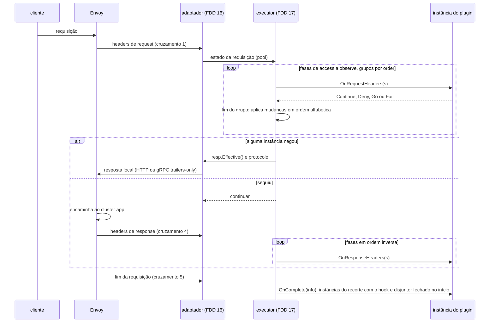
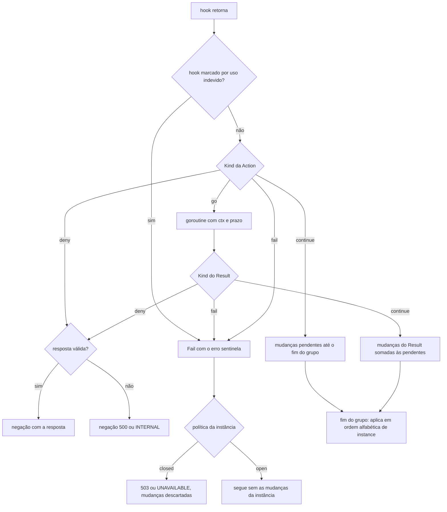
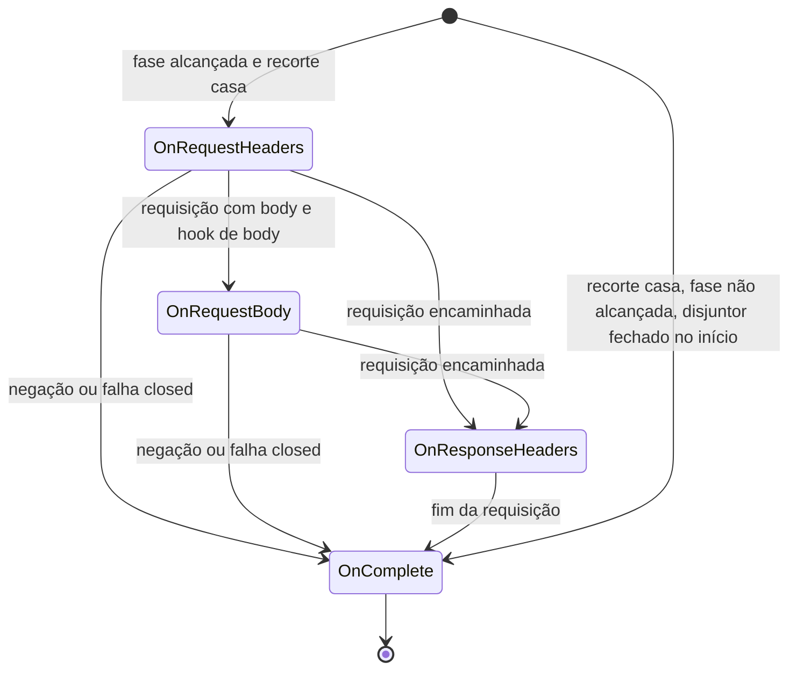

### FDD: Contrato de proxy: hooks, `Stream` e ações (SDK-05)

Versão: 1.0
Data: 2026-10-20
Responsável: Guilherme Giusti

---

### 1. Contexto e motivação técnica

**Problema técnico.** A metade de proxy de um plugin roda dentro do `libn3x.so`, chamada pelo executor da cadeia a partir do adaptador de cada alvo (`envoy-1.40` e `istio-1.31`). O plugin não pode importar o SDK Go do Envoy, que muda sem tag e difere entre alvos (decisão "SDK próprio" do PRD). O ADR-015 e o HLD do `n3x-sdk` fixaram os nomes (`proxy.Define[C]`, quatro hooks opcionais, `Stream`, `proxy.Continue`, `s.Deny`, `s.Go`, `proxy.Fail` e `Target().Has`), mas não o comportamento verificável:

- o que cada hook recebe e devolve, e em que momento da requisição ele é chamado
- como `SetRoute` deixa de existir nas fases depois de `route` e o que ele altera com um único cluster de aplicação (L-49)
- o que a função passada a `s.Go()` pode tocar, já que o grupo paralelo (ADR-005 do `n3x-sidecar`) exige que nenhuma instância veja as mudanças da outra
- como uma negação vira resposta HTTP e gRPC, e como tornar impossível uma negação gRPC com `grpc-status 0` (risco de probabilidade "alta" no PRD)
- por quanto tempo valem as strings devolvidas sem cópia (`s.Path()`, `Headers().Get`) e o que acontece se o plugin as guardar
- o que acontece com uso indevido da API: header protegido, valor inválido, rota inválida, recurso ausente no alvo
- quais capacidades um alvo pode não ter (L-20) e qual é o nome da função de erro (L-14)

Sem essas regras, o executor (FDD 17), o adaptador (FDD 16) e o kit de testes (FDD 07) implementariam versões diferentes do mesmo contrato, e um plugin aprovado no kit poderia falhar no Envoy.

**Encaixe no HLD.** Esta FDD especifica o pacote `proxy/` do módulo `github.com/giustech/n3x-sdk` (HLD do `n3x-sdk`: linha `proxy/` de "Componentes e responsabilidades", "Contrato de proxy", "Fluxo de requisição" e "Considerações de escalabilidade"). É o contrato central da metade de proxy:

- FDD 06: completa a interface `proxy.Env`; esta FDD fixa só `Env.Target()`
- FDD 07: o kit implementa `Stream`, `RouteStream` e `Headers` com as mesmas regras
- FDD 13: o plugin de exemplo usa `OnRequestHeaders`, `proxy.Forbidden` e `Headers().Set`
- FDD 16: o adaptador do `envoy-1.40` traduz os cruzamentos, renderiza a negação no fio e informa as capacidades do alvo
- FDD 17: o executor implementa `Stream` e `RouteStream`, aplica as mudanças por grupo e chama os hooks na ordem das fases
- FDD 18: aplica a política de falha a `proxy.Fail`, a panic e ao prazo do `s.Go()`
- FDDs 19 e 49: o catálogo de alvos e o alvo `istio-1.31` declaram as capacidades com os nomes definidos aqui
- FDD 21: o `main` gerado chama `agent.Plugin()` de cada plugin
- FDDs 36 e 42: a metade de proxy do plugin core não tem fase nem hook (ADR-008 do `n3x-plugin-core`)

**Atores.** Autor de plugin (implementa `New` e os hooks), executor da cadeia e adaptador do sidecar (implementam `Stream`, `Headers` e `Env` e chamam os hooks), kit de testes (implementa o mesmo contrato sem Envoy), builder (gera o registro que chama `agent.Plugin()`), operador (vê negações, falhas e métricas) e mantenedor do SDK (evolui o contrato por minor).

**Limites.** O pacote `proxy/` define tipos, interfaces e funções puras. Não cria goroutine, não faz I/O, não loga e não guarda estado mutável. Quem implementa `Stream`, `RouteStream`, `Headers` e `Env` é a plataforma: o executor do sidecar e o kit. O plugin só consome essas interfaces e nunca as implementa.

**Suposições**
- O Envoy normaliza o path (`normalize_path`, `merge_slashes`, `UNESCAPE_AND_REDIRECT`), aplica os limites de headers (60 KiB e 100 itens), recusa headers com `_` na entrada e gera o `x-request-id` quando ausente, antes de o filtro do N3X rodar (HLD do `n3x-sidecar`, bootstrap)
- Todos os plugins de um `.so` e o `core/` do sidecar são compilados com uma única versão do SDK (resolução do `go.mod`; o caso de SDK mais novo vindo de um plugin é a L-57, FDD 20)
- O adaptador consegue evitar cruzamentos de body quando nenhuma instância do recorte tem hook de body (HLD do `n3x-sidecar`, "Body: só cruza para o Go se alguma instância do recorte declarou hook de body"); a confirmação é da FDD 16
- Go 1.26 ou superior (ADR-021 do `n3x-sdk`)

**Restrições**
- `proxy/` usa só a biblioteca padrão, `plugin/`, `memory/` e grpc-go (ADR-011 do `n3x-sdk`); nunca importa `controller/` nem o SDK Go do Envoy; sem cgo
- Resposta local crua não existe na API; toda negação é ciente de gRPC (HLD do `n3x-sdk` e HLD do `n3x-sidecar`)
- `go` cru é proibido; assíncrono só por `s.Go()`, com o prazo do `Go()` de 200 ms por padrão (ADR-016 do `n3x-sdk`, ADR-006 do `n3x-sidecar`)
- `Stream` reaproveitado por pool, acessores sem cópia, respostas pré-montadas e sem `fmt` no caminho quente (HLD do `n3x-sdk`)
- Contrato estável desde a `v1.0.0`; antes disso, pré-releases `v0.x` (ADR-021 do `n3x-sdk`)
- Documentação e mensagens em pt-BR; identificadores em inglês

**Rastreabilidade**
- PRD 1.5: FR-012 (hooks, ler e alterar headers, negar com status HTTP e código gRPC, trabalho assíncrono, capacidade ausente informada, rota alterada só até `route`), FR-004 (seguir, negar, assíncrono e retomar; todos os plugins notificados no fim; negação gRPC com `grpc-status` e `grpc-message`), FR-003 (método gRPC como `/pacote.Serviço/Método`); desempenho (0 alocações nos caminhos comuns e até 5 entradas do Envoy no Go por requisição); critérios de aceite "negação gRPC do exemplo chega como `PERMISSION_DENIED`, nunca `OK`"
- ADRs do `n3x-sdk`: ADR-011, ADR-015, ADR-016, ADR-021 e ADR-022; ADR-009 de plataforma (sem tracing)
- ADRs do `n3x-sidecar`: ADR-004, ADR-005, ADR-006 e ADR-009; ADR-008 do `n3x-plugin-core`
- Lacunas do README:
  - **L-14 fechada aqui (parte do `Fail`):** o nome é `proxy.Fail(err)`, do pacote `github.com/giustech/n3x-sdk/proxy`. Não existe pacote `sdk` no módulo; `sdk.Fail` no HLD do `n3x-sidecar` é referência solta. A contraparte assíncrona é `proxy.FailResult(err)`. A parte do `Sleep` é da FDD 06
  - **L-20 fechada aqui:** a v1 tem exatamente duas capacidades opcionais, `proxy.CapRequestBody` (`request_body`) e `proxy.CapRouteChange` (`route_change`). Todo o resto do contrato é obrigatório para um alvo ser `supported`. As FDDs 16, 19 e 49 preenchem os valores de cada alvo (contrato 7)
  - **L-49 fechada aqui:** na v1, `SetRoute` reescreve o `:path` (com query) e o `:authority` da requisição enviada ao único cluster `app`; não escolhe cluster. As fases seguintes e os recortes delas veem a rota nova (contrato 6)
  - **L-46 aplicada:** `Plugin.Instantiate` recebe a config em bytes JSON (FDD 02)
  - **L-13 aplicada em parte:** `s.RequestID()` devolve o valor do header `x-request-id`; os nomes do campo de log e do metadado gRPC são da FDD 06

---

### 2. Objetivos técnicos

- **Negação gRPC nunca sai como sucesso.** Invariante: nenhum valor produzido pela API resulta em `grpc-status 0` numa negação. Medida: teste de propriedade sobre todo status de 0 a 999 e todo código de 0 a 20 em `NewDeny`, mais o valor zero de `DenyResponse`, conferindo que a resposta efetiva tem código entre 1 e 16.
- **Restrição de rota garantida pelo compilador.** Medida: teste de compilação em que `s.SetRoute` sobre `proxy.Stream`, `s.Deny` dentro de `OnComplete` e `return s.Go(...)` dentro da função assíncrona não compilam.
- **Uso indevido nunca é silencioso.** Invariante: toda operação inválida (header protegido, valor inválido, mudanças demais, rota inválida, recurso ausente no alvo, uso do `Stream` fora do hook) transforma o resultado do hook em falha com um erro sentinela do pacote; nenhuma operação vira no-op sem registro.
- **0 alocações nos caminhos comuns.** Medida com `testing.AllocsPerRun(1000, ...)`: 0 nas funções do SDK listadas na seção 9; nos acessores do `Stream`, em `Deny` e em `Headers().Set` sobre o `Stream` do kit (FDD 07) e do executor (FDD 17).
- **Cruzamentos independentes do número de plugins.** Invariante: nenhum hook cria cruzamento Envoy para Go por instância; cada evento do Envoy é um cruzamento para a cadeia inteira. Medida: 3 cruzamentos na config de referência (core e exemplo, sem body e sem `Go()`); no máximo 5 com body entregue numa chamada e um grupo com `Go()` (medição na FDD 16).
- **Hook não implementado não custa nada.** Invariante: os hooks são detectados uma vez na subida (`proxy.HooksOf`); o executor não faz type assertion por requisição.
- **Isolamento e determinismo no grupo paralelo.** Invariante: dentro de um grupo, uma instância lê o estado do início do grupo mais as próprias mudanças, nunca as de outra; as mudanças de cada instância são atômicas e aplicadas no fim do grupo em ordem alfabética de `instance`. Medida: o mesmo grupo dá o mesmo resultado em 1.000 execuções com ordem de término aleatória das funções assíncronas (teste do kit e do executor, FDDs 07 e 17).
- **Orçamento de latência.** Medida: hooks síncronos do core e do exemplo em p50 até 0,05 ms e p99 até 0,10 ms (ADR-009 do `n3x-sidecar`), medidos no benchmark da FDD 50.

---

### 3. Escopo e exclusões

**Incluído**
- `proxy.Define[C](New)`, a interface `proxy.Plugin` (com `Instantiate`) e o tipo `proxy.Instance`
- Interfaces opcionais dos quatro hooks, a detecção na subida (`HooksOf`, `Hook`, `HookSet`) e o momento de chamada de cada hook
- Interfaces `StreamInfo`, `Stream`, `RouteStream`, `HeaderReader` e `Headers`, com custo de alocação por método e regra de vida útil
- Semântica das mudanças de header: leitura com as próprias mudanças, isolamento no grupo, atomicidade por instância, limite por hook e headers protegidos
- Ações: `proxy.Continue`, `s.Deny(resp)`, `s.Go(fn)`, `proxy.Fail(err)`; tipo `Action` e o apoio `StreamActions` para quem implementa `Stream`
- Tipo `Result` da função assíncrona: `ContinueResult`, `DenyResult`, `FailResult` e mudanças de header
- `DenyResponse`, as respostas prontas, `NewDeny`, a tabela de status HTTP para código gRPC (`CodeForStatus`), o formato no fio em HTTP e em gRPC e a codificação do `grpc-message`
- `Route`, `SetRoute` e `CheckRoute`, com o que a rota significa na v1 (L-49)
- Semântica do hook de body: body inteiro, uma chamada, somente leitura, limite de tamanho e ordem estrita de fases
- `Capability`, as constantes `proxy.CapX` da v1 (L-20), `Target` e `Env.Target()`
- Erros sentinela do contrato de requisição e `CheckHeader`
- Regras de compatibilidade: o que entra por minor sem quebrar plugins compilados

**Excluído**
- O restante de `proxy.Env` (`Background`, `Controller`, `Dial`, clientes com prazo, `Sleep`, `Memory`, `Metrics`, `Log`) e os erros `ErrStandalone` e `ErrRequestPath`: FDD 06 (SDK-06)
- Execução por fases, grupos, recortes (`match`), retomada e aplicação das mudanças: FDD 17 (SID-03)
- Política de falha aplicada, prazo do `Go()`, `max_inflight`, zumbis, disjuntor e contenção de panic: FDD 18 (SID-04)
- Tradução para o SDK Go do Envoy, renderização da negação no fio e recálculo da rota no Envoy: FDD 16 (SID-02); alvo Istio: FDD 49 (SID-11)
- Kit de testes e lugar da lógica pura da cadeia (L-50): FDD 07 (SDK-07)
- `OnResponseBody`: fora da v1, entra por adição (ADR-015 do `n3x-sdk`)
- Alteração do body de request, leitura do body e dos trailers de response e status gRPC da resposta da aplicação: fora da v1, entram por adição (hipótese)
- Escolha de cluster em `SetRoute`: fora da v1, porque o bootstrap tem um único cluster `app` (L-49)
- Resposta local de sucesso ou redirecionamento (3xx): fora da v1 (README, "Fora da v1": redirects)
- Estado por requisição do plugin (ex.: `s.Value()`) e endereço do cliente no `Stream`: fora da v1, entram por adição (hipótese; ponto P-06)
- Campo do `n3x.yaml` que ajusta o limite do body: FDD 15 (SID-01)
- Valores de capacidade de cada alvo: FDDs 16, 19 e 49
- Regras de análise estática (atribuição a variáveis do SDK, `go` cru): FDD 24 (BLD-06)

---

### 4. Fluxos detalhados e diagramas

**Fluxo de subida (uma vez por instância)**
- O `main` gerado pelo builder (FDDs 17 e 21) chama `agent.Plugin()` de cada plugin; a função só chama `proxy.Define[C](New)` e não tem efeito colateral (ADR-015)
- Para cada item `plugins[i]` do `n3x.yaml`, o executor monta o `proxy.Env` da instância (FDD 06) e chama `p.Instantiate(configJSON, env, plugin.WithSecretOpener(abrir))` sob `recover` (FDDs 04 e 17):
  - `Instantiate` chama `plugin.DecodeConfig[C]` (FDD 02); config inválida devolve o erro com `ErrInvalidConfig` e o Envoy não sobe
  - depois chama `New(cfg, env)`; erro do `New` volta como está; `(nil, nil)` vira `ErrNilInstance`
- O executor chama `proxy.HooksOf(inst)` uma vez e guarda o `HookSet` na cadeia compilada
- Instância com hook de body num alvo sem `CapRequestBody`: o hook nunca é chamado e o executor registra o aviso `hook_unsupported` na subida. O plugin que exige body confere `env.Target().Has(proxy.CapRequestBody)` no `New` e devolve erro, o que impede a subida (FR-012: desliga de forma explícita)
- Instância com fase e sem nenhum hook: aviso `plugin_without_hooks` (pega o erro comum de receptor ponteiro com `New` devolvendo valor) (hipótese)
- Instância sem fase (metade só de fundo, como o core): nunca recebe hook; a criação dela é das FDDs 09 e 36 (L-10)

**Fluxo principal: requisição**
- **Cruzamento 1, headers de request.** O adaptador entrega o evento ao executor, que pega o estado da requisição do pool e decide uma vez se é gRPC (`content-type` começa com `application/grpc`)
- Para cada fase em ordem (`access` até `observe`), para cada grupo em ordem crescente de `order`, para cada instância do grupo cujo recorte casa com a requisição:
  - o executor chama `OnRequestHeaders(s)`; em `access`, `authn` e `route` (`Phase.CanSetRoute()`), `s` também implementa `RouteStream`
  - o hook lê com os acessores sem cópia e muda headers com `s.Headers()`; as mudanças ficam pendentes, visíveis só para a própria instância
  - o hook devolve `proxy.Continue`, `s.Deny(resp)`, `s.Go(fn)` ou `proxy.Fail(err)`
- No fim do grupo (depois de todas as funções `Go()` do grupo terminarem), o executor aplica as mudanças das instâncias que seguiram, em ordem alfabética de `instance` (vale a última); se alguém negou ou falhou com `closed`, vale a negação do primeiro em ordem alfabética e as mudanças do grupo são descartadas (ADR-005)
- Se a fase atual tem instância com hook de body no recorte, o alvo tem `CapRequestBody` e a requisição tem body, a cadeia para depois dos hooks de headers dessa fase
- **Cruzamento 2, body completo** (só nesse caso). O executor chama `OnRequestBody(s, body)` das instâncias da fase, por grupo, e segue com os hooks de headers e de body das fases seguintes. Ordem estrita: uma fase só começa depois de a anterior terminar, inclusive os hooks de body (hipótese)
- Sem negação, o executor libera a requisição e o Envoy encaminha ao cluster `app`, com a rota alterada por `SetRoute`, se houver
- **Cruzamento 4, headers de response.** As fases rodam em ordem inversa, com as mesmas regras de grupo; `s.Headers()` é o conjunto de headers da resposta e `s.Status()` é o status da aplicação. Um `s.Deny` aqui troca a resposta da aplicação pela negação
- **Cruzamento 5, fim da requisição.** O executor chama `OnComplete(info)` de toda instância do recorte que implementa o hook e cujo disjuntor não estava aberto no início da requisição, inclusive depois de negação, falha ou desconexão do cliente (FR-004); a ordem entre instâncias não é garantida. Depois de uma negação do N3X, `info.Status()` é o status HTTP nominal da negação (403, por exemplo), também em gRPC

**Fluxo do `s.Go()`**
- O hook chama `s.Go(fn)` e devolve a `Action` resultante; só a ação devolvida conta (um `s.Go` criado e não devolvido nunca roda)
- O executor (FDD 18) abre uma goroutine com `recover`, rótulos de pprof e `ctx` com o prazo de `plugins[].async.timeout` (200 ms por padrão); a requisição fica parada
- A função recebe só o `ctx`; não toca o `Stream`; usa cópias (`strings.Clone`) do que leu no hook; pode usar `env.Dial()` e os clientes do SDK; `env.Controller()` devolve `ErrRequestPath` (FDD 06)
- A função devolve um `Result`: seguir com mudanças de header, negar ou falhar
- **Cruzamento 3, retomada.** Quando todas as funções do grupo terminam, o scheduler do alvo retoma a requisição no worker e o executor aplica o grupo
- Prazo estourado, cliente desconectado ou negação de outro membro do grupo cancelam o `ctx`; o `Result` dessa função é descartado

**Mapa dos cruzamentos Envoy para Go**

| # | Evento do Envoy | Quando acontece | O que roda |
| --- | --- | --- | --- |
| 1 | Headers de request | Sempre | `OnRequestHeaders` das fases até a primeira com hook de body no recorte (ou de todas) |
| 2 | Body de request completo | Só se uma instância do recorte tem hook de body, o alvo tem `request_body` e a requisição tem body | `OnRequestBody` e o restante da cadeia de request |
| 3 | Retomada pelo scheduler | Uma por grupo que devolveu `Go()` | Aplicação do grupo e continuação |
| 4 | Headers de response | Quando a requisição foi encaminhada | `OnResponseHeaders` em ordem inversa |
| 5 | Fim da requisição | Sempre | `OnComplete` |

Config de referência (core sem hooks e exemplo só com `OnRequestHeaders`): cruzamentos 1, 4 e 5. O contrato não cria cruzamento por plugin; mais de um grupo com `Go()` ou body em vários pedaços passam de 5 (inconsistência I-04).

**Fluxos alternativos e exceções**
- **Negação em HTTP:** o executor pega `resp.Effective()` e o adaptador escreve `:status`, `content-type: text/plain; charset=utf-8`, os headers extras e a mensagem no body (contrato 5)
- **Negação em gRPC:** HTTP 200, `content-type: application/grpc`, `grpc-status` com o código (nunca 0), `grpc-message` codificado e headers extras, tudo em trailers-only (fim do stream nos headers)
- **Negação inválida** (valor zero, status fora de 400 a 599, código 0 ou acima de 16): a requisição é negada com 500 ou `INTERNAL` e o executor registra `invalid_deny`; uma negação nunca vira `Continue`
- **Negação ou falha do N3X não passa pelos hooks de response:** a resposta de negação é final; nenhum plugin altera ou desfaz uma negação. Respostas geradas pelo Envoy depois do encaminhamento (503 com a aplicação fora do ar, 504 por prazo) passam pelos hooks de response como qualquer resposta (hipótese)
- **Uso indevido no hook** (header protegido, header inválido, mais de 16 mudanças, rota inválida, `SetRoute` sem `CapRouteChange`): a operação não tem efeito, o hook fica marcado e, ao retornar, a ação vira `Fail` com o erro sentinela; as mudanças da instância nesse hook são descartadas (contrato 8)
- **`Stream` usado depois do retorno do hook** (inclusive dentro da função do `Go()`): o método faz panic com `ErrStreamClosed`; o executor contém o panic e aplica a política da instância
- **`Fail` com `open`:** a cadeia segue e as mudanças da instância nesse hook são descartadas; com `closed`, 503 ou `UNAVAILABLE` (FDD 18)
- **Body acima do limite:** instância com hook de body e política `closed` nega com `PayloadTooLarge` (413 ou `RESOURCE_EXHAUSTED`); com `open`, o hook não é chamado e a falha conta com `reason="body_limit"` (hipótese; viabilidade no adaptador é o ponto P-02)
- **Requisição sem body** (fim do stream nos headers): `OnRequestBody` não é chamado
- **Dois `SetRoute` no mesmo grupo de `access` ou `authn`:** vale o último em ordem alfabética de `instance` e o executor registra `route_conflict` (inconsistência I-05)
- **Cliente desconecta com `Go()` pendente:** o `ctx` é cancelado, o resultado é descartado sem retomar e `OnComplete` roda com `Status()` igual a 0
- **Instância com disjuntor aberto** (ADR-004 do `n3x-sidecar`, FDD 18): se o disjuntor estava aberto no início da requisição, a instância não recebe nenhum hook naquela requisição, inclusive `OnComplete`; a política dela é aplicada sem chamá-la (no kit e no executor, `Guard.Before` devolve `SkipBreaker`, contrato 9 da FDD 07)
- **Plugin sem nenhum hook:** aceito; `HooksOf` devolve o conjunto vazio e o executor nunca o chama na requisição

**Diagramas**

Sequência de uma requisição sem body e sem `Go()`:



Tratamento da ação devolvida por uma instância:



Hooks de uma instância numa requisição (cada um no máximo uma vez, nunca ao mesmo tempo):



---

### 5. Contratos públicos (assinaturas, endpoints, headers, exemplos)

**Contrato 1: `proxy.Define`, `proxy.Plugin` e `proxy.Instance`**
- Tipo: sdk (API Go)
- Assinatura/Rota:
  ```go
  package proxy // github.com/giustech/n3x-sdk/proxy

  // Instance é o valor devolvido pelo New: uma por item `instance` do n3x.yaml.
  // Os hooks são interfaces opcionais detectadas por HooksOf (contrato 2).
  type Instance interface{}

  // Define liga a struct de config C ao construtor da instância.
  func Define[C any](newFn func(cfg C, env Env) (Instance, error)) Plugin

  // Plugin é o valor devolvido por agent.Plugin(). Só Define cria um Plugin.
  type Plugin interface {
      plugin.ConfigSchemer // ConfigSchema() (*plugin.Schema, error), FDD 02
      // Instantiate decodifica a config e chama New. Usado pelo executor e pelo kit.
      Instantiate(config []byte, env Env, opts ...plugin.DecodeOption) (Instance, error)
      isProxyPlugin() // método não exportado: fecha a interface
  }

  var ErrNilInstance = errors.New("proxy: New devolveu instância nula sem erro")
  ```
- Método: n/a (chamada local)
- Semântica:
  - `Define` não faz trabalho: guarda `newFn` e o tipo `C`. `newFn` nulo é erro de programação e faz panic com mensagem que começa com `proxy:`
  - `ConfigSchema()` chama `plugin.SchemaOf[C]()` uma vez e guarda o resultado (mesmo ponteiro e mesmos bytes em toda chamada); `C` inválido devolve o erro com `ErrInvalidSchema` (FDD 02)
  - `Instantiate` chama `plugin.DecodeConfig[C](config, opts...)` e, sem erro, `newFn(cfg, env)`. O erro de config volta como está (`ErrInvalidConfig` e `FieldErrors`, para o executor prefixar com `PrefixErrors`); o erro do `New` volta como está; `(nil, nil)` devolve `ErrNilInstance`. `Instantiate` não usa `recover`: o executor chama sob `recover` e sela o escopo de memória depois (FDDs 04 e 17)
  - `Plugin` é fechada por um método não exportado: o registro gerado só aceita valores de `Define`, o que garante que toda config passa por `DecodeConfig`
  - **Instância:** criada uma vez na subida e usada por todas as requisições, em vários workers do Envoy e goroutines ao mesmo tempo. Os campos preenchidos no `New` são somente leitura depois dele; estado mutável só em estruturas seguras para concorrência (`memory.Map`, `sync/atomic`, métricas por handle)
  - **`Env`:** válido por toda a vida da instância e pode ser guardado nela; o `Stream` não pode (contrato 3)

**Exemplo de requisição**
```go
package agent // github.com/giustech/n3x-plugin-acl/agent (plugin hipotético)

type Config = types.ProxyConfig // {DenyPrefix string `json:"deny_prefix"`; Header string `json:"header"`}

func Plugin() proxy.Plugin { return proxy.Define[Config](New) }

func New(cfg Config, env proxy.Env) (proxy.Instance, error) {
    if err := proxy.CheckHeader(cfg.Header, "1"); err != nil {
        return nil, fmt.Errorf("header %q: %w", cfg.Header, err) // config com header protegido falha na subida
    }
    return &ACL{cfg: cfg, deny: proxy.Forbidden("bloqueado")}, nil
}

// No executor (FDD 17), uma vez por instância, sob recover:
//   inst, err := agent.Plugin().Instantiate(cfgJSON, env, plugin.WithSecretOpener(abrir))
```

**Exemplo de resposta** (três configs passadas a `Instantiate`)
```json
{
  "{\"deny_prefix\":\"/admin\",\"header\":\"x-acl\"}": { "inst": "*agent.ACL", "err": null },
  "{\"deny_prefix\":\"/admin\",\"header\":\"host\"}": { "inst": null, "err": "header \"host\": proxy: header protegido", "errors.Is(ErrProtectedHeader)": true },
  "{\"deny_prefx\":\"/admin\"}": { "inst": null, "err": "deny_prefx: campo desconhecido [unknown_field]", "errors.Is(plugin.ErrInvalidConfig)": true }
}
```

---

**Contrato 2: hooks opcionais e detecção**
- Tipo: sdk (interfaces Go)
- Assinatura/Rota:
  ```go
  type RequestHeadersHook interface {
      OnRequestHeaders(s Stream) Action
  }
  type RequestBodyHook interface {
      OnRequestBody(s Stream, body []byte) Action // body completo, somente leitura
  }
  type ResponseHeadersHook interface {
      OnResponseHeaders(s Stream) Action
  }
  type CompleteHook interface {
      OnComplete(s StreamInfo) // sem ação: a requisição já terminou
  }

  type Hook uint8

  const (
      HookRequestHeaders Hook = iota + 1
      HookRequestBody
      HookResponseHeaders
      HookComplete
  )

  const NumHooks = 4

  func (h Hook) String() string // "request_headers", "request_body", "response_headers", "complete"

  type HookSet uint8

  func HooksOf(inst Instance) HookSet // type assertion, uma vez na subida
  func (hs HookSet) Has(h Hook) bool
  func (hs HookSet) Len() int
  func (hs HookSet) String() string   // "request_headers,complete"; "" sem hooks
  ```
- Método: n/a
- Semântica:

| Hook | Quando é chamado | Recebe | Pode devolver |
| --- | --- | --- | --- |
| `OnRequestHeaders` | Headers de request, na fase da instância, se o recorte casa e a cadeia chegou à fase | `Stream`; também `RouteStream` em `access`, `authn` e `route` | `Continue`, `Deny`, `Go`, `Fail` |
| `OnRequestBody` | Body completo, se a requisição tem body, o alvo tem `CapRequestBody` e a cadeia chegou à fase | `Stream` (também `RouteStream` nas mesmas fases) e o body | `Continue`, `Deny`, `Go`, `Fail` |
| `OnResponseHeaders` | Headers da resposta da aplicação ou do Envoy, em ordem inversa de fases; nunca numa negação ou falha do N3X | `Stream` com `Headers()` da resposta | `Continue`, `Deny`, `Go`, `Fail` |
| `OnComplete` | Fim da requisição, uma vez, para toda instância do recorte que implementa o hook e cujo disjuntor não estava aberto no início da requisição, inclusive depois de negação, falha ou desconexão | `StreamInfo` (só leitura) | nada |

  - Para uma requisição e uma instância, os hooks rodam no máximo uma vez cada, nesta ordem, nunca ao mesmo tempo. Requisições diferentes rodam em paralelo
  - O body (hipótese): a requisição inteira, acumulada até o fim do stream, numa única chamada; o slice aponta para memória da requisição e vale até o hook retornar; o plugin não o altera. Em gRPC, o body traz os quadros com o prefixo de 5 bytes de cada mensagem. O limite padrão é `DefaultMaxRequestBody` (1 MiB); o campo que o ajusta no `n3x.yaml` é da FDD 15
  - Hook de body bufferiza a requisição: não deve ficar em recortes com gRPC de streaming do cliente ou bidirecional, porque a requisição só termina quando o cliente fecha o envio (guia do autor; risco na seção 10)
  - O nome do hook (`Hook.String()`) é o valor do rótulo `hook` em `n3x_plugin_duration_seconds`; a função do `Go()` usa o valor `async` (seção 7)
  - `OnResponseBody` entra numa minor como `ResponseBodyHook`, por adição (ADR-015)

```go
const DefaultMaxRequestBody = 1 << 20 // 1 MiB (hipótese)
```

**Exemplo de requisição**
```go
type Obs struct{ total *atomic.Int64 }

func (o *Obs) OnRequestHeaders(s proxy.Stream) proxy.Action { return proxy.Continue }
func (o *Obs) OnComplete(s proxy.StreamInfo)                 { o.total.Add(1) }

hooksPtr := proxy.HooksOf(&Obs{})  // New devolveu ponteiro
hooksVal := proxy.HooksOf(Obs{})   // New devolveu valor: receptores ponteiro não contam
```

**Exemplo de resposta**
```json
{ "hooksPtr": "request_headers,complete", "hooksVal": "", "aviso na subida para hooksVal": "plugin_without_hooks" }
```

---

**Contrato 3: `StreamInfo`, `Stream`, `RouteStream` e headers**
- Tipo: sdk (interfaces Go implementadas pelo executor e pelo kit)
- Assinatura/Rota:
  ```go
  type HeaderReader interface {
      Get(name string) string            // primeiro valor; "" se ausente
      Lookup(name string) (string, bool) // primeiro valor e presença
      Len() int                          // quantidade de pares nome e valor
      At(i int) (name, value string)     // 0 <= i < Len(); nome em minúsculas; ordem de chegada
  }

  type Headers interface {
      HeaderReader
      Set(name, value string) // troca todos os valores do nome
      Add(name, value string) // acrescenta um valor
      Del(name string)        // remove todos os valores do nome
  }

  type StreamInfo interface {
      Method() string               // ":method", ex.: "POST"
      Path() string                 // ":path" com query, normalizado pelo Envoy e com SetRoute aplicado
      Authority() string            // ":authority" (Host em HTTP/1.1)
      IsGRPC() bool                 // content-type da requisição começa com "application/grpc"
      GRPCMethod() string           // "/pacote.Servico/Metodo", ou "" fora de gRPC
      GRPCService() string          // "pacote.Servico", ou "" fora de gRPC
      RequestID() string            // valor de x-request-id
      RequestHeaders() HeaderReader // headers de request, só leitura
      Status() int                  // status da resposta; nominal numa negação do N3X; 0 antes da resposta ou sem resposta
      Phase() plugin.Phase          // fase da instância chamada
  }

  type Stream interface {
      StreamInfo
      Headers() Headers                              // headers da direção do hook
      Deny(resp DenyResponse) Action                 // contrato 5
      Go(fn func(ctx context.Context) Result) Action // contrato 4
  }

  type RouteStream interface {
      Stream
      SetRoute(r Route) // contrato 6
  }
  ```
- Método: n/a
- Semântica:
  - **`Status()`:** 0 nos hooks de request e quando não houve resposta (cliente desconectado). Em `OnResponseHeaders` e em `OnComplete` de uma resposta da aplicação ou do Envoy, é o `:status` recebido. Em `OnComplete` depois de uma negação do N3X (inclusive a produzida pela política `closed`), é o status HTTP nominal da negação efetiva (`resp.Effective().Status()`, por exemplo 403), também em gRPC, e não o `:status` 200 do fio; é o mesmo valor do rótulo `code` de `n3x_plugin_denies_total` (ajuste pós-FDDs 07 e 17, refino R9)
  - **Direção:** em `OnRequestHeaders` e `OnRequestBody`, `Headers()` é o conjunto de headers de request; em `OnResponseHeaders`, o de response. `RequestHeaders()` está em todos os hooks (no request, é a mesma visão de `Headers()`, só leitura)
  - **`RouteStream`** (hipótese de forma, por type assertion como `http.Flusher`): o `s` entregue a hooks de request de instâncias com `Phase.CanSetRoute()` (`access`, `authn` e `route`) também implementa `RouteStream`; nos demais hooks e fases, não. O plugin usa `if rs, ok := s.(proxy.RouteStream); ok { rs.SetRoute(...) }`. Chamar `s.SetRoute` sobre `Stream` não compila. Por isso o executor usa tipos concretos diferentes para as duas visões do mesmo estado, sem alocar
  - **Fase e grupo:** `s.Phase()` informa a fase da instância chamada (também em `OnComplete`). O grupo e o `order` não são expostos (hipótese): as regras de isolamento fazem o comportamento ser o mesmo com a instância sozinha ou num grupo, e expor o grupo convidaria a depender dele. A `instance` vem pelo `Env` e pelos campos fixos do log (FDD 06)
  - **Nomes de header:** comparados sem diferenciar maiúsculas (ASCII), sem alocar; `At` devolve em minúsculas. `Get(":path")` e outros pseudo-headers podem ser lidos, nunca alterados por `Headers()`
  - **gRPC:** detectado uma vez no início, pelo `content-type` original. `GRPCMethod()` é o path sem query (FR-003); `GRPCService()` é o trecho entre a primeira e a última barra
  - **Leitura com as próprias mudanças:** depois de `Set`, `Add`, `Del` ou `SetRoute`, a própria instância lê o valor novo (`Get`, `Path()`); as outras instâncias do mesmo grupo leem o estado do início do grupo. As mudanças viram estado comum só no fim do grupo, em ordem alfabética de `instance` (ADR-005). Uma instância sozinha no grupo segue a mesma regra
  - **Atomicidade:** as mudanças de uma instância num hook são aplicadas todas ou nenhuma. São descartadas se a ação final for `Deny`, `Fail`, panic, prazo estourado ou se o hook ficou marcado por uso indevido
  - **Limite:** até `MaxHeaderChanges` (16) chamadas a `Set`, `Add`, `Del` e `SetRoute` por hook de uma instância; a seguinte marca o hook com `ErrTooManyChanges` (hipótese)
  - **Regra de vida útil (sem cópia):** as strings e slices devolvidos pelo `Stream` (`Path()`, `Get`, `At`, `RequestID()`, o `body`) e o próprio `Stream` valem só até o hook retornar. Podem apontar para memória do Envoy ou para um buffer reaproveitado pela próxima requisição. Para guardar além do hook (campo da instância, canal, função do `Go()`), copie com `strings.Clone` ou `bytes.Clone`. Gravar num `memory.Map` é seguro sem cópia, porque o `Set` copia strings e slices (FDD 04)
  - **Uso fora do hook:** qualquer método do `Stream` chamado depois do retorno do hook faz panic com `ErrStreamClosed` (contador de geração por visão, conferido no kit e no executor) (hipótese)
  - **Valores passados ao `Set` e `Add`** podem ser fatias de strings do próprio `Stream`: o executor guarda as mudanças pendentes em memória da requisição e não reaproveita os buffers dela antes do fim do grupo (requisito para as FDDs 16 e 17)
- Custo por método:

| Método | Alocações | Observação |
| --- | --- | --- |
| `Method`, `Path`, `Authority`, `IsGRPC`, `GRPCMethod`, `GRPCService`, `RequestID`, `Status`, `Phase` | 0 | Sem cópia |
| `Headers`, `RequestHeaders` | 0 | Visão reaproveitada do estado da requisição |
| `Get`, `Lookup`, `Len`, `At` | 0 | Comparação de nome sem alocar |
| `Set`, `Add`, `Del` | 0 em regime | Mudança pendente em memória da requisição; valor referenciado, não copiado |
| `SetRoute` | 0 | Rota validada por `CheckRoute` sem alocar |
| `Deny` | 0 | Resposta por valor |
| `Go` | 0 no SDK | A closure e a goroutine são do caminho assíncrono, fora do portão de 0 alocações |

**Exemplo de requisição** (chamada gRPC na fase `authz`; `x-request-id` gerado pelo Envoy)
```text
POST /pedidos.v1.Pedidos/Criar HTTP/2
:authority: pedidos.interno
content-type: application/grpc
x-tenant: acme
x-request-id: 3f1c9a52-6b0e-4c6f-9d1a-0b7e2f4c8a11
```

**Exemplo de resposta** (valores vistos por `OnRequestHeaders` e efeito de `s.Headers().Set("x-acl", "1")`)
```json
{
  "Method": "POST",
  "Path": "/pedidos.v1.Pedidos/Criar",
  "Authority": "pedidos.interno",
  "IsGRPC": true,
  "GRPCMethod": "/pedidos.v1.Pedidos/Criar",
  "GRPCService": "pedidos.v1.Pedidos",
  "RequestID": "3f1c9a52-6b0e-4c6f-9d1a-0b7e2f4c8a11",
  "Status": 0,
  "Phase": "authz",
  "s.(proxy.RouteStream)": false,
  "Headers().Get(\"X-Tenant\")": "acme",
  "Headers().Get(\"x-acl\") depois do Set, na própria instância": "1",
  "Headers().Get(\"x-acl\") em outra instância do mesmo grupo": "",
  "alocações": 0
}
```

---

**Contrato 4: `Action`, `Result` e `StreamActions`**
- Tipo: sdk (API Go)
- Assinatura/Rota:
  ```go
  type ActionKind uint8

  const (
      KindContinue ActionKind = iota // valor zero
      KindDeny
      KindGo
      KindFail
  )

  func (k ActionKind) String() string // "continue", "deny", "go", "fail"

  type Action struct{ /* opaco; por valor; leva a negação, a função ou o erro */ }

  var Continue Action // valor zero: segue a cadeia

  func Fail(err error) Action // aplica a política de falha da instância (L-14)

  func (a Action) Kind() ActionKind
  func (a Action) Err() error                          // KindFail
  func (a Action) DenyResponse() DenyResponse          // KindDeny
  func (a Action) Async() func(context.Context) Result // KindGo

  // StreamActions é embutida pelos tipos que implementam Stream (executor e kit).
  // Plugins usam s.Deny e s.Go.
  type StreamActions struct{}

  func (StreamActions) Deny(resp DenyResponse) Action
  func (StreamActions) Go(fn func(ctx context.Context) Result) Action

  type Result struct{ /* opaco; por valor; até MaxHeaderChanges mudanças em vetor fixo */ }

  func ContinueResult() Result // igual ao valor zero
  func DenyResult(resp DenyResponse) Result
  func FailResult(err error) Result

  func (r Result) SetHeader(name, value string) Result
  func (r Result) AddHeader(name, value string) Result
  func (r Result) DelHeader(name string) Result
  func (r Result) Kind() ActionKind // nunca KindGo
  func (r Result) Err() error
  func (r Result) DenyResponse() DenyResponse
  func (r Result) NumChanges() int
  func (r Result) Change(i int) HeaderChange

  type ChangeOp uint8

  const (
      ChangeSet ChangeOp = iota + 1
      ChangeAdd
      ChangeDel
  )

  type HeaderChange struct {
      Op    ChangeOp
      Name  string // como o plugin escreveu; o executor normaliza ao aplicar
      Value string // vazio em ChangeDel
  }

  const MaxHeaderChanges = 16 // por hook de uma instância e por Result (hipótese)
  ```
- Método: n/a
- Semântica:
  - **Ações do hook síncrono:** `return proxy.Continue`, `return s.Deny(resp)`, `return s.Go(fn)` ou `return proxy.Fail(err)`. O valor zero de `Action` é `Continue`. Só a ação devolvida conta
  - **`Action` por valor** (hipótese): carrega a resposta de negação, a função ou o erro, sem alocar. Como o executor fica em outro módulo, `Deny` e `Go` são implementados pelo SDK em `StreamActions`, que os tipos de `Stream` embutem (padrão do `UnimplementedXServer` do grpc-go). A regra de construção fica num lugar só. Um plugin que chame `proxy.StreamActions{}.Deny(...)` obtém a mesma negação de `s.Deny`, sem efeito colateral
  - `proxy.Continue` é variável exportada (exigência do `return proxy.Continue` do HLD). Plugin nenhum pode atribuir a ela nem às sentinelas: pedido à FDD 24 para recusar atribuição a variáveis exportadas de pacotes do SDK
  - `Fail(nil)` e `s.Go(nil)` viram `Fail` com `ErrInvalidAction`; nunca `Continue`
  - **Função do `Go()`** (hipótese): recebe só o `ctx` (com prazo; sem dados da requisição) e devolve um `Result`. Não toca o `Stream`; o que precisar da requisição é lido no hook e copiado antes. Não chama `s.Go` de novo: o tipo `Action` não serve como `Result`
  - **`Result`:** o valor zero e `ContinueResult()` seguem sem mudanças. `SetHeader`, `AddHeader` e `DelHeader` acrescentam mudanças nos headers da direção do hook que abriu o `Go()` e devolvem uma cópia (vetor fixo, sem aliasing entre cópias, 0 alocações). Cada mudança passa por `CheckHeader` na hora: inválida ou acima de 16, o `Result` vira `FailResult` com o erro. Mudanças num `Result` de negação ou falha são ignoradas. `Result` não tem `SetRoute` na v1 (hipótese): rota assíncrona entra por adição, por exemplo `RouteStream.GoRoute`
  - As mudanças do hook síncrono que abriu o `Go()` e as do `Result` somam-se, nesta ordem, e entram juntas no fim do grupo

**Exemplo de requisição**
```go
func (r *RL) OnRequestHeaders(s proxy.Stream) proxy.Action {
    key := strings.Clone(s.Headers().Get("x-api-key")) // cópia: a função roda depois do retorno
    return s.Go(func(ctx context.Context) proxy.Result {
        n, err := r.replica.Incr(ctx, key) // conexão própria por env.Dial (FDD 06)
        if err != nil {
            return proxy.FailResult(err)
        }
        if n > r.cfg.Limit {
            return proxy.DenyResult(r.tooMany) // pré-montada no New com WithHeader("retry-after", "1")
        }
        return proxy.ContinueResult().SetHeader("x-ratelimit-remaining", strconv.FormatInt(r.cfg.Limit-n, 10))
    })
}
```

**Exemplo de resposta** (o que o executor recebe em três requisições)
```json
[
  { "Action.Kind": "go", "Result.Kind": "continue", "Changes": [{ "Op": "set", "Name": "x-ratelimit-remaining", "Value": "41" }] },
  { "Action.Kind": "go", "Result.Kind": "deny", "Deny": { "status": 429, "code": "ResourceExhausted", "headers": { "retry-after": "1" } } },
  { "Action.Kind": "go", "Result.Kind": "fail", "Err": "dial tcp 127.0.0.1:6379: i/o timeout", "efeito": "política da instância (FDD 18)" }
]
```

---

**Contrato 5: `DenyResponse`, respostas prontas e tabela HTTP para gRPC**
- Tipo: sdk (API Go) e formato no fio
- Assinatura/Rota:
  ```go
  type DenyResponse struct{ /* opaco: status, código gRPC, mensagem e headers extras */ }

  func NewDeny(status int, code codes.Code, message string) DenyResponse // google.golang.org/grpc/codes

  func BadRequest(message string) DenyResponse      // 400, codes.InvalidArgument
  func Unauthorized(message string) DenyResponse    // 401, codes.Unauthenticated
  func Forbidden(message string) DenyResponse       // 403, codes.PermissionDenied
  func NotFound(message string) DenyResponse        // 404, codes.NotFound
  func PayloadTooLarge(message string) DenyResponse // 413, codes.ResourceExhausted
  func TooManyRequests(message string) DenyResponse // 429, codes.ResourceExhausted
  func Internal(message string) DenyResponse        // 500, codes.Internal
  func Unavailable(message string) DenyResponse     // 503, codes.Unavailable
  func GatewayTimeout(message string) DenyResponse  // 504, codes.DeadlineExceeded

  func (d DenyResponse) WithHeader(name, value string) DenyResponse // aloca: chamar no New
  func (d DenyResponse) Status() int
  func (d DenyResponse) Code() codes.Code
  func (d DenyResponse) Message() string
  func (d DenyResponse) NumHeaders() int
  func (d DenyResponse) Header(i int) (name, value string)
  func (d DenyResponse) Validate() error         // nil ou erro com ErrInvalidDeny
  func (d DenyResponse) Effective() DenyResponse // d se válida; senão Internal("")

  func CodeForStatus(status int) codes.Code
  func AppendGRPCMessage(dst []byte, message string) []byte // codificação percentual do gRPC

  const (
      MaxDenyMessage = 1 << 10 // bytes; acima disso a mensagem é cortada sem quebrar UTF-8
      MaxDenyHeaders = 8
  )
  ```
- Método: n/a (o executor e o adaptador escrevem no fio)
- Semântica:
  - **Validade:** status de 400 a 599 e código de 1 a 16. O valor zero, status fora da faixa, `codes.OK` ou código acima de 16 são inválidos. `Effective()` troca a inválida por `Internal("")`: a negação vence sempre e nunca sai com `grpc-status 0`
  - **Respostas prontas:** `Forbidden("bloqueado")` e as demais só guardam a mensagem (string constante do plugin): 0 alocações, podem ser chamadas no hook. `WithHeader` copia a lista de headers (aloca) e por isso deve ser chamada no `New`, guardando a resposta pré-montada na instância (HLD do `n3x-sdk`)
  - **Headers extras** (hipótese): até 8; passam por `CheckHeader` e `content-type` também é proibido (a negação define o próprio). Header inválido torna a resposta inválida (`Validate` devolve o erro; no uso, vira `Internal`). Casos típicos: `www-authenticate` com 401 e `retry-after` com 429 ou 503
  - **Mensagem:** texto do plugin, nunca dado vindo da requisição (guia do autor). Cortada em 1 KiB numa fronteira de UTF-8, sem alocar
  - **Corpo da negação em HTTP** (hipótese): `content-type: text/plain; charset=utf-8` e a mensagem como body; mensagem vazia dá body vazio. Escolhido em vez de JSON porque não exige montar texto por requisição e é o formato das respostas locais do próprio Envoy; requisição `HEAD` não leva body
  - **Negação em gRPC:** HTTP 200, `content-type: application/grpc`, `grpc-status` com o código em decimal, `grpc-message` com a mensagem codificada por `AppendGRPCMessage` (omitido se vazio) e os headers extras, tudo em trailers-only (fim do stream no quadro de headers). Codificação: bytes fora de 0x20 a 0x7E e o `%` viram `%XX` em hexadecimal maiúsculo
  - **Em `OnResponseHeaders`:** a negação troca a resposta da aplicação; o body da aplicação é descartado; em gRPC sai o mesmo trailers-only
  - **`CodeForStatus`** (hipótese, baseada no mapeamento canônico `google.rpc.Code` para HTTP): usado nas respostas prontas e disponível para `NewDeny(status, proxy.CodeForStatus(status), msg)`. A tabela fica congelada na major:

| Status HTTP | Código gRPC |
| --- | --- |
| 400 | `INVALID_ARGUMENT` (3) |
| 401 | `UNAUTHENTICATED` (16) |
| 403 | `PERMISSION_DENIED` (7) |
| 404 | `NOT_FOUND` (5) |
| 409 | `ABORTED` (10) |
| 412 | `FAILED_PRECONDITION` (9) |
| 413 | `RESOURCE_EXHAUSTED` (8) |
| 429 | `RESOURCE_EXHAUSTED` (8) |
| 499 | `CANCELLED` (1) |
| 500 | `INTERNAL` (13) |
| 501 | `UNIMPLEMENTED` (12) |
| 502 | `UNAVAILABLE` (14) |
| 503 | `UNAVAILABLE` (14) |
| 504 | `DEADLINE_EXCEEDED` (4) |
| outro de 400 a 499 | `FAILED_PRECONDITION` (9) |
| outro de 500 a 599 | `INTERNAL` (13) |
| fora de 400 a 599 | `UNKNOWN` (2); `NewDeny` com esse status é inválida |

**Exemplo de requisição** (o mesmo `s.Deny(proxy.Forbidden("bloqueado"))` em HTTP/1.1 e em gRPC, e uma mensagem com acento)
```text
GET /admin/usuarios HTTP/1.1
host: pedidos.interno

POST /pedidos.v1.Pedidos/Excluir HTTP/2
content-type: application/grpc

s.Deny(proxy.Unauthorized("não autenticado").WithHeader("www-authenticate", `Bearer realm="api"`)) numa chamada gRPC
```

**Exemplo de resposta**
```text
HTTP/1.1 403 Forbidden
content-type: text/plain; charset=utf-8
content-length: 9

bloqueado

:status: 200
content-type: application/grpc
grpc-status: 7
grpc-message: bloqueado
(fim do stream: trailers-only)

:status: 200
content-type: application/grpc
grpc-status: 16
grpc-message: n%C3%A3o autenticado
www-authenticate: Bearer realm="api"
(fim do stream: trailers-only)
```

---

**Contrato 6: `Route`, `SetRoute` e `CheckRoute` (L-49)**
- Tipo: sdk (API Go)
- Assinatura/Rota:
  ```go
  type Route struct {
      Path      string // novo :path, com query; vazio mantém o atual
      Authority string // novo :authority (Host); vazio mantém o atual
  }

  // RouteStream.SetRoute(r Route): contrato 3

  func CheckRoute(r Route) error // nil, ou erro com ErrInvalidRoute

  const (
      MaxRoutePathLen = 4 << 10 // hipótese
      MaxAuthorityLen = 255
  )
  ```
- Método: n/a
- Semântica:
  - **O que a rota é na v1** (L-49, hipótese): o bootstrap tem uma única rota `/` para o cluster `app` (HLD do `n3x-sidecar`), então "alterar a rota" é reescrever o `:path` (com a query) e o `:authority` da requisição que vai para a aplicação. Não há escolha de cluster; um campo `Cluster` entra em `Route` numa minor, por adição, quando o bootstrap tiver mais de um destino
  - **Por que só até `route`:** autorização e as fases seguintes precisam ver a rota final; uma fase depois de `authz` reescrevendo o path furaria a autorização (FR-012). Por isso `SetRoute` só existe em `RouteStream`, entregue em hooks de request (headers e body) de `access`, `authn` e `route`; e os pseudo-headers e o `host` são protegidos em `Headers()` (contrato 8)
  - **Validação:** `SetRoute` chama `CheckRoute`; o Envoy já normalizou o path antes do filtro e não normaliza de novo, então a rota nova precisa estar em forma normalizada:
    - `Path` começa com `/`, tem até 4.096 bytes, só ASCII visível; sem segmento vazio (`//`), sem segmento `.` ou `..`, sem `\`, sem `#`, sem espaço ou caractere de controle; codificação percentual válida (`%XX`) e, antes do `?`, sem `%2F`, `%5C` nem `%2E` em qualquer caixa
    - `Authority` é `host` ou `host:porta`: nome DNS (letras, dígitos, `-` e `.`), IPv4 ou IPv6 entre colchetes; porta de 1 a 65535; até 255 bytes; sem `@`, `/` ou espaço
    - Os dois vazios é rota inválida
  - **Efeito:** a própria instância vê a rota nova em `Path()` e `Authority()` na hora; as outras, no fim do grupo. As fases seguintes, os recortes delas (`match.paths`, avaliado no path atual) e os hooks de response e de fim veem a rota nova. O adaptador manda o Envoy recalcular a rota (FDD 16); com uma rota só, prazos e cluster continuam os mesmos
  - **Capacidade:** num alvo sem `CapRouteChange`, `SetRoute` marca o hook com `ErrUnsupported` (falha explícita); o plugin deve conferir `env.Target().Has(proxy.CapRouteChange)` no `New`
  - **Grupo paralelo:** em `route`, `order` repetido é recusado (ADR-005), então há uma instância por grupo. Em `access` e `authn`, se duas instâncias do mesmo grupo chamarem `SetRoute`, vale a última em ordem alfabética de `instance` e o executor registra `route_conflict` (hipótese; inconsistência I-05)

**Exemplo de requisição**
```go
func (v *Versions) OnRequestHeaders(s proxy.Stream) proxy.Action {
    rs, ok := s.(proxy.RouteStream) // verdadeiro: instância na fase route
    if !ok {
        return proxy.Fail(errFaseErrada)
    }
    if rest, found := strings.CutPrefix(s.Path(), "/v2/"); found {
        rs.SetRoute(proxy.Route{Path: v.prefix + rest}) // v.prefix = "/" vindo da config
    }
    return proxy.Continue
}
// CheckRoute de referência:
//   {Path: "/pedidos?status=aberto"}, {Path: "/a/../admin"}, {Path: "/a%2Fb"},
//   {Authority: "pedidos-v2.interno:8080"}, {Authority: "admin@pedidos"}, {}
```

**Exemplo de resposta**
```json
{
  "requisição": "GET /v2/pedidos?status=aberto",
  "Path() na própria instância depois do SetRoute": "/pedidos?status=aberto",
  ":path enviado à aplicação": "/pedidos?status=aberto",
  "match.paths [\"/pedidos\"] de uma instância em authz": "casa",
  "CheckRoute": {
    "{Path: \"/pedidos?status=aberto\"}": null,
    "{Path: \"/a/../admin\"}": "proxy: rota inválida: segmento .. no path",
    "{Path: \"/a%2Fb\"}": "proxy: rota inválida: barra codificada no path",
    "{Authority: \"pedidos-v2.interno:8080\"}": null,
    "{Authority: \"admin@pedidos\"}": "proxy: rota inválida: authority com @",
    "{}": "proxy: rota inválida: path e authority vazios"
  }
}
```

---

**Contrato 7: `Capability`, `Target` e `Env.Target()` (L-20)**
- Tipo: sdk (API Go)
- Assinatura/Rota:
  ```go
  type Capability uint8

  const (
      CapRequestBody Capability = iota + 1 // "request_body": OnRequestBody é chamado
      CapRouteChange                       // "route_change": SetRoute tem efeito
  )

  const NumCapabilities = 2

  func ParseCapability(s string) (Capability, error)
  func (c Capability) String() string
  func AllCapabilities() [NumCapabilities]Capability // por valor, 0 alocações

  type Target struct{ /* nome e conjunto de capacidades; comparável e imutável */ }

  func NewTarget(name string, caps ...Capability) (Target, error)
  func (t Target) Name() string                 // "envoy-1.40", "istio-1.31"
  func (t Target) Has(c Capability) bool        // 0 alocações
  func (t Target) Capabilities() []Capability   // nova fatia, em ordem; para logs e testes

  var ErrInvalidTarget = errors.New("proxy: alvo inválido")

  // Env é o ambiente da instância, entregue ao New e válido por toda a vida dela.
  // Esta FDD fixa só Target(); os demais métodos são da FDD 06.
  type Env interface {
      Target() Target
      // Background, Controller, Dial, clientes com prazo, Memory, Metrics e Log: FDD 06
  }
  ```
- Método: n/a
- Semântica:
  - **Lista da v1** (L-20): só duas capacidades são opcionais, as mesmas do catálogo de alvos do HLD do `n3x-builder` (`capabilities: [request_body, route_change]`). Todo o resto do contrato (headers de request e de response, fim da requisição, retomada depois do `Go()`, negação em trailers-only, stats) é obrigatório: um alvo que não o ofereça não passa na conformidade e não vira `supported` (hipótese)
  - **O que cada uma desliga:** sem `CapRequestBody`, `OnRequestBody` nunca é chamado e o executor avisa `hook_unsupported` na subida; sem `CapRouteChange`, `SetRoute` falha com `ErrUnsupported`. Em ambos, o plugin confere `Has` no `New` e decide: desligar a funcionalidade e seguir, ou devolver erro e impedir a subida (FR-012)
  - **Nomes:** `String()` e `ParseCapability` usam os textos do catálogo; nome desconhecido é erro, o que a FDD 19 aplica ao campo `capabilities` de `targets/<alvo>.yaml`. Valores numéricos e nomes nunca são reaproveitados
  - **`Target` como valor** (hipótese, no lugar de uma interface): imutável, comparável e com `Has` sem alocar; construído do mesmo jeito pelo adaptador de cada alvo (FDDs 16 e 49) e pelos alvos simulados do kit (FDD 07). `Name` casa com `^[a-z][a-z0-9.-]{0,31}$`; capacidade fora da lista ou nome inválido dão `ErrInvalidTarget`. O valor zero tem nome vazio e `Has` falso para tudo
  - **Preenchimento por alvo:** FDD 16 confirma o `envoy-1.40` (catálogo sugere as duas), FDD 49 define o `istio-1.31` depois do spike, FDD 19 grava no catálogo

**Exemplo de requisição**
```go
t, _ := proxy.NewTarget("envoy-1.40", proxy.CapRequestBody, proxy.CapRouteChange)
s, _ := proxy.NewTarget("istio-1.31", proxy.CapRouteChange) // valores ilustrativos; FDD 49 decide
_, err := proxy.NewTarget("envoy-1.40", proxy.Capability(9))
c, errc := proxy.ParseCapability("request_trailers")

func New(cfg Config, env proxy.Env) (proxy.Instance, error) {
    if !env.Target().Has(proxy.CapRequestBody) {
        return nil, fmt.Errorf("este plugin exige request_body; alvo %s não oferece", env.Target().Name())
    }
    return &WAF{cfg: cfg}, nil
}
```

**Exemplo de resposta**
```json
{
  "t.Has(CapRequestBody)": true,
  "s.Has(CapRequestBody)": false,
  "s.Capabilities()": ["route_change"],
  "err": "proxy: alvo inválido: capacidade 9 desconhecida",
  "errc": "proxy: capacidade desconhecida \"request_trailers\"",
  "New do WAF no istio-1.31": "erro na subida: este plugin exige request_body; alvo istio-1.31 não oferece"
}
```

---

**Contrato 8: erros sentinela, `CheckHeader` e headers protegidos**
- Tipo: sdk (API Go)
- Assinatura/Rota:
  ```go
  func CheckHeader(name, value string) error // nil, ErrProtectedHeader ou ErrInvalidHeader

  const (
      MaxHeaderNameLen  = 256     // hipótese
      MaxHeaderValueLen = 8 << 10 // hipótese
  )

  var (
      ErrInvalidAction   = errors.New("proxy: ação inválida")
      ErrProtectedHeader = errors.New("proxy: header protegido")
      ErrInvalidHeader   = errors.New("proxy: header inválido")
      ErrTooManyChanges  = errors.New("proxy: mudanças de header demais no hook")
      ErrInvalidRoute    = errors.New("proxy: rota inválida")
      ErrUnsupported     = errors.New("proxy: recurso ausente no alvo")
      ErrInvalidDeny     = errors.New("proxy: resposta de negação inválida")
      ErrStreamClosed    = errors.New("proxy: Stream usado fora do hook")
  )
  // Também: ErrNilInstance (contrato 1) e ErrInvalidTarget (contrato 7).
  // ErrStandalone e ErrRequestPath ficam na FDD 06.
  ```
- Método: n/a
- Semântica:
  - **Modelo de erro por marcação** (hipótese): `Set`, `Add`, `Del` e `SetRoute` não devolvem erro, como `http.Header`. Uma operação inválida não tem efeito, marca o hook e, quando ele retorna, o executor troca a ação por `Fail` com o primeiro erro marcado. As mudanças da instância naquele hook são descartadas. Nada é ignorado em silêncio
  - **Headers protegidos** (hipótese), recusados por `CheckHeader` em qualquer caixa: todo nome que começa com `:` (`:path`, `:method`, `:authority`, `:scheme`, `:status`, `:protocol`), `host`, `content-length`, `transfer-encoding`, `connection`, `keep-alive`, `proxy-connection`, `te`, `upgrade`, `x-request-id`, `grpc-status`, `grpc-message` e `grpc-status-details-bin`. Motivos: rota só por `SetRoute`; enquadramento do HTTP intacto; correlação estável; status gRPC só por negação
  - **Nome válido:** de 1 a 256 bytes de `tchar` (RFC 9110) sem `_`, coerente com o `headers_with_underscores_action: REJECT_REQUEST` do bootstrap (HLD do `n3x-sidecar`)
  - **Valor válido:** até 8 KiB; ASCII visível, espaço, tab e bytes de 0x80 a 0xFF; sem CR, LF, NUL ou outro controle; sem espaço ou tab nas pontas; vazio permitido
  - `CheckHeader` também serve ao plugin para validar, no `New`, nomes de header vindos da config (contrato 1)
  - Todos os erros desta seção são sentinelas comparáveis com `errors.Is`; o texto pode ganhar detalhe (`proxy: rota inválida: segmento ..`) sem mudar a sentinela

| Erro | `rule` no log | Condição | Efeito |
| --- | --- | --- | --- |
| `ErrProtectedHeader` | `protected_header` | `Set`, `Add` ou `Del` de header protegido, em `Headers()` ou no `Result` | Sem efeito; o hook vira `Fail` |
| `ErrInvalidHeader` | `invalid_header` | Nome ou valor inválido | Sem efeito; o hook vira `Fail` |
| `ErrTooManyChanges` | `too_many_changes` | 17ª mudança no hook ou no `Result` | Sem efeito; o hook vira `Fail` |
| `ErrInvalidRoute` | `invalid_route` | `SetRoute` com rota recusada por `CheckRoute` | Sem efeito; o hook vira `Fail` |
| `ErrUnsupported` | `unsupported` | `SetRoute` num alvo sem `CapRouteChange` | Sem efeito; o hook vira `Fail` |
| `ErrInvalidAction` | `invalid_action` | `Fail(nil)`, `s.Go(nil)` | `Fail` |
| `ErrInvalidDeny` | `invalid_deny` | `Deny` ou `DenyResult` com resposta inválida | Negação 500 ou `INTERNAL` |
| `ErrStreamClosed` | `stream_closed` | Método do `Stream` depois do retorno do hook | Panic contido pelo executor; política da instância |

**Exemplo de requisição**
```go
s.Headers().Set("x-acl", "1")              // válido
s.Headers().Set("Host", "admin.interno")   // protegido
s.Headers().Add("x_user", "ana")           // nome com _
s.Headers().Set("x-nota", "a\r\nx-b: 1")   // CR e LF no valor
return proxy.Continue
```

**Exemplo de resposta** (o que o executor faz com o retorno do hook)
```json
{
  "ação devolvida": "continue",
  "ação efetiva": "fail",
  "Err": "proxy: header protegido",
  "rule": "protected_header",
  "mudanças aplicadas": [],
  "log": {"level":"warn","component":"core","msg":"hook_violation","plugin_id":"giustech.acl","instance":"acl-api","phase":"authz","hook":"request_headers","rule":"protected_header","request_id":"3f1c9a52-6b0e-4c6f-9d1a-0b7e2f4c8a11"}
}
```

---

**Contrato 9: regras de compatibilidade do contrato de proxy**
- Tipo: sdk (política de versão)
- Assinatura/Rota: semver do módulo `github.com/giustech/n3x-sdk` (ADR-021)
- Método: n/a
- Semântica:
  - `Stream`, `StreamInfo`, `RouteStream`, `HeaderReader`, `Headers` e `Env` são implementadas só pela plataforma (executor e kit). Plugins consomem e nunca implementam; testes usam o `sdktest` (FDD 07). Por isso o SDK pode acrescentar métodos a elas numa minor
  - `StreamActions` faz implementações antigas ganharem métodos novos de ação sem mudança
  - O `core/` do sidecar é compilado com o SDK do `.so`; acrescentar método a `Stream` exige `core/` atualizado na mesma imagem de build (L-57, FDD 20)

| Mudança | Versão |
| --- | --- |
| Hook novo como interface opcional (ex.: `ResponseBodyHook`) | Minor (ADR-015 e ADR-021) |
| Capacidade nova (próximo valor, nome novo) | Minor |
| Método novo em `Stream`, `StreamInfo`, `Headers`, `RouteStream` ou `Env` | Minor |
| Resposta pronta nova, método novo em `Result` ou `DenyResponse`, sentinela nova | Minor |
| Campo novo em `Route` com valor zero igual a "mantém" (ex.: `Cluster`) | Minor |
| Afrouxar uma regra (tirar header da lista de protegidos, subir `MaxHeaderChanges`) | Minor |
| Mudar assinatura ou nome de hook, tirar método, mudar o valor zero de `Action` ou `Result` | Major |
| Mudar a tabela `CodeForStatus`, os pares das respostas prontas ou o formato da negação no fio | Major |
| Apertar uma regra (header protegido novo, validação de rota mais estrita, limite menor) | Major; exceção: correção de segurança em patch, com nota de versão (hipótese) |

**Exemplo de requisição**
```text
SDK 1.3.0 acrescenta CapRequestTrailers, StreamInfo.ClientAddr() e ResponseBodyHook.
Plugin A compilado contra 1.0.0 e plugin B que usa ResponseBodyHook entram no mesmo .so.
```

**Exemplo de resposta**
```json
{
  "plugin A": "compila e roda sem mudança; nunca implementa ResponseBodyHook, então o hook não é chamado",
  "plugin B": "manifesto com sdk >=1.3.0 <2.0.0; imagem de build com SDK 1.2 falha com N3X-B004 (FDD 19)",
  "core/ do sidecar": "precisa da versão que implementa ClientAddr; o builder confere (FDDs 20 e 22)"
}
```

---

### 6. Erros, exceções e fallback

**Matriz de erros previstos e tratamentos**

| Condição | Tratamento | Observações |
| --- | --- | --- |
| Config inválida em `Instantiate` | Erro com `ErrInvalidConfig` e a lista de campos (FDD 02); o Envoy não sobe | O executor prefixa com `plugins[i].config` |
| `C` inválido (tipo ou tag) | `ErrInvalidSchema` em `ConfigSchema` e `Instantiate` | Pego antes, no `go test` do autor e no build (FDDs 07 e 21) |
| `New` devolve erro | Erro devolvido como está; o Envoy não sobe (FR-004) | Mensagem do plugin; o executor acrescenta plugin e instância |
| `New` devolve `(nil, nil)` | `ErrNilInstance`; o Envoy não sobe | |
| Panic no `New` | O executor contém e trata como erro de subida (FDD 17) | `Instantiate` não usa `recover` |
| `Define(nil)` | Panic `proxy:` | Erro de programação; aparece no `go test` e no build |
| Hook de body num alvo sem `CapRequestBody` | Hook nunca chamado; aviso `hook_unsupported` na subida | O plugin decide no `New` com `Has` |
| Instância com fase e sem hooks | Aviso `plugin_without_hooks` na subida (hipótese) | Pega receptor ponteiro com `New` devolvendo valor |
| Header protegido, header inválido, mudanças demais | Operação sem efeito; o hook vira `Fail` com a sentinela; mudanças descartadas | Contrato 8 |
| `SetRoute` inválido ou sem `CapRouteChange` | `Fail` com `ErrInvalidRoute` ou `ErrUnsupported` | Nunca segue com rota parcial |
| `Deny` com resposta inválida | Negação 500 ou `INTERNAL`; log `invalid_deny` | A negação vence; nunca vira `Continue` |
| `Fail(nil)` ou `s.Go(nil)` | `Fail` com `ErrInvalidAction` | |
| `Stream` usado depois do retorno (inclusive na função do `Go()`) | Panic `ErrStreamClosed`, contido; política da instância | Kit sempre; executor por contador de geração (hipótese) |
| Panic em hook ou na função do `Go()` | Política da instância (FDD 18) | Em `OnComplete`, só contado e registrado: a requisição já terminou |
| Prazo do `Go()` estourado | `Result` descartado; 504 ou `DEADLINE_EXCEEDED` em `closed`, segue em `open` (FDD 18) | |
| Cliente desconecta com `Go()` pendente | `ctx` cancelado; resultado descartado sem retomar; `OnComplete` com `Status()` 0 | HLD do `n3x-sidecar` |
| Disjuntor da instância aberto no início da requisição | Nenhum hook chamado naquela requisição, inclusive `OnComplete`; política da instância aplicada sem chamá-la (FDD 18) | ADR-004 do `n3x-sidecar`; `Guard.Before` com `SkipBreaker` (FDD 07) |
| Outra instância do grupo nega | `ctx` cancelado; `Result` descartado | ADR-005 |
| Body acima do limite | `closed`: `PayloadTooLarge` (413 ou `RESOURCE_EXHAUSTED`); `open`: hook não chamado, falha com `reason="body_limit"` | Hipótese; viabilidade no adaptador (P-02) |
| Dois `SetRoute` no mesmo grupo de `access` ou `authn` | Vale o último em ordem alfabética; log `route_conflict` | Inconsistência I-05 |
| Mudança inválida ou acima do limite no `Result` | O `Result` vira `FailResult` com a sentinela | Validação no SDK, igual no kit e no executor |
| Mudança num `Result` de negação ou falha | Ignorada por definição | |
| `NewTarget` com nome ou capacidade inválidos | `ErrInvalidTarget` | Erro do adaptador ou do kit, nunca do plugin |
| Nome desconhecido em `ParseCapability` | Erro | Catálogo de alvos recusa (FDD 19) |

**Estratégias de resiliência**
- **Timeouts:** o contrato só entrega `ctx` com prazo à função do `Go()` (`plugins[].async.timeout`, 200 ms por padrão, ADR-006 do `n3x-sidecar`); quem aplica é a FDD 18
- **Retries e backoff:** não existem no contrato; o plugin pode tentar de novo dentro do prazo do `Go()`
- **Circuit breaker:** disjuntor por instância da FDD 18 (ADR-004); a instância cujo disjuntor estava aberto no início da requisição não recebe nenhum hook naquela requisição, inclusive `OnComplete`, e a política dela é aplicada sem chamá-la
- **Estruturais:** API sem resposta local crua; validação no SDK (mesma regra no kit e no executor); mudanças atômicas por instância; nenhuma operação inválida silenciosa

**Política de fallback**
- Não há fallback silencioso. Toda falha vira `Fail` e passa pela política da instância (`open` ou `closed`)
- A negação vence sempre: resposta inválida vira 500 ou `INTERNAL`, nunca `Continue`
- Um hook que falhou não aplica nenhuma mudança parcial

**Invariantes**
- Nenhuma negação sai com `grpc-status 0`; toda negação gRPC é trailers-only com `grpc-status` e, se houver mensagem, `grpc-message`
- `SetRoute` só existe em `RouteStream`; `RouteStream` só é entregue a hooks de request de `access`, `authn` e `route`
- Os pseudo-headers e o `host` só mudam por `SetRoute`
- Dentro de um grupo, nenhuma instância lê a mudança de outra antes do fim do grupo; as mudanças de cada instância entram todas ou nenhuma, em ordem alfabética de `instance`
- Respostas de negação e de falha do N3X não passam por `OnResponseHeaders`
- Para cada requisição e instância, cada hook roda no máximo uma vez, na ordem do contrato 2, nunca ao mesmo tempo
- `OnComplete` roda exatamente uma vez para toda instância do recorte que o implementa e cujo disjuntor não estava aberto no início da requisição, inclusive depois de negação, falha ou desconexão; a instância com disjuntor aberto no início não recebe nenhum hook naquela requisição
- Hook não implementado nunca é chamado e não gera trabalho por requisição
- Nenhum hook cria cruzamento Envoy para Go próprio
- O pacote `proxy/` não cria goroutine, não faz I/O e não loga

---

### 7. Observabilidade

**Métricas** (emitidas pelo executor e publicadas pela telemetria do `.so`, FDDs 16 e 17; o pacote `proxy/` não emite)
- `n3x_plugin_denies_total{plugin, instance, code}` (counter): uma por negação efetiva. `code` é o status HTTP nominal da `DenyResponse` efetiva, em texto (`"403"`), igual para HTTP e gRPC e igual ao `Status()` que o `OnComplete` vê depois da negação (hipótese: o rótulo do HLD não dizia se era HTTP ou gRPC, inconsistência I-06). No máximo 200 valores, na prática poucos por instância; texto pré-calculado, 0 alocações
- `n3x_plugin_duration_seconds{plugin, instance, phase, hook}` (histogram): tempo de cada hook síncrono e da função do `Go()`. `hook` vale `request_headers`, `request_body`, `response_headers`, `complete` ou `async` (hipótese: o HLD do `n3x-sidecar` tinha só `phase` e o ADR-022 pede "por hook", inconsistência I-03). `phase` é fixo por instância e não aumenta a cardinalidade; `hook` multiplica por até 5
- `n3x_plugin_failures_total{plugin, instance, reason}` (FDD 18): violações do contrato 8 contam como `reason="error"`; body acima do limite com `open` conta como `reason="body_limit"` (valor novo, hipótese)
- Nenhum rótulo com path, header, mensagem de negação ou valor vindo da requisição

**Logs** (JSON em stderr com os campos fixos do componente, FDDs 06 e 16)
- Na subida, um registro por instância: `{"level":"info","component":"core","msg":"plugin_hooks","plugin_id":"giustech.acl","instance":"acl-api","phase":"authz","hooks":"request_headers,complete","target":"envoy-1.40"}` (hipótese)
- Na subida: `hook_unsupported` (warn) com `plugin_id`, `instance`, `hook` e `target`; `plugin_without_hooks` (warn) com `plugin_id`, `instance` e `phase`
- Por requisição, amostrado em no máximo 1 por segundo por instância: `hook_violation` (warn) com `plugin_id`, `instance`, `phase`, `hook`, `rule` (tabela do contrato 8) e `request_id`; `route_conflict` (warn) com `plugin_id`, `instance`, `phase` e `request_id`
- Nunca registra nome ou valor de header, path, query, body, mensagem de negação ou texto de erro do plugin nesses eventos (o texto do erro de `Fail` é tratado pela FDD 18)

**Tracing**
- Sem tracing distribuído na v1 (ADR-009 de plataforma). A correlação usa `s.RequestID()`, o valor de `x-request-id`, que o executor põe no campo `request_id` dos logs (nome do campo e do metadado gRPC: FDD 06, L-13)
- A goroutine do `Go()` leva os rótulos de pprof `plugin` e `instance` (FDD 18)

**Dashboards e alertas**
- Painel de referência (FDD 47): negações por `code` e por instância; p50 e p99 de `n3x_plugin_duration_seconds` por `hook`
- Alerta sugerido: p99 de `n3x_plugin_duration_seconds{hook!="async"}` acima de 0,10 ms por 15 minutos (orçamento dos plugins síncronos, ADR-009 do `n3x-sidecar`)
- Alerta sugerido: `rate(n3x_plugin_failures_total{reason="error"}[5m]) > 0` (inclui violações do contrato; detalhe no log `hook_violation`)
- Alerta informativo: `rate(n3x_plugin_failures_total{reason="body_limit"}[5m]) > 0` (limite de body apertado ou recorte largo demais)

---

### 8. Dependências e compatibilidade

| Componente | Versão mínima | Observações |
| --- | --- | --- |
| Go | 1.26 | Generics; mínimo das imagens do builder (ADR-021) |
| Biblioteca padrão | (a do Go) | `context`, `errors`, `strings`, `strconv`, `unicode/utf8`, `sync` e similares |
| `plugin/` (FDDs 01 e 02) | mesma versão do SDK | `Phase`, `CanSetRoute`, `ConfigSchemer`, `DecodeConfig`, `DecodeOption`, `ErrInvalidConfig`, `ErrInvalidSchema` |
| `memory/` (FDD 04) | mesma versão do SDK | Só pelo `Env` (FDD 06); a cópia na gravação torna seguro guardar strings do `Stream` |
| grpc-go (`google.golang.org/grpc/codes`) | a do `go.mod` do SDK | `codes.Code` na negação; o pacote já depende de grpc-go para a conexão compartilhada (ADR-011) |
| FDD 06 (`proxy.Env` completo) | mesma versão do SDK | Acrescenta os métodos de `Env` e os erros `ErrStandalone` e `ErrRequestPath` |
| Kit `sdktest` (FDD 07) | mesma versão do SDK | Implementa `Stream`, `RouteStream`, `Headers` e `Env` com estas regras, embutindo `StreamActions` |
| Executor e adaptador do `n3x-sidecar` (FDDs 16, 17 e 18) | `core/` compilado com o SDK do `.so` | Implementam o contrato; renderizam a negação; publicam as métricas |
| `n3x-builder` (FDDs 19, 21 e 24) | consumidor | Catálogo com `ParseCapability`; `main` gerado chama `agent.Plugin()`; análise estática |
| `n3x-plugin-core` (FDDs 36 e 42) | consumidor | Metade de proxy sem fase e sem hook |

**Garantias de compatibilidade**
- Semver estrito do módulo desde a `v1.0.0`; antes disso, `v0.x` pode mudar este contrato (ADR-021)
- Tabela do contrato 9: hook, capacidade, método de interface da plataforma e resposta pronta entram por minor; assinaturas de hook, valor zero de `Action` e `Result`, tabela `CodeForStatus` e formato da negação no fio ficam congelados na major
- Plugin compilado contra uma minor continua compilando e com o mesmo comportamento em qualquer minor seguinte da mesma major
- Um plugin que usa hook ou capacidade nova declara a faixa `sdk` com o limite inferior na minor que a trouxe; imagem de build antiga falha antes com `N3X-B004` (FDDs 01 e 19)
- Valores numéricos e nomes de `Capability`, `Hook` e `ActionKind` nunca são reaproveitados
- Superfície pública congelada por golden de `go doc -all ./proxy`; mudança exige atualizar o golden e passar pela tabela do contrato 9

---

### 9. Critérios de aceite técnicos

- **Tabela HTTP para gRPC:** teste de tabela com as 17 linhas de `CodeForStatus`, inclusive 403 para `PERMISSION_DENIED`
- **Propriedade da negação:** para todo status de 0 a 999 e todo código de 0 a 20, `NewDeny(status, code, "x").Effective()` tem código entre 1 e 16 e status entre 400 e 599; o valor zero de `DenyResponse` também; nenhum caso dá código 0
- **Respostas prontas:** as 9 funções dão o status, o código e a mensagem documentados; mensagem de 2.000 bytes com acentos é cortada em no máximo 1.024 bytes sem quebrar UTF-8
- **`Validate`:** valor zero, status 399, status 600, `codes.OK`, código 17 e header extra protegido dão `ErrInvalidDeny`; `content-type` como header extra também
- **`AppendGRPCMessage`:** `"bloqueado"` fica igual; `"não autenticado"` vira `n%C3%A3o autenticado`; `"100%"` vira `100%25`; a decodificação percentual da saída devolve a mensagem original em todo o corpus do fuzzing
- **Teste de compilação** (programa de teste roda `go build` em pacotes de `proxy/testdata/compile/` e confere a mensagem do compilador): `s.SetRoute` sobre `proxy.Stream` não compila; `s.Deny` dentro de `OnComplete(s proxy.StreamInfo)` não compila; `return s.Go(...)` dentro da função do `Go()` não compila (tipo `Action` não é `Result`); plugin sem nenhum hook compila
- **`HooksOf`:** as 16 combinações dos quatro hooks dão o `HookSet` certo; receptor ponteiro com valor devolvido dá conjunto vazio; `String()` na ordem `request_headers`, `request_body`, `response_headers`, `complete`
- **`Define` e `Instantiate`:** config válida cria a instância; campo desconhecido devolve erro com `errors.Is(err, plugin.ErrInvalidConfig)` e `Path`/`Rule` corretos; erro do `New` volta igual (`errors.Is`); `(nil, nil)` dá `ErrNilInstance`; `Define(nil)` faz panic; `ConfigSchema()` devolve o mesmo ponteiro em duas chamadas e os mesmos bytes de `plugin.SchemaOf[C]()`
- **`CheckHeader`:** cada header protegido, em minúsculas e em maiúsculas, dá `ErrProtectedHeader`; nome vazio, com espaço, com `_`, com `:` no meio, com 257 bytes ou não ASCII dá `ErrInvalidHeader`; valor com CR, LF, NUL, 0x7F, espaço nas pontas ou 8 KiB mais 1 byte dá `ErrInvalidHeader`; `x-acl: 1` e valor vazio passam
- **`CheckRoute`:** aceita `/`, `/pedidos?status=aberto`, `pedidos-v2.interno:8080` e `[::1]:3000`; recusa `v2`, `//x`, `/a/../b`, `/a/./b`, `/%2e%2e/x`, `/a%2Fb`, `/a\b`, `/a#b`, `/a b`, path com 4.097 bytes, authority com `@`, `/`, porta 0 ou 70000, e a rota vazia. Propriedade no fuzzing: todo path aceito não tem segmento `.` ou `..`, barra dupla nem barra codificada
- **`Result`:** a 17ª mudança vira `FailResult` com `ErrTooManyChanges`; mudança protegida vira `Fail` com `ErrProtectedHeader`; mudanças em `DenyResult` e `FailResult` são ignoradas (`NumChanges` 0); `r2 := r1.SetHeader("b","2")` e `r3 := r1.SetHeader("c","3")` são independentes
- **`StreamActions`:** `Deny(resp)` dá `KindDeny` com a mesma resposta; `Go(fn)` dá `KindGo` com a mesma função; `Go(nil)` e `Fail(nil)` dão `KindFail` com `ErrInvalidAction`; o valor zero de `Action` é `KindContinue`
- **Capacidades e alvo:** `ParseCapability` aceita `request_body` e `route_change` e recusa qualquer outro texto; `NewTarget` com nome fora do padrão ou capacidade 0 ou 9 dá `ErrInvalidTarget`; valor zero de `Target` tem `Has` falso para tudo
- **0 alocações** (`testing.AllocsPerRun(1000, ...)`): as 9 respostas prontas sem `WithHeader`, `NewDeny`, `Effective`, `CodeForStatus`, `StreamActions.Deny`, `StreamActions.Go` com função pré-criada, `proxy.Fail` com sentinela, `Action.Kind`, `HooksOf`, `HookSet.Has`, `Hook.String`, `Target.Has`, `ParseCapability`, `CheckHeader`, `CheckRoute`, `AppendGRPCMessage` com destino com capacidade, `ContinueResult().SetHeader(...)` e `DenyResult`
- **Portões em outras FDDs:** `AssertZeroAllocs` com 0 alocações nos acessores do `Stream`, em `Deny` e em `Headers().Set` do kit (FDD 07) e no benchmark do executor (FDD 17); hooks síncronos do core e do exemplo em p50 até 0,05 ms e p99 até 0,10 ms no benchmark (FDD 50); negação gRPC do exemplo chega como `PERMISSION_DENIED`, nunca `OK`, em `envoy-1.40` e `istio-1.31`, com release bloqueada se falhar (FDDs 16, 48 e 49); na suíte de conformidade (FDDs 07 e 17), `OnComplete` roda uma vez para toda instância do recorte com o hook, inclusive depois de negação, falha e desconexão, e nenhum hook (nem `OnComplete`) roda numa instância cujo disjuntor estava aberto no início da requisição; depois de uma negação do N3X, `Status()` no `OnComplete` é o status HTTP nominal da negação (403 com `Forbidden`) em HTTP e em gRPC
- **Cruzamentos:** com o core e o exemplo, 3 cruzamentos por requisição; com um hook de body (body num pedaço) e um grupo com `Go()`, 5 (medição da FDD 16)
- **Fuzzing:** `FuzzCheckHeader`, `FuzzCheckRoute`, `FuzzAppendGRPCMessage` e `FuzzParseCapability` rodam 5 minutos por alvo na CI noturna sem panic (hipótese de duração, igual às FDDs 01, 02 e 04)
- **Dependências:** `go list -deps ./proxy` só lista a biblioteca padrão, pacotes do próprio SDK (`plugin/`, `memory/`) e `google.golang.org/grpc` com as dependências dele; nunca `controller/` nem o SDK Go do Envoy; `go vet` e `go test -race ./proxy/...` passam
- **Superfície:** golden de `go doc -all ./proxy` igual ao versionado
- **Cobertura:** no mínimo 90% de linhas do pacote `proxy/` (hipótese, igual às FDDs anteriores)

---

### 10. Riscos e mitigação

### Negação gRPC chega ao cliente como sucesso (`grpc-status 0`)

- **Probabilidade:** alta (PRD)
- **Impacto:** requisição negada aparece como bem-sucedida, uma falha de segurança
- **Mitigação:**
    - API sem resposta local crua; toda negação passa por `DenyResponse`, com código entre 1 e 16 e `Effective()` trocando a inválida por `INTERNAL`
    - `grpc-status`, `grpc-message` e `grpc-status-details-bin` protegidos em `Headers()`; negações do N3X não passam pelos hooks de response
    - Teste de propriedade sobre todos os status e códigos (seção 9)
    - Teste de integração obrigatório nos dois alvos (FDDs 16, 48 e 49)
- **Plano de contingência:** release bloqueada se o teste de integração falhar

### 0 alocações difícil de manter com uma API ergonômica

- **Probabilidade:** média
- **Impacto:** latência dos hooks acima do orçamento de 0,05 ms no p50
- **Mitigação:**
    - `Action`, `Result` e `DenyResponse` por valor; respostas pré-montadas no `New`
    - Mudanças pendentes em memória da requisição reaproveitada; nomes comparados sem alocar
    - `AssertZeroAllocs` como portão no kit e benchmarks com `-benchmem` no executor
- **Plano de contingência:** variantes de baixo nível só para o caminho quente, por adição em minor (HLD do `n3x-sdk`)

### Plugin guarda string sem cópia e lê memória já reaproveitada ou liberada

- **Probabilidade:** média
- **Impacto:** dado corrompido ou crash do Envoy por leitura de memória liberada, principalmente na função do `Go()` com o cliente desconectado
- **Mitigação:**
    - Regra de vida útil no contrato 3 e no guia do autor, com o exemplo de `strings.Clone` antes do `Go()`
    - O kit sobrescreve os buffers depois do retorno do hook e faz panic com `ErrStreamClosed` em uso tardio (pedido à FDD 07)
    - `memory.Map` copia na gravação (FDD 04)
    - Executor não reaproveita a memória da requisição antes do fim do grupo (FDD 17)
- **Plano de contingência:** o adaptador passa a copiar os headers para memória Go da requisição (FDD 16), trocando 0 cópias por segurança, sem mudar o contrato

### Contrato congelado na `v1.0.0` com erro de design

- **Probabilidade:** média
- **Impacto:** major nova cedo, com todos os plugins recompilados
- **Mitigação:**
    - Pré-releases `v0.x` validadas com o plugin core, o `n3x.example` e o protótipo de rate limit (ADR-021)
    - Contrato 9 deixa claro o que cresce por minor (hooks, capacidades, métodos da plataforma)
    - Pontos já identificados como adição futura: estado por requisição, endereço do cliente, rota assíncrona e `OnResponseBody`
- **Plano de contingência:** `v2` com camada de compatibilidade para a `v1` durante uma major

### Comportamento diferente entre `envoy-1.40` e `istio-1.31`

- **Probabilidade:** média
- **Impacto:** plugin funciona num alvo e falha no outro
- **Mitigação:**
    - Só duas capacidades opcionais; o resto é obrigatório e provado pela conformidade (seguir, parar, retomar, negar e panic)
    - Capacidade ausente informada por `Target().Has` e falha explícita (`hook_unsupported`, `ErrUnsupported`)
    - Alvos simulados no kit (FDD 07)
- **Plano de contingência:** desligar o recurso naquele alvo pela capacidade, sem mudar o contrato

### Hook de body trava gRPC de streaming ou estoura memória

- **Probabilidade:** média
- **Impacto:** chamada de streaming do cliente presa até o prazo da requisição; pressão de memória com bodies grandes
- **Mitigação:**
    - Limite de body de 1 MiB por padrão, ajustável no `n3x.yaml` (FDD 15)
    - Guia do autor e do operador: hook de body só em recortes sem gRPC de streaming
    - `body_limit` em métrica e alerta
- **Plano de contingência:** hook de body por pedaços, por adição numa minor, se surgir caso real

### Executor e kit implementam regras diferentes

- **Probabilidade:** média
- **Impacto:** plugin passa no kit e falha no Envoy
- **Mitigação:**
    - Regras como funções do SDK usadas pelos dois: `CheckHeader`, `CheckRoute`, `Validate`, `Effective`, `CodeForStatus`, `AppendGRPCMessage`, `HooksOf` e `StreamActions`
    - Suíte de conformidade do `Stream` exportada pelo kit e rodada pelo executor (pedido à FDD 07; L-50)
- **Plano de contingência:** corrigir a implementação divergente; o caso vira teste da suíte

### Mudança de rota fura a autorização

- **Probabilidade:** baixa
- **Impacto:** requisição chega a um path que a autorização não avaliou
- **Mitigação:**
    - `SetRoute` só em `RouteStream`, só em `access`, `authn` e `route`; pseudo-headers e `host` protegidos
    - Ordem estrita de fases também com hooks de body; recortes avaliados no path atual
    - `CheckRoute` exige path em forma normalizada
- **Plano de contingência:** patch do SDK apertando a validação (exceção de segurança do contrato 9) e redeploy
