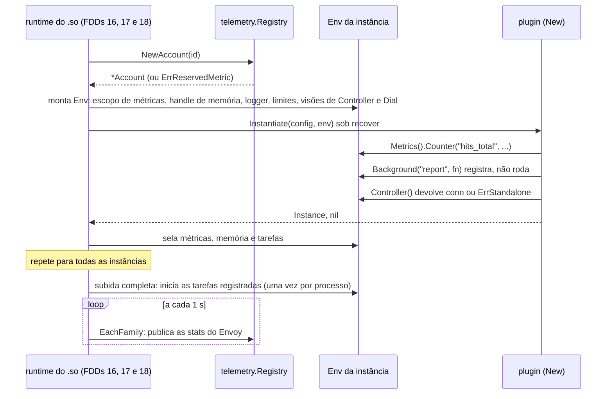
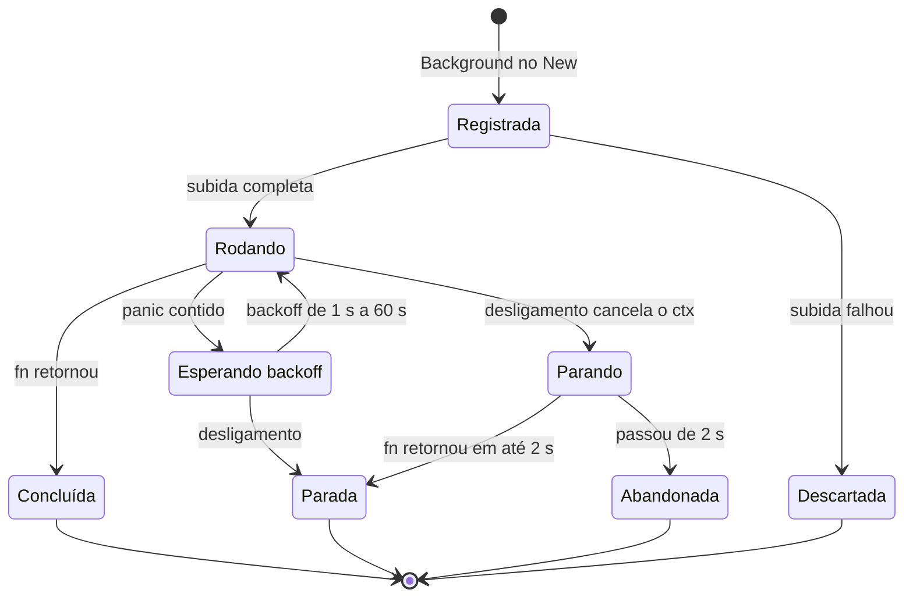
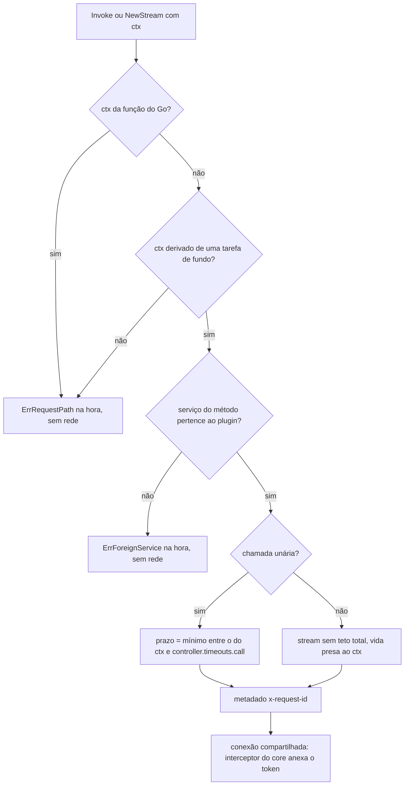
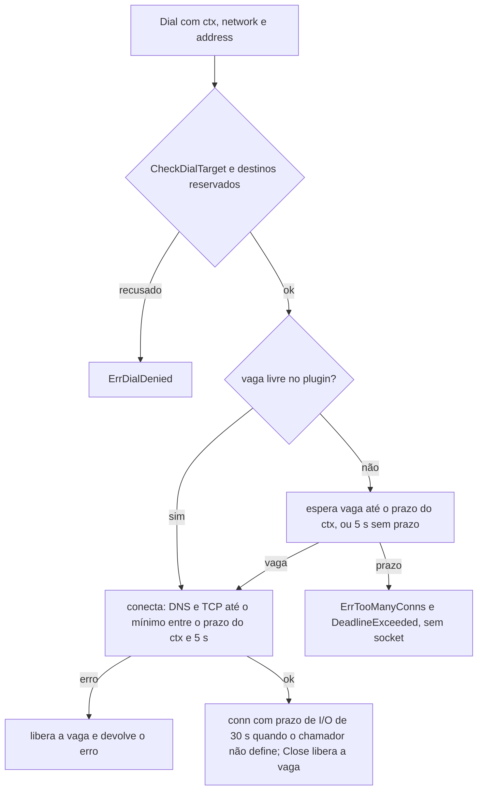

### FDD: Ambiente do proxy (`proxy.Env`): tarefas de fundo, conexões, prazos, métricas e logs (SDK-06)

Versão: 1.0
Data: 2026-10-20
Responsável: Guilherme Giusti

---

### 1. Contexto e motivação técnica

**Problema técnico.** O `proxy.Env` é tudo o que a metade de proxy de um plugin recebe além do `Stream`: o caminho para o controller, para backends próprios (réplica Redis, Postgres, APIs HTTP), para trabalho de longa duração, para memória, métricas e logs. Ele roda dentro do processo do Envoy, onde uma goroutine presa, uma conexão sem prazo ou um panic fora do `recover` derrubam o sidecar inteiro. O ADR-016 do `n3x-sdk` fixou as regras (controller só em segundo plano, `env.Dial()` na requisição com o prazo do `Go()`, 8 tarefas de fundo e 16 conexões por plugin, `go` cru proibido) e o ADR-022 fixou as métricas por handle com prefixo. Faltava o comportamento verificável:

- o tipo devolvido por `env.Controller()` e como uma chamada feita dentro de `s.Go()` é recusada, já que `Controller()` não recebe `ctx`
- como o teto de 5 s por chamada é aplicado sem o plugin perceber, e o que acontece com o stream de heartbeat do core (L-08)
- quando uma tarefa de fundo começa a rodar, como reinicia depois de um panic e como termina no desligamento
- o que é "prazo no transporte" numa conexão que vive mais do que uma requisição
- onde se ajustam os limites de 8 tarefas e 16 conexões (L-51) e se contam por plugin ou por instância
- a forma da API de métricas sem alocação, a regra de nome, os buckets e a recusa de nome repetido entre plugins (pedido da FDD 01, inconsistência I-01 dela)
- os campos fixos do log, o nome do identificador de correlação (L-13), o `request_id` num hook sem alocar (P-09 da FDD 05) e onde moram os tipos comuns às duas metades sem `proxy/` importar `controller/` (ADR-011)
- o nome da função de espera (L-14) e o destino das métricas `n3x_controller_*` do sidecar, que fogem do prefixo do ADR-022 (L-12)

Esta entrevista achou dois problemas novos:

- **Token do core emprestado a qualquer plugin.** A conexão compartilhada anexa o token do sidecar a toda chamada (interceptor do core, ADR-019). Sem uma regra no `Env`, qualquer plugin poderia chamar `n3x.plugins.n3x.core.v1.Core/Register` e forjar um registro aceito pelo controller. O FR-002 diz que "os demais plugins usam os próprios serviços", mas nenhum documento impõe isso.
- **Nomes de plugin dentro das famílias da plataforma.** O prefixo `n3x_<namespace>_<nome>_` de um plugin com namespace `plugin` ou `controller` cai dentro de `n3x_plugin_*` ou `n3x_controller_*`. Exemplo: o plugin `plugin.memory` com a métrica `bytes` gera `n3x_plugin_memory_bytes`, que é uma métrica do SDK (FDD 04).

**Encaixe no HLD.** Esta FDD completa o pacote `proxy/` do módulo `github.com/giustech/n3x-sdk` (HLD do `n3x-sdk`: linha `proxy/` de "Componentes e responsabilidades", "Contrato de proxy", "Fluxo de requisição: segundo plano", "Considerações de escalabilidade: limites por plugin" e "Observabilidade") e cria o pacote `telemetry/`, com os tipos de métricas e o formato de log comuns às duas metades. Consumidores:

- FDD 07: o kit implementa o `Env` com as mesmas regras, usando o `telemetry.Registry`, o handler de log do SDK, o `memory.Runtime`, o agendador determinístico e o relógio falso
- FDD 08: o `ctrl.Env` devolve os mesmos tipos de `telemetry/` e o mesmo `*slog.Logger`
- FDD 09: capacidade do lado do sidecar que alimenta as métricas `n3x_controller_*` da sessão (L-12) e exceção de prazo do login (proposta da L-08)
- FDDs 15 e 30: validam `runtime.plugin_limits["<id>"].background` e `.dial`
- FDD 16: hospeda o `telemetry.Registry`, exporta as métricas como stats do Envoy, escreve os logs e implementa `Metrics()`, `Log()`, `Target()` (D-09)
- FDD 17: monta o `Env` de cada instância, sela os recursos depois do `New` e inicia as tarefas uma vez por processo
- FDD 18: implementa `Background`, `Dial`, `HTTPClient` e a marcação do `ctx` do `Go()` (D-09)
- FDD 38: implementa a visão de `env.Controller()` sobre a conexão compartilhada (D-09) e decide a L-08
- FDDs 39 e 42: o core usa `Background` e `Controller` e não registra `n3x_controller_*` pelo `env.Metrics()`
- FDDs 20 e 24: regras de build e de análise estática ligadas a este contrato
- FDD 47: guia do autor (rótulos certos e errados, receitas de connector) e alertas

**Atores.** Autor de plugin (usa o `Env` no `New`, nos hooks, no `Go()` e nas tarefas de fundo), runtime do sidecar (executor, contenção de falhas, telemetria e conexão compartilhada, que implementam o `Env`), kit de testes (implementação determinística), plugin core (tarefas de sessão, registro, heartbeat, eventos e saída), operador (ajusta limites, lê métricas e logs) e mantenedor do SDK.

**Limites.** O SDK define o contrato (`proxy.Env`, `proxy.Sleep`, erros sentinela, constantes e funções de regra) e entrega pronto o que precisa ser idêntico em todo processo: o registro de métricas e o formato de log (`telemetry/`). O que depende do processo (goroutines, sockets e a conexão gRPC) é implementado pelo sidecar e pelo kit e conferido por uma suíte de conformidade comum (pedido à FDD 07). `proxy/` e `telemetry/` não criam goroutine, não abrem arquivo nem socket e não guardam estado global; `proxy.Sleep` só espera um timer.

**Suposições**
- O hook síncrono roda na thread do worker do Envoy; um hook que bloqueia segura o worker (HLD do `n3x-sidecar`)
- As bibliotecas de connector aceitam um discador com a forma `func(ctx, network, addr) (net.Conn, error)`: `Dialer` do go-redis, `DialFunc` do pgx e `DialContext` do `http.Transport`
- O runtime do sidecar consegue publicar, com atraso de até 1 s, valores de métricas atualizados em qualquer goroutine (hook, `Go()` ou tarefa de fundo); a forma exata é da FDD 16
- Go 1.26 ou superior (ADR-021 do `n3x-sdk`); `runtime.AddCleanup` existe desde o Go 1.24
- A interface `grpc.ClientConnInterface` do grpc-go é estável e é o tipo aceito pelos clients gerados (`NewXClient(cc grpc.ClientConnInterface)`)

**Restrições**
- `proxy/` usa só biblioteca padrão, pacotes do próprio SDK (`plugin/`, `memory/`, `telemetry/` e `internal/`) e grpc-go; nunca importa `controller/` (ADR-011); sem cgo
- `telemetry/` usa só biblioteca padrão e `plugin/`
- Nenhuma operação sem prazo (ADR-006 do `n3x-sidecar`); `go` cru, `time.Sleep`, `net.Dial` e `http.Get` são proibidos ao código de plugin (análise estática, FDD 24)
- Nada vem de variável de ambiente (FR-001): o cliente HTTP do SDK ignora `HTTP_PROXY` e afins
- Contrato estável desde a `v1.0.0`; antes disso, pré-releases `v0.x` (ADR-021)
- Documentação e mensagens em pt-BR; identificadores em inglês

**Rastreabilidade**
- PRD 1.5: FR-002 (conexão compartilhada, cada plugin cria o próprio client sobre ela, uso só em tarefa de fundo, erro devolvido ao plugin), FR-012 (controller só em tarefa de fundo com erro na hora durante a requisição, discador do SDK com prazo e política de falha, memória, métricas e logs com o ID), FR-004 (panic contido); requisitos não funcionais de desempenho (0 alocações nos caminhos comuns), disponibilidade (zero erros da aplicação causados pelo controller), observabilidade (logs com serviço, instância e ID; métricas do sidecar) e confiabilidade (toda requisição termina)
- ADRs do `n3x-sdk`: ADR-005, ADR-009 (de plataforma), ADR-011, ADR-012, ADR-016, ADR-017, ADR-019, ADR-021 e ADR-022; do `n3x-sidecar`: ADR-004, ADR-006 e ADR-008; do `n3x-plugin-core`: ADR-007, ADR-008 e ADR-010
- Lacunas do README:
  - **L-12 fechada aqui:** a família `n3x_controller_*` do sidecar é uma exceção registrada ao ADR-022, tratada como família de plataforma (igual a `n3x_plugin_*`), e mantém os nomes (ADR-010 do `n3x-plugin-core`). Ela nunca passa por `env.Metrics()`, que só produz nomes com `n3x_<namespace>_<nome>_`. Quem publica é a telemetria do `.so` (FDD 16), com valores da conexão compartilhada (`connected`, `buffer_items` e `buffer_dropped_total`, FDD 38) e da sessão do core (`session_age_seconds` e `logins_total`, FDD 39), estes entregues por uma capacidade privilegiada do lado do sidecar (FDD 09). Os namespaces `plugin`, `controller`, `sidecar`, `build` e `config` ficam reservados para métricas (contrato 10), para nenhum plugin cair dentro dessas famílias. Aplicada na FDD 42: o agente do core não registra `n3x_controller_*` pelo `env.Metrics()`
  - **L-13 fechada aqui:** o identificador de correlação se chama `request_id` em todo campo de log (sidecar, controller e plugins) e `x-request-id` no fio, no header HTTP (gerado pelo Envoy) e no metadado gRPC da conexão compartilhada (constante `telemetry.MetadataRequestID`, já aceita pelo controller, HLD do `n3x-controller`). `s.RequestID()` devolve o valor do header (FDD 05). Toda chamada pela conexão leva o metadado, com o valor do `ctx` ou um novo (contrato 3). Aplicada na FDD 38 (envio) e nas FDDs 16, 32 e 33 (campo de log e leitura no controller)
  - **L-14 fechada aqui (parte do `Sleep`):** `proxy.Sleep(ctx, d) error`, no pacote `proxy/`. `sdk.Sleep` no HLD do `n3x-sidecar` é referência solta, como `sdk.Fail` (FDD 05)
  - **L-23 fechada aqui:** a lista de bibliotecas aprovadas fica fora da v1 como regra de build (o `n3x-plugin build` não confere imports de connector). Entra uma lista mínima recomendada no guia do autor, com receita de ligação ao `env.Dial`: `net/http` pelo `env.HTTPClient()`, `github.com/redis/go-redis/v9` e `github.com/jackc/pgx/v5` (hipótese). O teste de longa duração com esses connectors é pedido à FDD 48 ou 50 (L-41)
  - **L-51 fechada aqui (parte de tarefas e conexões):** `runtime.plugin_limits["<id>"].background.max_tasks` (1 a 64, padrão 8) e `runtime.plugin_limits["<id>"].dial.max_conns` (1 a 256, padrão 16), na regra da FDD 04: por ID de plugin e por processo, somando todas as instâncias, fora da `config` tipada e fora do item de instância (hipótese de faixas). A FDD 15 já valida o bloco com os códigos da FDD 04 e deixou nomes, tipos e faixas para esta FDD; ela e a FDD 30 só aplicam o contrato 9. O core usa 5 tarefas (ADR-008 do `n3x-plugin-core`), então o padrão de 8 basta
  - **L-08 recebe a proposta (fechamento na FDD 38):** teto de `controller.timeouts.call` (5 s) só para chamadas unárias, imposto pela visão do `Env`, não pelo interceptor do core; exceção para o `Login` do core com `controller.timeouts.login` (10 s); stream sem teto total; os 10 s do ADR-007 do core são o prazo do lado do servidor (contrato 3) (hipótese)
- Pedidos de FDDs anteriores atendidos: FDD 01 (recusa de nome de métrica repetido entre plugins, contrato 6), FDD 04 (P-01: nomes dos sub-blocos e contagem por plugin, contrato 9; a varredura não conta no limite de tarefas), FDD 05 (P-08: `proxy.Sleep`; P-09: `request_id` sem alocar, contrato 7), FDD 15 (nomes, tipos, faixas e padrões de `background` e `dial` em `runtime.plugin_limits`, contrato 9)
- FDD 15 (SID-01) usada como fonte: tabela "Parte 3" do `n3x.yaml` (struct `config.PluginLimits` com `BackgroundMaxTasks` e `DialMaxConns`, 0 igual ao padrão), faixas de `controller.timeouts.call` (100 ms a 60 s) e `controller.timeouts.login` (1 s a 60 s), regra "`core/config` não importa `proxy/`" e a métrica de plataforma `n3x_config_secrets_in_clear`
- FDD 26 (SID-06) usada como fonte: L-16 fechada lá (admin do Envoy só em `/tmp/n3x/admin.sock`, sockets internos em `/tmp/n3x`, portas de loopback 17001 e 17090 reservadas em `core/envoycfg`); aplicada aqui ao `env.Dial` pela `DialDenyList` (contrato 4)

**Decisões aprovadas na clarificação**
- `env.Controller()` só aceita chamadas de plugins ao próprio namespace gRPC (`ErrForeignService`) e só com `ctx` derivado de uma tarefa de fundo (`ErrRequestPath` em qualquer outro caso), confirmado como regra da v1. O PRD (FR-002 e FR-012) e o HLD devem registrar a regra, e a FDD 38 (outro repositório) a implementa na visão do `Env`
- No sidecar, histogram sai como `_bucket` e `_count`, sem `_sum`; counter publica a parte inteira e gauge é arredondado, sem negativo; no controller os valores são exatos, com `_sum`. Limitação aceita na v1
- Os namespaces de plugin `plugin`, `controller`, `sidecar`, `build` e `config` ficam reservados, além de `n3x`. Isso altera o ADR-012 e a regra `reserved_namespace` da FDD-01 (`ParseID`/`CheckNamespace`), e a FDD 20 (builder, outro repositório) deve recusar esses namespaces no build
- A lista de connectors não é validada no build da v1: fica só como recomendação no guia do autor (`net/http` pelo `env.HTTPClient()`, go-redis e pgx pelo `env.Dial`), com teste de longa duração com connectors nas FDDs 48 ou 50. A pendência "lista de bibliotecas aprovadas" do HLD fica resolvida por essa decisão
- Os pacotes `telemetry/` e `internal/` (inclui `internal/clock`) entram no módulo do SDK e precisam constar na árvore de pacotes do HLD e no ADR-011
- Os demais valores e hipóteses (8 tarefas e 16 conexões por plugin com faixas até 64 e 256, backoff de 1 s a 60 s, prazos de 5 s, 30 s e 10 s, `ShutdownGrace` de 2 s, buckets padrão, regras de nome de métrica e limites de log) ficam aceitos como padrão, sem bloqueio

**Pendências não bloqueantes**
- Dependem de outros repositórios: teto de chamada unária, isenção do `Login` e streams (L-08, decisão final na FDD 38), implementação de `Background`, `Dial`, `HTTPClient` e contenção (FDD 18), registro, exportação e escrita de logs (FDD 16), validação de `runtime.plugin_limits` (FDDs 15 e 30), capacidade do core para `n3x_controller_*` (FDD 09), análise estática (FDD 24) e regra de build de namespaces (FDD 20)
- Em aberto: se `runtime.plugin_limits` com `background` e `dial` vale também para a metade de controller depende de a FDD 08 dar `Background` e `Dial` com limites ao `ctrl.Env` (P-05)

---

### 2. Objetivos técnicos

- **Controller nunca no caminho da requisição.** Invariante: uma chamada pela conexão de `env.Controller()` com o `ctx` da função do `Go()` devolve `ErrRequestPath` sem tocar a rede. Medida: em até 1 µs, com 0 bytes enviados à conexão compartilhada (teste com conexão falsa que conta chamadas).
- **Nenhuma espera sem limite no `Env`.** Invariante: toda operação que pode bloquear termina num prazo conhecido. Medida: chamada unária ao controller em até `min(prazo do ctx, controller.timeouts.call)` mais 50 ms; espera de vaga e conexão do `Dial` em até `min(prazo do ctx, 5 s)` mais 50 ms; `Sleep` em até o fim do `ctx`; desligamento das tarefas em até 2 s mais 100 ms, mesmo com uma tarefa que ignora o `ctx`.
- **Limites exatos e explícitos.** Medida: a 9ª tarefa de fundo do plugin (com o padrão) faz a subida falhar com `ErrTooManyTasks`; a 17ª conexão não abre socket, espera vaga e falha no prazo com `ErrTooManyConns`; nos dois casos a mensagem cita o campo de ajuste.
- **Panic em tarefa de fundo nunca derruba o processo.** Medida: tarefa que dá panic a cada execução reinicia com atrasos de 1, 2, 4, 8, 16, 32 e 60 s (com jitter de 20%), e o processo segue servindo tráfego.
- **Métricas sem alocação no caminho quente.** Medida com `testing.AllocsPerRun(1000, ...)`: 0 alocações em `With(...)` de série existente seguido de `Inc`, `Add`, `Set` ou `Observe`; até 100 ns por `With` com 2 rótulos e até 20 ns por `Inc` em série guardada (hipótese de tempos, no runner da CI).
- **Nenhum nome de métrica repetido.** Invariante: no processo, cada nome completo de métrica tem um único dono e uma única definição; nenhum plugin produz nome dentro de família da plataforma. Medida: recusa na subida, com os dois plugins citados.
- **Um formato de log só.** Invariante: sidecar, controller e kit escrevem logs com o mesmo handler do SDK, os mesmos campos e a mesma ordem; nenhum `plugin.Secret` aparece em claro. Medida: teste golden do handler e teste com o canário `n3x-canary-` (FDD 03).
- **Mesmo comportamento no kit e no sidecar.** Medida: a suíte de conformidade do `Env`, exportada pelo kit (FDD 07), passa na implementação do sidecar (FDDs 16, 18 e 38).
- **Isolamento na conexão compartilhada.** Invariante: um plugin só chama métodos do próprio namespace gRPC (`id.OwnsGRPCService`); qualquer outro devolve `ErrForeignService` sem tocar a rede.

---

### 3. Escopo e exclusões

**Incluído**
- Interface completa `proxy.Env` (`Target`, `Instance`, `Memory`, `Metrics`, `Log`, `Background`, `Controller`, `Dial` e `HTTPClient`): quando cada método pode ser chamado, custo e ciclo de vida
- `env.Background`: nome, limite por plugin, selo depois do `New`, início depois da subida, `recover`, rótulos de pprof, reinício com backoff e desligamento em 2 s
- `env.Controller()`: tipo devolvido, `ErrStandalone`, `ErrRequestPath` por chamada, restrição aos próprios serviços (`ErrForeignService`), teto por chamada unária, metadado `x-request-id` e a proposta para a L-08
- `env.Dial` e `env.HTTPClient`: redes aceitas, limite por plugin, espera de vaga, prazo de conexão e de I/O e liberação da vaga
- `proxy.Sleep` (L-14)
- Pacote novo `telemetry/`: API de métricas (`Metrics`, `Counter`, `Gauge`, `Histogram` e séries), regras de nome e rótulo, buckets, nomes reservados da plataforma, registro com recusa de nome repetido e API do runtime para criar contas, escopos e ler os valores
- Logs: `env.Log()`, handler JSON único com campos fixos, `request_id` (L-13), ordem de campos e mascaramento
- Bloco `runtime.plugin_limits` com `background.max_tasks` e `dial.max_conns` (L-51)
- Métricas publicadas pelo SDK sem esforço do autor e a família de plataforma `n3x_controller_*` (L-12)
- Erros sentinela e constantes do ambiente; funções de regra `CheckTaskName`, `BackgroundBackoff`, `CheckDialTarget`, `DialDenyList.Check`, `CheckMetricName` e `CheckLabelName`
- Lista mínima recomendada de connectors no guia do autor (L-23)

**Excluído**
- Implementação da conexão compartilhada, buffer, reconexão, conexão única por processo e decisão final do teto e da isenção de stream (L-08): FDD 38 (SID-10)
- Interceptor do token e capacidades do core, inclusive a que alimenta `n3x_controller_session_age_seconds` e `n3x_controller_logins_total`: FDD 09 (SDK-09)
- Contagem de zumbis, `max_inflight`, disjuntor, prazo do `Go()` e implementação de `Background`, `Dial` e clientes no sidecar: FDD 18 (SID-04)
- Pacote `memory/`: FDD 04 (SDK-04)
- Ambiente da metade de controller (`ctrl.Env`), que aplica o `telemetry/`: FDD 08 (SDK-08)
- Stats do Envoy que materializam as métricas e escritor de logs do `.so`: FDD 16 (SID-02)
- Kit de testes (agendador determinístico, relógio falso, rede falsa e suíte de conformidade do `Env`): FDD 07 (SDK-07)
- Validação do bloco `runtime.plugin_limits` nos parsers: FDDs 15 (SID-01) e 30 (CTL-01)
- Regras de análise estática: FDD 24 (BLD-06); regra de build para namespaces reservados: FDD 20 (BLD-02)
- Guias, painéis e receitas de connector: FDD 47 (SDK-15); teste de longa duração com connectors: FDD 48 ou 50 (L-41)
- Fora da v1, por adição em minor quando houver caso real (hipótese): UDP e outras redes no `Dial`, prazos de conexão e de I/O ajustáveis por plugin, remoção de séries de métrica, summary e exemplars, lista de connectors aplicada no build, tracing (ADR-009), tarefa de fundo criada depois do `New`

---

### 4. Fluxos detalhados e diagramas

**Fluxo principal: subida no sidecar**
- O `.so` valida o `n3x.yaml`, inclusive `runtime.plugin_limits` (FDD 15), e cria um `telemetry.Registry` e um `memory.Runtime` por processo (FDDs 16 e 17)
- Para cada plugin com metade de proxy presente (e sempre para o `n3x.core`), o `.so` cria a conta de métricas (`reg.NewAccount(id)`), a conta de memória (FDD 04) e os contadores de tarefas e de conexões com os limites efetivos; loga `plugin_limits` uma vez por plugin
- Para cada instância, o `.so` monta o `Env`: escopo de métricas (`acc.NewScope(instance)`), handle de memória, logger (`telemetry.PluginLogger`), alvo, nome da instância e as visões de `Controller`, `Dial` e `HTTPClient` daquele plugin
- O `.so` chama `Instantiate(config, env)` sob `recover` (FDDs 05 e 17). Dentro do `New`, o plugin:
  - cria métricas (`env.Metrics().Counter(...)`) e mapas de memória, conferidos na hora (nome, regras, conflito entre plugins)
  - registra tarefas com `env.Background(nome, fn)`; a tarefa não roda ainda; o registro confere nome e limite do plugin
  - pega a conexão com `env.Controller()` e cria o client gerado; sem seção `controller`, recebe `ErrStandalone`
  - não faz I/O de rede: o `New` não tem `ctx`, e o `Dial` e as chamadas ao controller exigem um
- Quando o `New` retorna (com sucesso, erro ou panic), o `.so` sela o escopo de métricas, o de memória e o registro de tarefas da instância. Erro ou panic no `New` (inclusive `ErrTooManyTasks`, `ErrSealed` e `ErrMetricConflict`) faz o Envoy não subir (FR-004)
- Com todas as instâncias criadas e a cadeia compilada, o `.so` inicia as tarefas registradas, uma vez por processo, na ordem de registro (hipótese). Se a subida falhou, nenhuma tarefa roda
- A telemetria do `.so` lê o registro a cada 1 s e publica as stats do Envoy (FDD 16)

**Fluxo da tarefa de fundo**
- O runtime abre uma goroutine por tarefa com `recover` e rótulos de pprof `plugin`, `instance`, `task` e `kind=background`, e chama `fn(ctx)`
- O `ctx` não tem prazo, é cancelado no desligamento e carrega a marca privada de "segundo plano" do runtime (hipótese; ver I-06)
- Dentro da tarefa, o plugin chama o controller (teto por chamada unária), o `Dial` (prazo próprio), o `HTTPClient` e `proxy.Sleep(ctx, d)` entre ciclos
- `fn` retornou antes do desligamento: a tarefa termina sem reinício e o runtime loga `background_done` (`info`)
- `fn` deu panic: o runtime recupera, loga `background_panic` com stack amostrado em no máximo 1 por segundo por instância, soma 1 em `n3x_plugin_panics_total` e em `n3x_plugin_background_restarts_total`, espera `BackgroundBackoff(reinícios, u)` com `proxy.Sleep` sobre o `ctx` da tarefa e chama `fn` de novo com o mesmo `ctx`
- A contagem de reinícios volta a zero depois de 60 s rodando sem panic
- O panic em tarefa de fundo não conta para o disjuntor da instância (hipótese; decisão final na FDD 18, P-04). O evento `PANIC` para o controller é das FDDs 09 e 42

**Fluxo da chamada ao controller** (implementação na FDD 38)
- O plugin chama um método do client gerado com um `ctx`
- A visão do `Env` confere, antes de qualquer rede:
  - `ctx` derivado do `ctx` da função do `Go()`: `ErrRequestPath` na hora
  - `ctx` que não deriva do `ctx` de uma tarefa de fundo: `ErrRequestPath` na hora, porque só a marca do segundo plano prova que a chamada está fora da requisição
  - serviço do método fora do namespace do plugin (`id.OwnsGRPCService` falso): `ErrForeignService` na hora
- Chamada unária: prazo efetivo `min(prazo do ctx, controller.timeouts.call)`; stream: sem teto total (proposta da L-08)
- A visão acrescenta o metadado `x-request-id` com `telemetry.RequestIDFrom(ctx)` ou um valor novo
- A conexão compartilhada roda o interceptor do core, que anexa o token, e envia; o erro volta ao plugin como status gRPC

**Fluxo do `Dial`** (implementação na FDD 18)
- Confere rede e endereço (`CheckDialTarget`) e a lista de destinos reservados que o runtime entregou (`DialDenyList.Check`; no sidecar, `/tmp/n3x` e as portas de loopback 17001 e 17090, FDD 26); recusa com `ErrDialDenied`. A mesma lista é conferida de novo no endereço resolvido, antes do `connect`
- Pega uma vaga do plugin; sem vaga, espera até o prazo do `ctx` (ou 5 s, se o `ctx` não tiver prazo); estourou: `ErrTooManyConns` junto com `context.DeadlineExceeded`, sem abrir socket
- Conecta (DNS e TCP) em até `min(prazo do ctx, 5 s)`; erro libera a vaga
- Devolve uma conexão que aplica prazo de I/O de 30 s quando o chamador não definiu um, e que libera a vaga no `Close` (ou na coleta, com log `dial_leak`)

**Fluxo de métricas**
- No `New`: `Counter`, `Gauge` e `Histogram` validam nome, ajuda, rótulos e buckets e registram a família com o nome completo `id.MetricPrefix() + nome`
- No hook: `familia.With(valores...)` acha a série existente sem alocar (ou cria uma, copiando os valores) e `Inc`, `Add`, `Set` ou `Observe` atualizam com operação atômica
- A cada 1 s, a telemetria do `.so` percorre o registro (`EachFamily`) e publica; no controller, o scrape lê o registro (FDD 32)

**Fluxo de log**
- `env.Log()` devolve um `*slog.Logger` com `component=plugin`, `service`, `instance` e `plugin_id` já preparados
- No hook síncrono (sem `ctx`): `env.Log().LogAttrs(nil, nível, msg, telemetry.RequestID(s.RequestID()), ...)`, sem alocar
- Na função do `Go()`: `env.Log().InfoContext(ctx, ...)`; o `ctx` do `Go()` traz o `request_id` (pedido à FDD 18)
- O handler do SDK monta a linha JSON e entrega ao escritor do runtime, que não bloqueia (FDD 16)

**Fluxo do desligamento**
- O supervisor manda SIGTERM ao Envoy depois da drenagem (FDD 29); o `.so` cancela o `ctx` de todas as tarefas de fundo
- O runtime espera até 2 s (`ShutdownGrace`) por todas as tarefas, em paralelo; a que passar loga `background_stop_timeout` e é abandonada (o processo termina)
- A chamada final do core (`Exit`) roda dentro dessa janela de 2 s, depois do cancelamento (FR-016 e HLD do `n3x-sidecar`): a tarefa de saída vê o `ctx` cancelado, pega `ExitContext()` da visão `Sidecar` do `proxy.CoreEnv` (FDD 09, contratos 4 e 8), com prazo de `ExitTimeout` (1,5 s) e a marca de segundo plano, e envia `Exit` com `reason` `drain` (se `Draining()` já fechou) ou `sigterm`. Esse `ctx` é exclusivo do core; os demais plugins não têm chamada depois do cancelamento

**Fluxos alternativos e exceções**
- **Modo standalone:** `env.Controller()` devolve `(nil, ErrStandalone)` sempre; o plugin registra só as tarefas que não precisam do controller; o core fica inativo (HLD do `n3x-sidecar`)
- **Controller fora do ar ou login incompleto:** a chamada unária devolve `Unavailable` ou espera no buffer da FDD 38, sempre dentro do teto; o tráfego não é afetado
- **Nona tarefa do plugin** (somando as instâncias): panic com `ErrTooManyTasks` no `New` da instância que passou do limite; o Envoy não sobe
- **Tarefa, métrica ou mapa criados fora do `New`:** panic com `ErrSealed` (`proxy` ou `telemetry`) ou o panic de `memory` (FDD 04); num hook, o executor contém e aplica a política de falha (FDD 18); numa tarefa de fundo, a tarefa reinicia com backoff
- **Décima sétima conexão na função do `Go()`:** espera vaga até o prazo do `Go()`; o `Dial` falha, o plugin devolve `FailResult(err)` e a política da instância vale (ADR-016)
- **Conexão não fechada pelo plugin:** a vaga só volta quando o objeto é coletado, com log `dial_leak`; até lá conta no limite
- **`s.Go()` com `ctx` guardado de uma tarefa de fundo:** a marca do segundo plano passaria; é risco tratado pela análise estática (pedido à FDD 24 contra `ctx` em campo de struct) e pela documentação (seção 10)
- **Uso indevido de métrica no caminho quente** (número de valores errado, valor negativo em counter, `NaN`): sem efeito, log `metric_misuse` amostrado; o kit falha o teste
- **Nome de métrica repetido entre plugins:** panic com `ErrMetricConflict` no `New` do segundo plugin, com os dois IDs na mensagem; o Envoy não sobe
- **Plugin com namespace reservado (`plugin`, `controller`, `sidecar`, `build` ou `config`):** `reg.NewAccount` devolve `ErrReservedMetric` e o Envoy não sobe; o build já deveria recusar (pedido à FDD 20)

**Diagramas**

Subida e ciclo de vida dos recursos de uma instância:



Estados de uma tarefa de fundo:



Decisão numa chamada pela conexão de `env.Controller()`:



Fluxo do `Dial`:



---

### 5. Contratos públicos (assinaturas, endpoints, headers, exemplos)

**Contrato 1: interface `proxy.Env`**
- Tipo: sdk (interface Go implementada pela plataforma)
- Assinatura/Rota:
  ```go
  package proxy // github.com/giustech/n3x-sdk/proxy

  // Env é o ambiente da instância, entregue ao New e válido por toda a vida dela.
  // É implementado só pela plataforma (executor do sidecar e kit de testes).
  type Env interface {
      Target() Target                 // alvo e capacidades (FDD 05)
      Instance() string               // nome da instância no n3x.yaml
      Memory() memory.Handle          // escopo de memória da instância (FDD 04)
      Metrics() *telemetry.Metrics    // contrato 6
      Log() *slog.Logger              // contrato 7

      Background(name string, fn func(ctx context.Context))                // contrato 2
      Controller() (grpc.ClientConnInterface, error)                       // contrato 3
      Dial(ctx context.Context, network, address string) (net.Conn, error) // contrato 4
      HTTPClient() *http.Client                                            // contrato 4
  }
  ```
- Método: n/a (chamada local)
- Semântica:
  - Um `Env` por instância, criado pelo runtime antes do `New`. Pode ser guardado na instância e usado por toda a vida dela. Todos os métodos são seguros entre goroutines
  - `Env` é implementado só pela plataforma (contrato 9 da FDD 05); por isso ganha métodos por minor sem quebrar plugins
  - `Instance()` devolve `plugins[i].instance` do `n3x.yaml` (pedido da FDD 05). O nome usado na metade só de fundo do core é das FDDs 09 e 36
  - O `New` não faz I/O de rede: ele não recebe `ctx`, e `Dial` e as chamadas ao controller exigem um. Trabalho de rede na subida vai para uma tarefa de fundo
- Quando cada método pode ser chamado:

| Método | No `New` | No hook síncrono | Na função do `Go()` | Em tarefa de fundo | Alocações |
| --- | --- | --- | --- | --- | --- |
| `Target`, `Instance`, `Memory`, `Metrics`, `Log` | sim | sim | sim | sim | 0 |
| `Metrics().Counter`, `Gauge`, `Histogram` | sim | panic `telemetry.ErrSealed` | panic | panic | sim (só no `New`) |
| `Background` | sim | panic `ErrSealed` | panic | panic | sim (só no `New`) |
| `Controller()` | sim | sim | sim | sim | 0 |
| Chamada pela conexão do controller | sem `ctx` | sem `ctx` | `ErrRequestPath` na hora | sim, com teto | as da gRPC |
| `Dial` e `HTTPClient().Do` | sem `ctx` | sem `ctx` | sim, prazo do `Go()` | sim, prazo próprio | as da rede |
| `HTTPClient()` | sim (guarde o valor) | sim | sim | sim | 1 (struct `http.Client`) |

"Sem `ctx`" quer dizer que o plugin não tem como chamar: o `New` e o hook síncrono não recebem `ctx`, e `context.Background()` e `context.TODO()` são recusados no build (FDD 24).

**Exemplo de requisição**
```go
package agent // github.com/giustech/n3x-plugin-ratelimit/agent (plugin hipotético)

func New(cfg Config, env proxy.Env) (proxy.Instance, error) {
    rl := &RateLimit{cfg: cfg, log: env.Log(), http: env.HTTPClient()}
    hits := env.Metrics().Counter("hits_total", "Requisições avaliadas pelo limite", "result")
    rl.allowed, rl.limited = hits.With("allowed"), hits.With("limited") // séries guardadas
    rl.lookup = env.Metrics().Histogram("lookup_seconds", "Tempo da consulta à réplica", nil)
    rl.local = memory.NewMap[string, int64](env.Memory(), "local")
    rl.replica = redis.NewClient(&redis.Options{
        Addr: cfg.ReplicaAddr, Dialer: env.Dial, PoolSize: 8, ContextTimeoutEnabled: true,
    })
    if conn, err := env.Controller(); err == nil {
        cli := ratelimitv1.NewRateLimitClient(conn)
        env.Background("report", func(ctx context.Context) {
            for {
                _, _ = cli.Report(ctx, &ratelimitv1.ReportReq{Limited: rl.totalLimited()})
                if proxy.Sleep(ctx, 10*time.Second) != nil {
                    return
                }
            }
        })
    }
    return rl, nil
}
```

**Exemplo de resposta** (efeito observável depois da subida, instância `rl-api` do serviço `pedidos`)
```json
{
  "env.Instance()": "rl-api",
  "métricas registradas": ["n3x_giustech_ratelimit_hits_total", "n3x_giustech_ratelimit_lookup_seconds"],
  "tarefas registradas no New": 1,
  "tarefas rodando depois da subida": 1,
  "env.Controller() com seção controller": "conn, nil",
  "env.Controller() sem seção controller": "nil, proxy: modo standalone, sem controller configurado",
  "conexões abertas na subida": 0
}
```

---

**Contrato 2: `env.Background` (tarefas de fundo)**
- Tipo: sdk (método de `Env` e funções de regra)
- Assinatura/Rota:
  ```go
  // Background registra uma tarefa longa da instância. Só no New.
  // Faz panic (valor do tipo error com a sentinela) em uso indevido.
  //   Background(name string, fn func(ctx context.Context))

  func CheckTaskName(name string) error                  // nil ou erro com ErrInvalidTask
  func BackgroundBackoff(restarts int, u float64) time.Duration // u uniforme em [0, 1)

  const (
      DefaultMaxTasks         = 8                // por plugin no processo (ADR-016)
      MaxMaxTasks             = 64               // teto aceito em runtime.plugin_limits (hipótese)
      MaxTaskNameLen          = 32
      ShutdownGrace           = 2 * time.Second  // ADR-006 do n3x-sidecar
      BackgroundBackoffMin    = 1 * time.Second  // hipótese
      BackgroundBackoffMax    = 60 * time.Second // hipótese
      BackgroundBackoffJitter = 0.2              // hipótese
      BackgroundBackoffReset  = 60 * time.Second // hipótese
  )

  var (
      ErrSealed       = errors.New("proxy: recurso só pode ser criado durante o New")
      ErrInvalidTask  = errors.New("proxy: tarefa de fundo inválida")
      ErrTooManyTasks = errors.New("proxy: limite de tarefas de fundo do plugin atingido")
  )
  ```
- Método: n/a
- Semântica:
  - **Momento (hipótese):** só durante o `New`, como `memory.NewMap` (FDD 04) e a criação de métricas. Depois do selo, panic com `ErrSealed`. Motivo: tarefa criada por requisição viraria goroutine sem limite
  - **Nome:** casa com `^[a-z][a-z0-9_]{0,31}$` e é único na instância; vira o rótulo `task` de pprof, de log e de `n3x_plugin_background_restarts_total`. Nome inválido, repetido ou `fn` nula: panic com `ErrInvalidTask`
  - **Limite (ADR-016, por plugin):** conta as tarefas registradas por todas as instâncias do plugin no processo. O limite é `runtime.plugin_limits["<id>"].background.max_tasks` ou `DefaultMaxTasks`. O registro que passa do limite faz panic com `ErrTooManyTasks`, e a mensagem cita o campo de ajuste. A varredura de memória, a telemetria e a conexão compartilhada são goroutines do runtime e não contam (FDD 04)
  - **Início (hipótese):** a tarefa não roda durante o `New`. O runtime inicia todas as tarefas depois da subida completa (todas as instâncias criadas e a cadeia compilada), uma vez por processo, na ordem de registro. Subida que falha não inicia nenhuma. Motivo: sem tarefas rodando enquanto a subida ainda pode falhar, e com ordem determinística no kit
  - **Execução:** uma goroutine por tarefa, com `recover` e rótulos de pprof `plugin`, `instance`, `task` e `kind=background`. O `ctx` não tem prazo, é cancelado no desligamento e carrega a marca privada do segundo plano usada pela visão do controller (contrato 3)
  - **Retorno de `fn`:** a tarefa termina e não reinicia. O plugin que quer laço infinito escreve o laço e sai com o fim do `ctx`
  - **Panic:** contido; a tarefa reinicia depois de `BackgroundBackoff(n, u)`, com `n` igual ao número de reinícios seguidos. O cálculo é `base = min(60 s, 1 s × 2^(n−1))` e `atraso = min(60 s, base × (1 + 0,2 × (2u − 1)))`: 1 s, 2 s, 4 s, 8 s, 16 s, 32 s e depois 60 s, cada um com até 20% para mais ou para menos. `n` volta a zero depois de 60 s rodando sem panic. A espera usa `proxy.Sleep` sobre o `ctx` da tarefa: desligamento durante a espera encerra sem reiniciar. A função é pública para o kit e o sidecar calcularem igual
  - **Desligamento:** o runtime cancela o `ctx` e espera até `ShutdownGrace` (2 s) por todas as tarefas, em paralelo. A tarefa que passar é abandonada com log `background_stop_timeout`; o processo termina em seguida (SIGKILL em 5 s, ADR-006 do `n3x-sidecar`)
  - **Chamada final na saída:** depois do cancelamento, o `ctx` da tarefa já não serve para chamar o controller. Só o core tem chamada final: `ExitContext()` da visão `Sidecar` do `proxy.CoreEnv` (FDD 09, contrato 8) devolve um `ctx` novo com a marca de segundo plano e prazo de `ExitTimeout` (1,5 s), dentro do `ShutdownGrace`; o `Exit` sai com `reason` `drain` ou `sigterm`, conforme `Draining()` já tenha fechado. O início da drenagem chega ao core por `Draining()`, não pelo `ctx`

**Exemplo de requisição**
```go
// Plugin giustech.sync com duas instâncias (sync-a e sync-b), limite padrão de 8
func New(cfg Config, env proxy.Env) (proxy.Instance, error) {
    for i := 0; i < 5; i++ {
        env.Background(fmt.Sprintf("worker_%d", i), work) // 5 em sync-a; em sync-b, a 4ª passa de 8
    }
    return &Sync{}, nil
}
// Outra tarefa, que dá panic a cada execução:
env.Background("flaky", func(ctx context.Context) { panic("boom") })
```

**Exemplo de resposta**
```json
{
  "subida": "falha no New de sync-b",
  "erro": "proxy: limite de 8 tarefas de fundo do plugin \"giustech.sync\" atingido (instância \"sync-b\", tarefa \"worker_3\"); ajuste runtime.plugin_limits[\"giustech.sync\"].background.max_tasks",
  "errors.Is(err, proxy.ErrTooManyTasks)": true,
  "tarefas iniciadas": 0,
  "flaky (outra subida, sem limite estourado)": {
    "atrasos entre reinícios (u = 0,5)": ["1s", "2s", "4s", "8s", "16s", "32s", "60s", "60s"],
    "n3x_plugin_panics_total{plugin=\"giustech.sync\",instance=\"sync-a\"}": 8,
    "n3x_plugin_background_restarts_total{plugin=\"giustech.sync\",instance=\"sync-a\",task=\"flaky\"}": 8,
    "processo": "segue servindo tráfego"
  }
}
```

---

**Contrato 3: `env.Controller()` (conexão compartilhada vista pelo plugin)**
- Tipo: sdk (método de `Env`; a implementação é da FDD 38)
- Assinatura/Rota:
  ```go
  //   Controller() (grpc.ClientConnInterface, error)

  const DefaultControllerCallTimeout = 5 * time.Second // padrão de controller.timeouts.call

  var (
      ErrStandalone     error // "proxy: modo standalone, sem controller configurado"; GRPCStatus Unavailable
      ErrRequestPath    error // "proxy: controller não pode ser chamado durante a requisição"; GRPCStatus FailedPrecondition
      ErrForeignService error // "proxy: método fora do namespace gRPC do plugin"; GRPCStatus PermissionDenied
  )
  ```
- Método: chamadas gRPC unárias e streams, pelo client gerado do plugin
- Semântica de status e metadados:
  - **Retorno:** sempre o mesmo valor por plugin (0 alocações), utilizável a qualquer momento para criar o client gerado (`examplev1.NewExampleClient(conn)`), de preferência no `New`. Sem seção `controller` no `n3x.yaml`, sempre `(nil, ErrStandalone)`. O tipo é a interface do grpc-go (hipótese), porque é o que os clients gerados aceitam; o valor é uma visão da conexão única do processo, própria do plugin
  - **Regras por chamada**, na ordem, antes de qualquer rede (em até 1 µs):
    1. `ctx` derivado do `ctx` da função do `Go()`: devolve `ErrRequestPath` (ADR-016, FR-012 "erro na hora")
    2. `ctx` que não deriva do `ctx` de uma tarefa de fundo: devolve `ErrRequestPath` (hipótese), porque só a marca do segundo plano prova que a chamada está fora da requisição
    3. método cujo serviço não passa em `id.OwnsGRPCService` (FDD 01), ou método mal formado: devolve `ErrForeignService` (hipótese). Motivo: o interceptor do core anexa o token do sidecar a toda chamada; sem esta regra, um plugin forjaria `Core/Register` (FR-002: "os demais plugins usam os próprios serviços")
    4. chamada unária: prazo efetivo `min(prazo do ctx, controller.timeouts.call)`, aplicado sem o plugin perceber (o `ctx` passado à conexão é encurtado); estourou: status `DeadlineExceeded`
    5. metadado `x-request-id`: valor de `telemetry.RequestIDFrom(ctx)` ou, se ausente, `telemetry.NewRequestID()` (L-13)
    6. delega à conexão compartilhada; o interceptor do core anexa o token (ADR-019)
  - **Marcação do `ctx`:** o executor marca o `ctx` do `Go()` e o runtime marca o das tarefas de fundo com chaves privadas do sidecar (e do kit). O SDK não exporta essas marcas, então um plugin não consegue forjá-las
  - **Erros da chamada:** status gRPC da conexão (`Unavailable` com login incompleto ou controller fora do ar, `DeadlineExceeded` no teto, `Unauthenticated` e os do serviço). O erro volta ao plugin, que decide (FR-002). As sentinelas acima implementam `GRPCStatus()`, então `status.Code(err)` funciona e `errors.Is(err, proxy.ErrRequestPath)` também
  - **Opções de chamada** (`grpc.CallOption`) do plugin são aceitas; o teto vale mesmo com `WaitForReady(true)`
- Limites e proposta para a L-08 (hipótese; decisão final na FDD 38, P-01):

| Chamada | Teto no sidecar | Origem |
| --- | --- | --- |
| Unária de qualquer plugin | `controller.timeouts.call`, padrão 5 s (faixa de 100 ms a 60 s na FDD 15), mesmo com `ctx` maior | ADR-016 do `n3x-sdk`; tabela "Prazos obrigatórios" do HLD do `n3x-sidecar` ("chamada unária"); FDD 15 |
| `/n3x.plugins.n3x.core.v1.Core/Login` feita pelo `n3x.core` | `controller.timeouts.login`, padrão 10 s (faixa de 1 s a 60 s na FDD 15) | ADR-006 do `n3x-sidecar` (login de 10 s); FDD 15 |
| Stream (heartbeat do core) | Sem teto total; vida presa ao `ctx`; queda detectada pelo keepalive (30 s, prazo de 10 s) e pela lógica do core (ack a cada intervalo) | HLD do `n3x-sidecar` (teto só para unária); HLD e ADR-007 do `n3x-plugin-core` |
| Handler no controller | `runtime.plugin_call_timeout`, 10 s, é o prazo do lado do servidor; não conflita com o teto do cliente, que é menor | ADR-007 do `n3x-plugin-core` ("10 s só para as unárias") |

  - **Quem impõe:** a visão do `Env` entregue ao plugin (FDD 38), não o interceptor do core; o interceptor só anexa o token (hipótese). Assim a regra vale igual para todos os plugins, inclusive antes do login
  - **Streams longos:** o host aceita 16 streams por conexão (HLD do `n3x-plugin-core`); o limite de streams simultâneos por plugin é decisão da FDD 38 (P-02)

**Exemplo de requisição**
```go
conn, _ := env.Controller()
cli := examplev1.NewExampleClient(conn)
corecli := corev1.NewCoreClient(conn) // serviço de outro namespace

env.Background("report", func(ctx context.Context) {
    _, err1 := cli.Report(ctx, &examplev1.ReportReq{Denies: 3})     // segundo plano: segue, teto de 5 s
    _, err2 := corecli.Register(ctx, &corev1.RegisterRequest{})     // plugin n3x.example chamando o core
    _ = err1; _ = err2
})

func (e *Example) OnRequestHeaders(s proxy.Stream) proxy.Action {
    return s.Go(func(ctx context.Context) proxy.Result {
        _, err3 := e.cli.Report(ctx, &examplev1.ReportReq{Denies: 1}) // dentro do Go()
        return proxy.FailResult(err3)
    })
}
```

**Exemplo de resposta**
```json
{
  "err1 (controller fora do ar)": "rpc error: code = Unavailable, em até 5 s",
  "metadados enviados em err1": { "x-request-id": "8b0f3c2e-4f1a-4c55-9a77-2d6e1b9f0c31", "authorization": "anexado pelo interceptor do core" },
  "err2": "proxy: método fora do namespace gRPC do plugin",
  "errors.Is(err2, proxy.ErrForeignService)": true,
  "status.Code(err2)": "PermissionDenied",
  "err3": "proxy: controller não pode ser chamado durante a requisição",
  "status.Code(err3)": "FailedPrecondition",
  "bytes enviados por err2 e err3": 0,
  "n3x_plugin_controller_calls_total": { "Unavailable": 1, "ForeignService": 1, "RequestPath": 1 }
}
```

---

**Contrato 4: `env.Dial` e `env.HTTPClient` (conexões próprias com prazo)**
- Tipo: sdk (métodos de `Env` e função de regra)
- Assinatura/Rota:
  ```go
  //   Dial(ctx context.Context, network, address string) (net.Conn, error)
  //   HTTPClient() *http.Client

  func CheckDialTarget(network, address string) error // nil ou erro com ErrDialDenied (só forma)

  // DialDenyList são os destinos reservados do processo hospedeiro. O runtime
  // monta a lista e a aplica no Dial do Env; o SDK só define a regra.
  type DialDenyList struct {
      LoopbackPorts []int    // portas TCP negadas em loopback e no endereço não especificado
      UnixDirs      []string // diretórios absolutos negados para a rede unix (o próprio e o que está abaixo)
  }

  func (l DialDenyList) Check(network, address string) error // nil ou erro com ErrDialDenied

  const (
      DefaultMaxConns    = 16               // por plugin no processo (ADR-016)
      MaxMaxConns        = 256              // teto aceito em runtime.plugin_limits (hipótese)
      DefaultDialTimeout = 5 * time.Second  // espera de vaga e conexão sem prazo no ctx (hipótese)
      DefaultIOTimeout   = 30 * time.Second // rede de segurança de cada Read e Write (hipótese)
      DefaultHTTPTimeout = 10 * time.Second // teto do cliente HTTP (hipótese)
      MaxDialAddressLen  = 255
  )

  var (
      ErrTooManyConns = errors.New("proxy: limite de conexões do plugin atingido")
      ErrDialDenied   = errors.New("proxy: rede ou endereço não permitido")
  )
  ```
- Método: TCP ou socket Unix (o "cliente TCP" do SDK é o próprio `Dial`); HTTP pelo `*http.Client`
- Semântica:
  - **Assinatura igual à de `net.Dialer.DialContext`:** encaixa direto no `Dialer` do go-redis, no `DialFunc` do pgx e no `DialContext` de um `http.Transport`
  - **Redes e endereços (hipótese):** `tcp`, `tcp4`, `tcp6` e `unix`. TCP exige `host:porta` com host explícito e porta numérica de 1 a 65535; Unix exige caminho absoluto. Até 255 bytes. Fora disso, `ErrDialDenied`
  - **Destinos reservados (FDD 26, L-16):** o SDK não importa o sidecar, então define a regra (`DialDenyList`) e o runtime entrega os valores ao montar o `Env`. No sidecar, a FDD 26 fixou o admin do Envoy só no socket `/tmp/n3x/admin.sock`, o diretório `/tmp/n3x` para os sockets internos (inclusive o canal de controle da FDD 29) e as portas de loopback 17001 e 17090 (`envoycfg.ReservedLoopbackPorts` e `envoycfg.IsReservedUnixPath`, pacote `core/envoycfg`). A lista do sidecar é `DialDenyList{LoopbackPorts: [17001, 17090], UnixDirs: ["/tmp/n3x"]}`, montada a partir desse pacote (FDD 18). Regras de `Check`, todas com `ErrDialDenied`:
    - `unix`: o caminho é limpo (`filepath.Clean`) e, quando existe, tem os links simbólicos resolvidos; é negado se for igual a um diretório da lista ou estiver abaixo dele (`/tmp/n3x/admin.sock`, `/tmp/x/../n3x/control.sock`)
    - `tcp`, `tcp4` e `tcp6`: porta da lista com host `localhost`, IPv4 em `127.0.0.0/8`, `::1`, IPv4 mapeado em IPv6 (`::ffff:127.0.0.1`) ou endereço não especificado (`0.0.0.0` e `::`, que o Linux liga ao próprio host)
    - a checagem roda no endereço escrito e de novo no endereço resolvido, no `Control` do `net.Dialer`, antes do `connect`; um nome DNS que resolve para loopback na porta 17001 também é negado
    - lista vazia não nega nada (controller e kit sem configuração); a lista do processo é a mesma para todos os plugins e não muda depois da subida
    - o kit aceita a lista como opção, para a suíte de conformidade do `Env` rodar com a lista do sidecar (pedido à FDD 07)
  - Os destinos reservados valem também para o transporte do `HTTPClient`, que disca pelo `env.Dial`
  - **Limite por plugin (ADR-016):** conexões abertas pelo `Dial` e pelo transporte do `HTTPClient`, somando todas as instâncias, até `runtime.plugin_limits["<id>"].dial.max_conns` ou `DefaultMaxConns`. A vaga é ocupada do `Dial` bem-sucedido até o `Close`
  - **Décima sétima conexão:** espera vaga até o prazo do `ctx` (na função do `Go()`, o prazo do `Go()`, ADR-016); com `ctx` sem prazo (tarefa de fundo), até `DefaultDialTimeout`. Estourou: erro com `errors.Is(err, ErrTooManyConns)` e `errors.Is(err, context.DeadlineExceeded)`, sem abrir socket
  - **Conexão:** DNS e TCP em até `min(prazo do ctx, DefaultDialTimeout)`; erro libera a vaga e volta embrulhado (`*net.OpError` preservado)
  - **"Prazo no transporte" (hipótese):** a `net.Conn` devolvida aplica `agora + DefaultIOTimeout` a cada `Read` e `Write` quando o chamador não definiu prazo (`SetDeadline`, `SetReadDeadline` ou `SetWriteDeadline`); prazo definido pelo chamador vale como está. É rede de segurança contra leitura eterna; as bibliotecas recomendadas já põem o prazo do `ctx` em cada comando
  - **Liberação:** `Close` é idempotente e libera a vaga uma vez. Conexão não fechada e coletada pelo GC libera a vaga e gera log `dial_leak`
  - **TLS:** o `Dial` entrega a conexão crua; TLS fica com a biblioteca ou com `tls.Client`
  - **Na requisição:** usar só dentro da função do `Go()`, com o `ctx` dela; erro vira `FailResult(err)` e a política da instância (ADR-016)
  - **`HTTPClient()`:** devolve um `*http.Client` novo a cada chamada (guarde no `New`), com o `Transport` compartilhado do plugin: `DialContext` igual ao `env.Dial` (conta vagas), `Proxy` nulo (ignora variáveis de ambiente, FR-001), `TLSHandshakeTimeout` de 5 s, `IdleConnTimeout` de 30 s, `MaxIdleConnsPerHost` de 4 e `ForceAttemptHTTP2` ligado (hipóteses). `Client.Timeout` igual a `DefaultHTTPTimeout`, teto quando o `ctx` tem prazo maior. Requisição com `http.NewRequestWithContext`; o plugin fecha o `Body` da resposta, senão a vaga fica presa. Não altere o `Transport` devolvido
  - **Lista mínima recomendada de connectors (L-23, hipótese):** `net/http` pelo `env.HTTPClient()`; `github.com/redis/go-redis/v9` com `Dialer: env.Dial`, `PoolSize` menor ou igual a `dial.max_conns` e `ContextTimeoutEnabled: true`; `github.com/jackc/pgx/v5` com `DialFunc: env.Dial` e `MaxConns` menor ou igual a `dial.max_conns`. Sem checagem no build na v1; receitas no guia do autor (FDD 47)

**Exemplo de requisição**
```go
// Na função do Go(), prazo de 200 ms, com 16 conexões do plugin já abertas
c, err := env.Dial(ctx, "tcp", "127.0.0.1:6379")

// Em tarefa de fundo (ctx sem prazo)
_, errd := env.Dial(ctx, "udp", "10.0.0.5:53")
_, erra := env.Dial(ctx, "tcp", "127.0.0.1:17001") // porta reservada (FDD 26)
_, erru := env.Dial(ctx, "unix", "/tmp/n3x/admin.sock") // admin do Envoy (FDD 26)
conn, _ := env.Dial(ctx, "tcp", "replica.interno:6379")
n, errr := conn.Read(buf) // réplica não responde, nenhum prazo definido
```

**Exemplo de resposta**
```json
{
  "err (17ª conexão)": "proxy: limite de conexões do plugin atingido: context deadline exceeded",
  "espera até falhar": "200 ms (prazo do Go)",
  "sockets abertos pela 17ª": 0,
  "errors.Is(err, proxy.ErrTooManyConns)": true,
  "errors.Is(err, context.DeadlineExceeded)": true,
  "errd": "proxy: rede ou endereço não permitido: rede udp",
  "erra": "proxy: rede ou endereço não permitido: destino reservado do sidecar",
  "erru": "proxy: rede ou endereço não permitido: destino reservado do sidecar",
  "errr (depois de 30 s)": "read tcp ...: i/o timeout",
  "n3x_plugin_dial_failures_total": { "slot_timeout": 1, "denied": 3 }
}
```

---

**Contrato 5: `proxy.Sleep` (L-14)**
- Tipo: sdk (função de pacote)
- Assinatura/Rota:
  ```go
  // Sleep espera d ou até o ctx terminar, o que vier primeiro.
  // Devolve nil se esperou d inteiro e ctx.Err() se o ctx terminou antes.
  func Sleep(ctx context.Context, d time.Duration) error
  ```
- Método: n/a
- Semântica:
  - Nome `proxy.Sleep` (ADR-016 e HLD do `n3x-sdk`); `sdk.Sleep` não existe (L-14)
  - `d` menor ou igual a zero: devolve `ctx.Err()` na hora, sem esperar (nil se o `ctx` está vivo)
  - `d` maior que o prazo do `ctx`: acorda no prazo e devolve `context.DeadlineExceeded`; nunca espera além do `ctx`
  - `ctx` nulo: panic, como as funções do pacote `context`
  - Relógio: no sidecar, o relógio real (um timer por chamada, parado ao sair). O kit troca o relógio por um falso que ele carrega no `ctx` por um pacote interno do SDK (`internal/clock`), então o agendador determinístico avança o tempo sem `time.Sleep` (pedido à FDD 07). O sidecar não precisa fazer nada
  - `time.Sleep` não faz parte do contrato e é recusado em código de plugin (FDD 24)

**Exemplo de requisição**
```go
env.Background("poll", func(ctx context.Context) {
    for {
        refresh(ctx)
        if err := proxy.Sleep(ctx, 10*time.Second); err != nil {
            return // desligamento
        }
    }
})
// desligamento 3 s depois do início da espera
```

**Exemplo de resposta**
```json
{ "Sleep devolve": "context canceled", "esperou": "3 s", "tarefa": "parada dentro dos 2 s de ShutdownGrace" }
```

---

**Contrato 6: métricas (`telemetry.Metrics`, `Counter`, `Gauge` e `Histogram`)**
- Tipo: sdk (API Go para autores de plugin, igual nas duas metades)
- Assinatura/Rota:
  ```go
  package telemetry // github.com/giustech/n3x-sdk/telemetry

  type Metrics struct{ /* escopo de métricas de uma instância */ }

  func (m *Metrics) Counter(name, help string, labels ...string) *Counter
  func (m *Metrics) Gauge(name, help string, labels ...string) *Gauge
  func (m *Metrics) Histogram(name, help string, buckets []float64, labels ...string) *Histogram // nil = DefaultBuckets

  type Counter struct{ /* família vista pela instância */ }
  func (c *Counter) With(values ...string) CounterSeries
  func (c *Counter) Inc()           // só em família sem rótulos do autor
  func (c *Counter) Add(v float64)

  type CounterSeries struct{ /* por valor; 8 bytes */ }
  func (s CounterSeries) Inc()
  func (s CounterSeries) Add(v float64) // v finito e >= 0

  type Gauge struct{ /* ... */ }
  func (g *Gauge) With(values ...string) GaugeSeries
  func (g *Gauge) Set(v float64)
  func (g *Gauge) Add(v float64)
  func (g *Gauge) Inc()
  func (g *Gauge) Dec()

  type GaugeSeries struct{ /* ... */ }
  func (s GaugeSeries) Set(v float64)
  func (s GaugeSeries) Add(v float64)
  func (s GaugeSeries) Inc()
  func (s GaugeSeries) Dec()

  type Histogram struct{ /* ... */ }
  func (h *Histogram) With(values ...string) HistogramSeries
  func (h *Histogram) Observe(v float64)
  func (h *Histogram) ObserveDuration(d time.Duration) // em segundos

  type HistogramSeries struct{ /* ... */ }
  func (s HistogramSeries) Observe(v float64)
  func (s HistogramSeries) ObserveDuration(d time.Duration)

  func DefaultBuckets() [NumDefaultBuckets]float64 // por valor

  const (
      NumDefaultBuckets = 18
      MaxBuckets        = 32
      MaxLabels         = 8   // rótulos do autor por família
      MaxFamilies       = 128 // famílias por plugin no processo
      MaxMetricNameLen  = 64  // nome sem o prefixo
      MaxHelpLen        = 256
      MaxLabelValueLen  = 256
  )
  ```
- Método: n/a (chamada local)
- Semântica:
  - **Onde mora (hipótese):** pacote novo `telemetry/`, só biblioteca padrão e `plugin/`. `proxy.Env.Metrics()` e `ctrl.Env.Metrics()` (FDD 08) devolvem o mesmo `*telemetry.Metrics`, sem `proxy/` importar `controller/` (ADR-011). Os tipos são concretos: sidecar, controller e kit usam a mesma implementação, então as regras são idênticas
  - **Momento:** `Counter`, `Gauge` e `Histogram` só durante o `New`; depois do selo, panic com `telemetry.ErrSealed` (as stats do Envoy são definidas na criação da config do filtro)
  - **Nome completo:** `id.MetricPrefix() + name` (ADR-012 e ADR-022), por exemplo `n3x_giustech_ratelimit_` mais `hits_total`
  - **Regras do nome** (hipótese, convenções do Prometheus): `name` casa com `^[a-z][a-z0-9_]{0,63}$`, sem `__` e sem `_` no fim. Counter termina em `_total`; gauge e histogram não terminam em `_total`; nenhum termina em `_bucket`, `_sum`, `_count`, `_created` ou `_info`
  - **Ajuda:** obrigatória, de 1 a 256 bytes, UTF-8, sem quebra de linha
  - **Rótulos:** o autor declara até 8 nomes, que casam com `^[a-z][a-z0-9_]{0,31}$` e não se repetem. O runtime acrescenta antes deles `plugin` (com `id.String()`) e `instance` (com `env.Instance()`), automáticos (ADR-022 e FDD 01). Nomes reservados ao autor: `plugin`, `instance`, `le`, `quantile`, `job` e todo nome começado por `__`
  - **Mesma métrica duas vezes:** no mesmo escopo ou em outra instância do mesmo plugin, com a mesma definição (tipo, ajuda, rótulos na mesma ordem e buckets), devolve a mesma família; com definição diferente, panic com `ErrMetricConflict`
  - **Nome repetido entre plugins** (pedido da FDD 01): nome completo já registrado por outro plugin faz panic com `ErrMetricConflict` no `New` do segundo, citando os dois IDs. Pega também a colisão sem prefixo igual: `a.b` com `c_total` e `a.b_c` com `total` dão o mesmo `n3x_a_b_c_total`
  - **Famílias da plataforma:** plugin com namespace reservado (`plugin`, `controller`, `sidecar`, `build` ou `config`) é recusado no `NewAccount` (contrato 8) com `ErrReservedMetric`
  - **Limite de famílias:** até 128 por plugin no processo; a 129ª faz panic com `ErrInvalidMetric`
  - **`With`:** recebe exatamente um valor por rótulo do autor. Série existente: achada sem alocar. Série nova: criada copiando os valores, então é seguro passar strings do `Stream` sem cópia (FDD 05). Sem limite de cardinalidade (ADR-022). Séries não são removidas na v1
  - **Atalhos sem rótulo:** `Counter.Inc`, `Gauge.Set` e `Histogram.Observe` direto na família equivalem a `With()`; numa família com rótulos do autor, são uso indevido
  - **Buckets:** `nil` usa `DefaultBuckets()`, em segundos: 0,00001; 0,000025; 0,00005; 0,0001; 0,00025; 0,0005; 0,001; 0,0025; 0,005; 0,01; 0,025; 0,05; 0,1; 0,25; 0,5; 1; 2,5 e 5 (hipótese: de 10 µs a 5 s, com limites em 50 µs e 100 µs, o orçamento dos hooks síncronos do ADR-009 do `n3x-sidecar`). O autor pode passar os próprios: de 1 a 32 valores finitos, estritamente crescentes; `+Inf` é implícito. Inválidos: panic com `ErrInvalidMetric`. Os mesmos buckets padrão valem para `n3x_plugin_duration_seconds` (FDD 05)
  - **Valores:** counter aceita só finito e maior ou igual a zero; gauge e histogram aceitam qualquer valor menos `NaN`
  - **Uso indevido no caminho quente** (número de valores errado, valor de rótulo acima de 256 bytes ou fora de UTF-8, valor de counter inválido, `NaN`, atalho em família com rótulos): sem efeito, sem panic e sem erro; o registro conta e o runtime loga `metric_misuse` em no máximo 1 linha por minuto por métrica e regra (códigos `label_count`, `label_value`, `counter_value`, `nan` e `missing_labels`). O kit falha o teste (pedido à FDD 07)
  - **Concorrência:** atualizações sem trava (operações atômicas); valores visíveis ao exportador na próxima leitura (no sidecar, a cada 1 s)
  - **Representação publicada** (FDD 16, contrato 8; fecha a P-03): o valor no Go é sempre exato (ponto flutuante) e é o que o kit lê. As stats do Envoy só guardam inteiros sem sinal, então no sidecar:
    - counter sai com a parte inteira do valor acumulado (`Add(1.5)` publica 1; depois `Add(0.5)`, publica 2)
    - gauge sai arredondado para o inteiro mais próximo, negativo vira 0 e acima de 2^53 vira 2^53, com log `metric_unrepresentable` (regras `fraction`, `negative` e `overflow`) uma vez por família e regra
    - histogram sai como counters `_bucket`, com `le` em segundos formatado por `strconv.FormatFloat(v, 'f', -1, 64)` (sem expoente: `0.00005`, `0.0001`, `+Inf`), e `_count`; **sem `_sum` no sidecar na v1**, porque o `_sum` em segundos não cabe num inteiro. `histogram_quantile` sobre `_bucket` e `rate(_count)` cobrem os painéis e alertas; a média sai aproximada dos buckets (guia, FDD 47)
    - no controller (Prometheus nativo, FDD 32), counter, gauge e histogram saem exatos, com `_sum`
    - Recomendação do guia: gauge que pode ser negativo ou fracionário (ex.: atraso com sinal) vira dois gauges ou usa unidade inteira menor (`_milliseconds`)
  - **Exemplos de rótulo (guia do autor):** certo, `With(cfg.DenyPath)` (valor da config), `With("hit")` e `With("miss")`; errado, `With(s.Path())`, IP do cliente, ID de usuário ou `request_id`
- Custo (hipótese de tempos, no runner da CI):

| Operação | Alocações | Tempo |
| --- | --- | --- |
| `With(v1, v2)` de série existente | 0 | até 100 ns |
| `Inc`, `Add`, `Set` em série guardada | 0 | até 20 ns |
| `Observe` em série guardada (18 buckets) | 0 | até 40 ns |
| `With` de série nova | cópia dos valores e da série | fora do caminho comum |
| `Counter`, `Gauge`, `Histogram` | sim | só no `New` |

**Exemplo de requisição**
```go
// No New da instância "rl-api" de giustech.ratelimit
hits := env.Metrics().Counter("hits_total", "Requisições avaliadas pelo limite", "result")
lookup := env.Metrics().Histogram("lookup_seconds", "Tempo da consulta à réplica", nil)
// No hook e na função do Go()
hits.With("limited").Inc()
lookup.ObserveDuration(73 * time.Microsecond)
hits.With().Inc()                                        // uso indevido: falta o valor de "result"
env.Metrics().Counter("hits", "x")                       // no New: counter sem _total
env.Metrics().Gauge("hits_total", "outra", "result")     // no New: mesmo nome, outra definição
```

**Exemplo de resposta** (stats publicadas pelo sidecar em `17090` depois da leitura de 1 s, sem `_sum`; a mesma família no controller, em `17091`, traria também `_sum ... 0.000073`; e erros do `New`)
```text
n3x_giustech_ratelimit_hits_total{plugin="giustech.ratelimit",instance="rl-api",result="limited"} 1
n3x_giustech_ratelimit_lookup_seconds_bucket{plugin="giustech.ratelimit",instance="rl-api",le="0.00005"} 0
n3x_giustech_ratelimit_lookup_seconds_bucket{plugin="giustech.ratelimit",instance="rl-api",le="0.0001"} 1
n3x_giustech_ratelimit_lookup_seconds_bucket{plugin="giustech.ratelimit",instance="rl-api",le="+Inf"} 1
n3x_giustech_ratelimit_lookup_seconds_count{plugin="giustech.ratelimit",instance="rl-api"} 1

log: {"level":"warn","component":"core","msg":"metric_misuse","plugin_id":"giustech.ratelimit","metric":"n3x_giustech_ratelimit_hits_total","rule":"label_count","count":1}
panic no New: telemetry: nome "hits" inválido: counter precisa terminar em _total (plugin "giustech.ratelimit")
panic no New: telemetry: métrica "n3x_giustech_ratelimit_hits_total" já existe com outra definição (counter, rótulos [result])
```

---

**Contrato 7: logs (`env.Log()`, campos fixos e `request_id`)**
- Tipo: sdk (logger da biblioteca padrão e funções de `telemetry/`)
- Assinatura/Rota:
  ```go
  //   proxy.Env.Log() *slog.Logger

  package telemetry

  const (
      KeyTS        = "ts"
      KeyLevel     = "level"
      KeyMsg       = "msg"
      KeyComponent = "component"
      KeyService   = "service"
      KeyInstance  = "instance"
      KeyPluginID  = "plugin_id"
      KeyRequestID = "request_id"

      MetadataRequestID = "x-request-id" // metadado gRPC e header HTTP (L-13)
      MaxRequestIDLen   = 128
      MaxLogLineSize    = 16 << 10
  )

  func RequestID(id string) slog.Attr                                  // slog.String("request_id", id); 0 alocações
  func ContextWithRequestID(ctx context.Context, id string) context.Context
  func RequestIDFrom(ctx context.Context) (string, bool)
  func NewRequestID() string                                           // UUID v4 com crypto/rand
  ```
- Método: n/a (JSON em stderr no sidecar e no controller)
- Semântica:
  - **Onde mora:** o tipo comum às duas metades é o `*slog.Logger` da biblioteca padrão; o formato é do handler do SDK (`telemetry.NewLogHandler`, contrato 8), usado pelo sidecar, pelo controller e pelo kit. Como `telemetry/` não importa grpc-go, o entrypoint `n3x` também pode usá-lo sem quebrar a regra da FDD 15 (`core/config` sem `proxy/`)
  - **Formato:** um objeto JSON por linha, campos fixos nesta ordem: `ts` (RFC 3339 em UTC com milissegundos), `level` (`debug`, `info`, `warn` ou `error`), `component` (`plugin` no `env.Log()`), `service`, `msg`, `plugin_id`, `instance` e `request_id` (quando houver); depois os atributos, na ordem em que foram passados; grupos viram objetos aninhados. Campo fixo vazio é omitido, menos `ts`, `level`, `component` e `msg`. A ordem segue a dos exemplos das FDDs 04, 05 e 15 (`component` antes de `msg`, `plugin_id` antes de `instance`); o nome do evento vai em `msg` em snake_case, como nas FDDs 04, 05 e 15 (hipótese de ordem e de formato de `ts`)
  - **Nível:** limiar de `runtime.log_level` no sidecar e do equivalente no controller; `Enabled` custa 0 alocações
  - **`request_id` (L-13):** o valor vem, nesta ordem, de um atributo explícito `request_id` no nível de cima ou de `RequestIDFrom(ctx)`. No hook síncrono, que não tem `ctx`, o plugin escreve `env.Log().LogAttrs(nil, slog.LevelWarn, "limite", telemetry.RequestID(s.RequestID()))`, sem alocar (fecha a P-09 da FDD 05). Na função do `Go()`, o `ctx` já traz o valor (pedido à FDD 18); no controller, o host põe no `ctx` o `x-request-id` recebido (FDDs 32 e 33). `ContextWithRequestID` guarda a string como recebida: quem chama passa uma cópia estável (o executor copia o valor do `Stream`)
  - **Nome no fio:** `x-request-id` no header HTTP e no metadado gRPC; `request_id` em todo campo de log, nos dois processos e no core (o HLD do core usava `x-request-id` como campo, I-03)
  - **Chave reservada em atributo do plugin:** `ts`, `level`, `msg`, `component`, `service`, `instance` e `plugin_id` vindos do plugin são renomeados para `attr_<chave>` (hipótese), para nunca sobrescrever um campo fixo
  - **Mascaramento:** `plugin.Secret` sai como `***` em qualquer nível, inclusive dentro de struct e de grupo (`LogValuer` e `MarshalJSON` da FDD 03); o handler nunca chama `Reveal`
  - **Conteúdo proibido:** headers, corpos, query strings, tokens e segredos nunca vão para log (HLD do `n3x-sidecar`); é regra do guia, conferida pelo canário do kit e pela análise estática de `.Reveal()` em chamada de log (FDD 24)
  - **Tamanho:** linha acima de 16 KiB tem os atributos cortados e ganha `"truncated":true` (hipótese)
  - **Não bloqueia:** a escrita nunca bloqueia o hook; o escritor do runtime usa fila limitada e, cheia, descarta e conta em `n3x_plugin_log_dropped_total{plugin}` (FDD 16)
- Custo: `LogAttrs` com até 5 atributos simples (texto, número, `bool`, duração) no handler do SDK com escritor que não aloca: 0 alocações (hipótese, portão da CI); `Info(msg, args...)` aloca e é para fora do caminho quente

**Exemplo de requisição**
```go
// Hook síncrono
func (r *RateLimit) OnRequestHeaders(s proxy.Stream) proxy.Action {
    if r.log.Enabled(nil, slog.LevelWarn) {
        r.log.LogAttrs(nil, slog.LevelWarn, "limite atingido",
            telemetry.RequestID(s.RequestID()), slog.Int("limit", r.cfg.Limit))
    }
    return s.Deny(r.tooMany)
}
// No New, um campo segredo da config
env.Log().Info("conectando à réplica", "addr", cfg.ReplicaAddr, "password", cfg.Password, "instance", "x")
```

**Exemplo de resposta**
```text
{"ts":"2026-10-20T14:03:07.412Z","level":"warn","component":"plugin","service":"pedidos","msg":"limite atingido","plugin_id":"giustech.ratelimit","instance":"rl-api","request_id":"3f1c9a52-6b0e-4c6f-9d1a-0b7e2f4c8a11","limit":100}
{"ts":"2026-10-20T14:02:59.001Z","level":"info","component":"plugin","service":"pedidos","msg":"conectando à réplica","plugin_id":"giustech.ratelimit","instance":"rl-api","addr":"replica.interno:6379","password":"***","attr_instance":"x"}
```

---

**Contrato 8: API do runtime de `telemetry/` (registro, contas, leitura e handler de log)**
- Tipo: sdk (API Go para o sidecar, o controller e o kit; plugins não chamam)
- Assinatura/Rota:
  ```go
  type RegistryOptions struct {
      OnMisuse func(owner plugin.ID, metric, rule string) // o runtime amostra e loga metric_misuse
  }

  type Registry struct{ /* um por processo; sem estado global */ }
  func NewRegistry(opts RegistryOptions) *Registry
  func (r *Registry) NewAccount(id plugin.ID) (*Account, error) // um por plugin
  func (r *Registry) EachFamily(fn func(f *Family))             // ordem por nome completo

  type Account struct{ /* métricas de um plugin */ }
  func (a *Account) NewScope(instance string) (*Metrics, error) // um por instância
  func (a *Account) Series() int                                 // séries criadas pelo plugin
  func (a *Account) Misuses() uint64                             // usos indevidos (kit e testes)

  func (m *Metrics) Seal() // idempotente; chamado depois do New

  type Kind uint8
  const (
      KindCounter Kind = iota + 1
      KindGauge
      KindHistogram
  )

  type Family struct{ /* somente leitura */ }
  func (f *Family) Name() string
  func (f *Family) Help() string
  func (f *Family) Kind() Kind
  func (f *Family) Owner() plugin.ID
  func (f *Family) LabelNames() []string // "plugin", "instance" e os do autor
  func (f *Family) Buckets() []float64   // só histogram
  func (f *Family) EachSeries(fn func(s Series))

  type Series struct{ /* somente leitura */ }
  func (s Series) Label(i int) string                       // valor do i-ésimo rótulo de LabelNames
  func (s Series) Value() float64                           // counter e gauge
  func (s Series) AppendBuckets(dst []uint64) []uint64      // contagens cumulativas; len = buckets + 1
  func (s Series) Sum() float64
  func (s Series) Count() uint64

  func CheckMetricName(k Kind, name string) error
  func CheckLabelName(name string) error
  func IsReservedNamespace(ns string) bool // plugin, controller, sidecar, build, config

  type LogOptions struct {
      Level     slog.Leveler
      Component string           // "plugin", "core", "entrypoint", "host" ...
      Service   string
      Now       func() time.Time // nil = relógio real
  }
  func NewLogHandler(w io.Writer, opts LogOptions) slog.Handler
  func PluginLogger(h slog.Handler, id plugin.ID, instance string) *slog.Logger

  var (
      ErrInvalidMetric  = errors.New("telemetry: métrica inválida")
      ErrMetricConflict = errors.New("telemetry: métrica já registrada com outra definição ou por outro plugin")
      ErrReservedMetric = errors.New("telemetry: namespace reservado a métricas da plataforma")
      ErrSealed         = errors.New("telemetry: métricas só podem ser criadas durante o New")
      ErrDuplicateOwner = errors.New("telemetry: plugin já tem conta neste registro")
      ErrDuplicateScope = errors.New("telemetry: instância já tem escopo neste plugin")
  )
  ```
- Método: n/a
- Semântica:
  - Um `Registry` por processo: o `.so` (FDD 16), o controller (FDD 32) e o kit (um por teste, FDD 07). Não há registro global; dois registros são independentes
  - `NewAccount` recusa ID repetido (`ErrDuplicateOwner`) e namespace reservado (`ErrReservedMetric`); `NewScope` recusa instância repetida (`ErrDuplicateScope`); o runtime chama `Seal` depois do `New`, com `defer`
  - A API do runtime é exportada porque sidecar, controller e kit estão em outros repositórios ou pacotes. Um registro criado por plugin é vazio e separado; a FDD 24 pode recusar o uso por código de plugin (hipótese, igual a `memory.NewRuntime`)
  - `EachFamily` e `EachSeries` leem valores atômicos e podem rodar junto com as atualizações. Em histogram, `Count` é a soma das contagens lidas, então `_count` e o bucket `+Inf` sempre batem
  - Ordem: famílias por nome completo e séries por ordem de criação (determinística para testes golden)
  - `NewLogHandler` monta cada registro num buffer reaproveitado e chama `w.Write` uma vez por linha; o escritor do sidecar não bloqueia (FDD 16). `PluginLogger` acrescenta `component=plugin`, `instance` e `plugin_id` uma vez (sem custo por linha)
  - A exportação para stats do Envoy é da FDD 16 (contrato 8 dela, que fecha a P-03): counter pela diferença da parte inteira, gauge arredondado e sem negativo, histogram como `_bucket` e `_count`, sem `_sum` (contrato 6 desta FDD). A do controller, texto Prometheus no scrape com valores exatos e `_sum`, é da FDD 32

**Exemplo de requisição**
```go
reg := telemetry.NewRegistry(telemetry.RegistryOptions{OnMisuse: amostrarELogar})
acc, _ := reg.NewAccount(plugin.MustParseID("giustech.ratelimit"))
m, _ := acc.NewScope("rl-api")
logger := telemetry.PluginLogger(telemetry.NewLogHandler(escritorNaoBloqueante,
    telemetry.LogOptions{Level: nivel, Component: "plugin", Service: "pedidos"}),
    plugin.MustParseID("giustech.ratelimit"), "rl-api")
inst, err := chamarNewComRecover(env{metrics: m, log: logger /* ... */})
m.Seal()
_, errRes := reg.NewAccount(plugin.MustParseID("plugin.memory"))
reg.EachFamily(func(f *telemetry.Family) { exportar(f) }) // a cada 1 s no sidecar
```

**Exemplo de resposta**
```json
{
  "errRes": "telemetry: namespace reservado a métricas da plataforma: plugin \"plugin.memory\" geraria nomes em n3x_plugin_*",
  "errors.Is(errRes, telemetry.ErrReservedMetric)": true,
  "EachFamily": [
    { "Name": "n3x_giustech_ratelimit_hits_total", "Kind": "counter", "LabelNames": ["plugin", "instance", "result"], "series": 2 },
    { "Name": "n3x_giustech_ratelimit_lookup_seconds", "Kind": "histogram", "Buckets": 18, "series": 1 }
  ],
  "acc.Series()": 3
}
```

---

**Contrato 9: bloco `runtime.plugin_limits` com tarefas e conexões (L-51)**
- Tipo: config (contrato de arquivo; o schema dos arquivos é das FDDs 15 e 30, que só aplicam estas regras)
- Assinatura/Rota: `runtime.plugin_limits["<id>"].background.max_tasks` e `runtime.plugin_limits["<id>"].dial.max_conns`
- Método: n/a
- Semântica (regra da FDD 04, contrato 5; validação já prevista na tabela "Parte 3" da FDD 15; faixas são hipótese):

| Campo | Tipo | Padrão | Faixa | Constante no SDK | Erros |
| --- | --- | --- | --- | --- | --- |
| `<id>.background.max_tasks` | inteiro (sem unidade, sem fração) | 8 | 1 a 64 | `proxy.DefaultMaxTasks`, `proxy.MaxMaxTasks` | `type`, `range` |
| `<id>.dial.max_conns` | inteiro (sem unidade, sem fração) | 16 | 1 a 256 | `proxy.DefaultMaxConns`, `proxy.MaxMaxConns` | `type`, `range` |
| outro campo em `background` ou `dial` | | | | | `unknown_field` |

  - Mesmo bloco da cota de memória: por ID de plugin e por processo, somando todas as instâncias; fora da `config` tipada e fora do item de instância
  - Campo ausente vale o padrão; no `config.PluginLimits` da FDD 15, o valor 0 significa "padrão" (`BackgroundMaxTasks` e `DialMaxConns`). Zero escrito no arquivo é `range`, não "padrão"
  - Como `core/config` não importa `proxy/` (FDD 15, para o binário `n3x` não levar o grpc-go), a FDD 15 replica as quatro constantes e um teste em `core/` confere a igualdade com `proxy.DefaultMaxTasks`, `proxy.MaxMaxTasks`, `proxy.DefaultMaxConns` e `proxy.MaxMaxConns`, como já faz com o limite de body
  - A contagem é por plugin, não por instância (ADR-016, decisão já tomada). O core usa 5 tarefas (sessão, registro, heartbeat, eventos e saída; ADR-008 do `n3x-plugin-core`), dentro do padrão
  - No `n3x.yaml` do serviço, os dois campos valem para a metade de proxy. No do controller, a mesma forma é aceita e vale para a metade de controller se a FDD 08 der a ela `Background` e `Dial` com limites (P-05)
  - Erros reaproveitam os códigos da FDD 04: `unknown_plugin`, `half_missing`, `type` (não inteiro), `range` e `unknown_field`, com caminho pela convenção da L-34
  - Nada vem de variável de ambiente (FR-001); mudar exige redeploy
  - Na subida, o runtime loga um registro `plugin_limits` por plugin com `max_tasks`, `max_conns` e `source` (`default` ou `n3x.yaml`)

**Exemplo de requisição**
```yaml
# n3x.yaml do serviço
runtime:
  plugin_limits:
    giustech.ratelimit:
      memory: { max_bytes: 32Mi }   # FDD 04
      background: { max_tasks: 4 }
      dial: { max_conns: 32 }
    n3x.core:
      background: { max_tasks: 10 }
    n3x.example:
      dial: { max_conns: 0 }
      background: { max_task: 2 }   # erro de digitação
```

**Exemplo de resposta** (`n3x validate`, uma linha por problema, na ordem da FDD 15: chave desconhecida antes do campo declarado; e log da subida)
```text
runtime.plugin_limits["n3x.example"].background.max_task: campo desconhecido [unknown_field]
runtime.plugin_limits["n3x.example"].dial.max_conns: fora da faixa de 1 a 256 [range]

{"level":"info","component":"core","msg":"plugin_limits","plugin_id":"giustech.ratelimit","max_tasks":4,"max_conns":32,"source":"n3x.yaml"}
```

---

**Contrato 10: métricas publicadas pelo SDK e famílias da plataforma (L-12)**
- Tipo: métrica (nomes e rótulos fixados aqui; quem publica está na coluna)
- Assinatura/Rota:

| Métrica | Tipo | Rótulos | Fonte | Quem publica |
| --- | --- | --- | --- | --- |
| `n3x_plugin_duration_seconds` | histogram (`DefaultBuckets`) | `plugin`, `instance`, `phase`, `hook` | executor | FDDs 05, 16 e 17 |
| `n3x_plugin_memory_bytes`, `_max_bytes`, `_evictions_total` | gauge e counter | `plugin` | `memory.Account.Stats` | FDDs 04 e 16 |
| `n3x_plugin_background_tasks` | gauge | `plugin` | tarefas rodando | FDDs 16 e 18 (nova, hipótese) |
| `n3x_plugin_background_restarts_total` | counter | `plugin`, `instance`, `task` | reinícios depois de panic | FDDs 16 e 18 (nova, hipótese) |
| `n3x_plugin_dial_conns` | gauge | `plugin` | vagas ocupadas | FDDs 16 e 18 (nova, hipótese) |
| `n3x_plugin_dial_max_conns` | gauge | `plugin` | limite efetivo | FDDs 16 e 18 (nova, hipótese) |
| `n3x_plugin_dial_failures_total` | counter | `plugin`, `reason` (`slot_timeout`, `timeout`, `denied`, `error`) | `Dial` | FDDs 16 e 18 (nova, hipótese) |
| `n3x_plugin_controller_calls_total` | counter | `plugin`, `code` (`codes.Code.String()`, mais `RequestPath` e `ForeignService`) | visão do controller | FDDs 16 e 38 (nova, hipótese) |
| `n3x_plugin_log_dropped_total` | counter | `plugin` | escritor de logs | FDD 16 (nova, hipótese) |
| `n3x_plugin_metric_series` | gauge | `plugin` | `Account.Series()` | FDD 16 (nova, hipótese) |
| `n3x_plugin_panics_total` | counter | `plugin`, `instance` | hooks, `Go()` e tarefas de fundo | FDD 18 (HLD do `n3x-sidecar`) |

- Método: n/a (stats do Envoy em `17090`; no controller, Prometheus em `17091`)
- Semântica:
  - **Famílias da plataforma:** `n3x_plugin_*`, `n3x_controller_*`, `n3x_sidecar_*`, `n3x_build_*` e `n3x_config_*` pertencem ao sidecar, ao controller e ao SDK (exemplos: `n3x_build_info` do HLD do `n3x-sidecar` e `n3x_config_secrets_in_clear` da FDD 15). `env.Metrics()` nunca produz nome nelas: os namespaces `plugin`, `controller`, `sidecar`, `build` e `config` são recusados pelo registro (contrato 8) e devem ser recusados no build (pedido à FDD 20) (hipótese). Regra para as próximas FDDs: toda métrica nova da plataforma usa um destes cinco prefixos
  - **Exceção da L-12:** as métricas `n3x_controller_connected`, `n3x_controller_session_age_seconds`, `n3x_controller_logins_total{result}`, `n3x_controller_buffer_items` e `n3x_controller_buffer_dropped_total` do sidecar continuam com esses nomes (ADR-010 do `n3x-plugin-core`). São métricas de plataforma, não de plugin: a telemetria do `.so` publica (FDD 16); `connected`, `buffer_items` e `buffer_dropped_total` vêm da conexão compartilhada (FDD 38); `session_age_seconds` e `logins_total` vêm da sessão do core (FDD 39) por uma capacidade privilegiada do lado do sidecar (FDD 09). O core não tem API para emitir nome fora do próprio prefixo, e suas métricas de negócio no sidecar, se houver, usam `n3x_n3x_core_*` pelo `env.Metrics()`
  - **Mesmo nome em dois processos:** `n3x_controller_logins_total` existe no sidecar (`result`) e no controller (`result`, `service`) com sentidos diferentes; consultas precisam filtrar por `job` (I-05, guia na FDD 47)
  - Nenhum rótulo com path, header, valor vindo da requisição, endereço ou chave

**Exemplo de requisição**
```text
GET http://127.0.0.1:17090/metrics
```

**Exemplo de resposta**
```text
n3x_plugin_background_tasks{plugin="n3x.core"} 5
n3x_plugin_background_restarts_total{plugin="giustech.ratelimit",instance="rl-api",task="report"} 0
n3x_plugin_dial_conns{plugin="giustech.ratelimit"} 8
n3x_plugin_dial_max_conns{plugin="giustech.ratelimit"} 32
n3x_plugin_dial_failures_total{plugin="giustech.ratelimit",reason="slot_timeout"} 0
n3x_plugin_controller_calls_total{plugin="n3x.core",code="OK"} 1240
n3x_plugin_controller_calls_total{plugin="n3x.example",code="RequestPath"} 0
n3x_plugin_log_dropped_total{plugin="giustech.ratelimit"} 0
n3x_plugin_metric_series{plugin="giustech.ratelimit"} 3
n3x_controller_connected 1
n3x_controller_session_age_seconds 1520
```

---

**Contrato 11: erros sentinela do ambiente**
- Tipo: sdk (API Go)
- Assinatura/Rota:
  ```go
  package proxy

  var (
      ErrStandalone     // Controller() sem seção controller
      ErrRequestPath    // chamada ao controller fora de tarefa de fundo
      ErrForeignService // método fora do namespace gRPC do plugin
      ErrSealed         // Background depois do New
      ErrInvalidTask    // nome inválido ou repetido, fn nula
      ErrTooManyTasks   // limite de tarefas do plugin
      ErrTooManyConns   // limite de conexões do plugin
      ErrDialDenied     // rede, endereço ou destino reservado
  )
  // Também em telemetry: ErrInvalidMetric, ErrMetricConflict, ErrReservedMetric,
  // ErrSealed, ErrDuplicateOwner e ErrDuplicateScope (contrato 8).
  ```
- Método: n/a
- Semântica:
  - Todas comparáveis com `errors.Is`; o texto pode ganhar detalhe sem mudar a sentinela
  - `ErrStandalone`, `ErrRequestPath` e `ErrForeignService` implementam `GRPCStatus()` (`Unavailable`, `FailedPrecondition` e `PermissionDenied`), para quem trata status gRPC
  - Os panics de uso indevido no `New` levam um valor `error` que embrulha a sentinela, para o runtime e o kit classificarem com `errors.Is` sobre o valor recuperado

| Erro | `rule` no log | Condição | Efeito |
| --- | --- | --- | --- |
| `ErrStandalone` | (não loga) | `Controller()` sem seção `controller` | O plugin segue sem controller |
| `ErrRequestPath` | `request_path` | Chamada com `ctx` do `Go()` ou sem marca de segundo plano | Erro na hora; métrica e log amostrado |
| `ErrForeignService` | `foreign_service` | Serviço de outro namespace | Erro na hora; log `error` amostrado |
| `ErrSealed` | `sealed` | `Background` depois do `New` | Panic; no hook, política da instância; em tarefa, reinício |
| `ErrInvalidTask` | `invalid_task` | Nome fora do padrão, repetido ou `fn` nula | Panic no `New`; o Envoy não sobe |
| `ErrTooManyTasks` | `too_many_tasks` | Passou de `background.max_tasks` | Panic no `New`; o Envoy não sobe |
| `ErrTooManyConns` | `slot_timeout` | Sem vaga até o prazo | Erro com `DeadlineExceeded`; sem socket |
| `ErrDialDenied` | `denied` | Rede, endereço ou destino reservado | Erro na hora; sem socket |

**Exemplo de requisição**
```go
_, err := env.Controller()
if errors.Is(err, proxy.ErrStandalone) { /* segue sem controller */ }
_, err = cli.Report(goCtx, req)
fmt.Println(errors.Is(err, proxy.ErrRequestPath), status.Code(err))
```

**Exemplo de resposta**
```json
{ "errors.Is(err, proxy.ErrRequestPath)": true, "status.Code(err)": "FailedPrecondition" }
```

---

### 6. Erros, exceções e fallback

**Matriz de erros previstos e tratamentos**

| Condição | Tratamento | Observações |
| --- | --- | --- |
| Sem seção `controller` | `Controller()` devolve `(nil, ErrStandalone)` | O plugin funciona sem controller; o core fica inativo |
| Chamada ao controller com `ctx` do `Go()` | `ErrRequestPath` na hora, sem rede | FR-012; métrica `code="RequestPath"` |
| Chamada ao controller com `ctx` sem marca de segundo plano | `ErrRequestPath` na hora | Hipótese: só a marca prova que é segundo plano |
| Método de outro namespace gRPC | `ErrForeignService` na hora | Impede forjar `Core/Register` com o token do sidecar |
| Controller fora do ar ou login incompleto | Status `Unavailable` (ou espera no buffer da FDD 38) dentro do teto | Nunca afeta o tráfego (FR-002) |
| Chamada unária passa do teto | Status `DeadlineExceeded` em `controller.timeouts.call` | Exceção proposta: `Login` do core com 10 s (L-08) |
| `Background` com nome inválido, repetido ou `fn` nula | Panic `ErrInvalidTask` no `New` | O Envoy não sobe (FR-004) |
| Tarefa além do limite do plugin | Panic `ErrTooManyTasks` no `New`, citando o campo de ajuste | Conta todas as instâncias |
| `Background`, métrica ou mapa depois do `New` | Panic `ErrSealed` (ou o de `memory`) | Num hook: política da instância (FDD 18); em tarefa: reinício com backoff |
| Panic dentro da tarefa de fundo | `recover`, log com stack amostrado, `panics_total` e `background_restarts_total`, reinício com backoff de 1 s a 60 s | Não conta para o disjuntor (hipótese, P-04) |
| Tarefa que ignora o `ctx` no desligamento | Abandonada depois de 2 s com `background_stop_timeout` | O processo termina; SIGKILL em 5 s |
| `Dial` com rede ou endereço inválido, ou destino reservado | `ErrDialDenied` na hora | `reason="denied"` |
| Décima sétima conexão | Espera vaga até o prazo; falha com `ErrTooManyConns` e `DeadlineExceeded`, sem socket | Na requisição, o plugin devolve `FailResult` e a política vale |
| Conexão demora para abrir | Erro de rede em até `min(prazo do ctx, 5 s)`; vaga liberada | `reason="timeout"` ou `"error"` |
| Leitura sem prazo numa conexão parada | `i/o timeout` em 30 s | Rede de segurança; libs recomendadas usam o prazo do `ctx` |
| Conexão não fechada | Vaga presa até a coleta; log `dial_leak` | Gauge `n3x_plugin_dial_conns` mostra o vazamento |
| Corpo de resposta HTTP não fechado | Conexão (e vaga) presa | Guia do autor; `dial_leak` na coleta |
| Nome, ajuda, rótulos ou buckets de métrica inválidos | Panic `ErrInvalidMetric` no `New` | O Envoy não sobe |
| Métrica com nome de outro plugin ou com outra definição | Panic `ErrMetricConflict` no `New`, citando os dois | Pedido da FDD 01 (I-01 dela) |
| Plugin com namespace reservado | `NewAccount` devolve `ErrReservedMetric`; o Envoy não sobe | Deveria ser barrado antes, no build (FDD 20) |
| Uso indevido de métrica no caminho quente | Sem efeito; log `metric_misuse` amostrado; o kit falha | Nunca panic nem erro no hook |
| Fila de log cheia | Linha descartada; `n3x_plugin_log_dropped_total` sobe | O hook nunca espera por I/O de log |
| Linha de log acima de 16 KiB | Atributos cortados, `"truncated":true` | |
| `Sleep` com `ctx` nulo | Panic | Erro de programação |

**Estratégias de resiliência**
- **Timeouts:** teto por chamada unária ao controller (5 s, `controller.timeouts.call`); espera de vaga e conexão do `Dial` em até `min(prazo do ctx, 5 s)`; I/O com rede de segurança de 30 s; cliente HTTP com teto de 10 s; desligamento das tarefas em 2 s; `Sleep` sempre preso ao `ctx`
- **Retries e backoff:** o `Env` não repete chamadas ao controller nem conexões; o plugin repete dentro do próprio laço, com `proxy.Sleep`. Tarefas de fundo reiniciam depois de panic com backoff exponencial de 1 s a 60 s e jitter de 20%. Reconexão da conexão compartilhada é da FDD 38 (1 s a 60 s, jitter de 20%)
- **Circuit breaker:** disjuntor por instância da FDD 18 (ADR-004 do `n3x-sidecar`); o `Env` não abre disjuntor próprio. Limites de tarefas e de conexões funcionam como contenção: um backend lento vira política de falha, não sidecar travado (ADR-016)
- **Estruturais:** recursos criados só no `New` e selados depois; tarefas iniciadas só depois da subida; marcas de `ctx` privadas do runtime; nenhuma operação do `Env` sem prazo

**Política de fallback**
- Sem controller (standalone, fora do ar ou chamada recusada), o plugin segue com dados locais; o `Env` nunca transforma falha do controller em falha de requisição
- Sem vaga ou sem conexão na requisição, vale a política da instância (`open` ou `closed`), pelo `FailResult` devolvido pelo plugin
- Métrica e log nunca falham a requisição: uso indevido e fila cheia só descartam e contam

**Invariantes**
- Nenhuma chamada pela conexão de `env.Controller()` com `ctx` do `Go()` chega à rede
- Nenhum plugin chama método gRPC fora do próprio namespace pela conexão compartilhada
- O número de tarefas registradas de um plugin nunca passa de `background.max_tasks`; o de conexões abertas nunca passa de `dial.max_conns`
- Nenhuma tarefa roda antes de a subida terminar com sucesso
- Toda operação bloqueante do `Env` termina no prazo da seção 2
- Cada nome completo de métrica tem um único dono e uma única definição no processo; nenhum plugin produz nome em família da plataforma
- Toda série de plugin tem os rótulos `plugin` e `instance` corretos
- Nenhuma linha de log contém `plugin.Secret` em claro
- `proxy/` e `telemetry/` não criam goroutine, não abrem arquivo nem socket e não guardam estado global

---

### 7. Observabilidade

**Métricas**
- Publicadas pelo SDK sem esforço do autor (contrato 10): `n3x_plugin_duration_seconds` por hook (FDD 05), o trio de memória (FDD 04) e as novas `n3x_plugin_background_tasks`, `n3x_plugin_background_restarts_total`, `n3x_plugin_dial_conns`, `n3x_plugin_dial_max_conns`, `n3x_plugin_dial_failures_total`, `n3x_plugin_controller_calls_total`, `n3x_plugin_log_dropped_total` e `n3x_plugin_metric_series` (hipótese)
- Métricas do autor: `n3x_<namespace>_<nome>_<métrica>` com `plugin` e `instance` automáticos (contrato 6)
- Família de plataforma `n3x_controller_*` do sidecar mantida como exceção (L-12, contrato 10)
- Cardinalidade das métricas do SDK: por plugin, constante (no máximo 19 valores de `code`, 4 de `reason` e 8 tarefas por instância). A cardinalidade das métricas do autor não tem limite (ADR-022); `n3x_plugin_metric_series` mede
- Publicação no sidecar a cada 1 s (FDD 16); no controller, no scrape (FDD 32)
- O Prometheus acrescenta o rótulo `instance` do alvo no scrape e renomeia o do N3X para `exported_instance`, a menos que o job use `honor_labels: true`; o guia do operador documenta essa opção nos jobs do sidecar e do controller (FDD 47)

**Logs** (JSON pelo handler do SDK, com os campos fixos do contrato 7; eventos do runtime com `component=core`, `plugin_id`, `instance` e `request_id` quando houver)

| Evento | Nível | Campos | Amostragem |
| --- | --- | --- | --- |
| `plugin_limits` | info | `max_tasks`, `max_conns`, `source` | um por plugin na subida |
| `background_start` | debug | `task` | |
| `background_panic` | error | `task`, `restarts`, `delay_ms`, `stack` | stack em no máximo 1 por segundo por instância (HLD do `n3x-sdk`) |
| `background_done` | info | `task` | |
| `background_stop_timeout` | warn | `task`, `grace_ms` | |
| `dial_slot_timeout` | warn | `network`, `address`, `max_conns`, `count` | no máximo 1 por minuto por plugin |
| `dial_leak` | warn | `network`, `address` | no máximo 1 por minuto por plugin |
| `controller_request_path` | warn | `method`, `count` | no máximo 1 por minuto por plugin |
| `controller_foreign_service` | error | `method`, `count` | no máximo 1 por minuto por plugin |
| `metric_misuse` | warn | `metric`, `rule`, `count` | no máximo 1 por minuto por métrica e regra |
| `log_dropped` | warn | `count` | no máximo 1 por minuto por plugin |

- `address` é `host:porta` ou caminho Unix vindo da config; nunca usuário, senha ou DSN completo
- O texto do valor do panic segue a regra da FDD 18 (P-11 da FDD 05)
- Nunca registra segredo, token, header, corpo ou query string

**Tracing**
- Sem tracing distribuído na v1 (ADR-009 de plataforma). A correlação é o `request_id` nos logs dos dois lados e o metadado `x-request-id` em toda chamada pela conexão compartilhada (L-13)
- Goroutines de tarefa de fundo com rótulos de pprof `plugin`, `instance`, `task` e `kind=background`, para aparecerem separadas no perfil de goroutines

**Dashboards e alertas**
- Painel de referência (FDD 47): séries por plugin, reinícios de tarefas, conexões em relação ao limite, chamadas ao controller por `code`, descartes de log, p50 e p99 por hook
- Alertas sugeridos:
  - cardinalidade: `n3x_plugin_metric_series > 1000` por 15 minutos (aviso, limiar hipótese; ADR-022)
  - orçamento por hook: p99 de `n3x_plugin_duration_seconds{hook!="async"}` acima de 0,0001 s por 15 minutos (FDD 05)
  - tarefa instável: `increase(n3x_plugin_background_restarts_total[15m]) > 0`
  - conexões apertadas: `n3x_plugin_dial_conns / n3x_plugin_dial_max_conns > 0.9` por 10 minutos, ou `rate(n3x_plugin_dial_failures_total{reason="slot_timeout"}[5m]) > 0`
  - bug de plugin: `rate(n3x_plugin_controller_calls_total{code=~"RequestPath|ForeignService"}[5m]) > 0`
  - logs perdidos: `rate(n3x_plugin_log_dropped_total[5m]) > 0`

---

### 8. Dependências e compatibilidade

| Componente | Versão mínima | Observações |
| --- | --- | --- |
| Go | 1.26 | Generics; `runtime.AddCleanup` (1.24) para liberar vaga de conexão coletada |
| Biblioteca padrão | (a do Go) | `context`, `net`, `net/http`, `log/slog`, `sync/atomic`, `hash/maphash`, `crypto/rand`, `time`, `math`, `io` |
| `plugin/` (FDDs 01, 02 e 03) | mesma versão do SDK | `ID`, `MetricPrefix`, `OwnsGRPCService`; `plugin.Secret` mascarado no log |
| `memory/` (FDD 04) | mesma versão do SDK | `env.Memory()` devolve `memory.Handle` |
| `proxy/` base (FDD 05) | mesma versão do SDK | `Target`, `Stream`, `Result`, `FailResult` |
| `telemetry/` (novo) | mesma versão do SDK | Só biblioteca padrão e `plugin/`; usado por `proxy/`, `controller/`, `sdktest/`, sidecar e controller |
| `internal/clock` (novo, interno) | mesma versão do SDK | Relógio do `proxy.Sleep`, trocado pelo kit |
| grpc-go | a do `go.mod` do SDK | `grpc.ClientConnInterface`, `codes` e `status` nas sentinelas |
| Kit `sdktest` (FDD 07) | mesma versão do SDK | Implementa o `Env` com as mesmas regras; exporta a suíte de conformidade do `Env` |
| `controller/` (FDD 08) | mesma versão do SDK | `ctrl.Env.Metrics()` e `Log()` com os tipos de `telemetry/` |
| `n3x-sidecar` `core/config` (FDD 15) | consumidor | Valida `background.max_tasks` e `dial.max_conns` com constantes replicadas e teste de igualdade (não importa `proxy/`) |
| `n3x-sidecar` (FDDs 16, 17, 18 e 38) | `core/` compilado com o SDK do `.so` | Implementa o `Env` (D-09); hospeda o registro e o handler |
| `n3x-controller` (FDDs 30, 32 e 33) | binário compilado com o SDK | Registro por processo, scrape e `x-request-id` recebido |
| `n3x-builder` (FDDs 20 e 24) | consumidor | Namespaces reservados; análise estática |
| `n3x-plugin-core` (FDDs 09, 39 e 42) | consumidor | 5 tarefas de fundo; `Controller()`; métricas de sessão por capacidade |

**Garantias de compatibilidade**
- Semver estrito do módulo desde a `v1.0.0`; antes disso, `v0.x` pode mudar este contrato (ADR-021)
- `Env` é implementado só pela plataforma: métodos novos entram por minor (contrato 9 da FDD 05)
- Congelados na major: assinaturas de `Env`, `Background`, `Controller`, `Dial`, `HTTPClient` e `Sleep`; sentinelas; nomes de campos de log e a ordem dos fixos; `x-request-id`; nomes, tipos e rótulos das métricas do SDK; regras de nome de métrica; `DefaultBuckets` (mudar buckets muda as séries publicadas); namespaces reservados; forma do bloco `runtime.plugin_limits`
- Por minor: método novo em `Env`, `Metrics`, família ou série; sentinela nova; métrica nova do SDK; campo novo em `runtime.plugin_limits`; rede nova no `Dial`; afrouxar regra (mais rótulos, mais buckets)
- Mudar padrão de limite (8 tarefas, 16 conexões) ou de prazo (5 s, 30 s, 10 s) é mudança de comportamento: só em minor, com nota de versão (hipótese, igual à cota de memória da FDD 04)
- Apertar regra (rótulo reservado novo, namespace reservado novo, limite menor) é major; exceção para correção de segurança em patch, com nota (hipótese, igual à FDD 05)
- Sidecar, controller e kit compilam o mesmo `telemetry/` na mesma versão (ADR-011), então não há divergência de formato entre processos
- Superfície pública de `proxy/` e de `telemetry/` congelada por golden de `go doc -all`

---

### 9. Critérios de aceite técnicos

- **`ErrRequestPath`:** com uma conexão falsa que conta chamadas, `Invoke` e `NewStream` com o `ctx` do `Go()` devolvem `ErrRequestPath` em até 1 µs (mediana de 10.000 chamadas) e 0 chamadas chegam à conexão; `status.Code` dá `FailedPrecondition`
- **`ctx` sem marca:** chamada com `ctx` que não deriva de tarefa de fundo devolve `ErrRequestPath`; com `ctx` derivado (`context.WithTimeout` sobre o da tarefa), segue
- **`ErrForeignService`:** `n3x.example` chamando `/n3x.plugins.n3x.core.v1.Core/Register` e um método mal formado devolvem `ErrForeignService` sem chegar à conexão; `n3x.core` chamando o próprio serviço segue
- **Teto unário:** com servidor que nunca responde e `ctx` de 60 s, a chamada termina com `DeadlineExceeded` entre 5,00 s e 5,05 s; com `ctx` de 1 s, em 1 s; um stream aberto continua vivo depois de 10 s
- **`x-request-id`:** o servidor de teste recebe o metadado com o valor do `ctx` (`ContextWithRequestID`) e, sem ele, um UUID v4 válido e diferente a cada chamada
- **`ErrStandalone`:** sem seção `controller`, `Controller()` devolve `(nil, ErrStandalone)` em 100% das chamadas e o plugin de exemplo sobe e serve tráfego
- **Limite de tarefas:** com o padrão, 8 registros passam e o 9º faz panic com `ErrTooManyTasks`, contando duas instâncias do mesmo plugin; com `max_tasks: 10`, o 11º falha; a mensagem cita `runtime.plugin_limits["<id>"].background.max_tasks`
- **Selo e início:** `Background` depois do `New` faz panic com `ErrSealed`; nenhuma tarefa roda antes de todas as instâncias terminarem o `New`; numa subida que falha, 0 tarefas rodam
- **Backoff:** `BackgroundBackoff(n, 0.5)` para `n` de 1 a 8 dá 1, 2, 4, 8, 16, 32, 60 e 60 s; com `u` em 0 e perto de 1, o resultado fica entre 80% e 120% da base, nunca acima de 60 s; depois de 60 s sem panic, o próximo reinício volta a 1 s (relógio falso)
- **Panic contido:** tarefa com panic a cada execução não derruba o processo durante 10 minutos no relógio falso; `n3x_plugin_panics_total` e `n3x_plugin_background_restarts_total` sobem 1 a cada reinício
- **Desligamento:** 8 tarefas que respeitam o `ctx` terminam antes de 2 s; com uma tarefa que ignora o `ctx`, o desligamento do runtime retorna em até 2,1 s e loga `background_stop_timeout`
- **Limite de conexões:** com `max_conns` padrão e 16 conexões abertas, a 17ª no `ctx` de 200 ms falha entre 200 e 250 ms com `ErrTooManyConns` e `DeadlineExceeded`, sem abrir socket (contagem de `accept` no servidor de teste); fechar uma conexão libera a vaga e o próximo `Dial` passa
- **`Dial` sem prazo no `ctx`:** a espera de vaga desiste em 5 s mais 50 ms
- **Prazo de I/O:** `Read` sem prazo definido numa conexão parada devolve `i/o timeout` em 30 s (relógio real no teste de integração) e prazo definido pelo chamador é respeitado
- **`CheckDialTarget`:** aceita `tcp` com `replica.interno:6379`, `[::1]:6379` e `unix` com `/var/run/redis.sock`; recusa `udp`, `tcp` sem porta, porta 0, porta 70000, porta não numérica, host vazio, caminho Unix relativo e endereço com 256 bytes
- **Destinos reservados (FDD 26):** com `DialDenyList{LoopbackPorts: [17001, 17090], UnixDirs: ["/tmp/n3x"]}`, `Check` recusa `127.0.0.1:17001`, `127.8.0.1:17090`, `localhost:17001`, `[::1]:17090`, `[::ffff:127.0.0.1]:17001`, `0.0.0.0:17001`, `[::]:17090`, `unix` em `/tmp/n3x`, `/tmp/n3x/admin.sock`, `/tmp/x/../n3x/control.sock` e num link simbólico em `/tmp` que aponta para `/tmp/n3x/admin.sock`; aceita `127.0.0.1:6379`, `10.0.0.5:17001` e `/tmp/redis.sock`. Um nome DNS de teste que resolve para `127.0.0.1` na porta 17001 é recusado no `Control`, sem `connect`. Lista vazia não recusa nada
- **Vazamento:** conexão sem `Close` coletada pelo GC libera a vaga e gera `dial_leak`
- **`HTTPClient`:** requisições pelo cliente contam no limite de conexões; `HTTP_PROXY` definido no ambiente do teste não é usado; servidor que não responde estoura em 10 s com `ctx` sem prazo
- **`Sleep`:** devolve nil depois de `d`; `ctx.Err()` quando o `ctx` termina antes; nunca passa do prazo do `ctx`; `d <= 0` não espera; com o relógio falso do kit, avança sem tempo real
- **Métricas, 0 alocações** (`testing.AllocsPerRun(1000, ...)`): `With` de série existente com 0, 1 e 2 rótulos; `Inc`, `Add`, `Set`, `Dec`, `Observe` e `ObserveDuration`; `Enabled` desligado; `LogAttrs` com 3 atributos simples no handler do SDK com escritor que descarta
- **Métricas, tempos** (benchmark no runner da CI, hipótese): `With` com 2 rótulos até 100 ns/op; `Inc` em série guardada até 20 ns/op; `Observe` até 40 ns/op; `BenchmarkIncParallel` com `GOMAXPROCS=8` sem regressão acima de 2 vezes o serial
- **Regras de nome:** testes de tabela de `CheckMetricName` e `CheckLabelName` com cada regra do contrato 6 (aceitos e recusados); cada nome reservado de rótulo recusado
- **Conflitos:** dois plugins registrando o mesmo nome completo fazem a subida falhar com `ErrMetricConflict` citando os dois IDs (inclusive `a.b` com `c_total` contra `a.b_c` com `total`); a mesma métrica em duas instâncias do mesmo plugin dá a mesma família; definição diferente falha
- **Namespaces reservados:** `NewAccount` com `plugin.x`, `controller.x`, `sidecar.x`, `build.x` e `config.x` devolve `ErrReservedMetric`; com `giustech.x`, passa
- **Uso indevido:** número errado de valores, valor de 257 bytes, valor fora de UTF-8, `Add(-1)` em counter e `Observe(NaN)` não mudam nenhum valor, somam em `Misuses()` e chamam `OnMisuse` com a regra certa
- **Cópia de rótulos:** série criada com valor feito por `unsafe.String` sobre buffer reaproveitado continua com o texto original depois de o buffer mudar
- **Histograma:** 1.000.000 de observações concorrentes em 8 goroutines dão `Count` igual a 1.000.000, bucket `+Inf` igual a `Count` e `Sum` igual à soma esperada com erro relativo menor que 1e-9
- **Logs, golden:** o handler gera exatamente as linhas do exemplo do contrato 7 (ordem de campos, `ts` com milissegundos em UTC, nível em minúsculas, `attr_instance`); `request_id` vindo do `ctx` e do atributo explícito, com o explícito vencendo
- **Mascaramento:** `plugin.Secret` com o canário `n3x-canary-` logado direto, dentro de struct, dentro de grupo e em `slog.Any` nunca aparece na saída (`secrettest.Leaks` da FDD 03)
- **Conformidade:** a suíte de conformidade do `Env` exportada pelo kit (FDD 07) passa no kit e no sidecar (FDDs 16, 18 e 38)
- **Dependências:** `go list -deps ./telemetry` só lista biblioteca padrão e `plugin/`; `go list -deps ./proxy` não lista `controller/` nem o SDK Go do Envoy; `go vet` e `go test -race ./proxy/... ./telemetry/...` passam
- **Superfície:** golden de `go doc -all ./proxy` e `./telemetry` igual ao versionado
- **Portões em outras FDDs:** `AssertZeroAllocs` em `With(...).Inc()` no kit (FDD 07); `AssertHonorsCancel` no plugin de exemplo (FDDs 07 e 13); com o controller desligado, o sidecar serve tráfego sem erro atribuível a ele (critério do PRD, FDD 48)
- **Cobertura:** no mínimo 90% de linhas em `telemetry/` e nas partes novas de `proxy/` (hipótese, igual às FDDs anteriores)

---

### 10. Riscos e mitigação

### Goroutine de biblioteca de connector dá panic fora do `recover`

- **Probabilidade:** média (ADR-016 e HLD do `n3x-sdk`)
- **Impacto:** derruba o Envoy e o serviço perde a entrada até o restart
- **Mitigação:**
    - Lista mínima recomendada (go-redis v9, pgx v5 e `net/http`), com receitas que passam pelo `env.Dial` (L-23)
    - Teste de longa duração e de injeção de falha com esses connectors (pedido à FDD 48 ou 50, L-41)
    - Guia do autor explica o risco e pede preferir bibliotecas sem goroutines próprias
- **Plano de contingência:** tirar o plugin da imagem e redeployar; se o caso se repetir, lista aplicada no build numa minor

### Rótulo com cardinalidade alta leva o sidecar ao OOM

- **Probabilidade:** média (ADR-022)
- **Impacto:** memória do registro e das stats do Envoy cresce sem fim; GC frequente e OOM
- **Mitigação:**
    - Guia com exemplos certos e errados (contrato 6)
    - Gauge `n3x_plugin_metric_series` e alerta acima de 1.000 séries por plugin
    - Valores de rótulo até 256 bytes; séries novas só pelo `With`
- **Plano de contingência:** tirar a instância do `n3x.yaml` e redeployar; limite de cardinalidade opcional numa minor, se o caso aparecer

### Plugin ignora o `ctx` e acumula goroutines

- **Probabilidade:** média (era alta antes das mitigações; risco mais crítico do sidecar)
- **Impacto:** goroutines e memória acumulam até derrubar o sidecar
- **Mitigação:**
    - Só ferramentas com prazo: `Sleep` preso ao `ctx`, teto nas chamadas ao controller, prazo no `Dial` e rede de segurança de I/O
    - Análise estática contra `time.Sleep`, `net.Dial`, `http.Get` e `context.Background()` (FDD 24)
    - Zumbis e disjuntor (FDD 18); `AssertHonorsCancel` no kit (FDD 07)
- **Plano de contingência:** o disjuntor isola a instância; correção do plugin e redeploy

### `ctx` de tarefa de fundo guardado e usado no hook

- **Probabilidade:** baixa
- **Impacto:** a marca de segundo plano passa, a chamada ao controller roda na thread do worker e segura a requisição até 5 s
- **Mitigação:**
    - Pedido à FDD 24: recusar `context.Context` em campo de struct e em variável de pacote no código de plugin
    - Guia do autor e exemplo com o `ctx` usado só dentro da tarefa
- **Plano de contingência:** patch do plugin; regra mais estrita na análise estática

### Plugin forja chamadas do core pela conexão compartilhada

- **Probabilidade:** baixa
- **Impacto:** registro falso aceito pelo controller com o token do sidecar
- **Mitigação:**
    - `ErrForeignService` na visão do `Env` (contrato 3)
    - Teste de aceite com `n3x.example` chamando `Core/Register`
- **Plano de contingência:** patch do sidecar; revogação pelo restart do controller sem `session.hmac_key`

### Exportação de histogram em segundos não cabe nas stats do Envoy

- **Probabilidade:** baixa (tratado pela FDD 16)
- **Impacto:** stats do Envoy são inteiras; sem `_sum` não há média exata no sidecar, e gauge negativo ou fracionário aparece como 0 ou arredondado
- **Mitigação:**
    - O registro agrega em Go e o runtime exporta a leitura de 1 s: buckets em segundos no rótulo `le` (exatos), `_count` exato, sem `_sum` no sidecar (FDD 16, contrato 8; P-03 fechada)
    - `metric_unrepresentable` avisa o autor; o valor exato continua no Go e no kit; o controller publica tudo exato
    - Teste de integração do `n3x_plugin_duration_seconds_bucket` com `le="0.0001"` em Envoy real (FDD 16)
- **Plano de contingência:** exportar `_sum` ou valores fracionários no sidecar por um caminho novo, por adição, sem mudar os nomes atuais (FDD 16)

### Vazamento de vagas de conexão

- **Probabilidade:** média
- **Impacto:** o plugin esgota as 16 vagas e toda requisição dele cai na política de falha
- **Mitigação:**
    - Liberação na coleta com `dial_leak`; gauge `n3x_plugin_dial_conns` e alerta de 90%
    - Receitas com `PoolSize` e `MaxConns` menores que o limite; guia sobre fechar o `Body`
- **Plano de contingência:** aumentar `dial.max_conns` até a correção do plugin

### Inundação de logs

- **Probabilidade:** média
- **Impacto:** CPU e I/O de stderr altos; logs do core perdidos junto com os do plugin
- **Mitigação:**
    - Escritor sem bloqueio, fila limitada e `n3x_plugin_log_dropped_total` por plugin
    - `runtime.log_level` e `Enabled` barato; guia pede log por requisição só em `debug`
- **Plano de contingência:** subir o nível de log do serviço; limite de linhas por plugin numa minor, se necessário

### Limites padrão apertados para o core ou para plugins com várias instâncias

- **Probabilidade:** baixa
- **Impacto:** subida recusada por `ErrTooManyTasks` ou requisições negadas por falta de vaga
- **Mitigação:**
    - Core com 5 tarefas, dentro do padrão (ADR-008 do `n3x-plugin-core`; confirmação na FDD 42, P-06)
    - Ajuste por plugin em `runtime.plugin_limits`, com a mensagem de erro citando o campo
- **Plano de contingência:** subir o padrão numa minor, com nota de versão
