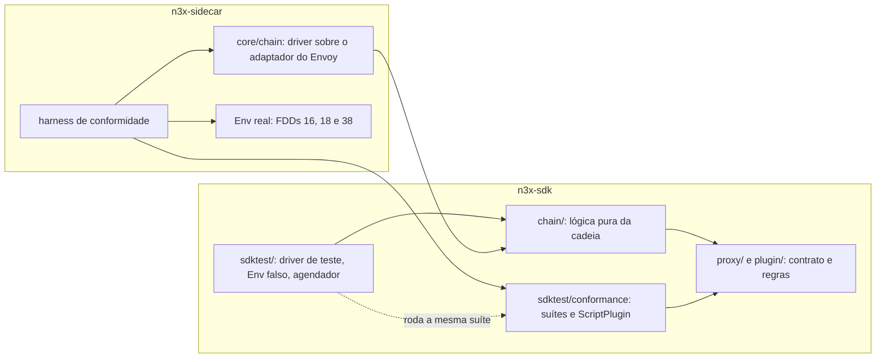
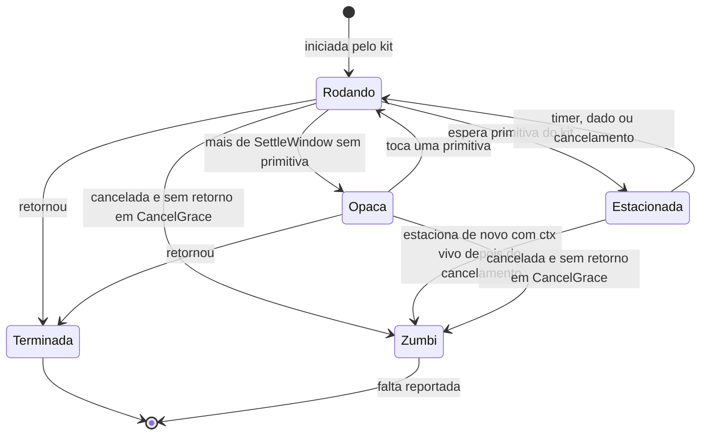

### FDD: Kit de testes da metade de proxy (`sdktest`) (SDK-07)

Versão: 1.0
Data: 2026-10-20
Responsável: Guilherme Giusti

---

### 1. Contexto e motivação técnica

**Problema técnico.** O PRD exige que o autor teste a metade de proxy do plugin sem Envoy e sem controller, com `go test -race` (FR-014). O HLD do `n3x-sdk` fixou as peças do `sdktest` (`NewProxy`, `GET`, `POST`, `GRPC`, agendador determinístico, métricas e logs falsos, `AssertCounter`, `AssertHonorsCancel`, `AssertZeroAllocs` e alvos simulados) e disse que o `Stream` falso "aplica as mesmas regras do executor". Faltava o comportamento verificável:

- onde mora a lógica pura da cadeia (ordem de fases, grupos por `order`, recortes, isolamento e aplicação das mudanças, escolha da negação, efeito da política de falha), já que o SDK não pode importar o sidecar (ADR-011) e duas implementações escritas à mão divergiriam (L-50)
- como `s.Go()` e `env.Background()` rodam "passo a passo", com relógio falso e sem `time.Sleep`, sem esconder as corridas que o `-race` precisa ver
- o critério objetivo dos portões `AssertHonorsCancel` e `AssertZeroAllocs`, inclusive o fato de que a contagem de alocações não é confiável com `-race`
- o formato da config de teste e a identidade do plugin (ID, fase, `order` e política padrão) num teste que não lê o `n3x.yaml`
- como o `Env` falso aplica as regras da FDD 06 (`ErrStandalone`, `ErrRequestPath`, `ErrForeignService`, limites, `DialDenyList`, relógio falso) e como se testa uma tarefa de fundo que fala com o controller sem o `bufconn` da FDD 12
- como o kit transforma em falha de teste os erros que só apareceriam em produção: string do `Stream` guardada depois do hook, `Stream` usado na função do `Go()`, panic contido, goroutine que ignora o `ctx`, uso indevido de métrica e segredo em log

Sem essas regras, cada autor escreveria o próprio dublê, um plugin aprovado no kit poderia falhar no Envoy e os riscos mais caros do PRD (plugin que ignora o `ctx`, alocação no caminho quente, negação gRPC errada, segredo em log) só apareceriam em produção.

**Encaixe no HLD.** Esta FDD especifica a metade de proxy do pacote `sdktest/` do módulo `github.com/giustech/n3x-sdk` (HLD do `n3x-sdk`, linha `sdktest/` de "Componentes e responsabilidades" e seção "Kit de testes") e cria dois pacotes novos:

- `chain/`: a lógica pura da cadeia, sem I/O, sem goroutine e sem relógio, usada pelo kit e pelo executor do sidecar (fecha a L-50)
- `sdktest/conformance`: as suítes de conformidade do `Stream` e da cadeia (pedido da FDD 05) e do `Env` (pedido da FDD 06), rodadas pelo kit e pelo sidecar

Consumidores:

- FDD 09: o kit sobe a metade de proxy do core como o runtime (instância única `core`, config `{}`), aplica `proxy.CheckPrivileged` com a origem lida do binário de teste e entrega os falsos de `proxy.CoreEnv` e `proxy.Sidecar`, com a `proxy.EventQueue` real (ajuste pós-FDD 09, contrato 12)
- FDD 12: acrescenta ao `sdktest` o host falso de controller, o `bufconn` e os falsos do lado controller das capacidades privilegiadas (`ctrl.CoreEnv`); reaproveita o agendador, o relógio falso, a captura de logs, `AssertCounter` e a opção `WithController`
- FDD 13: o plugin de exemplo é o primeiro usuário (`TestNegaPath`, `TestRespeitaCancelamento`, `AssertZeroAllocs`)
- FDD 14: o `n3x-new` gera os testes e a CI do plugin com o kit
- FDDs 16, 17, 18 e 38: o executor importa `chain` (FDD 17), e o sidecar roda `conformance.Run` com o próprio harness
- FDD 24: regras de análise estática ligadas ao kit (`sdktest` só em arquivo `_test.go`; `chain` e `sdktest/conformance` fora de código de plugin)
- FDDs 36 a 45: testes da metade de proxy do plugin core
- FDD 48: reaproveita os casos da suíte como dados nos testes de ponta a ponta

**Atores.** Autor de plugin (escreve testes com o kit), CI do plugin e do SDK (roda os portões), mantenedor do SDK (mantém `sdktest`, `chain` e as suítes), executor do sidecar (importa `chain` e roda as suítes), plugin core e plugin de exemplo (primeiros usuários).

**Limites.** O kit é uma biblioteca de teste que roda dentro do processo do `go test`. Não sobe Envoy nem controller, não abre socket real (salvo com `WithDialer`), não lê variável de ambiente e não lê o `n3x.yaml`; os únicos dados do ambiente que lê são o `n3x-plugin.yaml` do repositório e o build info do binário de teste (`runtime/debug.ReadBuildInfo`, para a origem do plugin). Ele reaproveita as implementações reais do SDK (`chain`, regras de `proxy/`, `telemetry.Registry`, handler de log, `memory.Runtime`, decodificação de config) e só simula o que depende do processo hospedeiro: goroutines, relógio, rede e conexão com o controller.

**Suposições**
- Go 1.26 ou superior (ADR-021 do `n3x-sdk`)
- O `go test` roda com o diretório do pacote como diretório de trabalho, o que permite achar o `n3x-plugin.yaml` subindo até o `go.mod`
- A CI roda com `GOMAXPROCS` maior que 1, para o `-race` ver concorrência real
- Plugins bloqueiam só por primitivas do SDK (`proxy.Sleep`, `env.Dial`, clientes do SDK, conexão do controller), como exigem a FDD 06 e a análise estática da FDD 24; é nessa condição que o determinismo é pleno
- O executor da FDD 17 consegue usar `chain` dentro do orçamento de 0 alocações e 0,05 ms no p50 (confirmação na FDD 17)
- `runtime/debug.ReadBuildInfo` devolve, num binário de `go test`, o módulo principal igual ao módulo do pacote testado (hipótese herdada da FDD 09; conferida nos testes do kit)

**Restrições**
- O SDK não importa pacotes do `n3x-sidecar` nem do `n3x-controller` (ADR-011)
- O kit não importa `secret/` nem `secret/secrettest` (FDD 03)
- A parte de proxy do `sdktest` não importa `controller/`; `chain` importa só a biblioteca padrão, `plugin/` e `proxy/`
- Sem cgo; o kit nunca chama `time.Sleep`
- Mensagens em pt-BR; identificadores em inglês

**Rastreabilidade**
- PRD 1.5: FR-014 (kit com requisição, config e métricas falsas, agendador determinístico, `go test -race`, sem Envoy e sem controller), FR-012 (teste sem Envoy, capacidade ausente informada, rota só até `route`), FR-004 (fases, grupos, negação, falhas e notificação no fim), FR-003 (método gRPC como `/pacote.Serviço/Método`); "Testes e validação" (unitários com `-race`, fuzzing, benchmarks com 0 alocações); critérios de aceite "plugin novo testado só com a documentação" e "nenhum segredo em logs"
- ADRs do `n3x-sdk`: ADR-011, ADR-015, ADR-016, ADR-020, ADR-021 e ADR-022; ADR-009 de plataforma (sem tracing)
- ADRs do `n3x-sidecar`: ADR-004, ADR-005 e ADR-006
- FDDs anteriores usadas como contrato: 01 (`Phase`, `FailurePolicy`, `Manifest`), 02 (`SchemaOf`, `DecodeConfig`, `WithSecretOpener`), 03 (`plugin.Secret`, prefixo `n3x-canary-`), 04 (`memory.Runtime` com relógio), 05 (`Stream`, `Action`, `Result`, `DenyResponse`, `Target`, sentinelas), 06 (`Env`, `telemetry/`, `internal/clock`, `DialDenyList`, limites), 09 (`CoreID`, `IsCoreOrigin`, `CheckPrivileged`, `CoreEnv`, `Sidecar`, `EventQueue`, `ExitTimeout`, `SessionReporter`) e 15 (semântica dos recortes `match` e campos de `plugins[]`)
- Lacunas do README:
  - **L-50 fechada aqui:** a lógica pura da cadeia mora no pacote público novo `github.com/giustech/n3x-sdk/chain` (contrato 9), importado pelo kit e pelo executor do sidecar. O sidecar pode importar o SDK; o contrário é que o ADR-011 proíbe. A paridade do que não é lógica pura (goroutines, prazos reais, adaptador do Envoy, `Env`) é conferida pelas suítes de `sdktest/conformance` (contrato 10). Aplicada na FDD 17 (executor usa `chain` e implementa o harness) e nas FDDs 16, 18 e 38 (partes do harness)
  - **L-14 aplicada:** `proxy.Fail`, `proxy.FailResult` e `proxy.Sleep`
  - **L-20 aplicada:** alvos simulados `envoy-1.40` (`request_body` e `route_change`) e `istio-1.31` (sem capacidade opcional até a FDD 49, como no catálogo da FDD 19)
  - **L-13 aplicada:** `request_id` nos logs capturados e `x-request-id` no metadado do controller falso
  - **L-46 aplicada:** a config de teste vira JSON antes de `DecodeConfig`; YAML passa por `yamlconv`
  - **L-51 aplicada:** limites por plugin (`max_tasks`, `max_conns`, `memory.max_bytes`) como opção do kit, com os padrões do SDK
  - **L-12 aplicada:** da família `n3x_controller_*`, o kit simula só `n3x_controller_logins_total` e `n3x_controller_session_age_seconds`, a partir do `SessionReporter` do falso de `Sidecar` (FDD 09); as de conexão e buffer são da FDD 38
  - **L-10 aplicada (fechada na FDD 09):** uma instância da metade de proxy do core, `proxy.CoreInstance` (`core`), com config `{}`, criada antes das demais; só o core tem metade só de fundo (contrato 12)
  - **L-01 aplicada (fechada na FDD 09):** falsos de `proxy.CoreEnv` e `proxy.Sidecar`, com a `proxy.EventQueue` real do SDK (contrato 12)

**Decisões aprovadas na clarificação**
- A lógica pura da cadeia fica no pacote público `chain/` do SDK, importado pelo kit e pelo executor do sidecar (L-50). Os pacotes `chain/` e `sdktest/conformance` precisam constar na árvore de pacotes do HLD e no ADR-011; o `chain/` é marcado como pacote de plataforma, fora do alcance de plugins (FDD 24)
- Grupo paralelo confirmado: na parte síncrona, em ordem alfabética de `instance`, quando uma instância nega ou falha com `closed` as seguintes do grupo não são chamadas (mas recebem `OnComplete`); quando uma função do `Go()` nega ou falha com `closed`, o `ctx` das posteriores em ordem alfabética é cancelado e vence a negação da primeira em ordem alfabética. O ADR-005 do `n3x-sidecar` e a FDD 17 devem refletir essa interpretação
- As demais hipóteses (tempos e janelas do agendador, padrão `FREED` de sobrescrita, origem do core por `debug.ReadBuildInfo`, `plugin_without_hooks` reprovando só no kit, valores de repetição de teste e cobertura) ficam aceitas como padrão, sem bloqueio

**Pendências não bloqueantes**
- Dependem de outros repositórios: uso de `chain` pelo executor (FDD 17), harness de conformidade no sidecar (FDDs 16, 17, 18 e 38), manifesto embutido (FDD 22) e catálogo de alvos (FDD 19). O host falso de controller e o `bufconn` são da FDD 12, deste repositório
- Divergência a tratar no Workflow 3: `plugin_without_hooks` é aviso no executor e reprova o teste no kit
- Pedidos de FDDs anteriores atendidos: FDD 02 (o kit falha se `SchemaOf[C]` falhar), FDD 03 (canário `n3x-canary-` via `plugin.NewSecret`), FDD 04 (`Runtime` real com relógio falso e `Sweep` determinístico), FDD 05 (`Stream` com `StreamActions` e as validações do SDK, panic `ErrStreamClosed`, sobrescrita dos buffers depois do hook, suíte de conformidade do `Stream`), FDD 06 (`Env` falso com as mesmas regras, `internal/clock`, suíte de conformidade do `Env`, falha em uso indevido de métrica; e, no ajuste pós-FDD 26, a `DialDenyList` como opção do kit), FDD 09 (ajuste pós-FDD 09: recusa de hook na metade só de fundo com `background_only_hooks`, instância única `core` com config `{}`, falsos de `proxy.CoreEnv` e `proxy.Sidecar` com a `proxy.EventQueue` real, origem por `debug.ReadBuildInfo` com `proxy.CheckPrivileged` e opção que simula a origem oficial, suíte `RunCore`)

---

### 2. Objetivos técnicos

- **Mesmas regras do executor por construção.** Invariante: o kit e o executor do sidecar chamam o mesmo código de `chain` para ordem de fases, grupos, recortes, isolamento, aplicação das mudanças, escolha da negação, efeito da política de falha e formato da negação no fio. Medida: a suíte `conformance.RunChain` (no mínimo 31 casos) passa no kit e no sidecar (FDD 17); nenhum desses algoritmos existe fora de `chain` (revisão de código e busca na CI).
- **Resultado determinístico.** Invariante: o resultado de uma requisição não depende da ordem em que as goroutines terminam. Medida: um grupo com 3 instâncias que usam `Go()` e terminam em ordem aleatória dá o mesmo `Result` em 1.000 execuções; com a rede falsa, uma função presa até o prazo termina com `Elapsed()` igual ao prazo falso (200 ms) em 100% das execuções.
- **Tempo virtual, sem `time.Sleep`.** Medida: uma tarefa de fundo com `proxy.Sleep(ctx, 10*time.Minute)` avança com `Advance(10*time.Minute)` em menos de 100 ms de tempo real; o código do kit não chama `time.Sleep` (busca na CI).
- **Corridas visíveis ao `-race`.** Invariante: funções do `Go()` e tarefas de fundo rodam em goroutines reais, e `RequestParallel` roda hooks da mesma instância em paralelo. Medida: um plugin de teste com contador sem trava faz `go test -race` falhar em 10 de 10 execuções na CI (hipótese de repetição).
- **Portões objetivos.** Medida: `AssertHonorsCancel` reprova um plugin que ignora o `ctx` em até 2 s de tempo real; `AssertZeroAllocs` reprova um hook com 1 alocação por requisição (`testing.AllocsPerRun(1000, ...)` maior ou igual a 1); os dois aprovam o plugin de referência.
- **Erro de produção vira falha de teste.** Invariante: panic contido, violação do contrato, `ErrStreamClosed`, goroutine zumbi, uso indevido de métrica e segredo em log reprovam o teste, com mensagem que cita instância, fase, hook e requisição. Medida: 100% dos casos de referência da seção 9 reprovam com a mensagem esperada.
- **Custo baixo.** Medida: 10.000 requisições síncronas da cadeia de referência rodam em menos de 1 s de tempo real sem `-race` e em menos de 10 s com `-race`; o caminho de requisição do próprio kit tem 0 alocações em regime (hipótese de tempos, no runner da CI).
- **`Env` fiel ao do sidecar.** Medida: a suíte `conformance.RunEnv` (no mínimo 20 casos) passa no kit e no sidecar (FDDs 16, 18 e 38), inclusive com a `DialDenyList` do sidecar.
- **Privilégios iguais aos do runtime (ajuste pós-FDD 09).** Invariante: o kit chama `proxy.CheckPrivileged` nos mesmos dois momentos do executor (antes do `New`, com a instância nula, e depois do `New` e do selo) e só monta `proxy.CoreEnv` para a origem do core. Medida: os vetores de recusa do lado proxy da FDD 09 (`privileged_capability`, `privileged_origin`, `core_capability_missing`, `background_only_hooks`) reprovam a construção com o mesmo `Path` e a mesma `Rule` do runtime; `env.(proxy.CoreEnv)` é falso para todo plugin que não é o core; a suíte `conformance.RunCore` (no mínimo 15 casos) passa no kit e no sidecar.

---

### 3. Escopo e exclusões

**Incluído**
- Construção: `sdktest.NewProxy`, `NewChain`, `Inst`, `ExpectNewError` e opções; descoberta do `n3x-plugin.yaml`; checagem de `SchemaOf[C]`; config em JSON ou YAML
- Requisições de teste: `GET`, `POST`, `GRPC`, `NewRequest`, resposta simulada da aplicação e as regras do Envoy aplicadas antes do filtro
- Execução: `Proxy.Request`, `Begin` com `Flight` (passo a passo e desconexão), `RequestParallel` (modo concorrente) e `For(t)`; `Result` com asserções
- Agendador determinístico e relógio falso (`Scheduler`), sobre `internal/clock` da FDD 06
- `Env` falso completo: alvos simulados, `Instance`, `Memory` (com `memory.Runtime` real), `Metrics` (com `telemetry.Registry` real), `Log` (handler do SDK), `Background`, `Controller` (controller falso ou conexão do teste), `Dial` e `HTTPClient` (rede falsa ou discador do teste, limites e `DialDenyList`)
- Métricas e logs falsos: `AssertCounter`, leitura de counter, gauge e histogram, captura de logs com campos fixos, `AssertLogged`, checagem de segredos e `Canary`
- Portões: `AssertHonorsCancel`, `AssertZeroAllocs` e `AssertZeroAllocsFunc`
- Apoio ao fuzzing nativo do Go: `FuzzRequest` e `AddFuzzSeeds`
- Faltas (`Fault`) e o formato das mensagens de falha
- Pacote novo `chain` com a lógica pura da cadeia (L-50)
- Pacote novo `sdktest/conformance`: `Harness`, `Run`, `RunChain`, `RunEnv`, `RunCore`, `ScriptPlugin` e os casos como dados
- Plugin de teste interno `denypath`, cópia do exemplo do HLD, para os testes de aceite do kit antes da FDD 13
- Metade de proxy do core no kit (ajuste pós-FDD 09): origem por `debug.ReadBuildInfo` ou pela opção `Module`, `proxy.CheckPrivileged` nos dois momentos, instância única `core` com config `{}`, falsos de `proxy.CoreEnv` e `proxy.Sidecar` (`Identity`, `ControllerSettings`, `Manifest`, `ConfigInput`, `NextEvent`, `Draining`, `ExitContext`, `Session`) sobre a `proxy.EventQueue` real, eventos produzidos pelo kit como o runtime, interceptors do core na visão do controller e simulação da drenagem

**Excluído**
- Host falso de controller, `bufconn`, widgets e falsos do lado controller das capacidades privilegiadas (`ctrl.CoreEnv` com `Credentials`, `Sessions`, `ControllerManifest` e `CallerIP`; `HostFacts`; tabela pública): FDD 12 (SDK-12)
- Testes da `proxy.EventQueue` em si (descarte, amostragem, `Seq`): FDD 09 (SDK-09), no pacote `proxy/`; o kit usa a fila real e confere só os produtores
- Conformidade contra Envoy e istio-proxy reais: FDDs 16 (SID-02), 17 (SID-03), 48 (SDK-16) e 49 (SID-11)
- Contenção real no sidecar: disjuntor, `max_inflight`, contagem de zumbis, amostragem de pilha e eventos ao controller: FDD 18 (SID-04). O kit contém panics e aplica a política pelo `chain`, mas não simula disjuntor nem `max_inflight`
- Plugin de exemplo e os testes dele: FDD 13 (SDK-13)
- Adaptador do Envoy, pool de estado por requisição e driver do executor sobre o `chain`: FDDs 16 (SID-02) e 17 (SID-03)
- Leitura e validação do `n3x.yaml`: FDD 15 (SID-01); o kit recebe as instâncias por opções Go
- Regras de análise estática: FDD 24 (BLD-06)
- Benchmark de latência do sidecar: FDD 50 (SID-12)
- `OnResponseBody`: fora da v1 (ADR-015)
- Motor de fuzzing próprio e execução dentro de `testing/synctest`: fora da v1 (hipótese; o segundo é contingência, seção 10)

---

### 4. Fluxos detalhados e diagramas

**Fluxo de construção (`NewProxy` e `NewChain`)**
- O kit marca `t.Helper()` e registra a limpeza com `t.Cleanup`
- Identidade de cada instância, nesta ordem: opções (`ID`, `Name`, `Phase`, `Order`, `Failure`); manifesto `n3x-plugin.yaml` achado subindo do diretório do pacote até o diretório do `go.mod` (o primeiro encontrado vale; lido por `yamlconv.ToJSON` e `plugin.DecodeManifest`); padrões do kit (`DefaultID`, fase `transform`, `order` 0, política `closed`) (hipótese). Manifesto inválido, sem metade de proxy ou fase fora de `proxy.phases` reprova com `Fatal`
- Schema: o kit chama `p.ConfigSchema()`; erro (`plugin.ErrInvalidSchema`) reprova com `Fatal` e a lista de `FieldErrors` (pedido da FDD 02). O kit também confere a ida e volta `MarshalJSON` e `plugin.ParseSchema`
- Config: texto que começa com `{` (depois de espaços) vai como JSON; o resto passa por `yamlconv.ToJSON` (L-46)
- Processo falso: relógio falso (`internal/clock`), agendador, `telemetry.Registry` com `OnMisuse` ligado ao kit, `memory.Runtime` com o relógio falso, captura de logs, rede falsa, controller (falso, do teste ou ausente), alvo simulado e `DialDenyList` (vazia por padrão)
- Origem de cada plugin (ajuste pós-FDD 09): o par (ID, módulo), com o módulo da opção `Module` ou, sem ela, o módulo principal de `debug.ReadBuildInfo` do binário de teste; sem manifesto achado, o kit monta um manifesto sintético com as opções (metade `proxy`, a fase escolhida e os padrões) (hipótese). Primeira conferência: `proxy.CheckPrivileged(id, módulo, manifesto, nil)`; erro reprova com `Fatal` (regras `privileged_origin` e `privileged_capability`, inclusive `privileged.background_only` de plugin de terceiro só de fundo)
- Para cada plugin: conta de métricas (`NewAccount`), conta de memória com a cota efetiva e contadores de tarefas e conexões com os limites efetivos
- Instância do core, se houver plugin com a origem do core: criada antes das demais, com nome `proxy.CoreInstance` (`core`) e config `{}`; uma só por `Proxy` (contrato 12)
- Para cada instância: monta o `Env` (um `proxy.CoreEnv` só para a origem do core; para as demais, a type assertion é falsa) e chama `Instantiate(configJSON, env, plugin.WithSecretOpener(gravador))` sob `recover`. O gravador devolve o texto como recebido e guarda o valor de cada campo segredo para a checagem de segredos
- Segunda conferência, depois do `New` e do selo: `proxy.CheckPrivileged(id, módulo, manifesto, instância)`; erro reprova com `Fatal` (`privileged_origin` em `instance`, `privileged_capability` em `privileged.conn_interceptors`, `core_capability_missing` e `background_only_hooks`). Core aprovado: log `privileged_granted`; com controller configurado, o kit chama `ConnInterceptors()` uma vez e instala os interceptors como os mais internos da visão do controller
- Erro de config, erro do `New`, `(nil, nil)` ou panic no `New` reprovam com `Fatal` (`ExpectNewError` devolve o erro em vez de reprovar)
- Sela métricas, memória e tarefas de cada instância (FDDs 04 e 06); chama `chain.Compile` com as instâncias que têm fase. Avisos: `hook_unsupported` vai para o log do teste; `plugin_without_hooks` reprova (hipótese)
- Põe na fila de eventos os avisos da subida que o runtime poria (`secret_in_clear` para cada segredo em claro das instâncias e do `controller.secret`), inicia as tarefas de fundo registradas, uma vez, na ordem de registro, e assenta o agendador

**Fluxo da metade de proxy do core (ajuste pós-FDD 09)**
- O core recebe o `proxy.CoreEnv` falso; `Sidecar()` devolve sempre a mesma visão (contrato 12)
- Eventos que o kit produz na `proxy.EventQueue` real, como o runtime (tabela do contrato 7 da FDD 09): `panic` em todo panic contido de hook, `Go()` ou tarefa (`Detail` `hook=<nome>` ou `task=<nome>`), `secret_in_clear` na subida e `drain_start` em `StartDrain`. `breaker_open`, `plugin_disabled` e `config_error` não são produzidos pelo kit (disjuntor e avisos de config ficam fora); o teste injeta qualquer evento com `PushEvent`
- `NextEvent` espera dentro do kit como primitiva rastreada: a tarefa de eventos do core fica estacionada com a fila vazia e acorda no `PushEvent` ou num evento produzido pelo kit
- `StartDrain(d)` fecha `Draining()` e põe `drain_start` com `Detail` `drain_timeout=<d>` no mesmo instante
- Desligamento: cancela o `ctx` das tarefas; a tarefa de saída chama `ExitContext()`, que dá um `ctx` novo com a marca de segundo plano e prazo de `proxy.ExitTimeout` no relógio falso, sem passar do fim do `ShutdownGrace`; a chamada `Exit` passa pela visão do controller do kit
- Standalone (sem controller): a instância `core` existe, `ControllerSettings()` devolve `false`, `NextEvent` devolve `ErrStandalone` na hora e `ConnInterceptors()` não é chamado

**Fluxo principal: `p.Request(req)` em modo automático**
- O kit confere a requisição pelas regras do Envoy (path normalizado, limites de headers, nome sem `_`, sem `%2F` nem `%5C` no path); requisição que o Envoy recusaria antes do filtro reprova com `Fatal`
- Monta os headers de entrada no armazenamento canônico da requisição (arena reaproveitada) e chama `x.Reset(guard, headers, temBody, éGRPC)` de um `chain.Exchange` reaproveitado; `éGRPC` é decidido pelo kit, uma vez, pelo `content-type` que começa com `application/grpc` (FDD 05)
- Laço sobre `x.Run()`:
  - antes de cada hook, o `Guard` do kit copia os headers canônicos para a arena de exposição, que é o que o plugin lê
  - depois de cada hook, o `Guard` grava a chamada, conta as métricas, copia para a arena da requisição os valores das mudanças pendentes daquela instância e sobrescreve a arena de exposição com o padrão `FREED` (pedido da FDD 05; contrato 3); `After` sem `Before` (instância não chamada, R5 da FDD 17) só grava e conta
  - `StepAsync`: o agendador inicia cada função pendente numa goroutine rastreada, com `recover`, rótulos de pprof e `ctx` com o prazo falso da instância e o `request_id`; espera cada uma terminar ou estacionar; se alguma estacionou, avança o relógio até o próximo timer e repete; entrega cada fim com `x.Resolve` ou `x.Abort` e cancela as funções que o `chain` mandar cancelar
  - `StepBody`: entrega o body inteiro com `x.SetBody`, ou `x.SetBodyOverLimit(tamanho)` quando a requisição de teste passa de `MaxRequestBody`
  - `StepRespond`: renderiza `x.Deny()` com `chain.Render` (HTTP ou gRPC trailers-only)
  - `StepForward`: simula a aplicação com a resposta da requisição (padrão 200), chama `x.Response` e continua o laço na resposta
- No fim, `x.Complete()` chama `OnComplete` de todo o recorte; o kit confere as faltas da requisição e devolve o `Result`

**Fluxo do agendador**
- Goroutines rastreadas: funções do `Go()`, tarefas de fundo e handlers da rede falsa (`Handle`, `HandleHTTP`); o handler do controller falso roda na goroutine de quem chama, que já é rastreada
- Estados: rodando, estacionada (esperando uma primitiva do kit: timer do relógio falso, `proxy.Sleep`, vaga ou leitura da rede falsa, chamada ao controller falso, espera do grupo) ou terminada
- **Assentar** (`Settle`): esperar todas as goroutines rastreadas estacionarem ou terminarem. Com servidor do teste fora do kit (`Listen`) ou rede real (`WithDialer`), exige também 10 ms de tempo real sem atividade na rede (hipótese)
- **Goroutine opaca:** a que fica rodando por mais de `SettleWindow` (padrão 200 ms de tempo real) sem tocar uma primitiva do kit, em geral bloqueada em canal próprio, em `ctx.Done()` direto ou em I/O real. O agendador deixa de esperá-la até ela tocar uma primitiva de novo e registra o fato no log do teste (hipótese)
- **Avançar** (`Advance`, `Step`): só com tudo assentado. Os timers vencem um por vez, na ordem do prazo (empate pela ordem de criação), e o agendador assenta entre um e outro. Cada passagem por um múltiplo de `memory.DefaultSweepInterval` chama `Runtime.Sweep()`
- Os prazos do `ctx` do `Go()` (`AsyncTimeout`), o teto das chamadas ao controller, a espera de vaga do `Dial`, o teto do cliente HTTP, o backoff das tarefas de fundo, os TTL da memória e o `ts` dos logs usam o relógio falso
- No modo automático, `Request` avança o relógio só o necessário para as funções do `Go()` da própria requisição; tarefas de fundo só avançam com `Advance`, `Step` ou `Drain`

**Fluxo das tarefas de fundo**
- Começam depois da subida inteira, uma vez, na ordem de registro, com `ctx` sem prazo, marca de segundo plano do kit e o relógio falso
- Panic: contido, conta em `n3x_plugin_panics_total` e `n3x_plugin_background_restarts_total`, registra a falta `panic` e reinicia depois de `proxy.BackgroundBackoff(n, u)`, com `u = 0,5` por padrão (sem jitter) ou aleatório com semente (`Jitter`) (hipótese)
- Desligamento (`Close` ou limpeza do teste): cancela o `ctx`, assenta e avança até `proxy.ShutdownGrace` (2 s falsos). Tarefa que não terminou vira falta `zombie`

**Fluxo da limpeza do teste**
- Desliga as tarefas de fundo (acima)
- Confere que toda função do `Go()` cancelada ou vencida terminou em até `CancelGrace` (1 s de tempo real); a que não terminou vira falta `zombie`
- Varre a saída capturada atrás de segredos (contrato 6) e reporta as faltas que ainda não foram reportadas

**Fluxo de `AssertHonorsCancel`**
- Cria uma cadeia com uma instância do plugin num ambiente hostil: toda conexão da rede falsa é buraco negro (aceita e nunca responde), o cliente HTTP espera para sempre e o controller falso não responde
- Roda as sondas padrão (`GET /`, `POST /` com 1 KiB de body, `GRPC /n3x.sdktest.v1.Probe/Call`) e as do autor (`Probes`)
- Para cada função do `Go()`: avança o relógio até o prazo, o `ctx` é cancelado e a função precisa terminar em até `CancelGrace` de tempo real, sem avançar o relógio de novo. Função que volta a estacionar numa primitiva do kit com um `ctx` vivo (por exemplo, o `ctx` de uma tarefa guardado num campo) reprova na hora, de forma determinística
- Avança 30 s falsos para as tarefas de fundo rodarem, desliga e confere `ShutdownGrace`

**Fluxo de `AssertZeroAllocs`**
- Sem `-race`: roda a requisição `ZeroAllocWarmup` vezes (100) para encher arenas, criar séries de métrica e chaves de memória; mede com `testing.AllocsPerRun(ZeroAllocRuns, ...)` (1.000) o caminho síncrono inteiro (hooks, `chain`, negação renderizada e `OnComplete`), com os logs indo para um escritor que não aloca; reprova se o resultado for maior ou igual a 1
- Requisição que dispara `Go()` reprova com `Fatal`: o portão vale só para o caminho síncrono (FDD 05)
- Com `-race` (detectado por arquivo com `//go:build race`): roda o aquecimento e o laço, mas não confere a contagem e registra no log do teste; a CI roda o portão sem `-race` (hipótese)

**Fluxos alternativos e exceções**
- **Grupo paralelo:** parte síncrona em ordem alfabética de `instance`; quando uma instância nega ou falha com `closed` na parte síncrona, as instâncias seguintes do grupo não são chamadas (continuam recebendo `OnComplete`); quando uma função do `Go()` nega ou falha com `closed`, o `ctx` das funções de instâncias posteriores em ordem alfabética é cancelado e o das anteriores segue até o fim; vence a negação da primeira instância em ordem alfabética (ADR-005, interpretação da I-01) (hipótese)
- **`Stream` na função do `Go()` ou depois do hook:** panic `ErrStreamClosed` (contador de geração do `chain`), contido; vale a política da instância e o kit registra a falta `stream_closed`
- **String do `Stream` guardada além do hook:** a arena de exposição foi sobrescrita; o plugin lê `FREED...` e o teste mostra o dado corrompido
- **Desconexão:** `Flight.Disconnect()` cancela as funções pendentes, descarta os resultados e chama `OnComplete` com `Status()` igual a 0
- **Alvo sem capacidade:** `istio-1.31` simulado não chama `OnRequestBody` (aviso `hook_unsupported`) e `SetRoute` vira `Fail` com `ErrUnsupported`
- **Controller:** sem opção, `env.Controller()` devolve `ErrStandalone`; com o controller falso, as regras `ErrRequestPath`, `ErrForeignService`, teto unário e `x-request-id` valem como no sidecar
- **`Dial` negado:** endereço fora de `CheckDialTarget` ou na `DialDenyList` devolve `ErrDialDenied` sem tocar a rede falsa
- **Endereço sem regra na rede falsa:** `connection refused` (hipótese)
- **Metade de proxy só de fundo:** só o core (FDD 09). A instância `core` sobe, as tarefas rodam e `Request` sem outra instância com fase reprova com `Fatal` ("plugin sem fase não recebe requisição"); hook declarado no core reprova a construção com `background_only_hooks`; plugin de terceiro só de fundo reprova com `privileged_capability` em `privileged.background_only`
- **Core fingido:** ID `n3x.core` com módulo de fora (`privileged_origin` em `module`) ou com tipo da instância declarado fora do módulo (`privileged_origin` em `instance`) reprova a construção, inclusive com a opção `AsCore()`

**Diagramas**

Onde mora cada parte (L-50):



Sequência de uma requisição com um grupo que usa `Go()`:

```mermaid
sequenceDiagram
    participant T as teste
    participant K as sdktest (driver)
    participant X as chain.Exchange
    participant P as instância do plugin
    participant A as agendador e relógio falso
    T->>K: p.Request(GET /api)
    K->>X: Reset(guard, headers, false, false)
    K->>X: Run()
    X->>K: Guard.Before: preenche a arena de exposição
    X->>P: OnRequestHeaders(s)
    P-->>X: s.Go(fn)
    X->>K: Guard.After: grava, copia pendentes, sobrescreve com FREED
    X-->>K: StepAsync
    K->>A: inicia fn numa goroutine rastreada, ctx com prazo falso
    A->>A: assenta; fn estacionou no Dial da rede falsa
    A->>A: avança até o próximo timer (latência ou prazo)
    A-->>K: fn terminou com Result
    K->>X: Resolve(i, r)
    K->>X: Run()
    X-->>K: StepForward
    K->>X: Response(200, headers)
    K->>X: Run() e depois Complete()
    K-->>T: *Result
```

Estados de uma goroutine rastreada:



---

### 5. Contratos públicos (assinaturas, endpoints, headers, exemplos)

**Contrato 1: construção (`NewProxy`, `NewChain`, `Inst`, `ExpectNewError`) e opções**
- Tipo: sdk (API Go de teste)
- Assinatura/Rota:
  ```go
  package sdktest // github.com/giustech/n3x-sdk/sdktest

  // Uma instância; atalho para NewChain com um único Inst.
  func NewProxy(t testing.TB, p proxy.Plugin, config string, opts ...Option) *Proxy
  // Várias instâncias com as regras do executor (fases, order, grupos, recortes).
  func NewChain(t testing.TB, insts []InstanceSpec, opts ...Option) *Proxy
  func Inst(p proxy.Plugin, config string, opts ...InstOption) InstanceSpec
  // Confere que a subida falha (config, New, panic no New, limites) e devolve o erro.
  func ExpectNewError(t testing.TB, p proxy.Plugin, config string, opts ...Option) error

  type Option interface{ /* opção da cadeia ou da instância */ }
  type InstOption interface{ Option /* opção só de instância */ }
  type InstanceSpec struct{ /* opaco */ }

  // Opções de instância (valem em Inst e em NewProxy)
  func ID(id string) InstOption                       // padrão: manifesto descoberto, senão DefaultID
  func Name(instance string) InstOption               // obrigatório em NewChain; em NewProxy, o nome do ID
  func Phase(p plugin.Phase) InstOption               // padrão: default_phase do manifesto, senão transform
  func Order(n int) InstOption                        // padrão: default_order do manifesto, senão 0
  func Failure(f plugin.FailurePolicy) InstOption     // padrão: default_failure do manifesto, senão closed
  func AsyncTimeout(d time.Duration) InstOption       // padrão DefaultAsyncTimeout; de 1 ms a 60 s
  func MatchPaths(prefixes ...string) InstOption      // semântica da FDD 15
  func MatchMethods(methods ...string) InstOption
  func MatchGRPCServices(services ...string) InstOption
  func Module(path string) InstOption                 // módulo da origem; padrão: módulo principal de debug.ReadBuildInfo
  func AsCore() InstOption                            // ID(n3x.core) e Module(plugin.CoreModule); CheckPrivileged continua valendo

  // Opções da cadeia
  func Target(tg proxy.Target) Option                 // padrão Envoy140
  func Service(name string) Option                    // campo service dos logs; padrão DefaultService
  func Limits(id string, l PluginLimits) Option
  func DialDeny(l proxy.DialDenyList) Option          // padrão: lista vazia (FDD 06, ajuste pós-FDD 26)
  func MaxRequestBody(n int64) Option                 // padrão proxy.DefaultMaxRequestBody
  func StartTime(t0 time.Time) Option                 // padrão DefaultStartTime
  func LogLevel(l slog.Level) Option                  // padrão slog.LevelDebug (captura tudo)
  func Jitter(seed uint64) Option                     // backoff com u aleatório e semente; padrão u = 0,5
  func SettleWindow(d time.Duration) Option           // padrão DefaultSettleWindow
  func AllowFaults(kinds ...FaultKind) Option         // contrato 11
  func NoPoison() Option                              // desliga a sobrescrita com FREED
  func Manifest(path string) Option                   // caminho explícito; "" desliga a descoberta
  func WithFakeController() Option                    // contrato 5
  func WithController(conn grpc.ClientConnInterface) Option
  func WithDialer(d func(ctx context.Context, network, address string) (net.Conn, error)) Option
  func Probes(reqs ...Request) Option                 // só em AssertHonorsCancel
  // Visão Sidecar do core (contrato 12)
  func SidecarIdentity(id proxy.SidecarIdentity) Option
  func ControllerSettings(cs proxy.ControllerSettings) Option // com WithFakeController ou WithController
  func EmbeddedManifest(b []byte) Option                      // bytes de Sidecar.Manifest()
  func SidecarConfig(b []byte) Option                         // ConfigInput().Sidecar

  type PluginLimits struct {
      MaxTasks       int   // 0 = proxy.DefaultMaxTasks; de 1 a proxy.MaxMaxTasks
      MaxConns       int   // 0 = proxy.DefaultMaxConns; de 1 a proxy.MaxMaxConns
      MemoryMaxBytes int64 // 0 = memory.DefaultProxyMaxBytes
  }

  const (
      DefaultID           = "sdktest.plugin"
      DefaultService      = "sdktest"
      DefaultAsyncTimeout = 200 * time.Millisecond // ADR-006 do n3x-sidecar
      DefaultSettleWindow = 200 * time.Millisecond
  )

  var DefaultStartTime = time.Date(2026, 1, 1, 0, 0, 0, 0, time.UTC)
  ```
- Método: n/a (chamada local no teste)
- Semântica:
  - **Config:** `string` com JSON (começa com `{`) ou YAML (convertido por `yamlconv.ToJSON`). Vazio vale `{}`. Decodificada por `Instantiate`, com `DecodeConfig` e sem abrir `ENC[...]`: o texto do segredo é o valor (FDD 03, "sem opener")
  - **Identidade:** manifesto achado subindo do diretório do pacote até o do `go.mod`; ele dá o ID e os padrões de fase, `order` e política e limita as fases aceitas. Instâncias de plugins diferentes precisam de `ID` próprio
  - **Regras da cadeia:** as mesmas do executor (`chain.Compile`): `Name` único, fase válida, `order` de `plugin.MinOrder` a `plugin.MaxOrder`, `order` repetido recusado na fase `route` e recortes com as regras e códigos da FDD 15 (linhas 22 a 27 da tabela de validação dela)
  - **Limites:** por ID de plugin, somando as instâncias (FDDs 04 e 06), com as mesmas faixas do `n3x.yaml`
  - **Falha de construção:** `NewProxy` e `NewChain` reprovam com `Fatal` e a mensagem completa (com os `FieldErrors`); `ExpectNewError` reprova se a subida passar e devolve o erro para `errors.Is`
  - **Concorrência:** `*Proxy` é seguro entre goroutines
  - **Origem e privilégios (ajuste pós-FDD 09):** o módulo de cada instância vem de `Module` ou do módulo principal do binário de teste (`debug.ReadBuildInfo`); o kit aplica `proxy.CheckPrivileged` antes e depois do `New`, como o executor. `AsCore()` só troca o par (ID, módulo) que o builder gravaria: a regra do tipo dinâmico continua valendo, então só uma instância de tipo declarado em `github.com/giustech/n3x-plugin-core` passa (serve, por exemplo, a testes do sidecar que importam o core real)
  - **Metade só de fundo:** só o core. A instância se chama `proxy.CoreInstance` (`core`), recebe config `{}` (config diferente de vazio ou `{}` reprova com `Fatal`) e é criada antes das demais; uma segunda instância do core reprova (contrato 12)

**Exemplo de requisição**
```go
func TestNegaPath(t *testing.T) {
    p := sdktest.NewProxy(t, agent.Plugin(), `{"header":"X-N3X","deny_path":"/admin"}`)
    p.Request(sdktest.GET("/admin")).AssertDenied(t, 403)
    p.Request(sdktest.GRPC("/pedidos.v1.Pedidos/Criar")).AssertHeader(t, "X-N3X", "1")
}

func TestHeaderProtegido(t *testing.T) {
    err := sdktest.ExpectNewError(t, agent.Plugin(), "header: host\ndeny_path: /admin\n")
    if !errors.Is(err, proxy.ErrProtectedHeader) {
        t.Fatalf("erro inesperado: %v", err)
    }
}

func TestGrupo(t *testing.T) {
    p := sdktest.NewChain(t, []sdktest.InstanceSpec{
        sdktest.Inst(acl.Plugin(), `{"deny_prefix":"/admin"}`, sdktest.ID("giustech.acl"), sdktest.Name("acl-b"), sdktest.Phase(plugin.PhaseAuthz), sdktest.Order(10)),
        sdktest.Inst(acl.Plugin(), `{"deny_prefix":"/api"}`, sdktest.ID("giustech.acl"), sdktest.Name("acl-a"), sdktest.Phase(plugin.PhaseAuthz), sdktest.Order(10)),
    })
    p.Request(sdktest.GET("/api/x")).AssertDenied(t, 403)
}
```

**Exemplo de resposta**
```json
{
  "TestNegaPath": "ok; manifesto achado em ../n3x-plugin.yaml; ID n3x.example; instância example; fase transform; política open",
  "TestHeaderProtegido": "ok; erro: config da instância example: header \"host\": proxy: header protegido",
  "TestGrupo": "ok; grupo authz/10 com acl-a e acl-b; acl-a negou na parte síncrona e acl-b não foi chamada"
}
```

---

**Contrato 2: requisições de teste (`GET`, `POST`, `GRPC`, `NewRequest`) e resposta simulada**
- Tipo: sdk (API Go de teste)
- Assinatura/Rota:
  ```go
  type Request struct{ /* valor imutável; os métodos devolvem cópia */ }

  func GET(path string) Request
  func POST(path string, body []byte) Request
  func GRPC(fullMethod string) Request // "/pacote.Servico/Metodo"; POST, HTTP/2, content-type application/grpc
  func NewRequest(method, path string) Request

  func (r Request) WithHeader(name, value string) Request
  func (r Request) WithBody(body []byte) Request
  func (r Request) WithMessage(m proto.Message) Request // gRPC: body com o quadro de 5 bytes e a mensagem
  func (r Request) WithAuthority(a string) Request       // padrão "sdktest.local"
  func (r Request) WithProtocol(p Protocol) Request      // padrão HTTP11; GRPC força HTTP2
  func (r Request) WithRequestID(id string) Request      // padrão: UUID determinístico pelo contador do Proxy
  func (r Request) WithResponse(u Upstream) Request      // resposta da aplicação
  func (r Request) WithUpstreamDown() Request            // o Envoy responde 503 ou UNAVAILABLE
  func (r Request) WithUpstreamTimeout() Request         // o Envoy responde 504 ou DEADLINE_EXCEEDED

  type Protocol uint8

  const (
      HTTP11 Protocol = iota + 1
      HTTP2
  )

  type Upstream struct {
      Status      int         // padrão 200
      Headers     [][2]string // nome e valor
      Body        []byte
      GRPCStatus  codes.Code  // só gRPC: trailer da aplicação
      GRPCMessage string
  }
  ```
- Método: o da requisição (`GET`, `POST` e outros dos 9 da RFC 9110)
- Semântica (regras do Envoy aplicadas antes do filtro, HLD do `n3x-sidecar`; hipótese de emulação):
  - Path normalizado como o Envoy (`normalize_path` e `merge_slashes`): `/a//b/../c` chega ao plugin como `/a/c`. Path com `%2F` ou `%5C` reprova com `Fatal`, porque o Envoy redirecionaria antes do filtro (`UNESCAPE_AND_REDIRECT`)
  - Nomes de header em minúsculas; nome com `_` reprova (o Envoy recusaria a requisição); mais de 100 headers ou mais de 60 KiB reprovam
  - `x-request-id` presente na requisição é mantido; ausente, o kit gera `00000000-0000-4000-8000-` mais 12 dígitos hexadecimais do contador do `Proxy` (determinístico)
  - `:authority` vem de `WithAuthority`; em HTTP/1.1 é também o `host`
  - Requisição com body chega ao filtro com `hasBody` verdadeiro; `GET` sem body, não
  - `GRPC` valida o método (`/pacote.Servico/Metodo`, FR-003); método mal formado reprova ao executar
  - Resposta padrão da aplicação: 200 com `content-type: text/plain` em HTTP e, em gRPC, 200 com `content-type: application/grpc` e `grpc-status: 0`. As respostas do Envoy simuladas (`WithUpstreamDown`, `WithUpstreamTimeout`) passam pelos hooks de response, como define a FDD 05

**Exemplo de requisição**
```go
r1 := sdktest.GET("/api//pedidos/../itens?x=1").WithHeader("X-Tenant", "acme")
r2 := sdktest.GRPC("/pedidos.v1.Pedidos/Criar").WithMessage(&pedidosv1.CriarReq{Id: "7"})
r3 := sdktest.GET("/a%2Fb")
```

**Exemplo de resposta** (o que o plugin vê e o que o kit faz)
```json
{
  "r1": { "Method": "GET", "Path": "/api/itens?x=1", "Authority": "sdktest.local", "x-tenant": "acme", "RequestID": "00000000-0000-4000-8000-000000000001" },
  "r2": { "IsGRPC": true, "GRPCMethod": "/pedidos.v1.Pedidos/Criar", "GRPCService": "pedidos.v1.Pedidos", "body": "quadro de 5 bytes mais 3 bytes da mensagem" },
  "r3": "Fatal: sdktest: path com barra codificada (%2F); o Envoy redirecionaria antes do filtro (UNESCAPE_AND_REDIRECT)"
}
```

---

**Contrato 3: execução (`Request`, `Begin`, `RequestParallel`, `For`) e `Result`**
- Tipo: sdk (API Go de teste)
- Assinatura/Rota:
  ```go
  type Proxy struct{ /* opaco; seguro entre goroutines */ }

  func (p *Proxy) Request(req Request) *Result                     // modo automático
  func (p *Proxy) Begin(req Request) *Flight                       // passo a passo
  func (p *Proxy) RequestParallel(reqs []Request, workers int) []*Result
  func (p *Proxy) For(t testing.TB) *Proxy                         // mesma cadeia; faltas vão para t
  func (p *Proxy) Instance(name string) proxy.Instance             // para asserções de caixa branca
  func (p *Proxy) Close()                                          // desliga; também na limpeza do teste

  type Flight struct{ /* uma requisição em andamento */ }
  func (f *Flight) Pending() []PendingCall
  func (f *Flight) Done() bool
  func (f *Flight) Disconnect()
  func (f *Flight) Wait() *Result                                  // termina em modo automático

  type PendingCall struct {
      Instance string
      Phase    plugin.Phase
      Since    time.Time // relógio falso
      Parked   bool
  }

  type Result struct{ /* cópia; válido depois do fim da requisição */ }
  func (r *Result) Denied() bool
  func (r *Result) Forwarded() bool
  func (r *Result) Status() int                         // :status ao cliente (200 numa negação gRPC)
  func (r *Result) DenyStatus() int                     // status HTTP nominal da negação, também em gRPC
  func (r *Result) GRPCStatus() (codes.Code, bool)
  func (r *Result) GRPCMessage() string                 // decodificada
  func (r *Result) TrailersOnly() bool
  func (r *Result) Body() []byte                        // corpo ao cliente
  func (r *Result) RequestHeader(name string) (string, bool)  // enviado à aplicação
  func (r *Result) Path() string                        // :path enviado à aplicação
  func (r *Result) Authority() string
  func (r *Result) ResponseHeader(name string) (string, bool) // enviado ao cliente
  func (r *Result) Calls() []Call
  func (r *Result) Failures() []Failure
  func (r *Result) Faults() []Fault
  func (r *Result) Elapsed() time.Duration              // relógio falso

  func (r *Result) AssertAllowed(t testing.TB) *Result
  func (r *Result) AssertDenied(t testing.TB, status int) *Result
  func (r *Result) AssertGRPCStatus(t testing.TB, code codes.Code, message string) *Result
  func (r *Result) AssertHeader(t testing.TB, name, value string) *Result
  func (r *Result) AssertNoHeader(t testing.TB, name string) *Result
  func (r *Result) AssertResponseHeader(t testing.TB, name, value string) *Result
  func (r *Result) AssertPath(t testing.TB, path string) *Result
  func (r *Result) AssertFailure(t testing.TB, instance string, cause chain.Cause) *Result

  type Call struct {
      Instance string
      Phase    plugin.Phase
      Hook     proxy.Hook       // zero na função do Go()
      Async    bool
      Action   proxy.ActionKind // ação efetiva
  }

  type Failure struct {
      Instance string
      Cause    chain.Cause
      Err      error
  }
  ```
- Método: n/a
- Semântica:
  - **`Request`:** roda a requisição inteira (request, `Go()`, body, aplicação simulada, response e `OnComplete`), avançando o relógio só o necessário para as funções do `Go()` dela
  - **`AssertDenied(t, status)`:** negação do N3X com status nominal igual a `status`. Em gRPC confere também o fio: HTTP 200, `content-type: application/grpc`, `grpc-status` presente e diferente de 0 e trailers-only. `AssertGRPCStatus` confere código e mensagem
  - **`AssertHeader`:** header que a aplicação recebe (nome sem diferenciar caixa); `AssertResponseHeader`, o que o cliente recebe
  - **Asserções** usam `t.Helper()` e `t.Errorf` e devolvem o próprio `Result`, para encadear
  - **`Begin`:** roda até a primeira espera e devolve o controle; o teste usa o agendador (contrato 4) e `Wait`. `Disconnect` simula o cliente saindo (FDD 05)
  - **`RequestParallel`:** roda as requisições em `workers` goroutines, com a mesma cadeia, para o `-race` ver hooks da mesma instância em paralelo (como os workers do Envoy). Devolve na ordem de entrada. O resultado de cada uma segue as mesmas regras; só a intercalação varia
  - **`For(t)`:** visão que reporta as faltas no `t` dado; serve ao fuzzing (contrato 8) e a subtestes
  - **Sobrescrita dos buffers (pedido da FDD 05):** as strings e o body entregues ao plugin apontam para a arena de exposição, preenchida antes de cada hook e sobrescrita com o padrão `FREED` repetido logo depois (mesmo tamanho). Antes de sobrescrever, o kit copia para a arena da requisição os valores das mudanças pendentes daquela instância, porque a FDD 05 garante que um valor passado a `Set` pode ser fatia do próprio `Stream` até o fim do grupo (I-03). As duas arenas são reaproveitadas: 0 alocações em regime. `NoPoison()` desliga
  - **Determinismo:** o resultado não depende da ordem de término das goroutines (regras do `chain`); só o log de teste das goroutines opacas e a intercalação de `RequestParallel` variam

**Exemplo de requisição**
```go
p := sdktest.NewProxy(t, rl.Plugin(), `{"limit":1,"replica":"replica.interno:6379"}`, sdktest.Phase(plugin.PhaseTraffic))
p.Net().Latency("tcp", "replica.interno:6379", 300*time.Millisecond)
fl := p.Begin(sdktest.GET("/api/x"))
p.Scheduler().Advance(100 * time.Millisecond)
pend := fl.Pending()
res := fl.Wait()
res.AssertDenied(t, 503).AssertFailure(t, "ratelimit", chain.CauseDeadline)
```

**Exemplo de resposta**
```json
{
  "pend": [{ "Instance": "ratelimit", "Phase": "traffic", "Since": "2026-01-01T00:00:00Z", "Parked": true }],
  "res": {
    "Denied": true, "DenyStatus": 504, "Status": 504,
    "Failures": [{ "Instance": "ratelimit", "Cause": "deadline", "Err": "context deadline exceeded" }],
    "Elapsed": "200ms",
    "Calls": [{ "Instance": "ratelimit", "Phase": "traffic", "Hook": "request_headers", "Action": "go" }, { "Instance": "ratelimit", "Async": true, "Action": "fail" }]
  },
  "AssertDenied(t, 503)": "falha: sdktest: negação com status 504, esperado 503 (GET /api/x, instância ratelimit, política closed com prazo do Go() vencido gera 504)"
}
```

---

**Contrato 4: agendador determinístico e relógio falso (`Scheduler`)**
- Tipo: sdk (API Go de teste)
- Assinatura/Rota:
  ```go
  func (p *Proxy) Scheduler() *Scheduler

  type Scheduler struct{ /* um por Proxy */ }
  func (s *Scheduler) Now() time.Time             // relógio falso
  func (s *Scheduler) Settle()                    // espera as goroutines rastreadas estacionarem ou terminarem; não move o relógio
  func (s *Scheduler) Step() bool                 // avança até o próximo timer, dispara e assenta; falso se não há timer
  func (s *Scheduler) Advance(d time.Duration)    // avança d, disparando os timers em ordem e assentando entre eles
  func (s *Scheduler) Drain()                     // termina as funções do Go() de Flights abertos; tarefas de fundo não contam
  func (s *Scheduler) Pending() []Pending

  type Pending struct {
      Kind     string    // "async", "background", "handler", "timer"
      Instance string
      Task     string    // tarefa de fundo
      At       time.Time // vencimento do timer
      Opaque   bool
  }
  ```
- Método: n/a
- Semântica (responde à pergunta do relógio: o kit troca o relógio e controla o agendamento):
  - **Relógio:** o kit instala o relógio falso pelo `internal/clock` da FDD 06 no `ctx` das funções do `Go()`, das tarefas de fundo, das chamadas ao controller e do `Dial`. O mesmo relógio alimenta `proxy.Sleep`, o prazo do `Go()`, o teto do controller, a espera de vaga e os prazos da rede falsa, o teto do cliente HTTP, `BackgroundBackoff`, o `Clock` do `memory.Runtime` (monotônico, desde `StartTime`) e o `Now` do handler de log
  - **Começo:** `DefaultStartTime` (2026-01-01T00:00:00Z) ou `StartTime`
  - **`ctx` do kit:** `Done()` fecha no prazo do relógio falso; `Deadline()` informa um prazo em tempo real equivalente, calculado na criação (agora real mais o tempo falso que falta), para bibliotecas reais (grpc-go sobre o `bufconn` da FDD 12) calcularem prazos positivos; as primitivas do SDK usam o prazo falso (hipótese)
  - **Limites declarados:** `time.Now()` chamado direto pelo plugin é real; I/O real (`WithDialer`, `Listen` com servidor do teste) não conta no prazo falso. Prazos só se testam de forma determinística com a rede falsa do kit
  - **Assentar, avançar e goroutine opaca:** como na seção 4. `Step` e `Advance` nunca disparam um timer antes de tudo assentar
  - **Varredura de memória:** `Runtime.Sweep()` a cada passagem por múltiplo de `memory.DefaultSweepInterval` (pedido da FDD 04)

**Exemplo de requisição**
```go
p := sdktest.NewProxy(t, agent.Plugin(), cfg, sdktest.WithFakeController())
p.Controller().Handle("/n3x.plugins.n3x.example.v1.Example/Report", reportOK)
s := p.Scheduler()
s.Settle()
antes := len(p.Controller().Calls("/n3x.plugins.n3x.example.v1.Example/Report"))
s.Advance(10 * time.Second)
depois := len(p.Controller().Calls("/n3x.plugins.n3x.example.v1.Example/Report"))
```

**Exemplo de resposta**
```json
{ "antes": 1, "depois": 2, "s.Now()": "2026-01-01T00:00:10Z", "tempo real gasto": "menos de 5 ms", "s.Pending()": [{ "Kind": "timer", "Instance": "example", "Task": "report", "At": "2026-01-01T00:00:20Z" }] }
```

---

**Contrato 5: `Env` falso (alvos simulados, rede falsa, controller, limites e memória)**
- Tipo: sdk (API Go de teste; o `Env` em si é a interface `proxy.Env` da FDD 06)
- Assinatura/Rota:
  ```go
  var (
      Envoy140 proxy.Target // "envoy-1.40": request_body e route_change (catálogo da FDD 19)
      Istio131 proxy.Target // "istio-1.31": nenhuma capacidade opcional até a FDD 49
  )
  func Targets() []proxy.Target                                // Envoy140 e Istio131
  func TargetWith(name string, caps ...proxy.Capability) proxy.Target // panic se inválido

  func (p *Proxy) Net() *Net
  type Net struct{ /* rede em memória com prazos no relógio falso */ }
  func (n *Net) Handle(network, address string, h func(ctx context.Context, c net.Conn)) // handler rastreado
  func (n *Net) HandleHTTP(address string, h http.Handler)                              // HTTP/1.1 rastreado
  func (n *Net) Listen(network, address string) net.Listener                            // servidor do teste
  func (n *Net) Blackhole(network, address string)                                      // aceita e nunca responde
  func (n *Net) Latency(network, address string, d time.Duration)                       // conexão demora d
  func (n *Net) Alias(host, ip string)                                                  // resolução de nome falsa
  func (n *Net) Dials(network, address string) int
  func (n *Net) Open(id string) int                                                     // vagas ocupadas do plugin

  func (p *Proxy) Controller() *FakeController // nil sem WithFakeController
  type FakeController struct{ /* conexão falsa, só unária */ }
  func (c *FakeController) Handle(fullMethod string, h func(ctx context.Context, req proto.Message) (proto.Message, error))
  func (c *FakeController) SetDown(down bool) // todas as chamadas devolvem Unavailable
  func (c *FakeController) Calls(fullMethod string) []ControllerCall

  type ControllerCall struct {
      Req       proto.Message // cópia
      RequestID string        // metadado x-request-id
      At        time.Time     // relógio falso
      Code      codes.Code
  }

  func (p *Proxy) Memory(id string) memory.Stats
  func (p *Proxy) SweepMemory()
  ```
- Método: n/a
- Semântica, método a método do `proxy.Env` (FDD 06, as mesmas regras):
  - **`Target()`:** o alvo escolhido (`Target`), `Envoy140` por padrão. Os valores acompanham o catálogo (FDD 19) e mudam com a FDD 49
  - **`Instance()`, `Memory()`, `Metrics()`, `Log()`:** nome da instância; handle de um `memory.Runtime` real por `Proxy`, com a cota de `Limits`; `*telemetry.Metrics` de um `telemetry.Registry` real por `Proxy`; `*slog.Logger` de `telemetry.PluginLogger` sobre `telemetry.NewLogHandler` com o relógio falso
  - **`Background`:** só no `New` (depois, panic `ErrSealed`), `CheckTaskName`, nome único na instância, limite por plugin somando as instâncias (`ErrTooManyTasks` citando `runtime.plugin_limits["<id>"].background.max_tasks`), início depois da subida inteira, reinício com backoff, desligamento em `ShutdownGrace`
  - **`Controller()`:** sem opção, `(nil, ErrStandalone)`. Com `WithFakeController`, uma conexão falsa (responde à pergunta do controller sem `bufconn`): só chamadas unárias; método sem handler devolve `Unimplemented`; stream devolve `Unimplemented` (hipótese). Com `WithController(conn)`, a conexão do teste (por exemplo, o `bufconn` da FDD 12). Nos dois casos, a visão do kit aplica, antes de tocar a conexão: `ErrRequestPath` para `ctx` do `Go()` ou sem marca de tarefa de fundo, `ErrForeignService` para serviço fora de `id.OwnsGRPCService`, teto unário `proxy.DefaultControllerCallTimeout` no relógio falso e o metadado `x-request-id`. O handler do controller falso recebe um `ctx` com o relógio falso e pode simular latência com `proxy.Sleep`
  - **`Dial`:** `CheckDialTarget`; `DialDenyList.Check` com a lista da opção `DialDeny` (vazia por padrão, como a FDD 06 define para o kit sem configuração), no endereço escrito e de novo no endereço resolvido pela rede falsa (`Alias`) ou na `RemoteAddr` da conexão real (hipótese); vaga por plugin com espera até o prazo do `ctx` ou `proxy.DefaultDialTimeout` sem prazo (`ErrTooManyConns` junto com `context.DeadlineExceeded`, sem abrir conexão); conexão pela rede falsa ou pelo `WithDialer`; prazo de I/O `proxy.DefaultIOTimeout` quando o chamador não define (relógio falso na rede falsa, relógio real na conexão real); `Close` libera a vaga
  - **`HTTPClient()`:** `*http.Client` novo a cada chamada sobre o transporte do plugin, com `DialContext` igual ao `Dial` do kit (conta vagas e aplica a lista), `Proxy` nulo e teto `proxy.DefaultHTTPTimeout` aplicado no relógio falso pelo transporte (hipótese)
  - **Rede falsa:** endereço sem regra recusa a conexão; `Handle` e `HandleHTTP` rodam como goroutines rastreadas (determinismo pleno); `Listen` entrega um `net.Listener` em memória para qualquer servidor do teste (assentamento com janela de quietude)
  - **Memória (pedido da FDD 04):** `memory.Runtime` real com `RuntimeOptions{DefaultMaxBytes: memory.DefaultProxyMaxBytes, Clock: monotônico falso}`; `Sweep` no avanço do relógio e em `SweepMemory`; `Memory(id)` devolve `Account.Stats()`; `Limits(...MemoryMaxBytes)` reduz a cota para testar descarte

**Exemplo de requisição**
```go
p := sdktest.NewProxy(t, rl.Plugin(), `{"replica":"replica.interno:6379"}`,
    sdktest.Target(sdktest.Istio131),
    sdktest.DialDeny(proxy.DialDenyList{LoopbackPorts: []int{17001, 17090}, UnixDirs: []string{"/tmp/n3x"}}),
    sdktest.Limits("giustech.ratelimit", sdktest.PluginLimits{MaxConns: 2}),
    sdktest.WithFakeController())
p.Net().Handle("tcp", "replica.interno:6379", fakeRedis)
p.Net().Alias("admin.interno", "127.0.0.1")
// dentro do plugin, numa tarefa de fundo e numa função do Go():
//   env.Dial(ctx, "tcp", "admin.interno:17001")
//   env.Dial(ctx, "unix", "/tmp/x/../n3x/admin.sock")
//   corecli.Register(bgCtx, ...)   // serviço do core chamado por giustech.ratelimit
//   cli.Report(goCtx, ...)         // dentro do Go()
```

**Exemplo de resposta**
```json
{
  "env.Target().Has(CapRequestBody)": false,
  "Dial admin.interno:17001": "proxy: rede ou endereço não permitido: porta reservada 17001 no endereço resolvido 127.0.0.1",
  "Dial unix /tmp/x/../n3x/admin.sock": "proxy: rede ou endereço não permitido: abaixo de /tmp/n3x",
  "Register": "proxy: método fora do namespace gRPC do plugin (PermissionDenied), 0 chamadas ao controller falso",
  "Report no Go()": "proxy: controller não pode ser chamado durante a requisição (FailedPrecondition)",
  "3ª conexão com MaxConns 2 no Go() de 200 ms": "proxy: limite de conexões do plugin atingido: context deadline exceeded, depois de 200 ms falsos",
  "faltas": ["violation: ErrForeignService em giustech.ratelimit", "violation: ErrRequestPath em giustech.ratelimit"]
}
```

---

**Contrato 6: métricas e logs falsos (`AssertCounter`, leitura, captura e checagem de segredos)**
- Tipo: sdk (API Go de teste)
- Assinatura/Rota:
  ```go
  type Labels map[string]string

  func (p *Proxy) Counter(name string, l Labels) float64            // soma das séries que contêm os rótulos dados
  func (p *Proxy) Gauge(name string, l Labels) float64
  func (p *Proxy) Histogram(name string, l Labels) HistogramValue
  func (p *Proxy) AssertCounter(t testing.TB, name string, l Labels, want float64)
  func (p *Proxy) MetricNames() []string

  type HistogramValue struct {
      Count   uint64
      Sum     float64
      Buckets []float64 // limites, sem +Inf
      Counts  []uint64  // cumulativas; len(Buckets)+1
  }

  func (p *Proxy) Logs() []LogLine
  func (p *Proxy) AssertLogged(t testing.TB, m LogMatch)
  func (p *Proxy) AssertNotLogged(t testing.TB, m LogMatch)
  func (p *Proxy) AssertNoSecrets(t testing.TB)

  type LogLine struct {
      Level     string // debug, info, warn, error
      Msg       string
      Component string // plugin ou core
      Service   string
      PluginID  string
      Instance  string
      RequestID string
      Attrs     map[string]any
      Raw       string // linha JSON como o handler do SDK escreveu
  }

  type LogMatch struct {
      Msg       string         // igualdade
      Level     string         // "" = qualquer
      Component string         // "" = qualquer
      Instance  string         // "" = qualquer
      Attrs     map[string]any // subconjunto
  }

  func Canary() string // "n3x-canary-" e 16 hexadecimais aleatórios (prefixo da FDD 03)

  const (
      MinSecretScanLen = 8      // valores de segredo menores não são procurados literalmente
      MaxLogLines      = 100000 // por Proxy; acima, descarta e avisa no log do teste
  )
  ```
- Método: n/a
- Semântica:
  - **Nome completo:** consultas por nome completo, tanto das métricas do plugin (`n3x_<namespace>_<nome>_<métrica>`, lidas do `telemetry.Registry` real) quanto das métricas de plataforma que o kit simula (seção 7). Rótulos `plugin` e `instance` estão em toda série; os rótulos dados são um subconjunto
  - **`AssertCounter`:** compara a soma com `want`; nome desconhecido reprova listando os nomes conhecidos parecidos; tipo diferente de counter reprova
  - **Uso indevido de métrica (pedido da FDD 06):** o `OnMisuse` do registro reprova o teste com métrica, regra e instância (`label_count`, `label_value`, `counter_value`, `nan`, `missing_labels`); não há opção para liberar
  - **Logs:** todas as linhas do `env.Log()` (formato e ordem de campos da FDD 06) e os eventos de runtime que o executor escreveria, com `component=core` e os mesmos nomes das FDDs 05 e 06 (`plugin_hooks`, `hook_unsupported`, `plugin_without_hooks`, `hook_violation`, `route_conflict`, `invalid_deny`, `background_start`, `background_panic`, `background_done`, `background_stop_timeout`, `dial_slot_timeout`, `controller_request_path`, `controller_foreign_service`, `metric_misuse`). O kit não amostra (hipótese)
  - **Checagem de segredos (ADR-020, pedido da FDD 03):** o kit procura, na saída capturada (linhas de log, valores de rótulo de métrica, mensagem e headers das negações e texto dos erros de `New`, `Fail` e `FailResult`), dois marcadores: o valor de cada campo segredo da config com pelo menos `MinSecretScanLen` bytes (gravado pelo `SecretOpener` do kit) e qualquer texto com o prefixo `n3x-canary-`. Headers enviados à aplicação ficam fora: mandar um segredo ao upstream é uso legítimo de `.Reveal()`. Achado reprova sempre, com o caminho do campo e a linha mascarada; não há opção para liberar. Roda na limpeza e em `AssertNoSecrets`
  - **`Canary`:** gera o valor de teste para pôr num campo `plugin.Secret` da config; o kit não importa `secret/secrettest`

**Exemplo de requisição**
```go
c := sdktest.Canary()
p := sdktest.NewProxy(t, rl.Plugin(), `{"replica":"r:6379","password":"`+c+`"}`)
p.Request(sdktest.GET("/admin"))
p.AssertCounter(t, "n3x_giustech_ratelimit_hits_total", sdktest.Labels{"result": "limited"}, 1)
p.AssertCounter(t, "n3x_plugin_denies_total", sdktest.Labels{"code": "429"}, 1)
p.AssertCounter(t, "n3x_giustech_ratelimit_hit_total", nil, 1)
// no plugin, por engano: env.Log().Info("conectando", "senha", cfg.Password.Reveal())
```

**Exemplo de resposta**
```text
--- FAIL: TestLimite
    rl_test.go:14: sdktest: métrica "n3x_giustech_ratelimit_hit_total" não existe; parecidas: n3x_giustech_ratelimit_hits_total
    rl_test.go:9: sdktest: segredo da config apareceu no log (campo plugins["giustech.ratelimit"].config.password, instância ratelimit):
        {"ts":"2026-01-01T00:00:00.000Z","level":"info","component":"plugin","service":"sdktest","msg":"conectando","plugin_id":"giustech.ratelimit","instance":"ratelimit","senha":"***"}
        dica: nunca passe .Reveal() para log; plugin.Secret já sai como *** sozinho
```

---

**Contrato 7: portões (`AssertHonorsCancel`, `AssertZeroAllocs`, `AssertZeroAllocsFunc`)**
- Tipo: sdk (API Go de teste)
- Assinatura/Rota:
  ```go
  func AssertHonorsCancel(t testing.TB, p proxy.Plugin, config string, opts ...Option)
  func (p *Proxy) AssertZeroAllocs(t testing.TB, req Request)
  func AssertZeroAllocsFunc(t testing.TB, name string, fn func())

  const (
      CancelGrace     = 1 * time.Second // tempo real para retornar depois do cancelamento
      ZeroAllocWarmup = 100
      ZeroAllocRuns   = 1000
  )
  ```
- Método: n/a
- Semântica de `AssertHonorsCancel` (critério de aprovação, hipótese de valores):
  - Sondas: `GET /`, `POST /` com 1 KiB, `GRPC /n3x.sdktest.v1.Probe/Call` e as de `Probes`. Ambiente hostil do fluxo da seção 4
  - Aprova se, para toda função do `Go()` iniciada, depois do cancelamento no prazo (`AsyncTimeout`): (1) ela retorna em até `CancelGrace` de tempo real; (2) não estaciona de novo numa primitiva do kit com um `ctx` vivo; (3) o relógio falso não precisa avançar para ela terminar
  - E se toda tarefa de fundo termina em até `ShutdownGrace` (2 s falsos) depois do cancelamento, sem laço ocupado (retorno em até `CancelGrace` de tempo real)
  - Goroutines criadas por bibliotecas (pool de connector) não entram no critério; ficam com o teste de longa duração (L-41, FDDs 48 ou 50)
  - Reprova com a instância, a sonda, o estado da goroutine e uma dica ("use o `ctx` recebido"; "saia do laço quando `proxy.Sleep` devolver erro")
- Semântica de `AssertZeroAllocs` (aquecimento, iterações e tolerância):
  - Mede o caminho síncrono da requisição, depois de `ZeroAllocWarmup` execuções, com `testing.AllocsPerRun(ZeroAllocRuns, ...)`; aprova com resultado 0, que é a mesma medida das FDDs 05 e 06 (menos de 1 alocação por execução em média)
  - Requisição com `Go()` reprova com `Fatal`; os logs vão para um escritor que não aloca durante a medida
  - Com `-race`, não confere a contagem (o `sync.Pool` descarta itens de propósito sob o detector) e registra o motivo no log do teste
  - `AssertZeroAllocsFunc` aplica o mesmo critério a qualquer função (por exemplo, `Map.Get` do exemplo, portão do HLD)

**Exemplo de requisição**
```go
func TestRespeitaCancelamento(t *testing.T) { sdktest.AssertHonorsCancel(t, agent.Plugin(), cfg) }

func TestSemAlocacao(t *testing.T) {
    p := sdktest.NewProxy(t, agent.Plugin(), cfg)
    p.AssertZeroAllocs(t, sdktest.GET("/admin"))
    p.AssertZeroAllocs(t, sdktest.GRPC("/pedidos.v1.Pedidos/Criar"))
}

// Plugin ruim A: guarda o ctx de uma tarefa de fundo e usa no Go()
// Plugin ruim B: fmt.Sprintf no hook
```

**Exemplo de resposta**
```text
--- FAIL: TestRespeitaCancelamento (0.01s)
    agent_test.go:3: sdktest: AssertHonorsCancel: função do Go() da instância bad (sonda GET /) voltou a esperar em env.Dial com um ctx que não foi cancelado, 0 s depois do cancelamento no prazo de 200 ms; use o ctx recebido pela função
--- FAIL: TestSemAlocacao (0.02s)
    agent_test.go:8: sdktest: AssertZeroAllocs: 1 alocação por requisição em GET /admin (100 aquecimentos, 1000 medidas); esperado 0
```

---

**Contrato 8: apoio ao fuzzing (`FuzzRequest`, `AddFuzzSeeds`)**
- Tipo: sdk (API Go de teste, para o fuzzing nativo do Go)
- Assinatura/Rota:
  ```go
  // Sementes com os parâmetros (method string, path string, headers []byte, body []byte).
  func AddFuzzSeeds(f *testing.F)
  // Monta uma requisição que o Envoy entregaria ao filtro; false quando não há como.
  // headers: linhas "nome: valor\n".
  func FuzzRequest(method, path string, headers, body []byte) (Request, bool)
  ```
- Método: n/a
- Semântica (responde à pergunta do fuzzing: construtores mais gerador, sem motor próprio):
  - `FuzzRequest` aplica as regras do contrato 2 e descarta o que o Envoy recusaria (devolve `false`); headers são truncados nos limites
  - As sementes cobrem HTTP/1.1, HTTP/2, gRPC com e sem body, path com query, headers repetidos e valores com bytes de 0x80 a 0xFF
  - Todo `Request` feito pelo kit já confere as faltas (panic, violação, `ErrStreamClosed`), então o fuzzing acha panics do plugin ao ler headers sem asserção extra

**Exemplo de requisição**
```go
func FuzzPlugin(f *testing.F) {
    sdktest.AddFuzzSeeds(f)
    p := sdktest.NewProxy(f, agent.Plugin(), cfg)
    f.Fuzz(func(t *testing.T, method, path string, headers, body []byte) {
        req, ok := sdktest.FuzzRequest(method, path, headers, body)
        if !ok {
            t.Skip()
        }
        p.For(t).Request(req)
    })
}
```

**Exemplo de resposta**
```text
--- FAIL: FuzzPlugin (3.21s)
    --- FAIL: FuzzPlugin/9f2c... 
        sdktest: panic contido em example.request_headers (fase transform): runtime error: index out of range [0] with length 0; o executor aplicaria a política open (segue); entrada salva em testdata/fuzz/FuzzPlugin/9f2c...
```

---

**Contrato 9: pacote `chain`, a lógica pura da cadeia (L-50)**
- Tipo: sdk (API Go da plataforma: usada pelo executor do sidecar e pelo kit; plugins não importam)
- Assinatura/Rota:
  ```go
  package chain // github.com/giustech/n3x-sdk/chain

  // Especificação de uma instância já validada (sidecar: core/config; kit: opções).
  type Spec struct {
      ID           plugin.ID
      Instance     string
      Phase        plugin.Phase
      Order        int
      Failure      plugin.FailurePolicy
      AsyncTimeout time.Duration  // informativo para o driver
      Match        Match
      Value        proxy.Instance // devolvido pelo New
  }

  type Match struct {
      Paths        []string // prefixos do path normalizado, sem query
      Methods      []string // os 9 da RFC 9110, em maiúsculas
      GRPCServices []string // "pacote.Servico"
  }

  type Options struct {
      Target         proxy.Target
      MaxRequestBody int64 // 0 = proxy.DefaultMaxRequestBody
  }

  func Compile(specs []Spec, opts Options) (*Chain, error) // ErrInvalidSpec com plugin.FieldErrors

  type Chain struct{ /* imutável; seguro entre goroutines */ }
  func (c *Chain) Len() int
  func (c *Chain) Inst(i int) *Inst  // ordem: fase, order, instance
  func (c *Chain) Warnings() []Warning
  func (c *Chain) MaxGroupLen() int  // R4: largura do maior grupo, para o driver dimensionar a tabela de funções

  type Inst struct{ /* imutável */ }
  func (in *Inst) Index() int
  func (in *Inst) Spec() *Spec      // somente leitura
  func (in *Inst) Hooks() proxy.HookSet

  type Warning struct {
      Instance string
      Code     string     // "hook_unsupported" ou "plugin_without_hooks"
      Hook     proxy.Hook
  }

  // Headers vistos pela cadeia; o driver adapta o mapa do Envoy (FDD 16) ou a arena do kit.
  type HeaderMap interface {
      Len() int
      At(i int) (name, value string)     // nome em minúsculas, ordem de chegada
      Lookup(name string) (string, bool) // primeiro valor; nome sem diferenciar caixa
      Set(name, value string)
      Add(name, value string)
      Del(name string)
  }

  // O que o driver decide e observa em cada hook síncrono (inclusive OnComplete, R6).
  type Guard interface {
      Before(in *Inst, h proxy.Hook) Admission // só quando há tentativa de chamada
      After(in *Inst, h proxy.Hook, o Outcome) // também sem chamada (R5): SkipBreaker ou body_limit com open, Action zero
      Panicked(in *Inst, h proxy.Hook, v any) // dentro do recover, ainda na pilha do panic
      Event(in *Inst, e Event)                // hook_violation, route_conflict, invalid_deny
  }

  type Admission uint8

  const (
      Admit       Admission = iota // chama o plugin
      SkipBreaker                  // disjuntor aberto (FDD 18): aplica a política sem chamar
  )

  type Outcome struct {
      Action proxy.ActionKind // ação efetiva depois das regras
      Cause  Cause            // 0 sem falha
      Err    error
  }

  type Event struct {
      Code string     // "hook_violation", "route_conflict", "invalid_deny"
      Rule string     // regra do contrato 8 da FDD 05 em hook_violation
      Hook proxy.Hook
  }

  type Cause uint8

  const (
      CauseFail      Cause = iota + 1 // proxy.Fail ou FailResult
      CauseViolation                  // hook marcado por uso indevido
      CausePanic                      // inclui ErrStreamClosed
      CauseDeadline                   // prazo do Go()
      CauseOverflow                   // max_inflight (FDD 18)
      CauseBreaker                    // disjuntor aberto (FDD 18)
      CauseBodyLimit                  // body acima do limite
      CauseCanceled                   // cancelada pelo grupo ou pela desconexão; sem efeito
  )
  func (c Cause) String() string
  func (c Cause) Reason() string // rótulo reason de n3x_plugin_failures_total

  // Efeito da política de falha: a negação a aplicar, ou false para seguir.
  func Effect(f plugin.FailurePolicy, c Cause) (proxy.DenyResponse, bool)

  // Estado de uma requisição; reaproveitável; 0 alocações em regime.
  type Exchange struct{ /* inclui as visões Stream e RouteStream, com proxy.StreamActions */ }
  func NewExchange(c *Chain) *Exchange
  func (x *Exchange) Reset(g Guard, req HeaderMap, hasBody, isGRPC bool) // cruzamento 1; R1: gRPC decidido pelo driver
  func (x *Exchange) Run() Step                                   // roda hooks síncronos até precisar do driver
  func (x *Exchange) Async(i int) (*Inst, func(context.Context) proxy.Result)
  func (x *Exchange) Resolve(i int, r proxy.Result) FnSet         // função i terminou; devolve as que cancelar
  func (x *Exchange) Abort(i int, c Cause, err error) FnSet       // panic, prazo, overflow ou cancelada
  func (x *Exchange) SetBody(b []byte)                            // passo StepBody
  func (x *Exchange) SetBodyOverLimit(size int64)                 // R2: o driver não juntou o body dentro do limite
  func (x *Exchange) Denier() (Denial, bool)                      // R3: quem venceu a negação de Deny(); false sem negação
  func (x *Exchange) Response(status int, resp HeaderMap)         // cruzamento 4
  func (x *Exchange) Disconnect() FnSet                           // cliente saiu
  func (x *Exchange) Complete()                                   // cruzamento 5: OnComplete do recorte
  func (x *Exchange) Deny() proxy.DenyResponse                    // passo StepRespond: negação efetiva
  func (x *Exchange) IsGRPC() bool
  func (x *Exchange) RouteChanged() bool                          // SetRoute aplicado: o adaptador recalcula a rota
  func (x *Exchange) SetValueCopier(copy func(string) string)     // kit: estabiliza valores pendentes no fim de cada hook

  type Step struct {
      Kind  StepKind
      Start FnSet // StepAsync: funções do grupo a iniciar
  }

  type StepKind uint8

  const (
      StepAsync        StepKind = iota + 1 // rodar as funções do Go() e responder com Resolve ou Abort
      StepBody                             // entregar o body completo com SetBody
      StepForward                          // encaminhar à aplicação; mudanças já aplicadas no HeaderMap
      StepRespond                          // renderizar Deny() e responder localmente
      StepResponseDone                     // liberar a resposta ao cliente; mudanças já aplicadas
  )

  type FnSet uint64 // índices das funções no grupo (ordem alfabética de instance)
  func (s FnSet) Has(i int) bool
  func (s FnSet) Len() int

  const MaxGroupWidth = 64 // igual ao máximo de itens em plugins (FDD 15)

  // R3: autoria da negação vencedora, para métricas e logs do driver.
  type Denial struct {
      Inst  *Inst
      Hook  proxy.Hook // zero = função do Go()
      Cause Cause      // 0 = negação do plugin; senão, falha que a política virou negação
  }

  // Formato da negação no fio, referência para o adaptador (FDD 16) e para o kit.
  type LocalReply struct {
      Status       int         // :status (200 em gRPC)
      Headers      [][2]string // content-type, grpc-status, grpc-message e extras, nesta ordem
      Body         []byte      // mensagem em HTTP; vazio em HEAD e em gRPC
      TrailersOnly bool
  }
  func Render(d proxy.DenyResponse, isGRPC, isHEAD bool, dst *LocalReply) // 0 alocações com dst reaproveitado

  var ErrInvalidSpec = errors.New("chain: especificação de cadeia inválida")
  ```
- Método: n/a
- Semântica (o que é lógica pura e fica aqui; o resto é do driver):
  - **No `chain`:** compilação (fases, grupos por `order` crescente, instâncias em ordem alfabética, recortes pré-processados, `HooksOf` uma vez, avisos); avaliação dos recortes no path atual com a semântica da FDD 15 (os de fases não alcançadas e os da resposta usam o path final); visões `Stream` e `RouteStream` (dois tipos concretos, `RouteStream` só em hooks de request de `access`, `authn` e `route`) com leitura das próprias mudanças, isolamento no grupo, atomicidade por instância, `MaxHeaderChanges`, erro por marcação com `CheckHeader` e `CheckRoute`, `ErrUnsupported` sem `CapRouteChange` e contador de geração para `ErrStreamClosed` (FDD 05); chamada dos hooks com `recover`; aplicação do grupo em ordem alfabética, `route_conflict` e escolha da negação; regras de cancelamento do grupo (I-01); body (passo único por fase, limite e `body_limit`); resposta em ordem inversa de fases e de grupos; `OnComplete` para todo o recorte; efeito da política (`Effect`); formato da negação (`Render`)
  - **No driver (executor ou kit):** goroutines, `recover` e prazo das funções do `Go()`, `max_inflight`, disjuntor (por `Guard.Before`), relógio, métricas, logs, pilha do panic (por `Guard.Panicked`), escrita no fio, pool de `Exchange`
  - **Tabela de `Effect`** (hipótese; mensagens vazias): `closed` com `CauseFail`, `CauseViolation`, `CausePanic`, `CauseOverflow` ou `CauseBreaker` dá `proxy.Unavailable("")` (503 ou `UNAVAILABLE`); `CauseDeadline` dá `proxy.GatewayTimeout("")` (504 ou `DEADLINE_EXCEEDED`); `CauseBodyLimit` dá `proxy.PayloadTooLarge("")` (413 ou `RESOURCE_EXHAUSTED`); `open` segue sem as mudanças da instância; `CauseCanceled` não tem efeito. A FDD 18 fecha a L-71 (panic com 500 ou 503) e, se mudar, muda esta tabela, o que muda o kit junto
  - **`Reason()`:** `CauseFail` e `CauseViolation` dão `error`, `CausePanic` dá `panic`, `CauseDeadline` dá `timeout`, `CauseOverflow` dá `overflow`, `CauseBodyLimit` dá `body_limit` (HLD do `n3x-sidecar` e FDD 05); `CauseBreaker` fica para a FDD 18; `CauseCanceled` não conta
  - **Validação em `Compile`:** invariantes da cadeia com as regras e códigos da FDD 15 para o que coincide (`duplicate` em `instance` e em `order` na fase `route`, `enum`, `range`, `path_format`, `grpc_service_format`); a FDD 15 continua sendo a validação do operador
  - **Valores pendentes:** sem `SetValueCopier`, os valores passados a `Set` ficam como recebidos (o executor garante os buffers até o fim do grupo, FDD 05); o kit liga a cópia para poder sobrescrever a arena de exposição
  - **Plataforma, não plugin:** a doc do pacote diz isso, e a FDD 24 recusa o import em código de plugin. As assinaturas podem ser refinadas pela FDD 17 dentro destes princípios enquanto o SDK estiver na série `v0.x`
  - **Refinos da FDD 17 (contrato 10 dela, ajuste pós-FDD 17), sem mudança de comportamento para o kit:**
    - R1: `Reset` recebe `isGRPC`; o driver decide com a regra dele (no sidecar, a do adaptador; no kit, `content-type` começando com `application/grpc`, FDD 05); o sidecar tem um teste de propriedade que confere as duas regras no mesmo corpus
    - R2: `SetBodyOverLimit(size)` no lugar de `SetBody` quando o driver parou de juntar o body no limite; o `chain` aplica a regra de `body_limit` da FDD 05
    - R3: `Denier()` diz quem venceu a negação (instância, hook, ou zero para a função do `Go()`, e a causa quando foi falha transformada pela política); serve ao rótulo de `n3x_plugin_denies_total`, que só conta negação de plugin
    - R4: `MaxGroupLen()` dá a largura do maior grupo da cadeia compilada (no máximo `MaxGroupWidth`)
    - R5: quando a instância não é chamada (`SkipBreaker`, ou `body_limit` com `open`), o `chain` chama `After` com a causa e `Action` zero, sem `Before`
    - R6: `Before` vale também para `OnComplete`; com `SkipBreaker`, a instância com disjuntor aberto não recebe o fim (ADR-004: instância com disjuntor aberto não é chamada; exceção ao "todo o recorte" da FDD 05, registrada no checkpoint)
    - R7: `Resolve`, `Abort` e `Disconnect` podem vir de qualquer goroutine, desde que o driver serialize as chamadas e nenhum `Run` esteja em curso (documentado no pacote; o kit já entrega pelo agendador)
    - R8: `Reset` solta os vetores internos de mudanças com capacidade acima de 256, para o pool não reter memória de uma requisição atípica (hipótese)
    - R9: `StreamInfo.Status()` no `OnComplete` depois de negação do N3X é o status HTTP nominal da negação efetiva, também em gRPC (o mesmo valor do rótulo `code`); `Result.Status()` do kit continua sendo o `:status` no fio (200 numa negação gRPC)

**Exemplo de requisição** (driver mínimo, como o do kit e o do executor)
```go
x := chain.NewExchange(c)
x.Reset(guard, headers, false, false)
for {
    st := x.Run()
    switch st.Kind {
    case chain.StepAsync:
        startAll(x, st.Start)                  // goroutines, prazo, recover; depois Resolve ou Abort
    case chain.StepForward:
        x.Response(200, respHeaders)           // aplicação simulada (kit) ou cruzamento 4 (executor)
    case chain.StepRespond:
        chain.Render(x.Deny(), x.IsGRPC(), false, &reply)
        writeLocalReply(&reply)
        x.Complete()
        return
    case chain.StepResponseDone:
        x.Complete()
        return
    }
}
```

**Exemplo de resposta** (grupo `authz/10` com `acl-a` e `acl-b`, as duas com `Go()`; `acl-b` nega primeiro, depois `acl-a` segue)
```json
{
  "Run 1": { "Kind": "StepAsync", "Start": [0, 1] },
  "Resolve(1, DenyResult(Forbidden))": { "cancelar": [] },
  "Resolve(0, ContinueResult().SetHeader(x-a, 1))": { "cancelar": [] },
  "Run 2": { "Kind": "StepRespond", "Deny": { "status": 403, "code": "PermissionDenied" } },
  "mudanças aplicadas": [],
  "se acl-a negasse primeiro": "Resolve(0, ...) devolveria cancelar [1] e acl-a venceria do mesmo jeito"
}
```

---

**Contrato 10: suítes de conformidade (`sdktest/conformance`)**
- Tipo: sdk (API Go de teste, rodada pelo kit e pelo sidecar)
- Assinatura/Rota:
  ```go
  package conformance // github.com/giustech/n3x-sdk/sdktest/conformance

  type Harness interface {
      Name() string                           // "sdktest", "n3x-sidecar"
      Start(t testing.TB, s Setup) Runtime
  }

  type Setup struct {
      Target                proxy.Target
      Instances             []Instance
      Limits                map[plugin.ID]Limits
      DialDeny              proxy.DialDenyList       // a do sidecar nos casos que exigem
      Controller            grpc.ClientConnInterface // nil = standalone
      ControllerCallTimeout time.Duration
      MaxRequestBody        int64
      Identity              proxy.SidecarIdentity    // RunCore
      ControllerSettings    proxy.ControllerSettings // RunCore, com Controller não nulo
  }

  type Instance struct {
      Plugin       proxy.Plugin
      ID           plugin.ID
      Module       string // origem, como o builder gravaria no registro
      Name         string
      Phase        plugin.Phase // zero = metade só de fundo
      Order        int
      Failure      plugin.FailurePolicy
      AsyncTimeout time.Duration
      Match        chain.Match
      Config       []byte // JSON
  }

  type Limits struct{ MaxTasks, MaxConns int }

  type Runtime interface {
      Err() error                                    // erro da subida; nil se subiu
      Do(req Request) Outcome
      Advance(d time.Duration)                       // kit: relógio falso; sidecar: espera real
      Listen(network, address string) (net.Listener, error)
      Metric(name string, labels map[string]string) (float64, bool)
      Logs() []map[string]any
      Sidecar() (proxy.Sidecar, bool)                // a visão que o runtime entregaria ao core
      Drain(timeout time.Duration)                   // kit: StartDrain; sidecar: mensagem do canal de controle
      Shutdown() ShutdownReport
      Close()
  }

  type Request struct {
      Method, Path, Authority string
      GRPC                    bool
      Headers                 [][2]string
      Body                    []byte
      Response                Upstream // resposta da aplicação simulada
      DisconnectAfterAsync    bool     // cliente sai com Go() pendente
  }

  type Upstream struct {
      Status  int
      Headers [][2]string
  }

  type Outcome struct {
      Denied       bool
      Status       int
      Headers      [][2]string // ao cliente
      Body         []byte
      TrailersOnly bool
      Forwarded    bool
      UpPath       string
      UpAuthority  string
      UpHeaders    [][2]string // à aplicação
      Marks        []string    // marcas do ScriptPlugin, em ordem
  }

  type ShutdownReport struct {
      Stopped, Abandoned []string
      Took               time.Duration
  }

  func Run(t *testing.T, h Harness)      // RunChain, RunEnv e RunCore
  func RunChain(t *testing.T, h Harness) // cadeia e Stream
  func RunEnv(t *testing.T, h Harness)   // Env
  func RunCore(t *testing.T, h Harness)  // privilégios, CoreEnv, Sidecar e produtores de eventos (ajuste pós-FDD 09)
  func Cases() []Case                    // casos de cadeia como dados (FDD 48)
  func ScriptPlugin() proxy.Plugin       // plugin de teste guiado por um roteiro JSON

  type Case struct {
      Name  string
      Setup Setup
      Req   Request
      Want  Outcome
  }
  ```
- Método: n/a
- Semântica:
  - **Um harness, duas suítes:** o harness monta o processo como o runtime faria (cria o `Env`, chama `Instantiate` sob `recover`, sela, compila a cadeia, inicia as tarefas) e executa requisições inteiras. O kit tem o próprio harness; o sidecar escreve o dele sobre o executor com um adaptador falso (FDD 17), o `Env` real (FDDs 16, 18 e 38) e a lista `DialDenyList{LoopbackPorts: [17001, 17090], UnixDirs: ["/tmp/n3x"]}` (FDD 06, ajuste pós-FDD 26)
  - **`ScriptPlugin`:** config JSON com um roteiro por hook e para a função do `Go()`: `set`, `add`, `del`, `set_route`, `copy` (copia um header lido para outro, para mostrar o que a instância viu), `mark` (grava uma marca pelo `env.Log()`, recolhida em `Outcome.Marks`), `deny`, `fail`, `panic`, `go`, `sleep`, `dial`, `controller`, `retain` (guarda string do `Stream`) e `use_stream_in_go`. Assim os dois harnesses instanciam o mesmo plugin pela config, como em produção
  - **`RunChain`, no mínimo 31 casos:** `Status()` no `OnComplete` depois de negação do N3X igual ao status HTTP nominal, em HTTP e em gRPC (R9 da FDD 17, ajuste pós-FDD 17); seguir; negar em HTTP e em gRPC (trailers-only, nunca `grpc-status 0`); negação inválida vira 500 ou `INTERNAL`; `Go()` que segue com mudanças; `Go()` que nega; prazo do `Go()` com `open` e `closed`; `Fail` com `open` e `closed`; panic síncrono e assíncrono com `open` e `closed`; grupo: isolamento, mudanças em ordem alfabética, negação do primeiro, cancelamento só dos posteriores, instâncias posteriores não chamadas depois de negação síncrona; `SetRoute` em `route` e ausente em `authz`; `route_conflict`; `SetRoute` sem `CapRouteChange`; recortes por path, método e serviço gRPC, inclusive depois de `SetRoute`; body com e sem a capacidade e acima do limite; resposta em ordem inversa; negação no response; negação do N3X fora dos hooks de response; `OnComplete` para todo o recorte, inclusive fase não alcançada e depois de negação; desconexão com `Go()` pendente; header protegido; mudanças demais; `ErrStreamClosed` no `Go()`
  - **`RunEnv`, no mínimo 20 casos:** os critérios da seção 9 da FDD 06 que não dependem só de código puro do SDK: `ErrStandalone`; `ErrRequestPath` com `ctx` do `Go()` e sem marca; `ErrForeignService`; teto unário; `x-request-id`; limite de tarefas somando instâncias; selo e início depois da subida; reinício depois de panic; desligamento em 2 s; limite de conexões com espera até o prazo; espera sem prazo de 5 s; `CheckDialTarget`; `DialDenyList` com a lista do sidecar (endereço escrito e resolvido, link simbólico); `HTTPClient` conta vagas e ignora `HTTP_PROXY`; `Sleep`; rótulos `plugin` e `instance`; campos fixos do log; segredo mascarado no log
  - **`RunCore`, no mínimo 15 casos (ajuste pós-FDD 09):** plugin `acme.x` com `ConnInterceptors` recusado com `privileged_capability`; `acme.bg` só de fundo recusado em `privileged.background_only`; `n3x.core` de módulo de fora e core com tipo declarado fora do módulo recusados com `privileged_origin` (o "core fingido" da suíte, cujo tipo mora em `sdktest/conformance`, serve de vetor de recusa); `env.(proxy.CoreEnv)` falso para não core; pela visão `Runtime.Sidecar()`: `Identity` e `ControllerSettings` iguais ao `Setup`, `false` no standalone, `Manifest` com cópia nova a cada chamada, `ConfigInput` com as marcas `sealed`, `in_clear` e `empty`, texto em claro trocado por `""` e canário ausente, `NextEvent` com `ErrStandalone` no standalone, evento `panic` com `hook=request_headers` depois de um panic do `ScriptPlugin`, `secret_in_clear` da subida com o caminho absoluto, `Drain` fecha `Draining()` e põe `drain_start` no mesmo instante, `ExitContext` com marca de segundo plano e prazo de `ExitTimeout`, `Session` alimentando `n3x_controller_logins_total` e `n3x_controller_session_age_seconds`. A `proxy.EventQueue` em si (descarte, amostragem, `Seq`) é código do SDK, testado na FDD 09, e não precisa de suíte própria: a suíte confere os produtores e a ligação da fila
  - **Core real:** um core válido só existe com o tipo em `github.com/giustech/n3x-plugin-core` (regra do tipo dinâmico), que o SDK não pode importar sem ciclo de módulos; por isso os casos positivos usam a visão `Runtime.Sidecar()` e os testes com o core real ficam no `n3x-sidecar` (FDD 17) e no `n3x-plugin-core` (FDDs 36 a 42)
  - **Tempo:** a suíte usa `Runtime.Advance`; no sidecar, com relógio real, os casos lentos (teto de 5 s, espera de 5 s, prazo de I/O de 30 s) ficam marcados e são pulados com `-short`
  - **Paridade:** um caso que passa no kit e falha no sidecar (ou o contrário) é bug de uma das implementações; a correção acompanha um caso novo na suíte

**Exemplo de requisição** (no `n3x-sidecar`, FDD 17)
```go
func TestConformidade(t *testing.T) {
    conformance.Run(t, sidecarHarness{adapter: fakeEnvoy{}})
}
```

**Exemplo de resposta**
```text
=== RUN   TestConformidade/chain/grupo_cancela_so_posteriores
=== RUN   TestConformidade/chain/grpc_negacao_trailers_only
=== RUN   TestConformidade/env/dial_deny_list_sidecar
=== RUN   TestConformidade/env/teto_unario_controller
    conformance.go:88: pulado com -short: caso lento no harness n3x-sidecar (5 s reais)
=== RUN   TestConformidade/core/drain_fecha_e_enfileira
--- PASS: TestConformidade (4.31s)
    PASS: 31 casos de cadeia, 19 de Env, 15 de core, 1 pulado
```

---

**Contrato 11: faltas, mensagens e compatibilidade**
- Tipo: sdk (API Go de teste e política de versão)
- Assinatura/Rota:
  ```go
  type FaultKind uint8

  const (
      FaultPanic        FaultKind = iota + 1 // panic contido em hook, Go() ou tarefa
      FaultViolation                         // hook_violation, invalid_deny, ErrRequestPath, ErrForeignService
      FaultStreamClosed                      // Stream usado depois do hook
      FaultZombie                            // goroutine sem retorno depois do cancelamento
      FaultMetricMisuse                      // sempre reprova
      FaultSecretLeak                        // sempre reprova
  )

  type Fault struct {
      Kind      FaultKind
      Instance  string
      Phase     plugin.Phase
      Hook      proxy.Hook
      RequestID string
      Detail    string
      Stack     string // só panic
  }
  ```
- Método: n/a
- Semântica:
  - **Mesmo resultado, mais barulho:** a falta não muda o resultado da requisição, que segue a política do `chain` como no executor; ela só reprova o teste. `AllowFaults` libera `FaultPanic`, `FaultViolation`, `FaultStreamClosed` e `FaultZombie` para testes que provocam essas situações de propósito (por exemplo, conferir o comportamento `open` de uma dependência que dá panic); `FaultMetricMisuse` (FDD 06) e `FaultSecretLeak` (ADR-020) não podem ser liberadas
  - **Destino:** a falta vai para o `testing.TB` da requisição (`For(t)` ou o do `NewProxy`) por `Errorf`, uma linha por falta; fora de requisição (tarefa de fundo, métrica sem contexto), para o do `NewProxy`
  - **Mensagem:** `sdktest: <o que aconteceu> em <instância>.<hook> (fase <fase>, <método> <path>, request_id <id>): <detalhe>; <o que o executor faria>; dica: <ação>`. Nunca traz valor de header, body ou segredo; o path vem da requisição de teste
  - **Compatibilidade (ADR-021):** `sdktest`, `chain` e `sdktest/conformance` seguem o semver do módulo. Por minor: opção nova, asserção nova, caso novo na suíte de conformidade (que pode reprovar uma implementação divergente, de propósito). Checagem automática nova que pode reprovar teste de plugin que antes passava entra desligada numa minor e ligada na major seguinte (hipótese). Mudança de comportamento do `chain` segue a tabela do contrato 9 da FDD 05

**Exemplo de requisição**
```go
p := sdktest.NewProxy(t, flaky.Plugin(), `{}`, sdktest.Failure(plugin.FailOpen), sdktest.AllowFaults(sdktest.FaultPanic))
r := p.Request(sdktest.GET("/x"))
```

**Exemplo de resposta**
```json
{
  "r.Forwarded()": true,
  "r.Failures()": [{ "Instance": "flaky", "Cause": "panic", "Err": "panic: boom" }],
  "r.Faults()": [{ "Kind": "panic", "Instance": "flaky", "Phase": "transform", "Hook": "request_headers", "RequestID": "00000000-0000-4000-8000-000000000001", "Detail": "boom" }],
  "teste": "passa, porque FaultPanic foi liberada; n3x_plugin_panics_total{instance=\"flaky\"} = 1"
}
```

---

**Contrato 12: metade de proxy do core (`CoreEnv`, `Sidecar` falso, origem e eventos) (ajuste pós-FDD 09)**
- Tipo: sdk (API Go de teste; `proxy.CoreEnv`, `proxy.Sidecar` e `proxy.EventQueue` são da FDD 09)
- Assinatura/Rota:
  ```go
  // Visão e fila do core no Proxy de teste
  func (p *Proxy) Sidecar() (proxy.Sidecar, bool)       // a mesma visão entregue ao core; false sem core
  func (p *Proxy) PushEvent(e proxy.Event) bool          // injeta na fila real (Push); acorda o NextEvent rastreado
  func (p *Proxy) EventStats() proxy.EventQueueStats
  func (p *Proxy) StartDrain(timeout time.Duration)      // fecha Draining() e enfileira drain_start
  func (p *Proxy) Session() SessionValue

  type SessionValue struct {
      Logins       map[string]uint64 // por resultado: "ok", "fail", "error"
      Active       bool
      IssuedAt     time.Time
  }

  var (
      DefaultSidecarIdentity = proxy.SidecarIdentity{
          Service: DefaultService, Instance: "sdktest-0", Address: "127.0.0.1:17000", EnvoyVersion: "1.40.0",
      }
  )
  ```
- Método: n/a
- Semântica (pedidos da FDD 09):
  - **Origem:** par (ID, módulo) com o módulo de `Module` ou do módulo principal de `debug.ReadBuildInfo`; `proxy.CheckPrivileged` antes do `New` (instância nula) e depois do `New` e do selo, com as regras e caminhos do contrato 2 da FDD 09 (`privileged_origin`, `privileged_capability`, `core_capability_missing`, `background_only_hooks`); erro reprova com `Fatal`, e `ExpectNewError` devolve o erro com `errors.Is(err, proxy.ErrPrivileged)`
  - **`AsCore()`:** simula a origem oficial trocando só o par (ID, módulo), que em produção vem do builder. Não abre exceção: a regra do tipo dinâmico continua, então um core falso declarado no pacote do teste é recusado com `privileged_origin` em `instance`. O kit nunca entra no `.so` (FDD 24), então a opção não existe em produção (I-08)
  - **Instância do core:** `proxy.CoreInstance`, config `{}`, criada antes das demais, uma por `Proxy`, limites de `Limits("n3x.core", ...)`. O kit não acrescenta o core sozinho às cadeias de outros plugins (hipótese): quem quer o core no teste o põe em `NewChain`
  - **`CoreEnv`:** o `Env` do core implementa `proxy.CoreEnv`; o dos demais não (type assertion falsa, sem log)
  - **`Identity()`:** `SidecarIdentity` ou `DefaultSidecarIdentity` (com `Service` igual ao da opção `Service`) (hipótese)
  - **`ControllerSettings()`:** sem controller (`WithFakeController` ou `WithController`), valor zero e `false`. Com controller: a opção `ControllerSettings` ou o padrão `{Address: "sdktest-controller:17443", Secret: plugin.NewSecret(Canary()), HeartbeatInterval: 10 s, CallTimeout: proxy.DefaultControllerCallTimeout, LoginTimeout: 10 s}` (hipótese). O canário do `controller.secret` entra nos marcadores da checagem de segredos; para simular um segredo cifrado, o teste monta o `Secret` com `plugin.OpenSecret` e um opener próprio
  - **`Manifest()`:** cópia nova de `EmbeddedManifest` a cada chamada; sem a opção, um JSON mínimo do kit com o alvo e os manifestos achados, marcado como não normativo, porque o formato do manifesto embutido é da FDD 22 (hipótese)
  - **`ConfigInput()`:** `Sidecar` igual a `SidecarConfig` (padrão `{"service":"<serviço>"}`, hipótese); `Plugins` com as instâncias que não são o core, na ordem de `NewChain`, com `Settings` (`async` e `match` com padrões) e `Schema` de `ConfigSchema()`; `Config` e `Secrets` montados por `proxy.NewPluginConfig(meta, raw)`, a função pura que o executor também usa (R10 da FDD 17, ajuste pós-FDD 17, que fecha o P-14 desta FDD): `Schema.Normalize` sem opener com o texto de segredo em claro trocado por `""`, e marcas por `Schema.Walk`, com `ENC[` como `sealed` e `plugin.SecretFingerprint` do texto (sem decifrar), texto não vazio como `in_clear` e vazio como `empty`. Cópia nova a cada chamada. A paridade com o executor é conferida por `RunCore`
  - **Eventos:** `proxy.NewEventQueue(proxy.MaxPendingEvents, relógio falso)` real; produtores do kit na seção 4; `NextEvent` como primitiva rastreada do agendador; standalone devolve `ErrStandalone` na hora
  - **`Draining()` e `ExitContext()`:** `StartDrain` fecha o canal uma vez e enfileira `drain_start` no mesmo instante; `ExitContext` como na FDD 09, no relógio falso
  - **`Session()`:** falso de `proxy.SessionReporter` que alimenta as métricas simuladas `n3x_controller_logins_total{result}` e `n3x_controller_session_age_seconds` e o `p.Session()`
  - **Interceptors do core:** com controller e core aprovado, `ConnInterceptors()` é chamado uma vez e os interceptors entram como os mais internos da visão do controller do kit, depois de `ErrRequestPath`, `ErrForeignService`, teto e `x-request-id`; panic dentro deles faz a chamada falhar com `Internal` e soma em `n3x_plugin_panics_total{plugin="n3x.core",instance="core"}`. Os falsos do lado controller (`ctrl.CoreEnv`) são da FDD 12

**Exemplo de requisição** (teste no `n3x-plugin-core`, cujo módulo principal já é o oficial)
```go
func TestEventoDePanic(t *testing.T) {
    p := sdktest.NewChain(t, []sdktest.InstanceSpec{
        sdktest.Inst(core.Plugin(), ""),
        sdktest.Inst(flaky.Plugin(), `{}`, sdktest.ID("acme.flaky"), sdktest.Name("flaky"), sdktest.Module("github.com/acme/flaky")),
    }, sdktest.WithController(conn), sdktest.AllowFaults(sdktest.FaultPanic))
    p.Request(sdktest.GET("/x"))
    p.StartDrain(20 * time.Second)
    p.Scheduler().Settle()
}

// Num plugin de terceiro, por engano:
func (p *Acme) ConnInterceptors() (grpc.UnaryClientInterceptor, grpc.StreamClientInterceptor) { /* ... */ }
```

**Exemplo de resposta**
```json
{
  "core: env.Instance()": "core",
  "core: env.(proxy.CoreEnv)": true,
  "flaky: env.(proxy.CoreEnv)": false,
  "eventos enviados pelo core": [
    { "Seq": 1, "Kind": "panic", "Plugin": "acme.flaky", "Instance": "flaky", "Detail": "hook=request_headers" },
    { "Seq": 2, "Kind": "drain_start", "Detail": "drain_timeout=20s" }
  ],
  "log": "{\"level\":\"info\",\"component\":\"core\",\"msg\":\"privileged_granted\",\"plugin_id\":\"n3x.core\",\"instance\":\"core\",\"capabilities\":\"conn_interceptors,background_only,sidecar\"}",
  "Acme": "Fatal: sdktest: subida recusada: plugins[\"acme.auth\"].privileged.conn_interceptors: capacidade privilegiada conn_interceptors recusada; só n3x.core vindo de github.com/giustech/n3x-plugin-core pode implementá-la (módulo github.com/acme/n3x-plugin-auth) [privileged_capability]"
}
```

---

### 6. Erros, exceções e fallback

**Matriz de erros previstos e tratamentos**

| Condição | Tratamento | Observações |
| --- | --- | --- |
| `SchemaOf[C]` falha (`ErrInvalidSchema`) | `Fatal` com os `FieldErrors` | Pedido da FDD 02 |
| Config inválida, erro do `New`, `(nil, nil)`, panic no `New` | `Fatal` com a mensagem completa; `ExpectNewError` devolve o erro | Mesmo efeito do executor: o Envoy não subiria |
| Manifesto inválido, sem metade de proxy, fase fora de `proxy.phases` | `Fatal` com o caminho do problema | Regras das FDDs 01 e 15 |
| Cadeia inválida (`instance` repetida, `order` repetido em `route`, recorte mal formado) | `Fatal` com `chain.ErrInvalidSpec` e os códigos da FDD 15 | `Name` ausente em `NewChain` também |
| Limites estourados no `New` (`ErrTooManyTasks`, `ErrSealed`, `ErrMetricConflict`, `ErrReservedMetric`) | `Fatal` | Igual ao executor |
| Privilégio fora do core, core fingido, core incompleto ou core com hook | `Fatal` com `proxy.ErrPrivileged` e a regra da FDD 09 (`privileged_capability`, `privileged_origin`, `core_capability_missing`, `background_only_hooks`) | Inclusive com `AsCore()`; `ExpectNewError` devolve o erro |
| Core com config diferente de vazio ou `{}`, ou segunda instância do core | `Fatal` | Uma instância `core` com config `{}` (FDD 09) |
| `debug.ReadBuildInfo` indisponível | Módulo vazio: o core é recusado com `privileged_origin`; os demais seguem | Use `Module` |
| `NextEvent` no standalone | `ErrStandalone` na hora | Igual ao runtime |
| Fila de eventos cheia | Sai o mais antigo, contado em `Dropped` (`EventStats`) | Fila real do SDK |
| Requisição que o Envoy recusaria (`%2F`, `_`, limites) | `Fatal` | O kit não emula o redirecionamento |
| Instância com fase e sem hook | `Errorf` (`plugin_without_hooks`) (hipótese) | No executor é aviso |
| Hook de body em alvo sem `CapRequestBody` | Hook não chamado; `hook_unsupported` no log | Igual ao executor |
| Panic em hook, `Go()` ou tarefa | Política pelo `chain.Effect`; falta `panic` com pilha | Em `OnComplete`, só conta |
| Violação do contrato (header protegido, mudanças demais, rota inválida, negação inválida) | `Fail` ou 500 pelo `chain`; falta `violation` | Evento `hook_violation` ou `invalid_deny` |
| `Stream` usado depois do hook | Panic `ErrStreamClosed` contido; falta `stream_closed` | Determinístico no kit |
| `proxy.Fail` ou prazo do `Go()` | Política da instância; sem falta | Comportamento legítimo; `Result.Failures()` mostra |
| Chamada ao controller no `Go()` ou a serviço alheio | `ErrRequestPath` ou `ErrForeignService` devolvido ao plugin; falta `violation` | Mesmo erro do sidecar |
| Função do `Go()` ou tarefa sem retorno depois do cancelamento | Falta `zombie` na limpeza ou no `AssertHonorsCancel` | A goroutine fica; Go não mata goroutine |
| Goroutine bloqueada fora das primitivas do kit | Marcada como opaca depois de `SettleWindow`; aviso no log do teste | Determinismo pleno só com primitivas do kit |
| Uso indevido de métrica | `Errorf` sempre | Pedido da FDD 06 |
| Segredo da config ou canário na saída | `Errorf` sempre, com a linha mascarada | ADR-020 |
| `AssertCounter` com nome desconhecido ou tipo errado | `Errorf` com nomes parecidos | |
| `AssertZeroAllocs` com `Go()` | `Fatal` | Portão só do caminho síncrono |
| `AssertZeroAllocs` com `-race` | Sem conferir a contagem; aviso no log do teste | CI roda o portão sem `-race` |
| `Request` em metade só de fundo | `Fatal` | |
| Mais de `MaxLogLines` linhas | Descarta e avisa no log do teste | Proteção de memória do teste |

**Estratégias de resiliência**
- **Timeouts:** todos os prazos do SDK no relógio falso; esperas reais só em `SettleWindow` (200 ms, por goroutine opaca), `CancelGrace` (1 s, por goroutine cancelada) e na janela de quietude (10 ms, só com servidor fora do kit ou rede real). O `-timeout` do `go test` continua sendo a proteção final
- **Retries e backoff:** o kit não repete nada; o backoff das tarefas de fundo é o da FDD 06, no relógio falso
- **Circuit breaker:** não simulado (FDD 18); `chain.Guard` deixa a porta para o driver do sidecar
- **Estruturais:** lógica da cadeia compartilhada (`chain`), implementações reais de `telemetry`, `memory` e decodificação de config; arenas reaproveitadas

**Política de fallback**
- O kit nunca esconde um problema: o que não consegue garantir (goroutine opaca, contagem de alocação com `-race`) aparece no log do teste
- O resultado da requisição é sempre o que o executor daria; as faltas só reprovam o teste

**Invariantes**
- Kit e executor tomam as decisões da cadeia com o mesmo código (`chain`)
- O resultado não depende da ordem de término das goroutines
- O kit nunca chama `time.Sleep` e nunca abre socket real sem `WithDialer`
- Toda função do `Go()` e toda tarefa de fundo retorna ou é reportada como zumbi até a limpeza
- Nenhuma string entregue ao plugin continua válida depois do retorno do hook (com a sobrescrita ligada); os valores das mudanças pendentes continuam válidos até o fim do grupo
- Nenhuma negação sai com `grpc-status 0`
- Toda saída capturada passa pela checagem de segredos antes do fim do teste
- O caminho de requisição do kit tem 0 alocações em regime, para `AssertZeroAllocs` medir só o plugin e o `chain`
- O kit não lê variável de ambiente; só lê o `n3x-plugin.yaml`

---

### 7. Observabilidade

**Métricas** (consultáveis no teste; o kit não publica nada para fora)
- Do plugin: as do `env.Metrics()`, no `telemetry.Registry` real, com nome completo e rótulos `plugin` e `instance`
- De plataforma, simuladas pelo kit a partir do `chain` e do `Env` falso, com os nomes e rótulos das FDDs 04, 05 e 06: `n3x_plugin_duration_seconds{plugin,instance,phase,hook}` (a contagem vale; a duração é no relógio falso, em geral 0), `n3x_plugin_denies_total{plugin,instance,code}`, `n3x_plugin_failures_total{plugin,instance,reason}`, `n3x_plugin_panics_total{plugin,instance}`, `n3x_plugin_memory_bytes`, `n3x_plugin_memory_max_bytes`, `n3x_plugin_memory_evictions_total`, `n3x_plugin_background_tasks`, `n3x_plugin_background_restarts_total{task}`, `n3x_plugin_dial_conns`, `n3x_plugin_dial_max_conns`, `n3x_plugin_dial_failures_total{reason}`, `n3x_plugin_controller_calls_total{code}` e `n3x_plugin_metric_series`
- Do core (ajuste pós-FDD 09): `n3x_sidecar_events_total{kind}`, `n3x_sidecar_events_suppressed_total{kind}`, `n3x_sidecar_events_dropped_total{kind}` e `n3x_sidecar_events_pending`, lidas de `EventQueue.Stats()`; `n3x_controller_logins_total{result}` e `n3x_controller_session_age_seconds`, do falso de `SessionReporter`
- Não simuladas: `n3x_plugin_breaker_open`, `n3x_plugin_async_inflight` e `n3x_plugin_async_zombies` (FDD 18; o zumbi aparece como falta), `n3x_plugin_log_dropped_total` (o kit não descarta por fila), as demais `n3x_controller_*` do sidecar (conexão e buffer, FDD 38) e `n3x_config_*`
- Cardinalidade: sem limite (ADR-022); `n3x_plugin_metric_series` permite ao autor afirmar no teste quantas séries o plugin cria

**Logs**
- Captura de todas as linhas com o handler do SDK (`telemetry.NewLogHandler`): campos fixos na ordem `ts`, `level`, `component`, `service`, `msg`, `plugin_id`, `instance`, `request_id` (FDD 06), `ts` no relógio falso, `service` igual a `DefaultService` ou `Service`
- Eventos de runtime com `component=core` e os nomes do executor (contrato 6), sem amostragem, mais `privileged_granted` e `privileged_refused` da FDD 09
- Mensagens do próprio kit (goroutine opaca, contagem ignorada com `-race`, descarte acima de `MaxLogLines`) vão para `t.Logf`, nunca para a saída capturada
- Proteção de dados: checagem de segredos em toda a saída capturada; mensagens de falha nunca trazem valor de header, body ou segredo

**Tracing**
- Sem tracing (ADR-009 de plataforma). Correlação pelo `request_id` determinístico de cada requisição de teste, presente nos logs capturados, nas faltas e no metadado `x-request-id` do controller falso
- Goroutines do kit com rótulos de pprof `plugin`, `instance` e `kind` (`async`, `background`, `handler`), como no executor, para investigar um teste preso com o perfil de goroutines

**Dashboards e alertas**
- Não se aplicam a uma biblioteca de teste. Os sinais equivalentes são os portões de CI: `go test -race ./...` no plugin e no SDK; `go test -run 'ZeroAllocs' ./...` sem `-race`; `conformance.Run` na CI do sidecar; fuzzing noturno do SDK com um plugin de referência
- Na CI do SDK: tempo total da suíte do kit e taxa de testes instáveis (um teste do kit que falha e passa na repetição sem mudança de código é tratado como bug do agendador)

---

### 8. Dependências e compatibilidade

| Componente | Versão mínima | Observações |
| --- | --- | --- |
| Go | 1.26 | `testing.AllocsPerRun`, `testing.F`, `unsafe.String` (arenas), `runtime.AddCleanup` (vaga coletada) |
| Biblioteca padrão | (a do Go) | `testing`, `context`, `net`, `net/http`, `log/slog`, `runtime/pprof`, `sync`, `time` |
| `plugin/` (FDDs 01, 02 e 03) | mesma versão do SDK | `Phase`, `FailurePolicy`, `DecodeManifest`, `ConfigSchemer`, `ParseSchema`, `WithSecretOpener`, `Secret` |
| `proxy/` (FDDs 05 e 06) | mesma versão do SDK | `Stream`, `Action`, `Result`, `DenyResponse`, `Target`, `Env`, sentinelas, `DialDenyList`, constantes de limite |
| `memory/` (FDD 04) | mesma versão do SDK | `Runtime` real com `Clock` falso |
| `telemetry/` (FDD 06) | mesma versão do SDK | `Registry`, `NewLogHandler`, `PluginLogger`, `ContextWithRequestID` |
| `internal/clock` (FDD 06) | mesma versão do SDK | Relógio falso no `ctx`; o kit pode importar por estar no mesmo módulo |
| `yamlconv` (FDD 01) | mesma versão do SDK | Config em YAML e leitura do `n3x-plugin.yaml` |
| `chain/` (novo, esta FDD) | mesma versão do SDK | Biblioteca padrão, `plugin/` e `proxy/` |
| Capacidades privilegiadas (FDD 09) | mesma versão do SDK | `plugin.CoreID`, `IsCoreOrigin`, `proxy.CheckPrivileged`, `CoreEnv`, `Sidecar`, `EventQueue`, `ExitTimeout`, `SessionReporter` e `proxy.NewPluginConfig` (decidida na FDD 17, R10); `runtime/debug.ReadBuildInfo` para a origem |
| Executor do sidecar (FDD 17) | `core/` com o SDK do `.so` | Usa o `chain` com os refinos R1 a R9 do contrato 10 dela e implementa o `conformance.Harness` (`chaintest.Harness`) |
| grpc-go e `google.golang.org/protobuf` | os do `go.mod` do SDK | Conexão do controller (`grpc.ClientConnInterface`), `codes`, cópia das mensagens no controller falso |
| `n3x-sidecar` (FDDs 16, 17, 18 e 38) | `core/` com o SDK do `.so` | Importa `chain`; roda `conformance.Run` com o próprio harness |
| FDD 12 (`sdktest` de controller) | mesma versão do SDK | Usa `WithController`, o agendador e a captura; decide se o host falso fica no mesmo pacote |
| `n3x-builder` (FDD 24) | consumidor | `sdktest` só em `_test.go`; `chain` e `sdktest/conformance` proibidos em código de plugin |

**Garantias de compatibilidade**
- Semver estrito do módulo desde a `v1.0.0`; antes disso, `v0.x` pode mudar `sdktest`, `chain` e `sdktest/conformance` (ADR-021)
- A parte de proxy do `sdktest` não importa `controller/`; um plugin só de proxy testa sem compilar o renderizador de widgets se a FDD 12 puser o host falso num subpacote (ponto P-04)
- Os alvos simulados acompanham o catálogo: mudança de capacidade de um alvo (FDD 49) muda `Istio131` numa minor do SDK, com nota de versão
- `sdktest` nunca entra no `.so`: só é importado por arquivos de teste, o que a FDD 24 confere
- Superfície pública de `sdktest`, `chain` e `sdktest/conformance` congelada por golden de `go doc -all`

---

### 9. Critérios de aceite técnicos

- **Testes do HLD:** `TestNegaPath` e `TestRespeitaCancelamento` do HLD do `n3x-sdk`, com o plugin interno `denypath` (cópia do exemplo do HLD), passam com `go test -race` e repetidos 100 vezes (`-count=100`) sem falha
- **Plugin que ignora o `ctx`:** três plugins de teste (função do `Go()` em laço de CPU; função que usa o `ctx` de uma tarefa guardado num campo; tarefa de fundo que ignora o erro de `proxy.Sleep`) reprovam em `AssertHonorsCancel` em até 2 s de tempo real cada, com a mensagem que cita a instância e a sonda; o `denypath` aprova
- **Hook que aloca:** um hook com `fmt.Sprintf` reprova em `AssertZeroAllocs` sem `-race`; o `denypath` aprova; acessores do `Stream`, `s.Deny(proxy.Forbidden(...))`, `Headers().Set` e `With(...).Inc()` medidos 0 pelo kit; com `-race`, `AssertZeroAllocs` não reprova e registra o motivo
- **Segredos:** um plugin que loga `cfg.Password.Reveal()` reprova; um que põe o canário na mensagem de negação reprova; um que manda o segredo num header à aplicação passa; a linha mostrada na falha não contém o valor
- **`SchemaOf`:** struct de config com tag inválida faz `NewProxy` reprovar com `Fatal` e os `FieldErrors` da FDD 02
- **Uso indevido de métrica:** `With()` com número errado de valores, `Add(-1)` em counter e `Observe(NaN)` reprovam, mesmo com `AllowFaults` de todos os tipos liberáveis
- **Determinismo do grupo:** grupo `authz/10` com 3 instâncias que usam `Go()` e terminam em ordem real aleatória dá o mesmo `Result` (mesma negação, mesmos headers) em 1.000 execuções; a regra "cancela só os posteriores" é conferida nos 6 cenários de quem nega primeiro
- **Prazo no relógio falso:** função presa num `Blackhole` com `AsyncTimeout` de 200 ms termina com `Elapsed()` exatamente 200 ms, `CauseDeadline` e 504 em `closed`, em 100 de 100 execuções, em menos de 50 ms de tempo real cada
- **Tempo virtual:** tarefa com `proxy.Sleep(ctx, 10*time.Minute)` roda 6 ciclos com `Advance(time.Hour)` em menos de 100 ms de tempo real; busca na CI não acha `time.Sleep` no código do kit
- **`ErrStreamClosed` e sobrescrita:** plugin que usa `s` dentro do `Go()` gera falta `stream_closed`; plugin que guarda `s.Path()` e lê no `Go()` vê `FREED`; plugin que faz `s.Headers().Set("x-copia", s.Path())` tem o header aplicado com o valor certo
- **gRPC:** negação de `GRPC(...)` com `proxy.Forbidden("bloqueado")` dá HTTP 200, `content-type: application/grpc`, `grpc-status: 7`, `grpc-message: bloqueado` e trailers-only; teste de propriedade sobre todo `NewDeny(status, code, msg)` de 0 a 999 e de 0 a 20, renderizado pelo kit, nunca dá `grpc-status 0`
- **Rota e capacidades:** `RouteStream` só em `access`, `authn` e `route`; `SetRoute` em `Istio131` vira `Fail` com `ErrUnsupported`; hook de body em `Istio131` não é chamado e gera `hook_unsupported`
- **`Env`:** `Controller()` sem opção dá `ErrStandalone`; com o controller falso, chamada no `Go()` dá `ErrRequestPath` e 0 chamadas registradas; serviço alheio dá `ErrForeignService`; teto unário vence em 5 s falsos; a 9ª tarefa com o padrão reprova a subida; a 17ª conexão espera até o prazo do `ctx` e falha sem chamar a rede falsa
- **`DialDenyList` (FDD 06, ajuste pós-FDD 26):** com `DialDeny(proxy.DialDenyList{LoopbackPorts: []int{17001, 17090}, UnixDirs: []string{"/tmp/n3x"}})`, `Dial` recusa `127.0.0.1:17001`, `[::1]:17090`, `0.0.0.0:17001`, um `Alias` para `127.0.0.1` na porta 17001 e `unix` em `/tmp/x/../n3x/control.sock`; aceita `127.0.0.1:6379` e `/tmp/redis.sock`; sem a opção, nenhuma dessas é recusada pela lista
- **Memória:** `SetWithTTL(k, v, time.Second)` seguido de `Advance(time.Second)` faz o item sumir com a varredura automática; cota de 1 MiB por `Limits` gera descarte visível em `Memory(id).Evictions` e em `n3x_plugin_memory_evictions_total`
- **Conformidade:** `conformance.Run` com o harness do kit passa com no mínimo 31 casos de cadeia (inclusive o `Status()` nominal no `OnComplete` depois de negação, em HTTP e em gRPC), 20 de `Env` e 15 de core; a mesma suíte é critério de aceite das FDDs 16, 17, 18 e 38
- **Refinos do `chain` (ajuste pós-FDD 17):** `MaxGroupLen()` igual à largura do maior grupo; `SetBodyOverLimit` com `closed` dá 413 e `Denier()` com `Cause` igual a `CauseBodyLimit`, com `open` segue e chama `After` com `Action` zero sem `Before`; `SkipBreaker` em `OnComplete` não entrega o fim; `Denier()` aponta a instância e o hook da negação vencedora num grupo de 3; depois de uma requisição com 1.000 mudanças, a próxima `Reset` deixa os vetores internos com capacidade de no máximo 256; `Reset` com `isGRPC` falso trata como HTTP mesmo com `content-type: application/grpc`
- **Privilégios (ajuste pós-FDD 09):** `acme.x` com `ConnInterceptors` reprova com `privileged_capability` em `privileged.conn_interceptors`; `acme.bg` com `phases: []` reprova em `privileged.background_only`; `n3x.core` de módulo de fora reprova com `privileged_origin` em `module`; `AsCore()` com tipo declarado no pacote do teste reprova com `privileged_origin` em `instance`; core com `OnRequestHeaders` reprova com `background_only_hooks`; core sem `ConnInterceptors` com controller reprova com `core_capability_missing`; `env.(proxy.CoreEnv)` falso para o `denypath`; um teste no módulo do core lê o módulo principal certo por `debug.ReadBuildInfo`
- **Core no kit:** a instância se chama `core` e recebe `{}`; `StartDrain` fecha `Draining()` e o `drain_start` sai no mesmo instante do relógio falso; panic contido no `denypath` gera um evento `panic` com `hook=request_headers` lido pelo `NextEvent` sem avançar o relógio; sem controller, `NextEvent` dá `ErrStandalone`; `ExitContext` vence em `proxy.ExitTimeout` falso; o canário do `controller.secret` padrão nunca aparece nos logs nem em `ConfigInput`
- **Corridas:** um plugin de teste com contador sem trava, exercitado por `RequestParallel` com 8 workers e 1.000 requisições, faz `go test -race` falhar (teste da CI que espera a falha do processo filho)
- **Custo:** 10.000 requisições síncronas da cadeia de referência em menos de 1 s sem `-race` e em menos de 10 s com `-race`; `AssertZeroAllocsFunc` mede 0 no caminho de requisição do próprio kit com um plugin vazio
- **`chain`:** benchmark do caminho síncrono da cadeia de referência (core sem hooks e exemplo) com 0 alocações por requisição; `go list -deps ./chain` só lista biblioteca padrão, `plugin/`, `proxy/` e as dependências deles
- **Dependências:** `go list -deps ./sdktest` não lista `controller/`, `secret/` nem pacotes do sidecar ou do controller (até a FDD 12); `go vet` e `go test -race ./sdktest/... ./chain/...` passam
- **Fuzzing:** `FuzzPlugin` com `AddFuzzSeeds` e `FuzzRequest` sobre o `denypath` roda 5 minutos na CI noturna sem falha (hipótese de duração, igual às FDDs anteriores)
- **Superfície:** golden de `go doc -all` de `./sdktest`, `./chain` e `./sdktest/conformance` igual ao versionado
- **Cobertura:** no mínimo 90% de linhas em `chain/` e na parte de proxy de `sdktest/` (hipótese, igual às FDDs anteriores)

---

### 10. Riscos e mitigação

### Kit diverge do executor e o plugin passa nos testes e falha no Envoy

- **Probabilidade:** média
- **Impacto:** a promessa do FR-014 cai; o autor só descobre o erro em produção
- **Mitigação:**
    - Lógica pura da cadeia num pacote só (`chain`), usado pelos dois (L-50)
    - Suítes de conformidade comuns (`RunChain` e `RunEnv`) como critério de aceite das FDDs 16, 17, 18 e 38
    - Casos da suíte reaproveitados contra o Envoy real na FDD 48
- **Plano de contingência:** corrigir a implementação divergente e acrescentar o caso à suíte; se o executor precisar de implementação própria por desempenho, a suíte vira a única garantia (opção b da L-50)

### Agendador determinístico esconde corridas reais

- **Probabilidade:** média
- **Impacto:** plugin com estado sem trava passa no kit e corrompe dados no Envoy, que tem vários workers
- **Mitigação:**
    - Funções do `Go()` e tarefas de fundo em goroutines reais; o determinismo vem das regras do `chain`, não de serializar goroutines
    - `-race` obrigatório e modo `RequestParallel`
    - Teste de aceite que espera a falha do `-race`
- **Plano de contingência:** ligar no `RequestParallel` uma intercalação aleatória com semente (`runtime.Gosched` entre hooks) numa minor

### Agendador instável ou lento com código que bloqueia fora das primitivas do kit

- **Probabilidade:** média
- **Impacto:** testes intermitentes ou lentos (200 ms por goroutine opaca); o autor perde a confiança no kit
- **Mitigação:**
    - Determinismo pleno com as primitivas do kit (`proxy.Sleep`, rede falsa com `Handle`, controller falso); goroutine opaca avisada no log do teste
    - Pedido à FDD 24 para avaliar a recusa de `time.After`, `time.NewTimer` e `time.Tick` em código de plugin
    - Teste instável no SDK tratado como bug
- **Plano de contingência:** trocar o motor do agendador por `testing/synctest` (estável desde o Go 1.25) numa minor, mantendo a API do `Scheduler`

### `AssertZeroAllocs` não protege com `-race`

- **Probabilidade:** alta (toda CI roda com `-race`)
- **Impacto:** regressão de alocação passa despercebida se a CI só rodar com `-race`
- **Mitigação:**
    - O kit avisa no log do teste quando ignora a contagem
    - O `n3x-new` gera a CI com os dois passos (com e sem `-race`) (pedido à FDD 14)
    - Benchmarks com `-benchmem` do `chain` na CI do SDK
- **Plano de contingência:** opção nova `sdktest.RequireAllocCount()`, numa minor, que reprova quando a contagem não pôde ser feita (execução com `-race`), para a CI que só roda com `-race` perceber que o portão não rodou

### Pacote `chain` público aumenta a superfície congelada e prende o desempenho do executor

- **Probabilidade:** média
- **Impacto:** mudança interna do executor vira mudança de API do SDK; ajuste fino do caminho quente fica mais lento
- **Mitigação:**
    - Pacote marcado como plataforma, fora do alcance dos plugins (FDD 24)
    - Série `v0.x` livre para a FDD 17 refinar as assinaturas
    - Benchmarks de 0 alocações no SDK e no executor
- **Plano de contingência:** o executor passa a ter implementação própria, mantida em paridade pela suíte de conformidade

### Relógio falso e bibliotecas reais discordam

- **Probabilidade:** média
- **Impacto:** com `WithController(bufconn)` ou `WithDialer`, um prazo falso pode parecer vencido para o grpc-go, ou I/O real pode não respeitar o prazo falso
- **Mitigação:**
    - `Deadline()` do `ctx` do kit em tempo real equivalente
    - Documentação dos limites (seção 5, contrato 4) e recomendação da rede falsa para testar prazos
- **Plano de contingência:** desligar o relógio falso por opção nesses testes (prazos reais), numa minor

### Sobrescrita dos buffers com `unsafe.String` causa comportamento estranho

- **Probabilidade:** baixa
- **Impacto:** a sobrescrita altera memória de strings que o compilador supõe imutáveis; um teste pode falhar de forma confusa
- **Mitigação:**
    - Só no kit, nunca no `.so`; padrão `FREED` fácil de reconhecer
    - Valores das mudanças pendentes copiados antes da sobrescrita (I-03)
    - Opção `NoPoison()`
- **Plano de contingência:** trocar a sobrescrita por arenas novas a cada hook com checagem por geração, aceitando alocação fora do modo `AssertZeroAllocs`

### Opção de origem do core usada para liberar privilégio fora dos testes

- **Probabilidade:** baixa
- **Impacto:** um plugin de terceiro ganharia `CoreEnv` ou instalaria interceptor na conexão compartilhada
- **Mitigação:**
    - `AsCore()` e `Module` só trocam o par (ID, módulo); a regra do tipo dinâmico da FDD 09 continua recusando tipo fora de `github.com/giustech/n3x-plugin-core`
    - O `sdktest` só entra em arquivo `_test.go` e nunca no `.so` (FDD 24); em produção o módulo vem do registro gerado pelo builder
- **Plano de contingência:** patch do kit e do SDK, com o caso de abuso acrescentado a `RunCore`

### Uma pessoa para manter SDK, kit, `chain` e as suítes

- **Probabilidade:** alta
- **Impacto:** atrasos na `v0.1.0` e kit desatualizado em relação ao contrato
- **Mitigação:**
    - Reaproveitar as implementações reais (`chain`, `telemetry`, `memory`, decodificação de config); simular só goroutines, relógio, rede e controller
    - Kit guiado pelos testes do exemplo (FDD 13) e do core
    - `ScriptPlugin` serve à suíte e aos testes do próprio kit
- **Plano de contingência:** adiar `RequestParallel`, `HandleHTTP` e o apoio ao fuzzing para uma minor depois da `v0.1.0`
