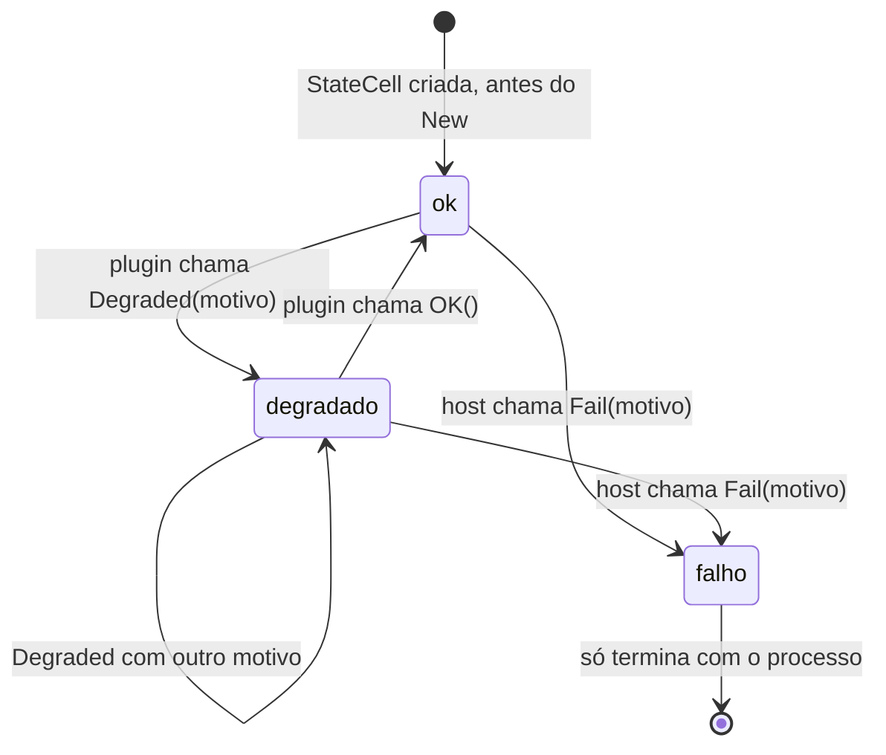
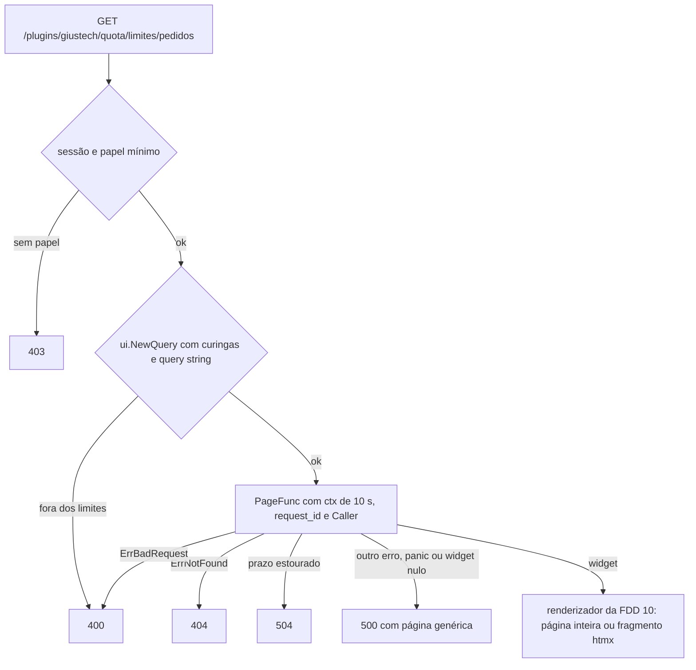

### FDD: Contrato de controller: capacidades, `Caller` e estado do plugin (SDK-08)

Versão: 1.0
Data: 2026-10-20
Responsável: Guilherme Giusti

---

### 1. Contexto e motivação técnica

**Problema técnico.** O controller é só um host de plugins, sem armazenamento (ADR-002 do `n3x-controller`): tudo o que aparece no painel ou responde no gRPC vem da metade de controller de algum plugin, a começar pelo core. O ADR-015 fixou as capacidades como interfaces opcionais (`Start`, `Stop`, `GRPC`, `Routes`, `Cards` e `Validate`) e o ADR-018 fixou páginas e cartões como árvores de widgets. Faltava o comportamento verificável:

- onde mora a `Validate`, que roda antes do `New`, quando ainda não existe instância para receber o método
- em que ordem o host chama as capacidades e o que acontece com plugin obrigatório e opcional em cada falha
- como o registro gRPC recusa um serviço fora do namespace, já que o código gerado do `.proto` chama `RegisterService` sem receber erro
- a gramática das rotas de página, inclusive parâmetros no path (`/sidecars/{id}`), e como a página entra no menu
- os tipos `ui.Widget` e `ui.Query`, usados na assinatura de `Routes`, mas definidos só na FDD 10 (L-56)
- os campos de `ctrl.Caller(ctx)` e quando a identidade está ausente
- como o plugin declara `degradado`, como volta a `ok` e como o host lê o estado
- o que o `ctrl.Env` entrega: as FDDs 04 e 06 deixaram para cá a memória, as métricas, os logs, as tarefas de fundo, as conexões e os limites da metade de controller
- como um plugin acessa a "API pública" de outro no mesmo processo (FR-011 e FR-013): nenhum documento define o mecanismo (L-52), e sem contrato cada autor inventaria o seu, furando o isolamento

Esta entrevista achou três problemas novos:

- **Cartão com valor fixo.** O ADR-018 e o HLD do `n3x-sdk` registram o cartão com `c.Add(id, widget)`, um widget montado uma vez na subida. Isso não combina com o prazo de 1 s por cartão (ADR-018) nem com a visão geral atualizada a cada 5 s (ADR-008 do `n3x-controller`): um valor fixo nunca muda e não tem o que estourar.
- **Registro gRPC que encerra o processo.** A interface `grpc.ServiceRegistrar`, usada pelos stubs gerados, não devolve erro, e o servidor do grpc-go encerra o processo (`Fatalf`) com serviço repetido ou com implementação que não satisfaz o tipo do serviço. As recusas precisam ser juntadas antes de o host tocar no servidor real.
- **Ordem divergente.** O HLD do `n3x-controller` (subida, passo 5) registra serviços e telas num `Init`, antes do `Start`; o HLD do `n3x-sdk` e o ASSUNTO chamam `Start` e depois `GRPC`, `Routes` e `Cards`.

**Encaixe no HLD.** Esta FDD especifica o pacote `controller/` do módulo `github.com/giustech/n3x-sdk` (pacote Go `ctrl`) e os tipos mínimos do pacote `controller/ui` (HLD do `n3x-sdk`: linha `controller/` de "Componentes e responsabilidades", "Contrato de controller", "Fluxo de requisições" na subida no controller e na página no painel, "Modelo de dados" e "Segurança"). Consumidores:

- FDD 09: acrescenta as capacidades privilegiadas do core nos pontos de encaixe definidos aqui
- FDDs 10 e 11: completam `controller/ui` (catálogo, renderizador, `Form` e `Action`)
- FDD 12: host falso do kit, com o mesmo `Registrar`, o mesmo `StateCell` e as mesmas funções de regra
- FDD 13: metade de controller do `n3x.example`
- FDD 24: regras de análise estática ligadas a este contrato
- FDD 30: `n3x.yaml` do controller (`runtime.plugin_limits`, prazos) e subcomando `validate`
- FDD 32: host de plugins, que implementa `ctrl.Env`, a ordem de chamadas, as políticas de obrigatório e opcional e o transporte da API entre plugins
- FDDs 33, 34 e 35: servidor gRPC, sessão do painel e painel, que injetam o `Caller`, aplicam o papel e montam menu, cartões e banners
- FDDs 36 a 45: plugin core, primeiro cliente do contrato

**Atores.** Autor de plugin (implementa), host do controller (FDD 32, chama as capacidades e implementa o `Env`), servidor gRPC e painel (FDDs 33 a 35, chamam os handlers registrados), kit de testes (FDD 12, simula o host), plugin core (primeiro cliente) e operador (lê estado, banners, métricas e logs).

**Limites.** O SDK define o contrato e entrega pronto o que precisa ser idêntico no host real e no host falso: as tabelas de registro com as checagens (`Registrar`), a máquina de estado do plugin (`StateCell`), as funções de regra e `ctrl.Sleep`. O que depende do processo (servidor gRPC, roteador HTTP, goroutines, sockets e o transporte em processo da API entre plugins) fica com o host (FDD 32) e com o kit (FDD 12). Os pacotes `ctrl` e `ui` não abrem porta, não criam goroutine, não leem arquivo e não guardam estado global.

**Suposições**
- Go 1.26 ou superior (ADR-021); o `net/http` aceita padrões com curinga `{nome}` desde o Go 1.22
- grpc-go com `grpc.ServiceRegistrar`, `grpc.ServiceDesc` e `grpc.ClientConnInterface` estáveis, porque os stubs gerados dependem deles
- Uma instância de controller por plugin, criada uma vez (HLD do `n3x-sdk`); controller em instância única por ambiente (ADR-001 do `n3x-sdk`)
- O host chama `Check`, `Instantiate`, `Start`, as capacidades de registro e `Stop` sob `recover` (FDD 32), como o executor faz no sidecar (FDDs 04 e 17)
- O core é obrigatório (`controller.required: true`) e os demais plugins declaram a obrigatoriedade no manifesto (FDD 01)

**Restrições**
- O contrato usa só `net/http`, `context`, grpc-go e widgets; o Echo nunca aparece (ADR-018 e ADR-011)
- `controller/` não importa `proxy/` (hipótese, simetria do ADR-011); as regras comuns às duas metades moram num pacote interno do SDK
- Sem cgo e sem pacotes internos do `n3x-controller` (ADR-011)
- Capacidades como interfaces opcionais, sem método genérico de execução, e registro sem `init()` (ADR-015)
- `falho` só pelo host; o plugin não consegue se desligar sozinho (HLD do `n3x-sdk`, "Segurança")
- `Form` e `Action` sem papel declarado exigem root (HLD do `n3x-sdk`)
- Na v1, o servidor gRPC `17443` só aceita o papel `sidecar` (ADR-007 do `n3x-controller`)
- Um plugin acessa dados de outro só pela API pública dele (FR-011 e FR-013)
- Contrato estável desde a `v1.0.0`; antes disso, pré-releases `v0.x` (ADR-021)
- Documentação e mensagens em pt-BR; identificadores, valores de rótulo e nomes de evento em inglês

**Rastreabilidade**
- PRD 1.5: FR-013 (inteiro), FR-011 (registro de serviços, telas e schema; dependências; obrigatório e opcional; identidade do chamador; panic contido; API pública entre plugins), FR-008 (banner por plugin degradado ou falho; telas de plugin no menu), FR-009 (core falho ou degradado: só o root entra); critérios de aceite "plugin novo com uma página e um cartão aparece no painel sem mudar repositórios do core" e "plugin opcional que falha sobe desligado e aparece como falho"
- ADRs do `n3x-sdk`: ADR-004, ADR-011, ADR-012, ADR-015, ADR-016, ADR-017, ADR-018, ADR-019, ADR-021 e ADR-022; do `n3x-controller`: ADR-001, ADR-002, ADR-003, ADR-007 e ADR-008; do `n3x-plugin-core`: ADR-009
- FDDs aplicadas: 01 (`OwnsGRPCService`, `OwnsRoute`, `FieldError`, notação de caminho), 02 (`ConfigSchemer`, `DecodeConfig`, `PrefixErrors`), 03 (`plugin.Secret`), 04 (`memory.Handle`, cota de 64 MiB), 05 (modelo de `Define` e `Instantiate`), 06 (`telemetry/`, `Background`, `Dial`, `Sleep` e limites)
- Lacunas do README:
  - **L-52 fechada aqui:** a API pública de um plugin para outros plugins é gRPC em processo. O provedor registra os serviços que oferece a outros plugins na capacidade nova `PluginAPI(r)`; o consumidor obtém a conexão com `env.Dependency(id)`, só para IDs declarados em `controller.depends_on`. O host encaminha a chamada em processo, com as mensagens serializadas (nenhum ponteiro compartilhado), os mesmos interceptors de recover, prazo, métricas e log, e o `Caller` imposto com o papel novo `RolePlugin` (contrato 8) (hipótese)
  - **L-56 fechada aqui:** esta FDD define em `controller/ui` os tipos mínimos `ui.Widget` (interface selada) e `ui.Query` (struct opaca com curingas do path e query string). A FDD 10 completa o catálogo, o renderizador e os métodos de paginação, ordenação e filtros da `Query`, sempre por adição (contrato 5)
  - **L-53 preparada (fecha na FDD 11):** `ctrl.Routes` é implementada só pela plataforma, então a FDD 11 acrescenta o registro dos handlers de `Form` e `Action` como métodos novos, sem quebrar plugins. A tabela de rotas é indexada por método e padrão; `Page` ocupa só `GET`; o valor zero de `Role` fica reservado para "não declarado", que em `Form` e `Action` vale root (contrato 4)
  - **L-36 não é fechada aqui:** o critério de `falho` em runtime é da FDD 32. O contrato só garante que `falho` é decidido pelo host e é terminal na v1 (contrato 9)
  - **L-63 e L-02 (parte do estado do core), fechadas na FDD 09, com os pontos de encaixe daqui:** o nome do root chega ao core pelo método `Plugin.CheckHost(config, ctrl.HostFacts{RootUser}, opts...)`, que chama a interface `ctrl.HostValidator` do tipo de config do core depois da `Validate` (contrato 15 da FDD 09; a opção de `Check` prevista na primeira versão desta FDD era impossível, porque `plugin.DecodeOption` é fechado, I-03 da FDD 09); o `StateCell` do core é a fonte que o host lê para a regra "só o root entra" (contrato 16 da FDD 09 e FDD 34)
  - **Encaixe das privilegiadas (FDD 09):** `ctrl.PrivilegesOf` e `ctrl.CheckPrivileged` na fase de config e depois do `New`; `ctrl.CoreEnv` montado só para o core; tabela `TablePublic` com `Registrar.Public()` para o `PublicGRPC` do core; sentinelas `ErrPrivileged`, `ErrUnauthenticated`, `ErrInvalidCredentials`, `ErrLoginBlocked`, `ErrVerifierBusy` e `ErrUnsupported` no pacote `ctrl`
- Pedidos de FDDs anteriores atendidos:
  - FDD 01: `Registrar` recusa serviço com `id.OwnsGRPCService` e rota com `id.OwnsRoute` (contratos 3 e 4)
  - FDD 02: `ctrl.Define[C]` implementa `plugin.ConfigSchemer` e chama `plugin.DecodeConfig[C]` (contrato 1)
  - FDD 04: `ctrl.Env.Memory()` devolve o `memory.Handle` do escopo do plugin, com instância `""` e cota padrão de 64 MiB (contrato 7)
  - FDD 06 (P-05 dela): `ctrl.Env` usa `*telemetry.Metrics` e `*slog.Logger`; ganha `Background`, `Dial`, `HTTPClient` e `ctrl.Sleep` com as mesmas regras da metade de proxy; os limites vêm de `runtime.plugin_limits` do `n3x.yaml` do controller; o rótulo `instance` fica vazio (contrato 7)

---

### 2. Objetivos técnicos

- **Nenhum registro fora do próprio namespace.** Invariante: todo serviço aceito passa em `id.OwnsGRPCService` e toda página aceita passa em `id.OwnsRoute`. Medida: 100% dos casos de recusa da seção 9 recusados pelo `Registrar`, com o mesmo `Path` e a mesma `Rule` no host real e no falso.
- **Todas as recusas de uma vez, sem derrubar o processo.** Medida: `Registrar.Close()` devolve todos os problemas de registro do plugin numa lista, na ordem das chamadas; nenhum registro com problema chega ao servidor do grpc-go (0 `Fatalf` em toda a suíte).
- **Capacidade ausente não custa nada.** Invariante: as capacidades são detectadas uma vez (`CapabilitiesOf`), com 0 alocações, e o host nunca chama uma capacidade ausente.
- **Toda chamada a plugin tem prazo.** Medida: `ctx` com prazo em `Start` (30 s), `Stop` (5 s), página e gRPC unário (10 s), cartão (1 s) e API entre plugins (10 s), conferido com tolerância de 50 ms nos vetores de conformidade do kit (FDD 12) e no host (FDD 32).
- **Config inválida nunca chega ao `New`.** Invariante: o host roda `Check` (schema e `Validate`) em todos os plugins, e `CheckHost` (mais `ValidateHost`) no core, antes do primeiro `New`; com qualquer problema, nenhum `New` roda.
- **Estado consistente e barato.** Medida: `StateCell.Load` e `StateReporter.Current` com 0 alocações; transições serializadas; `falho` terminal; 16 goroutines alternando `Degraded` e `OK` sem corrida em `go test -race`.
- **Isolamento mantido na API pública.** Invariante: um plugin só chama outro pelo gRPC registrado em `PluginAPI`, só se o declarou em `depends_on`, com mensagens serializadas e `Caller` com papel `plugin` imposto pelo host.
- **`Caller` não forjável entre fronteiras.** Invariante: o host sobrescreve o `Caller` em toda entrada (servidor gRPC, painel e API entre plugins); um valor posto no `ctx` pelo próprio plugin nunca chega a outro plugin.
- **Mesmo comportamento no kit e no host.** Medida: os vetores de conformidade do contrato, publicados pelo kit (FDD 12), passam no host real (FDD 32).

---

### 3. Escopo e exclusões

**Incluído**
- `ctrl.Define[C](New)`, a interface `ctrl.Plugin` (com `Check` e `Instantiate`) e o tipo `ctrl.Instance`, uma instância por plugin
- Interface `ctrl.Validator` no tipo de config `C`, chamada antes do `New`, e o formato dos erros que ela devolve
- Interfaces opcionais `Starter`, `Stopper`, `GRPCProvider`, `PluginAPIProvider`, `RoutesProvider` e `CardsProvider`, a detecção (`CapabilitiesOf`) e a ordem em que o host as chama
- `ctrl.GRPCRegistrar` sobre `grpc.ServiceRegistrar`, com as regras de namespace, duplicidade e tipo do serviço
- `ctrl.Routes` com `Page(path, papel, fn, opções...)`, gramática de path com curingas `{nome}`, opção `InMenu`, e `ctrl.Cards` com `Add(id, papel, fn)`
- Tipos mínimos `ui.Widget` e `ui.Query` (L-56)
- Papéis `RoleRead`, `RoleRoot`, `RoleSidecar` e `RolePlugin`; tipo `ctrl.Identity` (compartilhado com a FDD 09); `ctrl.Caller(ctx)` e `ctrl.ContextWithCaller`
- `ctrl.Env`: memória, métricas, logs, estado, tarefas de fundo, conexões, cliente HTTP e API entre plugins; `ctrl.Sleep`
- API entre plugins em processo: capacidade `PluginAPI` e `env.Dependency(id)` (L-52)
- Estado do plugin: `ok` e `degradado` declarados pelo plugin, `falho` só pelo host, com motivo e horário; `StateReporter` e `StateCell`
- Prazos que o contrato promete ao plugin e o que o host faz em cada falha (subida recusada, opcional `falho`, obrigatório encerra o controller)
- API do runtime usada pelo host e pelo kit: `Registrar`, `StateCell`, funções de regra e constantes
- Erros sentinela e códigos de regra do registro e da `Validate`
- Pontos de encaixe para as FDDs 09 (capacidades privilegiadas) e 11 (`Form` e `Action`)

**Excluído**
- Capacidades privilegiadas do core (`PublicGRPC`, `Authenticate`, `CheckUser`, `ChangePassword`, `WriteAudit`, `Credentials`, `Sessions`), `ctrl.CoreEnv`, `CheckPrivileged`, `HostFacts`, `HostValidator`, `Plugin.CheckHost`, as regras da tabela pública e o IP do chamador: FDD 09 (SDK-09); aqui ficam só a posição de cada um na ordem da subida e as citações
- Catálogo de widgets, renderizador, métodos de paginação, ordenação e filtros da `ui.Query`: FDD 10 (SDK-10)
- `Refresh`, `Link`, `Form`, `Action`, `Chart`, exportação e o registro dos handlers de envio (L-53): FDD 11 (SDK-11)
- Host falso, vetores de conformidade e `bufconn`: FDD 12 (SDK-12)
- Implementação do host: registro do binário, ordem por dependência, transporte em processo da API entre plugins, contenção de panic, critério de `falho` em runtime (L-36) e efeito de uma dependência `falho` sobre quem depende dela: FDD 32 (CTL-03); servidor gRPC: FDD 33 (CTL-04); sessão: FDD 34 (CTL-05); painel, menu, banners e cartões na tela: FDD 35 (CTL-06)
- Leitura do `n3x-plugin.yaml` e campos `controller.required` e `depends_on`: FDD 01 (SDK-01)
- Validação do `n3x.yaml` do controller, inclusive `runtime.plugin_limits` e as faixas dos prazos: FDD 30 (CTL-01)
- Banco do plugin: responsabilidade de cada plugin (ADR-002 do `n3x-controller`)
- Fora da v1, por adição em minor quando houver caso real (hipótese): papel declarado por método gRPC (ADR-007), retentativa de `Start`, reinício de plugin `falho` em runtime, delegação da identidade do usuário na API entre plugins, prazo de cartão ajustável, cartão com tamanho ou ordem declarados

---

### 4. Fluxos detalhados e diagramas

**Fluxo principal: subida do controller (lado do contrato; a implementação é da FDD 32)**
1. O `main` gerado pelo builder chama `host.Run(core.Plugin(), <plugins>...)`; cada `controller.Plugin()` só chama `ctrl.Define[C](New)` e não tem efeito colateral (ADR-015).
2. **Fase de config, todos os plugins, em ordem de ID:** o host chama `ctrl.PrivilegesOf(p, nil)`, que só enxerga o `HostValidator` do tipo de config; plugin que não é o core com esse privilégio recusa a subida (`privileged_capability`, FDD 09). Depois, com os bytes JSON da seção `plugins["<id>"]` do `n3x.yaml` (vazio quando a seção falta), o host chama `p.CheckHost(config, ctrl.HostFacts{RootUser: root.user}, plugin.WithSecretOpener(abrir))` para o core e `p.Check(config, plugin.WithSecretOpener(abrir))` para os demais. O `Check`:
   - decodifica com `plugin.DecodeConfig[C]` (schema, defaults e segredos, FDD 02)
   - se o tipo `C` implementa `ctrl.Validator`, chama `Validate()` sobre a config decodificada, com os `plugin.Secret` já abertos
   - devolve `nil` ou um erro com `plugin.ErrInvalidConfig` e a lista de problemas, com caminhos relativos à seção
   - o `CheckHost` faz o mesmo e, sem erro até ali, chama `ValidateHost(h)` se `C` implementa `ctrl.HostValidator` (contrato 15 da FDD 09; L-63)
3. O host prefixa os erros com `plugin.PrefixErrors(err, plugin.PathKey("plugins", id.String()))`, junta os de todos os plugins e, se houver algum, encerra sem chamar nenhum `New`, seja o plugin obrigatório ou opcional (hipótese). O subcomando `n3x-controller validate` faz só esta fase (FDD 30).
4. **Fase de instâncias, um plugin por vez:** o core primeiro (FDD 09, hipótese de lá) e depois os demais em ordem de dependência (dependências primeiro):
   - o host cria a conta e o escopo de memória (FDD 04), a conta e o escopo de métricas (FDD 06), o logger, o `StateCell`, os contadores de tarefas e de conexões e a visão de `Dependency`, e monta o `Env`; para o core, embrulha esse `Env` num `ctrl.CoreEnv` (com `Credentials`, `Sessions`, `ControllerManifest` e `CallerIP`, contrato 14 da FDD 09), que nunca é montado para outro plugin
   - chama `p.Instantiate(config, env, opener)`, que decodifica, roda a `Validate` de novo e chama `New(cfg, env)`; `(nil, nil)` vira `ErrNilInstance`
   - sela memória, métricas e tarefas (depois do `New` não se cria mapa, métrica nem tarefa)
   - chama `ctrl.CheckPrivileged(id, module, p, inst)` (contrato 2 da FDD 09): plugin que não é o core com `PublicGRPC`, `Authenticate`, `CheckUser`/`ChangePassword` ou `WriteAudit` recusa a subida; core sem `PublicGRPC`, `Authenticate` ou diretório de usuários também (`core_capability_missing`)
   - calcula `ctrl.CapabilitiesOf(p, inst)` uma vez
   - chama `Start(ctx)` com prazo de `runtime.plugin_start_timeout` (30 s), se existir
   - cria um `ctrl.NewRegistrar(id)` e chama, nesta ordem e só se existirem, `GRPC(r.GRPC())`, `PublicGRPC(r.Public())` (só o core, FDD 09), `PluginAPI(r.PluginAPI())`, `Routes(r.Routes())` e `Cards(r.Cards())`
   - chama `r.Close()`, que fecha o registro e devolve todos os problemas, inclusive os da tabela pública
5. **Depois de todos os plugins:** o host inicia as tarefas de fundo registradas, uma vez, na ordem de subida e de registro, só dos plugins que não ficaram `falho`; monta os serviços da tabela `sidecar` no servidor `17443`, as páginas e os cartões no painel e a tabela `plugin` no transporte em processo; abre `17091`, `17443` e `17444` (FDD 30).

**Regras de falha da subida** (o que o contrato promete; a aplicação é da FDD 32)

| Onde falhou | Plugin obrigatório | Plugin opcional |
| --- | --- | --- |
| `Check` ou `CheckHost` (schema, `Validate` ou `ValidateHost`) | O controller não sobe | O controller não sobe (hipótese) |
| `HostValidator` fora do core (fase de config) ou `CheckPrivileged` com erro depois do `New` | O controller não sobe | O controller não sobe (FDD 09) |
| Recusa de registro (`Close` com erro, inclusive na tabela pública) | O controller não sobe | O controller não sobe (hipótese) |
| `New` com erro ou panic | O controller não sobe | `falho`, sem `Start`, sem registros |
| `Start` com erro, panic ou prazo estourado | O controller não sobe | `falho`, sem registros, sem nova tentativa (hipótese) |
| Panic dentro de `GRPC`, `PluginAPI`, `Routes` ou `Cards` | O controller não sobe | `falho`; o host chama `Stop` para liberar o que o `Start` abriu (hipótese) |

- Recusa de registro é violação de contrato (plugin com erro ou malicioso), não falha operacional; por isso vale para os dois, como na regra do ADR-019 ("a subida é recusada")
- Quando a subida é abortada, todo plugin cujo `Start` já tinha terminado com sucesso recebe `Stop`, na ordem inversa
- `Validate`, `New` e as capacidades de registro não recebem `ctx`; o host os vigia com o mesmo `runtime.plugin_start_timeout` e trata o estouro como falha da etapa (hipótese)

**Fluxo de uma chamada gRPC de sidecar** (servidor da FDD 33)
- O host autentica, aplica o papel `sidecar` (ADR-007) e monta um `ctx` com prazo `min(prazo do cliente, runtime.plugin_call_timeout)`, `request_id` (de `x-request-id` ou novo) e `Caller` `{sidecar, serviço, instância, sessão}`
- O grpc-go chama o handler registrado na tabela `sidecar` pelo nome do método; o plugin lê `ctrl.Caller(ctx)`
- Plugin `falho` ou controller parando: `UNAVAILABLE`; panic: `INTERNAL` e `n3x_controller_plugin_panics_total{kind="grpc"}`

**Fluxo de uma página** (painel da FDD 35)
- O host confere a sessão e o papel mínimo da rota (`Role.Meets`); sem papel, 403
- O host monta `ui.NewQuery(curingas, query string)`; query fora dos limites dá 400
- O host chama a `PageFunc` com `ctx` de `runtime.plugin_call_timeout`, `request_id` e `Caller` `{read ou root, usuário}`
- Resultado: widget, que o renderizador (FDD 10) transforma em página inteira ou fragmento htmx; `ErrNotFound` dá 404; `ErrBadRequest` dá 400; prazo estourado dá 504; outro erro, panic ou `(nil, nil)` dá 500 com página genérica (hipótese de mapeamento)

**Fluxo de um cartão** (visão geral da FDD 35)
- A cada renderização da visão geral (e a cada polling de 5 s), o host chama a `CardFunc` de cada cartão visível para o papel do usuário, em paralelo, com `ctx` de 1 s (`CardTimeout`)
- Erro, panic, prazo ou `(nil, nil)`: o cartão aparece como "indisponível" e os outros seguem (ADR-018); o host conta em `n3x_controller_card_failures_total`

**Fluxo da API entre plugins (L-52)**
- O provedor `giustech.ratelimit` registra em `PluginAPI(r)` o serviço que oferece a outros plugins (`n3x.plugins.giustech.ratelimit.v1.Limits`)
- O consumidor `giustech.quota` declara `depends_on: [giustech.ratelimit]` no manifesto; no `New`, chama `env.Dependency(id)` e cria o client gerado sobre a conexão
- A dependência já subiu inteira antes do `New` do consumidor (ordem de dependência), então a conexão já conhece os serviços dela
- Numa chamada (com `ctx` do `Start`, de um handler ou de uma tarefa), o host:
  - confere que o método pertence a um serviço da tabela `plugin` do provedor; senão, `Unimplemented`
  - serializa a mensagem; o provedor recebe uma cópia, nunca um ponteiro do consumidor
  - monta um `ctx` novo só com prazo `min(prazo do ctx, runtime.plugin_call_timeout)`, cancelamento, `request_id` e `Caller` `{plugin, giustech.quota}`; outros valores do `ctx` do consumidor não atravessam
  - aplica recover, métricas e log, como no servidor gRPC
  - devolve a resposta desserializada ou o status (`Unavailable` com provedor `falho` ou parado, `Internal` com panic, `DeadlineExceeded` no prazo)

**Fluxo do estado**
- O `StateCell` do plugin nasce `ok`, antes do `New`
- O plugin chama `env.State().Degraded(motivo)` e `env.State().OK()` quando quiser, de qualquer goroutine, inclusive no `New` e no `Start` (sobe já degradado, por exemplo com o banco fora do ar)
- O host chama `cell.Fail(motivo)` quando decide `falho`; a partir daí as chamadas do plugin não têm efeito
- O host lê `cell.Load()` em toda renderização de banner e em todo scrape de métricas, sem consultar o plugin; cada transição chama o observador do host, que loga e atualiza as métricas

**Fluxo de desligamento** (SIGTERM; implementação da FDD 32)
1. `/ready` passa a 503; `GracefulStop` do gRPC e `Shutdown` do painel com `runtime.shutdown_timeout` (20 s)
2. O host cancela o `ctx` das tarefas de fundo e espera até `ShutdownGrace` (2 s)
3. `Stop(ctx)` de cada plugin na ordem inversa da subida, com 5 s cada, só para plugins cujo `Start` terminou com sucesso; quem estoura é abandonado com log, e o host segue para o próximo (hipótese)
4. A API entre plugins segue funcionando em processo até o `Stop` do provedor, então o `Stop` de um consumidor ainda alcança as dependências dele

**Fluxos alternativos e exceções**
- **Plugin só com schema** (FR-013): `Define` com um `New` que devolve uma instância sem capacidades; o painel mostra a config pelos schemas (FDDs 44 e 45)
- **`New` devolve valor e as capacidades têm receptor ponteiro:** `CapabilitiesOf` não as vê; o kit avisa (pedido à FDD 12), como no `HooksOf` da FDD 05
- **`Start` que ignora o `ctx`:** o host não espera além do prazo; o plugin vira `falho` (opcional) ou o controller encerra (obrigatório); um retorno tardio é ignorado e esse plugin não recebe `Stop`
- **Registrador guardado e usado depois:** qualquer chamada depois do `Close` faz panic com `ErrRegistrationClosed`; num handler, o host contém o panic (500 ou `INTERNAL`)
- **`Background`, métrica ou mapa criados depois do `New`:** panic com `ctrl.ErrSealed`, `telemetry.ErrSealed` ou o panic de `memory` (FDDs 04 e 06)
- **`env.Dependency` para ID fora de `depends_on`:** `ErrNotDependency`; para dependência sem `PluginAPI`: `ErrNoPluginAPI`; para dependência `falho`: `ErrDependencyFailed`
- **`Caller` ausente:** no `Start`, no `Stop`, nas tarefas de fundo e no `Login` do core (rota pública, FDD 09), `ctrl.Caller(ctx).IsZero()` é verdadeiro
- **`Validate` no `n3x-controller validate` sem a chave AES:** os `plugin.Secret` trazem o texto recebido; a `Validate` não pode depender do valor aberto de um segredo, só de `IsZero` (regra do guia do autor)
- **Página com curinga para um recurso que não existe:** a `PageFunc` devolve `ctrl.ErrNotFound` e o host responde 404
- **Plugin oscilando entre `ok` e `degradado`:** cada transição conta em `n3x_controller_plugin_state_changes_total`; o log de transição é limitado a 1 por segundo por plugin, com a contagem suprimida (hipótese)

**Diagramas**

Sequência da subida (chamadas ao contrato; a orquestração é da FDD 32):

```mermaid
sequenceDiagram
    participant H as host (FDD 32)
    participant P as ctrl.Plugin
    participant I as instância
    participant R as ctrl.Registrar
    H->>H: PrivilegesOf(p, nil): HostValidator fora do core recusa (FDD 09)
    H->>P: CheckHost(config, HostFacts, opener) no core; Check(config, opener) nos demais
    P-->>H: nil ou ErrInvalidConfig com a lista (schema, Validate e ValidateHost)
    Note over H: algum problema: encerra sem chamar nenhum New
    loop core primeiro, depois cada plugin em ordem de dependência
        H->>P: Instantiate(config, env ou CoreEnv, opener)
        P->>I: New(cfg, env)
        I-->>H: Instance
        H->>H: sela memória, métricas e tarefas; CheckPrivileged(id, module, p, inst) (FDD 09)
        H->>I: Start(ctx de 30 s)
        H->>R: NewRegistrar(id)
        H->>I: GRPC, PublicGRPC (só o core), PluginAPI, Routes e Cards com as visões do Registrar
        H->>R: Close()
        R-->>H: nil ou ErrRegistration com a lista
    end
    H->>H: inicia as tarefas de fundo, monta as tabelas e abre as portas
```

Estados do plugin:



Chamada pela API entre plugins:

```mermaid
sequenceDiagram
    participant B as giustech.quota (consumidor)
    participant C as conexão de env.Dependency (host)
    participant A as giustech.ratelimit (PluginAPI)
    B->>C: Invoke(ctx, "/n3x.plugins.giustech.ratelimit.v1.Limits/Snapshot", req)
    C->>C: método na tabela plugin do provedor? senão Unimplemented
    C->>C: serializa req; ctx novo: prazo, cancelamento, request_id e Caller {plugin, giustech.quota}
    C->>A: handler, com recover, métricas e log
    A-->>C: resposta ou status
    C-->>B: resposta desserializada (cópia) ou status
```

Página no painel:



---

### 5. Contratos públicos (assinaturas, endpoints, headers, exemplos)

**Contrato 1: `ctrl.Define`, `ctrl.Plugin`, `ctrl.Instance` e `ctrl.Validator`**
- Tipo: sdk (API Go)
- Assinatura/Rota:
  ```go
  // Diretório controller/, pacote Go ctrl (hipótese): o plugin importa
  // "github.com/giustech/n3x-sdk/controller" e usa ctrl.X sem alias,
  // sem colidir com o próprio pacote controller do plugin.
  package ctrl

  // Instance é o valor devolvido pelo New: uma por plugin no processo.
  // As capacidades são interfaces opcionais detectadas por CapabilitiesOf (contrato 2).
  type Instance interface{}

  // Define liga a struct de config C ao construtor da instância.
  func Define[C any](newFn func(cfg C, env Env) (Instance, error)) Plugin

  // Plugin é o valor devolvido por controller.Plugin(). Só Define cria um Plugin.
  type Plugin interface {
      plugin.ConfigSchemer // ConfigSchema() (*plugin.Schema, error), FDD 02
      // Check decodifica a config e roda a Validate do tipo C, sem chamar New.
      Check(config []byte, opts ...plugin.DecodeOption) error
      // CheckHost faz o Check e depois chama ValidateHost(h) se C implementa
      // HostValidator. Só para o core (FDD 09, contrato 15; L-63).
      CheckHost(config []byte, h HostFacts, opts ...plugin.DecodeOption) error
      // Instantiate decodifica, roda a Validate e chama New. Usado pelo host e pelo kit.
      Instantiate(config []byte, env Env, opts ...plugin.DecodeOption) (Instance, error)
      isControllerPlugin() // método não exportado: fecha a interface
  }

  // Validator é implementado pelo tipo de config C (receptor valor ou ponteiro),
  // não pela instância: roda antes do New.
  type Validator interface {
      Validate() error
  }

  var ErrNilInstance = errors.New("ctrl: New devolveu instância nula sem erro")
  ```
- Método: n/a (chamada local)
- Semântica:
  - `Define` não faz trabalho: guarda `newFn` e o tipo `C`. `newFn` nulo é erro de programação e faz panic com mensagem que começa com `ctrl:`
  - `ConfigSchema()` chama `plugin.SchemaOf[C]()` uma vez e guarda o resultado (mesmo ponteiro e mesmos bytes em toda chamada); `C` inválido devolve o erro com `plugin.ErrInvalidSchema` (FDD 02)
  - `Check`: `plugin.DecodeConfig[C](config, opts...)`; erro de config volta como está (`plugin.ErrInvalidConfig` e `FieldErrors`, caminhos relativos à seção). Sem erro, se `C` ou `*C` implementa `Validator`, chama `Validate()`. Não chama `New`, não recebe `Env` e não usa `recover` (o host chama sob `recover`)
  - Erro da `Validate`:
    - se é ou embrulha `plugin.FieldErrors` ou `plugin.FieldError`, valem `Path`, `Rule` e `Detail` do autor, com caminho relativo à raiz da seção do plugin (caminho vazio é a raiz)
    - senão, vira um único `FieldError{Path: "", Rule: "validate", Detail: <texto do erro>}` (hipótese)
    - em todo caso, o `Detail` é saneado (caracteres de controle viram espaço) e cortado em 512 caracteres (`plugin.MaxDescLength`), e a lista é cortada em 100 itens com `truncated` (`plugin.MaxConfigErrors`)
    - o erro devolvido satisfaz `errors.Is(err, plugin.ErrInvalidConfig)` e `errors.As(err, &fe)` com `var fe plugin.FieldErrors` (embrulho do pacote `ctrl` com `Unwrap() []error`)
  - **O que a `Validate` pode checar:** regras entre campos e de domínio que as tags não expressam (ex.: nomes repetidos numa lista, `redis` obrigatório quando `mode` é `redis`, custo do bcrypt). Ela é pura: não faz I/O, não loga, não guarda estado e não altera a config. Recebe os `plugin.Secret` já abertos quando o host passa o opener; no `validate` sem chave, recebe o texto como veio. O `Detail` nunca cita o valor recebido (regra da FDD 02, conferida pelo canário do kit, FDD 12)
  - **Fatos do host para o core (L-63, FDD 09):** o nome do root não está na config do core. O método `CheckHost(config, ctrl.HostFacts{RootUser}, opts...)` faz o mesmo que `Check` e, sem erro até ali, chama `ValidateHost(h)` se `C` ou `*C` implementa `ctrl.HostValidator`, com erros no mesmo formato da `Validate`. Não é uma opção de `Check` porque `plugin.DecodeOption` é `func(*decodeOptions)` sobre struct não exportada da FDD 02, que o pacote `ctrl` não consegue criar (I-03 da FDD 09). O host chama `CheckHost` só para o core; `Check` nunca chama `ValidateHost`; `HostValidator` em outro plugin é recusado na fase de config. Por ser `Plugin` fechada, o método novo é compatível
  - `Instantiate`: decodifica, roda a `Validate` e chama `newFn(cfg, env)`. Erro do `New` volta como está; `(nil, nil)` devolve `ErrNilInstance`. Não usa `recover`
  - **Instância:** criada uma vez e usada por todos os handlers, cartões, páginas e tarefas ao mesmo tempo. Campos preenchidos no `New` e no `Start` são somente leitura depois do `Start` (o host garante que nenhum handler roda antes de o `Start` voltar); estado mutável só em estruturas seguras para concorrência (`memory.Map`, `sync/atomic`, métricas por handle, mutex próprio)
  - **`Env`:** válido por toda a vida da instância; pode ser guardado nela

**Exemplo de requisição**
```go
// types/controller.go (plugin hipotético giustech.quota)
type ControllerConfig struct {
    Limits []Limit `json:"limits" n3x:"max=100" desc:"Cota por serviço"`
}
type Limit struct {
    Service string `json:"service" n3x:"required,min=1,max=63" desc:"Nome do serviço"`
    PerMin  int    `json:"per_min" n3x:"required,min=1,max=1000000" desc:"Requisições por minuto"`
}
func (c ControllerConfig) Validate() error {
    var errs plugin.FieldErrors
    first := map[string]int{}
    for i, l := range c.Limits {
        if j, ok := first[l.Service]; ok {
            errs = append(errs, plugin.FieldError{
                Path: plugin.PathIndex("limits", i) + ".service", Rule: "duplicate",
                Detail: fmt.Sprintf("serviço repetido; já aparece em limits[%d]", j)})
            continue
        }
        first[l.Service] = i
    }
    if len(errs) > 0 {
        return errs
    }
    return nil
}

// controller/plugin.go
func Plugin() ctrl.Plugin { return ctrl.Define[types.ControllerConfig](New) }

// No host (FDD 32), para cada plugin, antes de qualquer New:
//   err := p.Check(secaoJSON, plugin.WithSecretOpener(abrir))
//   err = plugin.PrefixErrors(err, plugin.PathKey("plugins", "giustech.quota"))
```

**Exemplo de resposta** (seção `{"limits":[{"service":"pedidos","per_min":100},{"service":"pedidos","per_min":50},{"service":"","per_min":0}]}`)
```text
plugins["giustech.quota"].limits[2].service: menos de 1 caracteres [min]
plugins["giustech.quota"].limits[2].per_min: abaixo do mínimo 1 [min]
```
Com a mesma seção corrigida no item 2 (`"service":"estoque","per_min":10`), o schema passa e a `Validate` roda:
```text
plugins["giustech.quota"].limits[1].service: serviço repetido; já aparece em limits[0] [duplicate]
```

---

**Contrato 2: capacidades opcionais, detecção, ordem e prazos**
- Tipo: sdk (interfaces Go)
- Assinatura/Rota:
  ```go
  type Starter interface {
      Start(ctx context.Context) error // ctx com prazo de runtime.plugin_start_timeout
  }
  type Stopper interface {
      Stop(ctx context.Context) error // ctx com prazo de StopTimeout
  }
  type GRPCProvider interface {
      GRPC(r GRPCRegistrar) // serviços para os sidecars (17443, papel sidecar)
  }
  type PluginAPIProvider interface {
      PluginAPI(r GRPCRegistrar) // serviços para outros plugins, em processo (L-52)
  }
  type RoutesProvider interface {
      Routes(r Routes) // páginas do painel
  }
  type CardsProvider interface {
      Cards(c Cards) // cartões da visão geral
  }

  type Capability uint8

  const (
      CapValidate  Capability = iota + 1 // no tipo C
      CapStart
      CapStop
      CapGRPC
      CapPluginAPI
      CapRoutes
      CapCards
  )

  const NumCapabilities = 7

  func (c Capability) String() string // "validate", "start", "stop", "grpc", "plugin_api", "routes", "cards"

  type Capabilities uint8

  // CapabilitiesOf detecta as capacidades uma vez, na subida. inst nulo: só CapValidate.
  func CapabilitiesOf(p Plugin, inst Instance) Capabilities
  func (cs Capabilities) Has(c Capability) bool
  func (cs Capabilities) Len() int
  func (cs Capabilities) String() string // "validate,start,grpc,routes,cards"; "" sem capacidades

  const (
      DefaultStartTimeout = 30 * time.Second // padrão de runtime.plugin_start_timeout
      DefaultCallTimeout  = 10 * time.Second // padrão de runtime.plugin_call_timeout
      StopTimeout         = 5 * time.Second  // fixo na v1 (hipótese)
      CardTimeout         = 1 * time.Second  // fixo na v1 (ADR-018; hipótese de não ajustável)
      ShutdownGrace       = 2 * time.Second  // tarefas de fundo, igual à metade de proxy
  )
  ```
- Método: n/a
- Semântica:
  - Detecção por type assertion, uma vez, com 0 alocações; capacidade ausente nunca é chamada (ADR-015). `CapValidate` vem do tipo `C`; as outras, da instância
  - Ordem por plugin (seção 4): `Check` ou `CheckHost` (todos antes), `Instantiate` (`New`), `CheckPrivileged` (FDD 09), `Start`, `GRPC`, `PublicGRPC` (capacidade privilegiada, só o core, FDD 09), `PluginAPI`, `Routes`, `Cards`, `Close` do registrador; `Stop` na ordem inversa da subida. As capacidades privilegiadas do core são detectadas por `ctrl.PrivilegesOf` (FDD 09), não por `CapabilitiesOf`
  - As capacidades de registro rodam uma vez, na subida; os handlers registrados é que são chamados depois, pelo grpc-go, pelo painel e pelo transporte em processo
  - `Start` pode fazer I/O (abrir o pool do banco, chamar dependências) e deve devolver `ctx.Err()` quando o prazo estoura; erro ou prazo estourado é falha de subida. Plugin opcional fica `falho` sem nova tentativa; o `Start` deve desfazer o que abriu antes de devolver erro
  - `Stop` é chamado só para plugins cujo `Start` terminou com sucesso (ou que não têm `Start`); deve fechar recursos e respeitar o `ctx`. Erro e prazo só geram log
  - Prazos prometidos ao plugin:

| Chamada | `ctx` | Prazo | Origem | Ajuste |
| --- | --- | --- | --- | --- |
| `Validate` (via `Check`) e `New` | sem `ctx` | vigiadas por `runtime.plugin_start_timeout` | hipótese | não |
| `Start` | sim | `runtime.plugin_start_timeout`, padrão 30 s | HLD do `n3x-controller` | `n3x.yaml` (FDD 30) |
| `GRPC`, `PluginAPI`, `Routes`, `Cards` | sem `ctx` | vigiadas por `runtime.plugin_start_timeout` | hipótese | não |
| Handler gRPC unário (sidecar) | sim | `min(prazo do cliente, runtime.plugin_call_timeout)`, padrão 10 s | HLD do `n3x-controller` | `n3x.yaml` |
| Handler gRPC de stream | sim, sem teto total | 1 s por mensagem processada (FDD 33) | HLD do `n3x-controller` | não |
| Página (`PageFunc`) | sim | `runtime.plugin_call_timeout`, padrão 10 s | HLD do `n3x-sdk` | `n3x.yaml` |
| Cartão (`CardFunc`) | sim | 1 s | ADR-018 | não |
| Handler de `PluginAPI` unário | sim | `min(prazo do chamador, runtime.plugin_call_timeout)` | hipótese | `n3x.yaml` |
| Tarefa de fundo | sim, sem prazo | cancelado no desligamento, com 2 s de folga | FDD 06 | não |
| `Stop` | sim | 5 s | HLD do `n3x-controller` | não |

**Exemplo de requisição**
```go
type Example struct{ db *sql.DB /* ... */ }

func (e *Example) Start(ctx context.Context) error   { /* abre o pool e faz um ping com ctx */ return nil }
func (e *Example) Stop(ctx context.Context) error    { return e.db.Close() }
func (e *Example) GRPC(r ctrl.GRPCRegistrar)         { examplev1.RegisterExampleServer(r, e) }
func (e *Example) Cards(c ctrl.Cards)                { c.Add("negacoes", ctrl.RoleRead, e.cardNegacoes) }

capsPtr := ctrl.CapabilitiesOf(controller.Plugin(), &Example{})
capsVal := ctrl.CapabilitiesOf(controller.Plugin(), Example{})
```

**Exemplo de resposta**
```json
{ "capsPtr": "start,stop,grpc,cards", "capsVal": "", "alocações": 0 }
```

---

**Contrato 3: `ctrl.GRPCRegistrar` (serviços para sidecars e para outros plugins)**
- Tipo: sdk (interface Go implementada só pela plataforma)
- Assinatura/Rota:
  ```go
  // GRPCRegistrar recebe os stubs gerados: examplev1.RegisterExampleServer(r, impl).
  // Implementado só pela plataforma (Registrar do contrato 10); ganha métodos por minor.
  type GRPCRegistrar interface {
      grpc.ServiceRegistrar // RegisterService(desc *grpc.ServiceDesc, impl any)
  }

  const MaxServices = 16 // por tabela (sidecar e plugin), por plugin (hipótese)
  ```
- Método: registro na subida; depois, chamadas gRPC unárias e de stream pelo nome do método
- Semântica:
  - Duas tabelas por plugin: `GRPC(r)` registra na tabela `sidecar` (servidor `17443`, só o papel `sidecar`, ADR-007); `PluginAPI(r)` registra na tabela `plugin` (só em processo, só o papel `plugin`, contrato 8). O mesmo serviço pode estar nas duas, por registros separados
  - `RegisterService` não devolve erro nem faz panic: cada problema é guardado e devolvido por `Registrar.Close()`, com todos os problemas de uma vez. Assim o servidor real do grpc-go nunca recebe um registro que o faria encerrar o processo (`Fatalf`)
  - Regras, na ordem, com um problema por chamada (sem erros derivados):

| # | Condição | `Rule` | `Path` |
| --- | --- | --- | --- |
| 1 | `desc` ou `impl` nulo | `invalid_service` | `grpc[<n>]` ou `plugin_api[<n>]` (índice da chamada) |
| 2 | `id.OwnsGRPCService(desc.ServiceName)` falso (FDD 01): fora de `n3x.plugins.<namespace>.<nome>.v<N>.<Servico>` | `foreign_service` | `grpc["<serviço>"]` |
| 3 | `impl` não implementa `desc.HandlerType` | `invalid_service` | `grpc["<serviço>"]` |
| 4 | Mesmo `ServiceName` já registrado na mesma tabela | `duplicate_service` | `grpc["<serviço>"]` |
| 5 | Mais de `MaxServices` na tabela | `too_many` | `grpc["<serviço>"]` |

  - Majors diferentes do mesmo plugin (`.v1.X` e `.v2.X`) e mais de um serviço no mesmo pacote são aceitos; o SDK não impõe "um serviço por major" (hipótese; o core pode ter `Core` e o serviço da rota pública, L-11 na FDD 36)
  - Dois plugins nunca registram o mesmo serviço, porque cada um só registra no próprio namespace e os IDs são únicos (FDD 20); o host ainda confere na montagem
  - **Tabela pública (FDD 09, contrato 10):** `PublicGRPC(r)` do core recebe `Registrar.Public()`, visão da terceira tabela, `TablePublic`, chamada depois de `GRPC` e antes de `PluginAPI`. Ela aceita um único serviço, com um único método unário `Login`, sem sessão na `17443`; as regras próprias (`public_method`, `public_overlap`, `too_many`, além de `invalid_service` e `foreign_service`) são acumuladas e devolvidas no mesmo `Close`, com caminho `public_grpc["<serviço>"]`. O host nunca chama `PublicGRPC` de outro plugin, já recusado pelo `CheckPrivileged`

**Exemplo de requisição**
```go
// plugin giustech.ratelimit
func (p *RateLimit) GRPC(r ctrl.GRPCRegistrar) {
    ratelimitv1.RegisterRateLimitServer(r, p)          // n3x.plugins.giustech.ratelimit.v1.RateLimit
    otherv1.RegisterReportServer(r, p)                 // n3x.plugins.giustech.other.v1.Report
    ratelimitv1.RegisterRateLimitServer(r, p)          // repetido
    // Chamada direta, que o compilador não confere: impl não implementa o HandlerType
    r.RegisterService(&ratelimitv2.RateLimit_ServiceDesc, &semMetodos{})
}
// No host: err := reg.Close()
```

**Exemplo de resposta** (`err.Error()`; `errors.Is(err, ctrl.ErrRegistration)` verdadeiro)
```text
grpc["n3x.plugins.giustech.other.v1.Report"]: serviço fora do namespace n3x.plugins.giustech.ratelimit.v<N> [foreign_service]
grpc["n3x.plugins.giustech.ratelimit.v1.RateLimit"]: serviço já registrado nesta tabela [duplicate_service]
grpc["n3x.plugins.giustech.ratelimit.v2.RateLimit"]: a implementação não satisfaz o tipo do serviço [invalid_service]
```

---

**Contrato 4: `ctrl.Routes`, `ctrl.Cards`, papéis de página e gramática de path**
- Tipo: sdk (interfaces Go implementadas só pela plataforma)
- Assinatura/Rota:
  ```go
  type PageFunc func(ctx context.Context, q ui.Query) (ui.Widget, error)
  type CardFunc func(ctx context.Context) (ui.Widget, error)

  type Routes interface {
      // Page registra uma página GET em /plugins/<namespace>/<nome>/<path sem a barra inicial>.
      Page(path string, role Role, fn PageFunc, opts ...PageOption)
      // A FDD 11 acrescenta aqui o registro dos handlers de Form e Action (L-53).
  }

  type PageOption func(*pageOptions)

  // InMenu põe a página no menu do painel com o rótulo dado.
  func InMenu(label string) PageOption

  type Cards interface {
      // Add registra um cartão da visão geral; fn roda a cada renderização, com prazo de 1 s.
      Add(id string, role Role, fn CardFunc)
  }

  func CheckPagePath(id plugin.ID, path string) (pattern string, err error) // regra pura, usada pelo Registrar
  func CheckCardID(id string) error

  var (
      ErrNotFound   = errors.New("ctrl: não encontrado")                                    // página: 404
      ErrBadRequest = errors.New("ctrl: parâmetro inválido")                                // página: 400
      ErrNilWidget  = errors.New("ctrl: página ou cartão devolveu widget nulo sem erro")
  )

  const (
      MaxPages        = 64  // hipótese
      MaxCards        = 16  // hipótese
      MaxPathLen      = 256 // bytes do path relativo
      MaxPathParams   = 4
      MaxMenuLabelLen = 48  // caracteres
  )
  ```
- Método: `Page` responde a `GET` (e `HEAD`, resolvido pelo host); cartões não têm rota própria
- Semântica:
  - **Path relativo ao prefixo** (hipótese): o plugin escreve `/negacoes`, e o padrão montado é `id.RoutePrefix()` mais o path sem a barra inicial: `/plugins/n3x/example/negacoes`. `/` sozinho é a página raiz do plugin
  - **Gramática** (hipótese, sintaxe de curinga do `net/http`):
    ```text
    path     = "/" | "/" segmento { "/" segmento }      ; até 256 bytes, sem barra no fim
    segmento = literal | "{" nome "}"
    literal  = [a-z0-9][a-z0-9_-]{0,63}
    nome     = [a-z][a-z0-9_]{0,31}                     ; até 4 curingas, nomes distintos
    ```
    Maiúsculas, `.`, `..`, `%`, `?`, `#`, barra dupla e curinga de resto (`{x...}`) são recusados. O pedido chega ao plugin com o mesmo padrão; a comparação do path da requisição é exata e sensível a maiúsculas
  - **Conflito:** dois padrões com o mesmo esqueleto (curingas trocados por `{}`) são duplicados (`/s/{id}` e `/s/{x}`). Literal e curinga na mesma posição convivem, e o literal vence (`/s/novo` antes de `/s/{id}`), como no `net/http`
  - **Papel:** `role` precisa ser `RoleRead` ou `RoleRoot`; o host confere `Caller.Role.Meets(role)` antes de chamar (403 sem papel). `RoleSidecar`, `RolePlugin` e o valor zero são recusados em `Page` e `Add`. O valor zero fica reservado para `Form` e `Action`, em que "não declarado" vale root (L-53, FDD 11)
  - **Menu:** `InMenu(label)` põe a página no menu, com rótulo de 1 a 48 caracteres, sem quebra de linha; recusado em padrão com curinga (não há valor para o link). A ordem e o agrupamento do menu são da FDD 35 (sugestão: por plugin, na ordem de registro)
  - **Cartão:** `id` casa com `^[a-z][a-z0-9_]{0,31}$`, único no plugin; papel `RoleRead` ou `RoleRoot` (cartão de root só aparece para root). A `CardFunc` roda a cada renderização da visão geral (ADR-008), em paralelo com os outros cartões, com prazo de 1 s; falha mostra "indisponível". O host deriva o ID do elemento do id do plugin e do cartão (FDD 35)
  - **Concorrência:** `PageFunc` e `CardFunc` são chamadas por várias requisições ao mesmo tempo
  - **Erro da `PageFunc`:** embrulha `ErrNotFound` dá 404; embrulha `ErrBadRequest` dá 400; `ctx` estourado dá 504; outro erro, panic ou `(nil, nil)` dá 500 com página genérica. O texto do erro nunca vai para a página; vai para o log do host (hipótese)
  - Regras de registro, com um problema por chamada, na ordem: `invalid_role`, `nil_handler`, `path_format` (vazio, sem barra inicial ou acima de 256 bytes), `foreign_route` (padrão montado reprovado por `id.OwnsRoute`, FDD 01), `path_format` (gramática dos segmentos), `duplicate_route`, `menu_label`, `menu_wildcard`, `too_many`; nos cartões: `card_id`, `invalid_role`, `nil_handler`, `duplicate_card`, `too_many`. Caminhos: `routes["<path>"]` e `cards["<id>"]`, pela notação da L-34
  - **Pronto para a L-53:** a tabela de rotas é indexada por método e padrão; `Page` ocupa o `GET`. A FDD 11 acrescenta métodos a `Routes` (por exemplo, um registro de handler de envio com papel e CSRF aplicados pelo host), o que é compatível porque só a plataforma implementa `Routes`

**Exemplo de requisição**
```go
// plugin giustech.quota
func (q *Quota) Routes(r ctrl.Routes) {
    r.Page("/", ctrl.RoleRead, q.visaoGeral, ctrl.InMenu("Cotas"))
    r.Page("/limites/{service}", ctrl.RoleRead, q.limiteDoServico)
    r.Page("/../core/usuarios", ctrl.RoleRead, q.visaoGeral)
    r.Page("/Limites", ctrl.RoleRead, q.visaoGeral)
    r.Page("/limites/{nome}", ctrl.RoleRoot, q.limiteDoServico)
    r.Page("/sidecar", ctrl.RoleSidecar, q.visaoGeral)
    r.Page("/detalhe/{id}", ctrl.RoleRead, q.detalhe, ctrl.InMenu("Detalhe"))
}

func (q *Quota) limiteDoServico(ctx context.Context, qq ui.Query) (ui.Widget, error) {
    l, ok := q.limite(qq.Param("service"))
    if !ok {
        return nil, ctrl.ErrNotFound
    }
    return q.telaDoLimite(l), nil // widgets da FDD 10
}

func (q *Quota) Cards(c ctrl.Cards) {
    c.Add("excedidos", ctrl.RoleRead, q.cardExcedidos)
    c.Add("Excedidos", ctrl.RoleRead, q.cardExcedidos)
}
```

**Exemplo de resposta** (`reg.Close().Error()`; aceitos: `/plugins/giustech/quota/` no menu como "Cotas", `/plugins/giustech/quota/limites/{service}` e o cartão `excedidos`)
```text
routes["/../core/usuarios"]: padrão /plugins/giustech/quota/../core/usuarios fora de /plugins/giustech/quota/ [foreign_route]
routes["/Limites"]: segmento "Limites" fora da gramática; use letras minúsculas, dígitos, _ e - [path_format]
routes["/limites/{nome}"]: mesmo padrão que /limites/{service} [duplicate_route]
routes["/sidecar"]: papel sidecar não vale para página; use RoleRead ou RoleRoot [invalid_role]
routes["/detalhe/{id}"]: página com curinga não entra no menu [menu_wildcard]
cards["Excedidos"]: id de cartão fora de ^[a-z][a-z0-9_]{0,31}$ [card_id]
```

---

**Contrato 5: tipos mínimos `ui.Widget` e `ui.Query` (L-56)**
- Tipo: sdk (API Go, pacote `controller/ui`; o catálogo e o renderizador são da FDD 10)
- Assinatura/Rota:
  ```go
  package ui // github.com/giustech/n3x-sdk/controller/ui

  // Widget é um nó da árvore que o renderizador do SDK transforma em HTML.
  // Interface selada: só tipos deste pacote a implementam, então nenhum plugin
  // cria um widget que emita HTML próprio (ADR-018). O catálogo é da FDD 10.
  type Widget interface {
      isWidget()
  }

  // Query é a entrada de uma página: curingas do path e query string, já
  // decodificados e limitados pelo host. Imutável e segura para uso concorrente.
  type Query struct{ /* opaco; o valor zero não tem parâmetros */ }

  // NewQuery é usada pelo host e pelo kit; copia os dados e confere os limites.
  func NewQuery(params map[string]string, values url.Values) (Query, error)

  func (q Query) Param(name string) string   // valor do curinga {name}; "" se não existe
  func (q Query) Get(key string) string      // primeiro valor da query string; "" se ausente
  func (q Query) Values(key string) []string // todos os valores, em cópia; nil se ausente
  func (q Query) Has(key string) bool

  const (
      MaxQueryKeys     = 32   // chaves distintas na query string (hipótese)
      MaxQueryValues   = 16   // valores por chave (hipótese)
      MaxQueryKeyLen   = 64   // bytes (hipótese)
      MaxQueryValueLen = 1024 // bytes (hipótese)
      MaxParamLen      = 256  // bytes por curinga (hipótese)
  )

  var ErrInvalidQuery = errors.New("ui: query fora dos limites")
  ```
- Método: n/a
- Semântica:
  - `Widget` é interface (e não struct) porque a função de página devolve qualquer widget do catálogo; o método não exportado fecha o conjunto. A FDD 10 pode acrescentar métodos não exportados ao selo sem quebrar plugins
  - `Query` é struct opaca para ganhar métodos por minor: a FDD 10 acrescenta paginação, ordenação e filtros (por exemplo `Page()`, `Sort()` e `Filter()`) e pode reservar chaves da query string para o renderizador
  - `NewQuery` recusa com `ErrInvalidQuery`: mais de 32 chaves, mais de 16 valores numa chave, chave acima de 64 bytes, valor acima de 1024 bytes, curinga acima de 256 bytes ou texto fora de UTF-8. O host responde 400 (FDD 35) e limita a query string bruta a 4 KiB antes de decodificar (hipótese)
  - Os valores chegam decodificados (sem `%xx`); o plugin os trata como texto opaco e nunca os põe em rótulo de métrica

**Exemplo de requisição**
```go
q, err := ui.NewQuery(map[string]string{"service": "pedidos"},
    url.Values{"periodo": {"24h"}, "estado": {"ok", "degradado"}})
```

**Exemplo de resposta**
```json
{ "err": null, "q.Param(\"service\")": "pedidos", "q.Get(\"periodo\")": "24h", "q.Values(\"estado\")": ["ok", "degradado"], "q.Has(\"pagina\")": false, "q.Param(\"x\")": "" }
```

---

**Contrato 6: papéis, `ctrl.Identity` e `ctrl.Caller`**
- Tipo: sdk (API Go; `Identity` compartilhada com a FDD 09)
- Assinatura/Rota:
  ```go
  type Role uint8

  const (
      RoleRead    Role = iota + 1 // "read": usuário de leitura do painel
      RoleRoot                    // "root": root do painel
      RoleSidecar                 // "sidecar": sidecar autenticado no 17443 (ADR-007)
      RolePlugin                  // "plugin": outro plugin pela API em processo (L-52)
  )

  func (r Role) String() string
  func (r Role) Valid() bool
  func (r Role) Meets(min Role) bool // o papel atende ao mínimo exigido?

  type Identity struct {
      Role     Role
      User     string    // RoleRead e RoleRoot: nome do usuário do painel
      Service  string    // RoleSidecar: serviço
      Instance string    // RoleSidecar: instância
      Session  string    // RoleSidecar: identificador não secreto da sessão (nonce do token, FDD 39)
      Plugin   plugin.ID // RolePlugin: plugin que chamou
  }

  func (id Identity) IsZero() bool
  func (id Identity) Valid() bool
  func (id Identity) String() string     // "root:admin", "read:ana", "sidecar:pedidos/pedidos-7d9f-xk2lp", "plugin:giustech.quota"
  func (id Identity) LogValue() slog.Value // grupo com role e os campos do papel; nunca Session

  // Caller devolve a identidade de quem chamou; valor zero quando não há chamador.
  func Caller(ctx context.Context) Identity

  // ContextWithCaller é usada pelo host (FDDs 32 a 35) e pelo kit (FDD 12). Panic se id não é Valid.
  func ContextWithCaller(ctx context.Context, id Identity) context.Context
  ```
- Método: n/a
- Semântica:
  - `Meets`: `RoleRoot` atende `RoleRead` e `RoleRoot`; `RoleRead` atende só `RoleRead`; `RoleSidecar` atende só `RoleSidecar`; `RolePlugin` atende só `RolePlugin`; o valor zero não atende nada
  - Campos por papel (`Valid`): `RoleRead` e `RoleRoot` exigem `User` e mais nada; `RoleSidecar` exige `Service` e `Instance` (`Session` opcional); `RolePlugin` exige `Plugin`; os demais campos ficam vazios
  - **Quando falta:** `Start`, `Stop`, tarefas de fundo e a rota pública de login do core (FDD 09) não têm chamador; `Caller(ctx).IsZero()` é verdadeiro. Handler de página, cartão, gRPC e `PluginAPI` sempre tem
  - **Sem IP e sem ID de sessão do painel** (hipótese): o ID da sessão é segredo e nunca chega a plugin; o IP é dado pessoal e só o login do core precisa dele, pela capacidade da FDD 09 (L-02)
  - **Origem:** o host sobrescreve o `Caller` em toda entrada (servidor gRPC, painel e API entre plugins), então um `ContextWithCaller` feito por um plugin nunca alcança outro plugin. A FDD 24 pode recusar o uso de `ContextWithCaller` em código de plugin (hipótese)
  - Valores de texto em inglês (`read`, `root`, `sidecar`, `plugin`), usados em logs; a documentação chama `read` de "leitura"
  - `Caller` com 0 alocações; `Identity` é comparável com `==`

**Exemplo de requisição**
```go
func (p *Example) Report(ctx context.Context, r *examplev1.ReportReq) (*examplev1.Ok, error) {
    who := ctrl.Caller(ctx)
    p.soma(who.Service, r.Denies)
    p.log.InfoContext(ctx, "report", slog.Any("caller", who))
    return &examplev1.Ok{}, nil
}
```

**Exemplo de resposta**
```json
{
  "who": { "Role": "sidecar", "Service": "pedidos", "Instance": "pedidos-7d9f-xk2lp", "Session": "c41f0e9a", "Plugin": "" },
  "who.String()": "sidecar:pedidos/pedidos-7d9f-xk2lp",
  "log": "{\"ts\":\"2026-10-20T14:03:07.412Z\",\"level\":\"info\",\"component\":\"plugin\",\"msg\":\"report\",\"plugin_id\":\"n3x.example\",\"request_id\":\"3f1c9a52-6b0e-4c6f-9d1a-0b7e2f4c8a11\",\"caller\":{\"role\":\"sidecar\",\"service\":\"pedidos\",\"instance\":\"pedidos-7d9f-xk2lp\"}}",
  "RoleRoot.Meets(RoleRead)": true,
  "RoleRead.Meets(RoleRoot)": false,
  "Caller no Start": "valor zero, IsZero() verdadeiro"
}
```

---

**Contrato 7: `ctrl.Env` e `ctrl.Sleep`**
- Tipo: sdk (interface Go implementada pela plataforma)
- Assinatura/Rota:
  ```go
  // Env é o ambiente do plugin, entregue ao New e válido por toda a vida da instância.
  // Implementado só pela plataforma (host e kit); ganha métodos por minor.
  type Env interface {
      Memory() memory.Handle       // FDD 04: escopo do plugin, instância ""
      Metrics() *telemetry.Metrics // FDD 06: mesmo tipo da metade de proxy
      Log() *slog.Logger           // FDD 06: handler do SDK, component=plugin
      State() StateReporter        // contrato 9

      Background(name string, fn func(ctx context.Context))                // igual à metade de proxy
      Dial(ctx context.Context, network, address string) (net.Conn, error) // igual à metade de proxy
      HTTPClient() *http.Client                                            // igual à metade de proxy
      Dependency(id plugin.ID) (grpc.ClientConnInterface, error)           // contrato 8 (L-52)
  }

  func Sleep(ctx context.Context, d time.Duration) error // mesma regra de proxy.Sleep

  func CheckTaskName(name string) error
  func BackgroundBackoff(restarts int, u float64) time.Duration
  func CheckDialTarget(network, address string) error

  const (
      DefaultMaxTasks    = 8                // runtime.plugin_limits["<id>"].background.max_tasks
      MaxMaxTasks        = 64
      DefaultMaxConns    = 16               // runtime.plugin_limits["<id>"].dial.max_conns
      MaxMaxConns        = 256
      DefaultDialTimeout = 5 * time.Second
      DefaultIOTimeout   = 30 * time.Second
      DefaultHTTPTimeout = 10 * time.Second
  )

  var (
      ErrSealed       = errors.New("ctrl: recurso só pode ser criado durante o New")
      ErrInvalidTask  = errors.New("ctrl: tarefa de fundo inválida")
      ErrTooManyTasks = errors.New("ctrl: limite de tarefas de fundo do plugin atingido")
      ErrTooManyConns = errors.New("ctrl: limite de conexões do plugin atingido")
      ErrDialDenied   = errors.New("ctrl: rede ou endereço não permitido")
  )
  ```
- Método: n/a (chamada local)
- Semântica:
  - **Um `Env` por plugin**, montado pelo host antes do `New`; todos os métodos são seguros entre goroutines
  - **Memória (pedido da FDD 04):** `Memory()` devolve `scope.Handle()` do escopo único do plugin (instância `""`), com cota `runtime.plugin_limits["<id>"].memory.max_bytes` ou `memory.DefaultControllerMaxBytes` (64 MiB). `memory.NewMap` só no `New`
  - **Métricas (pedido da FDD 06):** `*telemetry.Metrics` do `telemetry.Account.NewScope("")`; prefixo `n3x_<namespace>_<nome>_`; rótulos automáticos `plugin` (ID) e `instance` com valor vazio, que o exportador do host omite (hipótese; no texto do Prometheus, valor vazio equivale a rótulo ausente, o que também evita o `exported_instance` da I-11 da FDD 06). Criação só no `New`
  - **Logs (pedido da FDD 06):** `telemetry.PluginLogger(h, id, "")`: campos `component=plugin` e `plugin_id`; `request_id` vem do `ctx` nos métodos `*Context` (o host põe o valor em todo handler); `service` e `instance` ficam vazios e são omitidos. `plugin.Secret` sai como `***`
  - **Tarefas de fundo (P-05 da FDD 06):** mesmo contrato da metade de proxy (contrato 2 da FDD 06): só no `New`; nome com `CheckTaskName`; limite por plugin de `background.max_tasks` (padrão 8, faixa de 1 a 64); início depois da subida de todos os plugins, antes de abrir as portas, uma vez (hipótese); `recover` com reinício por `BackgroundBackoff` (1 s a 60 s, jitter de 20%); `ctx` sem prazo, cancelado no desligamento com `ShutdownGrace` de 2 s. Tarefas de plugin `falho` não começam
  - **Conexões (P-05 da FDD 06):** `Dial` e `HTTPClient` com o contrato 4 da FDD 06: redes `tcp`, `tcp4`, `tcp6` e `unix`; limite por plugin de `dial.max_conns` (padrão 16, faixa de 1 a 256); espera de vaga até o prazo do `ctx` (ou 5 s); rede de segurança de I/O de 30 s; cliente HTTP com teto de 10 s e sem `HTTP_PROXY`. Destinos reservados do controller (as portas `17443`, `17444` e `17091` do próprio processo em loopback) dão `ErrDialDenied` (hipótese; lista na FDD 32). É o caminho para o banco do plugin (ADR-002 do `n3x-controller`), com as receitas de connector da FDD 06
  - **Limites no `n3x.yaml` do controller:** `runtime.plugin_limits["<id>"]` aceita `memory.max_bytes`, `background.max_tasks` e `dial.max_conns` com a mesma forma e as mesmas faixas do sidecar; vale para a metade de controller (pedido à FDD 30)
  - **`ctrl.Sleep`:** mesma regra de `proxy.Sleep` (FDD 06, contrato 5), com o mesmo relógio interno trocado pelo kit
  - **Sem `proxy/`:** `controller/` não importa `proxy/`; as constantes e as funções de regra iguais às da metade de proxy moram num pacote interno do SDK (`internal/lifecycle`, hipótese) e um teste do SDK confere a igualdade com `proxy.DefaultMaxTasks`, `proxy.BackgroundBackoff` e as demais
  - Sem `Controller()`, `Target()` nem `Instance()`: não se aplicam à metade de controller
  - **`ctrl.CoreEnv` (FDD 09, contrato 14):** o host monta, só para a origem do core, um `ctrl.CoreEnv` que embute este `Env` e acrescenta `Credentials()`, `Sessions()`, `ControllerManifest()` e `CallerIP(ctx)`. O core o obtém com `env.(ctrl.CoreEnv)`; para qualquer outro plugin a type assertion é falsa, sem erro e sem log. Os erros do verificador (`ErrInvalidCredentials`, `ErrLoginBlocked`, `ErrVerifierBusy`) ficam no pacote `ctrl` (contrato 11)
- Quando cada método pode ser chamado:

| Método | No `New` | No `Start` | Em handler (gRPC, página, cartão, `PluginAPI`) | Em tarefa de fundo | No `Stop` | Alocações |
| --- | --- | --- | --- | --- | --- | --- |
| `Memory`, `Metrics`, `Log`, `State` | sim | sim | sim | sim | sim | 0 |
| `memory.NewMap`, `Metrics().Counter`, `Gauge`, `Histogram` | sim | panic | panic | panic | panic | só no `New` |
| `Background` | sim | panic `ErrSealed` | panic | panic | panic | só no `New` |
| `Dial` e `HTTPClient().Do` | sem `ctx` | sim | sim | sim | sim | as da rede |
| `Dependency` | sim | sim | sim | sim | sim | 0 depois da primeira |
| Chamada pela conexão de `Dependency` | sem `ctx` | sim | sim | sim | sim | as da serialização |
| `State().Degraded` e `OK` | sim | sim | sim | sim | sim | 0 com motivo já visto |

**Exemplo de requisição**
```go
func New(cfg types.ControllerConfig, env ctrl.Env) (ctrl.Instance, error) {
    q := &Quota{cfg: cfg, log: env.Log(), state: env.State(), http: env.HTTPClient()}
    q.checks = env.Metrics().Counter("checks_total", "Consultas de cota", "result")
    q.cache = memory.NewMap[string, int64](env.Memory(), "cache")
    env.Background("sync", func(ctx context.Context) {
        for {
            q.sincroniza(ctx)
            if ctrl.Sleep(ctx, 30*time.Second) != nil {
                return
            }
        }
    })
    return q, nil
}
```

**Exemplo de resposta** (depois da subida)
```json
{
  "métricas": ["n3x_giustech_quota_checks_total{plugin=\"giustech.quota\",result=\"ok\"}"],
  "memória": { "escopo": "giustech.quota, instância vazia", "cota": "64Mi" },
  "tarefas registradas no New": 1,
  "tarefas rodando antes de abrir as portas": 1,
  "Background no Start": "panic: ctrl: recurso só pode ser criado durante o New (plugin \"giustech.quota\", tarefa \"extra\")"
}
```

---

**Contrato 8: API entre plugins em processo (`PluginAPI` e `env.Dependency`, L-52)**
- Tipo: sdk (capacidade e método do `Env`; o transporte é do host, FDD 32)
- Assinatura/Rota:
  ```go
  //   PluginAPIProvider.PluginAPI(r GRPCRegistrar)       (contrato 2)
  //   Env.Dependency(id plugin.ID) (grpc.ClientConnInterface, error)

  var (
      ErrNotDependency    = errors.New("ctrl: plugin não declarado em controller.depends_on")
      ErrNoPluginAPI      = errors.New("ctrl: dependência não oferece PluginAPI")
      ErrDependencyFailed = errors.New("ctrl: dependência em estado falho")
  )
  ```
- Método: chamadas gRPC unárias e de stream, em processo, pelo client gerado do `.proto` do provedor
- Semântica:
  - **"API pública" é o gRPC do provedor** (FR-011 e FR-013): o mesmo contrato versionado do `.proto`, com `buf breaking`, no namespace do provedor. Nada de interface Go compartilhada nem ponteiro entre plugins
  - **Opt-in do provedor:** só os serviços registrados em `PluginAPI(r)` são alcançáveis por outros plugins. Os registrados em `GRPC(r)` continuam só para sidecars (ADR-007 inalterado). Assim um serviço escrito para sidecars (como o `Core` do core) nunca recebe chamada de plugin por acidente
  - **Declaração do consumidor:** `Dependency(id)` só aceita IDs em `controller.depends_on` do manifesto do consumidor (FDD 01); fora disso, ou o próprio ID, `ErrNotDependency`. A dependência sobe antes (ordem de dependência, sem ciclos, FDD 20), então as chamadas só descem no grafo e não há espera circular
  - **Retorno:** o mesmo valor por ID (0 alocações depois da primeira chamada). `ErrNoPluginAPI` quando a dependência não registrou nenhum serviço em `PluginAPI`; `ErrDependencyFailed` quando ela está `falho`. O efeito disso no consumidor (falhar o `Start`, degradar) é escolha do consumidor; a política do host para dependências `falho` é da FDD 32
  - **Chamada:** só métodos dos serviços da tabela `plugin` do provedor; outro método dá `Unimplemented`. Mensagens serializadas nos dois sentidos (o provedor recebe e devolve cópias). `ctx` do handler do provedor novo, só com prazo `min(prazo do ctx, runtime.plugin_call_timeout)`, cancelamento, `request_id` (o do `ctx` do consumidor ou novo) e `Caller` `{plugin, <ID do consumidor>}`. Recover, métricas e log como no servidor gRPC. Provedor `falho` ou já parado: `Unavailable`; panic no provedor: `Internal`; prazo: `DeadlineExceeded`. Streams aceitos, sem teto total, com 1 s por mensagem processada (como na FDD 33)
  - **Sem delegação de usuário na v1:** o provedor vê o plugin consumidor, não o usuário do painel que disparou a página do consumidor (hipótese; delegação entra numa minor, se houver caso real)
  - **Custo:** serialização protobuf em processo, fora do caminho do tráfego; aceitável no controller (orçamento do HLD do `n3x-controller`)

**Exemplo de requisição**
```go
// Provedor: giustech.ratelimit
func (p *RateLimit) PluginAPI(r ctrl.GRPCRegistrar) { ratelimitv1.RegisterLimitsServer(r, p) }

func (p *RateLimit) Snapshot(ctx context.Context, _ *ratelimitv1.SnapshotReq) (*ratelimitv1.Snapshot, error) {
    if who := ctrl.Caller(ctx); who.Role != ctrl.RolePlugin {
        return nil, status.Error(codes.PermissionDenied, "só para plugins")
    }
    return p.snapshot(), nil
}

// Consumidor: giustech.quota, com depends_on: [giustech.ratelimit] no manifesto
func New(cfg types.ControllerConfig, env ctrl.Env) (ctrl.Instance, error) {
    conn, err := env.Dependency(plugin.MustParseID("giustech.ratelimit"))
    if err != nil {
        return nil, err
    }
    _, errOutro := env.Dependency(plugin.MustParseID("n3x.core"))
    _ = errOutro
    return &Quota{limits: ratelimitv1.NewLimitsClient(conn)}, nil
}

func (q *Quota) Start(ctx context.Context) error {
    s, err := q.limits.Snapshot(ctx, &ratelimitv1.SnapshotReq{})
    if err != nil {
        return err
    }
    q.base = s
    return nil
}
```

**Exemplo de resposta**
```json
{
  "Caller visto pelo provedor": { "Role": "plugin", "Plugin": "giustech.quota" },
  "errOutro": "ctrl: plugin não declarado em controller.depends_on: n3x.core",
  "errors.Is(errOutro, ctrl.ErrNotDependency)": true,
  "chamada a /n3x.plugins.giustech.ratelimit.v1.RateLimit/Check pela conexão": "rpc error: code = Unimplemented (serviço só na tabela sidecar)",
  "n3x_controller_plugin_api_calls_total": { "plugin": "giustech.quota", "dependency": "giustech.ratelimit", "code": "OK", "valor": 1 }
}
```

---

**Contrato 9: estado do plugin (`State`, `StateInfo`, `StateReporter`)**
- Tipo: sdk (API Go)
- Assinatura/Rota:
  ```go
  type State uint8

  const (
      StateOK       State = iota + 1 // "ok"
      StateDegraded                  // "degraded" (degradado)
      StateFailed                    // "failed" (falho); só o host atribui
  )

  func (s State) String() string

  type StateInfo struct {
      State  State
      Reason string    // vazio em ok
      Since  time.Time // UTC; horário da entrada no estado atual
  }

  // StateReporter é a visão do plugin: declara degradado e volta a ok. Não tem Fail.
  type StateReporter interface {
      Degraded(reason string)
      OK()
      Current() StateInfo
  }

  const MaxStateReasonLen = 200 // caracteres (hipótese)
  ```
- Método: n/a
- Semântica:
  - **Canal empurrado** (hipótese, coerente com o "canal de estado" do ADR-002 e do HLD do `n3x-controller`): o plugin declara quando quiser, de qualquer goroutine; o host não consulta o plugin nem tem frequência de leitura. O host lê o valor atual (leitura atômica, 0 alocações) em cada banner renderizado e em cada scrape, e recebe cada transição por um observador (contrato 10)
  - **Estado inicial:** `ok`, antes do `New`. O plugin pode declarar `degradado` no `New` ou no `Start` e subir degradado (ex.: banco fora do ar), em vez de falhar
  - `Degraded(motivo)`: entra em `degraded`; já degradado com o mesmo motivo, nada muda; com outro motivo, troca o motivo e mantém `Since` (hipótese)
  - `OK()`: volta a `ok` com motivo vazio; já em `ok`, nada muda
  - **`falho` é do host e é terminal na v1:** depois de `Fail`, `Degraded` e `OK` não têm efeito (o host loga uma vez `state_ignored`). Não existe volta sem reiniciar o processo. O critério de `falho` em runtime (L-36) é da FDD 32
  - **Motivo:** espaços das pontas removidos; caracteres de controle viram espaço; cortado em 200 caracteres; vazio vira "motivo não informado". Aparece no banner (escapado pelo painel) e no log, nunca em rótulo de métrica. O guia proíbe segredo, token, dado de usuário e valor de config no motivo
  - **Efeitos prometidos:** `degraded` mostra o banner com o motivo e o plugin continua recebendo páginas, cartões, gRPC e `PluginAPI`; `failed` deixa o plugin sem serviços e sem telas montadas, e as chamadas pendentes respondem `UNAVAILABLE` (detalhe do menu e do banner na FDD 35). Com o core `degraded` ou `failed`, só o root entra no painel (FR-009; o host lê o `StateCell` do core, FDD 34, com a forma fechada na FDD 09)
  - Sem eventos para fora do processo: a transição muda banner, métrica e log

**Exemplo de requisição**
```go
// core (ADR-009 do n3x-plugin-core): teto de memória
func (s *Store) confereTeto() {
    switch uso := s.bytes(); {
    case uso > s.max:
        s.state.Degraded("teto de memória do core estourado (memory_limit 128Mi)")
    case uso < s.max*9/10:
        s.state.OK()
    }
}
```

**Exemplo de resposta**
```json
{
  "state.Current()": { "State": "degraded", "Reason": "teto de memória do core estourado (memory_limit 128Mi)", "Since": "2026-10-20T14:10:00Z" },
  "métricas": [
    "n3x_controller_plugin_state{plugin=\"n3x.core\",state=\"ok\"} 0",
    "n3x_controller_plugin_state{plugin=\"n3x.core\",state=\"degraded\"} 1",
    "n3x_controller_plugin_state{plugin=\"n3x.core\",state=\"failed\"} 0"
  ],
  "log": "{\"level\":\"warn\",\"component\":\"host\",\"msg\":\"plugin_state_changed\",\"plugin_id\":\"n3x.core\",\"from\":\"ok\",\"to\":\"degraded\",\"reason\":\"teto de memória do core estourado (memory_limit 128Mi)\"}"
}
```

---

**Contrato 10: API do runtime (`Registrar`, `StateCell` e funções de regra)**
- Tipo: sdk (API Go para o host e o kit; plugins não chamam)
- Assinatura/Rota:
  ```go
  type Table uint8

  const (
      TableSidecar Table = iota + 1 // GRPC(r): servidor 17443
      TablePlugin                   // PluginAPI(r): transporte em processo
      TablePublic                   // PublicGRPC(r) do core: 17443 sem sessão (FDD 09, contrato 10)
  )

  type Registrar struct{ /* tabelas de um plugin; sem estado global */ }

  func NewRegistrar(id plugin.ID) *Registrar
  func (r *Registrar) GRPC() GRPCRegistrar      // visão da tabela sidecar
  func (r *Registrar) PluginAPI() GRPCRegistrar // visão da tabela plugin
  func (r *Registrar) Public() GRPCRegistrar    // visão da tabela pública: um serviço, um método unário Login (FDD 09)
  func (r *Registrar) Routes() Routes
  func (r *Registrar) Cards() Cards
  func (r *Registrar) Close() error             // fecha e devolve todos os problemas; idempotente

  type Service struct {
      Desc *grpc.ServiceDesc
      Impl any
  }
  type PageEntry struct {
      Path    string // como o plugin escreveu: "/limites/{service}"
      Pattern string // montado: "/plugins/giustech/quota/limites/{service}"
      Role    Role
      Menu    string // rótulo do menu; vazio fora do menu
      Fn      PageFunc
  }
  type CardEntry struct {
      ID   string
      Role Role
      Fn   CardFunc
  }

  func (r *Registrar) Services(t Table) []Service // ordem de registro; só depois do Close sem erro
  func (r *Registrar) Pages() []PageEntry
  func (r *Registrar) CardEntries() []CardEntry

  type StateCell struct{ /* estado de um plugin; seguro entre goroutines */ }

  func NewStateCell(id plugin.ID, now func() time.Time) *StateCell // now nulo = relógio real
  func (c *StateCell) Reporter() StateReporter                     // visão entregue ao plugin
  func (c *StateCell) Fail(reason string)                          // só o host
  func (c *StateCell) Load() StateInfo                             // 0 alocações
  func (c *StateCell) Observe(fn func(from, to StateInfo))         // chamado a cada transição, fora da trava

  var (
      ErrRegistration       = errors.New("ctrl: registro recusado")
      ErrRegistrationClosed = errors.New("ctrl: registrador usado fora da chamada da capacidade")
  )
  ```
- Método: n/a
- Semântica:
  - **Por que no SDK** (hipótese, mesmo padrão do `telemetry.Registry` da FDD 06): o host real (FDD 32) e o falso (FDD 12) precisam recusar exatamente os mesmos registros, com o mesmo `Path` e a mesma `Rule`, e aplicar a mesma máquina de estado. Um registrador ou um `StateCell` criados por um plugin são vazios e separados dos do host; a FDD 24 pode recusar o uso por código de plugin (hipótese)
  - `Close` devolve um erro com `ErrRegistration` e `plugin.FieldErrors` (todos os problemas, na ordem das chamadas) ou `nil`. Depois do `Close`, qualquer chamada às visões faz panic com um valor `error` que embrulha `ErrRegistrationClosed`
  - `Services`, `Pages` e `CardEntries` devolvem cópias, para o host montar o servidor gRPC, o roteador do painel, o transporte em processo e a visão geral
  - `CheckPagePath` e `CheckCardID` (contrato 4) são as mesmas regras do `Registrar`, expostas para o kit e para testes
  - `StateCell`: transições serializadas por trava curta; `Observe` permite um observador por célula (o host loga `plugin_state_changed` e atualiza as métricas); o observador não pode bloquear
  - A API do runtime é exportada porque host e kit ficam em outros repositórios ou pacotes (ADR-011)

**Exemplo de requisição**
```go
reg := ctrl.NewRegistrar(id)
cell := ctrl.NewStateCell(id, nil)
cell.Observe(logaEMetrifica)
env := montaEnv(id, cell.Reporter() /* , memória, métricas, log, limites, Dependency */)
inst, err := p.Instantiate(secao, env, plugin.WithSecretOpener(abrir))
caps := ctrl.CapabilitiesOf(p, inst)
errPriv := ctrl.CheckPrivileged(id, module, p, inst) // FDD 09
if caps.Has(ctrl.CapStart) { err = inst.(ctrl.Starter).Start(ctxComPrazo) }
if caps.Has(ctrl.CapGRPC) { inst.(ctrl.GRPCProvider).GRPC(reg.GRPC()) }
if pub, ok := inst.(ctrl.PublicGRPCProvider); ok && id == plugin.CoreID() { pub.PublicGRPC(reg.Public()) }
if caps.Has(ctrl.CapRoutes) { inst.(ctrl.RoutesProvider).Routes(reg.Routes()) }
if caps.Has(ctrl.CapCards) { inst.(ctrl.CardsProvider).Cards(reg.Cards()) }
errReg := reg.Close()
```

**Exemplo de resposta**
```json
{
  "errReg": null,
  "reg.Services(TableSidecar)": ["n3x.plugins.n3x.example.v1.Example"],
  "reg.Pages()": [{ "Path": "/negacoes", "Pattern": "/plugins/n3x/example/negacoes", "Role": "read", "Menu": "Negações" }],
  "reg.CardEntries()": [{ "ID": "negacoes", "Role": "read" }],
  "cell.Load()": { "State": "ok", "Reason": "", "Since": "2026-10-20T14:00:00Z" }
}
```

---

**Contrato 11: erros sentinela e códigos de regra**
- Tipo: sdk (API Go)
- Assinatura/Rota:
  ```go
  package ctrl

  var (
      ErrNilInstance        // New devolveu (nil, nil)                       (contrato 1)
      ErrRegistration       // Close com problemas de registro               (contrato 10)
      ErrRegistrationClosed // registrador usado depois do Close             (contrato 10)
      ErrNotFound           // página: 404                                   (contrato 4)
      ErrBadRequest         // página: 400                                   (contrato 4)
      ErrNilWidget          // página ou cartão devolveu (nil, nil)          (contrato 4)
      ErrSealed             // Background depois do New                      (contrato 7)
      ErrInvalidTask        // nome de tarefa inválido ou repetido, fn nula  (contrato 7)
      ErrTooManyTasks       // limite de tarefas do plugin                   (contrato 7)
      ErrTooManyConns       // limite de conexões do plugin                  (contrato 7)
      ErrDialDenied         // rede, endereço ou destino reservado           (contrato 7)
      ErrNotDependency      // Dependency fora de depends_on                 (contrato 8)
      ErrNoPluginAPI        // dependência sem PluginAPI                     (contrato 8)
      ErrDependencyFailed   // dependência falho                             (contrato 8)

      // Definidas pela FDD 09 no mesmo pacote ctrl, citadas aqui:
      ErrPrivileged         // CheckPrivileged recusou (contrato 2 da FDD 09)
      ErrUnauthenticated    // Authenticate; GRPCStatus Unauthenticated
      ErrInvalidCredentials // Verify e CheckUser; GRPCStatus Unauthenticated
      ErrLoginBlocked       // Verify; GRPCStatus ResourceExhausted
      ErrVerifierBusy       // Verify; GRPCStatus ResourceExhausted
      ErrUnsupported        // ChangePassword na v1; GRPCStatus Unimplemented
  )
  // Erros de config: plugin.ErrInvalidConfig com plugin.FieldErrors (FDD 02), também para a Validate e a ValidateHost.
  // Também em ui: ErrInvalidQuery (contrato 5).
  ```
- Método: n/a
- Semântica:
  - Todas comparáveis com `errors.Is`; o texto pode ganhar detalhe sem mudar a sentinela
  - Panics de uso indevido levam um valor `error` que embrulha a sentinela, para o host e o kit classificarem com `errors.Is` sobre o valor recuperado (mesma regra da FDD 06)
  - As seis sentinelas da FDD 09 seguem as regras de lá: as cinco de autenticação implementam `GRPCStatus()` (`status.Code(err)` funciona) e o host as traduz para gRPC e para o painel pela tabela do contrato de erros da FDD 09; `ErrUnsupported` é o que `ChangePassword` devolve na v1. Neste contrato, elas só aparecem como erros que o handler de um plugin nunca recebe do host, com uma exceção: o core recebe `ErrInvalidCredentials`, `ErrLoginBlocked` e `ErrVerifierBusy` do `CoreEnv.Credentials().Verify`
  - Códigos de regra (estáveis na major; testes conferem `Path` e `Rule`):

| `Rule` | Origem | Condição | Efeito no host |
| --- | --- | --- | --- |
| `validate` | `Check` | `Validate` devolveu erro que não é `FieldError` | O controller não sobe |
| (do autor) | `Check` | `Validate` devolveu `FieldError` ou `FieldErrors` | O controller não sobe |
| `validate_panic` | host | Panic dentro da `Validate` | O controller não sobe |
| `invalid_service` | registro | `desc` ou `impl` nulo; `impl` não implementa o tipo | Subida recusada |
| `foreign_service` | registro | Serviço fora do namespace (`OwnsGRPCService`) | Subida recusada |
| `duplicate_service` | registro | Serviço repetido na tabela | Subida recusada |
| `foreign_route` | registro | Padrão fora do prefixo (`OwnsRoute`) | Subida recusada |
| `path_format` | registro | Path vazio, sem barra inicial, longo ou fora da gramática | Subida recusada |
| `duplicate_route` | registro | Mesmo esqueleto de padrão | Subida recusada |
| `invalid_role` | registro | Papel diferente de `RoleRead` e `RoleRoot` | Subida recusada |
| `nil_handler` | registro | `PageFunc` ou `CardFunc` nula | Subida recusada |
| `menu_label` | registro | Rótulo vazio, longo, com quebra de linha ou `InMenu` repetido | Subida recusada |
| `menu_wildcard` | registro | `InMenu` em padrão com curinga | Subida recusada |
| `card_id` | registro | Id de cartão fora do padrão | Subida recusada |
| `duplicate_card` | registro | Id de cartão repetido | Subida recusada |
| `too_many` | registro | Acima de `MaxServices`, `MaxPages` ou `MaxCards`, ou segundo serviço na tabela pública | Subida recusada |
| `public_method`, `public_overlap` | registro, tabela pública (FDD 09) | Serviço público com stream, com mais de um método ou sem `Login`; mesmo serviço também em outra tabela | Subida recusada |
| `privileged_capability`, `privileged_origin`, `core_capability_missing` | `CheckPrivileged` (FDD 09) | Privilégio fora do core, origem do core inválida ou core sem capacidade exigida | Subida recusada |

**Exemplo de requisição**
```go
err := reg.Close()
var fe plugin.FieldErrors
fmt.Println(errors.Is(err, ctrl.ErrRegistration), errors.As(err, &fe), fe[0].Path, fe[0].Rule)
```

**Exemplo de resposta**
```json
{ "errors.Is(err, ctrl.ErrRegistration)": true, "errors.As": true, "fe[0].Path": "grpc[\"n3x.plugins.giustech.other.v1.Report\"]", "fe[0].Rule": "foreign_service" }
```

---

**Contrato 12: regras de compatibilidade do contrato de controller**
- Tipo: sdk (política de versão)
- Assinatura/Rota: semver do módulo `github.com/giustech/n3x-sdk` (ADR-021)
- Método: n/a
- Semântica:
  - `Env`, `GRPCRegistrar`, `Routes`, `Cards` e `StateReporter` são implementadas só pela plataforma (host e kit): o SDK acrescenta métodos a elas numa minor sem quebrar plugins. `Plugin` é fechada por método não exportado; `ui.Widget` é selada; `ui.Query` é opaca
  - O `host/` do controller é compilado com o SDK do binário; método novo numa interface implementada pela plataforma exige `host/` atualizado na mesma imagem de build (L-57, FDD 20)

| Mudança | Versão |
| --- | --- |
| Capacidade nova como interface opcional | Minor (ADR-015 e ADR-021) |
| Método novo em `Plugin` (interface fechada), como o `CheckHost` da FDD 09 | Minor |
| Método novo em `Env`, `Routes` (ex.: `Form` e `Action` da FDD 11), `Cards`, `GRPCRegistrar` ou `StateReporter` | Minor |
| Método novo em `ui.Query`, opção nova de página, papel novo, sentinela nova, regra nova só para chamada nova | Minor |
| Afrouxar limite (mais páginas, mais curingas, rótulo maior) | Minor |
| Mudar assinatura de capacidade, de `PageFunc` ou `CardFunc`, tirar método, mudar o valor zero de `Role` ou `State` | Major |
| Mudar a gramática de path para recusar o que era aceito, apertar limite, mudar o mapeamento de erro de página | Major; exceção: correção de segurança em patch, com nota de versão (hipótese, igual às FDDs 05 e 06) |
| Mudar padrão de prazo (30 s, 10 s, 5 s, 1 s) | Minor com nota de versão (hipótese, igual à FDD 06) |

**Exemplo de requisição**
```text
SDK 1.2.0 acrescenta Routes.Action (FDD 11) e Query.Page (FDD 10).
Plugin A compilado contra 1.0.0 e plugin B que usa Routes.Action entram no mesmo controller.
```

**Exemplo de resposta**
```json
{
  "plugin A": "compila e roda sem mudança; nunca chama Action",
  "plugin B": "manifesto com sdk >=1.2.0 <2.0.0; imagem de build com SDK 1.1 falha com N3X-B004 (FDD 19)",
  "host/ do controller": "precisa da versão que implementa Routes.Action; o builder confere (FDDs 20 e 22)"
}
```

---

### 6. Erros, exceções e fallback

**Matriz de erros previstos e tratamentos**

| Condição | Tratamento | Observações |
| --- | --- | --- |
| Config fora do schema | `Check` devolve `plugin.ErrInvalidConfig` com a lista; o controller não sobe | Vale para obrigatório e opcional (hipótese); nenhum `New` roda |
| `Validate` devolve erro | Mesmo tratamento, com `Rule` do autor ou `validate` | `Detail` saneado e cortado; nunca o valor |
| Panic na `Validate` | O host contém e trata como erro de config (`validate_panic`) | O controller não sobe |
| `New` com erro, panic ou `(nil, nil)` | Obrigatório: o controller não sobe; opcional: `falho` | `ErrNilInstance` no caso `(nil, nil)` |
| Capacidade privilegiada fora do core | `ctrl.CheckPrivileged` devolve `ErrPrivileged`; subida recusada (FDD 09) | Conferida depois do `New`, antes do `Start`; `HostValidator` já na fase de config |
| `ValidateHost` do core devolve erro (ex.: usuário com o nome do root) | `CheckHost` devolve `plugin.ErrInvalidConfig`; o controller não sobe | L-63, FDD 09 |
| Tabela pública fora das regras (FDD 09) | `Close` devolve `ErrRegistration` com `public_method`, `public_overlap` ou `too_many`; subida recusada | Core é obrigatório |
| `Start` com erro, panic ou prazo | Obrigatório: o controller não sobe; opcional: `falho`, sem nova tentativa | Retorno tardio ignorado; sem `Stop` |
| Recusa de registro | `Close` devolve `ErrRegistration`; subida recusada para obrigatório e opcional | Todos os problemas no log, um registro por problema |
| Panic numa capacidade de registro | Obrigatório: o controller não sobe; opcional: `falho` e `Stop` | Registros parciais descartados |
| Registrador usado depois do `Close` | Panic com `ErrRegistrationClosed` | Num handler, o host contém (500 ou `INTERNAL`) |
| Página devolve `ErrNotFound` ou `ErrBadRequest` | 404 ou 400 com página genérica | Texto do erro só no log |
| Página estoura o prazo | 504 com página genérica | `ctx` cancelado |
| Página com erro, panic ou `(nil, nil)` | 500 com página genérica; panic conta em `n3x_controller_plugin_panics_total{kind="panel"}` | FR-011 |
| Cartão com erro, panic, prazo ou `(nil, nil)` | "indisponível"; os outros cartões seguem | `n3x_controller_card_failures_total{reason}` |
| Handler gRPC com panic | `INTERNAL` com mensagem genérica | FDD 33 |
| `Dependency` fora de `depends_on` | `ErrNotDependency` | Log `dependency_refused` amostrado |
| Dependência sem `PluginAPI` ou `falho` | `ErrNoPluginAPI` ou `ErrDependencyFailed` | O consumidor decide |
| Chamada a método fora da tabela `plugin` | `Unimplemented` | |
| Provedor `falho` ou parado | `Unavailable` | |
| Provedor com panic | `Internal` | `kind="plugin_api"` |
| `Background` depois do `New`, nome inválido ou além do limite | Panic com `ErrSealed`, `ErrInvalidTask` ou `ErrTooManyTasks` | No `New`: falha de subida do plugin |
| Panic em tarefa de fundo | `recover`, log, reinício com backoff de 1 s a 60 s | `kind="background"` e `n3x_plugin_background_restarts_total` |
| `Dial` sem vaga, negado ou lento | `ErrTooManyConns`, `ErrDialDenied` ou erro de rede no prazo | Regras da FDD 06 |
| `Degraded` ou `OK` depois de `falho` | Sem efeito; log `state_ignored` uma vez | `falho` é terminal |
| `Stop` com erro, panic ou prazo de 5 s | Log; o host segue para o próximo plugin | |
| `ui.NewQuery` fora dos limites | `ErrInvalidQuery`; o host responde 400 | |

**Estratégias de resiliência**
- **Timeouts:** prazo em toda chamada a plugin (tabela do contrato 2); `Validate`, `New` e as capacidades de registro vigiadas pelo prazo de subida; desligamento das tarefas em 2 s e de cada `Stop` em 5 s
- **Retries e backoff:** nenhum retry de `Start` na v1; tarefas de fundo reiniciam depois de panic com backoff exponencial de 1 s a 60 s e jitter de 20% (FDD 06); chamadas pela API entre plugins não são repetidas pelo host, o consumidor repete com `ctrl.Sleep`
- **Circuit breaker:** não há disjuntor no controller; o isolamento é por estado (`degradado` e `falho`) e por prazo
- **Estruturais:** registro em tabelas com recusa antes do servidor real; recursos criados só no `New` e selados; `Caller` sobrescrito em toda entrada; mensagens serializadas entre plugins; `falho` terminal

**Política de fallback**
- Plugin opcional que falha na subida fica `falho`, sem serviços nem telas, e o controller segue (FR-011)
- Plugin degradado continua servindo; o banner avisa e os dados são os últimos que ele tem em memória (FR-008)
- Cartão que falha vira "indisponível" sem afetar os demais (ADR-018)
- Violação de contrato (registro fora do namespace, capacidade privilegiada fora do core, config inválida) nunca tem fallback: a subida é recusada

**Invariantes**
- Nenhum `New` roda se algum `Check` ou `CheckHost` falhou
- Nenhum `ctrl.CoreEnv` é montado para plugin que não é o core, e nenhum `PublicGRPC` é chamado fora dele (FDD 09)
- Nenhum serviço fora de `n3x.plugins.<namespace>.<nome>.v<N>` e nenhuma rota fora de `/plugins/<namespace>/<nome>/` é montada
- Nenhum registro com problema chega ao servidor do grpc-go
- Todo plugin cujo `Start` terminou com sucesso recebe `Stop`, também quando a subida é abortada
- Nenhuma capacidade ausente é chamada; nenhuma capacidade é chamada fora da ordem do contrato 2
- `falho` só é atribuído pelo host e não volta na v1
- Todo handler de página, cartão, gRPC e `PluginAPI` recebe `ctx` com prazo e `Caller` válido posto pelo host
- Um plugin só alcança outro pelos serviços de `PluginAPI` de uma dependência declarada, com mensagens copiadas
- `ctrl` e `ui` não criam goroutine, não abrem arquivo nem socket e não guardam estado global

---

### 7. Observabilidade

**Métricas** (publicadas pelo host, FDD 32, em `17091`; nomes, tipos e rótulos fixados aqui)

| Métrica | Tipo | Rótulos | Fonte |
| --- | --- | --- | --- |
| `n3x_controller_plugin_state` | gauge 0/1 | `plugin`, `state` (`ok`, `degraded`, `failed`) | `StateCell.Load` no scrape (HLD do `n3x-controller`) |
| `n3x_controller_plugin_state_changes_total` | counter | `plugin`, `state` (estado de destino) | observador do `StateCell` (nova, hipótese) |
| `n3x_controller_plugin_panics_total` | counter | `plugin`, `kind` (`grpc`, `panel`, `plugin_api`, `background`, `lifecycle`) | recover do host (HLD; valores além de `grpc` e `panel` são hipótese) |
| `n3x_controller_card_duration_seconds` | histogram (`telemetry.DefaultBuckets`) | `plugin`, `card` | renderização da visão geral (nova, hipótese) |
| `n3x_controller_card_failures_total` | counter | `plugin`, `card`, `reason` (`timeout`, `error`, `panic`, `nil_widget`) | renderização da visão geral (nova, hipótese) |
| `n3x_controller_plugin_api_calls_total` | counter | `plugin` (consumidor), `dependency` (provedor), `code` | transporte em processo (nova, hipótese) |
| `n3x_plugin_memory_bytes`, `n3x_plugin_memory_max_bytes`, `n3x_plugin_memory_evictions_total` | gauge, gauge e counter | `plugin` | `memory.Account.Stats` (FDD 04) |
| `n3x_plugin_background_tasks`, `n3x_plugin_background_restarts_total` | gauge e counter | `plugin`; `plugin`, `instance`, `task` | tarefas de fundo (FDD 06) |
| `n3x_plugin_dial_conns`, `n3x_plugin_dial_max_conns`, `n3x_plugin_dial_failures_total` | gauge, gauge e counter | `plugin`; o último também `reason` | `Dial` (FDD 06) |
| `n3x_plugin_metric_series` | gauge | `plugin` | `telemetry.Account.Series` (FDD 06) |
| `n3x_<namespace>_<nome>_*` | do autor | `plugin`, `instance` vazio, rótulos do autor | `env.Metrics()` (ADR-022) |

- Páginas e gRPC já são medidos pelo host com `n3x_controller_panel_requests_total{route,status}`, `n3x_controller_panel_duration_seconds{route}`, `n3x_controller_grpc_calls_total{method,code}` e `n3x_controller_grpc_duration_seconds{method}` (HLD do `n3x-controller`); o rótulo `route` usa o padrão registrado, com `{nome}` (hipótese; o HLD mostra `:id`)
- As famílias `n3x_plugin_*` do SDK valem também no controller, com os mesmos nomes da metade de proxy (hipótese); no controller o rótulo `instance` fica vazio
- Cardinalidade por plugin, constante: 3 séries de estado, 5 tipos de panic, até 16 cartões vezes 4 motivos, dependências (até 32) vezes até 17 códigos. Nenhum rótulo com path real, valor de curinga, usuário, serviço do sidecar ou motivo do estado
- O motivo do `degradado` nunca vira rótulo; vai para o banner e para o log

**Logs** (JSON pelo handler do SDK, FDD 06; eventos do host com `component=host` e `plugin_id`; logs do plugin com `component=plugin`, `plugin_id` e `request_id` quando o `ctx` traz)

| Evento (`msg`) | Nível | Campos | Amostragem |
| --- | --- | --- | --- |
| `config_problem` | error | `plugin_id`, `path`, `rule`, `detail` | um por problema (nome do evento confirmado na FDD 30) |
| `plugin_registration_refused` | error | `plugin_id`, `path`, `rule`, `detail` | um por problema |
| `plugin_started` | info | `plugin_id`, `capabilities`, `state`, `duration_ms` | um por plugin |
| `plugin_start_failed` | error | `plugin_id`, `required`, `reason` (`error`, `timeout`, `panic`, `registration_panic`), `duration_ms` | um por plugin |
| `plugin_state_changed` | info (para `ok`), warn (para `degraded`), error (para `failed`) | `plugin_id`, `from`, `to`, `reason`, `suppressed` | no máximo 1 por segundo por plugin (hipótese) |
| `state_ignored` | warn | `plugin_id`, `call` (`degraded` ou `ok`) | uma vez por plugin |
| `plugin_stopped` | info | `plugin_id`, `duration_ms` | um por plugin |
| `plugin_stop_failed` | warn | `plugin_id`, `reason` (`error`, `timeout`, `panic`) | um por plugin |
| `card_failed` | warn | `plugin_id`, `card`, `reason` | no máximo 1 por minuto por cartão |
| `page_failed` | error | `plugin_id`, `route`, `status`, `error` | no máximo 1 por segundo por plugin |
| `dependency_refused` | warn | `plugin_id`, `dependency`, `rule` (`not_dependency`, `no_plugin_api`, `dependency_failed`) | no máximo 1 por minuto por par |
| `plugin_panic` | error | `plugin_id`, `kind`, `stack` | stack em no máximo 1 por segundo por plugin (HLD do `n3x-controller`) |

- Eventos de tarefas de fundo, conexões e métricas iguais aos da FDD 06 (`background_panic`, `dial_slot_timeout`, `metric_misuse` e os demais), com `component=host`
- `caller` só aparece quando o plugin o loga com `slog.Any("caller", ctrl.Caller(ctx))` (`LogValue` sem `Session`); o host loga o chamador nos próprios eventos de acesso (FDDs 33 e 34)
- `error` em `page_failed` é o texto devolvido pelo plugin: o guia proíbe valor sensível nele, e `plugin.Secret` sai como `***`
- Nunca registra segredo, token, cookie, hash de senha, corpo de requisição, ID de sessão do painel ou valor de config

**Tracing**
- Sem tracing distribuído na v1 (ADR-009 de plataforma)
- Correlação por `request_id`: o host põe no `ctx` de todo handler o `x-request-id` recebido do sidecar, um valor novo por requisição do painel e, na API entre plugins, o `request_id` do `ctx` do consumidor (L-13, FDD 06)

**Dashboards e alertas**
- Painel de referência (FDD 47): estado por plugin, transições, panics por tipo, latência e falhas dos cartões, chamadas entre plugins por código
- Alertas sugeridos:
  - `n3x_controller_plugin_state{state!="ok"} == 1` por 5 minutos (HLD do `n3x-controller`)
  - oscilação: `increase(n3x_controller_plugin_state_changes_total[15m]) > 6` (hipótese)
  - `rate(n3x_controller_plugin_panics_total[5m]) > 0` (HLD do `n3x-controller`)
  - cartão instável: `rate(n3x_controller_card_failures_total[5m]) > 0` por 15 minutos
  - dependência com problema: `rate(n3x_controller_plugin_api_calls_total{code=~"Unavailable|DeadlineExceeded|Internal"}[5m]) > 0` por 10 minutos

---

### 8. Dependências e compatibilidade

| Componente | Versão mínima | Observações |
| --- | --- | --- |
| Go | 1.26 | Generics; padrões `{nome}` do `net/http` (1.22); `Unwrap() []error` |
| grpc-go | a do `go.mod` do SDK | `grpc.ServiceRegistrar`, `grpc.ServiceDesc`, `grpc.ClientConnInterface`, `codes` e `status` |
| `plugin/` (FDDs 01, 02 e 03) | mesma versão do SDK | `ID`, `OwnsGRPCService`, `OwnsRoute`, `RoutePrefix`, `FieldError`, `ConfigSchemer`, `DecodeConfig`, `PrefixErrors`, `Secret` |
| `memory/` (FDD 04) | mesma versão do SDK | `memory.Handle`; o host usa `NewRuntime` com `DefaultControllerMaxBytes` |
| `telemetry/` (FDD 06) | mesma versão do SDK | `*telemetry.Metrics`, `PluginLogger`, `RequestIDFrom`, `ContextWithRequestID` |
| `internal/lifecycle` e `internal/clock` (novos ou da FDD 06, internos) | mesma versão do SDK | Regras de tarefas, conexões e `Sleep` comuns às duas metades, sem `controller/` importar `proxy/` |
| `controller/ui` (FDDs 08 e 10) | mesma versão do SDK | `Widget` e `Query` aqui; catálogo e renderizador na FDD 10 |
| Kit `sdktest` (FDD 12) | mesma versão do SDK | Host falso com `Registrar`, `StateCell` e as mesmas regras; vetores de conformidade |
| `n3x-controller` `host/` (FDDs 30 a 35) | compilado com o SDK do binário | Implementa `Env`, a ordem, o transporte em processo e as entradas que injetam o `Caller` |
| `n3x-builder` (FDDs 20, 21 e 24) | consumidor | Ordem por dependência sem ciclos; registro gerado; análise estática |
| `n3x-plugin-core` (FDDs 36 a 45) | consumidor | Primeiro cliente; `Validate` dos usuários; estado degradado (ADR-009 do core) |

**Garantias de compatibilidade**
- Semver estrito do módulo desde a `v1.0.0`; antes disso, `v0.x` pode mudar este contrato (ADR-021)
- Congelados na major: assinaturas de `Define`, `Plugin`, das capacidades, de `PageFunc` e `CardFunc`; gramática de path; papéis e estados com seus valores de texto; campos de `Identity`; mapeamento de erro de página; códigos de regra; nomes e rótulos das métricas fixadas aqui
- Por minor: capacidade nova, método novo nas interfaces implementadas pela plataforma, método novo em `ui.Query`, opção nova de página, papel novo, sentinela nova (contrato 12)
- `controller/` e `proxy/` não se importam; as regras comuns vivem em pacote interno, então as duas metades mudam juntas
- Host real e kit usam o mesmo `Registrar` e o mesmo `StateCell`, então as recusas e as transições são idênticas por construção
- Superfície pública de `controller/` e de `controller/ui` congelada por golden de `go doc -all`

---

### 9. Critérios de aceite técnicos

- **`Define` e `Instantiate`:** config válida cria a instância; campo desconhecido devolve erro com `errors.Is(err, plugin.ErrInvalidConfig)` e `Path`/`Rule` corretos; erro do `New` volta igual (`errors.Is`); `(nil, nil)` dá `ErrNilInstance`; `Define(nil)` faz panic; `ConfigSchema()` devolve o mesmo ponteiro em duas chamadas e os mesmos bytes de `plugin.SchemaOf[C]()`
- **`Check`:** nunca chama `New` (contador no teste); roda a `Validate` com receptor valor e com receptor ponteiro; a entrada do exemplo do contrato 1 produz exatamente as linhas mostradas, nas duas etapas; erro comum da `Validate` vira `Rule` `validate`; `Detail` com quebra de linha sai em uma linha e acima de 512 caracteres é cortado; 150 problemas dão 100 mais `truncated`
- **Canário na `Validate`:** com um `plugin.Secret` de valor `n3x-canary-` e uma `Validate` que formata a config inteira com `%v` no erro, nenhum `Error()` contém o canário (`secrettest.Leaks`, FDD 03)
- **`CapabilitiesOf`:** as 128 combinações das 7 capacidades dão o conjunto certo; receptor ponteiro com valor devolvido dá conjunto vazio; `String()` na ordem do contrato 2; 0 alocações (`testing.AllocsPerRun(1000, ...)`)
- **Registro gRPC:** `n3x.plugins.giustech.ratelimit.v1.RateLimit` e `.v2.RateLimit` aceitos para `giustech.ratelimit`; `n3x.plugins.giustech.other.v1.Report` dá `foreign_service`; repetido dá `duplicate_service`; `impl` que não implementa o `HandlerType` dá `invalid_service`; 17º serviço dá `too_many`; o exemplo do contrato 3 produz as 3 linhas mostradas; nenhum caso chama o `RegisterService` do grpc-go real
- **Rotas:** aceitos `/`, `/negacoes`, `/limites/{service}` e `/a/{b}/c/{d}`; recusados `""`, `negacoes` (sem barra), `/x/`, `//x`, `/X`, `/a.b`, `/../core/x` (`foreign_route`), `/a%2e`, `/a?b`, `/{x...}`, `/{id}/{id}`, 5 curingas e path de 257 bytes; `/s/{id}` e `/s/{x}` dão `duplicate_route`; `/s/novo` com `/s/{id}` aceitos; papel zero, `RoleSidecar` e `RolePlugin` dão `invalid_role`; `InMenu` com curinga dá `menu_wildcard`; rótulo de 49 caracteres dá `menu_label`; 65ª página dá `too_many`; o exemplo do contrato 4 produz as 6 linhas mostradas, na ordem
- **Cartões:** `excedidos` aceito; `Excedidos`, `1x` e id de 33 caracteres dão `card_id`; repetido dá `duplicate_card`; 17º dá `too_many`
- **`Close`:** devolve todos os problemas numa lista com `ErrRegistration`; chamada a qualquer visão depois do `Close` faz panic com `ErrRegistrationClosed`; `Close` é idempotente; `Services`, `Pages` e `CardEntries` devolvem cópias
- **`ui.Query`:** `Param`, `Get`, `Values` (cópia; alterar o retorno não muda a `Query`) e `Has` dão o resultado do exemplo do contrato 5; 33 chaves, 17 valores, chave de 65 bytes, valor de 1025 bytes, curinga de 257 bytes e texto fora de UTF-8 dão `ErrInvalidQuery`; valor zero sem parâmetros
- **Papéis e `Caller`:** tabela completa de `Meets` (4 papéis mais o zero, contra 4 mínimos); `Valid` por papel; `Caller` sem identidade dá valor zero; com `ContextWithCaller` devolve a mesma identidade; `ContextWithCaller` com identidade inválida faz panic; `LogValue` nunca contém `Session`; `Caller` com 0 alocações
- **Estado:** `Degraded("x")` dá `{degraded, "x", agora}`; `OK()` volta a `ok` com motivo vazio; mesmo estado e mesmo motivo não chamam o observador; outro motivo troca o motivo e mantém `Since`; `Fail` é terminal e depois dele `Degraded` e `OK` não mudam nada; motivo com quebra de linha sai em uma linha, com 300 caracteres sai com 200, vazio vira "motivo não informado"; 16 goroutines alternando `Degraded` e `OK` por 1 s com `-race` sem corrida e com o número de chamadas do observador igual ao de transições efetivas; `Load` e `Current` com 0 alocações
- **`Env`, conformidade:** a suíte de conformidade do `Env` de controller (exportada pelo kit, FDD 12) passa no kit e no host real (FDD 32): `Background` depois do `New` faz panic com `ErrSealed`; 9ª tarefa faz panic com `ErrTooManyTasks`; tarefas só começam depois da subida de todos os plugins; desligamento das tarefas em até 2,1 s; 17ª conexão falha no prazo com `ErrTooManyConns`; `Dial` para a porta `17443` do próprio controller em loopback dá `ErrDialDenied`
- **Igualdade entre metades:** teste do SDK confere que `ctrl.DefaultMaxTasks`, `MaxMaxTasks`, `DefaultMaxConns`, `MaxMaxConns`, `DefaultDialTimeout`, `DefaultIOTimeout` e `DefaultHTTPTimeout` são iguais aos de `proxy/`, e que `ctrl.BackgroundBackoff`, `ctrl.CheckTaskName`, `ctrl.CheckDialTarget` e `ctrl.Sleep` dão o mesmo resultado que os de `proxy/` em 10.000 entradas
- **API entre plugins** (no kit e no host): `Dependency` para ID fora de `depends_on` e para o próprio ID dá `ErrNotDependency`; dependência sem `PluginAPI` dá `ErrNoPluginAPI`; dependência `falho` dá `ErrDependencyFailed`; método da tabela `sidecar` pela conexão dá `Unimplemented`; o provedor vê `Caller` `{plugin, <consumidor>}` mesmo quando o consumidor pôs outra identidade no `ctx`; alterar a mensagem recebida no provedor não muda a do consumidor (cópia); provedor que nunca responde estoura em `runtime.plugin_call_timeout` mais 50 ms; panic no provedor dá `Internal` ao consumidor e o processo segue
- **Prazos** (vetores de conformidade do kit, rodados no host): `Start` com `ctx` de 30 s; página com 10 s; cartão com 1 s; `Stop` com 5 s; tolerância de 50 ms; `Start` que ignora o `ctx` não segura a subida além do prazo mais 100 ms
- **Ordem** (vetores de conformidade): com o core e 3 plugins (`a` sem dependência, `b` dependendo de `a`, `c` dependendo de `b`), o registro de chamadas é `CheckHost` do core e `Check` dos demais, depois, para o core, `New`, `CheckPrivileged`, `Start`, `GRPC`, `PublicGRPC`, `Routes`, `Cards`, e em seguida `New`, `CheckPrivileged`, `Start`, `GRPC`, `PluginAPI`, `Routes`, `Cards` de `a`, de `b` e de `c`; no desligamento, `Stop` de `c`, `b`, `a` e do core; `Check` nunca chama `ValidateHost`; com `b` opcional e `Start` falhando, `b` fica `falho`, não recebe `Stop` e `c` recebe `ErrDependencyFailed` no `Dependency`
- **Política de subida** (vetores): opcional com `Validate` falhando impede a subida; opcional com rota fora do prefixo impede a subida; opcional com `Start` falhando sobe `falho`; obrigatório com `Start` falhando encerra com código diferente de zero (código da FDD 30) e chama `Stop` dos que já tinham subido
- **Critério do PRD:** plugin de teste com uma página no menu e um cartão aparece no host falso e no painel real sem mudar repositórios do core (FDDs 12, 13 e 35)
- **Dependências:** `go list -deps ./controller` não lista `proxy/`, Echo, o SDK Go do Envoy nem pacotes do `n3x-controller` ou do `n3x-sidecar`; `go list -deps ./controller/ui` só lista biblioteca padrão nesta FDD (a FDD 10 acrescenta o que o renderizador precisar); `go vet` e `go test -race ./controller/...` passam
- **Superfície:** golden de `go doc -all ./controller` e `./controller/ui` igual ao versionado
- **Cobertura:** no mínimo 90% de linhas em `controller/` e nos tipos de `controller/ui` desta FDD (hipótese, igual às FDDs anteriores)

---

### 10. Riscos e mitigação

### Contrato congelado na `v1.0.0` com erro de design

- **Probabilidade:** média
- **Impacto:** major nova do SDK cedo, com todos os plugins de controller recompilados e revisados
- **Mitigação:**
    - Pré-releases `v0.x` validadas pelo plugin core (telas, cartões, estado degradado, `Validate` dos usuários), pelo `n3x.example` e por um protótipo de rate limit com banco e `PluginAPI` (ADR-021)
    - Interfaces implementadas só pela plataforma, `ui.Query` opaca e `ui.Widget` selada, para crescer por adição
- **Plano de contingência:** `v2` com camada de compatibilidade no host para plugins da `v1` durante uma major

### Plugin que bloqueia no `Start`, numa página ou num cartão

- **Probabilidade:** média
- **Impacto:** subida lenta, painel acima de 300 ms ou visão geral travada
- **Mitigação:**
    - Prazo em toda chamada (tabela do contrato 2) e vigia nas etapas sem `ctx`
    - Cartões em paralelo com 1 s e "indisponível" isolado
    - Opcional que não sobe fica `falho`, sem segurar o resto
- **Plano de contingência:** tirar o plugin da imagem ou torná-lo opcional e redeployar

### API entre plugins vira acoplamento forte ou fura o isolamento

- **Probabilidade:** média
- **Impacto:** plugins que quebram juntos a cada versão, ou um plugin lendo e alterando dados internos de outro
- **Mitigação:**
    - Mecanismo único definido aqui (L-52): gRPC em processo, opt-in do provedor por `PluginAPI`, consumo só com `depends_on`
    - Contrato do provedor versionado no `.proto` com `buf breaking`; mensagens copiadas, sem ponteiro compartilhado
    - `Caller` imposto pelo host com o papel `plugin`
- **Plano de contingência:** desligar a capacidade do provedor (remover o `PluginAPI`) e servir o dado por outro caminho numa minor; consumidores recebem `ErrNoPluginAPI` e degradam

### Host real e host falso divergem

- **Probabilidade:** média
- **Impacto:** plugin passa no kit e falha no controller, ou o contrário
- **Mitigação:**
    - `Registrar`, `StateCell` e funções de regra entregues pelo SDK e usados pelos dois
    - Vetores de conformidade de ordem, prazos, política de subida e API entre plugins, publicados pelo kit (FDD 12) e rodados pelo host (FDD 32)
- **Plano de contingência:** corrigir o lado divergente para usar o código do SDK; patch do SDK se a regra estiver errada

### Registro gRPC encerra o processo

- **Probabilidade:** baixa (depois desta FDD)
- **Impacto:** controller cai na subida com um `Fatalf` do grpc-go, sem dizer qual plugin
- **Mitigação:**
    - `Registrar` confere namespace, tipo da implementação e duplicidade antes de o host montar o servidor
    - Teste que garante 0 chamadas ao `RegisterService` real com registro inválido
- **Plano de contingência:** patch do SDK com a checagem que faltou

### Handler escrito para sidecar recebe chamada de plugin

- **Probabilidade:** baixa
- **Impacto:** um plugin consumidor chama um serviço pensado para sidecars e passa por regras de identidade que esperavam serviço e instância
- **Mitigação:**
    - Tabelas separadas: só o que está em `PluginAPI` é alcançável por plugins; `GRPC` continua só para sidecars (ADR-007)
    - Guia do autor: handler de `PluginAPI` confere `Caller(ctx).Role`
- **Plano de contingência:** o provedor tira o serviço do `PluginAPI` numa versão nova

### Motivo de degradado com dado sensível, ou estado oscilando

- **Probabilidade:** média
- **Impacto:** valor sensível no banner visto por usuários de leitura; logs e banners piscando
- **Mitigação:**
    - Guia proíbe segredo, token, dado de usuário e valor de config no motivo; motivo saneado e cortado em 200 caracteres
    - Log de transição limitado a 1 por segundo por plugin; métrica de transições e alerta de oscilação
- **Plano de contingência:** patch do plugin; histerese no próprio plugin (como os 90% do ADR-009 do core)

### `Validate` vaza segredo na mensagem de erro

- **Probabilidade:** baixa
- **Impacto:** segredo no log do controller
- **Mitigação:**
    - `plugin.Secret` sempre `***` em `fmt` (FDD 03); análise estática de `.Reveal()` em `fmt.Errorf` (FDD 24)
    - Canário do kit sobre os erros da `Validate` (FDD 12); guia pede `FieldError` sem o valor
- **Plano de contingência:** patch do plugin e rotação do segredo pelo operador

### Nome do pacote `ctrl` diferente do diretório `controller/`

- **Probabilidade:** baixa
- **Impacto:** linters e ferramentas reclamam; autores importam com alias diferente em cada plugin
- **Mitigação:**
    - Documentação e gerador `n3x-new` (FDD 14) sempre com `ctrl.X`; exceção registrada nas regras de lint do SDK
- **Plano de contingência:** manter o pacote `controller` com alias `ctrl` documentado, decidido na revisão desta FDD (antes da `v0.1.0`)

### Cartões pesados no polling de 5 s

- **Probabilidade:** média
- **Impacto:** visão geral acima de 300 ms com 500 sidecars e várias abas abertas
- **Mitigação:**
    - Prazo de 1 s por cartão, execução em paralelo e histograma `n3x_controller_card_duration_seconds`
    - Guia do autor: cartão lê só snapshot em memória, nunca o banco direto
- **Plano de contingência:** limitar o número de cartões por página na FDD 35 ou cache curto no host numa minor
