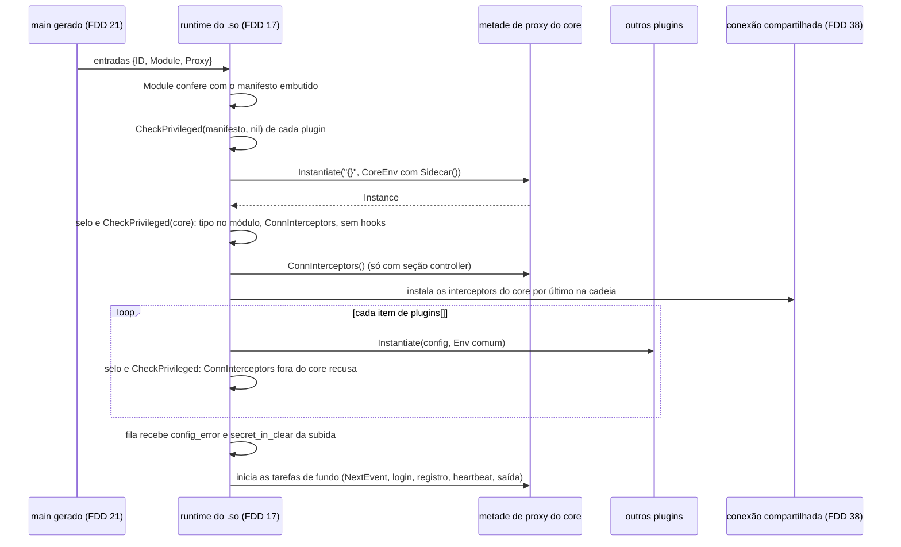
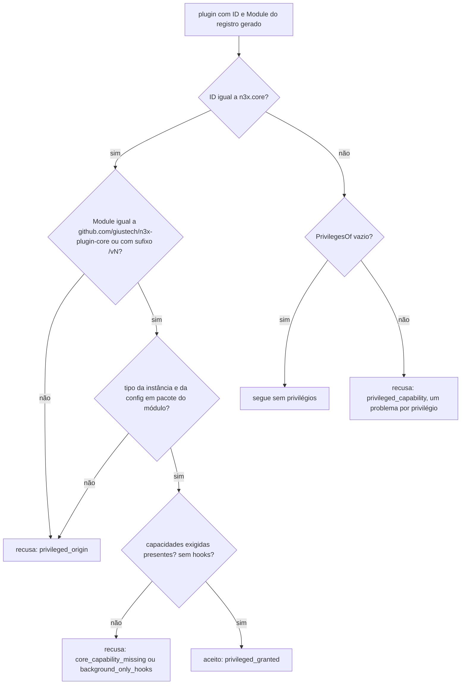
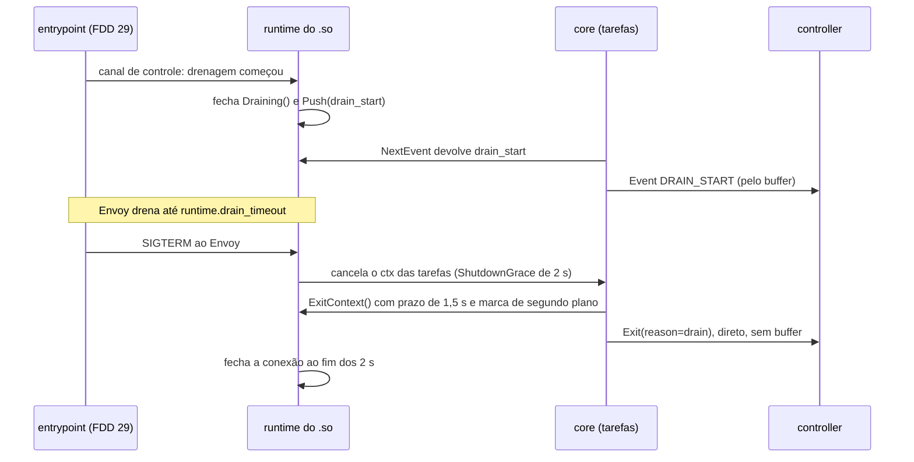
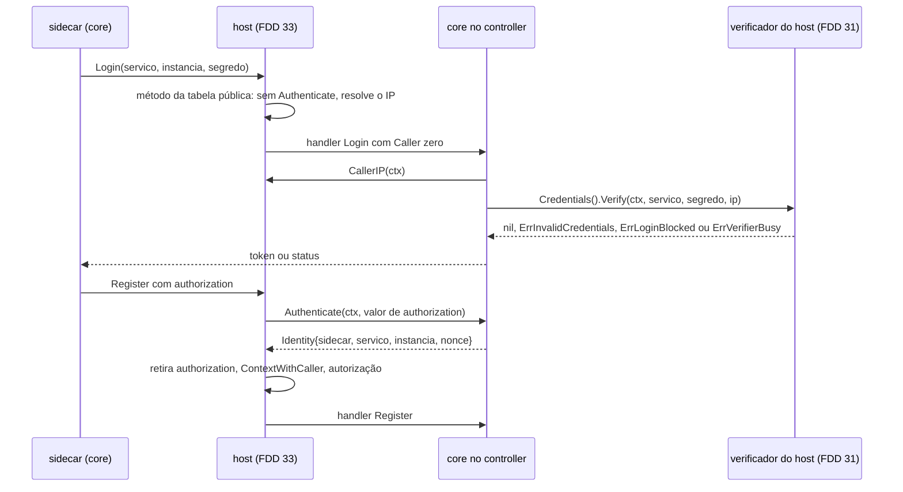

### FDD: Capacidades privilegiadas do plugin core (SDK-09)

Versão: 1.0
Data: 2026-10-20
Responsável: Guilherme Giusti

---

### 1. Contexto e motivação técnica

**Problema técnico.** O plugin core concentra login, sessão, registro, inventário e usuários de leitura (ADR-004 e ADR-019 do `n3x-sdk`). O ADR-019 fixou as interfaces que só ele implementa ou recebe, mas cobre só metade do caminho:

- no sidecar existe apenas `ConnInterceptors()`, que vai do core para o runtime. Nada leva do runtime ao core os eventos do executor (`panic`, `breaker_open`, `plugin_disabled`, `config_error`, `secret_in_clear`), o início da drenagem, o manifesto ELF, a config efetiva de todos os plugins com schemas e cifrados originais, a identidade da instância e o `controller.secret` (L-01)
- no controller, o core não tem como obter o manifesto do binário do controller (alerta de listas de plugins diferentes), o IP do chamador do `Login` e o estado usado na regra "só o root entra" (L-02)
- o core não aparece no `n3x.yaml` do serviço, mas o SDK cria uma instância de proxy por item de `plugins` (ADR-015); ninguém diz quantas instâncias da metade só de fundo existem, quem as cria e com que config (L-10)
- a `Validate` do core precisa recusar usuário de leitura com o nome do root, que está no `n3x.yaml` do host (L-63)
- o plugin recebe a config já decifrada e não pode importar `secret/`, mas a impressão digital do ADR-006 do core exige o texto `ENC[...]` e a marca "veio sem `ENC`" (L-07)
- a regra "aceitas só de `n3x.core` vindo de `github.com/giustech/n3x-plugin-core`" não diz como o executor e o host conhecem, em runtime, o módulo de origem de um valor Go
- faltam os tipos dos parâmetros (senha, segredo, IP), os erros sentinela e o mapeamento para códigos gRPC e respostas do painel

Esta entrevista achou seis problemas novos:

- **Saída com `ctx` cancelado.** A FDD 06 cancela o `ctx` das tarefas de fundo no desligamento e lembra que, depois disso, ele não serve para chamar o controller; por isso sugeriu começar o `Exit` no sinal de drenagem. O FR-016 e o HLD do `n3x-sidecar` (drenagem, passo 5) põem o aviso de saída na janela de 2 s depois do SIGTERM ao Envoy, e no modo Istio não existe sinal de drenagem (L-18). Sem um `ctx` próprio para a chamada final, o `Exit` nunca sairia no Istio.
- **Bloqueio por IP atrás de proxy.** Com um balanceador L7 na frente da `17443`, todo login chega com o IP do balanceador: 5 falhas de qualquer serviço bloqueiam o login de todos por 15 minutos (ADR-004 do `n3x-controller`). E ler `x-forwarded-for` de qualquer origem deixaria um atacante escolher o IP e escapar do bloqueio.
- **Opção de `Check` sem tipo.** A FDD 08 previu entregar o nome do root por uma opção de `Plugin.Check`, mas `plugin.DecodeOption` é `func(*decodeOptions)` sobre uma struct não exportada da FDD 02; o pacote `ctrl` não consegue criar uma opção desse tipo.
- **Rajada de panics.** Um plugin quebrado gera panics em toda requisição até o disjuntor abrir (e panics em `Go()` e em tarefas de fundo continuam); um canal sem limite ou um envio que bloqueia seguraria a thread do worker do Envoy.
- **Canal de controle negado ao core.** O HLD do `n3x-plugin-core` põe o canal de controle do entrypoint como dependência direta do `agent/exit`, mas as FDDs 06 e 26 negam `/tmp/n3x` no `env.Dial` de todo plugin, inclusive o core.
- **Login fora da forma do registrador.** O ADR-019 manda o `PublicGRPC` registrar "só `n3x.plugins.n3x.core.v1.Login`", mas o registrador gRPC registra serviços inteiros, e o ADR-007 do core põe `Login` como método do serviço `Core` (L-11, FDD 36).

**Encaixe no HLD.** Esta FDD completa os pacotes `proxy/` e `controller/` (pacote Go `ctrl`) do módulo `github.com/giustech/n3x-sdk` com as capacidades privilegiadas (HLD do `n3x-sdk`: "Capacidades privilegiadas do core", "Segurança" e linha `controller/` de "Componentes e responsabilidades") e acrescenta ao `plugin/` a identidade do core. Ela usa os pontos de encaixe deixados pela FDD 06 (sinal de drenagem e métricas de sessão) e pela FDD 08 (conferência depois do `New`, `Env` do core, opção do nome do root, `StateCell` do core, `Identity.Session`). Consumidores:

- FDD 12: falsos do lado sidecar e do lado controller, suítes de conformidade e origem do core nos testes
- FDDs 16, 17, 18, 25, 29 e 38: implementam no sidecar, cada uma a sua parte, a visão `proxy.Sidecar` e a conferência de origem (tabela da seção 3)
- FDDs 30, 31, 32, 33 e 34: implementam no controller o `ctrl.CoreEnv`, a tabela pública, o interceptor de autenticação e o login do painel
- FDDs 36, 37, 39, 40, 42, 43 e 45: o plugin core, único cliente
- FDDs 20, 21, 22 e 24: regras de build, registro gerado com o módulo, manifesto embutido e análise estática

**Atores.** Plugin core (implementa as capacidades e consome os handles), executor e runtime do `.so` (FDDs 16 a 18, 25, 29 e 38), host do controller (FDDs 30 a 34), kit de testes (FDDs 07 e 12), builder (FDDs 20 a 22) e operador (lê logs, métricas e alertas).

**Limites.** O SDK define as interfaces, os tipos de dados, a regra de origem e o que precisa ser idêntico no runtime real e no kit: a conferência de origem (`CheckPrivileged`), a fila de eventos (`proxy.EventQueue`) e as tabelas do registrador (FDD 08). O que depende do processo (ler o ELF, decifrar, ouvir o canal de controle, resolver o IP, conferir bcrypt, abrir sessões) fica no sidecar e no controller. Os pacotes não abrem porta, não criam goroutine fora do que já está nas FDDs 06 e 08 e não guardam estado global.

**Suposições**
- O builder grava o caminho do módulo de cada plugin no registro gerado e no manifesto embutido (FDDs 17, 21, 22 e 30), e o core entra sempre na versão fixada pela imagem (FDD 20, `N3X-B008`)
- Um processo do Envoy tem um único runtime do `.so` e uma única conexão compartilhada (FDD 38, L-45)
- A config do sidecar é estática (ADR-007 do `n3x-sidecar`): identidade, manifesto e config efetiva não mudam durante a vida do processo
- O controller roda com uma réplica (ADR-001 do `n3x-sdk`)
- `runtime/debug.ReadBuildInfo` devolve o módulo principal também em binários de `go test` (confirmado como padrão; o spike de verificação fica como pendência na FDD 12)

**Restrições**
- `plugin/` usa só a biblioteca padrão; `proxy/` não importa `controller/` e `controller/` não importa `proxy/` (ADR-011 e FDDs 01, 06 e 08)
- O core nunca importa `secret/` (FDD 03)
- Nenhum outro plugin enxerga o token (ADR-004 do `n3x-sdk`); nenhum token, segredo, senha, hash ou valor `authorization` em log, erro, evento ou métrica
- Nenhuma operação sem prazo (ADR-006 do `n3x-sidecar`); nada no caminho da requisição (ADR-008 do `n3x-plugin-core`)
- Capacidades como interfaces opcionais (ADR-015); contrato estável desde a `v1.0.0` (ADR-021)
- Documentação e mensagens em pt-BR; identificadores, valores de rótulo e nomes de evento em inglês

**Rastreabilidade**
- PRD 1.5: FR-002 (interceptor e token invisível aos outros plugins), FR-005 (autenticador, login como única rota pública, limite por IP e por serviço), FR-006 (manifesto, eventos e alerta de listas diferentes), FR-007 (mascaramento sobre o cifrado, `***:plain`), FR-009 (diretório de usuários, nome igual ao do root, "só o root entra"), FR-011 e FR-013 (recusa para outros plugins), FR-016 (o que o core envia: identidade, manifesto, config mascarada, eventos e saída em 2 s); critérios de aceite "credencial inválida recusada com `UNAUTHENTICATED`", "nenhum segredo nos logs, erros ou config enviada", "painel mostra manifesto, hash e divergências"
- ADRs do `n3x-sdk`: ADR-003, ADR-004, ADR-011, ADR-015, ADR-016, ADR-017, ADR-019 e ADR-021; do `n3x-plugin-core`: ADR-001 a ADR-008; do `n3x-controller`: ADR-003, ADR-004, ADR-006 e ADR-007; do `n3x-sidecar`: ADR-004 e ADR-006
- FDDs aplicadas: 01 (`ID`, `CheckNamespace`, `Manifest.BackgroundOnly`, `FieldError`, notação L-34), 02 (`Schema`, `Normalize`, `MaskSecrets`, `Walk`, `DecodeOption`), 03 (`plugin.Secret`, `Sealed`, `InClear`, `Fingerprint`, `SecretFingerprint`), 05 (`Instance`, `HooksOf`, `Target`), 06 (`proxy.Env`, `ErrStandalone`, marca de segundo plano, `ShutdownGrace`, famílias de métrica da plataforma, L-12), 08 (`ctrl.Env`, `Identity`, `Registrar`, `StateCell`, ordem de subida)
- Lacunas do README fechadas aqui:
  - **L-01 fechada:** uma única visão `proxy.Sidecar`, entregue só ao core pelo `proxy.CoreEnv` (type assertion sobre o `Env` que o runtime monta só para o core), com dados imutáveis e três canais: fila de eventos puxada pelo core (`NextEvent`), sinal de drenagem (`Draining`) e `ctx` próprio para a chamada final (`ExitContext`). Manifesto em bytes prontos; config efetiva como entrada crua normalizada com marcas de segredo; identidade e parâmetros do controller em structs; métricas de sessão por `Session()` (contratos 4 a 9)
  - **L-02 fechada:** `ctrl.CoreEnv` (type assertion, montado só para o core) com `ControllerManifest()` (bytes do manifesto embutido no binário do controller) e `CallerIP(ctx)` (IP resolvido pelo host: endereço do par TCP, ou `x-forwarded-for` só quando o par está em `grpc.trusted_proxies`); a regra "só o root entra" lê o `StateCell` do core, sem sinal próprio do diretório (contratos 14 e 16)
  - **L-10 fechada (restante, a parte do formato veio da FDD 01):** uma instância da metade de proxy do core por processo, criada pelo executor antes das demais, com nome `core`, config `{}` e todos os parâmetros pela visão `Sidecar`; criada também no modo standalone, onde fica inativa; metade só de fundo exclusiva do core na v1 (contrato 4)
  - **L-63 fechada:** `ctrl.HostFacts{RootUser}` entregue pelo método novo `Plugin.CheckHost` à interface `ctrl.HostValidator` do tipo de config do core, depois da `Validate`; capacidade privilegiada (contrato 15)
  - **L-07 (interface definida aqui; detalhes do mascaramento na FDD 37):** o runtime entrega a config de cada instância normalizada com os textos `ENC[...]` intactos, o texto de segredo em claro trocado por vazio e uma `SecretMark` por campo segredo (`sealed`, `in_clear` ou `empty`, com a impressão digital de `plugin.SecretFingerprint`); o `controller.secret` chega como `plugin.Secret`, com `Fingerprint()` e `InClear()` (contrato 6)
- Lacunas só registradas: L-08 (teto e exceção do `Login`, FDD 38), L-11 (nome do login, FDD 36, com a decisão confirmada no contrato 10: serviço próprio `Login`), L-18 (drenagem no Istio, FDD 49), L-37 (IP no painel, FDD 34, com a mesma regra do contrato 14), L-68 e L-69 (origem de endereço e versão do Envoy, FDD 25), L-70 (`breaker_open` contra `plugin_disabled`, FDD 18)
- Pedidos de FDDs anteriores atendidos:
  - FDD 01 (P-01): exclusividade, quantidade e criação da metade só de fundo (contrato 4)
  - FDD 03 (P-01): L-07 com `plugin.SecretFingerprint` (marcas dos plugins) e `Secret.Fingerprint()` (`controller.secret`); segredo vazio vira `empty` e não gera `secret_in_clear` (contratos 6 e 7)
  - FDD 05 (P-10): a metade só de fundo nunca recebe hook; hook declarado nela recusa a subida (contrato 4)
  - FDD 06 (P-08, P-12 e P-13): sinal de drenagem e `ctx` de saída (contrato 8), capacidade que alimenta `n3x_controller_session_age_seconds` e `n3x_controller_logins_total` (contrato 9), `Instance()` do core igual a `core` (contrato 4)
  - FDD 07 (H-26 e P-10): nome `core` (`id.Name()`) e uma instância por processo
  - FDD 08 (P-01): privilegiadas conferidas depois do `New` e antes do `Start` (contrato 2); `ctrl.CoreEnv` (contrato 14); nome do root por `CheckHost` (contrato 15); `StateCell` do core para "só o root entra" (contrato 16); tabela pública (contrato 10); `Identity.Session` igual ao nonce do token (contrato 11)

**Decisões aprovadas na clarificação**
- L-11: o login fica num serviço próprio `n3x.plugins.n3x.core.v1.Login` com 1 método unário `Login`; `Register`, `Heartbeat` e `Exit` ficam no serviço `Core`. Isso exige mudar o ADR-007 do `n3x-plugin-core` e a FDD 36 (outro repositório)
- IP do chamador do `Login`: campo novo `grpc.trusted_proxies` (lista de CIDRs, vazio por padrão) no `n3x.yaml` do controller; o IP vem do par TCP e, só se o par estiver em `trusted_proxies`, de `x-forwarded-for` lido da direita para a esquerda. O campo entra no schema do controller (FDD 30, outro repositório); o PRD FR-005 deve ser esclarecido no Workflow 3
- A metade de proxy só de fundo (`phases: []`) é exclusiva do core na v1; plugin de terceiro é recusado no build (FDD 20) e no runtime (`privileged.background_only`). Abrir a terceiros fica como adição futura em minor
- Estado do core: só o próprio core declara `degraded` (via `env.State().Degraded`); o host atribui `failed` ao core por panic repetido em `Authenticate` ou `CheckUser` (limiar definido na FDD 32, outro repositório), com recuperação automática quando o core volta a `ok`
- Os pacotes novos `internal/privileged` e as APIs de runtime públicas (`proxy.NewEventQueue`, `proxy.NewPluginConfig`) devem constar no HLD/ADR-011; análise estática na FDD 24 impede uso por plugins
- As demais hipóteses numéricas, de teste, de nomes e de baixo risco ficam aceitas como padrão, sem bloqueio

**Pendências não bloqueantes**
- Documentar lacunas de `Seq` quando há descarte de eventos e que "trava curta" não é bloqueio longo; reescrever a descrição de `n3x_sidecar_events_total` (aceito vs entregue); fixar que `issuedAt` é o horário local de recebimento do token; explicitar que `RolePlugin` (chamadas PluginAPI em processo) não passa por `Authenticate` nem pela tabela pública; corrigir o formato do log `capabilities` (`sidecar` não é Privilege); registrar `kind="auth"` nas FDDs 06 e 08 e no log `plugin_panic` vs `privileged_misbehavior`
- Spike de `runtime/debug.ReadBuildInfo` em binário de `go test` e fallback (FDD 12); regra do tipo dinâmico para embrulhos (`Adapt[T]`) e para `phases` não vazio do core no manifesto; nota no kit sobre texto malformado com prefixo `ENC[` classificado como `sealed`
- Divergências para o Workflow 3: texto do ADR-019 linha ~18 diz `WriteAudit` síncrono com recusa por falha, mas a linha ~40 e o HLD dizem reservado à v2; HLD tabela "Capacidades privilegiadas do core" precisa listar `CoreEnv`, `Sidecar`, `HostValidator`/`CheckHost`, `ControllerManifest`/`CallerIP`; PRD FR-005 sobre `trusted_proxies`; ADR-007 do core (`Login` como serviço próprio)
- Dependem de outros repositórios: `n3x-plugin-core` (FDDs 36 a 45), `n3x-sidecar` (FDDs 15 a 18, 25, 29, 38, 49), `n3x-controller` (FDDs 30 a 34, 47), `n3x-builder` (FDDs 20 a 22 e 24)

---

### 2. Objetivos técnicos

- **Nenhuma capacidade privilegiada fora do core.** Invariante: um plugin que não seja `n3x.core` do módulo `github.com/giustech/n3x-plugin-core` e implemente ou declare qualquer privilégio da tabela do contrato 2 faz a subida falhar, no sidecar, no controller e no kit. Medida: 100% dos vetores de recusa da seção 9 recusados com o mesmo `Path` e a mesma `Rule` no runtime real e no falso.
- **Origem que o plugin não forja.** Invariante: a origem é o par (ID, módulo) gravado pelo builder no registro gerado, conferido contra o manifesto embutido e contra o pacote do tipo dinâmico da instância; nenhum valor vindo do código do plugin entra na decisão.
- **Token e handles fora do alcance dos outros plugins.** Invariante: `env.(proxy.CoreEnv)` e `env.(ctrl.CoreEnv)` são falsos para todo plugin que não é o core; o interceptor do core é o mais interno da conexão compartilhada; o host retira `authorization` dos metadados antes de qualquer handler. Medida: teste com o kit e com `bufconn` (seção 9).
- **Evento nunca segura o worker.** Medida: `EventQueue.Push` nunca bloqueia; 100.000 `Push` sem consumidor terminam em menos de 50 ms no runner da CI e a fila fica em no máximo `MaxPendingEvents` (1.024) itens (confirmado).
- **Rajada contida.** Medida: no máximo 1 evento `panic` aceito por instância de plugin por segundo; os demais somam em `Suppressed` do próximo evento daquela instância e em `n3x_sidecar_events_suppressed_total`.
- **Evento entregue rápido.** Medida: com o core esperando em `NextEvent`, um `Push` chega a ele em até 10 ms (mediana de 1.000 eventos, confirmado).
- **Saída dentro da janela.** Medida: depois do cancelamento das tarefas, a chamada `Exit` feita com `ExitContext()` passa pelas regras da visão do controller (FDD 06) e termina em até `ExitTimeout` (1,5 s), dentro dos 2 s do `ShutdownGrace`.
- **Nenhum segredo de outro plugin em claro no core.** Invariante: o texto de um segredo que veio sem `ENC[...]` nunca aparece em `ConfigInput`; o `controller.secret` nunca aparece em `ConfigInput.Sidecar`. Medida: canário `n3x-canary-` ausente de todos os bytes entregues (`secrettest.Leaks`, FDD 03).
- **Autenticação barata.** Meta para o core (FDD 39), conferida pelo kit (FDD 12): `Authenticate` com 0 alocações e p99 até 20 µs com token válido (confirmado; 0 alocações vem do HLD do `n3x-plugin-core`).
- **Mesmo comportamento no kit e no runtime.** Medida: as suítes de conformidade de `proxy.Sidecar` e de `ctrl.CoreEnv` (FDD 12) passam no kit, no sidecar e no controller.

---

### 3. Escopo e exclusões

**Incluído**
- Identidade do core no `plugin/`: `CoreID`, `CoreModule` e `IsCoreOrigin` (contrato 1)
- Regra de aceitação por origem nos dois lados, com detecção (`PrivilegesOf`), conferência (`CheckPrivileged`), códigos de regra e mensagem de recusa (contrato 2)
- Lado sidecar: `ConnInterceptors()` (contrato 3); metade de proxy do core e `proxy.CoreEnv` (contrato 4, L-10); visão `proxy.Sidecar` com identidade, parâmetros do controller e manifesto (contrato 5), entradas da config efetiva (contrato 6, L-07), eventos e `proxy.EventQueue` (contrato 7), drenagem e saída (contrato 8) e métricas de sessão (contrato 9, L-12)
- Lado controller: `PublicGRPC` e a tabela pública (contrato 10), `Authenticate` (contrato 11), `CheckUser` e `ChangePassword` (contrato 12), `WriteAudit` reservado (contrato 13), `ctrl.CoreEnv` com `Credentials`, `Sessions`, `ControllerManifest` e `CallerIP` (contrato 14, L-02), `HostFacts` e `CheckHost` (contrato 15, L-63), regra do estado do core (contrato 16)
- Erros sentinela e mapeamento para gRPC e painel (contrato 17); regras de compatibilidade (contrato 18)
- O que cada FDD do sidecar e do controller implementa (tabela abaixo)

| Parte | Implementada em |
| --- | --- |
| Registro gerado com o módulo de cada plugin | FDD 21 (`.so` e controller), sobre o contrato do `main` das FDDs 17 (L-03) e 30 (`host.Run`) |
| Conferência de origem, instância do core, `proxy.CoreEnv`, `ConfigInput`, eventos `config_error` e `secret_in_clear` da subida | FDD 17 |
| Eventos `panic`, `breaker_open` e `plugin_disabled` | FDD 18 |
| `Identity` e `Manifest` | FDD 25, com o leitor da FDD 22 |
| `Draining` e evento `drain_start` | FDD 29 (modo Istio na FDD 49) |
| Instalação do `ConnInterceptors`, conexão viva na janela de saída, `ControllerSettings` | FDD 38, com a FDD 15 |
| Publicação das métricas de sessão e de eventos | FDD 16 |
| `ctrl.CoreEnv`, conferência de origem e de capacidades exigidas, tabela pública na subida | FDD 32 |
| `Credentials().Verify` | FDD 31 |
| Interceptor que chama `Authenticate`, `CallerIP`, retirada do `authorization` | FDD 33 |
| Login do painel com `CheckUser` e a regra do estado; `Sessions().Revoke` | FDD 34 |
| `ControllerManifest`, `grpc.trusted_proxies` e `CheckHost` no `validate` | FDD 30 |

**Excluído**
- Formato do token, nonce, TTL e chave HMAC: FDD 39 (CORE-03)
- Formato da config efetiva, campos do objeto `sidecar` (L-06), mascaramento e hash: FDD 37 (CORE-02); aqui só como o core recebe os dados de entrada
- Implementação do verificador de credencial (bcrypt, cache, bloqueio): FDD 31 (CTL-02)
- Cadeia de interceptors do servidor gRPC: FDD 33 (CTL-04); sessão do painel e login: FDD 34 (CTL-05)
- Conexão compartilhada, buffer de 1.000 itens, reconexão e teto de prazo (L-08): FDD 38 (SID-10)
- Gravador de auditoria em uso: v2 (ADR-002 do `n3x-plugin-core`); aqui só a interface reservada
- Nome e forma do serviço de login (L-11), proto `Core` e tipo `types.ProxyConfig` do core: FDD 36 (CORE-01)
- Quando cada evento de falha é emitido e a diferença entre `breaker_open` e `plugin_disabled` (L-70): FDD 18 (SID-04)
- Detecção da drenagem no modo Istio (L-18): FDD 49 (SID-11)
- Geração do `id` de idempotência, envio dos eventos e do `Exit`: FDD 42 (CORE-06)
- Falsos do kit e suítes de conformidade em si: FDD 12 (SDK-12)
- Fora da v1, por adição em minor quando houver caso real (confirmado): metade só de fundo de terceiros (decisão: exclusiva do core na v1), sinal de drenagem para outros plugins, PROXY protocol na `17443`, `WriteAudit` chamado pelo host, `Sessions().Revoke` em uso

---

### 4. Fluxos detalhados e diagramas

**Fluxo principal: subida do `.so` (lado do contrato; a orquestração é da FDD 17)**
1. O `main` gerado entrega ao runtime, para cada plugin compilado, a entrada `{ID, Module, Proxy}`, com `Module` gravado pelo builder a partir do `plugins.json` e do `builder.yaml` (FDD 21). O runtime confere `Module` contra `plugins[].module` do manifesto embutido (FDD 22); diferença recusa a subida (`privileged_origin`, confirmado).
2. Para cada plugin do manifesto, o runtime chama `proxy.CheckPrivileged(id, module, manifesto, nil)`. Plugin que não é o core com metade de proxy só de fundo (`phases: []`) recusa a subida (`privileged_capability` em `privileged.background_only`).
3. **Instância do core, primeiro e uma vez por processo** (confirmado): o runtime monta o `Env` normal da instância `core` (FDD 06) e o embrulha num `proxy.CoreEnv` cuja visão `Sidecar()` já tem identidade, parâmetros do controller, manifesto e `ConfigInput`. Chama `Instantiate([]byte("{}"), coreEnv, opener)` sob `recover`, sela e chama `proxy.CheckPrivileged(id, module, manifesto, inst)`, que confere:
   - o tipo dinâmico da instância declarado num pacote do módulo do core (`privileged_origin`)
   - `ConnInterceptorProvider` implementado (`core_capability_missing`)
   - nenhum hook de requisição (`background_only_hooks`)
4. Com a seção `controller` presente, o runtime chama `ConnInterceptors()` uma vez, sob `recover`, e entrega os dois interceptors à conexão compartilhada (FDD 38), na posição mais interna. Interceptor nulo recusa a subida (`core_capability_missing`).
5. **Demais instâncias de `plugins[]`**, na ordem do arquivo: `Env` comum (sem `Sidecar`), `Instantiate`, selo e `proxy.CheckPrivileged`. Instância que implementa `ConnInterceptorProvider` recusa a subida (`privileged_capability`).
6. O runtime põe na fila de eventos um `config_error` por aviso não fatal do `core/config` e um `secret_in_clear` por campo segredo em claro (inclusive `controller.secret`), na ordem do relatório (FDD 15).
7. Subida completa: o runtime inicia as tarefas de fundo (FDD 06). As do core consomem `NextEvent`, fazem o login e o registro (FDDs 39 e 42).
8. Qualquer recusa dos passos 1 a 5 faz o Envoy não subir (FR-004), com um log `privileged_refused` por problema.

**Fluxo principal: subida do controller (lado do contrato; a orquestração é da FDD 32)**
1. `host.Run` recebe as entradas `{ID, Module, Plugin}` geradas pelo builder e confere `Module` contra o manifesto do próprio binário (FDD 30).
2. **Fase de config** (FDD 08), em ordem de ID: o host chama `ctrl.PrivilegesOf(p, nil)`, que só enxerga o `HostValidator` do tipo de config. Plugin que não é o core com esse privilégio recusa a subida (`privileged_capability`). Para o core, o host chama `p.CheckHost(secao, ctrl.HostFacts{RootUser: root.user}, opener)`; para os demais, `p.Check(secao, opener)`. O subcomando `n3x-controller validate` faz o mesmo (FDD 30).
3. **Fase de instâncias**: o core primeiro (confirmado), depois os demais em ordem de dependência. Para o core, o host monta um `ctrl.CoreEnv` (o `Env` da FDD 08 mais `Credentials`, `Sessions`, `ControllerManifest` e `CallerIP`); para os demais, o `Env` comum.
4. Depois do `New` e do selo, o host chama `ctrl.CheckPrivileged(id, module, p, inst)`. Plugin que não é o core com `PublicGRPC`, `Authenticate`, `CheckUser`/`ChangePassword` ou `WriteAudit` recusa a subida, obrigatório ou opcional (FDD 08, H-05). Core sem `PublicGRPC`, `Authenticate` ou `UserDirectory` recusa a subida (`core_capability_missing`).
5. Ordem por plugin (FDD 08 com o acréscimo desta FDD): `Start`, `GRPC`, `PublicGRPC` (só o core), `PluginAPI`, `Routes`, `Cards`, `Close` do registrador. O `Close` confere as regras da tabela pública.
6. Depois de todos: o host liga o `Authenticate` ao interceptor de autenticação (FDD 33), monta o serviço da tabela pública na `17443` sem sessão, liga o `CheckUser` ao login do painel (FDD 34) e loga `capability_unused` se o core implementar `WriteAudit` (sem chamá-lo na v1).

**Fluxo: login de um sidecar**
- O core no sidecar chama o método público com serviço, instância e segredo, pela conexão compartilhada; o interceptor do core não anexa token a esse método (FDD 39)
- No controller, o interceptor do host reconhece o método da tabela pública: não chama `Authenticate`, não exige papel, resolve o IP (contrato 14) e chama o handler do core com `Caller(ctx).IsZero()` verdadeiro
- O handler lê `cenv.CallerIP(ctx)` e chama `cenv.Credentials().Verify(ctx, servico, segredo, ip)`
- `nil`: o core emite o token (FDD 39); `ErrInvalidCredentials`: `UNAUTHENTICATED`; `ErrLoginBlocked` ou `ErrVerifierBusy`: `RESOURCE_EXHAUSTED`; prazo: `DEADLINE_EXCEEDED`
- No sidecar, o core chama `sc.Session().LoginAttempt(resultado)` e, com sucesso, `SessionStarted(emitidoEm)`

**Fluxo: chamada autenticada de um sidecar**
- O plugin chama o próprio serviço pela visão do `Env` (FDD 06); a conexão roda os interceptors da FDD 38 e, por último, o do core, que anexa `authorization`
- No controller, o interceptor do host lê o primeiro valor de `authorization`. Ausente: `UNAUTHENTICATED` sem chamar o core. Core `failed`: `UNAVAILABLE` sem chamar o core
- O host chama `Authenticate(ctx, valor)`. Erro: `UNAUTHENTICATED` com mensagem genérica. Identidade que não é `RoleSidecar` válida: `UNAUTHENTICATED` e log `privileged_misbehavior`
- O host retira `authorization` dos metadados de entrada, põe a identidade com `ctrl.ContextWithCaller` e segue para a autorização e o handler do plugin dono (FDD 08)

**Fluxo: login no painel** (FDD 34 implementa)
- Bloqueio por usuário e IP conferido pelo host
- Usuário igual ao root: conferido pelo host contra o arquivo; o core nunca vê a senha do root
- Outro usuário: se `StateCell` do core não está em `ok`, o login é recusado com a mensagem genérica (só o root entra) e log `auth_core_unavailable`; se está em `ok`, o host chama `CheckUser(ctx, usuario, plugin.NewSecret(senha))`
- Resultado diferente de `Identity{Role: RoleRead, User: usuario}` é tratado como falha, com log `privileged_misbehavior`

**Fluxo: eventos do runtime até o core**
- O produtor (executor, contenção de falhas, carga da config, supervisor da drenagem) chama `queue.Push(evento)` na thread em que está; o `Push` não bloqueia, não faz I/O e aplica a amostragem de `panic`
- Fila cheia: o evento mais antigo sai e soma em `n3x_sidecar_events_dropped_total{kind}`
- A tarefa de eventos do core chama `sc.NextEvent(ctx)` em laço, gera o `id` de idempotência a partir de `Seq` e de um nonce do processo e entrega ao buffer da conexão (FDD 42)
- No controller, o core conta em `n3x_n3x_core_events_total{kind}` (FDD 43)

**Fluxo: drenagem e saída**
1. SIGTERM no entrypoint: `/ready` passa a 503 e o entrypoint avisa o `.so` pelo canal de controle (FDD 29)
2. O runtime fecha `Draining()` e põe `drain_start` na fila; o core envia `DRAIN_START` e mantém o heartbeat
3. O Envoy drena até `runtime.drain_timeout` (20 s)
4. O supervisor manda SIGTERM ao Envoy; o runtime cancela o `ctx` das tarefas e conta 2 s (`ShutdownGrace`, FDD 06)
5. A tarefa de saída do core vê o `ctx` cancelado, pega `sc.ExitContext()` e chama `Exit` com `reason` `drain` (se `Draining()` fechou antes) ou `sigterm`; a conexão compartilhada fica aberta até o fim dos 2 s (FDD 38)
6. Sem saída em 5 s, SIGKILL (ADR-006 do `n3x-sidecar`)

**Fluxos alternativos e exceções**
- **Modo standalone:** a instância `core` é criada e fica inativa: `env.Controller()` devolve `ErrStandalone`, `Sidecar().ControllerSettings()` devolve `false`, `NextEvent` devolve `ErrStandalone` na hora e `ConnInterceptors()` não é chamado. O runtime não mantém a fila; os eventos só viram log e métrica (confirmado)
- **Modo Istio:** `Draining()` não fecha até a FDD 49 resolver a L-18; o `Exit` sai com `reason` `sigterm` pela janela de desligamento
- **Validação do bootstrap** (`N3X_ENVOY_VALIDATE=1`, FDD 26): o `.so` não chama `New` de ninguém, inclusive do core
- **Config do filtro criada mais de uma vez:** a instância do core continua única por processo (singleton do runtime, FDD 17 com a FDD 38, L-45)
- **Panic no `New` do core, no `ConnInterceptors()` ou no interceptor:** os dois primeiros recusam a subida; no interceptor, o runtime contém o panic, a chamada falha com `Internal` e conta em `n3x_plugin_panics_total{plugin="n3x.core"}`
- **Panic em `Authenticate` ou `CheckUser`:** o host contém; gRPC responde `INTERNAL` com mensagem genérica, o painel recusa o login com a mensagem genérica; `n3x_controller_plugin_panics_total{plugin="n3x.core",kind="auth"}`
- **Core `degraded` ou `failed` (confirmado):** só o root entra no painel; com `failed`, o gRPC responde `UNAVAILABLE` sem chamar o `Authenticate`. Só o próprio core declara `degraded`; o host atribui `failed` por panic repetido em `Authenticate` ou `CheckUser` (limiar na FDD 32) e recupera sozinho quando o core volta a `ok`
- **Plugin que não é o core tenta `env.(proxy.CoreEnv)` ou `env.(ctrl.CoreEnv)`:** a type assertion dá falso; não há erro nem log, porque não houve acesso
- **ID `n3x.core` vindo de outro módulo:** impossível depois do build (`N3X-B007` e `N3X-B008`); se chegar à subida, recusa com `privileged_origin`
- **Proxy L7 na frente da `17443` sem `grpc.trusted_proxies`:** o IP é o do proxy; o host loga `caller_ip_proxy_suspected` uma vez por minuto quando chega `x-forwarded-for` de um par não confiável (confirmado) e o bloqueio por serviço continua valendo

**Diagramas**

Subida do `.so` com as privilegiadas (orquestração da FDD 17):



Conferência de origem (igual nos dois lados):



Drenagem e saída no sidecar:



Login e chamada autenticada no controller:



---

### 5. Contratos públicos (assinaturas, endpoints, headers, exemplos)

**Contrato 1: identidade do core no `plugin/`**
- Tipo: sdk (API Go; acréscimo ao contrato 1 da FDD 01)
- Assinatura/Rota:
  ```go
  package plugin

  // CoreModule é o caminho do módulo oficial do plugin core.
  const CoreModule = "github.com/giustech/n3x-plugin-core"

  // CoreID devolve o ID do plugin core, n3x.core. 0 alocações.
  func CoreID() ID

  // IsCoreOrigin diz se o par (ID, módulo) é o do plugin core oficial.
  func IsCoreOrigin(id ID, module string) bool
  ```
- Método: n/a (chamada local)
- Semântica:
  - `IsCoreOrigin` é verdadeiro se, e só se, `id == CoreID()` e `module` é exatamente `CoreModule` ou `CoreModule + "/v<N>"` com `N` inteiro maior ou igual a 2, sem zero à esquerda (sufixo de major do Go, confirmado). Comparação sensível a maiúsculas, sem normalizar
  - `CoreID()` devolve um valor (não uma variável exportada), para nenhum código conseguir trocá-lo
  - Ficam no `plugin/` porque o builder (`core_invalid`, FDD 20), o `core/config` (`core_implicit`, FDD 15), o executor, o host e o kit usam a mesma constante; `plugin/` continua só com a biblioteca padrão
  - **Origem em runtime:** `module` vem sempre do registro gerado pelo builder (FDD 21), nunca do código do plugin, e o runtime o confere contra `plugins[].module` do manifesto embutido (FDD 22); o contrato 2 confere ainda o pacote do tipo dinâmico

**Exemplo de requisição**
```json
{
  "IsCoreOrigin": [
    ["n3x.core", "github.com/giustech/n3x-plugin-core"],
    ["n3x.core", "github.com/giustech/n3x-plugin-core/v2"],
    ["n3x.core", "github.com/giustech/n3x-plugin-core-fork"],
    ["n3x.core", "github.com/giustech/n3x-plugin-core/agent"],
    ["n3x.core", "github.com/giustech/n3x-plugin-core/v1"],
    ["acme.core", "github.com/giustech/n3x-plugin-core"]
  ]
}
```

**Exemplo de resposta**
```json
{ "IsCoreOrigin": [true, true, false, false, false, false], "CoreID().String()": "n3x.core" }
```

---

**Contrato 2: detecção e conferência das capacidades privilegiadas**
- Tipo: sdk (API Go do runtime; usada pelo executor, pelo host e pelo kit)
- Assinatura/Rota:
  ```go
  package proxy

  type Privilege uint8

  const (
      PrivConnInterceptors Privilege = iota + 1 // "conn_interceptors": instância implementa ConnInterceptorProvider
      PrivBackgroundOnly                         // "background_only": manifesto com metade de proxy só de fundo
  )

  func (p Privilege) String() string

  type Privileges uint8

  func PrivilegesOf(m plugin.Manifest, inst Instance) Privileges // inst nulo: só o manifesto; 0 alocações
  func (ps Privileges) Has(p Privilege) bool
  func (ps Privileges) String() string // "conn_interceptors,background_only"; "" sem privilégios

  // CheckPrivileged devolve nil ou um erro com ErrPrivileged e plugin.FieldErrors.
  func CheckPrivileged(id plugin.ID, module string, m plugin.Manifest, inst Instance) error

  var ErrPrivileged = errors.New("proxy: capacidade privilegiada recusada")
  ```
  ```go
  package ctrl

  type Privilege uint8

  const (
      PrivHostValidator Privilege = iota + 1 // "host_validator": tipo de config C implementa HostValidator
      PrivPublicGRPC                          // "public_grpc"
      PrivAuthenticate                        // "authenticate"
      PrivUserDirectory                       // "user_directory"
      PrivAuditWriter                         // "audit_writer"
  )

  func (p Privilege) String() string

  type Privileges uint8

  func PrivilegesOf(p Plugin, inst Instance) Privileges // inst nulo: só o tipo de config; 0 alocações
  func (ps Privileges) Has(x Privilege) bool
  func (ps Privileges) String() string

  func CheckPrivileged(id plugin.ID, module string, p Plugin, inst Instance) error

  var ErrPrivileged = errors.New("ctrl: capacidade privilegiada recusada")
  ```
- Método: n/a
- Semântica:
  - **Quando:** no sidecar, com `inst` nulo antes de qualquer instância (manifesto) e com a instância depois do `New` e do selo; no controller, com `inst` nulo na fase de config (só `HostValidator`) e com a instância depois do `New` e do selo, antes do `Start` (pedido da FDD 08). Detecção por type assertion, uma vez, como `HooksOf` e `CapabilitiesOf`
  - **Regras, na ordem, todas acumuladas** (sem parar na primeira):

| # | Condição | `Rule` | `Path` (relativo ao plugin) |
| --- | --- | --- | --- |
| 1 | `id == plugin.CoreID()` e `IsCoreOrigin(id, module)` falso | `privileged_origin` | `module` |
| 2 | Origem do core e tipo dinâmico da instância (ou de `C`) declarado fora de `module` (pacote igual a `module` ou com prefixo `module + "/"`); tipo sem nome também é recusado | `privileged_origin` | `instance` ou `config` |
| 3 | Plugin que não é o core com qualquer privilégio de `PrivilegesOf` | `privileged_capability` | `privileged.<privilégio>`, um por privilégio |
| 4 | Core sem privilégio exigido, com `inst` não nulo: no sidecar, `conn_interceptors`; no controller, `public_grpc`, `authenticate` e `user_directory` (confirmado) | `core_capability_missing` | `privileged.<privilégio>` |
| 5 | Sidecar: core (metade só de fundo) com qualquer hook de `proxy.HooksOf` | `background_only_hooks` | `hooks` |

  - **Erro:** embrulho com `Unwrap() []error` que carrega `ErrPrivileged` e `plugin.FieldErrors`, como nas FDDs 01, 02 e 08. O chamador prefixa com `plugin.PrefixErrors(err, plugin.PathKey("plugins", id.String()))` e loga um `privileged_refused` por problema
  - **Mensagem:** `Detail` em pt-BR, sem valor de config: `capacidade privilegiada <nome> recusada; só n3x.core vindo de github.com/giustech/n3x-plugin-core pode implementá-la (módulo <module>)`
  - **Efeito:** no sidecar, o Envoy não sobe (FR-004); no controller, o controller não sobe, para plugin obrigatório ou opcional (FDD 08); no kit, `NewProxy` e `NewHost` reprovam com `Fatal` (FDD 12)
  - **`privileged_granted`:** quando o core passa, o runtime loga uma vez a lista (`PrivilegesOf` mais os handles entregues)
  - **Por que o tipo dinâmico:** um plugin de terceiro pode importar pacotes do core na mesma versão (FDD 20) e devolver um valor do core no próprio `New`; com ID diferente de `n3x.core`, a regra 3 o recusa. A regra 2 pega erro do registro gerado e o caso de um teste que finge a origem (contrato 4, kit)

**Exemplo de requisição**
```go
// Plugin acme.auth (módulo github.com/acme/n3x-plugin-auth) no controller
type Auth struct{}
func (a *Auth) Authenticate(ctx context.Context, tok string) (ctrl.Identity, error) { /* ... */ }
func (a *Auth) PublicGRPC(r ctrl.GRPCRegistrar)                               { /* ... */ }

err := ctrl.CheckPrivileged(plugin.MustParseID("acme.auth"), "github.com/acme/n3x-plugin-auth", p, &Auth{})
err = plugin.PrefixErrors(err, plugin.PathKey("plugins", "acme.auth"))

// Core no sidecar com hook por engano
errCore := proxy.CheckPrivileged(plugin.CoreID(), plugin.CoreModule, manifestoDoCore, &agent.Core{ /* com OnRequestHeaders */ })
```

**Exemplo de resposta**
```text
plugins["acme.auth"].privileged.public_grpc: capacidade privilegiada public_grpc recusada; só n3x.core vindo de github.com/giustech/n3x-plugin-core pode implementá-la (módulo github.com/acme/n3x-plugin-auth) [privileged_capability]
plugins["acme.auth"].privileged.authenticate: capacidade privilegiada authenticate recusada; só n3x.core vindo de github.com/giustech/n3x-plugin-core pode implementá-la (módulo github.com/acme/n3x-plugin-auth) [privileged_capability]

errCore: hooks: a metade de proxy do core é só de fundo e não pode implementar request_headers [background_only_hooks]
errors.Is(err, ctrl.ErrPrivileged) = true; errors.Is(errCore, proxy.ErrPrivileged) = true
```

---

**Contrato 3: `ConnInterceptors()` (interceptor da conexão compartilhada)**
- Tipo: sdk (capacidade implementada só pelo core; ADR-019)
- Assinatura/Rota:
  ```go
  package proxy

  type ConnInterceptorProvider interface {
      ConnInterceptors() (grpc.UnaryClientInterceptor, grpc.StreamClientInterceptor)
  }
  ```
- Método: interceptors de cliente gRPC, chamados em toda chamada de qualquer plugin ao controller
- Semântica:
  - O runtime chama `ConnInterceptors()` uma vez por processo, depois do `New` e do `CheckPrivileged` do core, só com a seção `controller` presente. Os dois valores precisam ser não nulos (senão `core_capability_missing`)
  - **Posição:** o mais interno da cadeia, logo antes do transporte. Antes dele rodam as regras da visão do `Env` (`ErrRequestPath`, `ErrForeignService`, teto e `x-request-id`, FDD 06) e os interceptors da própria conexão (métricas, FDD 38). Nenhum interceptor ou código de plugin vê o metadado `authorization` (pedido à FDD 38)
  - **O que o interceptor do core pode fazer:** anexar ou sobrescrever `authorization` (ADR-004: "sempre sobrescreve"), devolver `Unavailable` ou esperar o login dentro do prazo do `ctx` (ADR-004), não anexar token ao método público de login (FDD 39). Ele respeita o `ctx`, não faz outro I/O além de chamar o `invoker` e não loga o token
  - Panic dentro do interceptor é contido pelo runtime: a chamada falha com `Internal` e soma em `n3x_plugin_panics_total{plugin="n3x.core",instance="core"}`
  - Plugin que não é o core e implementa a interface: recusado (contrato 2)

**Exemplo de requisição**
```go
func (c *Core) ConnInterceptors() (grpc.UnaryClientInterceptor, grpc.StreamClientInterceptor) {
    return c.session.unary, c.session.stream // anexam authorization a partir do token em campo privado (FDD 39)
}
```

**Exemplo de resposta** (efeito observável numa chamada do `n3x.example`)
```json
{
  "metadados vistos pelo servidor": { "authorization": "anexado pelo core", "x-request-id": "8b0f3c2e-4f1a-4c55-9a77-2d6e1b9f0c31" },
  "metadados no ctx do plugin depois da chamada": { "authorization": "ausente" },
  "chamadas de ConnInterceptors() no processo": 1
}
```

---

**Contrato 4: metade de proxy do core e `proxy.CoreEnv` (L-10 e forma da L-01)**
- Tipo: sdk (interface implementada pela plataforma; regra de criação)
- Assinatura/Rota:
  ```go
  package proxy

  // CoreEnv é o Env entregue só à metade de proxy do plugin core.
  // O runtime só monta um CoreEnv para a origem do core; para os demais,
  // a type assertion env.(proxy.CoreEnv) é falsa.
  type CoreEnv interface {
      Env
      Sidecar() Sidecar // contratos 5 a 9
  }

  // CoreInstance é o nome da instância implícita da metade de proxy do core.
  const CoreInstance = "core"
  ```
- Método: n/a
- Semântica (L-10):
  - **Quantas:** uma instância por processo (`.so`), mesmo que o Envoy crie a config do filtro mais de uma vez (singleton do runtime, FDDs 17 e 38) (confirmado)
  - **Quem cria:** o executor (FDD 17), sempre, antes das instâncias de `plugins[]`; o core é implícito e não se declara no `n3x.yaml` (FDD 15, `core_implicit`)
  - **Nome:** `CoreInstance` (`core`, igual a `id.Name()`, confirmado, H-26 da FDD 07); é o que `env.Instance()` devolve e o rótulo `instance` das métricas e dos logs do core. Não fica reservado em `plugins[].instance`, porque logs e métricas sempre levam `plugin_id` (confirmado)
  - **Config:** o runtime chama `Instantiate([]byte("{}"), coreEnv, opener)`. O tipo de config da metade de proxy do core é vazio na v1 (pedido à FDD 36); todos os parâmetros vêm da visão `Sidecar()`, sem duplicar o schema da seção `controller`, que é da FDD 15
  - **Limites:** valem os de `runtime.plugin_limits["n3x.core"]` (FDD 15), com 5 tarefas no padrão de 8 (FDD 06)
  - **Standalone:** a instância é criada e fica inativa (HLD do `n3x-sidecar`: "o plugin core fica inativo"); ver contratos 5 e 7
  - **Sem hook:** a instância nunca entra na cadeia e nenhum hook pode ser declarado (`background_only_hooks`, ADR-008 do core)
  - **Metade só de fundo exclusiva do core na v1** (confirmado): não há lugar no `n3x.yaml` para ligar nem configurar um plugin de terceiro sem fase (FDD 15 recusa `background_only` em `plugins[]`), e uma tarefa sempre ligada em todo sidecar, sem decisão do operador, é risco. O build recusa (pedido à FDD 20) e o runtime também (contrato 2, `privileged.background_only`). Abrir para terceiros é adição numa minor
  - **Forma (L-01):** um único ponto de entrada, `Sidecar()`, com métodos pequenos de dados (bytes, structs e um canal) e um único método bloqueante (`NextEvent`). `CoreEnv` e `Sidecar` são implementados só pela plataforma e crescem por minor (ADR-021); o core é o único consumidor e é compilado com a mesma versão do SDK que o runtime (FDD 20, L-57)

**Exemplo de requisição**
```go
package agent // github.com/giustech/n3x-plugin-core/agent

func New(_ types.ProxyConfig, env proxy.Env) (proxy.Instance, error) {
    cenv, ok := env.(proxy.CoreEnv)
    if !ok {
        return nil, errors.New("core: Env sem a visão do sidecar")
    }
    c := &Core{env: env, sc: cenv.Sidecar()}
    if _, err := env.Controller(); errors.Is(err, proxy.ErrStandalone) {
        return c, nil // inativo: nenhuma tarefa
    }
    env.Background("session", c.sessionLoop)
    env.Background("registrar", c.registerLoop)
    env.Background("heartbeat", c.heartbeatLoop)
    env.Background("events", c.eventsLoop)
    env.Background("exit", c.exitLoop)
    return c, nil
}

// Em giustech.ratelimit:
_, ok := env.(proxy.CoreEnv)
```

**Exemplo de resposta**
```json
{
  "core: env.Instance()": "core",
  "core: tarefas registradas": 5,
  "giustech.ratelimit: ok": false,
  "log": "{\"level\":\"info\",\"component\":\"core\",\"msg\":\"privileged_granted\",\"plugin_id\":\"n3x.core\",\"instance\":\"core\",\"capabilities\":\"conn_interceptors,background_only,sidecar\"}"
}
```

---

**Contrato 5: `proxy.Sidecar`: identidade, parâmetros do controller e manifesto**
- Tipo: sdk (interface implementada pela plataforma; L-01)
- Assinatura/Rota:
  ```go
  package proxy

  // Sidecar é a visão do runtime do sidecar entregue só ao core.
  // Todos os métodos são seguros entre goroutines; os dados não mudam durante o processo.
  type Sidecar interface {
      Identity() SidecarIdentity                          // este contrato
      ControllerSettings() (ControllerSettings, bool)     // este contrato; false no modo standalone
      Manifest() []byte                                   // este contrato
      ConfigInput() ConfigInput                           // contrato 6
      NextEvent(ctx context.Context) (Event, error)       // contrato 7
      Draining() <-chan struct{}                          // contrato 8
      ExitContext() (context.Context, context.CancelFunc) // contrato 8
      Session() SessionReporter                           // contrato 9
  }

  type SidecarIdentity struct {
      Service      string // service do n3x.yaml
      Instance     string // identidade da instância do sidecar: nome do pod ou ID do container (não é o nome da instância de plugin)
      Address      string // endereço anunciado no Register (L-68, FDD 25)
      EnvoyVersion string // versão do Envoy em execução (L-69, FDD 25)
  }

  type ControllerSettings struct {
      Address           string        // controller.address (informativo; quem conecta é a FDD 38)
      Secret            plugin.Secret // controller.secret aberto com plugin.OpenSecret: Sealed, InClear e Fingerprint
      HeartbeatInterval time.Duration // controller.heartbeat_interval (padrão 10 s)
      CallTimeout       time.Duration // controller.timeouts.call (padrão 5 s)
      LoginTimeout      time.Duration // controller.timeouts.login (padrão 10 s)
  }
  ```
- Método: n/a
- Semântica:
  - **Identidade:** preenchida pelo pré-voo (FDD 25), igual à que o entrypoint detectou. O alvo vem de `env.Target().Name()` (FDD 05), sem repetir aqui
  - **`controller.secret` como `plugin.Secret`** (FDD 03): valor só por `Reveal()`, `***` em qualquer saída; `Fingerprint()` para o mascaramento do objeto `sidecar` da config efetiva e `InClear()` para o `***:plain` (FDD 37)
  - **Standalone:** `ControllerSettings()` devolve o valor zero e `false`
  - **Manifesto (L-01):** bytes prontos, exatamente os da seção `.n3x_manifest` do próprio `.so` (formato da FDD 22, lidos uma vez pelo runtime na subida, FDD 25), em cópia nova a cada chamada. O core não lê o arquivo nem calcula a integridade; o hash do manifesto para deduplicação é calculado no controller (FDD 43). Um leitor seria API do runtime exposta ao plugin; bytes são estáveis porque o formato do manifesto já é versionado por `format`
  - Nenhum desses dados entra em log do runtime além do que as FDDs 15 e 25 já logam

**Exemplo de requisição**
```go
sc := cenv.Sidecar()
id := sc.Identity()
cs, ok := sc.ControllerSettings()
m := sc.Manifest()
```

**Exemplo de resposta**
```json
{
  "id": { "Service": "pedidos", "Instance": "pedidos-7d9f8b-xk2lp", "Address": "10.42.3.17:17000", "EnvoyVersion": "1.40.1" },
  "ok": true,
  "cs": { "Address": "n3x-controller:17443", "Secret": "***", "Secret.Sealed()": true, "Secret.Fingerprint()": "9f2c41ab07de", "HeartbeatInterval": "10s", "CallTimeout": "5s", "LoginTimeout": "10s" },
  "len(m)": 18342,
  "m (início)": "{\"format\":1,\"target\":\"envoy-1.40\",\"plugins\":[..."
}
```

---

**Contrato 6: `proxy.ConfigInput`, entradas da config efetiva (L-07)**
- Tipo: sdk (tipos de dados; o formato de saída é da FDD 37)
- Assinatura/Rota:
  ```go
  package proxy

  type ConfigInput struct {
      Sidecar []byte         // topo efetivo do n3x.yaml (com padrões) em JSON normalizado, sem plugins e sem controller.secret
      Plugins []PluginConfig // plugins[] na ordem do arquivo; o core não aparece
  }

  type PluginConfig struct {
      ID       plugin.ID
      Instance string
      Phase    plugin.Phase
      Order    int
      Failure  plugin.FailurePolicy
      Settings []byte         // demais campos do item (async e match), com padrões, em JSON normalizado
      Config   []byte         // Schema.Normalize sem opener; ENC[...] como recebido; texto de segredo em claro trocado por ""
      Schema   *plugin.Schema // schema da metade de proxy, do manifesto embutido
      Secrets  []SecretMark   // um por campo segredo presente, na ordem do Schema.Walk
  }

  type SecretState uint8

  const (
      SecretSealed  SecretState = iota + 1 // "sealed": veio em ENC[...] e abriu
      SecretInClear                        // "in_clear": texto não vazio sem ENC[...]
      SecretEmpty                          // "empty": texto vazio
  )

  func (s SecretState) String() string

  type SecretMark struct {
      Path        string      // relativo à config da instância, notação da L-34: "redis.password", "tokens[1]"
      State       SecretState
      Fingerprint string      // plugin.SecretFingerprint(texto recebido) em SecretSealed; "" nos outros
  }

  // NewPluginConfig monta Config e Secrets de um PluginConfig a partir da config crua
  // da instância (ajuste pós-FDD 17). Pura: sem I/O, sem chave, sem estado.
  // meta traz ID, Instance, Phase, Order, Failure, Settings e Schema; Config e Secrets
  // de meta são ignorados. Usada igualmente pelo executor (FDD 17) e pelo kit (FDD 07).
  func NewPluginConfig(meta PluginConfig, raw []byte) (PluginConfig, error)
  ```
- Método: n/a
- Semântica:
  - **Entrada crua, não a config efetiva pronta:** o runtime entrega os dados e a FDD 37 monta o JSON canônico, mascara e calcula o hash (fora do escopo, ASSUNTO). Assim o formato da config efetiva evolui no core sem mudar o `.so`
  - **`Config`:** saída de `Schema.Normalize(config)` sem opener (FDD 02): padrões aplicados, ordem canônica e o texto dos segredos como recebido. O runtime troca por `""` o texto de todo segredo em claro antes de entregar: o core nunca vê o valor em claro de segredo de outro plugin (confirmado, menor privilégio). Envelope `ENC[...]` não é segredo e fica intacto, para quem preferir usar o texto no `MaskSecrets`
  - **`Secrets` (L-07):** uma marca por campo segredo presente (`plugin.Secret`, `[]Secret`, `map[string]Secret`, `*Secret` não nulo), achada por `Schema.Walk`. `Sealed` corresponde a "veio em `ENC[...]` e abriu", o que é exato depois de uma subida sem erro (FDD 03). `Fingerprint` é sempre `plugin.SecretFingerprint` do texto recebido, a implementação única do ADR-006 do core (pedido da FDD 03)
  - **Segredo vazio:** `SecretEmpty`, nunca `SecretInClear`, e não gera `secret_in_clear` (FDD 03)
  - **`controller.secret`:** não entra em `Sidecar`; o core usa `ControllerSettings().Secret` (`Fingerprint()` e `InClear()`) para montar o campo, se a FDD 37 o incluir (L-06)
  - **`Sidecar`:** o documento inteiro do topo efetivo, para a FDD 37 escolher os campos do objeto `sidecar` (L-06) sem mudar esta interface quando o `n3x.yaml` ganhar campos. Caminhos de arquivo (`keys.aes_file`, `controller.ca_file`) não são segredo
  - **Cópia nova a cada chamada:** o core pode alterar o que recebe sem afetar o runtime; os dados são calculados uma vez na subida (config estática)
  - **Tamanho:** cada `Config` até `plugin.MaxConfigSize` (1 MiB, FDD 02); o limite do `Register` (1 MiB) é do core (FDD 37)
  - **`NewPluginConfig` (ajuste pós-FDD 17, pedido P-14 da FDD 07; H-27 confirmado):** a única implementação da montagem de `Config` e `Secrets`, para o executor e o kit não escreverem a mesma regra duas vezes. Regras:
    - `raw` vazio vale `{}`; `meta.Schema` nulo devolve erro com `plugin.ErrInvalidSchema`
    - `Config` = `meta.Schema.Normalize(raw)` sem opener (FDD 02): padrões aplicados, ordem canônica, `ENC[...]` intacto; depois, o texto de todo segredo não vazio que não começa com `ENC[` é trocado por `""`
    - `Secrets` = uma `SecretMark` por campo segredo presente, na ordem do `Schema.Walk`, com caminho relativo à config pela notação da L-34: `sealed` para texto que começa com `ENC[` (com `Fingerprint` = `plugin.SecretFingerprint` do texto exato), `in_clear` para outro texto não vazio e `empty` para texto vazio
    - não decifra nem importa `secret/` (o kit não tem chave, FDD 03). No executor, a classificação por prefixo é exata, porque depois de um `config.Load` sem erro todo `ENC[...]` é um envelope válido que abriu (FDD 15); no kit, um texto malformado com prefixo `ENC[` sai como `sealed`
    - `raw` que não passa no schema devolve o erro de `Normalize` (`plugin.ErrInvalidConfig` com `FieldErrors`, sem valor no `Detail`); não acontece no executor depois do `Load`
    - os campos de `meta` (menos `Config` e `Secrets`) são copiados como estão; `Config` e `Secrets` devolvidos são memória nova, sem compartilhar `raw`
    - `ConfigInput.Sidecar` não passa por esta função: o topo do `n3x.yaml` só existe no sidecar, que o monta (FDD 17)

**Exemplo de requisição** (`NewPluginConfig`)
```go
pc, err := proxy.NewPluginConfig(proxy.PluginConfig{
    ID: rl, Instance: "rl-api", Phase: plugin.PhaseTraffic, Order: 10, Failure: plugin.FailOpen, Schema: schemaRL,
}, []byte(`{"limit":100,"redis":{"address":"replica:6379","password":"ENC[v1:Q2hh...]"},"tokens":["n3x-canary-abc",""]}`))
_, errNil := proxy.NewPluginConfig(proxy.PluginConfig{ID: rl, Instance: "rl-api"}, nil)
```

**Exemplo de resposta**
```json
{
  "err": null,
  "pc.Config": "{\"limit\":100,\"redis\":{\"address\":\"replica:6379\",\"password\":\"ENC[v1:Q2hh...]\"},\"tokens\":[\"\",\"\"]}",
  "pc.Secrets": [
    { "Path": "redis.password", "State": "sealed", "Fingerprint": "51e0c3aa9b12" },
    { "Path": "tokens[0]", "State": "in_clear", "Fingerprint": "" },
    { "Path": "tokens[1]", "State": "empty", "Fingerprint": "" }
  ],
  "canário em pc.Config": false,
  "errors.Is(errNil, plugin.ErrInvalidSchema)": true
}
```

**Exemplo de requisição** (`n3x.yaml` com três segredos na instância `rl-api`)
```yaml
plugins:
  - id: giustech.ratelimit
    instance: rl-api
    phase: traffic
    order: 10
    config:
      limit: 100
      redis: { address: replica:6379, password: ENC[v1:Q2hh...] }
      tokens: ["n3x-canary-abc", ""]
```

**Exemplo de resposta** (`ConfigInput().Plugins[0]`)
```json
{
  "ID": "giustech.ratelimit", "Instance": "rl-api", "Phase": "traffic", "Order": 10, "Failure": "open",
  "Settings": "{\"async\":{\"max_inflight\":1000,\"timeout\":\"200ms\"},\"match\":{\"grpc_services\":[],\"methods\":[],\"paths\":[]}}",
  "Config": "{\"limit\":100,\"redis\":{\"address\":\"replica:6379\",\"password\":\"ENC[v1:Q2hh...]\"},\"tokens\":[\"\",\"\"]}",
  "Secrets": [
    { "Path": "redis.password", "State": "sealed", "Fingerprint": "51e0c3aa9b12" },
    { "Path": "tokens[0]", "State": "in_clear", "Fingerprint": "" },
    { "Path": "tokens[1]", "State": "empty", "Fingerprint": "" }
  ]
}
```

---

**Contrato 7: eventos do runtime (`Event`, `NextEvent` e `EventQueue`)**
- Tipo: sdk (tipos, método da visão e API do runtime usada pelo sidecar e pelo kit)
- Assinatura/Rota:
  ```go
  package proxy

  type EventKind uint8

  const (
      EventPanic          EventKind = iota + 1 // "panic"
      EventBreakerOpen                         // "breaker_open"
      EventPluginDisabled                      // "plugin_disabled"
      EventConfigError                         // "config_error"
      EventDrainStart                          // "drain_start"
      EventSecretInClear                       // "secret_in_clear"
  )

  const NumEventKinds = 6

  func (k EventKind) String() string
  func ParseEventKind(s string) (EventKind, error)

  type Event struct {
      Seq        uint64    // 1, 2, 3... por processo, na ordem de aceite na fila
      Kind       EventKind
      Plugin     plugin.ID // zero em drain_start e em eventos do processo
      Instance   string    // instância do plugin; "" quando não se aplica
      Detail     string    // até MaxEventDetail bytes, saneado; tabela abaixo
      At         time.Time // UTC, quando aconteceu
      Suppressed uint32    // panics da mesma instância suprimidos desde o último evento aceito dela
  }

  //   Sidecar.NextEvent(ctx) (Event, error)

  const (
      MaxPendingEvents   = 1024            // capacidade da fila (confirmado)
      MaxEventDetail     = 256             // bytes
      PanicEventInterval = 1 * time.Second // no máximo 1 panic aceito por instância por intervalo (confirmado)
  )

  // API do runtime (sidecar e kit). Plugins não chamam.
  type EventQueue struct{ /* fila circular com trava curta; sem estado global */ }

  func NewEventQueue(capacity int, now func() time.Time) *EventQueue // now nulo = relógio real
  func (q *EventQueue) Push(e Event) bool                             // false se suprimido; nunca bloqueia
  func (q *EventQueue) Next(ctx context.Context) (Event, error)       // bloqueia até haver evento ou o ctx terminar
  func (q *EventQueue) Stats() EventQueueStats

  type EventQueueStats struct {
      Pending    int
      Accepted   [NumEventKinds + 1]uint64 // índice = EventKind
      Suppressed [NumEventKinds + 1]uint64
      Dropped    [NumEventKinds + 1]uint64
  }
  ```
- Método: fila em memória, produtores múltiplos e um consumidor (o core)
- Semântica:
  - **Pull, não push (L-01):** o core puxa com `NextEvent(ctx)` numa tarefa de fundo. Um callback rodaria código do core na thread do produtor, que pode ser o worker do Envoy (panic num hook); um canal entregue ao core não tem descarte do mais antigo
  - **`Push` nunca bloqueia nem faz I/O:** trava curta, cópia do evento, sem alocação além do saneamento do `Detail`. Atribui `Seq` e corta o `Detail`
  - **Fila cheia:** sai o evento mais antigo e soma em `Dropped` do tipo dele; o novo entra. Mesma política do buffer da conexão (FR-002). Com o core consumindo, a fila só enche se a tarefa dele travar
  - **Amostragem de `panic`:** por par (plugin, instância), no máximo 1 aceito por `PanicEventInterval`; os demais somam no contador do par e em `Suppressed` do tipo; o próximo `panic` aceito do par leva o contador em `Suppressed` e o zera. As contagens exatas ficam em `n3x_plugin_panics_total` (FDD 18). Os outros tipos não são amostrados
  - **`Detail`:** caracteres de controle viram espaço; corte em 256 bytes sem quebrar UTF-8; nunca o valor do panic, header, corpo, query, token ou valor de config (confirmado; a FDD 18 fixa o texto do panic)
  - **`Next`:** devolve na ordem de `Seq`; com `ctx` terminado, `ctx.Err()`. `NextEvent` no modo standalone devolve `ErrStandalone` na hora (o runtime não mantém a fila)
  - **No desligamento:** os eventos não lidos são perdidos; o runtime loga `core_events_lost` com a contagem por tipo (confirmado)
  - **Por que no SDK:** a fila do sidecar e a do kit precisam descartar, amostrar e numerar igual (mesmo padrão do `Registrar` e do `StateCell` da FDD 08)
- Produtores e conteúdo:

| `Kind` | Produtor | `Plugin` e `Instance` | `Detail` |
| --- | --- | --- | --- |
| `panic` | contenção de falhas (FDD 18) | o plugin e a instância | `hook=<request_headers, request_body, response_headers, complete ou async>` ou `task=<nome>` |
| `breaker_open` | contenção de falhas (FDD 18) | o plugin e a instância | `reason=panics` ou `reason=zombies` |
| `plugin_disabled` | contenção de falhas (FDD 18, L-70) | o plugin e a instância | definido na FDD 18 |
| `config_error` | carga da config no `.so` (FDD 17), na subida | o plugin e a instância, ou zero | `<caminho> [<código>]` de cada aviso não fatal do `core/config`, menos `secret_in_clear` (confirmado) |
| `secret_in_clear` | carga da config no `.so` (FDD 17), na subida | o plugin e a instância, ou zero para `controller.secret` | caminho absoluto: `plugins[1].config.tokens[0]` ou `controller.secret` |
| `drain_start` | supervisor da drenagem no `.so` (FDD 29) | zero e `""` | `drain_timeout=<duração>` |

**Exemplo de requisição**
```go
q := proxy.NewEventQueue(proxy.MaxPendingEvents, relogio)
for i := 0; i < 10; i++ { // 10 panics da mesma instância em 300 ms
    q.Push(proxy.Event{Kind: proxy.EventPanic, Plugin: rl, Instance: "rl-api", Detail: "hook=request_headers", At: relogio()})
}
avancar(1100 * time.Millisecond)
q.Push(proxy.Event{Kind: proxy.EventPanic, Plugin: rl, Instance: "rl-api", Detail: "hook=async", At: relogio()})
e1, _ := q.Next(ctx)
e2, _ := q.Next(ctx)
```

**Exemplo de resposta**
```json
{
  "e1": { "Seq": 1, "Kind": "panic", "Plugin": "giustech.ratelimit", "Instance": "rl-api", "Detail": "hook=request_headers", "Suppressed": 0 },
  "e2": { "Seq": 2, "Kind": "panic", "Plugin": "giustech.ratelimit", "Instance": "rl-api", "Detail": "hook=async", "Suppressed": 9 },
  "Stats": { "Pending": 0, "Accepted": { "panic": 2 }, "Suppressed": { "panic": 9 }, "Dropped": {} }
}
```

---

**Contrato 8: drenagem e saída (`Draining` e `ExitContext`)**
- Tipo: sdk (métodos da visão `Sidecar`)
- Assinatura/Rota:
  ```go
  package proxy

  //   Sidecar.Draining() <-chan struct{}
  //   Sidecar.ExitContext() (context.Context, context.CancelFunc)

  const ExitTimeout = 1500 * time.Millisecond // dentro do ShutdownGrace de 2 s (confirmado)
  ```
- Método: n/a
- Semântica:
  - **Dois momentos, dois sinais (L-01 e L-18):** o cancelamento do `ctx` das tarefas (FDD 06) continua sendo o sinal de desligamento; a drenagem precisa de um sinal distinto, porque durante ela o processo segue vivo, o `ctx` segue válido e o heartbeat continua
  - **`Draining()`:** o mesmo canal em toda chamada; fecha uma vez, quando o runtime recebe o aviso do entrypoint pelo canal de controle (FDD 29), no mesmo instante em que põe `drain_start` na fila. O core nunca toca o canal de controle (negado pela `DialDenyList`, FDDs 06 e 26). No modo Istio, não fecha até a FDD 49 resolver a L-18. Fechado também é um estado válido para quem chama depois
  - **`ExitContext()`:** devolve um `ctx` novo, com a marca privada de segundo plano (passa na regra 2 da visão do controller, FDD 06), sem `request_id` e com prazo `agora + ExitTimeout`; depois do início do desligamento, o prazo nunca passa do fim do `ShutdownGrace`. Não é cancelado pelo cancelamento das tarefas. Serve para a chamada final do core e para nada mais (guia do autor do core)
  - **Sequência do core** (FDD 42): a tarefa de saída espera o `ctx` dela terminar, chama `ExitContext()` e envia `Exit` direto, sem o buffer; `reason` é `drain` se `Draining()` já fechou e `sigterm` se não (os dois valores do proto, ADR-007 do core). O `DRAIN_START` sai antes, pela fila, enquanto o Envoy drena
  - A conexão compartilhada fica aberta até o fim do `ShutdownGrace` (pedido à FDD 38)
  - Por que não começar o `Exit` na drenagem (sugestão da FDD 06): o FR-016 e o HLD do `n3x-sidecar` põem o aviso na janela de 2 s depois do SIGTERM ao Envoy; marcar a instância como desconectada no início da drenagem esconderia 20 s de sidecar ainda servindo; e no Istio não há drenagem visível (I-01)

**Exemplo de requisição**
```go
func (c *Core) exitLoop(ctx context.Context) {
    <-ctx.Done() // desligamento do .so
    reason := "sigterm"
    select {
    case <-c.sc.Draining():
        reason = "drain"
    default:
    }
    ectx, cancel := c.sc.ExitContext()
    defer cancel()
    _, err := c.cli.Exit(ectx, &corev1.ExitRequest{Reason: reason})
    c.log.LogAttrs(nil, slog.LevelInfo, "exit_sent", slog.String("reason", reason), slog.Any("error", err))
}
```

**Exemplo de resposta** (linha do tempo em ms a partir do SIGTERM no entrypoint)
```json
{
  "0": "entrypoint: /ready 503; canal de controle",
  "3": "runtime: Draining() fechado; drain_start na fila",
  "9": "core: Event DRAIN_START enviado",
  "20000": "supervisor: SIGTERM ao Envoy; runtime cancela as tarefas",
  "20002": "core: ExitContext() com prazo em 21502",
  "20041": "core: Exit(reason=drain) respondido",
  "22000": "fim do ShutdownGrace; conexão fechada"
}
```

---

**Contrato 9: `SessionReporter` (métricas de sessão do sidecar, L-12)**
- Tipo: sdk (método da visão `Sidecar`; pedido da FDD 06)
- Assinatura/Rota:
  ```go
  package proxy

  type LoginResult uint8

  const (
      LoginOK    LoginResult = iota + 1 // "ok": token obtido
      LoginFail                         // "fail": recusado pelo controller (UNAUTHENTICATED ou RESOURCE_EXHAUSTED)
      LoginError                        // "error": rede, prazo, indisponível ou outro código
  )

  func (r LoginResult) String() string

  type SessionReporter interface {
      LoginAttempt(r LoginResult)        // soma 1 em n3x_controller_logins_total{result}
      SessionStarted(issuedAt time.Time) // sessão ativa desde issuedAt
      SessionEnded()                     // sem sessão (token recusado, expirado ou desligamento)
  }
  ```
- Método: n/a
- Semântica:
  - A família `n3x_controller_*` do sidecar é exceção da plataforma (L-12, FDD 06): o core nunca registra esses nomes pelo `env.Metrics()`; ele informa os fatos e a telemetria do `.so` publica (FDD 16)
  - `n3x_controller_session_age_seconds` = `agora - issuedAt` enquanto há sessão ativa, `0` sem sessão; calculado na publicação de 1 s
  - `n3x_controller_logins_total{result}` com `result` em `ok`, `fail` e `error` (confirmado; o alerta do HLD do core usa `fail`); a classificação de cada código é da FDD 39
  - 0 alocações, seguro entre goroutines; valor inválido de `LoginResult` não tem efeito
  - Standalone: o core não chama; as séries ficam em zero

**Exemplo de requisição**
```go
rep := c.sc.Session()
rep.LoginAttempt(proxy.LoginError) // controller fora do ar
rep.LoginAttempt(proxy.LoginOK)
rep.SessionStarted(time.Date(2026, 10, 20, 14, 0, 0, 0, time.UTC))
```

**Exemplo de resposta** (stats às 14:25:20)
```text
n3x_controller_logins_total{result="ok"} 1
n3x_controller_logins_total{result="error"} 1
n3x_controller_session_age_seconds 1520
```

---

**Contrato 10: `PublicGRPC` e a tabela pública**
- Tipo: sdk (capacidade do core e extensão do `Registrar` da FDD 08)
- Assinatura/Rota:
  ```go
  package ctrl

  type PublicGRPCProvider interface {
      PublicGRPC(r GRPCRegistrar) // serviço sem sessão na 17443: só o login
  }

  const TablePublic Table = 3 // acrescentada a TableSidecar (1) e TablePlugin (2) da FDD 08

  func (r *Registrar) Public() GRPCRegistrar // visão da tabela pública

  const (
      PublicMethodName  = "Login"
      MaxPublicServices = 1
  )
  ```
- Método: gRPC unário, sem `authorization`, na `17443`
- Semântica:
  - Chamado só para o core, uma vez, depois de `GRPC` e antes de `PluginAPI` (confirmado); o host nunca chama `PublicGRPC` de outro plugin, que já foi recusado (contrato 2)
  - Regras do `Registrar` para a tabela pública, acumuladas e devolvidas no `Close` com as da FDD 08:

| # | Condição | `Rule` | `Path` |
| --- | --- | --- | --- |
| 1 | `desc` ou `impl` nulo, ou `impl` não implementa o `HandlerType` | `invalid_service` | `public_grpc["<serviço>"]` |
| 2 | Serviço fora do namespace do plugin (`OwnsGRPCService`) | `foreign_service` | `public_grpc["<serviço>"]` |
| 3 | `desc` com stream, com mais de um método ou com método diferente de `Login` | `public_method` | `public_grpc["<serviço>"]` |
| 4 | Mesmo `ServiceName` também na tabela `sidecar` ou `plugin` | `public_overlap` | `public_grpc["<serviço>"]` |
| 5 | Segundo serviço na tabela | `too_many` | `public_grpc["<serviço>"]` |

  - **L-11 (FDD 36), decisão confirmada:** o registrador trabalha com serviços inteiros e o grpc-go encerra o processo com o mesmo serviço registrado duas vezes (FDD 08). Por isso a rota pública é um serviço próprio, com um único método: `n3x.plugins.n3x.core.v1.Login` com o método unário `Login`, cujo nome completo de serviço é exatamente o que o PRD, o ADR-004 e o ADR-019 citam. `Register`, `Heartbeat` e `Exit` ficam no serviço `Core`. Isso exige mudar o ADR-007 do `n3x-plugin-core` e a FDD 36 (outro repositório)
  - O host (FDD 33) monta o serviço na `17443`, sem `Authenticate` e sem papel; o `Caller` fica zero (FDD 08) e o IP vem de `CallerIP` (contrato 14); vale o limite de tentativas do verificador (FDD 31)

**Exemplo de requisição**
```go
func (a *Auth) PublicGRPC(r ctrl.GRPCRegistrar) {
    corev1.RegisterLoginServer(r, a) // n3x.plugins.n3x.core.v1.Login, um método unário Login
}
// Erro de autor, para mostrar a regra:
func (a *Auth) PublicGRPC2(r ctrl.GRPCRegistrar) { corev1.RegisterCoreServer(r, a) }
```

**Exemplo de resposta**
```json
{
  "PublicGRPC": { "Services(TablePublic)": ["n3x.plugins.n3x.core.v1.Login"], "métodos sem sessão": ["/n3x.plugins.n3x.core.v1.Login/Login"] },
  "PublicGRPC2": "public_grpc[\"n3x.plugins.n3x.core.v1.Core\"]: a tabela pública aceita um serviço com um único método unário Login; este tem 5 métodos e 1 stream [public_method]"
}
```

---

**Contrato 11: `Authenticate` (autenticador de sessão)**
- Tipo: sdk (capacidade do core; ADR-019)
- Assinatura/Rota:
  ```go
  package ctrl

  type Authenticator interface {
      Authenticate(ctx context.Context, token string) (Identity, error)
  }

  var ErrUnauthenticated error // "sessão ausente, inválida ou expirada"; GRPCStatus Unauthenticated
  ```
- Método: chamada local pelo interceptor de autenticação do servidor `17443` (FDD 33), em toda chamada fora da tabela pública
- Semântica:
  - `token` é o primeiro valor do metadado `authorization`, como chegou; o formato e o esquema são do core (FDD 39), porque quem anexa (contrato 3) e quem confere são o mesmo plugin. Metadado ausente ou vazio: o host responde `UNAUTHENTICATED` sem chamar
  - **Sucesso:** `Identity{Role: RoleSidecar, Service, Instance, Session}` com `Valid()` verdadeiro e `Session` igual ao nonce do token (identificador não secreto, pedido da FDD 08 e I-10 dela). Qualquer outra identidade: `UNAUTHENTICATED` e log `privileged_misbehavior` (confirmado)
  - **Erro:** qualquer erro vira `UNAUTHENTICATED` com a mensagem genérica de `ErrUnauthenticated`; o texto devolvido pelo core vai só para o log, sem o token
  - **Custo (HLD do core):** sem I/O; 0 alocações e p99 até 20 µs com token válido (confirmado; critério na FDD 39, medido pelo kit). Seguro entre goroutines, sem trava global
  - O host confere o papel depois (`sidecar`, ADR-007), retira `authorization` dos metadados de entrada e injeta a identidade com `ContextWithCaller`; nenhum handler, nem os do core, vê o token
  - Core `failed`: o host responde `UNAVAILABLE` sem chamar. Panic: `INTERNAL` e `kind="auth"`

**Exemplo de requisição**
```text
/n3x.plugins.n3x.core.v1.Core/Register
authorization: <token anexado pelo interceptor do core>
x-request-id: 8b0f3c2e-4f1a-4c55-9a77-2d6e1b9f0c31
```

**Exemplo de resposta**
```json
{
  "Authenticate": { "Role": "sidecar", "Service": "pedidos", "Instance": "pedidos-7d9f8b-xk2lp", "Session": "c41f0e9a7b2d4e10", "User": "", "Plugin": "" },
  "token expirado": "rpc error: code = Unauthenticated desc = sessão ausente, inválida ou expirada",
  "metadados vistos pelo handler Register": { "x-request-id": "8b0f3c2e-4f1a-4c55-9a77-2d6e1b9f0c31" }
}
```

---

**Contrato 12: `CheckUser` e `ChangePassword` (diretório de usuários)**
- Tipo: sdk (capacidade do core; ADR-019 e ADR-003 do core)
- Assinatura/Rota:
  ```go
  package ctrl

  type UserDirectory interface {
      CheckUser(ctx context.Context, user string, password plugin.Secret) (Identity, error)
      ChangePassword(ctx context.Context, user string, current, next plugin.Secret) error
  }

  var (
      ErrInvalidCredentials error // "credencial inválida"; GRPCStatus Unauthenticated
      ErrUnsupported        error // "operação não suportada"; GRPCStatus Unimplemented
  )
  ```
- Método: chamada local pelo login do painel (FDD 34)
- Semântica:
  - **Senha como `plugin.Secret`** (confirmado): o host monta com `plugin.NewSecret(valorDoFormulario)`; o valor só sai por `Reveal()` e nunca aparece em log, erro ou `fmt` (FDD 03)
  - O host só chama para usuário diferente do root, depois de conferir o bloqueio por usuário e IP e o estado do core (contrato 16)
  - **Sucesso:** exatamente `Identity{Role: RoleRead, User: user}`; qualquer outra identidade é falha, com log `privileged_misbehavior`. O core nunca devolve `RoleRoot`
  - **Falha:** `ErrInvalidCredentials` para usuário inexistente, senha errada ou `disabled`, sem distinguir (FR-009); com tempo parecido nos três casos (pedido à FDD 40: bcrypt de referência para usuário inexistente)
  - **Prazo:** `ctx` com `runtime.plugin_call_timeout` (10 s); o custo é dominado pelo bcrypt (cerca de 250 ms)
  - **`ChangePassword` na v1:** sempre `ErrUnsupported` (ADR-003 do core); o host da v1 não oferece a tela e não chama
  - Panic ou prazo: o login falha com a mensagem genérica e `kind="auth"`

**Exemplo de requisição**
```go
id, err := dir.CheckUser(ctx, "ana", plugin.NewSecret(senhaDoFormulario))
err2 := dir.ChangePassword(ctx, "ana", plugin.NewSecret("a"), plugin.NewSecret("b"))
```

**Exemplo de resposta**
```json
{
  "senha certa": { "id": { "Role": "read", "User": "ana" }, "err": null },
  "senha errada ou usuário desativado": { "id": "valor zero", "errors.Is(err, ctrl.ErrInvalidCredentials)": true },
  "err2": "ctrl: operação não suportada",
  "log do host": "{\"level\":\"info\",\"component\":\"host\",\"msg\":\"panel_login\",\"user\":\"ana\",\"result\":\"fail\"}"
}
```

---

**Contrato 13: `WriteAudit` (gravador de auditoria, reservado)**
- Tipo: sdk (capacidade do core; ADR-019 atualizado e ADR-002 do core)
- Assinatura/Rota:
  ```go
  package ctrl

  type AuditWriter interface {
      WriteAudit(ctx context.Context, e AuditEvent) error
  }

  // AuditEvent é reservado para a v2; campos novos entram por adição.
  type AuditEvent struct {
      At     time.Time
      Actor  Identity
      Action string     // ex.: "panel.login"
      Target string
      IP     netip.Addr
      Result string     // "ok" ou "fail"
  }
  ```
- Método: n/a na v1
- Semântica:
  - **Entra no contrato da `v1.0.0`, sem uso** (confirmado; `WriteAudit` reservado à v2): o ADR-019 atualizado diz que as interfaces seguem no contrato, e o FR-013 exige que o SDK e o controller recusem gravador de auditoria em plugin que não é o core; sem o tipo, não haveria o que recusar
  - O host da v1 nunca chama `WriteAudit`. Se o core implementar, o host aceita (origem conferida) e loga `capability_unused` uma vez; plugin que não é o core é recusado (contrato 2)
  - A semântica de uso (gravação síncrona, recusa da ação quando falha) volta com a auditoria da v2 e muda o host, não este contrato

**Exemplo de requisição**
```go
privs := ctrl.PrivilegesOf(p, &CoreV2{}) // um core futuro que implementa WriteAudit
```

**Exemplo de resposta**
```json
{ "privs": "public_grpc,authenticate,user_directory,audit_writer", "host v1": "{\"level\":\"info\",\"component\":\"host\",\"msg\":\"capability_unused\",\"plugin_id\":\"n3x.core\",\"capability\":\"audit_writer\"}" }
```

---

**Contrato 14: `ctrl.CoreEnv` com `Credentials`, `Sessions`, `ControllerManifest` e `CallerIP` (L-02)**
- Tipo: sdk (interfaces implementadas pela plataforma)
- Assinatura/Rota:
  ```go
  package ctrl

  // CoreEnv é o Env entregue só à metade de controller do core.
  type CoreEnv interface {
      Env
      Credentials() CredentialVerifier
      Sessions() SessionRevoker
      ControllerManifest() []byte                      // .n3x_manifest do binário do controller
      CallerIP(ctx context.Context) (netip.Addr, bool) // IP resolvido pelo host para a chamada gRPC
  }

  type CredentialVerifier interface {
      Verify(ctx context.Context, service string, secret plugin.Secret, ip netip.Addr) error
  }

  type SessionRevoker interface {
      Revoke(user string) int // sessões do painel cortadas; sem uso na v1
  }

  var (
      ErrLoginBlocked error // IP ou serviço bloqueado; GRPCStatus ResourceExhausted
      ErrVerifierBusy error // sem vaga de bcrypt no prazo; GRPCStatus ResourceExhausted
  )
  ```
- Método: chamadas locais
- Semântica:
  - **Entrega:** o host monta um `CoreEnv` só para a origem do core (contrato 1); para os demais, `env.(ctrl.CoreEnv)` é falso. A grafia `env.Credentials()` do ADR-019 vale sobre o `CoreEnv`
  - **`Credentials().Verify`** (ADR-004 do `n3x-controller`; implementação na FDD 31): `nil` com credencial certa; `ErrInvalidCredentials` para serviço inexistente ou segredo errado, sem distinguir; `ErrLoginBlocked` com IP ou serviço bloqueado; `ErrVerifierBusy` sem vaga entre os 2 bcrypt simultâneos; `ctx.Err()` no prazo. Nunca loga o segredo. `ip` zero (sem IP conhecido) usa um balde próprio de bloqueio (pedido à FDD 31)
  - **`Sessions().Revoke`:** corta as sessões do painel do usuário (ADR-006 do `n3x-controller`); sem uso na v1 (ADR-003 do core); implementado pela FDD 34 mesmo assim, para o contrato ter um único comportamento
  - **`ControllerManifest()` (L-02):** bytes do manifesto embutido no binário do controller, lidos pelo host na subida (FDD 30, formato da FDD 22), em cópia nova a cada chamada; o core compara as listas de plugins com o manifesto do sidecar (FDD 43) e pode rotular campos pelos schemas (FDD 44)
  - **`CallerIP(ctx)` (L-02):** devolve o IP que o host resolveu para a chamada gRPC em curso; `false` fora de handler gRPC (página, cartão, `Start`, tarefa). Só o core recebe o IP pelo contrato; o painel não entrega IP a plugin (FDD 08)
  - **Regra de resolução do IP** (confirmado; implementação na FDD 33):
    1. endereço do par TCP da conexão (`peer`), com IPv4 mapeado em IPv6 convertido para IPv4
    2. se o par está em `grpc.trusted_proxies` (lista de prefixos CIDR no `n3x.yaml` do controller, vazia por padrão, FDD 30), o host lê o metadado `x-forwarded-for` (todos os valores, separados por vírgula) da direita para a esquerda e usa o primeiro endereço válido que não está na lista
    3. sem lista, com par fora dela ou sem endereço válido no metadado, vale o par; `x-forwarded-for` nunca é lido de par não confiável, para ninguém escolher o próprio IP
    4. par sem IP (socket Unix): `false`
  - Balanceador L4 na frente: precisa preservar o IP de origem; sem isso, o bloqueio por IP vira bloqueio do balanceador e o bloqueio por serviço continua protegendo (guia na FDD 47)

**Exemplo de requisição**
```go
func (a *Auth) Login(ctx context.Context, r *corev1.LoginRequest) (*corev1.LoginResponse, error) {
    ip, _ := a.cenv.CallerIP(ctx)
    secret := plugin.NewSecret(r.GetSecret())
    if err := a.cenv.Credentials().Verify(ctx, r.GetService(), secret, ip); err != nil {
        return nil, err // sentinelas com GRPCStatus
    }
    return a.emitir(r.GetService(), r.GetInstance()) // FDD 39
}
```
```yaml
# n3x.yaml do controller, com um gateway L7 em 10.0.0.0/24 na frente da 17443
grpc:
  trusted_proxies: [10.0.0.0/24]
```

**Exemplo de resposta**
```json
{
  "par 10.42.3.17, sem trusted_proxies, x-forwarded-for 1.2.3.4": "10.42.3.17",
  "par 10.0.0.9, x-forwarded-for \"203.0.113.7, 10.0.0.8\"": "203.0.113.7",
  "par 10.0.0.9, x-forwarded-for \"lixo\"": "10.0.0.9",
  "par ::ffff:10.42.3.17": "10.42.3.17",
  "Verify com 5 falhas recentes do mesmo IP": "rpc error: code = ResourceExhausted desc = muitas tentativas; tente mais tarde",
  "len(ControllerManifest())": 9120
}
```

---

**Contrato 15: `HostFacts`, `HostValidator` e `Plugin.CheckHost` (L-63)**
- Tipo: sdk (capacidade do tipo de config do core e método novo da interface fechada `Plugin` da FDD 08)
- Assinatura/Rota:
  ```go
  package ctrl

  // HostFacts são fatos do n3x.yaml do host que só o core recebe.
  type HostFacts struct {
      RootUser string // root.user do n3x.yaml do controller
  }

  // HostValidator é implementado pelo tipo de config C do core (receptor valor ou ponteiro).
  type HostValidator interface {
      ValidateHost(h HostFacts) error
  }

  // Método novo de Plugin (interface fechada; acréscimo por minor):
  //   CheckHost(config []byte, h HostFacts, opts ...plugin.DecodeOption) error
  ```
- Método: n/a
- Semântica:
  - **Por que um método e não uma opção:** `plugin.DecodeOption` é `func(*decodeOptions)` sobre struct não exportada da FDD 02, então o pacote `ctrl` não cria uma opção desse tipo (I-03). Como `Plugin` é fechada, um método novo é compatível
  - `CheckHost` faz o mesmo que `Check` (decodificação, schema e `Validate`) e, sem erro até ali, chama `ValidateHost(h)` se `C` ou `*C` implementa `HostValidator`. Erros no formato da `Validate` (FDD 08): `plugin.FieldErrors` com `Rule` do autor ou `validate`, sob `plugin.ErrInvalidConfig`, `Detail` saneado e sem valor
  - O host chama `CheckHost` só para o core, na fase de config, com `root.user`; o `n3x-controller validate` também (FDD 30). Para os demais, `Check`. `HostValidator` em plugin que não é o core é recusado na fase de config (contrato 2, `privileged.host_validator`)
  - `Instantiate` não chama `ValidateHost`: os fatos não mudam entre a fase de config e a de instâncias
  - Uso no core (FDD 40): recusar usuário de leitura com o nome do root (`users[i].name`, regra sugerida `root_name`)
  - `HostFacts` cresce por adição de campos; um campo novo exige caso real

**Exemplo de requisição**
```go
// types/controller.go do core
func (c ControllerConfig) ValidateHost(h ctrl.HostFacts) error {
    var errs plugin.FieldErrors
    for i, u := range c.Users {
        if u.Name == h.RootUser {
            errs = append(errs, plugin.FieldError{Path: plugin.PathIndex("users", i) + ".name", Rule: "root_name",
                Detail: "usuário de leitura não pode ter o nome do root"})
        }
    }
    if len(errs) > 0 {
        return errs
    }
    return nil
}

// No host:
err := core.CheckHost(secao, ctrl.HostFacts{RootUser: "admin"}, plugin.WithSecretOpener(abrir))
err = plugin.PrefixErrors(err, plugin.PathKey("plugins", "n3x.core"))
```

**Exemplo de resposta** (seção com `users: [{name: ana, ...}, {name: admin, ...}]`)
```text
plugins["n3x.core"].users[1].name: usuário de leitura não pode ter o nome do root [root_name]
```

---

**Contrato 16: estado do core e a regra "só o root entra" (L-02)**
- Tipo: sdk (regra que o host aplica sobre o `StateCell` da FDD 08)
- Assinatura/Rota: `StateCell` do plugin cujo ID é `plugin.CoreID()`; `cell.Load()` com 0 alocações (FDD 08, contrato 10)
- Método: n/a
- Semântica:
  - **Fonte única (confirmado):** só o próprio core declara `degraded` (`env.State().Degraded`, ADR-009 do core); o host atribui `failed` ao core por panic repetido em `Authenticate` ou `CheckUser` (`Fail`, L-36; limiar definido na FDD 32, outro repositório), com recuperação automática quando o core volta a `ok`. Não há sinal próprio do diretório: "o diretório não responde" já é `failed` ou `degraded` do core
  - **Painel:** no login, `State` diferente de `StateOK` faz o host aceitar só o root; o pedido de usuário de leitura recebe a mensagem genérica e o host loga `auth_core_unavailable` (no máximo 1 por minuto). Sessões já abertas seguem até expirar (confirmado; FDD 34 implementa)
  - **gRPC:** com `StateFailed`, o host não chama `Authenticate` e responde `UNAVAILABLE` a tudo, inclusive à tabela pública (plugin `falho` não tem serviços, FDD 08); com `StateDegraded`, tudo segue (o core continua aceitando heartbeats, ADR-009)
  - O root nunca depende do core (ADR-003 do `n3x-controller`)

**Exemplo de requisição**
```go
// host (FDD 34), login de usuário que não é o root
if st := coreCell.Load(); st.State != ctrl.StateOK {
    return loginRecusado(w, "usuário ou senha inválidos") // só o root entra
}
```

**Exemplo de resposta**
```json
{
  "core degraded, login de ana": "recusado com a mensagem genérica",
  "core degraded, login de admin (root)": "aceito pelo host",
  "core failed, Register de um sidecar": "rpc error: code = Unavailable",
  "log": "{\"level\":\"warn\",\"component\":\"host\",\"msg\":\"auth_core_unavailable\",\"plugin_id\":\"n3x.core\",\"state\":\"degraded\",\"count\":3}"
}
```

---

**Contrato 17: erros sentinela e mapeamento para gRPC e painel**
- Tipo: sdk (API Go)
- Assinatura/Rota:
  ```go
  package ctrl

  var (
      ErrPrivileged         // capacidade privilegiada recusada (contrato 2)
      ErrUnauthenticated    // Authenticate (contrato 11)
      ErrInvalidCredentials // Verify e CheckUser (contratos 12 e 14)
      ErrLoginBlocked       // Verify (contrato 14)
      ErrVerifierBusy       // Verify (contrato 14)
      ErrUnsupported        // ChangePassword na v1 (contrato 12)
  )

  package proxy

  var ErrPrivileged // capacidade privilegiada recusada (contrato 2)
  // NextEvent no modo standalone devolve proxy.ErrStandalone (FDD 06).
  ```
- Método: n/a
- Semântica:
  - Todas comparáveis com `errors.Is`. As de autenticação implementam `GRPCStatus()` com mensagem genérica fixa, para o core devolvê-las direto no handler e `status.Code(err)` funcionar; o detalhe do motivo fica só no log
  - Mapeamento:

| Erro ou situação | gRPC (`17443`) | Painel (login) | Log |
| --- | --- | --- | --- |
| `ErrUnauthenticated`, token ausente, identidade inválida | `UNAUTHENTICATED`, "sessão ausente, inválida ou expirada" | n/a | `auth_failed` com `reason` |
| `ErrInvalidCredentials` | `UNAUTHENTICATED`, "credencial inválida" | mensagem genérica "usuário ou senha inválidos" | resultado do login (FDDs 33 e 34) |
| `ErrLoginBlocked` | `RESOURCE_EXHAUSTED`, "muitas tentativas; tente mais tarde" | mensagem de bloqueio da FDD 34 | `login_blocked` (FDD 31) |
| `ErrVerifierBusy` | `RESOURCE_EXHAUSTED`, "controller ocupado; tente mais tarde" | n/a | `verifier_busy` (FDD 31) |
| `ErrUnsupported` | `UNIMPLEMENTED` | tela ausente na v1 | n/a |
| Prazo estourado | `DEADLINE_EXCEEDED` | mensagem genérica | `auth_failed` com `reason=timeout` |
| Panic em capacidade do core | `INTERNAL`, mensagem genérica | mensagem genérica | `plugin_panic` com `kind=auth` |
| Core `failed` (atribuído pelo host por panic repetido; recuperação automática) | `UNAVAILABLE` | só o root entra | `auth_core_unavailable` |
| Core `degraded` (declarado só pelo próprio core) | normal | só o root entra | `auth_core_unavailable` |
| `ErrPrivileged` | n/a (subida) | n/a (subida) | `privileged_refused` |

**Exemplo de requisição**
```go
err := cenv.Credentials().Verify(ctx, "pedidos", plugin.NewSecret("errado"), ip)
fmt.Println(errors.Is(err, ctrl.ErrInvalidCredentials), status.Code(err))
```

**Exemplo de resposta**
```json
{ "errors.Is": true, "status.Code": "Unauthenticated", "status.Message": "credencial inválida" }
```

---

**Contrato 18: regras de compatibilidade das capacidades privilegiadas**
- Tipo: sdk (política de versão, ADR-021)
- Assinatura/Rota: semver do módulo `github.com/giustech/n3x-sdk`
- Método: n/a
- Semântica:
  - `proxy.CoreEnv`, `proxy.Sidecar`, `proxy.SessionReporter`, `ctrl.CoreEnv`, `ctrl.CredentialVerifier` e `ctrl.SessionRevoker` são implementados só pela plataforma: ganham métodos por minor
  - As capacidades implementadas pelo core (`ConnInterceptorProvider`, `PublicGRPCProvider`, `Authenticator`, `UserDirectory`, `AuditWriter`, `HostValidator`) têm assinatura congelada na major
  - Structs de dados (`SidecarIdentity`, `ControllerSettings`, `ConfigInput`, `PluginConfig`, `SecretMark`, `Event`, `HostFacts`, `AuditEvent`) crescem por campo novo em minor; o core usa literais com nome de campo
  - Valores novos de `EventKind`, `SecretState`, `LoginResult` e `Privilege` entram em minor; o consumidor trata valor desconhecido sem falhar
  - Acoplamento entre `n3x-sidecar` e `n3x-plugin-core`: os dois são compilados no mesmo `.so` com a versão do SDK e do core fixadas pela imagem (FDD 20, L-57); não há descompasso em runtime

| Mudança | Versão |
| --- | --- |
| Método novo em `Sidecar`, `CoreEnv`, verificador ou revogador | Minor |
| Tipo de evento, estado de segredo, resultado de login ou privilégio novo | Minor |
| Campo novo em struct de dados ou em `HostFacts` | Minor |
| Privilégio novo exigido do core (`core_capability_missing`) | Minor com nota, porque só o core oficial é afetado e ele sobe junto |
| Mudar assinatura de capacidade, tirar método, mudar a regra de origem ou o mapeamento de erro | Major |
| Mudar `MaxPendingEvents`, `PanicEventInterval` ou `ExitTimeout` | Minor com nota de versão (confirmado, igual às FDDs 06 e 08) |

**Exemplo de requisição**
```text
SDK 1.3.0 acrescenta Sidecar.ProcessInfo() e o EventKind "zombie".
Core 1.3 usa ProcessInfo; o sidecar-builder com SDK 1.2 tenta compilar esse core.
```

**Exemplo de resposta**
```json
{
  "build": "N3X-B008 core_gomod: o core exige github.com/giustech/n3x-sdk v1.3.0; esta imagem fixa v1.2.0 (FDD 20)",
  "core 1.2 com SDK 1.3": "compila e roda; trata o EventKind desconhecido como genérico"
}
```

---

### 6. Erros, exceções e fallback

**Matriz de erros previstos e tratamentos**

| Condição | Tratamento | Observações |
| --- | --- | --- |
| Plugin que não é o core implementa ou declara privilégio | `CheckPrivileged` devolve `privileged_capability`; a subida falha (Envoy ou controller) | Também para plugin opcional no controller (FDD 08); um log por privilégio |
| ID `n3x.core` de outro módulo, ou tipo fora do módulo | `privileged_origin`; a subida falha | Barrado antes no build (`N3X-B007`, `N3X-B008`) |
| `Module` do registro diferente do manifesto embutido | `privileged_origin` em `module`; a subida falha | Erro do builder ou artefato adulterado |
| Core sem capacidade exigida, ou interceptor nulo | `core_capability_missing`; a subida falha | Build quebrado do core |
| Core com hook de requisição | `background_only_hooks`; o Envoy não sobe | ADR-008 do core |
| Plugin de terceiro só de fundo | Build recusa (pedido à FDD 20); runtime recusa (`privileged.background_only`) | Exclusivo do core na v1 |
| `HostValidator` fora do core | Recusa na fase de config, antes de qualquer `New` | |
| `ValidateHost` com erro | `plugin.ErrInvalidConfig` com a lista; o controller não sobe | `Detail` sem valor |
| Panic no `New`, no `ConnInterceptors()` ou no `PublicGRPC` do core | A subida falha | Core é obrigatório |
| Panic no interceptor do core | Chamada falha com `Internal`; `n3x_plugin_panics_total{plugin="n3x.core"}` | O processo segue |
| Fila de eventos cheia | Sai o mais antigo; `n3x_sidecar_events_dropped_total{kind}`; log `core_events_dropped` amostrado | Nunca bloqueia o produtor |
| Rajada de panics | 1 aceito por instância por segundo; resto em `Suppressed` | Contagem exata em `n3x_plugin_panics_total` |
| `NextEvent` no standalone | `ErrStandalone` na hora | O core não registra tarefas |
| `ctx` do `NextEvent` terminado | `ctx.Err()` | Desligamento |
| Sem sinal de drenagem (Istio) | `Draining()` não fecha; `Exit` sai com `reason=sigterm` | L-18 na FDD 49 |
| `Exit` não responde | Termina em `ExitTimeout` (1,5 s); o controller marca desconectado após 3 intervalos | Melhor esforço (FR-016) |
| Token ausente, inválido ou expirado | `UNAUTHENTICATED` genérico | O core no sidecar refaz o login (FDD 39) |
| `Authenticate` devolve identidade inválida | `UNAUTHENTICATED` e `privileged_misbehavior` | Defesa contra bug do core |
| Core `failed` | gRPC `UNAVAILABLE`; painel só root | Sidecars tentam de novo com backoff |
| Core `degraded` | Painel só root; gRPC normal | FR-009 |
| `CheckUser` com identidade diferente de `{read, usuário}` | Login recusado e `privileged_misbehavior` | |
| `Verify` bloqueado ou sem vaga | `RESOURCE_EXHAUSTED` | FDD 31 |
| `x-forwarded-for` de par não confiável | Ignorado; vale o par; `caller_ip_proxy_suspected` amostrado | Evita IP escolhido pelo atacante |
| `ChangePassword` | `ErrUnsupported` | v1 |
| Core implementa `WriteAudit` | Aceito, não chamado; `capability_unused` | v1 |
| Outro plugin tenta `env.(CoreEnv)` | Falso, sem efeito | Nada a logar |

**Estratégias de resiliência**
- **Timeouts:** `ExitTimeout` de 1,5 s dentro do `ShutdownGrace` de 2 s; `Authenticate` sem I/O e com o prazo da chamada; `CheckUser` e `Verify` com o `ctx` do handler (10 s no painel, prazo do cliente no login); `NextEvent` preso ao `ctx` da tarefa
- **Retries e backoff:** nenhum no contrato; o core repete login e envios com o backoff das FDDs 38 e 39 (1 s a 60 s, jitter de 20%); o host não repete chamadas ao core
- **Circuit breaker:** não há; o isolamento é pelo estado do core (`degraded` e `failed`) e pelos limites do verificador (FDD 31)
- **Estruturais:** fila limitada com descarte do mais antigo e amostragem; handles só para a origem do core; interceptor do core o mais interno; `authorization` retirado no host; dados entregues em cópia

**Política de fallback**
- Sem controller (standalone ou fora do ar): o core fica inativo ou espera; o tráfego nunca é afetado (FR-002, ADR-008 do core)
- Sem o core no painel (`degraded` ou `failed`): só o root entra (FR-009)
- Sem drenagem visível: o `Exit` sai na janela de desligamento; se nem ele chegar, vale o timeout de 3 intervalos (FR-016)
- Violação de origem ou de capacidade nunca tem fallback: a subida é recusada

**Invariantes**
- Nenhum plugin que não seja o core passa em `CheckPrivileged` com privilégio
- Nenhum `CoreEnv` é montado para origem que não é a do core
- `Push` nunca bloqueia; a fila nunca passa de `MaxPendingEvents`
- `Seq` é estritamente crescente no processo
- Nenhum texto de segredo em claro aparece em `ConfigInput`; `controller.secret` nunca aparece em `ConfigInput.Sidecar`
- O token só existe no core e no fio; nenhum outro código vê `authorization`
- `ExitContext()` nunca vai além do fim do `ShutdownGrace` depois do início do desligamento
- `Authenticate` só é chamado para métodos fora da tabela pública e com o core fora de `failed`
- `CheckUser` nunca recebe a senha do root

---

### 7. Observabilidade

**Métricas** (nomes, tipos e rótulos fixados aqui; quem publica na coluna)

| Métrica | Tipo | Rótulos | Fonte | Quem publica |
| --- | --- | --- | --- | --- |
| `n3x_sidecar_events_total` | counter | `kind` | `EventQueueStats.Accepted` (o que o core do sidecar já conta antes de entregar) | FDD 16 (nova, confirmado) |
| `n3x_sidecar_events_suppressed_total` | counter | `kind` | `EventQueueStats.Suppressed` | FDD 16 (nova, confirmado) |
| `n3x_sidecar_events_dropped_total` | counter | `kind` | `EventQueueStats.Dropped` | FDD 16 (nova, confirmado) |
| `n3x_sidecar_events_pending` | gauge | | `EventQueueStats.Pending` | FDD 16 (nova, confirmado) |
| `n3x_controller_session_age_seconds` | gauge | | `SessionReporter` (L-12) | FDD 16 (HLD do `n3x-sidecar`) |
| `n3x_controller_logins_total` | counter | `result` (`ok`, `fail`, `error`) | `SessionReporter` (L-12) | FDD 16 (HLD do `n3x-sidecar`) |
| `n3x_controller_auth_total` | counter | `result` (`ok`, `unauthenticated`, `missing_token`, `invalid_identity`, `core_unavailable`, `panic`) | interceptor de autenticação | FDD 33 (nova, confirmado) |
| `n3x_controller_plugin_panics_total` | counter | `plugin`, `kind` com o valor novo `auth` | recover nas capacidades do core | FDD 32 (valor novo, confirmado) |
| `n3x_n3x_core_events_total` | counter | `kind` | eventos recebidos no controller | FDD 43 (HLD do core) |

- Famílias `n3x_sidecar_*` e `n3x_controller_*` são da plataforma (FDD 06, contrato 10); o core não registra nenhuma delas pelo `env.Metrics()`
- Cardinalidade constante: 6 valores de `kind`, 3 de `result` no sidecar, 6 no controller; nenhum rótulo com IP, usuário, serviço, instância ou token
- `n3x_sidecar_events_total` mais `n3x_sidecar_events_dropped_total` mostram quanto o core recebeu; a diferença para `n3x_n3x_core_events_total` no controller mostra perda no buffer da conexão (`n3x_controller_buffer_dropped_total`, FDD 38)

**Logs** (JSON pelo handler do SDK, FDD 06; `component=core` no sidecar e `component=host` no controller)

| Evento (`msg`) | Nível | Campos | Amostragem |
| --- | --- | --- | --- |
| `privileged_granted` | info | `plugin_id`, `module`, `capabilities` | uma vez por processo |
| `privileged_refused` | error | `plugin_id`, `module`, `capability`, `rule`, `path`, `detail` | um por problema, na subida |
| `capability_unused` | info | `plugin_id`, `capability` | uma vez |
| `privileged_misbehavior` | error | `plugin_id`, `capability`, `rule` (`invalid_identity`) | no máximo 1 por minuto |
| `core_events_dropped` | warn | `kind`, `count` | no máximo 1 por minuto |
| `core_events_lost` | info | `count` por tipo | uma vez, no desligamento |
| `auth_failed` | info | `reason` (`unauthenticated`, `missing_token`, `timeout`), `method`, `count` | no máximo 1 por segundo por motivo |
| `auth_core_unavailable` | warn | `plugin_id`, `state`, `count` | no máximo 1 por minuto |
| `caller_ip_proxy_suspected` | warn | `peer`, `count` | no máximo 1 por minuto |

- Exemplo: `{"ts":"2026-10-20T14:00:00.120Z","level":"error","component":"host","msg":"privileged_refused","plugin_id":"acme.auth","module":"github.com/acme/n3x-plugin-auth","capability":"authenticate","rule":"privileged_capability","path":"plugins[\"acme.auth\"].privileged.authenticate","detail":"capacidade privilegiada authenticate recusada; só n3x.core vindo de github.com/giustech/n3x-plugin-core pode implementá-la (módulo github.com/acme/n3x-plugin-auth)"}`
- Nunca registra token, valor de `authorization`, segredo, senha, hash bcrypt, `Detail` com valor de config ou o valor do panic
- IP aparece só nos eventos do host já previstos no HLD do `n3x-controller` (login, bloqueio) e em `caller_ip_proxy_suspected` (IP do par, que é infraestrutura)

**Tracing**
- Sem tracing distribuído na v1 (ADR-009 de plataforma); correlação pelo `request_id` nos logs e pelo `x-request-id` no fio (L-13). `Seq` do evento correlaciona o log do sidecar com o `id` de idempotência no controller (FDD 42)

**Dashboards e alertas**
- Painel de referência (FDD 47): eventos por tipo no sidecar (aceitos, suprimidos e descartados), idade da sessão, logins por resultado, autenticações por resultado no controller
- Alertas sugeridos:
  - `rate(n3x_sidecar_events_dropped_total[5m]) > 0` (core parado ou rajada)
  - `n3x_controller_session_age_seconds > 3600` por 5 minutos (renovação falhando; TTL de 1 h, ADR-005 do core)
  - `increase(n3x_controller_logins_total{result="fail"}[15m]) > 3` (credencial do serviço recusada)
  - `rate(n3x_controller_auth_total{result=~"invalid_identity|panic"}[5m]) > 0` (bug do core)
  - `rate(n3x_controller_auth_total{result="core_unavailable"}[5m]) > 0` por 5 minutos

---

### 8. Dependências e compatibilidade

| Componente | Versão mínima | Observações |
| --- | --- | --- |
| Go | 1.26 | `net/netip`, `reflect.TypeFor`, `runtime/debug.ReadBuildInfo` |
| grpc-go | a do `go.mod` do SDK | `grpc.UnaryClientInterceptor`, `grpc.StreamClientInterceptor`, `grpc.ServiceDesc`, `codes`, `status` |
| `plugin/` (FDDs 01, 02 e 03) | mesma versão do SDK | `ID`, `Manifest.BackgroundOnly`, `FieldErrors`, `Schema.Normalize` e `Walk`, `Secret`, `SecretFingerprint`; acréscimo de `CoreID`, `CoreModule` e `IsCoreOrigin` |
| `proxy/` (FDDs 05 e 06) | mesma versão do SDK | `Env`, `Instance`, `HooksOf`, `ErrStandalone`, marca de segundo plano, `ShutdownGrace` |
| `controller/` (FDD 08) | mesma versão do SDK | `Env`, `Plugin`, `Identity`, `Registrar`, `StateCell`, `ContextWithCaller` |
| `telemetry/` (FDD 06) | mesma versão do SDK | Famílias da plataforma; logs |
| Kit `sdktest` (FDDs 07 e 12) | mesma versão do SDK | Falsos de `Sidecar` (com `EventQueue` real) e de `CoreEnv`; suítes de conformidade; origem pelo módulo principal do teste |
| `n3x-sidecar` `core/` (FDDs 15 a 18, 25, 29 e 38) | compilado com o SDK do `.so` | Implementa `CoreEnv`, `Sidecar` e a conferência; publica as métricas |
| `n3x-controller` `host/` (FDDs 30 a 34) | compilado com o SDK do binário | Implementa `CoreEnv`, a tabela pública, o interceptor e o login do painel |
| `n3x-builder` (FDDs 20, 21, 22 e 24) | consumidor | Módulo no registro gerado e no manifesto; recusa de metade só de fundo de terceiros |
| `n3x-plugin-core` (FDDs 36 a 45) | mesma versão do SDK, fixada pela imagem | Único implementador e consumidor |

**Garantias de compatibilidade**
- Semver estrito do módulo desde a `v1.0.0`; antes disso, `v0.x` pode mudar este contrato (ADR-021)
- Congelados na major: regra de origem (`IsCoreOrigin` e o par ID e módulo), assinaturas das seis capacidades, códigos de regra (`privileged_capability`, `privileged_origin`, `core_capability_missing`, `background_only_hooks`, `public_method`, `public_overlap`), mapeamento de erros do contrato 17, nomes e rótulos das métricas fixadas aqui
- Por minor: métodos novos nas interfaces implementadas pela plataforma, campos novos em structs de dados, valores novos de enumeração (contrato 18)
- `proxy/` e `controller/` continuam sem importar um ao outro; a regra de origem comum mora em `plugin/` e num pacote interno (`internal/privileged`, confirmado; deve constar no HLD e no ADR-011), com teste de igualdade entre as duas metades
- Runtime real e kit usam a mesma `EventQueue`, o mesmo `CheckPrivileged` e o mesmo `Registrar`; recusas e descartes são idênticos por construção
- Superfície pública de `proxy/`, `controller/` e `plugin/` congelada por golden de `go doc -all`

---

### 9. Critérios de aceite técnicos

- **Origem:** `IsCoreOrigin` dá o resultado do exemplo do contrato 1, inclusive `/v2` aceito e `/v1`, `-fork` e `/agent` recusados; `CoreID()` com 0 alocações
- **Detecção:** `proxy.PrivilegesOf` e `ctrl.PrivilegesOf` acertam as 4 combinações do lado proxy e as 32 do lado controller (instância e tipo de config), com receptor valor e ponteiro; 0 alocações (`testing.AllocsPerRun(1000, ...)`)
- **Recusa:** para cada um dos 7 privilégios, um plugin de teste `acme.x` que o implementa produz exatamente `privileged_capability` com o `Path` do contrato 2, no `CheckPrivileged`, no kit (FDD 12) e nos vetores rodados no sidecar (FDD 17) e no controller (FDD 32); o mesmo plugin sem o privilégio passa
- **Core fingido:** ID `n3x.core` com módulo `github.com/acme/n3x-plugin-core` dá `privileged_origin` em `module`; origem do core com instância de tipo declarado em `github.com/acme/x` dá `privileged_origin` em `instance`; tipo sem nome também
- **Core incompleto:** core sem `ConnInterceptors` no sidecar, sem `Authenticate`, sem `PublicGRPC` ou sem `UserDirectory` no controller dá `core_capability_missing`; core com `OnRequestHeaders` dá `background_only_hooks`
- **Metade só de fundo de terceiro:** manifesto `acme.bg` com `phases: []` dá `privileged_capability` em `privileged.background_only` com `inst` nulo
- **Handles:** `env.(proxy.CoreEnv)` e `env.(ctrl.CoreEnv)` falsos para `n3x.example` no kit e no runtime; verdadeiros para o core
- **Token invisível:** com o kit e `bufconn`, uma chamada do `n3x.example` chega ao servidor com `authorization`; o handler do `n3x.example` no controller não vê `authorization`; o `ctx` do plugin no sidecar não tem `authorization` depois da chamada; o interceptor do core é o último antes do transporte (contagem de ordem no teste)
- **Fila:** `MaxPendingEvents + 1` eventos sem consumidor deixam 1.024 pendentes e `Dropped` igual a 1 no tipo do mais antigo; 100.000 `Push` sem consumidor em menos de 50 ms no runner da CI (confirmado); 16 produtores e 1 consumidor por 1 s com `-race`, sem corrida, `Seq` estritamente crescente e soma de aceitos, descartados e pendentes igual à de `Push` aceitos
- **Amostragem:** o exemplo do contrato 7 dá exatamente `e1` e `e2` (relógio falso); duas instâncias diferentes não se afetam; `breaker_open` e `secret_in_clear` nunca são suprimidos
- **Entrega:** com o consumidor esperando, mediana de `Push` até `Next` de no máximo 10 ms em 1.000 eventos; `Next` com `ctx` cancelado volta em até 1 ms com `ctx.Err()`
- **`Detail`:** 300 bytes viram 256 sem quebrar UTF-8; quebra de linha e caracteres de controle viram espaço
- **Panic injetado de ponta a ponta:** um panic injetado no executor chega ao `NextEvent` do core em até 100 ms e sai no buffer da conexão (teste de integração das FDDs 18 e 42; vetor publicado pela FDD 12)
- **Drenagem:** no kit, fechar a drenagem fecha `Draining()` e põe `drain_start` na fila no mesmo instante; no sidecar, em até 100 ms depois da mensagem do canal de controle (FDD 29)
- **Saída:** depois do cancelamento das tarefas, uma chamada pela visão do controller com `ExitContext()` passa na regra de segundo plano e termina em até 1,5 s mais 50 ms contra um servidor que não responde; o prazo nunca passa do fim do `ShutdownGrace`
- **Config efetiva (L-07):** para o exemplo do contrato 6, `Secrets` sai exatamente como mostrado; `Fingerprint` igual a `plugin.SecretFingerprint` do envelope; o canário `n3x-canary-` não aparece em `ConfigInput` (`secrettest.Leaks`); `controller.secret` (com canário em claro) não aparece em `ConfigInput.Sidecar`; `Config` é igual a `Schema.Normalize` sem opener com os textos em claro trocados por `""`; alterar o retorno não muda a próxima chamada
- **`NewPluginConfig`:** o exemplo do contrato 6 dá exatamente o `Config` e os `Secrets` mostrados; segredo dentro de lista, de map e em `*Secret` nulo (sem marca) e não nulo; `Schema` nulo dá `plugin.ErrInvalidSchema`; `raw` fora do schema dá `plugin.ErrInvalidConfig` sem o valor no `Detail`; alterar `raw` depois da chamada não muda o resultado; o kit (FDD 07) e o executor (FDD 17) chamam a função, sem cópia da regra (busca na CI)
- **Standalone:** sem seção `controller`, a instância `core` existe, `ControllerSettings()` devolve `false`, `NextEvent` devolve `ErrStandalone` na hora e `ConnInterceptors()` não é chamado
- **Uma instância:** com a config do filtro criada duas vezes no mesmo processo, `New` do core roda uma vez (FDD 17)
- **Tabela pública:** os exemplos do contrato 10 dão o resultado mostrado; `Core` com 5 métodos dá `public_method`; o mesmo serviço em `GRPC` e `PublicGRPC` dá `public_overlap`; segundo serviço dá `too_many`
- **`CheckHost`:** o exemplo do contrato 15 dá a linha mostrada; `CheckHost` não chama `ValidateHost` quando a `Validate` falha; `Check` nunca chama `ValidateHost`; `HostValidator` em `acme.x` é recusado na fase de config sem nenhum `New`
- **Erros:** cada linha do contrato 17 tem um teste com `errors.Is` e `status.Code`; nenhuma mensagem contém o token, o segredo ou o nome do serviço consultado
- **Regra do IP** (vetores publicados para a FDD 33): os 4 casos do exemplo do contrato 14, mais IPv6, `x-forwarded-for` em vários valores de metadado e lista com prefixo IPv6
- **Estado do core** (vetores para a FDD 34): `degraded` e `failed` recusam leitura e aceitam root; `failed` dá `UNAVAILABLE` sem chamar `Authenticate`
- **Dependências:** `go list -deps ./plugin` só lista biblioteca padrão; `./proxy` não lista `controller/`; `./controller` não lista `proxy/`; `go vet` e `go test -race ./plugin/... ./proxy/... ./controller/...` passam
- **Superfície:** golden de `go doc -all` de `plugin/`, `proxy/` e `controller/` igual ao versionado
- **Cobertura:** no mínimo 90% de linhas no código novo desta FDD (confirmado, igual às FDDs anteriores)

---

### 10. Riscos e mitigação

### Interface do lado sidecar grande demais congelada na `v1.0.0`

- **Probabilidade:** média
- **Impacto:** acoplamento forte entre `n3x-sidecar` e `n3x-plugin-core`; uma escolha ruim exige major do SDK
- **Mitigação:**
    - Um único ponto de entrada (`Sidecar()`) com dados (bytes, structs, um canal) e um único método bloqueante; nenhum callback do runtime para o core
    - Config efetiva entregue como entrada crua (o formato evolui no core, FDD 37); manifesto em bytes versionados por `format`
    - Interfaces implementadas só pela plataforma, que crescem por minor; core e runtime compilados juntos com versões fixadas pela imagem
    - Pré-releases `v0.x` validadas pelo core antes da `v1.0.0` (ADR-021)
- **Plano de contingência:** método novo por minor e depreciação do antigo durante a major

### Plugin de terceiro se passa pelo core

- **Probabilidade:** baixa
- **Impacto:** alto: token, rota pública e usuários nas mãos de um plugin qualquer
- **Mitigação:**
    - Namespace `n3x` restrito no build (`N3X-B007`) e core sempre da imagem (`N3X-B008`)
    - Origem pelo registro gerado, conferida com o manifesto embutido e com o pacote do tipo dinâmico (contrato 2)
    - Handles entregues por `CoreEnv` montado só para o core
- **Plano de contingência:** patch do SDK e do runtime com a checagem que faltou; rotação de `session.hmac_key` e das credenciais

### Core concentra autenticação, interceptor e registro

- **Probabilidade:** média
- **Impacto:** um bug no core corta a comunicação de todos os plugins com o controller (o tráfego não é afetado) ou tira o login de leitura
- **Mitigação:**
    - TDD e testes dedicados (HLD de plataforma); suítes de conformidade de `Sidecar` e `CoreEnv` (FDD 12)
    - Host confere a identidade devolvida e contém panics (`kind="auth"`); root nunca depende do core
    - Alertas de `invalid_identity`, `panic` e `core_unavailable`
- **Plano de contingência:** rollback da imagem de build para a versão anterior do core

### Rajada de eventos trava o worker do Envoy

- **Probabilidade:** média
- **Impacto:** latência e queda de throughput do sidecar
- **Mitigação:**
    - `Push` sem bloqueio, com trava curta, fila limitada e descarte do mais antigo
    - Amostragem de 1 `panic` por instância por segundo; contagem exata nas métricas
    - Benchmark de 100.000 `Push` na CI
- **Plano de contingência:** reduzir `PanicEventInterval` ou a capacidade numa minor com nota

### IP errado no bloqueio do login

- **Probabilidade:** média (proxy ou balanceador na frente da `17443`)
- **Impacto:** bloqueio de todos os sidecars por 15 minutos, ou atacante escapando do bloqueio com `x-forwarded-for` forjado
- **Mitigação:**
    - `x-forwarded-for` só de par em `grpc.trusted_proxies`, lido da direita para a esquerda
    - Bloqueio também por serviço (ADR-004 do controller); log `caller_ip_proxy_suspected`
    - Guia de topologia (FDD 47): balanceador L4 que preserva o IP de origem
- **Plano de contingência:** PROXY protocol numa minor do controller

### `Exit` não chega

- **Probabilidade:** média
- **Impacto:** o painel mostra o sidecar conectado por até 3 intervalos depois de ele sair
- **Mitigação:**
    - `ExitContext` próprio, independente do `ctx` cancelado; conexão aberta até o fim do `ShutdownGrace` (FDD 38); envio direto, sem buffer
    - `DRAIN_START` antes, pela fila, quando há drenagem
- **Plano de contingência:** o controller marca desconectado pelo heartbeat (FR-016)

### Atalho dos testes copiado para produção

- **Probabilidade:** baixa
- **Impacto:** um plugin libera as privilegiadas fora dos testes
- **Mitigação:**
    - Não há chave para ligar: o kit usa o módulo principal do binário de teste e a mesma conferência de tipo; em produção o módulo vem do builder
    - Análise estática recusa `proxy.NewEventQueue` e as APIs de runtime em código de plugin (pedido à FDD 24)
- **Plano de contingência:** patch do kit e do SDK

### Segredo de outro plugin vaza pelo core

- **Probabilidade:** baixa
- **Impacto:** alto: valor em claro no log ou no painel
- **Mitigação:**
    - Texto de segredo em claro trocado por vazio antes de chegar ao core; `controller.secret` fora de `ConfigInput.Sidecar`
    - Canário `n3x-canary-` nos testes do SDK, do core (FDD 37) e de ponta a ponta (FDD 48)
- **Plano de contingência:** patch do runtime e rotação do segredo pelo operador

### `WriteAudit` congelado sem uso real

- **Probabilidade:** média
- **Impacto:** a v2 da auditoria precisa de outra assinatura e a interface da v1 fica morta
- **Mitigação:**
    - `AuditEvent` struct que cresce por adição; assinatura mínima (`ctx`, evento, erro)
    - O host da v1 não chama; a semântica de uso fica para a v2
- **Plano de contingência:** interface nova por minor (`AuditWriterV2`) e depreciação da antiga
