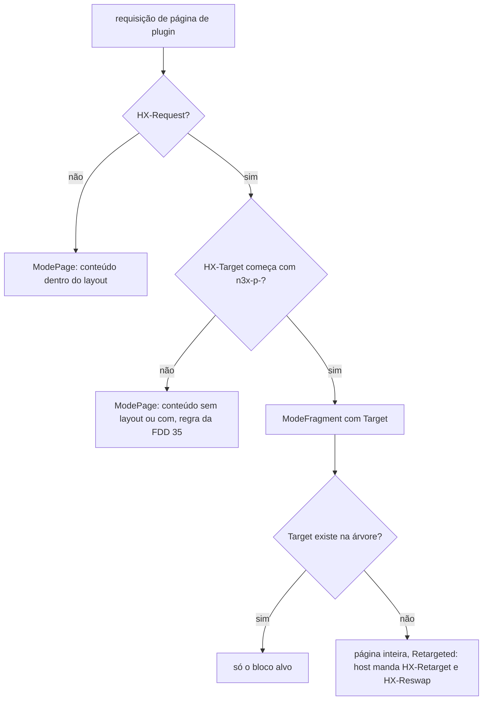
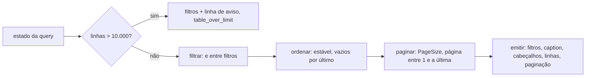

### FDD: Widgets do painel e renderizador (SDK-10)

Versão: 1.0
Data: 2026-10-20
Responsável: Guilherme Giusti

---

### 1. Contexto e motivação técnica

**Problema técnico.** Nenhum plugin escreve HTML (ADR-018 do `n3x-sdk`): páginas e cartões chegam ao painel como uma árvore de `ui.Widget`, e o renderizador do SDK gera o HTML com o visual, a acessibilidade e a segurança do painel. A FDD 08 fixou só os tipos mínimos `ui.Widget` (interface selada) e `ui.Query` (struct opaca), porque a assinatura de `Routes` precisava deles (L-56). Faltava o comportamento verificável:

- os campos, os valores padrão e as regras de aninhamento de cada widget do catálogo
- como a tabela pagina, ordena e filtra no servidor, e onde esse estado fica na URL
- quando o renderizador devolve a página e quando devolve um fragmento htmx, e com quais IDs
- como o escape de todo texto e a CSP do painel (`default-src 'self'`, sem script nem estilo inline) ficam garantidos por construção, e não por revisão
- se o templ entra no SDK ou não, e quem é dono do tema visual (L-22)
- o que o host passa ao renderizador e o que recebe de volta
- como a tela "fluxo por serviço" desenha a cadeia de plugins em ordem de fase (L-67)
- como a config aparece com nome e descrição de cada campo, vindos do schema (FR-007)

Esta entrevista achou quatro problemas novos:

- **`ui.Column` com dois papéis.** O exemplo do HLD do `n3x-sdk` usa `ui.Column` como widget de layout e como coluna de tabela (I-03 da FDD 08). Go não aceita dois tipos com o mesmo nome no pacote.
- **CSP e estilo.** `default-src 'self'` sem `unsafe-inline` bloqueia o atributo `style`. Nenhum parâmetro visual pode virar estilo inline: largura de grade, espaçamento e cor precisam ser enumerações que viram classes.
- **`HX-Request` não basta para decidir o fragmento.** Navegação com `hx-boost` e restauração de histórico do htmx também mandam `HX-Request`, mas precisam do conteúdo inteiro, não de um bloco.
- **IDs repetidos na visão geral.** Dois plugins podem registrar cartões com uma tabela de mesmo ID; na mesma página, os IDs de elemento colidiriam.

**Encaixe no HLD.** Esta FDD especifica o pacote `controller/ui` do módulo `github.com/giustech/n3x-sdk` (HLD do `n3x-sdk`: linha `controller/ui` de "Componentes e responsabilidades", "Catálogo de widgets da v1", "Interfaces públicas" e "Considerações de escalabilidade"). Consumidores:

- FDD 08: `PageFunc` e `CardFunc` devolvem `ui.Widget`; o host mapeia os erros da página
- FDD 11: acrescenta `Refresh`, `Link`, `Form`, `Action`, `Chart` e a exportação sobre o mesmo renderizador e o mesmo escritor de HTML
- FDD 12: o host falso renderiza HTML de verdade com este renderizador e confere as páginas com `uitest.Lint`
- FDD 13: página e cartão do `n3x.example`
- FDD 35: o host do painel chama o renderizador, embrulha o resultado no layout, serve a folha de estilo e roda o axe na galeria
- FDDs 44 e 45: telas do core (sidecars, configs com diff, fluxo e usuários)
- FDD 51: medição do p95 do painel com 500 sidecars

**Atores.** Autor de plugin (monta a árvore), renderizador (valida e gera o HTML), host do painel (FDD 35: escolhe o modo, embrulha no layout, serve os assets e responde), kit de testes (FDD 12: renderiza nos testes do plugin), plugin core (telas da FDD 45) e operador (usa o painel com mouse, teclado ou leitor de tela).

**Limites.** O pacote é uma biblioteca pura. Não abre porta, não lê arquivo (a folha de estilo vem embutida por `embed`), não loga, não publica métricas e não guarda estado global além dos pools de buffer. Recebe a árvore e um pedido e escreve HTML num `io.Writer`. Layout, menu, `<head>`, cabeçalhos HTTP, sessão, CSRF, papel e prazo ficam com o host (FDDs 08, 34 e 35).

**Suposições**
- Go 1.26 ou superior (ADR-021)
- htmx 2.0.x embutido e servido pelo host, com `includeIndicatorStyles`, `allowEval` e `allowScriptTags` desligados (confirmado; a configuração é da FDD 35, L-38)
- O host aplica sessão, papel e prazo antes de chamar a `PageFunc` e chama o renderizador com o mesmo `ctx` (FDD 08)
- A árvore é gerada a cada requisição e nunca guardada (HLD do `n3x-sdk`, "Modelo de dados")
- O orçamento do renderizador dentro do p95 de 300 ms do painel é de até 5 ms por página típica (confirmado)
- Navegadores alvo: as duas últimas versões estáveis de Chrome, Edge, Firefox e Safari (confirmado)

**Restrições**
- Nenhum widget aceita HTML, nome de tag, nome de atributo, classe ou estilo vindos do plugin (ADR-018)
- templ e htmx nunca aparecem no contrato (HLD do `n3x-sdk`, "Tecnologias principais")
- HTML compatível com a CSP `default-src 'self'`: sem `<script>`, sem atributo `style`, sem atributo `on*`, sem URL `javascript:` (HLD do `n3x-controller`)
- Paginação no servidor com 50 linhas por padrão (ADR-018)
- Widget novo só em minor; o catálogo faz parte do contrato estável (ADR-018 e ADR-021)
- Atualização parcial por htmx com polling, sem SPA (ADR-008 do `n3x-controller`)
- `controller/ui` não importa o pacote `ctrl` (o `ctrl` importa `ui`), `proxy/`, Echo, templ nem o SDK Go do Envoy (ADR-011)
- Textos fixos do renderizador em pt-BR; identificadores, classes e chaves em inglês

**Rastreabilidade**
- PRD 1.5: FR-007 (config com nome e descrição dos campos, diff, cópia do trecho YAML), FR-008 (painel em Echo v5 + templ + htmx, fluxo por serviço em ordem de fase, telas de plugin com o mesmo visual, atualizações parciais), FR-011 (telas de plugin no menu), FR-013 (páginas e cartões como árvore de widgets, renderizador do SDK com visual e acessibilidade do painel); requisitos não funcionais de acessibilidade (WCAG 2.1 AA, todo campo e botão rotulado), segurança do painel (CSP restrita, nenhum JavaScript externo) e desempenho (painel em p95 < 300 ms com 500 sidecars); critérios de aceite "painel passa em verificação automatizada de acessibilidade sem violações WCAG AA" e "plugin novo aparece com uma página e um cartão em widgets"
- ADRs do `n3x-sdk`: ADR-011, ADR-018 e ADR-021; do `n3x-controller`: ADR-008
- HLDs: `n3x-sdk/docs/HLD.md` (linha `controller/ui`, catálogo, interfaces públicas, escalabilidade, segurança, decisões pendentes); `n3x-controller/docs/HLD.md` (fluxo de requisição do painel, mapa de telas, CSP); `n3x-plugin-core/docs/HLD.md` (telas de sidecars, configs, fluxo e usuários)
- FDDs aplicadas: 01 (`plugin.ID`, `FieldError`, `FieldErrors`, notação de caminho da L-34), 02 (`Schema.Walk`, `Node`), 08 (`ui.Widget`, `ui.Query`, `PageFunc`, `CardFunc`, mapeamento de erro de página, `CheckCardID`)
- Lacunas do README:
  - **L-22 fechada aqui:** o renderizador gera HTML direto, sem templ, por um escritor interno sobre buffer reaproveitado, só com a biblioteca padrão e `plugin/`. O tema visual é do SDK: uma folha de estilo embutida (`ui.Stylesheet`) com tokens de cor claro e escuro e as classes dos widgets e do esqueleto do host. O host (FDD 35) serve essa folha e usa as mesmas classes no layout templ (confirmado; contratos 6 a 8)
  - **L-67 fechada aqui:** o catálogo da v1 ganha o widget `ui.Pipeline`, uma sequência ordenada de etapas (`ui.Stage`), usada pela tela de fluxo por serviço da FDD 45 para desenhar a cadeia em ordem de fase (confirmado; contrato 3)
  - **L-56 completada:** os tipos mínimos da FDD 08 ficam como estão; aqui entram o catálogo, `Query.Table`, `Query.Tab` e as chaves reservadas da query (contratos 1 a 5)
  - **L-38 (FDD 35) recebe uma restrição:** o HTML do renderizador não depende dos estilos de indicador do htmx, então a FDD 35 pode desligá-los
- Pedidos de FDDs anteriores atendidos:
  - FDD 08 (P-02 e I-03 dela): `ui.Widget` continua selada e `ui.Query` continua opaca; a `Query` ganha paginação, ordenação, filtros e aba por métodos novos; a coluna de tabela passa a ser `ui.TableColumn`, e `ui.Column` fica só como layout
  - FDD 02 (pedido às FDDs 44 e 45): o SDK oferece `ui.ConfigDetail`, que usa `Schema.Walk` e `Node` para mostrar a config com nome e descrição

**Decisões aprovadas na clarificação**
- `ui.ConfigDetail` confia na entrada: a config chega já normalizada e mascarada (`***...`, formato da FDD 37, no core) e o renderizador não mascara por conta própria; a garantia de mascarar é de quem chama (core ou plugin), sem defesa em profundidade
- Excesso estrutural vindo de dados (listas de filhos, itens de `Detail` e `Stage`, etapas e widgets acima de `MaxChildren`, `MaxStages` e `MaxWidgets`) é truncado com um item final "mais N itens não exibidos" e o novo aviso `list_truncated`; erro estrutural fica só para profundidade, contexto e campos obrigatórios (código do plugin)
- Depois da troca de fragmento, cada link ou controle de paginação, ordenação e filtro da tabela tem `id` estável (`n3x-p-<id>-sort-<coluna>`, `-prev`, `-next`, `-filter`) para o htmx devolver o foco ao elemento de mesmo `id` (WCAG 2.4.3), e o resumo "Página X de Y" tem `role="status"` com `aria-live="polite"` (WCAG 4.1.3), sem JavaScript do plugin; os novos IDs ficam congelados na major
- O horário exibido (`FormatTime`, `TimeCell`) é sempre em UTC, com o sufixo "UTC" e `<time datetime>` em RFC 3339, sem fuso configurável e sem campo novo em `Request`
- O catálogo da v1 ganha `Pipeline` (com `Stage`) e `Code` amplia para texto, YAML, JSON e diff; `ui.Column` fica só como layout (a coluna da tabela é `ui.TableColumn`); `Stat.Value` é `string`. O HLD (exemplo de `Routes`, `Stat` e `Table`) e a ADR-018 (catálogo, "templ só no host", `Cards.Add(id, papel, fn CardFunc)`) devem ser atualizados no Workflow 3
- As demais hipóteses numéricas, de teste e de baixo risco ficam aceitas como padrão, sem bloqueio

**Pendências não bloqueantes**
- Definir os IDs da `Table`, do `<caption>` e das partes no modo cartão (o prefixo do cartão vale para tudo); esclarecer o cálculo de `N` em `_s<N>` com abas inativas e o texto de "estabilidade" do ID; dizer o que "Anterior" e "Próxima" fazem nas bordas (o foco some quando o controle não existe mais na página nova) e de onde vêm as opções do filtro automático; decidir se "Limpar filtros" também ganha `id`
- Esclarecer a preservação de chaves da query com `.` desconhecidas ou multivaloradas nos links e campos ocultos, e o aviso `query_ignored`
- Duplicar em `ui` a regra de `CheckCardID` (sem importar `ctrl`), com teste de sincronia; definir `Check` com `ModeFragment` e com valor zero; deixar claro que o renderizador só entrega o conteúdo e que layout e modo são da FDD 35
- Revisar esta FDD após a clarificação da FDD 11 (campos reservados `Request.CSRFToken`, `Request.Root`, `Request.RefreshInterval`, `Table.Export`, chave `<id>.export`)
- Corrigir na FDD 08 a nota de versão que cita `Query.Page` (o método existente é `Query.Table`)
- Divergências para o Workflow 3: HLD (exemplo de `Routes`, `Columns: []ui.Column`, `Stat.Value`), ADR-018 (templ só no host; widget novo só em minor; `Pipeline`; `Code`), pacote novo `controller/ui/uitest` e embute da folha de estilo no HLD e na ADR-011
- Dependem de outros repositórios: FDD 35 (modo, `HX-Retarget` e `HX-Reswap`, folha com hash, configuração do htmx, axe na galeria), FDD 34 (CSRF), FDDs 37, 44 e 45 (core), FDD 12 (kit), FDDs 13, 47 e 51

---

### 2. Objetivos técnicos

- **Nenhum texto do plugin vira marcação.** Invariante: todo texto passa pelo único escritor de HTML do pacote, que escapa `&`, `<`, `>`, `"` e `'`; nenhum campo de widget aceita tag, atributo, classe ou estilo. Medida: fuzzing de cada campo de texto por 5 minutos por alvo na CI noturna, sem achado; teste de propriedade "a estrutura do HTML não muda com o conteúdo do texto".
- **HTML compatível com a CSP por construção.** Medida: 0 `<script>`, 0 atributo `style`, 0 atributo `on*`, 0 URL com esquema ou `//` em todos os arquivos golden e na galeria (`uitest.Lint`).
- **Acessível no nível WCAG 2.1 AA.** Medida: 0 violações do axe (`wcag2a`, `wcag2aa`, `wcag21a`, `wcag21aa`) nas páginas da galeria, na CI do controller (FDD 35); 0 problemas no `uitest.Lint`, inclusive a regra `focus_id` (controles de paginação, ordenação e filtro com ID estável, para o foco voltar ao mesmo controle depois da troca de fragmento, WCAG 2.4.3, e resumo de página em região `status`, WCAG 4.1.3; confirmado); pares de cor do tema com contraste mínimo de 4,5:1 para texto e 3:1 para bordas de controle e foco, no tema claro e no escuro.
- **Rápido e previsível.** Medida: tabela de 500 linhas por 8 colunas numa página só em até 5 ms por operação; 500 linhas entregues com página de 50, ordenadas e filtradas, em até 1 ms; até 100 alocações por renderização de tabela; buffer de saída reaproveitado (confirmado).
- **Determinístico.** Invariante: a mesma árvore com o mesmo pedido gera os mesmos bytes; o fragmento de um bloco é byte a byte igual ao trecho desse bloco na página inteira; renderizar não altera a árvore.
- **Erros completos, sem vazar dados.** Medida: a validação estrutural devolve todos os problemas numa passada, em ordem determinística, com `Path` e `Rule` estáveis na major; o `Detail` nunca cita texto vindo do plugin.
- **Dado ruim não derruba a tela.** Invariante: texto longo, UTF-8 inválido, código grande, linhas demais, listas de filhos, itens e etapas acima dos limites e query inválida viram saneamento com aviso (`Notice`), nunca erro; listas acima de `MaxChildren` e árvores acima de `MaxWidgets` são truncadas com um item final "mais N itens não exibidos" e o aviso `list_truncated` (confirmado). Só a estrutura inválida (profundidade, contexto e campos obrigatórios, que são código do plugin) falha a renderização.
- **Um tema só.** Invariante: as telas do host e as de plugin usam a mesma folha de estilo, entregue pelo SDK; nenhuma tela de plugin tem visual próprio.
- **Catálogo cresce por adição.** Invariante: `Widget` selada, structs em que o valor zero de todo campo opcional é o comportamento padrão, `Cell` e `TableState` opacos; widget, campo, célula e método novos entram em minor.

---

### 3. Escopo e exclusões

**Incluído**
- Selo de `ui.Widget`, contextos de aninhamento (bloco, compacto, abas, cartão e célula) e limites da árvore
- Widgets de layout: `Page`, `Column`, `Row`, `Grid`, `Section` (com recolhimento opcional por `<details>`) e `Tabs`
- Widgets de conteúdo: `Text`, `Stat`, `Badge`, `Table`, `Detail`, `Code` (texto, YAML, JSON e diff unificado), `Empty` e o widget novo `Pipeline` (L-67)
- Tabela: colunas, linhas com células tipadas, filtros de texto e de seleção, ordenação e paginação no servidor (50 linhas por padrão), aplicados pelo renderizador sobre as linhas entregues
- Métodos novos de `ui.Query` (`Table`, `Tab`) e o tipo `ui.TableState`; chaves da query reservadas ao renderizador
- Renderizador: `NewRenderer`, `Render` e `Check`; modos página, fragmento e cartão; IDs de elemento estáveis; atributos htmx; buffer reaproveitado; limites e avisos
- Escritor interno de HTML com escape e lista fechada de tags e atributos (L-22)
- Tema: folha de estilo embutida, tokens claro e escuro, classes dos widgets e do esqueleto do host (L-22)
- `ui.ConfigDetail` (schema mais config vira `Detail`) e funções de formatação em pt-BR
- Pacote de apoio a testes `controller/ui/uitest`, com `Lint` (checagens estruturais de CSP e acessibilidade) e `Gallery` (páginas de exemplo para o axe)

**Excluído**
- `Refresh`, `Link`, `Form`, `Action`, `Chart`, exportação CSV e JSON (campo `Table.Export`), célula de link e botão de copiar: FDD 11 (SDK-11)
- Registro de páginas e cartões (`Routes.Page`, `Cards.Add`), prazos de página e cartão e mapeamento de erro da `PageFunc`: FDD 08 (SDK-08)
- Layout do painel, menu, login, banners de estado, `<head>`, cabeçalhos HTTP, entrega dos assets e execução do axe: FDD 35 (CTL-06)
- Renderização no host falso de testes: FDD 12 (SDK-12)
- Telas concretas do core e o cálculo do diff de config: FDDs 44 (CORE-08) e 45 (CORE-09)
- Fora da v1, por adição em minor se houver caso real (confirmado): paginação feita pelo próprio plugin com total informado, realce de sintaxe no `Code`, tema escolhido pelo usuário, textos em outros idiomas, ordenação com colação de acentos do pt-BR, filtro de seleção múltipla, destaque de linha por tom, cálculo de diff pelo SDK

---

### 4. Fluxos detalhados e diagramas

**Fluxo principal: página de plugin (modo página)**
1. O host (FDD 35) confere sessão e papel, monta a `ui.Query` com os curingas do path e a query string (FDD 08) e chama a `PageFunc` com `ctx` de `runtime.plugin_call_timeout` (10 s).
2. A `PageFunc` monta a árvore, com `ui.Page` na raiz, e a devolve.
3. O host escolhe o modo `ModePage`: requisição sem `HX-Request`, ou com `HX-Request` e sem `HX-Target` que nomeie um bloco do renderizador (regra completa no contrato 7).
4. O host chama `r.Render(ctx, buf, raiz, ui.Request{Mode: ui.ModePage, Query: q, Plugin: id, ...})` sobre um buffer próprio, antes de escrever qualquer cabeçalho.
5. O renderizador:
   - confere o pedido (modo, plugin, cartão e nível de heading); pedido errado devolve `ErrInvalidRequest`
   - percorre a árvore inteira uma vez: valida estrutura e limites, conta widgets e profundidade, calcula o nível de cada heading e o ID de cada elemento, e lê da query o estado de cada tabela e de cada `Tabs`
   - com problema estrutural, devolve `ErrInvalidTree` com todos os problemas e não escreve nada
   - emite o HTML num buffer do pool; cada tabela passa por filtro, ordenação e paginação sobre um vetor de índices, sem tocar nas linhas do plugin
   - confere `ctx.Err()` no início e a cada 1.000 linhas de tabela processadas
   - confere o tamanho da saída contra `MaxOutputBytes` (8 MiB)
   - escreve o HTML em `w` numa única chamada e devolve o `Result` (modo, título, bytes, widgets, linhas e avisos)
6. O host embrulha o HTML no layout (`<main id="n3x-main">`), usa `Result.Title` no `<title>`, loga os avisos (FDD 35) e responde 200.

**Fluxo de fragmento: página, ordenação ou filtro de uma tabela**
1. O usuário ativa "Próxima": `<a id="n3x-p-sidecars-next" href="?sidecars.page=3" hx-get="?sidecars.page=3" hx-target="#n3x-p-sidecars" hx-swap="outerHTML" hx-push-url="true">`.
2. O htmx pede a mesma rota com `HX-Request: true` e `HX-Target: n3x-p-sidecars`.
3. O host chama a mesma `PageFunc` (a árvore inteira é montada de novo) e o renderizador com `ModeFragment` e `Target: "n3x-p-sidecars"`.
4. O renderizador valida a árvore inteira, para que IDs e níveis de heading sejam os mesmos da página, e emite só o bloco cujo ID de elemento é o alvo.
5. O host devolve o fragmento sem layout; o htmx troca o bloco inteiro (`outerHTML`) e atualiza a URL. Como o link ativado ("Próxima", `id="n3x-p-sidecars-next"`) volta no fragmento com o mesmo `id`, o htmx devolve o foco a ele (WCAG 2.4.3), e o resumo "Página X de Y" é uma região `role="status"` com `aria-live="polite"` (WCAG 4.1.3); nada disso usa JavaScript do plugin.
6. Sem JavaScript, o mesmo `href` faz a navegação comum e o host devolve a página inteira com layout (aprimoramento progressivo).

**Fluxo do filtro**
- Acima da tabela, um formulário `GET` com um controle por filtro, campos ocultos com os outros parâmetros da query atual (menos a página desta tabela, que volta a 1), botão "Filtrar" e link "Limpar filtros"
- Com htmx, o envio vira um fragmento da tabela (mesmo `hx-target`); sem htmx, vira navegação comum
- Formulário `GET` não altera estado, então não leva token CSRF (o CSRF vale para métodos que não são `GET`, FDD 34)

**Fluxo de abas (`Tabs`)**
- Cada aba é um link com `?<id>.tab=<chave>`; só o conteúdo da aba ativa é renderizado
- O plugin pode montar só o filho da aba ativa, lendo `q.Tab(id)`; os filhos das outras abas podem ser `nil`
- Com htmx, a troca de aba é um fragmento do bloco `Tabs`

**Fluxo de cartão (modo cartão)**
- Na visão geral, o host (FDD 35) chama a `CardFunc` de cada cartão com prazo de 1 s (FDD 08) e o renderizador com `ModeCard`, `Plugin` e `Card`
- O renderizador emite só o conteúdo do cartão, sem `Page`, com IDs no escopo do cartão (`n3x-c-<namespace>-<nome>-<cartão>`) e headings a partir de `HeadingBase` (3 por padrão)
- `Table` em cartão é estática: primeira página, ordenação padrão, sem filtros, sem links de ordenação e sem paginação, com a linha "Mostrando N de M" quando há mais linhas
- `Tabs` e `Page` são recusadas em cartão (`card_widget`)

**Pipeline da tabela (dentro da etapa de emissão)**
1. Lê o estado da query: `<id>.page`, `<id>.sort` e `<id>.f.<filtro>` (contrato 5). Valor inválido volta ao padrão e gera o aviso `query_ignored`.
2. Se a tabela trouxe mais de `MaxTableRows` (10.000) linhas, não filtra nem renderiza linhas: mostra os filtros e uma linha de aviso, e gera `table_over_limit`.
3. Filtra: cada filtro preenchido deixa só as linhas que passam; filtros diferentes combinam com "e".
4. Ordena: pela ordenação da query, senão por `Table.Sort`, senão na ordem de entrega; ordenação estável, células vazias sempre por último.
5. Pagina: `PageSize` (50 por padrão); página abaixo de 1 vira 1; página além da última vira a última.
6. Emite: formulário de filtros, tabela com `<caption>`, cabeçalhos com `scope` e `aria-sort`, linhas da página e navegação "Anterior" e "Próxima" com o resumo "Página X de Y (linhas A a B de N)". Links de ordenação, "Anterior", "Próxima" e o botão "Filtrar" levam `id` estável (contrato 7), e o resumo leva `role="status"` com `aria-live="polite"`.

**Fluxos alternativos e exceções**
- **Alvo de fragmento que não existe** (o bloco sumiu da árvore, aba antiga, alvo do próprio host): o renderizador devolve a página inteira com `Result.Mode = ModePage` e `Result.Retargeted = true`; o host responde com `HX-Retarget: #n3x-page` e `HX-Reswap: outerHTML` (pedido à FDD 35)
- **Árvore inválida:** `ErrInvalidTree` com a lista; o host responde 500 com a página genérica (mapeamento "outro erro" da FDD 08); o kit falha o teste do plugin (FDD 12)
- **Raiz que não é `Page` no modo página ou fragmento:** problema `page_required`
- **`ctx` cancelado ou com prazo estourado:** o renderizador devolve `ctx.Err()` sem escrever nada; o host responde 504 no prazo, como na `PageFunc` (FDD 08)
- **Mais de 10.000 linhas entregues:** aviso no lugar das linhas, filtros visíveis; o guia do autor manda o plugin pré-filtrar lendo `q.Table(id).Filter(...)`, o que é seguro porque filtrar duas vezes dá o mesmo resultado
- **Query inválida** (`sidecars.page=abc`, ordenação por coluna desconhecida ou não ordenável, opção de seleção que não existe, aba desconhecida): volta ao padrão, aviso `query_ignored`
- **Lista de filhos, itens de `Detail`, itens de `Stage` ou etapas de `Pipeline` acima do limite (`MaxChildren` 200, `MaxStages` 16), ou árvore acima de `MaxWidgets` (5.000):** truncada, com os primeiros itens (o limite menos 1) e um item final "mais N itens não exibidos"; aviso `list_truncated` (aviso, não erro). Profundidade acima de `MaxDepth`, contexto inválido e campo obrigatório vazio continuam sendo erro estrutural
- **Texto acima do limite ou com UTF-8 inválido:** cortado na fronteira de caractere com "…", ou com os bytes inválidos e caracteres de controle trocados por U+FFFD; avisos `text_truncated` e `invalid_text`
- **`Code` acima de 256 KiB ou 5.000 linhas:** cortado, com a nota "Conteúdo cortado em N linhas."; aviso `code_truncated`
- **Filtro de seleção automático com mais de 50 valores distintos:** vira campo de texto; aviso `filter_as_text`
- **`nil` numa lista de filhos:** ignorado (permite montar listas com condição); `nil` em campo de filho único não renderiza nada; `DetailItem.Value` nulo mostra "-" com o texto "vazio" para leitor de tela
- **Falha ao escrever em `w`** (cliente desconectou): o erro volta embrulhado; o host loga em `debug`

**Diagramas**

Sequência de uma página e de um fragmento:

```mermaid
sequenceDiagram
    participant B as navegador (htmx)
    participant H as host do painel (FDD 35)
    participant P as PageFunc do plugin
    participant R as ui.Renderer
    B->>H: GET /plugins/n3x/core/sidecars?sidecars.page=2
    H->>H: sessão, papel, ui.NewQuery (FDD 08)
    H->>P: PageFunc(ctx 10 s, q)
    P-->>H: ui.Page{...}
    H->>R: Render(ctx, buf, raiz, Request{ModePage})
    R-->>H: HTML do conteúdo e Result{Title}
    H-->>B: 200, layout + conteúdo
    B->>H: GET ...?sidecars.page=3 (HX-Request, HX-Target: n3x-p-sidecars)
    H->>P: PageFunc(ctx, q)
    P-->>H: a mesma árvore, com os dados atuais
    H->>R: Render(ctx, buf, raiz, Request{ModeFragment, Target})
    R-->>H: só o bloco n3x-p-sidecars
    H-->>B: 200, fragmento; o htmx troca o bloco e a URL
```

Escolha do modo pelo host e pelo renderizador:



Pipeline da tabela:



---

### 5. Contratos públicos (assinaturas, endpoints, headers, exemplos)

**Contrato 1: `ui.Widget`, selo, contextos de aninhamento e limites da árvore**
- Tipo: sdk (API Go, pacote `controller/ui`)
- Assinatura/Rota:
  ```go
  package ui // github.com/giustech/n3x-sdk/controller/ui

  // Widget é um nó da árvore que o renderizador transforma em HTML.
  // Interface selada (FDD 08): só os tipos deste pacote a implementam.
  type Widget interface {
      isWidget()
  }

  const (
      MaxDepth    = 16   // profundidade máxima da árvore
      MaxWidgets  = 5000 // widgets por árvore; linhas e células de tabela não contam; acima, truncado (list_truncated)
      MaxChildren = 200  // itens por lista de filhos, de Detail e de Stage; acima, truncado (list_truncated)
      MaxIDLen    = 24   // IDs de Table e Tabs e chaves de coluna, filtro e aba
      MaxProblems = 100  // problemas devolvidos; acima, um último com a regra "truncated"
  )
  ```
- Método: n/a (chamada local)
- Semântica:
  - Cada widget é uma struct de valor com campos exportados, montada com campos nomeados (`ui.Text{Text: "ok"}`). Literal sem nome de campo não tem garantia de compatibilidade (o `go vet` já avisa em literal de struct de outro pacote)
  - `*T` também satisfaz `Widget` (regra do Go) e é tratado como `T`; ponteiro nulo é tratado como `nil`
  - O valor zero de todo campo opcional é o comportamento padrão; é isso que permite campo novo em minor
  - O selo pode ganhar métodos não exportados (ex.: `kind()`) sem efeito em plugins
  - O renderizador nunca altera a árvore; a mesma árvore pode ser renderizada por várias goroutines ao mesmo tempo
  - IDs (`Table.ID`, `Tabs.ID`) e chaves (coluna, filtro, aba) casam com `^[a-z][a-z0-9_]{0,23}$`; IDs são únicos na árvore inteira, chaves são únicas no widget
  - `nil` numa lista de filhos é ignorado; `nil` em campo de filho único não renderiza nada
  - **Excesso vindo de dados é truncado, não é erro:** lista de filhos (`Column`, `Row`, `Grid`), itens de `Detail` e de `Stage` acima de `MaxChildren`, etapas de `Pipeline` acima de `MaxStages` e árvore acima de `MaxWidgets` (contados em ordem de documento) ficam com os primeiros itens (o limite menos 1) e um item final "mais N itens não exibidos" (`Text` em `TextMuted`; em `Pipeline`, uma etapa final com esse título), que conta no limite; aviso `list_truncated` (contrato 10). Só profundidade (`depth`), contexto e campos obrigatórios são erro estrutural (confirmado)
  - Contextos de aninhamento:

| Contexto | Onde | Widgets aceitos | Regra quando viola |
| --- | --- | --- | --- |
| Raiz de página | retorno da `PageFunc` (modos página e fragmento) | só `Page` | `page_required` |
| Bloco | `Page.Body`, `Column`, `Row`, `Grid`, `Section.Child`, `Tab.Child` | todos, menos `Page` | `page_nested` |
| Compacto | `DetailItem.Value`, `Stage.Items` e tudo abaixo deles | `Text`, `Stat`, `Badge`, `Code`, `Detail`, `Row`, `Column`, `Empty` | `compact_widget` |
| Abas | abaixo de `Tab.Child` | os de bloco, menos `Tabs` | `tabs_nested` |
| Cartão | retorno da `CardFunc` (modo cartão) e abaixo | os de bloco, menos `Page` e `Tabs`; `Table` sem controles | `card_widget` |
| Célula | `TableRow.Cells` | só `ui.Cell` (contrato 4) | (garantido pelo tipo) |

  - Caminho dos problemas: nome do tipo da raiz e nomes de campo Go, com índice entre colchetes (convenção da L-34): `Page.Body.Children[1].Columns[0].Key`
  - Sem erros derivados (como na FDD 01): um widget recusado pelo contexto não tem a subárvore validada, e um ID com formato inválido não entra na conferência de repetição

**Exemplo de requisição**
```go
ui.Page{Title: "Cotas", Body: ui.Column{Children: []ui.Widget{
    ui.Detail{Items: []ui.DetailItem{
        {Label: "Limites", Value: ui.Table{ID: "limites", Caption: "Limites"}},
    }},
    ui.Section{Title: "", Child: ui.Page{Title: "x"}},
    ui.Table{ID: "Limites", Caption: "Limites"},
}}}
```

**Exemplo de resposta** (`err.Error()` de `ui.Check(raiz, ui.ModePage)`; `errors.Is(err, ui.ErrInvalidTree)` verdadeiro)
```text
Page.Body.Children[0].Items[0].Value: Table não é aceito em contexto compacto [compact_widget]
Page.Body.Children[1].Title: campo obrigatório [required]
Page.Body.Children[1].Child: Page só pode ser a raiz [page_nested]
Page.Body.Children[2].ID: fora de ^[a-z][a-z0-9_]{0,23}$ [id_format]
Page.Body.Children[2].Columns: pelo menos 1 coluna [too_few]
```

---

**Contrato 2: widgets de layout (`Page`, `Column`, `Row`, `Grid`, `Section`, `Tabs`)**
- Tipo: sdk (API Go)
- Assinatura/Rota:
  ```go
  type Page struct {
      Title       string // obrigatório; vira <h1> e Result.Title
      Description string // opcional; parágrafo abaixo do título
      Body        Widget // contexto de bloco; nil = só o título
  }

  type Gap uint8

  const (
      GapDefault Gap = iota // médio (1rem)
      GapNone
      GapSmall // 0,5rem
      GapLarge // 2rem
  )

  type Column struct { // pilha vertical
      Children []Widget
      Gap      Gap
  }

  type Row struct { // linha horizontal; quebra em tela estreita
      Children []Widget
      Gap      Gap
  }

  type Grid struct {
      Columns  int // 0 = automático (itens de no mínimo 16rem); 1 a 4 = máximo de colunas
      Children []Widget
      Gap      Gap
  }

  type Fold uint8

  const (
      FoldNone   Fold = iota // seção sempre aberta
      FoldOpen               // recolhível, começa aberta
      FoldClosed             // recolhível, começa fechada
  )

  type Section struct {
      Title       string // obrigatório; heading com nível calculado
      Description string
      Child       Widget
      Fold        Fold
  }

  type Tabs struct {
      ID    string // obrigatório; único na árvore; alvo de fragmento
      Label string // obrigatório; nome acessível da navegação entre abas
      Items []Tab  // 2 a 12
  }

  type Tab struct {
      Key   string // obrigatória; única em Items; valor de <id>.tab
      Label string // obrigatório
      Child Widget // só o da aba ativa é renderizado; nil aceito nas outras
  }

  const MaxTabs = 12
  ```
- Método: n/a
- Semântica:
  - **Página:** `<div id="n3x-page" class="n3x-page">` com `<h1>`, descrição e corpo. Nunca `<html>`, `<head>`, `<body>`, menu ou rodapé: isso é do layout do host (FDD 35)
  - **Headings:** `Page.Title` é `h1`; cada `Section` aninhada desce um nível a partir de `h2`, até `h6` (mais fundo continua `h6`). Em cartão, o primeiro nível é `Request.HeadingBase` (3 por padrão). `Tabs` não cria nível
  - **Espaçamento e grade por classe:** `Gap` vira `n3x-gap-none`, `n3x-gap-sm`, `n3x-gap-md` ou `n3x-gap-lg`; `Grid.Columns` vira `n3x-grid--auto` ou `n3x-grid--1` a `n3x-grid--4`. Nenhum atributo `style` (CSP)
  - **Responsivo:** `Row` sempre quebra linha; `Grid` vira uma coluna abaixo de 40rem; nada exige rolagem horizontal da página em 320 px de largura, exceto o conteúdo de tabela e de código, que rola dentro da própria região (WCAG 1.4.10)
  - **Seção:** `<section aria-labelledby>` com o heading; `FoldOpen` e `FoldClosed` usam `<details>` e `<summary>` nativos, sem JavaScript, com o heading dentro do `<summary>`
  - **Abas:** `<nav aria-label>` com uma lista de links (`aria-current="true"` na ativa) e um `<section aria-labelledby>` com o painel da aba ativa. Não usa `role="tablist"`, porque esse papel promete navegação por setas, que exigiria JavaScript. Aba ativa: `q.Tab(id)` se for uma chave válida, senão a primeira (com aviso `query_ignored` quando a chave veio e não existe)
  - **Contingência (HLD do `n3x-sdk`):** `Tabs` é o último widget a ser implementado; se for adiado, entra numa minor sem quebrar nada, e nenhuma tela do core pode depender dele (pedido à FDD 45)

**Exemplo de requisição**
```go
ui.Page{Title: "Negações", Description: "Contagem por serviço nas últimas 24 h.",
    Body: ui.Column{Children: []ui.Widget{
        ui.Row{Children: []ui.Widget{ui.Stat{Label: "Total", Value: ui.FormatInt(12345)}}},
        ui.Section{Title: "Por serviço", Fold: ui.FoldOpen, Child: ui.Text{Text: "Sem dados ainda."}},
    }}}
```

**Exemplo de resposta**
```html
<div id="n3x-page" class="n3x-page">
<h1 class="n3x-page__title">Negações</h1>
<p class="n3x-page__desc">Contagem por serviço nas últimas 24 h.</p>
<div class="n3x-column n3x-gap-md">
<div class="n3x-row n3x-gap-md"><div class="n3x-stat"><span class="n3x-stat__label">Total</span><span class="n3x-stat__value">12.345</span></div></div>
<section class="n3x-section n3x-section--fold" aria-labelledby="n3x-p-_s1">
<details open="open"><summary><h2 id="n3x-p-_s1" class="n3x-section__title">Por serviço</h2></summary>
<p class="n3x-text">Sem dados ainda.</p>
</details>
</section>
</div>
</div>
```

---

**Contrato 3: widgets de conteúdo (`Text`, `Stat`, `Badge`, `Detail`, `Code`, `Empty`, `Pipeline`) e formatação**
- Tipo: sdk (API Go)
- Assinatura/Rota:
  ```go
  type Tone uint8

  const (
      ToneNeutral Tone = iota
      ToneOK
      ToneInfo
      ToneWarning
      ToneDanger
  )

  type TextStyle uint8

  const (
      TextBody TextStyle = iota
      TextMuted
      TextStrong
      TextMono
      TextSmall
  )

  type Text struct {
      Text  string // vazio não renderiza nada; quebras de linha preservadas
      Style TextStyle
  }

  type Stat struct {
      Label string // obrigatório
      Value string // obrigatório; texto já formatado (FormatInt e as demais)
      Hint  string // opcional; contexto curto, ex.: "últimas 24 h"
      Tone  Tone
  }

  type Badge struct {
      Label string // obrigatório; a cor nunca é a única informação
      Tone  Tone
  }

  type Detail struct {
      Items []DetailItem // 1 a 200; acima, truncado (list_truncated)
  }

  type DetailItem struct {
      Label string // obrigatório
      Help  string // descrição opcional, ex.: desc do schema
      Value Widget // contexto compacto; nil mostra "-" (vazio)
  }

  func Item(label, value string) DetailItem // atalho: Value = Text{Text: value}

  type CodeLang uint8

  const (
      CodePlain CodeLang = iota
      CodeYAML
      CodeJSON
      CodeDiff // diff unificado: linhas que começam com " ", "+", "-", "@@", "---" ou "+++"
  )

  type Code struct {
      Label string // obrigatório; nome acessível do bloco
      Lang  CodeLang
      Text  string // até MaxCodeBytes e MaxCodeLines; acima, cortado com nota
  }

  type Empty struct {
      Text string // vazio = "Nada para mostrar."
  }

  // Pipeline: sequência ordenada de etapas (L-67), ex.: a cadeia de plugins em ordem de fase.
  type Pipeline struct {
      Label  string  // obrigatório; nome acessível da sequência
      Stages []Stage // 1 a 16, na ordem; acima, truncado (list_truncated)
  }

  type Stage struct {
      Title string   // obrigatório
      Note  string   // opcional, abaixo do título
      Items []Widget // contexto compacto; vazio mostra "Nenhum item."
  }

  const MaxStages = 16

  func FormatInt(n int64) string                  // "12.345"
  func FormatDecimal(f float64, places int) string // "1.234,50"; places de 0 a 6 (fora disso, ajustado)
  func FormatBytes(n int64) string                // "1,5 MiB" (base 1024, uma casa)
  func FormatDuration(d time.Duration) string     // "2m30s"; abaixo de 1 s, "250ms"
  func FormatTime(t time.Time) string             // "2026-10-20 14:03:07 UTC"; sempre em UTC (converte t); zero = ""
  ```
- Método: n/a
- Semântica:
  - **`Text`:** `<p class="n3x-text">` com classe de estilo; quebras de linha preservadas pelo CSS (`white-space: pre-line`)
  - **`Stat`:** rótulo, valor e dica em `<div class="n3x-stat">`, nessa ordem de leitura; `Value` é texto para o autor escolher o formato, com as funções `Format*` para manter o padrão pt-BR
  - **`Badge`:** `<span class="n3x-badge n3x-tone-<tom>">`; o rótulo é obrigatório porque cor sozinha não informa (WCAG 1.4.1)
  - **`Detail`:** `<dl class="n3x-detail">` com um `<div>` por item, `<dt>` com o rótulo e `<dd>` com o valor e a ajuda (`<p class="n3x-help">`)
  - **`Code`:** `<pre tabindex="0" role="region" aria-label="<Label>">` com `<code>`; a região recebe foco pelo teclado para rolar (WCAG 2.1.1) e o texto pode ser selecionado e copiado. Em `CodeDiff`, cada linha ganha uma classe (`n3x-diff__add`, `__del`, `__hunk`, `__meta`, `__ctx`) e o caractere `+` ou `-` continua visível, então a cor não é a única informação. Linha que não segue o formato vira contexto, sem erro. Sem realce de sintaxe na v1. Limites: `MaxCodeBytes` (256 KiB) e `MaxCodeLines` (5.000)
  - **Origem do diff:** o `Code` recebe o diff unificado pronto. Quem calcula é o plugin (o core, na FDD 44, que já é dono do diff entre versões e instâncias); o SDK não calcula diff na v1
  - **`Empty`:** `<p class="n3x-empty">` com o texto ou o padrão
  - **`Pipeline` (L-67):** `<ol class="n3x-pipeline" aria-label="<Label>">` com um `<li>` por etapa (título, nota e itens). A ordem vem da lista ordenada, que o leitor de tela anuncia; a seta entre etapas é desenho de CSS, sem texto. Em tela larga as etapas ficam lado a lado, com rolagem horizontal dentro da região; em tela estreita, uma abaixo da outra. Para a tela de fluxo por serviço (FDD 45), cada etapa é uma fase e os itens são os plugins com ordem e política de falha em `Badge`
  - **Formatação:** separador de milhar `.`, decimal `,`. O horário exibido (`FormatTime` e `TimeCell`) é SEMPRE em UTC, com o sufixo "UTC" no texto e `<time datetime>` em RFC 3339 (o servidor não sabe o fuso de quem lê e não há JavaScript). Não há fuso configurável nem campo novo em `Request` (confirmado)

**Exemplo de requisição** (trecho da tela de fluxo por serviço, FDD 45)
```go
ui.Pipeline{Label: "Cadeia de pedidos na requisição", Stages: []ui.Stage{
    {Title: "access"},
    {Title: "transform", Items: []ui.Widget{
        ui.Row{Gap: ui.GapSmall, Children: []ui.Widget{
            ui.Badge{Label: "n3x.example"}, ui.Badge{Label: "ordem 50"}, ui.Badge{Label: "open", Tone: ui.ToneInfo},
        }},
    }},
}}
```

**Exemplo de resposta**
```html
<ol class="n3x-pipeline" aria-label="Cadeia de pedidos na requisição">
<li class="n3x-pipeline__stage"><p class="n3x-pipeline__title">access</p><div class="n3x-pipeline__items"><p class="n3x-empty">Nenhum item.</p></div></li>
<li class="n3x-pipeline__stage"><p class="n3x-pipeline__title">transform</p><div class="n3x-pipeline__items"><div class="n3x-row n3x-gap-sm"><span class="n3x-badge n3x-tone-neutral">n3x.example</span><span class="n3x-badge n3x-tone-neutral">ordem 50</span><span class="n3x-badge n3x-tone-info">open</span></div></div></li>
</ol>
```

---

**Contrato 4: `ui.Table`, colunas, linhas, células, filtros, ordenação e paginação**
- Tipo: sdk (API Go)
- Assinatura/Rota:
  ```go
  type Table struct {
      ID        string        // obrigatório; único na árvore; alvo de fragmento e prefixo das chaves da query
      Caption   string        // obrigatório; vira <caption>
      Columns   []TableColumn // 1 a 16
      Rows      []TableRow    // até MaxTableRows; acima, aviso no lugar das linhas
      Filters   []Filter      // 0 a 8
      Sort      SortBy        // ordenação padrão; valor zero = ordem de entrega
      PageSize  int           // 0 = 50; 1 a 500
      EmptyText string        // vazio = "Nenhum item encontrado."
      // A FDD 11 acrescenta Export []Format.
  }

  // TableColumn resolve a colisão com o widget de layout Column (I-03 da FDD 08).
  type TableColumn struct {
      Key      string // obrigatória; única na tabela; usada em <id>.sort e nos filtros
      Label    string // obrigatório; texto do <th>
      Sortable bool
  }

  type TableRow struct {
      Cells []Cell // exatamente len(Columns)
  }

  func RowOf(cells ...Cell) TableRow

  // Cell é opaca: o valor zero é a célula vazia. Construtores novos entram em minor.
  type Cell struct{ /* tipo, texto exibido e chave de ordenação */ }

  func TextCell(s string) Cell
  func MonoCell(s string) Cell                      // texto em fonte monoespaçada (hash, instância)
  func IntCell(n int64) Cell                        // exibe FormatInt; ordena como número
  func DecimalCell(f float64, places int) Cell      // exibe FormatDecimal; NaN é vazia
  func BytesCell(n int64) Cell                      // exibe FormatBytes; ordena pelo valor
  func DurationCell(d time.Duration) Cell           // exibe FormatDuration; ordena pelo valor
  func TimeCell(t time.Time) Cell                   // exibe FormatTime em <time datetime>; zero é vazia
  func BadgeCell(b Badge) Cell                      // exibe o Badge; filtra e ordena pelo rótulo

  type SortBy struct {
      Column string // chave de uma coluna com Sortable
      Desc   bool
  }

  type FilterKind uint8

  const (
      FilterText   FilterKind = iota // trecho do texto, sem diferenciar maiúsculas
      FilterSelect                   // valor exato entre opções
  )

  type Filter struct {
      Key     string     // obrigatória; única na tabela; parâmetro <id>.f.<key>
      Label   string     // obrigatório; vira <label>
      Kind    FilterKind
      Column  string     // coluna filtrada; vazio só em FilterText (todas as colunas)
      Options []Option   // só FilterSelect; nil = valores distintos da coluna, ordenados
  }

  type Option struct {
      Value string // obrigatório; comparado com o texto exibido da célula
      Label string // vazio = Value
  }

  const (
      MaxTableColumns = 16
      MaxTableRows    = 10000
      DefaultPageSize = 50
      MaxPageSize     = 500
      MaxFilters      = 8
      MaxOptions      = 50
      MaxCellBytes    = 1 << 10
  )
  ```
- Método: n/a
- Semântica:
  - **Quem aplica (ADR-018):** o renderizador filtra, ordena e pagina sobre as linhas entregues. O plugin pode pré-filtrar lendo `q.Table(id)` (contrato 5) para montar menos linhas; filtrar de novo dá o mesmo resultado. Não há, na v1, modo em que o plugin entrega só a página com o total (fora da v1, seção 3)
  - **Texto exibido de cada célula:** o próprio texto (`TextCell`, `MonoCell`), o número formatado, a duração, o horário formatado ou o rótulo do `Badge`. Filtros comparam com esse texto exibido, que é o que o operador vê
  - **Filtro de texto:** trecho, sem diferenciar maiúsculas (folding simples do Unicode), na coluna indicada ou em todas. Valor de até 256 caracteres (`maxlength`)
  - **Filtro de seleção:** igualdade exata com o texto exibido. "Estado" é seleção sobre uma coluna de `BadgeCell`. `Options` nil gera as opções a partir dos valores distintos da coluna, ordenados; com mais de 50 valores distintos, o controle vira campo de texto (aviso `filter_as_text`). Valor que não é opção é ignorado (aviso `query_ignored`). Primeira opção sempre "Todos" (valor vazio)
  - **Combinação:** filtros diferentes combinam com "e"; um filtro tem um valor só na v1
  - **Ordenação:** por coluna `Sortable`, pela query ou por `Table.Sort`. Números, bytes e durações por valor; horário por instante; texto e badge por letras minúsculas, sem colação de acentos (confirmado). Células de tipos diferentes na mesma coluna se ordenam pelo tipo e depois pelo valor. Vazias sempre por último, nos dois sentidos. Ordenação estável: empate mantém a ordem de entrega
  - **Paginação:** `PageSize` (50 por padrão, até 500). Página abaixo de 1 vira 1, acima da última vira a última. Navegação "Anterior" e "Próxima" e o resumo "Página X de Y (linhas A a B de N)", que é uma região `role="status"` com `aria-live="polite"`; com uma página só, sem navegação
  - **Links de estado:** URLs relativas que começam com `?` e mantêm os outros parâmetros da query atual, em ordem de chave (`url.Values.Encode`). Ordenar ou filtrar volta à página 1. Ordenar pela coluna já ordenada inverte o sentido
  - **Acessibilidade:** `<caption>` sempre; `<th scope="col">`; `aria-sort` nas colunas ordenáveis; o link do cabeçalho leva o texto oculto "(ordem crescente; ativar para inverter)" ou "(ativar para ordenar)"; a tabela fica numa região rolável com foco por teclado e nome dado pelo `<caption>`; célula vazia mostra "-" com "vazio" só para leitor de tela; números alinhados à direita (`n3x-num`). **Foco depois da troca de fragmento (WCAG 2.4.3 e 4.1.3):** cada link de ordenação, "Anterior", "Próxima" e o botão "Filtrar" levam `id` estável (`n3x-p-<id>-sort-<coluna>`, `-prev`, `-next`, `-filter`), o que permite ao htmx devolver o foco ao elemento de mesmo `id` no bloco trocado; o resumo da paginação leva `role="status"` e `aria-live="polite"`, para o leitor de tela anunciar a página nova. Sem JavaScript do plugin (confirmado)
  - **Sem linhas:** uma linha única com `colspan` e o `EmptyText`. Acima de 10.000 linhas entregues: a mesma linha única com "Mais de 10.000 linhas: use os filtros para reduzir." e os filtros visíveis
  - **Em cartão:** primeira página, `Table.Sort` aplicado, sem formulário, sem links e sem navegação; com mais linhas, nota "Mostrando N de M"
  - Validação estrutural: `required` (ID, Caption, Label, Key, Value de opção), `id_format`, `duplicate` (coluna, filtro, opção), `duplicate_id`, `too_few` (sem colunas), `too_many`, `range` (`PageSize`), `cell_count` (linha com número de células diferente das colunas), `unknown_column` (`Sort` ou `Filter.Column`), `not_sortable`, `filter_column` (`FilterSelect` sem coluna), `enum`

**Exemplo de requisição** (tabela da tela de sidecars, FDD 45; query `?periodo=24h&sidecars.f.estado=conectado&sidecars.page=2`, com `HX-Target: n3x-p-sidecars`)
```go
ui.Table{
    ID: "sidecars", Caption: "Sidecars",
    Columns: []ui.TableColumn{
        {Key: "service", Label: "Serviço", Sortable: true},
        {Key: "instance", Label: "Instância"},
        {Key: "state", Label: "Estado", Sortable: true},
        {Key: "seen", Label: "Visto por último", Sortable: true},
    },
    Rows: linhas, // 437 linhas, cada uma assim:
    // ui.RowOf(ui.TextCell("pedidos"), ui.MonoCell("pedidos-7d9f-xk2lp"),
    //     ui.BadgeCell(ui.Badge{Label: "conectado", Tone: ui.ToneOK}), ui.TimeCell(visto))
    Filters: []ui.Filter{
        {Key: "estado", Label: "Estado", Kind: ui.FilterSelect, Column: "state"},
        {Key: "busca", Label: "Buscar"},
    },
    Sort: ui.SortBy{Column: "service"},
}
```

**Exemplo de resposta** (fragmento; 412 linhas depois do filtro; o comentário marca o corte do exemplo, o renderizador não emite comentários)
```html
<div id="n3x-p-sidecars" class="n3x-table">
<form class="n3x-filters" method="get" action="?" hx-get="?" hx-target="#n3x-p-sidecars" hx-swap="outerHTML" hx-push-url="true" aria-label="Filtros: Sidecars">
<input type="hidden" name="periodo" value="24h" />
<div class="n3x-filters__field"><label for="n3x-p-sidecars-f-estado">Estado</label><select id="n3x-p-sidecars-f-estado" name="sidecars.f.estado"><option value="">Todos</option><option value="conectado" selected="selected">conectado</option><option value="desconectado">desconectado</option></select></div>
<div class="n3x-filters__field"><label for="n3x-p-sidecars-f-busca">Buscar</label><input id="n3x-p-sidecars-f-busca" type="search" name="sidecars.f.busca" value="" maxlength="256" /></div>
<button id="n3x-p-sidecars-filter" type="submit" class="n3x-button">Filtrar</button>
<a class="n3x-link" href="?periodo=24h" hx-get="?periodo=24h" hx-target="#n3x-p-sidecars" hx-swap="outerHTML" hx-push-url="true">Limpar filtros</a>
</form>
<div class="n3x-table__scroll" role="region" aria-labelledby="n3x-p-sidecars-caption" tabindex="0">
<table class="n3x-table__grid">
<caption id="n3x-p-sidecars-caption">Sidecars</caption>
<thead><tr>
<th scope="col" aria-sort="ascending"><a id="n3x-p-sidecars-sort-service" href="?periodo=24h&amp;sidecars.f.estado=conectado&amp;sidecars.sort=-service" hx-get="?periodo=24h&amp;sidecars.f.estado=conectado&amp;sidecars.sort=-service" hx-target="#n3x-p-sidecars" hx-swap="outerHTML" hx-push-url="true">Serviço<span class="n3x-sr-only"> (ordem crescente; ativar para inverter)</span></a></th>
<th scope="col">Instância</th>
<th scope="col" aria-sort="none"><a id="n3x-p-sidecars-sort-state" href="?periodo=24h&amp;sidecars.f.estado=conectado&amp;sidecars.sort=state" hx-get="?periodo=24h&amp;sidecars.f.estado=conectado&amp;sidecars.sort=state" hx-target="#n3x-p-sidecars" hx-swap="outerHTML" hx-push-url="true">Estado<span class="n3x-sr-only"> (ativar para ordenar)</span></a></th>
<th scope="col" aria-sort="none"><a id="n3x-p-sidecars-sort-seen" href="?periodo=24h&amp;sidecars.f.estado=conectado&amp;sidecars.sort=seen" hx-get="?periodo=24h&amp;sidecars.f.estado=conectado&amp;sidecars.sort=seen" hx-target="#n3x-p-sidecars" hx-swap="outerHTML" hx-push-url="true">Visto por último<span class="n3x-sr-only"> (ativar para ordenar)</span></a></th>
</tr></thead>
<tbody>
<tr><td>pedidos</td><td><code class="n3x-mono">pedidos-7d9f-xk2lp</code></td><td><span class="n3x-badge n3x-tone-ok">conectado</span></td><td><time datetime="2026-10-20T14:03:07Z">2026-10-20 14:03:07 UTC</time></td></tr>
<!-- mais 49 linhas -->
</tbody>
</table>
</div>
<nav class="n3x-pager" aria-label="Paginação: Sidecars">
<a id="n3x-p-sidecars-prev" rel="prev" href="?periodo=24h&amp;sidecars.f.estado=conectado&amp;sidecars.page=1" hx-get="?periodo=24h&amp;sidecars.f.estado=conectado&amp;sidecars.page=1" hx-target="#n3x-p-sidecars" hx-swap="outerHTML" hx-push-url="true">Anterior</a>
<span class="n3x-pager__status" role="status" aria-live="polite">Página 2 de 9 (linhas 51 a 100 de 412)</span>
<a id="n3x-p-sidecars-next" rel="next" href="?periodo=24h&amp;sidecars.f.estado=conectado&amp;sidecars.page=3" hx-get="?periodo=24h&amp;sidecars.f.estado=conectado&amp;sidecars.page=3" hx-target="#n3x-p-sidecars" hx-swap="outerHTML" hx-push-url="true">Próxima</a>
</nav>
</div>
```

---

**Contrato 5: `ui.Query` (métodos novos), `ui.TableState` e chaves reservadas**
- Tipo: sdk (API Go; acrescenta métodos à struct opaca da FDD 08)
- Assinatura/Rota:
  ```go
  // Métodos novos de Query (FDD 08 mantém Param, Get, Values, Has e NewQuery).
  func (q Query) Table(id string) TableState // estado pedido para a tabela id
  func (q Query) Tab(id string) string       // chave da aba pedida para Tabs id; "" se ausente

  type TableState struct{ /* opaco; valor zero = sem estado na query */ }

  func (s TableState) Page() int                         // >= 1; 1 se ausente ou inválida
  func (s TableState) Sort() (column string, desc bool) // "" se ausente ou inválida
  func (s TableState) Filter(key string) string          // valor do filtro; "" se ausente
  func (s TableState) IsZero() bool
  ```
- Método: n/a (o estado chega pela query string da requisição `GET`)
- Semântica:
  - **Chaves reservadas:** toda chave da query que contém `.` pertence ao renderizador. O plugin usa chaves sem `.` para os próprios parâmetros (ex.: `periodo`), e o renderizador as preserva nos links e formulários
  - **Gramática** (confirmado; o `.` pertence ao renderizador; congelada na major, porque as URLs são compartilhadas entre operadores):
    ```text
    <id>.page       = 1*6DIGIT, sem zero à esquerda, >= 1
    <id>.sort       = <coluna> | "-" <coluna>           ; "-" = decrescente
    <id>.f.<filtro> = texto (limites da Query: até 1024 bytes)
    <id>.tab        = <chave da aba>
    <id>, <coluna>, <filtro>, <chave> = [a-z][a-z0-9_]{0,23}
    ```
    O maior nome possível (`<id>.f.<filtro>`, 51 bytes) cabe em `MaxQueryKeyLen` (64 bytes) da FDD 08
  - Valor vazio equivale a ausente. Links e campos ocultos gerados pelo renderizador omitem chaves com valor vazio; o formulário de filtros envia todos os seus controles, inclusive vazios (comportamento do navegador). Com o limite de 32 chaves da FDD 08, uma página comporta, por exemplo, 3 tabelas com 8 filtros cada mais os parâmetros do plugin; acima disso o host responde 400 (`ErrInvalidQuery`)
  - `Query.Table` e `Query.Tab` não conhecem a árvore: só leem e conferem a forma. A coluna da ordenação e o valor da seleção são conferidos pelo renderizador, que ignora o que não existir (aviso `query_ignored`)
  - Os métodos copiam o que devolvem; a `Query` continua imutável e segura para uso concorrente
  - Cartões não usam a query (a visão geral é uma página do host); em `ModeCard`, `Request.Query` é ignorada
  - A FDD 11 pode acrescentar chaves com `.` (ex.: `<id>.export`)

**Exemplo de requisição**
```go
q, _ := ui.NewQuery(nil, url.Values{
    "periodo": {"24h"}, "sidecars.page": {"2"}, "sidecars.sort": {"-seen"},
    "sidecars.f.estado": {"conectado"}, "config.tab": {"instancia"}, "outra.page": {"abc"},
})
```

**Exemplo de resposta**
```json
{
  "q.Table(\"sidecars\").Page()": 2,
  "q.Table(\"sidecars\").Sort()": ["seen", true],
  "q.Table(\"sidecars\").Filter(\"estado\")": "conectado",
  "q.Table(\"outra\").Page()": 1,
  "q.Table(\"nenhuma\").IsZero()": true,
  "q.Tab(\"config\")": "instancia",
  "q.Get(\"periodo\")": "24h"
}
```

---

**Contrato 6: renderizador (`NewRenderer`, `Render`, `Check`, `Request`, `Result`)**
- Tipo: sdk (API Go usada pelo host do painel e pelo kit; plugins não precisam chamar)
- Assinatura/Rota:
  ```go
  type Mode uint8

  const (
      ModePage     Mode = iota + 1 // conteúdo da página, para o slot do layout
      ModeFragment                 // só o bloco cujo ID de elemento é Target
      ModeCard                     // conteúdo de um cartão da visão geral
  )

  func (m Mode) String() string // "page", "fragment", "card"

  type Request struct {
      Mode        Mode
      Target      string    // ModeFragment: valor do header HX-Target, sem "#"
      Query       Query     // a mesma entregue à PageFunc; ignorada em ModeCard
      Plugin      plugin.ID // dono da árvore; obrigatório
      Card        string    // ModeCard: id do cartão (regra de ctrl.CheckCardID)
      HeadingBase int       // ModeCard: nível do primeiro heading, 2 a 6; 0 = 3

      // Reservados aos widgets da FDD 11; os widgets desta FDD não os usam.
      CSRFToken       string        // token da sessão (FDD 34)
      Root            bool          // o chamador tem o papel root
      RefreshInterval time.Duration // panel.refresh_interval (5 s)
  }

  type Result struct {
      Mode       Mode     // o que foi renderizado
      Retargeted bool     // ModeFragment com alvo inexistente: devolveu a página
      Title      string   // título da Page (modos página e fragmento)
      Bytes      int      // bytes escritos em w
      Widgets    int      // widgets visitados
      Rows       int      // linhas de tabela emitidas
      Notices    []Notice // avisos de dados, um por tipo, em ordem de tipo
  }

  type Notice struct {
      Kind  string // ver contrato 10
      Path  string // primeiro caminho em que aconteceu
      Count int
  }

  type RendererOptions struct {
      MaxOutputBytes int // 0 = DefaultMaxOutputBytes
  }

  const DefaultMaxOutputBytes = 8 << 20

  // Renderer guarda só os pools; é seguro para uso concorrente. Um por processo.
  type Renderer struct{ /* pools de buffer e de índices */ }

  func NewRenderer(opts RendererOptions) *Renderer
  func (r *Renderer) Render(ctx context.Context, w io.Writer, root Widget, req Request) (Result, error)

  // Check faz só a validação estrutural, sem HTML (kit e testes). mode: ModePage ou ModeCard.
  func Check(root Widget, mode Mode) error

  const PageContainerID = "n3x-page"

  // CardContainerID é o ID do elemento do cartão no layout do host: "n3x-c-<namespace>-<nome>-<cartão>".
  func CardContainerID(id plugin.ID, card string) string
  ```
- Método: chamada local, uma por requisição de página, fragmento ou cartão
- Semântica:
  - **O que o host passa:** o modo, o alvo do htmx, a mesma `Query` da `PageFunc`, o ID do plugin dono da árvore, o id do cartão, o nível inicial de heading do cartão e, para a FDD 11, o token CSRF, se o chamador é root e o intervalo de atualização. Nada da sessão, do cookie ou do usuário além disso
  - **O que o host recebe:** o HTML do conteúdo (sem layout) em `w` e o `Result`. O título vai para o `<title>`; `Retargeted` pede os headers `HX-Retarget` e `HX-Reswap`; `Notices` vão para o log e para as métricas sugeridas (seção 7)
  - **Escrita só no fim:** o renderizador valida e emite num buffer do pool e só então escreve em `w`, numa única chamada. Com qualquer erro, nada é escrito, então o host ainda pode responder 500 ou 504
  - **Pools:** buffers de saída e vetores de índices voltam ao pool depois da escrita; buffer acima de 1 MiB de capacidade é descartado, para o pool não segurar memória de uma página rara
  - **Prazo:** `ctx.Err()` conferido no início e a cada 1.000 linhas; cancelado, devolve o erro do `ctx` sem escrever
  - **Pedido inválido** (`ErrInvalidRequest`): modo zero ou desconhecido, `Plugin` zero, `ModeCard` sem `Card` ou com `Card` fora da regra, `HeadingBase` fora de 2 a 6
  - **Raiz nula:** `ErrInvalidTree` com `nil_root` (o host já trata `(nil, nil)` da `PageFunc` como `ctrl.ErrNilWidget`, FDD 08)
  - **`Check`** devolve exatamente os mesmos problemas estruturais que o `Render` devolveria, sem tocar em linhas de tabela além da contagem de células
  - **Contrato com a FDD 11:** os widgets novos usam o mesmo escritor, os mesmos contextos e os mesmos IDs; `Refresh` também é alvo de fragmento

**Exemplo de requisição** (host do painel, FDD 35, esboço)
```go
var renderer = ui.NewRenderer(ui.RendererOptions{})

func (h *panel) pluginPage(c echo.Context, pg ctrl.PageEntry, q ui.Query) error {
    ctx := c.Request().Context()
    root, err := pg.Fn(ctx, q) // erros da PageFunc: mapeamento da FDD 08
    // ...
    mode, target := ui.ModePage, ""
    if t := c.Request().Header.Get("HX-Target"); c.Request().Header.Get("HX-Request") == "true" && strings.HasPrefix(t, "n3x-p-") {
        mode, target = ui.ModeFragment, t
    }
    buf := h.bufs.Get()
    defer h.bufs.Put(buf)
    res, err := renderer.Render(ctx, buf, root, ui.Request{
        Mode: mode, Target: target, Query: q, Plugin: pg.Plugin,
        CSRFToken: sess.CSRF, Root: caller.Role == ctrl.RoleRoot, RefreshInterval: h.refresh,
    })
    // err: 500 (ErrInvalidTree, ErrOutputTooLarge) ou 504 (prazo); res.Retargeted: HX-Retarget
    // ...
}
```

**Exemplo de resposta** (`Result` de um fragmento com uma ordenação ignorada)
```json
{
  "Mode": "fragment",
  "Retargeted": false,
  "Title": "Sidecars",
  "Bytes": 18342,
  "Widgets": 9,
  "Rows": 50,
  "Notices": [{ "Kind": "query_ignored", "Path": "Page.Body.Children[1]", "Count": 1 }]
}
```

---

**Contrato 7: contrato do HTML gerado (IDs, atributos htmx, CSP, tags e atributos permitidos)**
- Tipo: sdk (formato de saída; o host e o htmx dependem dele)
- Assinatura/Rota:
  ```text
  IDs de elemento
    n3x-page                                   contêiner da página (PageContainerID)
    n3x-p-<id>                                 bloco Table ou Tabs da página (alvo de fragmento)
    n3x-p-<id>-caption | -f-<filtro> | -tab-<chave>   partes do bloco
    n3x-p-<id>-sort-<coluna> | -prev | -next | -filter  controles da tabela (ordenação, paginação, botão Filtrar);
                                               congelados na major, para o htmx devolver o foco depois da troca
    n3x-p-_s<N>                                heading de Section, N em ordem de documento
    n3x-c-<namespace>-<nome>-<cartão>          contêiner do cartão no host (CardContainerID)
    n3x-c-<namespace>-<nome>-<cartão>-_s<N>    heading de Section dentro do cartão

  Atributos htmx emitidos (só estes)
    hx-get="?<query>"   hx-target="#<id do bloco>"   hx-swap="outerHTML"   hx-push-url="true"

  Tags permitidas
    div section details summary h1 h2 h3 h4 h5 h6 p span strong code pre time
    dl dt dd ul ol li nav table caption thead tbody tr th td
    form label input select option button a

  Atributos permitidos
    id class href rel role(só "region" e "status") tabindex(só "0") aria-label aria-labelledby aria-describedby
    aria-current aria-sort aria-hidden aria-live(só "polite") scope colspan datetime open
    method action type name value selected maxlength for
    hx-get hx-target hx-swap hx-push-url
  ```
- Método: n/a
- Semântica:
  - **Unicidade de IDs:** `<id>` não tem `-` e não começa com `_`, então os IDs gerados (`_s<N>`, sufixos fixos) nunca colidem com os do autor. O escopo `n3x-c-<namespace>-<nome>-<cartão>` é injetivo, porque as partes do ID do plugin e o id do cartão não têm `-` (FDDs 01 e 08), e isola os cartões de plugins diferentes na mesma página
  - **Estabilidade:** o ID de elemento de um bloco depende só do ID que o autor deu, não da posição na árvore; um bloco que muda de lugar continua alvo do mesmo fragmento. O mesmo vale para os IDs dos controles (`-sort-<coluna>`, `-prev`, `-next`, `-filter`): `<coluna>` e `<id>` não têm `-`, então eles não colidem com `-f-<filtro>`, `-tab-<chave>` nem `-caption`. Os novos IDs ficam congelados na major, junto com a gramática de chaves e IDs (confirmado)
  - **Regra de modo para o host** (pedido à FDD 35): `ModeFragment` só quando há `HX-Request: true` e o `HX-Target` começa com `n3x-p-`; qualquer outra requisição do htmx (`hx-boost`, restauração de histórico com `HX-History-Restore-Request`) recebe o conteúdo da página
  - **Fragmento igual ao trecho da página:** o fragmento de `n3x-p-<id>` é byte a byte igual ao elemento de mesmo ID dentro da saída de `ModePage` para a mesma árvore e a mesma query
  - **Escape:** um único escritor interno escreve todo texto e todo valor de atributo, entre aspas duplas, escapando `&`, `<`, `>`, `"` e `'`. Tags e nomes de atributo são constantes do pacote. Bytes UTF-8 inválidos e caracteres de controle (menos tabulação e quebra de linha) viram U+FFFD
  - **CSP:** nenhum `<script>`, nenhum atributo `style`, nenhum `on*`, nenhum `hx-on`, nenhuma URL com esquema ou começando com `//`: `href`, `action` e `hx-get` são sempre relativas e começam com `?`. Nenhuma entidade nomeada além de `&amp;`, `&lt;`, `&gt;`, `&quot;` e `&#39;`
  - **XML bem formado:** todo elemento é fechado, elementos vazios são escritos como `<input ... />` e atributos booleanos levam valor (`selected="selected"`, `open="open"`). Assim os testes do SDK leem a saída com `encoding/xml`, sem dependência externa
  - **Foco e teclado:** só controles nativos (`a`, `button`, `input`, `select`) e regiões roláveis com `tabindex="0"`; nenhum `tabindex` positivo; ordem do DOM igual à ordem visual (o CSS não reordena). Depois da troca de fragmento, o foco volta ao controle de mesmo `id` (htmx, WCAG 2.4.3), e o resumo da paginação é `role="status"` com `aria-live="polite"` (WCAG 4.1.3); nenhum JavaScript do plugin
  - Sem comentários HTML e sem espaço em branco significativo além das quebras de linha entre blocos

**Exemplo de requisição**
```text
ModePage para a raiz Page{Body: Column{Section{Table{ID: "sidecars"}}, Tabs{ID: "config"}}}
ModeCard para o cartão "excedidos" do plugin giustech.quota, com uma Section
```

**Exemplo de resposta**
```json
{
  "page": ["n3x-page", "n3x-p-_s1", "n3x-p-sidecars", "n3x-p-sidecars-caption", "n3x-p-sidecars-f-estado", "n3x-p-sidecars-filter", "n3x-p-sidecars-next", "n3x-p-config", "n3x-p-config-tab-servico"],
  "card": ["n3x-c-giustech-quota-excedidos-_s1"],
  "CardContainerID(giustech.quota, excedidos)": "n3x-c-giustech-quota-excedidos"
}
```

---

**Contrato 8: tema visual (`ui.Stylesheet`) (L-22)**
- Tipo: sdk (API Go mais arquivo CSS embutido)
- Assinatura/Rota:
  ```go
  // Stylesheet devolve uma cópia da folha de estilo do painel, embutida no SDK por embed.
  func Stylesheet() []byte

  // StylesheetName é o nome com o hash do conteúdo: "n3x-ui.<12 hex do SHA-256>.css".
  func StylesheetName() string

  const StylesheetMediaType = "text/css; charset=utf-8"
  ```
- Método: o host serve os bytes em `GET /assets/<StylesheetName()>` (FDD 35)
- Semântica:
  - **Dono do tema:** o SDK. A folha cobre os widgets e o esqueleto do host (`n3x-shell`, `n3x-skip-link`, `n3x-nav`, `n3x-main`, `n3x-banner`, `n3x-cards`, `n3x-card`, `n3x-login`, `n3x-error`), para que as telas do host e as de plugin tenham o mesmo visual (FR-008). O host não tem folha própria para esses componentes (pedido à FDD 35)
  - **Classes:** prefixo `n3x-`, no formato bloco, `__elemento` e `--modificador`; utilitárias `n3x-sr-only` (só para leitor de tela), `n3x-num`, `n3x-mono`, `n3x-tone-<tom>` e `n3x-gap-<tamanho>`. As classes não fazem parte do contrato de plugin (plugin não escreve HTML); são um contrato interno entre SDK e host, versionado junto com o SDK
  - **Tokens:** propriedades CSS em `:root`; tema escuro por `@media (prefers-color-scheme: dark)`, sem botão de troca (o botão exigiria JavaScript ou cookie) (confirmado)
  - **Tipografia e espaço:** fontes do sistema (`system-ui` e `ui-monospace`), sem fonte baixada; 1rem de base, altura de linha 1,5; escala de espaço 0,25, 0,5, 1, 1,5 e 2rem; quebra de layout em 40rem
  - **Foco visível:** `:focus-visible` com contorno de 2px na cor `--n3x-focus` e afastamento de 2px
  - **Sem animação** e sem `@import`, `url()` externo ou `expression()`
  - **Cache:** o nome muda com o conteúdo, então o host pode servir com `Cache-Control: public, max-age=31536000, immutable` (decisão final na FDD 35)
  - **Tamanho:** até 24 KiB sem compressão (confirmado)
  - **Contraste:** cada par de cor declarado (texto sobre fundo, texto do tom sobre o fundo do badge, borda de controle e foco sobre o fundo) é conferido por um teste do SDK com a fórmula da WCAG: 4,5:1 para texto e 3:1 para bordas e foco, nos dois temas

Tokens de referência (confirmado; o teste de contraste é o portão):

| Token | Claro | Escuro | Uso |
| --- | --- | --- | --- |
| `--n3x-bg` | `#ffffff` | `#0d1117` | fundo |
| `--n3x-surface` | `#f6f8fa` | `#161b22` | cartões, cabeçalho de tabela |
| `--n3x-fg` | `#1f2328` | `#e6edf3` | texto |
| `--n3x-muted` | `#59636e` | `#9198a1` | texto secundário (cerca de 6,1:1 e 6,5:1) |
| `--n3x-border` | `#818b98` | `#656c76` | borda de controle (cerca de 3,5:1 e 3,6:1) |
| `--n3x-ok` | `#1a7f37` | `#3fb950` | tom ok (cerca de 5,1:1 e 7,5:1) |
| `--n3x-info` e `--n3x-focus` | `#0969da` | `#4493f8` | tom info e foco (cerca de 5,2:1 e 6,1:1) |
| `--n3x-warning` | `#9a6700` | `#d29922` | tom de alerta (cerca de 4,9:1 e 7,5:1) |
| `--n3x-danger` | `#cf222e` | `#f85149` | tom de perigo (cerca de 5,4:1 e 5,6:1) |

**Exemplo de requisição**
```go
name := ui.StylesheetName()
css := ui.Stylesheet()
```

**Exemplo de resposta**
```json
{ "name": "n3x-ui.4f2a9c01be73.css", "len(css)": 21734, "rota no host": "/assets/n3x-ui.4f2a9c01be73.css", "Content-Type": "text/css; charset=utf-8" }
```

---

**Contrato 9: `ui.ConfigDetail` (config com nome e descrição do schema, FR-007)**
- Tipo: sdk (API Go; função pura)
- Assinatura/Rota:
  ```go
  // ConfigDetail monta um Detail a partir do schema da metade do plugin (FDD 02) e da
  // config já normalizada e mascarada (FDD 37). Não renderiza; devolve widgets.
  func ConfigDetail(s *plugin.Schema, config []byte) (Widget, error)

  var ErrNilSchema = errors.New("ui: schema nulo")
  ```
- Método: n/a
- Semântica:
  - **Quem resolve:** o widget `Detail` continua genérico (rótulo, ajuda e valor). O mapeamento do schema para widgets fica nesta função do SDK, usada pelo core (FDDs 44 e 45) e por qualquer plugin, para a config aparecer igual em todo lugar
  - Percorre a config com `Schema.Walk` (FDD 02), na ordem de declaração das propriedades:
    - objeto: `Detail` com um item por campo; `Label` = `Node.Name()`, `Help` = `Node.Desc()`
    - map: `Detail` com um item por chave (ordem de chave), com a `Desc` do elemento
    - lista de valores simples: `Column` com um `Text` monoespaçado por item
    - lista de objetos: `Detail` com itens `[0]`, `[1]` e assim por diante
    - texto, número, booleano, duração e tamanho: `Text` monoespaçado com o valor como está no JSON normalizado (texto sem aspas)
    - segredo (`Node.Secret()`): `Row` com o valor mascarado (`***:<impressão digital>`) e o `Badge` "segredo"; com `***:plain`, `Badge` "em claro" em `ToneWarning`
    - valor fora do schema (`Node.Known()` falso): `Column` com o `Badge` "fora do schema" e um `Code` JSON do valor
    - objeto, map ou lista vazia: `Text` "(vazio)" em `TextMuted`, porque `Detail` exige pelo menos um item
  - **Limites para a árvore caber nos limites do contrato 1:** mais de 200 itens num objeto, map ou lista: os 199 primeiros e um item final "…" com "mais N itens não exibidos", a mesma regra de truncamento da árvore (contrato 1), sem o aviso `list_truncated`, porque a função não renderiza e não devolve `Notice`; mais de 6 níveis de objeto: o resto vira `Code` JSON (confirmado)
  - Erros: `s` nulo devolve `ErrNilSchema`; JSON inválido devolve o erro do `Walk`. Nunca devolve um valor de segredo em claro, porque a entrada já vem mascarada. `ConfigDetail` confia na entrada: a garantia de mascarar (`***...`, formato da FDD 37, no core) é de quem chama (core ou plugin); a função e o renderizador não mascaram por conta própria, e não há defesa em profundidade (confirmado)
  - Config sem schema (FR-007, "YAML bruto") fica com quem chama: `Code` com `CodeYAML` e o texto convertido pela FDD 44

**Exemplo de requisição** (config de instância do plugin hipotético `giustech.ratelimit`, com o schema do contrato 1 da FDD 02, já normalizada e mascarada)
```json
{"limit":100,"window":"1m0s","mode":"local","max_body":"1Mi","paths":["/api/"],"per_route":{},"redis":{"address":"redis:6379","password":"***:51e0c3aa9b12","timeout":"50ms"}}
```

**Exemplo de resposta** (árvore devolvida, resumida em Go)
```go
ui.Detail{Items: []ui.DetailItem{
    {Label: "limit", Help: "Requisições permitidas por janela", Value: ui.Text{Text: "100", Style: ui.TextMono}},
    {Label: "window", Help: "Tamanho da janela", Value: ui.Text{Text: "1m0s", Style: ui.TextMono}},
    {Label: "mode", Help: "Onde o contador fica", Value: ui.Text{Text: "local", Style: ui.TextMono}},
    {Label: "max_body", Help: "Maior corpo inspecionado", Value: ui.Text{Text: "1Mi", Style: ui.TextMono}},
    {Label: "paths", Help: "Prefixos de path cobertos", Value: ui.Column{Gap: ui.GapNone, Children: []ui.Widget{ui.Text{Text: "/api/", Style: ui.TextMono}}}},
    {Label: "per_route", Help: "Limite por serviço gRPC", Value: ui.Text{Text: "(vazio)", Style: ui.TextMuted}},
    {Label: "redis", Help: "Réplica Redis, usada com mode redis", Value: ui.Detail{Items: []ui.DetailItem{
        {Label: "address", Help: "Endereço host:porta", Value: ui.Text{Text: "redis:6379", Style: ui.TextMono}},
        {Label: "password", Help: "Senha do Redis", Value: ui.Row{Gap: ui.GapSmall, Children: []ui.Widget{
            ui.Text{Text: "***:51e0c3aa9b12", Style: ui.TextMono}, ui.Badge{Label: "segredo"}}}},
        {Label: "timeout", Help: "Prazo por comando", Value: ui.Text{Text: "50ms", Style: ui.TextMono}},
    }}},
}}
```

---

**Contrato 10: erros, regras estruturais, avisos de dados e limites de texto**
- Tipo: sdk (API Go)
- Assinatura/Rota:
  ```go
  var (
      ErrInvalidTree    = errors.New("ui: árvore de widgets inválida")
      ErrInvalidRequest = errors.New("ui: pedido de renderização inválido")
      ErrOutputTooLarge = errors.New("ui: HTML maior que o limite")
      ErrNilSchema      // contrato 9
      ErrInvalidQuery   // FDD 08: query fora dos limites
  )

  const (
      MaxLabelBytes = 256       // títulos, rótulos, legendas, badges, opções
      MaxTextBytes  = 16 << 10  // Text, Description, Help, Note, EmptyText
      MaxCodeBytes  = 256 << 10
      MaxCodeLines  = 5000
      // MaxCellBytes (1 KiB, texto exibido de uma célula) fica no contrato 4.
  )
  ```
- Método: n/a
- Semântica:
  - `ErrInvalidTree` vem num embrulho com `Unwrap() []error` (sentinela mais `plugin.FieldErrors`), como nas FDDs 01, 02 e 08: `errors.Is(err, ui.ErrInvalidTree)` e `errors.As(err, &fe)` com `var fe plugin.FieldErrors`
  - Todos os problemas numa passada, em ordem de documento; até `MaxProblems` (100), e depois um último com a regra `truncated`
  - `Detail` cita só nomes de campo, IDs, chaves e limites; nunca um texto do plugin (que pode ter dado pessoal, como IP)
  - `Rule` é estável na major; os testes conferem `Path` e `Rule`, nunca o texto
  - Limites de texto são de dados: o texto é cortado na fronteira de caractere, com "…", e gera aviso; nunca erro. O mesmo vale para o excesso de itens, etapas e widgets (`list_truncated`); `table_over_limit` continua à parte, porque nesse caso nenhuma linha é mostrada
  - Regras estruturais (erro, a renderização falha):

| `Rule` | Condição |
| --- | --- |
| `nil_root` | Raiz nula |
| `page_required` | Raiz de página ou fragmento que não é `Page` |
| `page_nested` | `Page` fora da raiz |
| `card_widget` | `Page` ou `Tabs` em cartão |
| `tabs_nested` | `Tabs` abaixo de outro `Tabs` |
| `compact_widget` | Widget não aceito em `DetailItem.Value` ou `Stage.Items` |
| `required` | Campo obrigatório vazio (título, rótulo, legenda, ID, chave, valor de opção, `Stat.Value`) |
| `id_format` | ID ou chave fora de `^[a-z][a-z0-9_]{0,23}$` |
| `duplicate_id` | ID de `Table` ou `Tabs` repetido na árvore |
| `duplicate` | Chave de coluna, filtro, aba ou valor de opção repetido no widget |
| `enum` | Valor desconhecido de `Tone`, `Gap`, `Fold`, `TextStyle`, `CodeLang` ou `FilterKind` |
| `range` | `PageSize` fora de 0 a 500; `Grid.Columns` fora de 0 a 4 |
| `too_few` | `Table` sem colunas; `Tabs` com menos de 2 abas; `Detail` sem itens; `Pipeline` sem etapas |
| `too_many` | Lista definida pelo código do plugin acima do limite: colunas, filtros, opções ou abas. Filhos, itens de `Detail` e de `Stage` e etapas acima do limite não são erro: são truncados (aviso `list_truncated`) |
| `cell_count` | Linha com número de células diferente do de colunas |
| `unknown_column` | `Table.Sort.Column` ou `Filter.Column` que não existe |
| `not_sortable` | `Table.Sort` numa coluna sem `Sortable` |
| `filter_column` | `FilterSelect` sem `Column` |
| `depth` | Árvore com mais de 16 níveis |
| `unknown_widget` | Tipo que o renderizador não conhece (só por defeito do SDK) |
| `truncated` | Mais de 100 problemas |

  - Avisos de dados (`Notice.Kind`; a renderização segue):

| `Kind` | Condição | Tratamento |
| --- | --- | --- |
| `text_truncated` | Texto acima do limite do campo | Corte com "…" |
| `invalid_text` | UTF-8 inválido ou caractere de controle | Troca por U+FFFD |
| `code_truncated` | `Code` acima de 256 KiB ou 5.000 linhas | Corte com nota |
| `table_over_limit` | Mais de 10.000 linhas entregues | Linha de aviso no lugar das linhas |
| `list_truncated` | Lista de filhos, itens de `Detail` ou de `Stage` acima de 200, etapas de `Pipeline` acima de 16, ou árvore acima de 5.000 widgets (`Count` = itens não exibidos) | Os primeiros itens (o limite menos 1) e um item final "mais N itens não exibidos" |
| `query_ignored` | Página, ordenação, opção ou aba inválida na query | Valor padrão |
| `filter_as_text` | Seleção automática com mais de 50 valores distintos | Campo de texto |

**Exemplo de requisição**
```go
_, err := renderer.Render(ctx, io.Discard, ui.Page{Title: "x", Body: ui.Table{ID: "t", Caption: "T",
    Columns: []ui.TableColumn{{Key: "a", Label: "A"}},
    Rows:    []ui.TableRow{ui.RowOf(ui.TextCell("1"), ui.TextCell("2"))},
    Sort:    ui.SortBy{Column: "a"}}}, req)
var fe plugin.FieldErrors
fmt.Println(errors.Is(err, ui.ErrInvalidTree), errors.As(err, &fe), fe[0].Path, fe[0].Rule, fe[1].Rule)
```

**Exemplo de resposta**
```json
{ "errors.Is": true, "errors.As": true, "fe[0].Path": "Page.Body.Rows[0].Cells", "fe[0].Rule": "cell_count", "fe[1].Rule": "not_sortable", "bytes escritos": 0 }
```

---

**Contrato 11: apoio a testes (`controller/ui/uitest`: `Lint` e `Gallery`)**
- Tipo: sdk (API Go de teste; só biblioteca padrão, `plugin/` e `controller/ui`)
- Assinatura/Rota:
  ```go
  package uitest // github.com/giustech/n3x-sdk/controller/ui/uitest

  type Problem struct {
      Path   string // caminho do elemento, ex.: "div[1]/form[1]/input[2]"
      Rule   string
      Detail string
  }

  type Problems []Problem

  func (p Problems) Error() string

  // Lint confere um HTML gerado pelo renderizador (página, fragmento ou cartão).
  func Lint(html []byte) error // nil ou Problems

  type GalleryPage struct {
      Name  string    // ex.: "table-filtros"
      Root  ui.Widget // árvore de exemplo
      Query ui.Query  // query que exercita estado (página, ordenação, filtro, aba)
  }

  // Gallery cobre todos os widgets do catálogo e os casos de borda (vazio, limite, dark).
  func Gallery() []GalleryPage
  ```
- Método: n/a
- Semântica:
  - **`Lint` (checagens estruturais, sem navegador):**
    - `xml`: saída bem formada
    - `tag` e `attr`: só as tags e os atributos do contrato 7; nenhum `style`, `on*`, `hx-on`, `<script>`
    - `url`: `href`, `action` e `hx-get` relativos, começando com `?`
    - `id_duplicate` e `id_ref`: IDs únicos; `for`, `aria-labelledby`, `aria-describedby` e `hx-target` apontam para IDs que existem
    - `caption` e `th_scope`: toda `<table>` com `<caption>` não vazio e todo `<th>` com `scope`
    - `label`: todo `<input>` visível e todo `<select>` com `<label for>`; todo `<button>` com texto
    - `name`: toda região (`role="region"`), `<nav>` e `<ol>` de `Pipeline` com nome acessível
    - `heading_order`: headings sem pular nível dentro da saída
    - `tabindex`: nenhum valor diferente de `0`
    - `focus_id`: dentro de uma tabela (`n3x-table`), todo link de ordenação, o link `rel="prev"`, o link `rel="next"` e o botão "Filtrar" com `id` no formato `n3x-p-<id>-sort-<coluna>`, `-prev`, `-next` e `-filter`, e o resumo da paginação (`n3x-pager__status`) com `role="status"` e `aria-live="polite"`
    - `link_text`: todo `<a>` com texto e `href`
  - **`Gallery`:** as páginas que o host renderiza no modo de desenvolvimento para o axe da CI do controller (FDD 35) e que o próprio SDK usa nos golden. Página nova na galeria acompanha todo widget novo
  - `Lint` complementa o axe, não o substitui: contraste real, foco visível e leitura por tecnologia assistiva são conferidos no navegador (FDD 35)

**Exemplo de requisição**
```go
err := uitest.Lint([]byte(`<div class="n3x-x" style="color:red"><input id="a" name="b" type="search" /></div>`))
```

**Exemplo de resposta**
```text
div[1]: atributo style não permitido [attr]
div[1]/input[1]: campo sem <label for="a"> [label]
```

---

**Contrato 12: regras de compatibilidade de `controller/ui`**
- Tipo: sdk (política de versão)
- Assinatura/Rota: semver do módulo `github.com/giustech/n3x-sdk` (ADR-021)
- Método: n/a
- Semântica:
  - Congelados na major: nomes e campos dos widgets, os contextos de aninhamento, os construtores de `Cell`, os códigos de regra e de aviso, a gramática das chaves da query, o esquema de IDs de elemento e os nomes das constantes
  - Fora do contrato de plugin: a marcação exata e as classes. Mudam em patch ou minor, mantendo o `Lint`, o axe e o contraste, com nota de versão e golden atualizados no SDK e no host

| Mudança | Versão |
| --- | --- |
| Widget novo (ex.: os da FDD 11, `Tabs` se adiado) | Minor (ADR-018 e ADR-021) |
| Campo novo em widget, com valor zero igual ao comportamento anterior | Minor |
| Valor novo de enumeração (`Tone`, `Gap`, `CodeLang`, `FilterKind`) | Minor |
| Construtor novo de `Cell`, método novo de `Query` ou `TableState`, campo novo em `Request` ou `Result`, aviso novo | Minor |
| Afrouxar limite (mais linhas, mais colunas, texto maior) | Minor |
| Mudança de marcação ou de CSS que não mexe em IDs nem em chaves | Patch ou minor, com nota |
| Remover widget, campo, construtor ou método; mudar o significado do valor zero; apertar limite; mudar a gramática das chaves ou o esquema de IDs | Major; exceção: correção de segurança em patch, com nota (confirmado, igual às FDDs 05, 06 e 08) |

**Exemplo de requisição**
```text
SDK 1.3.0 acrescenta ui.Chart (FDD 11) e Cell LinkCell; SDK 1.4.0 acrescenta Table.Window.
Plugin A, compilado contra 1.0.0, usa só Table; plugin B usa Chart.
```

**Exemplo de resposta**
```json
{
  "plugin A": "compila e renderiza igual; o valor zero de Window mantém a paginação pelo renderizador",
  "plugin B": "declara sdk >=1.3.0 <2.0.0; imagem de build com SDK 1.2 falha com N3X-B004 (FDD 19)",
  "host do controller": "compilado com o SDK do binário, sempre com o renderizador do mesmo catálogo"
}
```

---

### 6. Erros, exceções e fallback

**Matriz de erros previstos e tratamentos**

| Condição | Tratamento | Observações |
| --- | --- | --- |
| Árvore com problema estrutural | `ErrInvalidTree` com todos os problemas; nada escrito | Host: 500 com página genérica e log `page_render_failed` (FDD 35); kit: o teste falha (FDD 12) |
| Raiz nula | `ErrInvalidTree` com `nil_root` | O host já trata `(nil, nil)` como `ctrl.ErrNilWidget` (FDD 08) |
| Pedido do host inválido | `ErrInvalidRequest` | Erro de programação do host; 500 |
| `ctx` cancelado ou prazo estourado | Devolve `ctx.Err()`; nada escrito | Host: 504 no prazo, como na `PageFunc` |
| Saída acima de 8 MiB | `ErrOutputTooLarge`; nada escrito | 500; sinal de tabela com `PageSize` alto e células grandes |
| Falha ao escrever em `w` | Erro embrulhado | Cliente desconectado; log em `debug` |
| Alvo de fragmento inexistente | Página inteira, `Retargeted` verdadeiro | Host manda `HX-Retarget: #n3x-page` e `HX-Reswap: outerHTML` |
| Texto longo, UTF-8 inválido, código grande | Corte ou troca, com aviso | `text_truncated`, `invalid_text`, `code_truncated` |
| Filhos, itens, etapas ou widgets acima do limite | Truncados, com item final "mais N itens não exibidos" | `list_truncated` (aviso, não erro) |
| Mais de 10.000 linhas | Linha de aviso, filtros visíveis | `table_over_limit` |
| Query inválida | Valor padrão | `query_ignored` |
| Seleção automática com mais de 50 valores | Vira campo de texto | `filter_as_text` |
| `ConfigDetail` com schema nulo ou JSON inválido | `ErrNilSchema` ou o erro do `Walk` | Quem chama decide mostrar `Code` |
| Panic dentro do renderizador | Não esperado (fuzzing); se ocorrer, o recover do host vira 500 | `n3x_controller_plugin_panics_total{kind="panel"}` (FDD 08) |

**Estratégias de resiliência**
- **Timeouts:** o renderizador não faz I/O além da escrita final; respeita o `ctx` no início e a cada 1.000 linhas, dentro do prazo de página do host
- **Retries, backoff e circuit breaker:** não se aplicam; a renderização é determinística e não depende de serviço externo
- **Limites:** profundidade, número de widgets, filhos, colunas, linhas, filtros, opções, abas, etapas, texto, código e saída, todos com constante pública
- **Isolamento:** o buffer só é escrito em `w` depois de tudo validado e emitido; buffer grande não volta ao pool
- **Sem panic por dado:** todo texto e toda query são tratados como entrada hostil, com fuzzing na CI

**Política de fallback**
- Dado ruim é saneado e a tela sai, com aviso para o operador e para o log; estrutura ruim falha, porque é código do plugin e o kit já a pega antes do deploy
- Alvo de fragmento que sumiu vira a página inteira, nunca um bloco vazio
- Sem JavaScript, todo link e todo formulário funcionam como navegação comum

**Invariantes**
- Nenhum byte é escrito em `w` quando a renderização devolve erro
- Nenhum texto vindo do plugin aparece fora de um nó de texto ou de um valor de atributo escapado
- Nenhuma saída contém `<script>`, atributo `style`, atributo `on*` ou URL com esquema
- IDs de elemento são únicos na saída de uma página e nos cartões de uma visão geral
- O fragmento de um bloco é igual ao trecho do mesmo bloco na página
- O renderizador não altera a árvore nem as linhas entregues
- `controller/ui` não cria goroutine, não lê arquivo, não abre socket, não loga e não guarda estado global além dos pools

---

### 7. Observabilidade

**Métricas**
- O renderizador não publica métricas próprias (ASSUNTO; biblioteca pura). O que ele mede volta no `Result` (`Bytes`, `Widgets`, `Rows`, `Notices`)
- O host já mede a página inteira com `n3x_controller_panel_duration_seconds{route}` e `n3x_controller_panel_requests_total{route,status}`, e o panic com `n3x_controller_plugin_panics_total{plugin,kind="panel"}` (HLD do `n3x-controller` e FDD 08)
- Métricas sugeridas ao host, a decidir na FDD 35 (confirmado):
  - `n3x_controller_panel_render_failures_total{plugin, reason}`, counter, `reason` em `invalid_tree`, `output_too_large`, `canceled`
  - `n3x_controller_panel_render_notices_total{plugin, kind}`, counter, `kind` com os 7 avisos do contrato 10
- Cardinalidade: por plugin, 3 motivos mais 7 avisos; nenhum rótulo com path real, ID de tabela, query ou texto
- Na CI do SDK: `ns/op`, `allocs/op` e `B/op` dos benchmarks do renderizador a cada PR, e o tamanho da folha de estilo

**Logs**
- O renderizador não loga
- Eventos sugeridos ao host (FDD 35), JSON com `component=panel`:
  - `page_render_failed` (error): `plugin_id`, `route` (padrão registrado), `mode`, `problems` (até 10 itens `{path, rule}`), `count`, `request_id`
  - `page_render_notice` (warn, no máximo 1 por minuto por plugin e tipo): `plugin_id`, `route`, `kind`, `path`, `count`
- Nunca entram no log: texto de célula, valores da query, conteúdo de `Code`, `Detail` com dado do plugin, token CSRF. Os `Path` e `Rule` do renderizador não carregam dado do plugin por construção (contrato 10)

**Tracing**
- Sem tracing distribuído na v1 (ADR-009 de plataforma); correlação pelo `request_id` que o host põe nos próprios logs

**Dashboards e alertas**
- Painel de referência (FDD 47): latência do painel por rota, falhas e avisos de renderização por plugin
- Alertas sugeridos:
  - `rate(n3x_controller_panel_render_failures_total[5m]) > 0` por 10 minutos (uma tela de plugin quebrada)
  - `histogram_quantile(0.95, rate(n3x_controller_panel_duration_seconds_bucket[5m])) > 0.3` (HLD do `n3x-controller`)
  - `increase(n3x_controller_panel_render_notices_total{kind="table_over_limit"}[1h]) > 0` como aviso (tabela crescendo além do previsto)
- Na CI do SDK: tendência dos benchmarks; o PR falha se a meta absoluta estourar (seção 9)

---

### 8. Dependências e compatibilidade

| Componente | Versão mínima | Observações |
| --- | --- | --- |
| Go | 1.26 | `embed`, `slices`, `unicode/utf8`, `net/url`, `sync`, `strconv`, `crypto/sha256`, `encoding/json` (`ConfigDetail`) e `encoding/xml` (`uitest`) |
| `plugin/` (FDDs 01 e 02) | mesma versão do SDK | `ID`, `FieldError`, `FieldErrors`, `Schema.Walk`, `Node` |
| `controller/` (pacote `ctrl`, FDD 08) | mesma versão do SDK | Consumidor: `PageFunc` e `CardFunc`; `ctrl` importa `ui`, nunca o contrário |
| templ | não usado no SDK | Fica só no host, no layout (FDD 35) (L-22) |
| htmx | 2.0.x (confirmado) | Embutido e servido pelo host; o renderizador só usa `hx-get`, `hx-target`, `hx-swap` e `hx-push-url` |
| axe-core | a da CI do controller | Roda na galeria e nas telas do host e do core (FDD 35) |
| Navegadores | duas últimas versões estáveis de Chrome, Edge, Firefox e Safari (confirmado) | CSS grid, flex com `gap`, `:focus-visible`, `prefers-color-scheme`, `<details>` |
| `n3x-controller` `host/panel` (FDD 35) | compilado com o SDK do binário | Chama `Render`, serve `Stylesheet`, usa as classes do esqueleto |
| Kit `sdktest` (FDD 12) | mesma versão do SDK | Renderiza com o mesmo renderizador e usa `uitest.Lint` |
| `n3x-plugin-core` (FDDs 44 e 45) | consumidor | Telas com `Table`, `Pipeline`, `Code` com diff e `ConfigDetail` |

**Garantias de compatibilidade**
- Semver estrito desde a `v1.0.0`; antes, pré-releases `v0.x` validadas com as telas do core e o `n3x.example` (ADR-021)
- Regras do contrato 12: catálogo, campos, contextos, construtores de célula, regras, chaves da query e esquema de IDs congelados na major; crescimento só por adição
- `go list -deps ./controller/ui` lista só a biblioteca padrão, `plugin/` e pacotes internos de `controller/ui`: sem templ, sem `golang.org/x/net`, sem Echo (conferido na CI)
- Host e SDK andam juntos: o host é compilado com o SDK do binário (FDD 08, contrato 12), então o renderizador e a folha de estilo são sempre os da mesma versão; as classes do esqueleto são contrato interno entre os dois
- A FDD 11 acrescenta widgets, o campo `Table.Export`, construtores de célula e chaves `<id>.<algo>` sem mudar nada desta FDD
- Superfície pública de `controller/ui` e `controller/ui/uitest` congelada por golden de `go doc -all`

---

### 9. Critérios de aceite técnicos

- **Escape (fuzzing):** `FuzzWidgetText` (todo campo de texto de todo widget), `FuzzQueryState`, `FuzzConfigDetail` e `FuzzTree` (árvores aleatórias) rodam 5 minutos por alvo na CI noturna sem panic e sem falha de propriedade; o corpus inicial inclui `<script>alert(1)</script>`, `"><a href=x>`, `javascript:`, `&amp;`, U+0000, U+202E e bytes UTF-8 inválidos (confirmado, igual às FDDs anteriores)
- **Propriedade de estrutura:** para todo texto `s` posto num campo, a saída é XML bem formado, a sequência de elementos e atributos é igual à da saída com `s = "x"`, e o texto lido de volta é `s` saneado (corte e U+FFFD aplicados)
- **CSP:** `uitest.Lint` sem problemas em todos os golden e em todas as páginas da galeria; uma busca nesses arquivos não acha `<script`, ` style=`, ` on` seguido de letras e `=`, `hx-on`, `javascript:` nem `//` em `href`, `action` ou `hx-get`
- **Golden:** pelo menos um arquivo por widget em modo página, um por bloco com ID em modo fragmento (`Table` e `Tabs`) e um por widget aceito em modo cartão, em `controller/ui/testdata/golden/`; 100 renderizações seguidas da mesma entrada dão os mesmos bytes
- **Fragmento igual ao trecho:** para cada bloco com ID de cada página da galeria, a saída de `ModeFragment` é byte a byte igual ao elemento de mesmo ID na saída de `ModePage`
- **Regras:** cada `Rule` e cada `Kind` dos contratos 1 e 10 tem pelo menos um teste que produz exatamente aquele `Path` e aquela `Rule` (ou aquele aviso); os exemplos dos contratos 1 e 10 produzem exatamente as linhas mostradas; 150 problemas dão 100 mais `truncated`
- **Tabela, semântica:**
  - filtro de texto `PED` acha `pedidos`; seleção `conectado` deixa só as linhas com esse badge; dois filtros combinam com "e"
  - `IntCell` 2 vem antes de 10; `TimeCell` por instante; `BytesCell` por valor; vazias por último nos dois sentidos; empate mantém a ordem de entrega
  - `sidecars.page=0` e `abc` dão a página 1 (o segundo com `query_ignored`); `sidecars.page=999` dá a última; ordenação por coluna desconhecida ou não ordenável volta ao padrão com `query_ignored`
  - `PageSize` 0 mostra 50 linhas; 10.001 linhas entregues dão 0 linhas emitidas, a linha de aviso e `table_over_limit`; 51 valores distintos num filtro automático dão campo de texto e `filter_as_text`
  - links de ordenação e de filtro mantêm `periodo=24h`, voltam à página 1 e saem com as chaves em ordem; o exemplo do contrato 4 produz o HTML mostrado (sem o comentário)
- **Cartão:** `Table` em `ModeCard` sai sem `<form>`, sem `<a>` e sem `<nav>`, com "Mostrando N de M"; `Page` e `Tabs` em cartão dão `card_widget`; IDs começam com `CardContainerID`; o primeiro heading é `h3` com `HeadingBase` 0
- **Truncamento (`list_truncated`):** `Column` com 250 filhos dá 199 filhos mais o item final "mais 51 itens não exibidos" e um aviso `list_truncated` com `Count` 51 (sem erro, `Render` devolve `nil`); `Detail` com 201 itens e `Pipeline` com 17 etapas truncam do mesmo modo; árvore com 5.001 widgets renderiza sem erro e com o aviso; 17 níveis dão `ErrInvalidTree` com `depth`; a saída truncada passa em `uitest.Lint`
- **Foco e anúncio depois da troca de fragmento:** no HTML, cada link de ordenação, "Anterior", "Próxima" e o botão "Filtrar" têm o `id` `n3x-p-<id>-sort-<coluna>`, `-prev`, `-next` e `-filter`, o fragmento repete os mesmos IDs, e o resumo da paginação tem `role="status"` e `aria-live="polite"`; `uitest.Lint` acusa `focus_id` quando falta um deles. No navegador (CI do controller, FDD 35), depois de ordenar, paginar e filtrar via htmx, `document.activeElement` é o elemento de mesmo `id` quando ele existe no bloco novo, e o resumo é anunciado
- **Horário:** `FormatTime` e `TimeCell` de um instante em outro fuso saem em UTC, com o sufixo "UTC" e `<time datetime>` em RFC 3339
- **Headings:** `Page` dá `h1`; seções aninhadas dão `h2` a `h6` e param em `h6`; os níveis no fragmento são iguais aos da página
- **IDs:** `duplicate_id` para dois `Table` com o mesmo ID, inclusive em ramos diferentes; dois cartões de plugins diferentes com a mesma estrutura na mesma visão geral não repetem nenhum ID
- **Desempenho** (benchmarks com `-benchmem` e `-count=10`, mediana, no executor padrão da CI, confirmado):
  - B1: 500 linhas por 8 colunas, `PageSize` 500, ordenadas por coluna de texto: até 5 ms por operação, até 100 alocações e até 128 KiB alocados por operação, com `w = io.Discard`
  - B2: 500 linhas entregues, página de 50, ordenação e 2 filtros: até 1 ms por operação
  - B3: 10.000 linhas entregues, página de 50, ordenação: até 20 ms por operação
  - B4: página da galeria parecida com a tela de sidecars (seções, filtros, tabela de 500 linhas, página de 50): até 5 ms por operação
- **Concorrência:** 32 goroutines renderizam a mesma árvore 100 vezes cada com `-race`, com bytes iguais, e a árvore fica igual (`reflect.DeepEqual`) antes e depois
- **Pool:** depois de uma saída de 7 MiB, o buffer não volta ao pool (conferido por gancho de teste)
- **Prazo e limites:** `ctx` já cancelado devolve `context.Canceled` com 0 bytes escritos; `ctx` cancelado durante uma tabela de 10.000 linhas devolve o erro antes de terminar as linhas; saída acima de 8 MiB dá `ErrOutputTooLarge` com 0 bytes escritos; pedido com modo zero, `Plugin` zero ou cartão inválido dá `ErrInvalidRequest`
- **Alvo:** `ModeFragment` com `Target` inexistente devolve a página com `Retargeted` verdadeiro e `Mode` página; `Target` igual a `n3x-page` devolve a página sem `Retargeted`
- **Query:** o exemplo do contrato 5 dá exatamente os valores mostrados; `Values` devolve cópia; chaves sem `.` não são afetadas
- **Tema:** teste de contraste com todos os pares declarados (texto 4,5:1; borda e foco 3:1) nos dois temas; folha com até 24 KiB, sem `@import`, sem `url(` e sem `expression(`; `StylesheetName` igual para os mesmos bytes e diferente quando um byte muda; `Stylesheet()` devolve cópia
- **`ConfigDetail`:** o exemplo do contrato 9 dá exatamente a árvore mostrada; `***:plain` dá o `Badge` "em claro" em `ToneWarning`; valor fora do schema dá o `Badge` "fora do schema"; lista de 250 itens dá 199 mais "mais 51 itens não exibidos"; 8 níveis de objeto dão `Code` a partir do 7º; `nil` dá `ErrNilSchema`; a árvore devolvida passa em `ui.Check`
- **Acessibilidade no navegador** (CI do controller, FDD 35): o axe com as tags `wcag2a`, `wcag2aa`, `wcag21a` e `wcag21aa` não acha violações em nenhuma página de `uitest.Gallery()`, no tema claro e no escuro
- **Dependências:** `go list -deps ./controller/ui ./controller/ui/uitest` só lista biblioteca padrão, `plugin/` e pacotes de `controller/ui`; `go vet` e `go test -race ./controller/ui/...` passam
- **Superfície:** golden de `go doc -all ./controller/ui` e `./controller/ui/uitest` igual ao versionado
- **Cobertura:** no mínimo 90% de linhas em `controller/ui` (confirmado, igual às FDDs anteriores)
- **Critério do PRD (com as FDDs 12, 13 e 35):** a página com `Table` e o cartão com `Stat` do `n3x.example` renderizam no host falso e no painel real sem mudar nenhum repositório do core

---

### 10. Riscos e mitigação

### Catálogo não cobre uma tela do core, sem escape para HTML

- **Probabilidade:** média
- **Impacto:** tela do core incompleta na `v1.0.0` ou minor apressada do SDK
- **Mitigação:**
    - Peças que as telas do core pedem entram já nesta FDD: `Pipeline` para o fluxo (L-67), `Code` com diff, filtros de seleção para estado, alvo, versão e hash, `ConfigDetail` para a config por schema e `Section` recolhível
    - Telas do core montadas com os widgets nas pré-releases `v0.x`, antes da `v1.0.0` (HLD do `n3x-sdk`)
- **Plano de contingência:** minor rápida com o widget que faltar, sem mudar os existentes

### Painel acima de 300 ms com 500 sidecars

- **Probabilidade:** média
- **Impacto:** critério de aceite do PRD não fecha (FDD 51)
- **Mitigação:**
    - Paginação no servidor (50 linhas), buffer e índices reaproveitados, escrita sem `fmt` e sem cópia intermediária
    - Benchmarks B1 a B4 como portão de PR
    - Pré-filtro do plugin pela `Query` para tabelas grandes
- **Plano de contingência:** modo em que o plugin entrega só a página com o total (`Table.Window`), em minor

### Uma pessoa para manter SDK, gerador, kit e widgets

- **Probabilidade:** alta
- **Impacto:** atraso na `v1.0.0`
- **Mitigação:**
    - HTML direto, só com biblioteca padrão, sem gerador de código nem dependência a acompanhar
    - Catálogo enxuto: 14 widgets, sem realce de sintaxe, sem colação, sem seleção múltipla
    - `Tabs` por último, e nenhuma tela do core depende dele
- **Plano de contingência:** adiar `Tabs` e `Section.Fold` para uma minor (HLD do `n3x-sdk`)

### Tema dividido entre SDK e host

- **Probabilidade:** média
- **Impacto:** páginas de plugin com aparência diferente das telas do host
- **Mitigação:**
    - Folha de estilo única no SDK, com as classes do esqueleto do host (L-22)
    - Host sem CSS próprio para os componentes do esqueleto; golden do layout no host
- **Plano de contingência:** mover para o SDK o componente do host que divergir, numa minor

### Falha de escape ou atributo inseguro (XSS vindo de plugin)

- **Probabilidade:** baixa
- **Impacto:** script ou marcação de um plugin rodando na sessão do root
- **Mitigação:**
    - Um único escritor, com tags e atributos constantes e lista fechada conferida pelo `Lint`
    - Fuzzing de todo campo de texto e teste de propriedade de estrutura
    - CSP do host como segunda barreira
- **Plano de contingência:** patch de segurança do SDK, com nota, e recompilação do controller

### Comportamento do htmx diferente do esperado (versão, CSP ou formulário)

- **Probabilidade:** média
- **Impacto:** paginação ou filtro quebrados em produção, ou indicadores bloqueados pela CSP
- **Mitigação:**
    - Só quatro atributos htmx e links que funcionam sem JavaScript
    - Versão 2.0.x fixada pelo host, com estilos de indicador, `eval` e scripts desligados (L-38, FDD 35)
    - Teste de navegador na CI do controller cobrindo página, ordenação, filtro e aba
- **Plano de contingência:** patch trocando o atributo problemático; no pior caso, navegação comum sem htmx, que já funciona

### Acessibilidade falha no navegador apesar do `Lint`

- **Probabilidade:** média
- **Impacto:** critério WCAG AA do PRD não fecha
- **Mitigação:**
    - Marcação nativa (tabela, lista, `details`, links), sem papéis ARIA que exijam JavaScript
    - Galeria com todos os widgets e casos de borda no axe da FDD 35, nos dois temas
    - Teste de contraste dos tokens
- **Plano de contingência:** patch na marcação ou na folha, que não fazem parte do contrato de plugin

### Contrato congelado na `v1.0.0` com erro de design

- **Probabilidade:** média
- **Impacto:** major nova do SDK cedo para corrigir widget, campo ou chave de query
- **Mitigação:**
    - Valor zero como padrão em todo campo opcional, `Cell` e `TableState` opacos, `Widget` selada
    - Validação nas pré-releases `v0.x` com as telas do core e o `n3x.example` (ADR-021)
- **Plano de contingência:** `v2` com camada de compatibilidade para árvores da `v1` durante uma major

### Tabela maior que 10.000 linhas na prática

- **Probabilidade:** baixa
- **Impacto:** operador vê o aviso em vez das linhas
- **Mitigação:**
    - Meta da v1 é 500 sidecars (20 vezes de folga); filtros continuam visíveis e o plugin pré-filtra pela `Query`
    - Aviso `table_over_limit` medido e com alerta sugerido
- **Plano de contingência:** `Table.Window` em minor, ou afrouxar o limite (minor)
