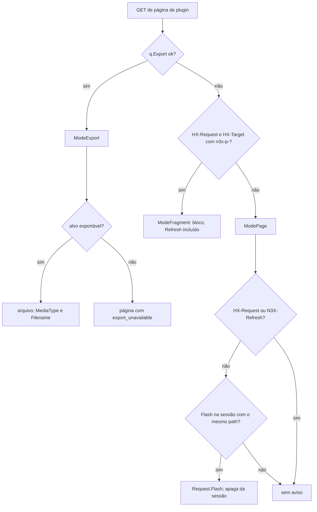
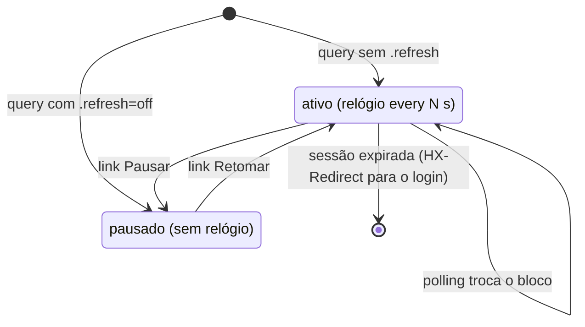

### FDD: Widgets interativos, gráficos e exportação (SDK-11)

Versão: 1.0
Data: 2026-10-20
Responsável: Guilherme Giusti

---

### 1. Contexto e motivação técnica

**Problema técnico.** A FDD 10 fechou os widgets de layout e de conteúdo, o renderizador, o escritor de HTML e o tema de `controller/ui`, e reservou para esta FDD os campos `CSRFToken`, `Root` e `RefreshInterval` do `ui.Request`, a chave `<id>.export` e o `LinkCell`. Faltava o comportamento verificável da parte do catálogo que conversa com o servidor depois de a página estar pronta (ADR-018 e HLD do `n3x-sdk`, grupo "Interação" e `Chart`):

- como o `Refresh` faz polling sem JavaScript próprio, qual intervalo vale quando o plugin pede menos que `panel.refresh_interval`, e o que acontece quando a sessão expira no meio do polling (FR-008)
- para onde um `Link` pode apontar e com quais atributos de segurança
- como `Form` e `Action` levam o token CSRF, escondem o controle de quem não tem o papel, pedem confirmação, para onde o envio vai e o que o operador vê depois
- como o plugin registra o handler que recebe o envio: nenhum documento define (L-53); a FDD 08 só preparou `ctrl.Routes` com a tabela por método e padrão e o papel zero reservado
- como o `Chart` desenha linha e barra em SVG no servidor, com limites, escala, cores com contraste AA nos dois temas e alternativa acessível
- o que a exportação JSON e CSV da `Table` exporta, por qual rota, com qual prazo, papel, limite, nome de arquivo e cabeçalhos, e como neutraliza fórmulas no CSV

Esta entrevista achou cinco problemas novos:

- **Polling contra a WCAG 2.2.2.** Conteúdo que se atualiza sozinho por mais de 5 s, ao lado de outro conteúdo, precisa de um jeito de pausar (critério de nível A). O ADR-008 do `n3x-controller` não previa pausa.
- **Polling que mantém a sessão viva.** Cada polling leva o cookie da sessão; se contar como uso, a expiração por 30 min sem uso (ADR-006 do `n3x-controller`) nunca acontece com uma aba aberta.
- **Polling que apaga o que o operador digita.** O bloco inteiro é trocado a cada intervalo; um filtro ou formulário dentro dele perderia o texto digitado.
- **Herança de atributos do htmx.** `hx-headers`, `hx-target` e `hx-sync` passam do elemento pai para os filhos. Marcar o bloco inteiro como polling marcaria também os cliques do operador dentro dele.
- **Copiar o YAML (FR-007) exige JavaScript.** A área de transferência só é acessível por script, e o painel não serve outro JavaScript além do htmx.

**Encaixe no HLD.** Esta FDD completa o pacote `controller/ui` do módulo `github.com/giustech/n3x-sdk` (HLD do `n3x-sdk`: linha `controller/ui` de "Componentes e responsabilidades", "Catálogo de widgets da v1", "Segurança" e "Contrato de controller") e acrescenta um método a `ctrl.Routes` (pacote `controller/`). Usa o mesmo escritor, os mesmos contextos de aninhamento e o mesmo esquema de IDs da FDD 10. Consumidores:

- FDD 08: `ctrl.Routes` ganha `Action` (L-53), com a mesma tabela por método e padrão
- FDD 12: o host falso simula envios, exportações e polling com as mesmas funções do SDK e confere os destinos de `Form` e `Action`
- FDD 13: página do `n3x.example` com `Refresh`, exportação e uma `Action` de exercício
- FDD 34: valida o token CSRF, guarda o aviso de uso único na sessão e trata a sessão expirada no polling
- FDD 35: monta as rotas POST, escolhe o modo (exportação, fragmento ou página), escreve os cabeçalhos e publica as métricas
- FDDs 44 e 45: telas do core com `Refresh`, exportação e `Code` com download do trecho YAML
- FDDs 47, 48 e 51: guia do autor, testes ponta a ponta e carga do painel

**Atores.** Autor de plugin (monta a árvore e escreve o handler do envio), renderizador (valida e gera HTML, SVG, CSV e JSON), host do painel (FDDs 34 e 35: sessão, CSRF, papel, rotas, aviso de uso único e cabeçalhos), kit de testes (FDD 12), plugin de exemplo (FDD 13), plugin core (FDDs 44 e 45) e operador (mouse, teclado, leitor de tela e planilha).

**Limites.** Como na FDD 10, `controller/ui` é uma biblioteca pura: não abre porta, não lê arquivo, não loga, não publica métricas e não guarda estado global além dos pools. Ela gera a saída e entrega funções puras para o host ler o envio e montar o aviso. Quem valida sessão, token CSRF e papel, guarda o aviso na sessão, monta as rotas POST e escreve status e cabeçalhos é o host (FDDs 34 e 35).

**Suposições**
- Go 1.26 ou superior (ADR-021)
- htmx 2.0.x embutido e servido pelo host (FDD 10), com `includeIndicatorStyles`, `allowEval` e `allowScriptTags` desligados (L-38, fechada na FDD 35); esta FDD usa só o gatilho `every`, `hx-sync`, `hx-headers` com JSON puro e os cabeçalhos de resposta `HX-Redirect`, `HX-Retarget` e `HX-Reswap`
- O cookie de sessão é `SameSite=Strict` (ADR-006 do `n3x-controller`), então requisição de outro site não leva a sessão
- O host aplica sessão, CSRF e papel antes de chamar a função do plugin e repassa ao renderizador o token, o papel e o intervalo pelo `ui.Request` (FDD 10)
- Poucas pessoas operam o painel ao mesmo tempo: até 10 abas abertas com polling (confirmado, para a FDD 51)

**Restrições**
- Nenhum JavaScript além do htmx servido pelo próprio controller; CSP `default-src 'self'` sem script nem estilo inline (PRD, HLD do `n3x-controller`)
- Nenhum widget aceita HTML, tag, atributo, classe ou estilo do plugin (ADR-018); o SVG usa só classes, sem atributo de cor ou de traço
- `controller/ui` não importa o pacote `ctrl`, então o papel chega ao renderizador como `Request.Root` (FDD 10)
- Só biblioteca padrão e `plugin/` em `controller/ui` (FDD 10, ADR-011)
- `Form` e `Action` sem papel declarado exigem root (HLD do `n3x-sdk`); o valor zero de `ctrl.Role` fica reservado para isso (FDD 08)
- Ninguém altera a config dos sidecars pelo painel (FR-008); ações do core sobre usuários e configs ficam fora da v1 (ADR-003 do `n3x-plugin-core`)
- Widget novo e campo novo só em minor; o catálogo é contrato estável (ADR-018 e ADR-021)
- Textos fixos em pt-BR; identificadores, classes, chaves e cabeçalhos em inglês

**Rastreabilidade**
- PRD 1.5: FR-007 (copiar o trecho YAML de um plugin), FR-008 (atualizações parciais via htmx, polling de 5 s, sessão expirada volta à mesma página, ação sem permissão com 403 e mensagem clara), FR-011 (autenticação e permissão antes do plugin; panic em tela vira 500), FR-013 (árvore com tabela, gráfico e formulário); requisitos não funcionais de segurança do painel (CSRF em toda ação, CSP restrita, nenhum JavaScript externo), acessibilidade (WCAG 2.1 AA, todo campo e botão rotulado), desempenho (p95 < 300 ms com 500 sidecars) e compliance (IP e usuário como dado pessoal); FR-010 (v2) como referência do "recorte filtrado exportado em JSON ou CSV"
- ADRs do `n3x-sdk`: ADR-011, ADR-018 e ADR-021; do `n3x-controller`: ADR-006 e ADR-008; do `n3x-plugin-core`: ADR-003
- HLDs: `n3x-sdk/docs/HLD.md` (catálogo, segurança, exemplo do contrato de controller com `Refresh` e `Export`, riscos); `n3x-controller/docs/HLD.md` (fluxo do painel, CSRF em todo método que não é GET, `hx-trigger="every 5s"`, `panel.refresh_interval`, mapa de telas)
- FDDs aplicadas: 01 (`plugin.ID`, `RoutePrefix`, `FieldError`, notação da L-34), 08 (`Routes`, `Role`, `PageFunc`, mapeamento de erro de página, `ui.Query`, `Registrar`), 10 (escritor, contextos, IDs, `Request`, `Result`, `Table`, `Code`, tema, `uitest`), 24 (funções de pacote puras e tabela M)
- Lacunas do README:
  - **L-53 fechada aqui:** o handler de `Form` (método POST) e de `Action` é registrado por um método novo, `ctrl.Routes.Action(path, papel, fn)`, na tabela por método e padrão preparada pela FDD 08. O widget aponta para o destino por `ui.PluginPath`; o papel zero vale root e é guardado como `RoleRoot`; o envio é navegação comum com POST/redirecionamento/GET e aviso de uso único (confirmado; contratos 4 a 6)
  - **L-38 (fechada na FDD 35) recebe restrições:** nada desta FDD depende de estilo inline, de `eval` nem de script; o polling usa só `every`, `hx-sync` e `hx-headers` com JSON puro, sem `js:`; envios não usam htmx
  - **L-22 (fechada na FDD 10) aplicada:** os widgets novos usam o mesmo escritor e o mesmo tema; o tema ganha seis tokens de cor de série (contrato 7)
- Pedidos de FDDs anteriores atendidos:
  - FDD 08 (P-03 dela): registro de `Form` e `Action` em `Routes`, papel zero como root e rota da exportação (contratos 5 e 8)
  - FDD 10 (P-01 dela): mesmo escritor, contextos e IDs (contrato 1); `CSRFToken`, `Root` e `RefreshInterval` do `Request` (contrato 9); chave `<id>.export` (contrato 8); `LinkCell` (contrato 3); `Refresh` como alvo de fragmento (contrato 2); botão de copiar o YAML decidido: sem botão na v1, com download sem JavaScript (contrato 8)
  - FDD 24: as funções de pacote desta FDD são puras, sem I/O, sem goroutine e sem panic; a única API só do host (`ui.ReadSubmission`) vai para a tabela M (contrato 6)

**Decisões aprovadas na clarificação**
- Exportação de `Table` (CSV e JSON) exige root por padrão; o campo novo `Table.ExportAllowRead` (padrão falso) libera a exportação também para o papel de leitura, tabela a tabela, porque o recorte pode ter dado pessoal em massa (IP e usuário, LGPD) que sairia da retenção de 24 h em memória do core e a auditoria formal só chega na v2; o link só é emitido para quem tem permissão e o host valida no servidor (403); o download de `Code` segue a mesma regra. O PRD (FR-008 e FR-013) precisa registrar que leitura não exporta por padrão
- O polling do `Refresh` não renova a inatividade da sessão (cabeçalho `N3X-Refresh: 1`, requisito novo para a FDD 34): a aba aberta cai no login após o prazo de inatividade, e o retorno à mesma página é garantido pelo FR-008; o PRD precisa registrar que a sessão expira por inatividade e que o polling não conta como atividade
- `ui.External` (link externo `https`) sai da v1: só `ui.PluginPath` e `ui.PluginPathOf` (links dentro do painel); `External` fica como adição futura em minor (seção 3, "Fora da v1")
- `ModeExport`, `Request.Path` e `Request.Flash` entram no renderizador; `ChartBar` fica na v1 com contingência de adiar para minor (HLD)
- O HLD (exemplo de `Routes`: `Refresh` e `Table` precisam de `ID`; `Export` por tabela) e o ADR-018 ("papel mínimo" contra `AllowRead`; exportação e CSRF ficam no host) devem ser atualizados no Workflow 3
- As demais hipóteses numéricas, de teste e de baixo risco ficam aceitas como padrão, sem bloqueio

**Pendências não bloqueantes**
- Dependem de outros repositórios: FDD 34 (CSRF em tempo constante, aviso por sessão de 60 s com `TakeFlash`, não renovar a inatividade com `N3X-Refresh`, `HX-Redirect` no polling expirado, token mascarado contra BREACH); FDD 35 (rotas POST, `ModeExport` antes de fragmento, `Content-Disposition`, `no-store` e `nosniff`, 422 para `ErrOutputTooLarge`, CSP com `form-action 'self'`, `base-uri 'none'` e `frame-ancestors 'none'`, `historyCacheSize 0`, `HX-Retarget`); FDD 30 (`panel.refresh_interval` de 1 s a 10 min); FDDs 44 e 45 (exportação do inventário e decisão de não depender de `ChartBar`); FDDs 12, 13, 47, 48 e 51
- Documentar: a pausa do `Refresh` não persiste entre páginas; quando a `PageFunc` falha durante o polling, o bloco mantém os dados antigos; o prefixo `'` do CSV e o JSON são formato para máquina; a ordem repetida de `path_format` nas regras de registro; rotular como exemplo de erro o exemplo do contrato 1 (`Form{ID:"vivo"}` com `AllowRead` em GET)
- Divergências para o Workflow 3: PRD (leitura não exporta por padrão; polling não renova a sessão), HLD linhas 212, 218 e 146, ADR-018 (papel mínimo; templ só no host) e pacotes `controller/ui/uitest`

---

### 2. Objetivos técnicos

- **Envio seguro por construção.** Invariante: todo `<form method="post">` gerado tem exatamente um campo `_csrf` com o token da sessão e um `_return` dentro do prefixo do plugin; nenhum controle de envio sai para quem não é root quando o widget não tem `AllowRead`. Medida: `uitest.Lint` (regra `form_csrf`) sem problema em todos os golden e na galeria; 100% dos envios sem token ou com papel insuficiente recusados pelo host (FDDs 34 e 35) e pelo host falso (FDD 12).
- **Nenhum JavaScript além do htmx.** Medida: 0 `<script>`, 0 atributo `style`, 0 `on*`, 0 `hx-on` e 0 atributo `hx-*` fora da lista do contrato 9 nos golden e na galeria; SVG sem `href`, `<use>`, `<image>`, `<foreignObject>` nem `<style>`.
- **Polling que respeita o operador.** Invariante: o intervalo emitido nunca é menor que `panel.refresh_interval` nem maior que 10 min; todo bloco com polling tem o link de pausa (WCAG 2.2.2); só o elemento relógio leva o cabeçalho `N3X-Refresh`; no máximo 4 blocos `Refresh` por página.
- **Destinos de link previsíveis.** Invariante: todo `href` gerado é `?...`, `#n3x-...` ou um path dentro de `/plugins/<namespace>/<nome>/`; nenhum outro esquema sai (link externo `https` fora da v1).
- **Gráfico acessível e rápido.** Medida: todo `Chart` tem `<title>`, `<desc>` e tabela de dados; cores de série com contraste mínimo de 3:1 contra o fundo e contra a superfície, nos dois temas; linha com 6 séries de 200 pontos em até 1 ms por operação e até 40 alocações (confirmado).
- **Exportação fiel e inofensiva.** Invariante: a exportação leva exatamente as linhas que passam nos filtros da query, na ordenação da query, sem paginação, até 10.000 linhas; nenhuma célula de texto do CSV começa com caractere de fórmula sem o prefixo `'`; o link e o botão de exportar só saem para quem tem permissão (root, ou leitura quando a tabela declara `ExportAllowRead`) e o host recusa os demais com 403 (confirmado). Medida: 10.000 linhas por 8 colunas em até 30 ms (CSV) e 40 ms (JSON) por operação (confirmado).
- **Determinismo herdado.** Invariante: a mesma árvore com o mesmo pedido gera os mesmos bytes em HTML, SVG, CSV e JSON; o fragmento de um `Refresh` é igual ao trecho dele na página.
- **Dado ruim não derruba a tela.** Invariante: destino de link inválido, intervalo fora da faixa, valor infinito, pontos demais e exportação indisponível viram aviso (`Notice`); só estrutura inválida falha.

---

### 3. Escopo e exclusões

**Incluído**
- `ui.Refresh`: intervalo, piso pelo `panel.refresh_interval`, teto, pausa, alvo de fragmento, elemento relógio, regras de conteúdo e limite por página
- `ui.Href`, `ui.Link` e `ui.LinkCell`: destinos permitidos (página do próprio plugin e página de outro plugin; link externo `https` fora da v1) e atributos de segurança
- `ui.Form` (métodos POST e GET, cinco tipos de campo, valores fixos, confirmação, visibilidade por papel) e `ui.Action` (botão de envio com confirmação)
- Registro do handler de envio: `ctrl.Routes.Action`, `ctrl.ActionFunc` e `ctrl.ActionEntry` (L-53)
- Resposta do envio: `ui.Reply` (`Done`, `DoneAt`, `Rejected`), campos reservados do formulário, `ui.ReadSubmission`, `Submission.Finish`, `ui.Flash` e o contrato HTTP do POST que o host implementa
- `ui.Chart` de linha e de barra em SVG gerado no servidor, com escala automática, limites, cores do tema, resumo automático e tabela de dados
- Exportação: `ui.Format`, campos `Table.Export` e `Table.ExportAllowRead`, campos `Code.ID` e `Code.Download`, `Query.Export`, modo `ModeExport`, formatos CSV e JSON, nome do arquivo, cabeçalhos HTTP e neutralização de fórmulas
- Ampliação do contrato do renderizador da FDD 10: campos `Request.Path` e `Request.Flash`, campos `Result.MediaType` e `Result.Filename`, opção `MaxExportBytes`, tags, atributos, URLs e atributos htmx novos, regras e avisos novos
- Apoio a testes: `ui.ActionTargets`, regras novas do `uitest.Lint` e páginas novas da `uitest.Gallery`

**Excluído**
- Widgets de layout e de conteúdo, `ui.Query`, paginação, ordenação e filtros: FDD 10 (SDK-10)
- Validação do token CSRF e da sessão no servidor, guarda do aviso na sessão: FDD 34 (CTL-05); middlewares, cabeçalhos de segurança, montagem das rotas e entrega dos assets: FDD 35 (CTL-06)
- Registro de páginas e papéis por rota de página: FDD 08 (SDK-08); aqui só o método novo `Action`
- Ações do core sobre usuários ou configs: fora da v1 (ADR-003 do `n3x-plugin-core`)
- SSE ou conexão aberta: fora da v1 (ADR-008 do `n3x-controller`)
- Simulação no host falso: FDD 12 (SDK-12); telas concretas do core: FDDs 44 (CORE-08) e 45 (CORE-09)
- Fora da v1, por adição em minor se houver caso real (confirmado): link externo `https` (`ui.External`, com `rel="noopener noreferrer"` e regra de lint própria), envio por htmx com troca parcial, botão de copiar com JavaScript, ação por linha de tabela (`ActionCell`), campo de senha, seleção múltipla, envio de arquivo, carimbo "atualizado às" no `Refresh`, eixo de tempo contínuo, gráfico de área, pizza ou empilhado, exclusão de coluna da exportação, limite de taxa da exportação

---

### 4. Fluxos detalhados e diagramas

**Fluxo principal 1: bloco `Refresh` com polling**
1. A `PageFunc` devolve uma árvore com `ui.Refresh{ID: "resumo", Child: ...}`.
2. O host (FDD 35) chama o renderizador em `ModePage` com `RefreshInterval` igual a `panel.refresh_interval` (5 s).
3. O renderizador calcula o intervalo efetivo: `Every` zero vale `RefreshInterval`; menor que ele sobe para ele; acima de 10 min desce para 10 min; o valor é arredondado para cima em segundos. Ajuste gera o aviso `refresh_clamped`.
4. O renderizador emite `<div id="n3x-p-resumo" class="n3x-refresh">` com:
   - uma barra com o texto "Atualização automática a cada 5s." e o link "Pausar", que aponta para `?<query>&resumo.refresh=off` e troca o próprio bloco
   - o conteúdo do filho; links de paginação, ordenação e abas dentro dele apontam para o bloco `Refresh` mais próximo, não para a tabela ou as abas
   - por último, um elemento relógio vazio, irmão do conteúdo, com `hx-get="?<query>"`, `hx-trigger="every 5s"`, `hx-target="#n3x-p-resumo"`, `hx-swap="outerHTML"`, `hx-sync="this:drop"` e `hx-headers` com `N3X-Refresh: 1`
5. A cada intervalo, o htmx pede a mesma rota com `HX-Request`, `HX-Target: n3x-p-resumo` e `N3X-Refresh: 1`. O host monta a árvore inteira de novo e o renderizador emite só o bloco (`ModeFragment`, regra da FDD 10). O htmx troca o bloco e o novo relógio começa a contar.
6. O host não conta o polling como uso para a expiração por inatividade (pedido à FDD 34), não entrega aviso de uso único e mede o polling à parte (seção 7).

**Fluxo principal 2: envio de uma `Action` (POST, redirecionamento, GET)**
1. Na subida, o plugin registra `r.Action("/negacoes/zerar", ctrl.RoleRoot, e.zerar)` (contrato 5). O host monta `POST /plugins/n3x/example/negacoes/zerar`.
2. A página usa `ui.Action{Label: "Zerar contagem", To: ui.PluginPath("negacoes", "zerar"), Confirm: "..."}`.
3. O renderizador só emite o controle se `Request.Root` for verdadeiro ou se o widget tiver `AllowRead`. Emite um `<form method="post">` comum, sem htmx, com `_csrf` (de `Request.CSRFToken`) e `_return` (de `Request.Path` mais a query atual, sem chaves `<id>.export`). Com `Confirm`, o botão vira um `<details>` nativo que mostra o texto e o botão "Confirmar: ...".
4. O navegador envia o formulário. O host (FDDs 34 e 35), nesta ordem:
   - confere a sessão; sem sessão, responde 303 para `/login?next=<_return>`
   - confere `Content-Type: application/x-www-form-urlencoded` (senão 415) e lê no máximo 64 KiB do corpo (senão 413)
   - chama `ui.ReadSubmission(id, curingas, corpo)`, que separa os campos reservados e monta a entrada do handler com os limites da `ui.Query` (fora dos limites: 400)
   - compara `sub.CSRF()` com o token da sessão em tempo constante (diferente ou ausente: 403 e log `panel_action_refused` com `reason=csrf`)
   - confere `Caller.Role.Meets(entry.Role)` (sem papel: 403 com "Esta ação exige o papel root." e log com `reason=forbidden`)
   - chama `entry.Fn(ctx, sub.Input())` com prazo de `runtime.plugin_call_timeout` (10 s), `Caller` e `request_id`, sob `recover`
5. O handler devolve um `ui.Reply`. O host chama `sub.Finish(reply)`, que devolve o destino e o aviso. O host guarda o aviso na sessão (um por sessão, por até 60 s) e responde `303 See Other` com `Location` no destino.
6. O navegador pede a página de destino com GET. Como é uma página inteira (sem `HX-Request` e sem `N3X-Refresh`) e o path é igual a `Flash.Path()`, o host passa o aviso no `Request.Flash` e o apaga da sessão. O renderizador mostra o aviso no topo do conteúdo da página (`role="status"`).

**Fluxo 3: formulário recusado (`ui.Rejected`)**
- O handler devolve `ui.Rejected("Revise os campos destacados.", ui.FieldProblem{Field: "limit", Message: "Use um inteiro de 1 a 100.000."})`
- `Finish` monta um aviso com o ID do formulário (campo `_form`), a mensagem, os problemas e os valores enviados (para preencher de novo os campos), e o host redireciona para `_return`
- Na página, o renderizador acha o `Form` de mesmo ID: mostra no topo do formulário um resumo com `role="alert"` e links para cada campo com problema; cada campo recebe `aria-invalid="true"`, a mensagem ligada por `aria-describedby` e o valor que o operador tinha digitado
- Se o formulário não estiver na árvore (ou estiver escondido para o papel), a mensagem e a lista de problemas aparecem no aviso do topo da página

**Fluxo 4: exportação de uma tabela**
1. A tabela declara `Export: []ui.Format{ui.CSV, ui.JSON}`. Em modo página, o renderizador emite, acima da tabela, os links "Exportar CSV" e "Exportar JSON" para `?<query atual>&<id>.export=csv`, sem htmx, só se `Request.Root` for verdadeiro ou a tabela tiver `ExportAllowRead` (confirmado); para leitura sem `ExportAllowRead` os links não saem.
2. O operador ativa o link. O host vê a chave pelo `q.Export()`, confere o papel (root, ou leitura quando a tabela declara `ExportAllowRead`; senão 403 com "Esta exportação exige o papel root.") e escolhe `ModeExport` antes de qualquer regra de fragmento (pedido à FDD 35). A sessão é a da página; o prazo é o da página (10 s); a chamada é a mesma `PageFunc`, com a mesma `ui.Query`.
3. O renderizador valida a árvore como numa página, acha a `Table` pelo ID, aplica os filtros e a ordenação da query a todas as linhas entregues, sem paginar, e escreve CSV ou JSON num buffer de até 16 MiB, conferindo o `ctx` a cada 1.000 linhas.
4. O `Result` traz `Mode: ModeExport`, `MediaType`, `Filename` e `Rows`. O host responde 200 com `Content-Type`, `Content-Disposition: attachment`, `Cache-Control: no-store` e `X-Content-Type-Options: nosniff`, e loga `panel_export`.
5. Download de `Code` (FR-007): o mesmo caminho e a mesma regra de papel (root por padrão), com `Code{ID: "cfg", Download: true}` e o valor da chave igual ao formato do `Lang` (`yaml`, `json`, `diff` ou `txt`).

**Fluxo 5: formulário GET (parâmetros da própria página)**
- `ui.Form{Method: ui.MethodGet}` vira `<form method="get" action="?">` sem htmx, com campos ocultos para os outros parâmetros da query atual (menos os campos do próprio formulário e as chaves `<id>.export`), como os filtros da FDD 10
- Não leva token CSRF, não tem handler e não tem papel próprio: o operador navega para a mesma página com os valores na query, e a `PageFunc` lê `q.Get(nome)`
- O renderizador preenche cada campo com o valor da query, se houver, senão com `Field.Value`

**Fluxo 6: link**
- `ui.Link{Label, To}` vira `<a class="n3x-link" href="...">` sem htmx: navegação comum para a página de destino
- Só há destino dentro do painel (`PluginPath` e `PluginPathOf`); link externo `https` está fora da v1

**Fluxo 7: gráfico**
- O renderizador valida a estrutura (tipo, séries, número de valores por série), corta pontos acima do limite com aviso, troca valores infinitos por "sem valor" com aviso, calcula a escala, desenha grade, eixos e séries em coordenadas com uma casa decimal e emite `<figure>` com título visível, SVG (`role="img"` com `<title>` e `<desc>`), legenda e a tabela de dados dentro de `<details>`

**Fluxos alternativos e exceções**
- **Sessão expirada durante o polling:** como o polling não renova a inatividade (confirmado), uma aba aberta e sem uso do operador expira no prazo de inatividade. O host responde à requisição do relógio com `HX-Redirect: /login?next=<path e query de HX-Current-URL>` (qualquer status); o htmx navega para o login e, depois do login, o operador volta à mesma página (FR-008). Sem htmx não há polling (pedido às FDDs 34 e 35)
- **Polling com erro (500, 504) ou sem resposta:** o htmx 2 não troca o conteúdo em resposta 4xx ou 5xx; os dados anteriores continuam na tela e o relógio continua contando
- **Bloco `Refresh` que sumiu da árvore:** o renderizador devolve a página com `Retargeted` (FDD 10) e o host manda `HX-Retarget: #n3x-page`
- **Pausa:** com `<id>.refresh=off` na query, o bloco sai sem relógio, com o texto "Atualização automática pausada." e o link "Retomar", que tira a chave. O estado fica na URL e sobrevive a recarga; valor diferente de `off` gera `query_ignored`
- **Sem JavaScript:** não há polling; links, formulários GET, envios POST e exportações funcionam como navegação comum
- **Envio com sessão expirada:** 303 para o login com `next` igual a `_return`; o envio não é repetido depois do login
- **Token CSRF ausente ou errado:** 403 com a página "O formulário expirou. Volte à página e tente de novo." e link para `_return`, se válido
- **Papel insuficiente:** 403 com "Esta ação exige o papel root." (ou "leitura"), bloqueado no servidor mesmo se o controle tiver aparecido (FR-008)
- **Handler devolve erro:** mapeamento da página (FDD 08): `ctrl.ErrNotFound` dá 404, `ctrl.ErrBadRequest` dá 400, prazo estourado dá 504, outro erro ou panic dá 500, sempre página inteira, sem aviso
- **`_return` ausente ou fora do prefixo do plugin:** o destino vira `/` (visão geral)
- **`DoneAt` para fora do plugin:** ignorado; o destino é o `_return`
- **Exportação indisponível** (tabela fora da árvore, formato não habilitado, mais de 10.000 linhas entregues, `Code` sem `Download`): o renderizador devolve a página com `Result.Mode = ModePage` e o aviso `export_unavailable`; o host responde a página normal
- **Exportação por leitura sem `ExportAllowRead`:** o host responde 403 com "Esta exportação exige o papel root." (e `panel_action_refused`/`reason=forbidden`), mesmo que o link tenha sido digitado à mão
- **Exportação acima de 16 MiB:** `ErrOutputTooLarge`, nada escrito; o host responde 422 com "Recorte grande demais para exportar; use os filtros." (pedido à FDD 35)
- **Duplo clique no botão de envio:** dois POSTs; o handler deve ser idempotente (guia do autor, FDD 47); o SDK não deduplica na v1
- **Aviso de uso único disputado por outra aba:** o polling e os fragmentos nunca consomem o aviso; só uma página inteira com o mesmo path consome
- **Formulário dentro de bloco paginado:** um `Form` em `Tabs` é renderizado também em fragmento, com o mesmo `_return` da URL atual

**Diagramas**

Polling, pausa e sessão expirada:

```mermaid
sequenceDiagram
    participant B as navegador (htmx)
    participant H as host do painel (FDDs 34 e 35)
    participant P as PageFunc
    participant R as ui.Renderer
    B->>H: GET /plugins/n3x/example/negacoes
    H->>P: PageFunc(ctx 10 s, q)
    H->>R: Render(ModePage, RefreshInterval 5 s)
    R-->>H: página com bloco n3x-p-resumo e relógio every 5s
    H-->>B: 200, página
    loop a cada 5 s
        B->>H: GET ?... (HX-Target n3x-p-resumo, N3X-Refresh 1)
        H->>H: sessão válida; não renova a inatividade
        H->>P: PageFunc(ctx, q)
        H->>R: Render(ModeFragment, Target n3x-p-resumo)
        R-->>H: só o bloco
        H-->>B: 200, fragmento; o htmx troca o bloco
    end
    B->>H: GET ?...&resumo.refresh=off (operador pausou)
    H-->>B: bloco sem relógio, com "Retomar"
    B->>H: GET ?... (polling depois de 30 min sem uso)
    H-->>B: HX-Redirect /login?next=/plugins/n3x/example/negacoes
    B->>H: GET /login?next=... (navegação inteira)
```

Envio de uma `Action` com POST, redirecionamento e GET:

```mermaid
sequenceDiagram
    participant B as navegador
    participant H as host do painel
    participant A as ActionFunc do plugin
    participant R as ui.Renderer
    B->>H: POST /plugins/n3x/example/negacoes/zerar (_csrf, _return)
    H->>H: sessão, Content-Type, 64 KiB, ReadSubmission
    H->>H: CSRF em tempo constante; papel (zero = root)
    H->>A: Fn(ctx 10 s, sub.Input())
    A-->>H: ui.Done("Contagem zerada.")
    H->>H: sub.Finish(reply): destino e Flash; guarda o Flash na sessão
    H-->>B: 303 Location /plugins/n3x/example/negacoes?periodo=24h
    B->>H: GET /plugins/n3x/example/negacoes?periodo=24h
    H->>R: Render(ModePage, Flash)
    R-->>H: página com aviso role=status no topo
    H-->>B: 200, página; o aviso sai da sessão
```

Escolha do modo pelo host (amplia o diagrama da FDD 10):



Estados de um bloco `Refresh`:



---

### 5. Contratos públicos (assinaturas, endpoints, headers, exemplos)

**Contrato 1: contextos, IDs e limites dos widgets novos** (amplia os contratos 1 e 7 da FDD 10)
- Tipo: sdk (API Go, pacote `controller/ui`)
- Assinatura/Rota:
  ```go
  package ui // github.com/giustech/n3x-sdk/controller/ui

  // Widgets novos (todos implementam o selo de Widget da FDD 08):
  // Refresh, Link, Form, Action, Chart.

  const (
      MaxRefresh          = 4                // blocos Refresh por árvore
      DefaultRefreshEvery = 5 * time.Second  // quando Request.RefreshInterval é zero
      MinRefreshInterval  = time.Second      // menor Request.RefreshInterval aceito
      MaxRefreshEvery     = 10 * time.Minute // teto do intervalo efetivo
      MaxFormFields       = 16
      MaxFormParams       = 8                // valores fixos por Form ou Action
      MaxFieldBytes       = 1024             // igual a MaxQueryValueLen (FDD 08)
      MaxHrefSegments     = 8
      MaxHrefParams       = 16
      MaxURLBytes         = 2048
      MaxChartSeries      = 6                // linha
      MaxChartBarSeries   = 4                // barra
      MaxChartPoints      = 200              // rótulos numa linha
      MaxChartBars        = 50               // rótulos numa barra
  )
  ```
- Método: n/a (chamada local)
- Semântica:
  - Os widgets novos usam o mesmo escritor, as mesmas regras de escape, os mesmos contextos e o mesmo esquema de IDs da FDD 10
  - `Refresh.ID`, `Form.ID` e `Code.ID` dividem o espaço de IDs de `Table` e `Tabs`: mesma gramática `^[a-z][a-z0-9_]{0,23}$` e únicos na árvore (`duplicate_id`)
  - Nomes de campo de `Form` e de `Param` seguem a mesma gramática; não podem começar com `_`, então nunca colidem com os campos reservados `_csrf`, `_form` e `_return`
  - Contextos dos widgets novos:

| Widget | Bloco e abas | Compacto | Cartão | Dentro de `Refresh` |
| --- | --- | --- | --- | --- |
| `Refresh` | sim | não (`compact_widget`) | não (`card_widget`) | não (`refresh_nested`) |
| `Link` | sim | sim | sim | sim |
| `Form` | sim | não (`compact_widget`) | não (`card_widget`) | não (`refresh_input`) |
| `Action` | sim | sim | não (`card_widget`) | não (`refresh_input`) |
| `Chart` | sim | não (`compact_widget`) | sim | sim |
| `Table` com `Filters` (FDD 10) | sim | não | sim, estática | não (`refresh_input`) |

  - `LinkCell` vale em qualquer `TableRow`
  - Em cartão, `Table.Export` e `Code.Download` são ignorados sem erro (a tabela já é estática, FDD 10), porque a visão geral é uma página do host e a chave da query não chegaria ao plugin
  - IDs de elemento novos (sem `-` nas partes vindas do autor, como na FDD 10):

| ID | Elemento |
| --- | --- |
| `n3x-p-<id>` | bloco `Refresh` (alvo de fragmento) e `Form` |
| `n3x-p-<id>-pause` | link de pausa ou de retomada do `Refresh` (o htmx devolve o foco a ele depois da troca) |
| `n3x-p-<form>-in-<campo>`, `-help-<campo>`, `-err-<campo>` | controle, ajuda e erro de um campo |
| `n3x-p-<form>-errors` | resumo dos problemas do formulário |
| `n3x-p-_c<N>-title`, `-desc`, `-caption` | título, descrição e legenda da tabela de dados do N-ésimo gráfico, em ordem de documento |
| `n3x-c-<namespace>-<nome>-<cartão>-_c<N>-...` | os mesmos, dentro de um cartão |
| `n3x-flash` | aviso de uso único no topo da página |

  - **Alvo dos controles dentro de `Refresh`:** todo link `?` gerado dentro de um bloco `Refresh` (paginação, ordenação, abas, pausa) usa `hx-target="#n3x-p-<id do Refresh>"`. Assim, o bloco volta inteiro, com o relógio apontando para a query nova; sem isso, o próximo polling desfaria a página escolhida

**Exemplo de requisição** (exemplo de erro, inválido de propósito: aninha `Refresh`, põe controle de entrada em `Refresh`, `Chart` em contexto compacto, repete o ID `vivo` e usa `AllowRead` em formulário GET)
```go
ui.Page{Title: "Cotas", Body: ui.Column{Children: []ui.Widget{
    ui.Refresh{ID: "vivo", Child: ui.Column{Children: []ui.Widget{
        ui.Refresh{ID: "dentro", Child: ui.Text{Text: "x"}},
        ui.Table{ID: "limites", Caption: "Limites", Columns: cols,
            Filters: []ui.Filter{{Key: "busca", Label: "Buscar"}}},
        ui.Action{Label: "Zerar", To: ui.PluginPath("zerar")},
    }}},
    ui.Detail{Items: []ui.DetailItem{{Label: "Uso", Value: ui.Chart{Title: "Uso", Series: series}}}},
    ui.Form{ID: "vivo", Label: "Período", Method: ui.MethodGet, AllowRead: true, Fields: campos},
}}}
```

**Exemplo de resposta** (`err.Error()` de `ui.Check(raiz, ui.ModePage)`; `errors.Is(err, ui.ErrInvalidTree)` verdadeiro)
```text
Page.Body.Children[0].Child.Children[0]: Refresh dentro de Refresh [refresh_nested]
Page.Body.Children[0].Child.Children[1].Filters: tabela com filtros dentro de Refresh [refresh_input]
Page.Body.Children[0].Child.Children[2]: Action dentro de Refresh [refresh_input]
Page.Body.Children[1].Items[0].Value: Chart não é aceito em contexto compacto [compact_widget]
Page.Body.Children[2].ID: ID repetido na árvore [duplicate_id]
Page.Body.Children[2].AllowRead: só vale em formulário POST [form_method]
```

---

**Contrato 2: `ui.Refresh` (polling htmx)**
- Tipo: sdk (API Go e formato de saída)
- Assinatura/Rota:
  ```go
  type Refresh struct {
      ID    string        // obrigatório; único na árvore; alvo de fragmento n3x-p-<id>
      Label string        // opcional; completa o nome acessível do link de pausa
      Every time.Duration // 0 = Request.RefreshInterval; menor sobe para ele; acima de 10 min desce
      Child Widget        // contexto de bloco, sem Refresh, Form, Action nem Table com filtros
  }

  // Chave da query reservada ao renderizador (FDD 10, contrato 5): <id>.refresh=off
  const RefreshHeader = "N3X-Refresh" // cabeçalho enviado só pelo elemento relógio
  ```
- Método: o polling é `GET` na mesma rota da página, com `HX-Request: true`, `HX-Target: n3x-p-<id>` e `N3X-Refresh: 1`
- Semântica de status/headers:
  - **Intervalo efetivo:** `e = Every`, ou `Request.RefreshInterval` se `Every` for zero; `e` menor que `RefreshInterval` sobe para ele e `e` acima de `MaxRefreshEvery` desce para 10 min, os dois com o aviso `refresh_clamped`; o valor emitido é `every <segundos>s`, arredondado para cima. O plugin pode pedir um intervalo maior que o do operador, nunca menor (o `panel.refresh_interval` é o piso e o padrão, ADR-008)
  - **Teto por página:** no máximo 4 blocos `Refresh` na árvore (`too_many`), porque cada bloco é uma chamada inteira da `PageFunc` por intervalo e por aba aberta (confirmado, medida na FDD 51)
  - **Elemento relógio:** um `<span class="n3x-refresh__tick">` vazio, último filho do bloco, irmão do conteúdo. Só ele leva `hx-get`, `hx-trigger`, `hx-sync="this:drop"` e `hx-headers`. Como os atributos do htmx são herdados por descendentes, pôr o polling no próprio bloco marcaria com `N3X-Refresh` também os cliques do operador
  - **`hx-sync="this:drop"`:** um polling não começa enquanto o anterior do mesmo relógio não terminou
  - **Cabeçalho `N3X-Refresh: 1`:** o host não renova a inatividade da sessão com essa requisição (requisito novo para a FDD 34, confirmado), não entrega aviso de uso único e mede à parte (pedidos às FDDs 34 e 35). A sessão continua obrigatória e o prazo absoluto continua valendo. Consequência: uma aba aberta cai no login após o prazo de inatividade (`HX-Redirect`), e o retorno à mesma página é garantido pelo FR-008; o polling não conta como atividade
  - **Pausa (WCAG 2.2.2):** a barra do bloco mostra "Atualização automática a cada 5s." e o link "Pausar" (`?<query>&<id>.refresh=off`); pausado, o bloco sai sem relógio, com "Atualização automática pausada." e o link "Retomar" (query sem a chave). Os dois links trocam o próprio bloco, com `hx-push-url="true"`, e funcionam sem JavaScript
  - **Leitor de tela:** o bloco não é `aria-live`; atualização a cada poucos segundos não é anunciada
  - **Conteúdo proibido:** `Form`, `Action` e `Table` com `Filters` dentro do bloco (`refresh_input`), porque o polling trocaria o que o operador está digitando ou fecharia a confirmação aberta. Paginação, ordenação, abas, links e exportação são permitidos
  - **Fragmento:** o fragmento `n3x-p-<id>` é byte a byte igual ao trecho do bloco na página (invariante da FDD 10)
  - **Query do relógio:** a query atual, sem chaves `<id>.export` e com os links de estado preservados; sem query, `hx-get="?"`

**Exemplo de requisição** (query `?periodo=24h`, `Request.RefreshInterval` de 5 s)
```go
ui.Refresh{ID: "resumo", Label: "Resumo", Every: 2 * time.Second,
    Child: ui.Row{Children: []ui.Widget{ui.Stat{Label: "Negações", Value: ui.FormatInt(12345)}}}}
```

**Exemplo de resposta** (mais o aviso `refresh_clamped` no `Result`, porque 2 s ficou abaixo do piso)
```html
<div id="n3x-p-resumo" class="n3x-refresh">
<p class="n3x-refresh__bar"><span class="n3x-refresh__status">Atualização automática a cada 5s.</span> <a id="n3x-p-resumo-pause" class="n3x-link" href="?periodo=24h&amp;resumo.refresh=off" hx-get="?periodo=24h&amp;resumo.refresh=off" hx-target="#n3x-p-resumo" hx-swap="outerHTML" hx-push-url="true">Pausar<span class="n3x-sr-only"> a atualização: Resumo</span></a></p>
<div class="n3x-row n3x-gap-md"><div class="n3x-stat"><span class="n3x-stat__label">Negações</span><span class="n3x-stat__value">12.345</span></div></div>
<span class="n3x-refresh__tick" hx-get="?periodo=24h" hx-trigger="every 5s" hx-target="#n3x-p-resumo" hx-swap="outerHTML" hx-sync="this:drop" hx-headers="{&quot;N3X-Refresh&quot;:&quot;1&quot;}"></span>
</div>
```

---

**Contrato 3: `ui.Href`, `ui.Link` e `ui.LinkCell`**
- Tipo: sdk (API Go)
- Assinatura/Rota:
  ```go
  // Href é um destino de link ou de envio. Opaco; o valor zero é "sem destino".
  type Href struct{ /* tipo, plugin, segmentos e parâmetros */ }

  func PluginPath(segments ...string) Href                 // página do próprio plugin
  func PluginPathOf(id plugin.ID, segments ...string) Href // página de outro plugin do painel
  func (h Href) With(key, value string) Href               // acrescenta um parâmetro de query (cópia)
  func (h Href) IsZero() bool

  type Link struct {
      Label string // obrigatório; texto visível e nome acessível
      To    Href   // obrigatório
  }

  // LinkCell exibe label como link; filtra, ordena e exporta pelo label.
  func LinkCell(label string, to Href) Cell
  ```
- Método: n/a (navegação comum, `GET`, sem htmx)
- Semântica:
  - **Página de plugin:** `/plugins/<namespace>/<nome>/` mais os segmentos, cada um escapado com `url.PathEscape`, unidos por `/`. `PluginPath` usa `Request.Plugin`; sem segmentos, é a raiz do plugin. Qualquer texto vira segmento seguro (ex.: um nome de instância); segmento vazio, `.`, `..`, acima de 256 bytes, com UTF-8 inválido ou caractere de controle é inválido
  - **Parâmetros:** `With` acrescenta pares na ordem de chamada; a URL sai com `url.Values.Encode` (chaves em ordem). Chaves com `.` são aceitas, para um cartão apontar para uma tabela já filtrada (ex.: `sidecars.f.estado=desconectado`). Até 16 pares, chave de 1 a 64 bytes, valor até 1024 bytes
  - **Sem destino externo (confirmado):** a v1 não tem `ui.External`; não há `https`, `http`, `mailto`, `javascript` nem `data`, e o `Href` só aponta para páginas do painel. `External` fica como adição futura em minor (seção 3, "Fora da v1")
  - **Outros painéis do host** (visão geral, login): fora do `Href` na v1; o menu já leva a eles
  - **Inválido é dado, não estrutura:** `Href` com conteúdo inválido não derruba a página: o link sai como texto simples e gera o aviso `link_invalid`. Só o `Href` zero onde ele é obrigatório é erro (`required`)
  - **Construtores puros:** nenhum construtor faz panic nem valida na hora; a validação acontece na renderização (pedido da FDD 24)

**Exemplo de requisição** (plugin `n3x.example`)
```go
ui.Column{Children: []ui.Widget{
    ui.Link{Label: "Sidecars desconectados", To: ui.PluginPathOf(plugin.MustParseID("n3x.core"), "sidecars").
        With("sidecars.f.estado", "desconectado")},
    ui.Link{Label: "Detalhe de pedidos", To: ui.PluginPath("servicos", "pedidos")},
    ui.Link{Label: "Intranet", To: ui.PluginPath("..", "x")},
}}
```

**Exemplo de resposta** (mais o aviso `link_invalid` no `Result`)
```html
<div class="n3x-column n3x-gap-md">
<a class="n3x-link" href="/plugins/n3x/core/sidecars?sidecars.f.estado=desconectado">Sidecars desconectados</a>
<a class="n3x-link" href="/plugins/n3x/example/servicos/pedidos">Detalhe de pedidos</a>
<span class="n3x-text">Intranet</span>
</div>
```

---

**Contrato 4: `ui.Form`, `ui.Field`, `ui.Param` e `ui.Action`**
- Tipo: sdk (API Go e formato de saída)
- Assinatura/Rota:
  ```go
  type FormMethod uint8

  const (
      MethodPost FormMethod = iota // valor zero: envio que muda estado; CSRF, papel e Routes.Action
      MethodGet                    // parâmetros da própria página; sem CSRF, sem handler
  )

  type FieldKind uint8

  const (
      FieldText     FieldKind = iota // <input type="text">
      FieldNumber                    // inteiro: type="text" com inputmode="numeric"
      FieldTextArea                  // <textarea rows="4">
      FieldSelect                    // <select> com Options
      FieldCheckbox                  // marcado envia "on"; desmarcado não envia nada
  )

  type Field struct {
      Name     string    // obrigatório; ^[a-z][a-z0-9_]{0,23}$; único no Form; chave enviada
      Label    string    // obrigatório; vira <label for>
      Kind     FieldKind
      Value    string    // valor inicial; FieldCheckbox: "on" = marcado; até 1024 bytes
      Help     string    // opcional; ligado por aria-describedby
      Required bool      // atributo required e marca "*"
      Options  []Option  // só FieldSelect: 1 a 50 (Option da FDD 10)
  }

  // Param é um valor fixo enviado junto (campo oculto), ex.: o serviço da tela.
  type Param struct {
      Name  string // mesma regra de Field.Name
      Value string // até 1024 bytes
  }

  type Form struct {
      ID        string     // obrigatório; único na árvore; volta no campo _form
      Label     string     // obrigatório; <legend> e nome acessível
      Method    FormMethod
      To        Href       // MethodPost: obrigatório, página do próprio plugin registrada em Routes.Action
      Fields    []Field    // 1 a 16
      Hidden    []Param    // 0 a 8
      Submit    string     // rótulo do botão; vazio = "Enviar" (POST) ou "Aplicar" (GET)
      Confirm   string     // só POST: texto de confirmação antes de enviar
      AllowRead bool       // só POST: o controle aparece também para leitura; zero = só root
  }

  type Action struct {
      Label     string  // obrigatório; texto do botão
      To        Href    // obrigatório; página do próprio plugin registrada em Routes.Action
      Values    []Param // 0 a 8
      Tone      Tone    // ToneDanger para ação destrutiva (FDD 10)
      Confirm   string  // texto de confirmação; vazio envia direto
      AllowRead bool    // zero = só root
  }
  ```
- Método: `Form` POST e `Action` geram `<form method="post">` comum, sem htmx; `Form` GET gera `<form method="get" action="?">`, sem htmx
- Semântica:
  - **Destino:** `To` precisa ser `PluginPath` (ou `PluginPathOf` com o próprio ID); outro plugin dá `action_target`. O path montado tem de casar com um padrão registrado por `Routes.Action`; o host falso confere (FDD 12), o real responde 404 ou 405
  - **Campos reservados:** todo POST visível leva, antes do `<fieldset>`, os ocultos `_csrf` (de `Request.CSRFToken`), `_form` (só `Form`, com o ID) e `_return` (`Request.Path` mais `?` e a query atual sem chaves `<id>.export`; acima de 2048 bytes, só o path). Depois vêm os `Param`
  - **Visibilidade (confirmado):** o modelo é `AllowRead bool` no widget mais o papel registrado em `Routes.Action`, sem campo `Role` no widget (papel zero = root); o HLD e o ADR-018 ("papel mínimo") devem alinhar o texto no Workflow 3. Com `Request.Root` falso e `AllowRead` falso, o renderizador não emite o controle. Isso é apresentação: quem autoriza é o host, pelo papel registrado em `Routes.Action` (FR-008: "bloqueada também no servidor"). O host falso confere que `AllowRead` bate com o papel registrado (`RoleRead` contra o zero ou `RoleRoot`)
  - **Pedido incompleto:** se a saída tem algum POST visível e `CSRFToken` está vazio ou fora do formato (16 a 256 bytes ASCII imprimíveis, sem espaço), ou `Path` está vazio ou fora de `Plugin.RoutePrefix()`, a renderização devolve `ErrInvalidRequest` sem escrever nada
  - **Confirmação (confirmado):** com `Confirm`, o botão vira `<details class="n3x-confirm">`, com o `<summary>` no lugar do botão e, dentro, o texto e o botão "Confirmar: <rótulo>". Nativo, acessível por teclado, sem JavaScript e sem `hx-confirm`
  - **Campos:** `<fieldset>` com `<legend>`; cada campo com `<label for>`; `Help` em `<p class="n3x-help">` ligado por `aria-describedby`; `Required` gera `required="required"` e a marca visual "*" (oculta para leitor de tela, porque o `required` já é anunciado), com a nota "Campos com * são obrigatórios." no topo; texto, número e área de texto com `maxlength="1024"`; `FieldNumber` usa `type="text"` e `inputmode="numeric"`, sem setas nem rolagem acidental (padrão do GOV.UK, confirmado); valor de seleção fora das opções deixa nenhuma opção marcada
  - **Estado recusado:** com `Request.Flash` de um `Rejected` cujo ID é o do `Form`, o renderizador mostra o resumo `n3x-p-<form>-errors` com `role="alert"` e links `#n3x-p-<form>-in-<campo>`, marca os campos com `aria-invalid="true"`, liga a mensagem por `aria-describedby` e preenche os valores enviados
  - **GET:** sem `_csrf`, `_form` e `_return`; campos ocultos com os outros parâmetros da query atual (menos os nomes dos campos e as chaves `<id>.export`); cada campo vem preenchido pela query, se houver, senão por `Field.Value`. `To`, `Confirm` e `AllowRead` em GET dão `form_method`
  - **Botões:** `<button type="submit" class="n3x-button">`; `Action` com `Tone` ganha `n3x-tone-<tom>`; o texto é sempre visível
  - **Fragmento:** `Form` e `Action` dentro de `Tabs` saem também no fragmento das abas, com o `_return` da URL do fragmento

**Exemplo de requisição** (plugin `giustech.quota`; `Request{Path: "/plugins/giustech/quota/limites/pedidos", Query: periodo=24h, CSRFToken: "k3J9w2Qx7vT1mN5pR8sY4uZ6", Root: true}`)
```go
ui.Column{Children: []ui.Widget{
    ui.Form{ID: "limite", Label: "Limite do serviço", To: ui.PluginPath("limites", "salvar"),
        Hidden: []ui.Param{{Name: "service", Value: "pedidos"}},
        Fields: []ui.Field{
            {Name: "limit", Label: "Requisições por minuto", Kind: ui.FieldNumber, Value: "100",
                Required: true, Help: "Inteiro de 1 a 100.000."},
            {Name: "mode", Label: "Modo", Kind: ui.FieldSelect, Value: "local",
                Options: []ui.Option{{Value: "local", Label: "Local"}, {Value: "redis", Label: "Redis"}}},
            {Name: "enabled", Label: "Limite ativo", Kind: ui.FieldCheckbox, Value: "on"},
        },
        Submit: "Salvar"},
    ui.Action{Label: "Zerar contadores", To: ui.PluginPath("limites", "pedidos", "zerar"),
        Tone: ui.ToneDanger, Confirm: "Zerar os contadores de pedidos? Isso não pode ser desfeito."},
}}
```

**Exemplo de resposta** (com `Root: false`, os dois controles não saem, porque nenhum tem `AllowRead`)
```html
<div class="n3x-column n3x-gap-md">
<form id="n3x-p-limite" class="n3x-form" method="post" action="/plugins/giustech/quota/limites/salvar">
<input type="hidden" name="_csrf" value="k3J9w2Qx7vT1mN5pR8sY4uZ6" />
<input type="hidden" name="_form" value="limite" />
<input type="hidden" name="_return" value="/plugins/giustech/quota/limites/pedidos?periodo=24h" />
<input type="hidden" name="service" value="pedidos" />
<fieldset class="n3x-form__set"><legend class="n3x-form__title">Limite do serviço</legend>
<p class="n3x-help">Campos com * são obrigatórios.</p>
<div class="n3x-field"><label for="n3x-p-limite-in-limit">Requisições por minuto<span class="n3x-form__req" aria-hidden="true"> *</span></label><p id="n3x-p-limite-help-limit" class="n3x-help">Inteiro de 1 a 100.000.</p><input id="n3x-p-limite-in-limit" type="text" inputmode="numeric" name="limit" value="100" maxlength="1024" required="required" aria-describedby="n3x-p-limite-help-limit" /></div>
<div class="n3x-field"><label for="n3x-p-limite-in-mode">Modo</label><select id="n3x-p-limite-in-mode" name="mode"><option value="local" selected="selected">Local</option><option value="redis">Redis</option></select></div>
<div class="n3x-field n3x-field--check"><input id="n3x-p-limite-in-enabled" type="checkbox" name="enabled" value="on" checked="checked" /><label for="n3x-p-limite-in-enabled">Limite ativo</label></div>
<div class="n3x-form__actions"><button type="submit" class="n3x-button">Salvar</button></div>
</fieldset>
</form>
<form class="n3x-action" method="post" action="/plugins/giustech/quota/limites/pedidos/zerar">
<input type="hidden" name="_csrf" value="k3J9w2Qx7vT1mN5pR8sY4uZ6" />
<input type="hidden" name="_return" value="/plugins/giustech/quota/limites/pedidos?periodo=24h" />
<details class="n3x-confirm"><summary class="n3x-button n3x-tone-danger">Zerar contadores</summary><div class="n3x-confirm__body"><p class="n3x-text">Zerar os contadores de pedidos? Isso não pode ser desfeito.</p><button type="submit" class="n3x-button n3x-tone-danger">Confirmar: Zerar contadores</button></div></details>
</form>
</div>
```

---

**Contrato 5: `ctrl.Routes.Action`, `ctrl.ActionFunc` e `ctrl.ActionEntry` (L-53)**
- Tipo: sdk (interface Go implementada só pela plataforma; pacote `ctrl`)
- Assinatura/Rota:
  ```go
  package ctrl

  // ActionFunc trata o envio de um Form com MethodPost ou de uma Action.
  // in traz os curingas do path (Param) e os campos do corpo (Get, Values, Has),
  // sem os campos reservados; os limites são os da ui.Query (FDD 08).
  type ActionFunc func(ctx context.Context, in ui.Query) (ui.Reply, error)

  type Routes interface {
      // Page registra uma página GET (FDD 08).
      Page(path string, role Role, fn PageFunc, opts ...PageOption)
      // Action registra o destino POST /plugins/<namespace>/<nome>/<path sem a barra inicial>.
      // role zero ("não declarado") vale RoleRoot (L-53); RoleRead e RoleRoot também são aceitos.
      Action(path string, role Role, fn ActionFunc)
  }

  type ActionEntry struct {
      Path    string     // como o plugin escreveu: "/negacoes/zerar"
      Pattern string     // montado: "/plugins/n3x/example/negacoes/zerar"
      Role    Role       // nunca zero: o zero é guardado como RoleRoot
      Fn      ActionFunc
  }

  func (r *Registrar) Actions() []ActionEntry // cópia, na ordem de registro

  const MaxActions = 32 // por plugin (confirmado)
  ```
- Método: `POST`; o host responde 405 com `Allow` para outro método num padrão só de ação
- Semântica:
  - **Um método para os dois widgets:** `Form` POST e `Action` são o mesmo envio (formulário urlencoded); muda só se há campos
  - **Gramática e posse:** a mesma de `Page` (FDD 08): path relativo ao prefixo, curingas `{nome}` (até 4), checagem por `id.OwnsRoute`. O widget aponta para um path concreto (`ui.PluginPath("limites", "pedidos", "zerar")`), que casa com o padrão `/limites/{service}/zerar`
  - **Tabela por método e padrão (FDD 08):** uma página GET e uma ação POST podem ter o mesmo padrão; duas ações com o mesmo esqueleto não
  - **Papel:** o valor zero vale root e vira `RoleRoot` no `ActionEntry`, então o host nunca vê zero; `RoleSidecar`, `RolePlugin` e valores inválidos dão `invalid_role`
  - **Regras de registro** (um problema por chamada, nesta ordem): `invalid_role`, `nil_handler`, `path_format` (vazio, sem barra inicial ou acima de 256 bytes), `foreign_route`, `path_format` (gramática), `duplicate_route`, `too_many` (`path_format` aparece duas vezes na ordem de propósito: primeiro o formato básico do texto, depois a gramática do padrão, depois da posse). Caminho do problema: `actions["<path>"]` (notação da L-34). `Registrar.Close()` devolve esses problemas junto com os de páginas e cartões, com `ErrRegistration`
  - **Prazo e chamador:** `ctx` com `runtime.plugin_call_timeout` (10 s), `request_id` e `Caller` `{read ou root, usuário}`, como numa página
  - **Erros do handler:** o mesmo mapeamento da página (FDD 08): `ErrNotFound` 404, `ErrBadRequest` 400, prazo 504, outro erro, panic ou `ui.Reply` com erro não nulo 500; o texto do erro só vai para o log
  - **Compatibilidade:** método novo em interface implementada só pela plataforma: minor (FDD 08, contrato 12)

**Exemplo de requisição**
```go
func (e *Example) Routes(r ctrl.Routes) {
    r.Page("/negacoes", ctrl.RoleRead, e.paginaNegacoes, ctrl.InMenu("Negações"))
    r.Action("/negacoes/zerar", 0, e.zerar)              // papel não declarado: root
    r.Action("/negacoes/zerar", ctrl.RoleRoot, e.zerar)  // repetido
    r.Action("/limites", ctrl.RoleSidecar, e.salvar)
    r.Action("/../core/x", ctrl.RoleRead, e.salvar)
}
// No host: err := reg.Close(); acoes := reg.Actions()
```

**Exemplo de resposta**
```text
actions["/negacoes/zerar"]: mesmo padrão que /negacoes/zerar [duplicate_route]
actions["/limites"]: papel sidecar não vale para ação; use RoleRead, RoleRoot ou o valor zero (root) [invalid_role]
actions["/../core/x"]: padrão /plugins/n3x/example/../core/x fora de /plugins/n3x/example/ [foreign_route]
```
```json
{
  "errors.Is(err, ctrl.ErrRegistration)": true,
  "reg.Pages()": [{ "Path": "/negacoes", "Pattern": "/plugins/n3x/example/negacoes", "Role": "read", "Menu": "Negações" }],
  "reg.Actions()": [{ "Path": "/negacoes/zerar", "Pattern": "/plugins/n3x/example/negacoes/zerar", "Role": "root" }]
}
```

---

**Contrato 6: envio e resposta (`ui.Reply`, `ui.Submission`, `ui.Flash`) e o contrato HTTP do POST**
- Tipo: sdk (API Go) e endpoint implementado pelo host (FDDs 34 e 35)
- Assinatura/Rota:
  ```go
  package ui

  // Lado do plugin.
  type Reply struct{ /* opaca; o valor zero equivale a Done("") */ }

  func Done(message string) Reply                                 // sucesso; volta à página de origem
  func DoneAt(to Href, message string) Reply                      // sucesso; vai para outra página do plugin
  func Rejected(message string, problems ...FieldProblem) Reply   // entrada recusada; mostra os problemas

  type FieldProblem struct {
      Field   string // Field.Name do formulário; desconhecido aparece só no resumo
      Message string // até 256 bytes
  }

  // Lado do host e do kit (ReadSubmission entra na tabela M da FDD 24).
  const (
      CSRFField        = "_csrf"
      FormField        = "_form"
      ReturnField      = "_return"
      MaxSubmitBytes   = 64 << 10         // corpo do POST
      FlashTTL         = 60 * time.Second // vida do aviso na sessão
      MaxFlashBytes    = 16 << 10
      MaxReplyProblems = 32
  )

  type Submission struct{ /* opaca */ }

  // ReadSubmission separa os campos reservados e monta a entrada do handler.
  // body é o corpo urlencoded já lido (até MaxSubmitBytes); params são os curingas do padrão.
  func ReadSubmission(id plugin.ID, params map[string]string, body url.Values) (Submission, error)

  func (s Submission) Input() Query   // curingas e campos sem "_"
  func (s Submission) CSRF() string    // valor de _csrf; "" se ausente
  func (s Submission) Form() string    // valor de _form; "" em Action
  func (s Submission) Return() string  // _return conferido; "" se ausente ou inválido

  // Finish devolve o destino do 303 e o aviso a guardar na sessão.
  func (s Submission) Finish(r Reply) (location string, f Flash)

  type Flash struct{ /* opaca: tipo, mensagem, formulário, problemas, valores e path */ }

  func (f Flash) IsZero() bool
  func (f Flash) Path() string // path do destino; o host só entrega o aviso nesse path
  func (f Flash) Bytes() int   // tamanho estimado, para o teto da sessão
  ```
- Método: `POST /plugins/<namespace>/<nome>/<path>`, `Content-Type: application/x-www-form-urlencoded`
- Semântica de status/headers:
  - **Por que POST, redirecionamento e GET sem htmx (confirmado):** o envio funciona igual com e sem JavaScript; recarregar a página depois não reenvia; erro de status é página inteira, que o navegador mostra sem configuração do htmx (o htmx 2 não troca respostas 4xx e 5xx); o foco volta ao topo da página e o aviso tem papel de status. A ação é rara no painel (FR-008: só leitura de configs), então o custo da recarga inteira é pequeno. As atualizações parciais continuam no polling, na paginação, na ordenação e nas abas
  - **`ReadSubmission`:** cada campo reservado aceita no máximo um valor (mais de um é `ErrInvalidQuery`); campos desconhecidos começando com `_` são ignorados (reserva para minor); o restante vai para `NewQuery(params, valores)` com os limites da FDD 08 (`ErrInvalidQuery`, 400). `_return` vale só se começar com `id.RoutePrefix()`, não tiver `//`, `\`, segmento `.` ou `..`, esquema nem caractere de controle e tiver até 2048 bytes
  - **`Finish`:** destino = alvo do `DoneAt` se for página do próprio plugin; senão `Return()`; senão `/`. O aviso guarda o tipo (`done` ou `rejected`), a mensagem (padrão "Ação concluída." ou "Revise os campos destacados."; até 1 KiB), o ID do formulário, até 32 problemas e, só em `Rejected`, os valores enviados para preencher de novo; acima de `MaxFlashBytes`, os valores são descartados e ficam mensagem e problemas
  - **Guarda do aviso (pedido à FDD 34):** um aviso por sessão (o mais novo vence), por até `FlashTTL`, entregue ao renderizador só numa página inteira (sem `HX-Request`, sem `N3X-Refresh`, fora de `ModeExport`) cujo path é igual a `Flash.Path()`, e apagado depois de entregue
  - **Ordem no host:** sessão, `Content-Type` e tamanho, `ReadSubmission`, CSRF em tempo constante, papel, handler; a checagem de `Origin` ou `Sec-Fetch-Site` como defesa extra fica a critério da FDD 34

| Situação | Status e cabeçalhos | Corpo |
| --- | --- | --- |
| Sucesso (`Done`, `DoneAt`) ou recusa (`Rejected`) | `303 See Other`, `Location: <destino>`, `Cache-Control: no-store` | vazio |
| Sem sessão ou sessão expirada | `303`, `Location: /login?next=<_return ou />` | vazio |
| `_csrf` ausente ou diferente | `403` | "O formulário expirou. Volte à página e tente de novo." |
| Papel insuficiente | `403` | "Esta ação exige o papel root." (ou "leitura") |
| `Content-Type` diferente de urlencoded | `415` | página genérica |
| Corpo acima de 64 KiB | `413` | página genérica |
| Campos fora dos limites da `ui.Query` | `400` | página genérica |
| Handler: `ErrNotFound`, `ErrBadRequest`, prazo, outro erro ou panic | `404`, `400`, `504`, `500` | página genérica; texto do erro só no log |
| Outro método num padrão só de ação | `405`, `Allow: POST` | vazio |

**Exemplo de requisição**
```text
POST /plugins/giustech/quota/limites/salvar HTTP/1.1
Host: n3x.exemplo.com.br:17444
Content-Type: application/x-www-form-urlencoded
Origin: https://n3x.exemplo.com.br:17444
Cookie: n3x_session=<id da sessão>

_csrf=k3J9w2Qx7vT1mN5pR8sY4uZ6&_form=limite&_return=%2Fplugins%2Fgiustech%2Fquota%2Flimites%2Fpedidos%3Fperiodo%3D24h&service=pedidos&limit=0&mode=local&enabled=on
```
```go
func (q *Quota) salvar(ctx context.Context, in ui.Query) (ui.Reply, error) {
    n, err := strconv.Atoi(in.Get("limit"))
    if err != nil || n < 1 || n > 100000 {
        return ui.Rejected("", ui.FieldProblem{Field: "limit", Message: "Use um inteiro de 1 a 100.000."}), nil
    }
    q.grava(in.Get("service"), n, in.Get("mode"), in.Has("enabled"))
    return ui.Done("Limite de pedidos salvo."), nil
}
```

**Exemplo de resposta** (o 303 e, em seguida, o trecho do formulário na página de destino)
```text
HTTP/1.1 303 See Other
Location: /plugins/giustech/quota/limites/pedidos?periodo=24h
Cache-Control: no-store
```
```html
<div id="n3x-p-limite-errors" class="n3x-form__errors" role="alert"><p class="n3x-text">Revise os campos destacados.</p><ul><li><a class="n3x-link" href="#n3x-p-limite-in-limit">Requisições por minuto: Use um inteiro de 1 a 100.000.</a></li></ul></div>
<div class="n3x-field n3x-field--error"><label for="n3x-p-limite-in-limit">Requisições por minuto<span class="n3x-form__req" aria-hidden="true"> *</span></label><p id="n3x-p-limite-help-limit" class="n3x-help">Inteiro de 1 a 100.000.</p><p id="n3x-p-limite-err-limit" class="n3x-field__error">Use um inteiro de 1 a 100.000.</p><input id="n3x-p-limite-in-limit" type="text" inputmode="numeric" name="limit" value="0" maxlength="1024" required="required" aria-invalid="true" aria-describedby="n3x-p-limite-help-limit n3x-p-limite-err-limit" /></div>
```

---

**Contrato 7: `ui.Chart` (linha e barra em SVG)**
- Tipo: sdk (API Go e formato de saída)
- Assinatura/Rota:
  ```go
  type ChartKind uint8

  const (
      ChartLine ChartKind = iota // valor zero: uma linha por série
      ChartBar                   // barras agrupadas por rótulo (adiável, HLD do n3x-sdk)
  )

  type ChartFormat uint8

  const (
      ChartNumber  ChartFormat = iota // FormatDecimal com as casas do passo
      ChartPercent                    // número com "%"; 0 a 100
      ChartBytes                      // FormatBytes
      ChartSeconds                    // segundos, exibidos com FormatDuration
  )

  type Chart struct {
      Title  string      // obrigatório; título visível, <title> do SVG e legenda da tabela
      Desc   string      // opcional; vazio = resumo automático em pt-BR
      Kind   ChartKind
      XLabel string      // opcional; cabeçalho da coluna de rótulos na tabela; vazio = "Rótulo"
      Labels []string    // rótulos do eixo X, em ordem (categorias ou instantes já formatados)
      Series []Series    // 1 a 6 (linha) ou 1 a 4 (barra)
      Format ChartFormat
      YMax   float64     // 0 = automático; maior que 0 fixa o topo (ex.: 100 em percentual)
  }

  type Series struct {
      Name   string    // obrigatório; legenda e cabeçalho da coluna
      Values []float64 // exatamente len(Labels); NaN = sem valor
  }
  ```
- Método: n/a
- Semântica:
  - **Estrutura:** `<figure class="n3x-chart n3x-chart--line">` com `<figcaption>` (título visível), o `<svg viewBox="0 0 640 240" role="img" aria-labelledby="<title> <desc>">`, a legenda (`<ul class="n3x-chart__legend">`, omitida com uma série) e a tabela de dados em `<details>` ("Dados do gráfico: <título>"), com `<caption>`, `<th scope="col">` e `<th scope="row">`
  - **Área e escala (confirmado):** margens de 56 à esquerda, 12 à direita, 12 em cima e 32 embaixo. A escala vai de `min(0, menor valor)` a `max(0, maior valor)`, ou até `YMax`; o passo é o menor "número redondo" (1, 2, 2,5, 5 ou 10 vezes uma potência de 10) maior ou igual a um quarto da faixa, com 3 a 6 marcas. Barra sempre começa no zero. Coordenadas com no máximo uma casa decimal, escritas com `strconv` (ponto decimal, como o SVG exige)
  - **Linha:** uma `<polyline>` por trecho contínuo; `NaN` quebra a linha; ponto isolado vira `<circle r="3">`. Séries diferenciadas por cor e por tracejado (contínuo, traço, ponto, traço e ponto, traço longo, contínuo grosso), definidos no CSS, então a cor não é a única informação (WCAG 1.4.1)
  - **Barra:** um `<rect>` por valor, agrupado por rótulo; valor negativo desce da linha do zero; `NaN` não desenha nada
  - **Rótulos do eixo X:** no máximo 8 visíveis (um a cada `ceil(n/8)`), cortados em 16 caracteres com "…" no SVG; inteiros na tabela de dados
  - **Limites de dados (aviso, não erro):** linha acima de 200 rótulos fica com os 200 últimos (série temporal); barra acima de 50 fica com os 50 primeiros; os dois com `chart_truncated`. Valor acima de `YMax` é desenhado no topo, com `chart_clipped`, e a tabela mostra o valor real. Valor infinito vira "sem valor", com `chart_value`. `Labels` vazio mostra "Sem dados para o gráfico." sem SVG
  - **Limites de estrutura (erro):** séries acima de 6 (linha) ou 4 (barra) dão `too_many`; nenhuma série dá `too_few`; série com número de valores diferente do de rótulos dá `value_count`; `YMax` negativo ou não finito dá `range`
  - **Resumo automático (`<desc>`):** "Gráfico de linhas com S séries e N rótulos, de <primeiro> a <último>." e, por série, "<nome>: mínimo X em <rótulo>, máximo Y em <rótulo>" mais "; K pontos sem valor" quando houver. Determinístico, formatado por `Format`
  - **Cores e tema:** só classes (`n3x-chart__s1` a `n3x-chart__s6`, `n3x-chart__grid`, `n3x-chart__axis`, `n3x-chart__zero`), nunca atributo `fill`, `stroke` ou `style`; o tema da FDD 10 ganha os tokens `--n3x-chart-1` a `--n3x-chart-6`, com contraste mínimo de 3:1 contra `--n3x-bg` e `--n3x-surface` nos dois temas (WCAG 1.4.11), conferido pelo teste de contraste do SDK. Grade decorativa; marcas de texto com `--n3x-muted` (4,5:1). Com as classes dos widgets novos (refresh, formulário, confirmação, aviso, gráfico), a folha `ui.Stylesheet()` passa a ter até 32 KiB sem compressão (confirmado; a FDD 10 previa 24 KiB só para os widgets dela)
  - **Escape:** título, descrição, rótulos e nomes passam pelo escritor; o SVG não tem `href`, `<use>`, `<image>`, `<a>`, `<foreignObject>`, `<style>` nem `<script>`
  - **Contingência (HLD do `n3x-sdk`, confirmado):** `ChartBar` fica na v1 e é o último pedaço a ser implementado; se for adiado, entra numa minor, e nenhuma tela do core depende dele (pedido à FDD 45)

Tokens de cor de série (confirmado; o teste de contraste é o portão):

| Token | Claro | Escuro |
| --- | --- | --- |
| `--n3x-chart-1` | `#0969da` | `#4493f8` |
| `--n3x-chart-2` | `#bc4c00` | `#db6d28` |
| `--n3x-chart-3` | `#1a7f37` | `#3fb950` |
| `--n3x-chart-4` | `#8250df` | `#a371f7` |
| `--n3x-chart-5` | `#cf222e` | `#f85149` |
| `--n3x-chart-6` | `#59636e` | `#9198a1` |

**Exemplo de requisição** (primeiro gráfico da página)
```go
ui.Chart{Title: "Negações por período", XLabel: "Horário",
    Labels: []string{"00:00", "06:00", "12:00", "18:00"},
    Series: []ui.Series{
        {Name: "Negações", Values: []float64{4, 10, 42, 18}},
        {Name: "Erros", Values: []float64{0, 2, math.NaN(), 7}},
    }}
```

**Exemplo de resposta** (escala de 0 a 60 com passo 20; a tabela de dados resumida no fim)
```html
<figure class="n3x-chart n3x-chart--line">
<figcaption class="n3x-chart__title">Negações por período</figcaption>
<svg class="n3x-chart__svg" viewBox="0 0 640 240" role="img" aria-labelledby="n3x-p-_c1-title n3x-p-_c1-desc">
<title id="n3x-p-_c1-title">Negações por período</title>
<desc id="n3x-p-_c1-desc">Gráfico de linhas com 2 séries e 4 rótulos, de 00:00 a 18:00. Negações: mínimo 4 em 00:00, máximo 42 em 12:00. Erros: mínimo 0 em 00:00, máximo 7 em 18:00; 1 ponto sem valor.</desc>
<g class="n3x-chart__grid"><line x1="56" y1="208" x2="628" y2="208" /><line x1="56" y1="142.7" x2="628" y2="142.7" /><line x1="56" y1="77.3" x2="628" y2="77.3" /><line x1="56" y1="12" x2="628" y2="12" /></g>
<g class="n3x-chart__axis"><text x="50" y="212" class="n3x-chart__ytick">0</text><text x="50" y="146.7" class="n3x-chart__ytick">20</text><text x="50" y="81.3" class="n3x-chart__ytick">40</text><text x="50" y="16" class="n3x-chart__ytick">60</text><text x="56" y="226" class="n3x-chart__xtick">00:00</text><text x="246.7" y="226" class="n3x-chart__xtick">06:00</text><text x="437.3" y="226" class="n3x-chart__xtick">12:00</text><text x="628" y="226" class="n3x-chart__xtick">18:00</text></g>
<g class="n3x-chart__series n3x-chart__s1"><polyline points="56,194.9 246.7,175.3 437.3,70.8 628,149.2" /></g>
<g class="n3x-chart__series n3x-chart__s2"><polyline points="56,208 246.7,201.5" /><circle cx="628" cy="185.1" r="3" /></g>
</svg>
<ul class="n3x-chart__legend"><li><span class="n3x-chart__key n3x-chart__s1" aria-hidden="true"></span>Negações</li><li><span class="n3x-chart__key n3x-chart__s2" aria-hidden="true"></span>Erros</li></ul>
<details class="n3x-chart__data"><summary>Dados do gráfico: Negações por período</summary>
<div class="n3x-table__scroll" role="region" aria-labelledby="n3x-p-_c1-caption" tabindex="0"><table class="n3x-table__grid"><caption id="n3x-p-_c1-caption">Negações por período</caption>
<thead><tr><th scope="col">Horário</th><th scope="col">Negações</th><th scope="col">Erros</th></tr></thead>
<tbody><tr><th scope="row">12:00</th><td class="n3x-num">42</td><td class="n3x-num">-<span class="n3x-sr-only"> vazio</span></td></tr></tbody>
</table></div></details>
</figure>
```

---

**Contrato 8: exportação (`Table.Export`, `ui.Format`, `Code.Download`, `Query.Export`) e o contrato HTTP do arquivo**
- Tipo: sdk (API Go) e endpoint implementado pelo host (FDD 35) sobre a rota da página
- Assinatura/Rota:
  ```go
  type Format uint8

  const (
      CSV  Format = iota + 1 // valor zero inválido
      JSON
  )

  func (f Format) String() string            // "csv", "json"
  func ParseFormat(s string) (Format, bool)

  // Campos novos de widgets da FDD 10:
  //   Table.Export []Format // 0 a 2, sem repetição; habilita "Exportar CSV" e "Exportar JSON" (vazio por padrão: habilitação explícita do formato)
  //   Table.ExportAllowRead bool // padrão falso: a exportação exige root; verdadeiro libera também para o papel de leitura, por tabela
  //   Code.ID       string  // obrigatório quando Download; único na árvore
  //   Code.Download bool    // habilita "Baixar <formato>" (FR-007, sem JavaScript)

  // Export devolve o pedido de exportação da query: a menor chave <id>.export
  // com id e valor válidos ([a-z]{2,8}); ok falso se não houver.
  func (q Query) Export() (id, value string, ok bool)

  type RendererOptions struct {
      MaxOutputBytes int // FDD 10
      MaxExportBytes int // 0 = DefaultMaxExportBytes
  }

  const DefaultMaxExportBytes = 16 << 20
  ```
- Método: `GET <path da página>?<query da página>&<id>.export=<valor>`
- Semântica de status/headers:
  - **Rota:** a mesma da página, com a chave reservada `<id>.export` (prevista na FDD 10). A sessão e o prazo (`runtime.plugin_call_timeout`, 10 s) são os da página, mas o papel não: quem vê a página NÃO exporta mais por padrão (confirmado). A exportação exige root, a menos que a tabela declare `ExportAllowRead`, que a libera também para leitura; o download de `Code` segue a mesma regra (root por padrão). Motivo: o recorte pode ter dado pessoal em massa (IP e usuário, LGPD) e sairia da retenção de 24 h em memória do core, e a auditoria formal só chega na v2. O host valida no servidor e responde 403 ("Esta exportação exige o papel root.") para leitura sem `ExportAllowRead`, com o log `panel_action_refused` e `reason=forbidden`; o link ou botão só é emitido para quem tem permissão. O PRD (FR-008 e FR-013) precisa registrar isso. O host escolhe `ModeExport` antes de qualquer regra de fragmento
  - **O que é exportado (confirmado):** o recorte filtrado e ordenado inteiro, sem paginação: todas as linhas entregues que passam nos filtros `<id>.f.<filtro>` da query, na ordenação `<id>.sort` (ou `Table.Sort`, ou ordem de entrega). Teto: o mesmo `MaxTableRows` (10.000 linhas entregues) da FDD 10, que já não processa mais que isso; acima, `export_unavailable`
  - **Valores aceitos:** `Table`: `csv` ou `json`, se estiverem em `Export`. `Code` com `Download`: `yaml` (`CodeYAML`), `json` (`CodeJSON`), `diff` (`CodeDiff`) ou `txt` (`CodePlain`), igual ao `Lang`. Qualquer outro caso dá a página com `export_unavailable`
  - **Links:** em modo página e fragmento, e só com `Request.Root` verdadeiro ou `ExportAllowRead` na tabela (`Code`: só root), o renderizador emite os links na barra `n3x-table__tools`, acima da tabela, ou em `n3x-code__tools`, abaixo do código: "Exportar CSV", "Exportar JSON", "Baixar YAML" e assim por diante, com o nome do bloco só para leitor de tela. São links comuns, sem htmx. Não saem em cartão nem com a tabela acima do teto. O renderizador nunca propaga chaves `<id>.export` em outros links, campos ocultos ou no relógio do `Refresh`
  - **Nome do arquivo:** `<namespace>-<nome>-<id>.<ext>` (ex.: `giustech-quota-servicos.csv`), só com `[a-z0-9_-.]`, sem data (saída determinística)
  - **Cabeçalhos que o host escreve com o `Result`:** `200`, `Content-Type: <Result.MediaType>`, `Content-Disposition: attachment; filename="<Result.Filename>"`, `Cache-Control: no-store`, `X-Content-Type-Options: nosniff`

| Formato | `MediaType` | Extensão |
| --- | --- | --- |
| CSV | `text/csv; charset=utf-8; header=present` | `.csv` |
| JSON | `application/json` | `.json` |
| `CodeYAML` | `application/yaml` | `.yaml` |
| `CodeJSON` | `application/json` | `.json` |
| `CodeDiff` | `text/plain; charset=utf-8` | `.diff` |
| `CodePlain` | `text/plain; charset=utf-8` | `.txt` |

  - **CSV (confirmado):** RFC 4180 com `encoding/csv` (`UseCRLF`), vírgula, BOM UTF-8 no início (para planilhas reconhecerem os acentos), cabeçalho com os `Label` das colunas, valores de máquina: `IntCell` e `BytesCell` inteiros; `DecimalCell` com ponto e as casas da célula (`NaN` vazio); `DurationCell` em segundos (`strconv.FormatFloat(d.Seconds(), 'f', -1, 64)`); `TimeCell` em RFC 3339 UTC; `BadgeCell` e `LinkCell` pelo rótulo; célula vazia vazia
  - **Neutralização de fórmulas (OWASP):** toda célula de texto (`TextCell`, `MonoCell`, `BadgeCell`, `LinkCell`) que começa com `=`, `+`, `-`, `@`, tabulação, retorno de carro ou as variantes de largura total `＝`, `＋`, `－` e `＠` ganha o prefixo `'`. Células numéricas e de horário não são tocadas: o SDK as escreve com `strconv` e o formato nunca vira fórmula
  - **JSON (confirmado):** objeto com `format` (1), `plugin`, `table`, `caption`, `sort` (ou `null`), `filters` (só os preenchidos), `columns` (`key` e `label`), `rows` (objetos com as chaves na ordem das colunas) e `count`; números como número (`NaN` como `null`), duração em segundos, horário em RFC 3339 UTC, texto como texto, célula vazia como `null`; sem neutralização (JSON não é fórmula). Inteiros acima de 2^53 perdem precisão em leitores JavaScript (documentado). O prefixo `'` do CSV e o JSON são formato para máquina (documentado no guia do autor)
  - **Download de `Code`:** o texto como está (já mascarado pelo plugin), UTF-8 sem BOM
  - **Limites:** saída até `MaxExportBytes` (16 MiB; acima, `ErrOutputTooLarge` sem escrever nada); `ctx` conferido a cada 1.000 linhas

**Exemplo de requisição**
```text
GET /plugins/giustech/quota/limites?periodo=24h&servicos.sort=-denies&servicos.export=csv HTTP/1.1
Cookie: n3x_session=<id da sessão>
```

**Exemplo de resposta** (cada linha termina em CRLF; o arquivo começa com o BOM UTF-8)
```text
HTTP/1.1 200 OK
Content-Type: text/csv; charset=utf-8; header=present
Content-Disposition: attachment; filename="giustech-quota-servicos.csv"
Cache-Control: no-store
X-Content-Type-Options: nosniff

Serviço,Negações,Variação,Observação,Último relatório
pedidos,120,15,,2026-10-20T14:03:07Z
pagamentos,7,-3,"'=HIPERLINK(""https://x.exemplo"")",2026-10-20T14:01:00Z
estoque,0,0,'-sem dados,2026-10-20T13:58:12Z
```
```json
{"format":1,"plugin":"giustech.quota","table":"servicos","caption":"Por serviço","sort":{"column":"denies","desc":true},"filters":{},"columns":[{"key":"service","label":"Serviço"},{"key":"denies","label":"Negações"},{"key":"delta","label":"Variação"},{"key":"note","label":"Observação"},{"key":"last","label":"Último relatório"}],"rows":[{"service":"pedidos","denies":120,"delta":15,"note":null,"last":"2026-10-20T14:03:07Z"},{"service":"pagamentos","denies":7,"delta":-3,"note":"=HIPERLINK(\"https://x.exemplo\")","last":"2026-10-20T14:01:00Z"},{"service":"estoque","denies":0,"delta":0,"note":"-sem dados","last":"2026-10-20T13:58:12Z"}],"count":3}
```

---

**Contrato 9: renderizador (ampliação do contrato 6 da FDD 10) e formato de saída (ampliação do contrato 7)**
- Tipo: sdk (API Go usada pelo host e pelo kit)
- Assinatura/Rota:
  ```go
  const ModeExport Mode = 4 // depois de ModePage (1), ModeFragment (2) e ModeCard (3); String() = "export"

  type Request struct {
      // FDD 10: Mode, Target, Query, Plugin, Card, HeadingBase
      CSRFToken       string        // obrigatório quando a saída tem Form POST ou Action visível
      Root            bool          // mostra Form POST e Action sem AllowRead, e exportação sem ExportAllowRead
      RefreshInterval time.Duration // panel.refresh_interval; 0 = 5 s; de 1 s a 10 min
      // Novos (FDD 11):
      Path  string // path da página, como o navegador pediu (escapado); obrigatório com POST visível
      Flash Flash  // aviso de uso único depois de um envio; só em ModePage
  }

  type Result struct {
      // FDD 10: Mode, Retargeted, Title, Bytes, Widgets, Rows, Notices
      MediaType string // ModeExport: valor de Content-Type
      Filename  string // ModeExport: nome do arquivo
  }
  ```
- Método: chamada local, uma por requisição
- Semântica:
  - **Modo de exportação:** o host passa `ModeExport` e a mesma `Query`; o renderizador lê `q.Export()`, valida a árvore como em `ModePage`, acha o alvo e escreve o arquivo; sem alvo exportável, devolve a página com `Result.Mode = ModePage` e `export_unavailable`. Em `ModeExport`, `Rows` conta as linhas exportadas
  - **Pedido inválido (`ErrInvalidRequest`), além dos da FDD 10:** `RefreshInterval` diferente de zero fora de 1 s a 10 min; POST visível com `CSRFToken` vazio ou fora do formato; POST visível com `Path` vazio, fora de `Plugin.RoutePrefix()`, com `//`, `..` ou acima de 1024 bytes
  - **Aviso de uso único:** renderizado só em `ModePage`, como primeiro filho de `#n3x-page`, antes do `<h1>`: `<div id="n3x-flash" class="n3x-flash n3x-tone-ok" role="status">` para `done`; para `rejected` sem o formulário na árvore, `n3x-tone-danger` com `role="alert"` e a lista de problemas. Em outros modos, ignorado
  - **Regra de modo para o host (pedido à FDD 35):** `q.Export()` presente: `ModeExport`; senão `HX-Request` com `HX-Target` começando com `n3x-p-`: `ModeFragment` (inclui o `Refresh`); senão `ModePage`. O aviso só vai em `ModePage` sem `HX-Request` e sem `N3X-Refresh`
  - **Formato de saída, acréscimos à lista fechada da FDD 10:**
    ```text
    Tags novas
      figure figcaption fieldset legend textarea
      svg title desc g line polyline rect circle text      (title, desc, g, line, polyline,
                                                            rect, circle e text só dentro de svg)
    Atributos novos
      required checked inputmode("numeric") rows("4") aria-invalid("true")
      viewBox x y x1 y1 x2 y2 cx cy r width height points   (só em svg)
      role: "img" (svg), "status" e "alert" (aviso e resumo), além de "region" (FDD 10)
    Atributos htmx novos (valores fixos)
      hx-trigger="every <N>s"   hx-sync="this:drop"   hx-headers='{"N3X-Refresh":"1"}'
      (só no elemento relógio do Refresh)
    URLs aceitas
      href, action, hx-get = "?..."                         (FDD 10)
      href                 = "#n3x-..."                     (resumo de erros do formulário)
      href, action         = "/plugins/<namespace>/<nome>/..." (PluginPath e PluginPathOf)
      (sem "https://...": link externo fora da v1)
    method = "get" | "post"; type = hidden | text | search | checkbox | submit
    ```
  - **Envios não usam htmx:** nenhum `<form method="post">` leva atributo `hx-*`; formulário GET também não
  - **Determinismo:** a mesma árvore com o mesmo `Request` (inclusive o mesmo `CSRFToken` e o mesmo `Flash`) dá os mesmos bytes

**Exemplo de requisição** (host do painel, FDD 35, esboço)
```go
mode, target := ui.ModePage, ""
if _, _, ok := q.Export(); ok {
    mode = ui.ModeExport
} else if hx := r.Header.Get("HX-Request") == "true"; hx && strings.HasPrefix(r.Header.Get("HX-Target"), "n3x-p-") {
    mode, target = ui.ModeFragment, r.Header.Get("HX-Target")
}
req := ui.Request{Mode: mode, Target: target, Query: q, Plugin: pg.Plugin,
    CSRFToken: sess.CSRF, Root: caller.Role == ctrl.RoleRoot, RefreshInterval: h.refresh,
    Path: r.URL.EscapedPath()}
if mode == ui.ModePage && r.Header.Get("HX-Request") == "" && r.Header.Get(ui.RefreshHeader) == "" {
    req.Flash = sess.TakeFlash(r.URL.Path) // FDD 34
}
res, err := renderer.Render(ctx, buf, root, req)
```

**Exemplo de resposta** (`Result` de uma exportação)
```json
{ "Mode": "export", "Retargeted": false, "Title": "Limites", "Bytes": 187, "Widgets": 6, "Rows": 3, "Notices": [], "MediaType": "text/csv; charset=utf-8; header=present", "Filename": "giustech-quota-servicos.csv" }
```

---

**Contrato 10: erros, regras estruturais e avisos novos** (amplia o contrato 10 da FDD 10)
- Tipo: sdk (API Go)
- Assinatura/Rota: as sentinelas da FDD 10 (`ErrInvalidTree`, `ErrInvalidRequest`, `ErrOutputTooLarge`) valem para os widgets novos; nenhuma sentinela nova em `ui`. Em `ctrl`, as regras de registro de `Action` saem em `ErrRegistration` (contrato 5)
- Método: n/a
- Semântica: mesmo formato da FDD 10 (embrulho com `Unwrap() []error`, `plugin.FieldErrors`, todos os problemas numa passada, `Detail` sem texto do plugin, `Rule` estável na major)

Regras estruturais novas ou ampliadas (erro; a renderização falha):

| `Rule` | Condição |
| --- | --- |
| `refresh_nested` | `Refresh` dentro de `Refresh` |
| `refresh_input` | `Form`, `Action` ou `Table` com `Filters` dentro de `Refresh` |
| `card_widget` (ampliada) | `Refresh`, `Form` ou `Action` em cartão |
| `compact_widget` (ampliada) | `Refresh`, `Form` ou `Chart` em contexto compacto |
| `action_target` | `Form` POST ou `Action` com `To` que não é página do próprio plugin |
| `form_method` | `Form` GET com `To`, `Confirm` ou `AllowRead` |
| `field_kind` | `Options` em campo que não é `FieldSelect` |
| `value_count` | Série com número de valores diferente do de rótulos |
| `required` (ampliada) | `Refresh.ID`, `Form.ID`, `Form.Label`, `Form.To` (POST), `Field.Name`, `Field.Label`, `Param.Name`, `Action.Label`, `Action.To`, `Link.Label`, `Link.To`, `Chart.Title`, `Series.Name`, `Code.ID` com `Download` |
| `id_format` (ampliada) | ID de `Refresh`, `Form` ou `Code`; nome de campo ou de `Param` |
| `duplicate_id` (ampliada) | ID de `Refresh`, `Form` ou `Code` repetido no espaço de `Table` e `Tabs` |
| `duplicate` (ampliada) | Nome de campo ou de `Param` repetido no widget; formato repetido em `Export` |
| `enum` (ampliada) | Valor desconhecido de `FormMethod`, `FieldKind`, `ChartKind`, `ChartFormat` ou `Format` |
| `range` (ampliada) | `Refresh.Every` negativo; `Chart.YMax` negativo ou não finito |
| `too_few` (ampliada) | `Form` sem campos; `FieldSelect` sem opções; `Chart` sem séries |
| `too_many` (ampliada) | Mais de 4 `Refresh` na árvore; campos acima de 16; `Param` acima de 8; opções acima de 50; séries acima de 6 (linha) ou 4 (barra) |

Avisos de dados novos (`Notice.Kind`; a renderização segue):

| `Kind` | Condição | Tratamento |
| --- | --- | --- |
| `refresh_clamped` | `Every` abaixo do piso ou acima de 10 min | Intervalo ajustado |
| `link_invalid` | `Href` com conteúdo inválido | Texto sem link; em `Form` e `Action`, o controle não sai |
| `chart_truncated` | Linha com mais de 200 rótulos ou barra com mais de 50 | Últimos 200 ou primeiros 50 |
| `chart_clipped` | Valor acima de `YMax` | Desenhado no topo; tabela com o valor real |
| `chart_value` | Valor infinito | Tratado como sem valor |
| `export_unavailable` | Exportação pedida e impossível | Página com o aviso |
| `query_ignored` (ampliado) | `<id>.refresh` diferente de `off` | Bloco ativo |

**Exemplo de requisição**
```go
_, err := renderer.Render(ctx, io.Discard, ui.Page{Title: "x", Body: ui.Column{Children: []ui.Widget{
    ui.Refresh{ID: "r", Every: -time.Second, Child: ui.Text{Text: "a"}},
    ui.Chart{Title: "c", Labels: []string{"a", "b"}, Series: []ui.Series{{Name: "s", Values: []float64{1}}}},
}}}, req)
var fe plugin.FieldErrors
fmt.Println(errors.Is(err, ui.ErrInvalidTree), errors.As(err, &fe), fe[0].Rule, fe[1].Path, fe[1].Rule)
```

**Exemplo de resposta**
```json
{ "errors.Is": true, "errors.As": true, "fe[0].Rule": "range", "fe[1].Path": "Page.Body.Children[1].Series[0].Values", "fe[1].Rule": "value_count", "bytes escritos": 0 }
```

---

**Contrato 11: apoio a testes (`ui.ActionTargets`, regras novas do `uitest.Lint`, páginas novas da `uitest.Gallery`)**
- Tipo: sdk (API Go de teste)
- Assinatura/Rota:
  ```go
  package ui

  // ActionRef descreve um destino de envio na árvore, para o kit conferir com Routes.Action.
  type ActionRef struct {
      Path      string // caminho do widget na árvore (L-34), ex.: "Page.Body.Children[2]"
      Target    string // path relativo ao prefixo, já escapado: "/negacoes/zerar"
      AllowRead bool
  }

  func ActionTargets(root Widget) []ActionRef // pura; ordem de documento

  package uitest

  type GalleryPage struct {
      Name  string     // FDD 10
      Root  ui.Widget  // FDD 10
      Query ui.Query   // FDD 10
      Req   ui.Request // novo: CSRFToken falso, Root, Path e Flash que a página exige
  }
  ```
- Método: n/a
- Semântica:
  - **Regras novas do `Lint`:**
    - `form_csrf`: todo `<form method="post">` tem exatamente um `_csrf` e um `_return` ocultos e nenhum atributo `hx-*`
    - `url` (ampliada): só as formas de URL do contrato 9, cada uma no atributo permitido
    - `hx_value`: `hx-trigger` só `every <N>s` com N de 1 a 600; `hx-sync` só `this:drop`; `hx-headers` só a constante; os três só num `<span class="n3x-refresh__tick">`
    - `refresh_pause`: todo bloco com relógio tem o link `n3x-p-<id>-pause`
    - `svg`: só os elementos e atributos do contrato 9 dentro de `svg`; `role="img"` com `aria-labelledby` para um `<title>` existente
    - `fieldset`: todo `<fieldset>` tem `<legend>` não vazio
    - `figure`: todo `<figure class="n3x-chart">` tem a tabela de dados
  - **Páginas novas da `Gallery`** (cobertas pelo axe da FDD 35 nos dois temas): `refresh`, `refresh-pausado`, `links`, `form-post`, `form-get`, `form-rejeitado`, `action-confirmar`, `action-leitura` (controle oculto para leitura), `aviso-concluido`, `chart-linha`, `chart-barra`, `chart-vazio`, `table-exportacao`, `code-download`
  - O aviso de uso único das páginas da galeria é montado pelo caminho real (`ReadSubmission` e `Finish`), sem construtor de teste

**Exemplo de requisição**
```go
err := uitest.Lint([]byte(`<div><form method="post" action="/plugins/n3x/example/x" hx-post="/x"><button type="submit">Ok</button></form></div>`))
```

**Exemplo de resposta**
```text
div[1]/form[1]: atributo hx-post não permitido [attr]
div[1]/form[1]: formulário POST sem _csrf e _return [form_csrf]
```

---

**Contrato 12: regras de compatibilidade** (amplia o contrato 12 da FDD 10 e o 12 da FDD 08)
- Tipo: sdk (política de versão)
- Assinatura/Rota: semver do módulo `github.com/giustech/n3x-sdk` (ADR-021)
- Método: n/a
- Semântica:
  - Congelados na major: nomes e campos dos widgets novos, `Href` e construtores, `Reply` e construtores, campos reservados `_csrf`, `_form` e `_return`, cabeçalho `N3X-Refresh`, chaves `<id>.refresh` e `<id>.export` com os valores aceitos, regras e avisos, formato JSON de exportação (`format: 1`) e colunas do CSV, `Routes.Action` e as regras de registro
  - Fora do contrato de plugin: a marcação exata, as classes, as coordenadas do SVG e os textos fixos; mudam em patch ou minor com golden atualizado no SDK e no host

| Mudança | Versão |
| --- | --- |
| Tipo de campo novo, formato de gráfico novo, `ChartKind` novo, `Format` novo | Minor |
| Construtor novo de `Href` (ex.: `External`, link externo `https`) ou de `Reply`, método novo em `Routes` | Minor |
| Campo novo no JSON de exportação | Minor (leitores devem ignorar campo desconhecido) |
| Afrouxar limite (mais séries, mais pontos, mais `Refresh`, exportação maior) | Minor |
| Envio por htmx como opção (campo novo, valor zero igual ao atual) | Minor |
| Mudar a coluna, a ordem ou a codificação do CSV; mudar `format` do JSON; mudar o nome de um campo reservado ou do cabeçalho | Major |
| Apertar limite; aceitar esquema de URL a menos; mudar o valor zero de `FormMethod`, `AllowRead` ou do papel de `Action` | Major; exceção: correção de segurança em patch, com nota (confirmado, como nas FDDs 05, 06, 08 e 10) |

**Exemplo de requisição**
```text
SDK 1.0.0 traz Refresh, Link, Form, Action, Chart de linha e Export.
SDK 1.1.0 acrescenta ChartBar (contingência aplicada) e Href.Overview.
Plugin A (compilado contra 1.0.0) usa Chart de linha; plugin B usa ChartBar.
```

**Exemplo de resposta**
```json
{
  "plugin A": "compila e renderiza igual no host 1.1.0",
  "plugin B": "declara sdk >=1.1.0 <2.0.0; imagem de build com SDK 1.0 falha com N3X-B004 (FDD 19)",
  "host do controller": "compilado com o SDK do binário; renderizador e Routes.Action sempre da mesma versão"
}
```

---

### 6. Erros, exceções e fallback

**Matriz de erros previstos e tratamentos**

| Condição | Tratamento | Observações |
| --- | --- | --- |
| Estrutura inválida nos widgets novos | `ErrInvalidTree` com todos os problemas; nada escrito | Host: 500 e `page_render_failed` (FDD 10); kit: o teste falha (FDD 12) |
| POST visível sem `CSRFToken` ou sem `Path` válido | `ErrInvalidRequest`; nada escrito | Erro de programação do host; 500 |
| `RefreshInterval` fora de 1 s a 10 min | `ErrInvalidRequest` | A FDD 30 recusa o valor no `n3x.yaml` antes |
| `Every` fora do piso ou do teto | Intervalo ajustado, `refresh_clamped` | Dado; a tela sai |
| `Href` com conteúdo inválido | Texto sem link (ou controle omitido), `link_invalid` | Um segmento vazio vindo de dado não derruba a página |
| Gráfico com pontos demais, valor infinito ou acima de `YMax` | Corte, "sem valor" ou topo, com aviso | Tabela de dados mostra o valor real |
| Exportação pedida por leitura sem `ExportAllowRead` (ou `Code` por leitura) | Host: 403 "Esta exportação exige o papel root."; link não emitido | Log `panel_action_refused`, `reason=forbidden`; vale mesmo com o link digitado à mão |
| Exportação pedida e impossível | Página com `export_unavailable` | Tabela fora da árvore, formato não habilitado, acima de 10.000 linhas |
| Exportação acima de 16 MiB | `ErrOutputTooLarge`; nada escrito | Host responde 422 com orientação de filtrar (pedido à FDD 35) |
| `ctx` cancelado na exportação | Erro do `ctx`; nada escrito | Host: 504 |
| Polling com sessão expirada (inatividade; o polling não a renova) | Host: `HX-Redirect` para o login com `next` | O htmx navega; volta à mesma página depois (FR-008) |
| Polling com erro 4xx ou 5xx | O htmx não troca; dados anteriores ficam | O relógio continua; o host mede em `n3x_controller_panel_refresh_total` |
| Bloco `Refresh` sumiu da árvore | Página com `Retargeted` | Host manda `HX-Retarget: #n3x-page` |
| Envio sem sessão | 303 para o login | O envio não é repetido depois |
| Envio com `_csrf` ausente ou errado | 403 com mensagem clara | Log `panel_action_refused`, `reason=csrf`, sem corpo |
| Envio com papel insuficiente | 403 com mensagem clara | Log `reason=forbidden`; vale mesmo se o controle apareceu |
| Envio com `Content-Type` errado ou corpo acima de 64 KiB | 415 ou 413 | Log `reason=content_type` ou `body_too_large` |
| Campos fora dos limites | 400 (`ErrInvalidQuery`) | Log `reason=bad_form` |
| Handler com erro, prazo ou panic | 404, 400, 504 ou 500 (mapeamento da FDD 08) | Panic conta em `n3x_controller_plugin_panics_total{kind="panel"}` |
| `_return` inválido | Destino `/` | `Submission.Return()` vazio |
| `DoneAt` para fora do plugin | Destino `_return` | Sem erro para o operador |
| Aviso acima de 16 KiB | Valores descartados; ficam mensagem e problemas | O formulário volta com os valores iniciais |
| Registro de ação inválido | `Close()` com `ErrRegistration`; subida recusada | Mesma política de páginas (FDD 08) |

**Estratégias de resiliência**
- **Timeouts:** handler de envio e exportação com o prazo da página (10 s); renderização confere o `ctx` a cada 1.000 linhas, também na exportação
- **Retries e backoff:** nenhum retry de envio (não é idempotente por contrato); o polling não acelera depois de erro: o relógio segue o mesmo intervalo, e `hx-sync="this:drop"` impede pedidos sobrepostos
- **Circuit breaker:** não se aplica; o teto de 4 blocos `Refresh` por página e o piso do `panel.refresh_interval` limitam a carga do polling
- **Limites:** corpo de 64 KiB, campos pela `ui.Query`, aviso de 16 KiB, exportação de 10.000 linhas e 16 MiB, gráfico de 6 séries e 200 pontos

**Política de fallback**
- Sem JavaScript, tudo funciona como navegação comum, menos o polling
- Polling com falha mantém os dados anteriores na tela; o operador pausa ou recarrega quando quiser
- Exportação impossível vira a página, nunca um arquivo vazio ou cortado
- Destino de link inválido vira texto, nunca um link quebrado; destino de envio inválido esconde o controle
- Envio sem destino de retorno válido volta à visão geral

**Invariantes**
- Nenhum `<form method="post">` sai sem `_csrf` e `_return`, nem com atributo `hx-*`
- Nenhum controle de envio sem `AllowRead` sai com `Request.Root` falso
- Todo envio aceito passou por sessão, CSRF e papel no host antes do handler
- O intervalo do relógio nunca é menor que `Request.RefreshInterval` nem maior que 10 min; nenhum `hx-headers` sai fora do relógio
- Toda URL de link é relativa ao painel; a v1 não emite `https://` externo
- Nenhum link ou botão de exportação sai para quem não tem permissão (leitura sem `ExportAllowRead`; `Code` só para root), e o host recusa o pedido com 403
- `_return` e `Location` nunca saem do prefixo do plugin, exceto o fallback `/`
- A exportação nunca leva linha que os filtros da query tirariam, nunca pagina e nunca passa de 10.000 linhas
- Nenhuma célula de texto do CSV começa com caractere de fórmula sem `'`
- Nenhuma chave `<id>.export` é propagada pelo renderizador
- Nenhum byte é escrito em `w` quando a renderização ou a exportação devolve erro (FDD 10)

---

### 7. Observabilidade

**Métricas**
- O SDK não publica métricas (biblioteca pura, FDD 10). O que ele mede volta no `Result` (`Rows`, `Bytes`, `Notices`, `Mode`) e no `Flash.Bytes()`
- Métricas propostas ao host, publicadas pela FDD 35 em `17091` (confirmado):

| Métrica | Tipo | Rótulos | Fonte |
| --- | --- | --- | --- |
| `n3x_controller_panel_actions_total` | counter | `plugin`, `route` (padrão registrado), `result` (`done`, `rejected`, `csrf`, `forbidden`, `bad_request`, `not_found`, `timeout`, `error`, `panic`) | rota POST de `Routes.Action` |
| `n3x_controller_panel_action_duration_seconds` | histogram (`telemetry.DefaultBuckets`) | `plugin`, `route` | só o tempo do handler |
| `n3x_controller_panel_exports_total` | counter | `plugin`, `format` (`csv`, `json`, `yaml`, `diff`, `txt`), `result` (`ok`, `unavailable`, `too_large`, `timeout`, `error`) | `ModeExport` |
| `n3x_controller_panel_export_duration_seconds` | histogram | `plugin`, `format` | `ModeExport` |
| `n3x_controller_panel_refresh_total` | counter | `plugin`, `result` (`ok`, `expired`, `error`) | requisições com `N3X-Refresh` |
| `n3x_controller_panel_render_notices_total` (FDD 10) | counter | `plugin`, `kind` (ganha os 6 avisos novos) | `Result.Notices` |

- A exportação não entra em `n3x_controller_panel_duration_seconds{route}`, para o p95 de 300 ms continuar medindo telas interativas; o polling entra, porque é renderização de tela (confirmado). Envio e página com o mesmo padrão somam na mesma série de `n3x_controller_panel_requests_total{route,status}`; a FDD 35 decide se esse par ganha o rótulo `method` (pedido)
- Cardinalidade por plugin: até 32 rotas de ação vezes 9 resultados, 5 formatos vezes 5 resultados, 3 resultados de polling, 12 tipos de aviso. Nenhum rótulo com path real, valor de curinga, usuário, ID de tabela ou valor de campo

**Logs** (host, JSON com `component=panel`; nomes propostos à FDD 35)

| Evento (`msg`) | Nível | Campos | Amostragem |
| --- | --- | --- | --- |
| `panel_action` | info | `plugin_id`, `route`, `result`, `status`, `duration_ms`, `user`, `role`, `request_id` | um por envio |
| `panel_action_refused` | warn | `plugin_id`, `route`, `reason` (`no_session`, `csrf`, `forbidden`, `content_type`, `body_too_large`, `bad_form`), `user` quando houver, `request_id` | no máximo 1 por segundo por `reason` e usuário |
| `panel_export` | info | `plugin_id`, `route`, `target` (ID da tabela ou do código), `format`, `rows`, `bytes`, `duration_ms`, `user`, `request_id` | um por exportação |
| `panel_export_failed` | warn | `plugin_id`, `route`, `target`, `format`, `reason` (`unavailable`, `too_large`, `timeout`, `error`), `request_id` | no máximo 1 por minuto por alvo |
| `page_render_notice` (FDD 10) | warn | ganha os avisos novos | no máximo 1 por minuto por plugin e tipo |

- O `panel_export` registra quem exportou o quê, como paliativo de rastreio enquanto não há auditoria (FR-010, v2), já que o recorte pode ter dado pessoal (IP, usuário)
- Nunca entram no log: corpo do envio, valores de campo, `_csrf`, `_return` com a query, valores da query, conteúdo exportado, mensagens do `Reply` e texto de célula

**Tracing**
- Sem tracing distribuído na v1 (ADR-009 de plataforma); correlação pelo `request_id` do host, que também vai no `ctx` do handler de envio

**Dashboards e alertas**
- Painel de referência (FDD 47): envios por resultado, exportações por formato e resultado, polling por plugin e resultado, avisos de renderização
- Alertas sugeridos:
  - `sum by (plugin, route) (rate(n3x_controller_panel_actions_total{result=~"error|panic|timeout"}[5m])) > 0` por 10 minutos (ação de plugin quebrada)
  - `sum(rate(n3x_controller_panel_actions_total{result="csrf"}[10m])) > 0.1` como aviso (token quebrado ou tentativa de CSRF)
  - `sum by (plugin) (rate(n3x_controller_panel_exports_total{result=~"too_large|timeout|error"}[15m])) > 0` como aviso
  - `histogram_quantile(0.95, sum by (le) (rate(n3x_controller_panel_duration_seconds_bucket[5m]))) > 0.3` (HLD do `n3x-controller`; inclui o polling)
- Na CI do SDK: `ns/op`, `allocs/op` e `B/op` dos benchmarks B5 a B9 a cada PR

---

### 8. Dependências e compatibilidade

| Componente | Versão mínima | Observações |
| --- | --- | --- |
| Go | 1.26 | Biblioteca padrão: `encoding/csv`, `encoding/json`, `math`, `net/url`, `strconv`, `time`, `unicode/utf8` |
| `plugin/` (FDD 01) | mesma versão do SDK | `ID`, `RoutePrefix`, `FieldError`, `FieldErrors` |
| `controller/ui` (FDD 10) | mesma versão do SDK | Escritor, contextos, IDs, `Table`, `Code`, `Query`, `Request`, `Result`, tema, `uitest` |
| `controller/` (pacote `ctrl`, FDD 08) | mesma versão do SDK | Recebe `Routes.Action`, `ActionFunc`, `ActionEntry`, `Registrar.Actions` |
| htmx | 2.0.x (confirmado, FDD 10) | Gatilho `every`, `hx-sync`, `hx-headers` com JSON puro, cabeçalhos `HX-Request`, `HX-Target`, `HX-Current-URL`, `HX-Redirect`, `HX-Retarget`, `HX-Reswap`; sem `eval`, sem estilos de indicador, sem `hx-on` |
| `n3x-controller` `host/session` (FDD 34) | compilado com o SDK do binário | CSRF, aviso de uso único, polling sem renovar a inatividade, sessão expirada no polling |
| `n3x-controller` `host/panel` (FDD 35) | compilado com o SDK do binário | Rotas POST, modos, cabeçalhos, métricas e logs, axe nas páginas novas da galeria |
| Kit `sdktest` (FDD 12) | mesma versão do SDK | Envio, exportação e polling simulados com `ReadSubmission`, `Finish` e `ActionTargets` |
| axe-core | a da CI do controller | Galeria nos dois temas |
| Navegadores | os da FDD 10 (confirmado) | `<details>`, SVG inline, `inputmode`, `Content-Disposition` |

**Garantias de compatibilidade**
- Tudo entra por adição sobre as FDDs 08 e 10: widgets novos, campos novos com valor zero igual ao comportamento anterior (`Table.Export` vazio, `Table.ExportAllowRead` falso, `Code.Download` falso, `Request.Path` e `Request.Flash` vazios, `Result.MediaType` vazio), modo novo e método novo em `Routes`, que só a plataforma implementa
- Os golden da FDD 10 não mudam: nenhum widget dela muda de marcação fora dos casos novos (tabela com `Export`, controles dentro de `Refresh`)
- `go list -deps ./controller/ui ./controller/ui/uitest` continua só com biblioteca padrão, `plugin/` e pacotes de `controller/ui`
- Host e SDK andam juntos (o host é compilado com o SDK do binário), então campos reservados, cabeçalho e modos são sempre da mesma versão nos dois lados
- O JSON de exportação tem `format: 1`; campo novo entra em minor e leitores ignoram campo desconhecido
- Superfície pública de `controller/ui`, `controller/ui/uitest` e `controller/` congelada por golden de `go doc -all`

---

### 9. Critérios de aceite técnicos

- **Escape (fuzzing):** `FuzzHref` (segmentos, chaves e valores), `FuzzFormText` (rótulos, ajudas, valores, confirmação), `FuzzChart` (títulos, rótulos, nomes e valores, inclusive `NaN`, infinitos e extremos), `FuzzSubmission` (corpo urlencoded) e `FuzzExportCell` rodam 5 minutos por alvo na CI noturna, sem panic e sem falha de propriedade; o corpus inicial inclui `<script>`, `"><a href=x>`, `javascript:`, `=cmd|' /C calc'!A0`, `＝1`, U+0000, U+202E e UTF-8 inválido (confirmado, duração igual à das FDDs anteriores)
- **Propriedade do CSV:** para todo texto `s` numa célula de texto, o campo lido de volta com `encoding/csv` começa com `'` exatamente quando `s` começa com um dos 10 caracteres de fórmula, e `strings.TrimPrefix(campo, "'")` devolve `s` nesses casos; `IntCell(-5)` sai `-5`
- **CSP e Lint:** `uitest.Lint` sem problemas em todos os golden e nas 14 páginas novas da galeria; uma busca nesses arquivos não acha `<script`, ` style=`, ` on` seguido de letras e `=`, `hx-on`, `hx-post`, `javascript:`, `http://`, nem `href` dentro de `svg`
- **Golden:** pelo menos um arquivo para `Refresh` ativo e pausado (página e fragmento), cada tipo de `Href` e o inválido, `LinkCell`, `Form` POST com os 5 tipos de campo, `Form` GET, `Form` recusado, `Action` com e sem `Confirm`, controle oculto para leitura, aviso concluído, `Chart` de linha (com lacuna e ponto isolado), `Chart` de barra (com negativo e topo cortado), gráfico vazio, exportação CSV e JSON da mesma tabela e download de `Code`; 100 renderizações seguidas dão os mesmos bytes
- **Exemplos desta FDD:** os exemplos dos contratos 1 a 8, 10 e 11 produzem exatamente a saída mostrada (o do contrato 7 com a tabela de dados completa)
- **Refresh:** com `RefreshInterval` de 5 s, `Every` 0 dá `every 5s`, 2 s dá `every 5s` e `refresh_clamped`, 1 h dá `every 600s` e `refresh_clamped`, 7,2 s dá `every 8s`; 5 blocos dão `too_many`; links de paginação dentro do bloco têm `hx-target` do bloco; `?<id>.refresh=off` dá o bloco sem relógio e com "Retomar"; `?<id>.refresh=x` dá o bloco ativo e `query_ignored`; o fragmento do bloco é igual ao trecho da página; só o relógio tem `hx-headers`
- **Form e Action:** `CSRFToken` vazio com POST visível dá `ErrInvalidRequest` e 0 bytes; com `Root` falso e `AllowRead` falso, a saída não tem `method="post"`; `_return` é `Request.Path` mais a query sem chaves `<id>.export`; `Form` GET não tem `_csrf` e preserva os outros parâmetros; recusa com `Flash` preenche os valores, marca `aria-invalid` e gera o resumo com links
- **Registro (L-53):** o exemplo do contrato 5 gera exatamente as 3 linhas; `Action` com papel zero gera `ActionEntry.Role == RoleRoot`; `Page` e `Action` no mesmo padrão são aceitos; 33 ações dão `too_many`
- **Envio:** `ReadSubmission` tira `_csrf`, `_form` e `_return` da entrada; `_csrf` repetido dá `ErrInvalidQuery`; `_return` com `//`, `..`, esquema ou fora do prefixo dá `Return() == ""` e destino `/`; `DoneAt` para outro plugin cai no `_return`; aviso acima de 16 KiB perde os valores e mantém mensagem e problemas
- **Chart:** escala do exemplo com marcas 0, 20, 40 e 60; 201 rótulos dão 200 e `chart_truncated`; 51 barras dão 50; `YMax` 100 com valor 130 dá `chart_clipped` e a tabela com 130; `+Inf` dá `chart_value`; os 6 tokens de série passam no teste de contraste (3:1 contra `--n3x-bg` e `--n3x-surface`, nos dois temas); o SVG não tem atributo `fill`, `stroke` nem `style`; a folha de estilo tem até 32 KiB, sem `@import`, `url(` nem `expression(`
- **Exportação:** exporta todas as linhas filtradas (não só a página): com 437 linhas, filtro que deixa 412 e `PageSize` 50, o CSV tem 412 linhas de dados; ordem igual à da query; BOM, CRLF e cabeçalho com os rótulos; JSON lido de volta por `encoding/json` com `count` igual ao número de linhas; 10.001 linhas entregues dão `export_unavailable`; saída acima de 16 MiB dá `ErrOutputTooLarge` com 0 bytes; `ctx` cancelado devolve o erro com 0 bytes; `Filename` e `MediaType` iguais à tabela do contrato 8; cartão não tem link de exportação; com `Root` falso e `ExportAllowRead` falso, a saída não tem link de exportação (nem de download de `Code`), e com `ExportAllowRead` verdadeiro o link de `Table` sai para leitura; o host real e o host falso respondem 403 à exportação por leitura sem `ExportAllowRead` e 200 com ele
- **Desempenho** (benchmarks com `-benchmem` e `-count=10`, mediana, no executor padrão da CI, confirmado):
  - B5: `Chart` de linha com 6 séries de 200 pontos, até 1 ms por operação e até 40 alocações
  - B6: `Chart` de barra com 4 séries de 50 rótulos, até 0,5 ms por operação
  - B7: exportação CSV de 10.000 linhas por 8 colunas, até 30 ms por operação
  - B8: exportação JSON da mesma tabela, até 40 ms por operação
  - B9: página da galeria com 4 `Refresh`, um `Chart` de linha e uma tabela de 500 linhas com página de 50, até 5 ms por operação (mesma meta do B4 da FDD 10)
- **Acessibilidade no navegador** (CI do controller, FDD 35): o axe com `wcag2a`, `wcag2aa`, `wcag21a` e `wcag21aa` não acha violações nas 14 páginas novas da galeria, nos dois temas; a confirmação por `<details>` abre e envia só com teclado (teste de navegador da FDD 35)
- **Dependências:** `go list -deps ./controller/ui ./controller/ui/uitest` só com biblioteca padrão, `plugin/` e pacotes de `controller/ui`; `go vet` e `go test -race ./controller/...` passam
- **Superfície:** golden de `go doc -all` de `./controller`, `./controller/ui` e `./controller/ui/uitest` igual ao versionado
- **Cobertura:** no mínimo 90% de linhas nos arquivos novos de `controller/ui` (confirmado, igual às FDDs anteriores)
- **Critérios do PRD (com as FDDs 12, 13, 34, 35 e 48):** a página do `n3x.example` com `Refresh` e exportação funciona no host falso e no painel real; POST sem token CSRF válido é recusado com 403; usuário de leitura que envia uma ação de root recebe 403 com "Esta ação exige o papel root."; o polling não renova a inatividade da sessão (aba aberta sem uso cai no login após o prazo) e, depois do login, o operador volta à mesma página; leitura não exporta por padrão (403), e exporta só nas tabelas com `ExportAllowRead`

---

### 10. Riscos e mitigação

### `Form` e `Action` congelados na `v1.0.0` sem uso real na v1

- **Probabilidade:** alta
- **Impacto:** erro de desenho descoberto só depois da `v1.0.0`, corrigível só numa major (ADR-021); o core não usa formulário na v1 (ADR-003 do `n3x-plugin-core`)
- **Mitigação:**
    - Superfície mínima e opaca: `Reply`, `Href`, `Submission` e `Flash` opacos; 5 tipos de campo; sem senha, sem envio de arquivo, sem seleção múltipla
    - Exercício antes da tag: `Action` "Zerar contagem" no `n3x.example` (pedido à FDD 13), páginas da galeria com o axe, host falso conferindo destinos e papéis (FDD 12) e teste ponta a ponta com e sem CSRF (FDD 48)
    - Pré-releases `v0.x` com um protótipo de plugin que use `Form` (ADR-021)
- **Plano de contingência:** acréscimo em minor (envio por htmx, tipos de campo); erro grave no desenho vira `v2` com camada de compatibilidade

### Injeção de fórmula no CSV aberto em planilha

- **Probabilidade:** média
- **Impacto:** fórmula executada na planilha do operador, com risco de vazamento ou execução de comando (DDE)
- **Mitigação:**
    - Neutralização com `'` nas células de texto, incluindo tabulação, retorno de carro e as variantes de largura total
    - Células numéricas e de horário escritas pelo SDK com `strconv`, sem texto do plugin
    - Propriedade e fuzzing do CSV na CI
- **Plano de contingência:** patch de segurança ampliando a lista de caracteres; o guia recomenda o JSON para automação

### Muitos `Refresh` por página pesando no p95 de 300 ms com 500 sidecars

- **Probabilidade:** média
- **Impacto:** cada bloco é uma chamada inteira da `PageFunc` por intervalo e por aba; com 10 abas e 4 blocos a 5 s, são 8 renderizações por segundo
- **Mitigação:**
    - Teto de 4 blocos por página e piso do `panel.refresh_interval`, que só o operador muda
    - `hx-sync="this:drop"` evita pedidos sobrepostos; pausa por bloco
    - Métrica `n3x_controller_panel_refresh_total` e medição na FDD 51
- **Plano de contingência:** apertar o teto em patch de segurança ou subir o `panel.refresh_interval` no `n3x.yaml`; em minor, fragmento que monta só o bloco

### Polling mantendo a sessão viva

- **Probabilidade:** alta, se nada for feito (decisão aprovada: o polling não renova a sessão)
- **Impacto:** a expiração por 30 min sem uso (ADR-006 do `n3x-controller`) nunca aconteceria com uma aba aberta, e uma estação abandonada continuaria com sessão de root
- **Mitigação (confirmado):**
    - Cabeçalho `N3X-Refresh: 1` só no relógio; o host não renova a inatividade com ele (requisito novo para a FDD 34, em outro repositório). A aba aberta cai no login após o prazo de inatividade
    - Sessão expirada no polling leva ao login (`HX-Redirect`) e de volta à mesma página, garantido pelo FR-008
    - Esclarecimento para o PRD: a sessão expira por inatividade e o polling não conta como atividade
- **Plano de contingência:** se a FDD 34 precisar atender à WCAG 2.2.1 (aviso antes de expirar), um banner do host antes da expiração, sem mudar o SDK; se o operador reclamar de cair no login com o painel à vista, avaliar em minor um prazo de inatividade configurável, sem mudar o contrato do SDK

### Comportamento do htmx diferente do esperado (`every`, `hx-sync`, `hx-headers`, herança, CSP)

- **Probabilidade:** média
- **Impacto:** polling que não para, pedidos sobrepostos, cabeçalho em cliques do operador ou bloqueio pela CSP (L-38)
- **Mitigação:**
    - Relógio como elemento irmão, sem filhos, para não haver herança
    - Só atributos sem `eval`; envios sem htmx
    - Teste de navegador na CI do controller cobrindo polling, pausa, paginação dentro do bloco e sessão expirada (FDD 35)
- **Plano de contingência:** patch trocando o atributo problemático; no pior caso, `Refresh` sem polling (página estática com "Atualizar"), sem mudar o contrato

### Exportação expondo dado pessoal em massa (LGPD)

- **Probabilidade:** média
- **Impacto:** IP e usuário saem do painel em arquivo, fora do controle de retenção de 24 h em memória do core; a auditoria formal só chega na v2 (FR-010)
- **Mitigação (confirmado):**
    - Exportação só onde o plugin habilita (`Export` vazio por padrão) e, por padrão, só para root: `Table.ExportAllowRead` (padrão falso) libera a leitura tabela a tabela, e o download de `Code` segue a mesma regra
    - O link ou botão só é emitido para quem tem permissão, e o host valida no servidor (403 para leitura sem `ExportAllowRead`)
    - `Cache-Control: no-store` e log `panel_export` com quem exportou
    - Pedido à FDD 45 para decidir a exportação do inventário com IP; guia do autor (FDD 47) recomenda não ligar `ExportAllowRead` em tabela com dado pessoal
    - O PRD (FR-008 e FR-013) precisa registrar que leitura não exporta por padrão
- **Plano de contingência:** em minor, exclusão de coluna da exportação e limite de taxa; até lá, o plugin tira a coluna ou o `Export`

### Token CSRF vazado (compressão, cache do navegador ou histórico do htmx)

- **Probabilidade:** baixa
- **Impacto:** envio forjado em nome do operador
- **Mitigação:**
    - Cookie `SameSite=Strict` e token por sessão comparado em tempo constante (FDD 34)
    - Pedidos à FDD 35: `Cache-Control: no-store` nas páginas, `historyCacheSize` 0 no htmx (o cache de histórico guarda a página em `localStorage`), CSP com `form-action 'self'`, `base-uri 'none'` e `frame-ancestors 'none'`
    - Pedido à FDD 34: se houver compressão das respostas, entregar ao renderizador o token mascarado por requisição (BREACH)
- **Plano de contingência:** rotação do token na próxima requisição e patch do host

### Gráfico inacessível ou ilegível

- **Probabilidade:** média
- **Impacto:** critério WCAG AA não fecha; operador daltônico ou com leitor de tela perde a informação
- **Mitigação:**
    - Título, resumo automático e tabela de dados em todo gráfico; tracejado por série na linha; contraste de 3:1 testado nos dois temas
    - Páginas de gráfico na galeria do axe
- **Plano de contingência:** patch na marcação ou na folha, que não fazem parte do contrato de plugin

### Uma pessoa para manter SDK, gerador, kit e widgets

- **Probabilidade:** alta
- **Impacto:** atraso na `v1.0.0`
- **Mitigação:**
    - Envio sem htmx (um caminho só, sem estados parciais)
    - Gráfico com escala e formatos fechados, sem eixo de tempo contínuo
    - `ChartBar` por último
- **Plano de contingência:** adiar `ChartBar` para uma minor (HLD do `n3x-sdk`); nenhuma tela do core depende dele

### Envio duplicado por duplo clique ou recarga

- **Probabilidade:** média
- **Impacto:** ação executada duas vezes
- **Mitigação:**
    - POST, redirecionamento e GET evitam o reenvio por recarga
    - Guia do autor exige handler idempotente (FDD 47)
- **Plano de contingência:** em minor, token de envio de uso único no `Form`, sem mudar os existentes

### Catálogo não cobre uma tela

- **Probabilidade:** média
- **Impacto:** plugin espera uma minor do SDK
- **Mitigação:**
    - Telas do core montadas com os widgets nas pré-releases `v0.x` (HLD do `n3x-sdk`)
    - Contrato aberto para adição: `Href`, `Reply`, tipos de campo, formatos de gráfico e de exportação
- **Plano de contingência:** minor rápida com o widget ou o campo que faltar
