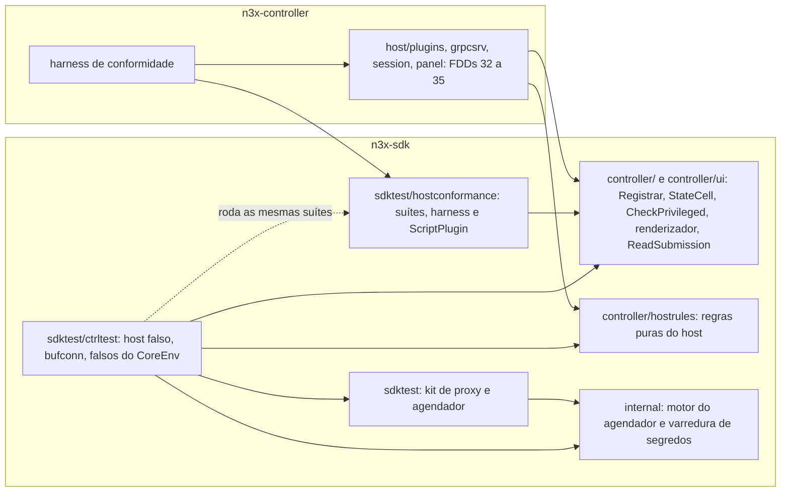
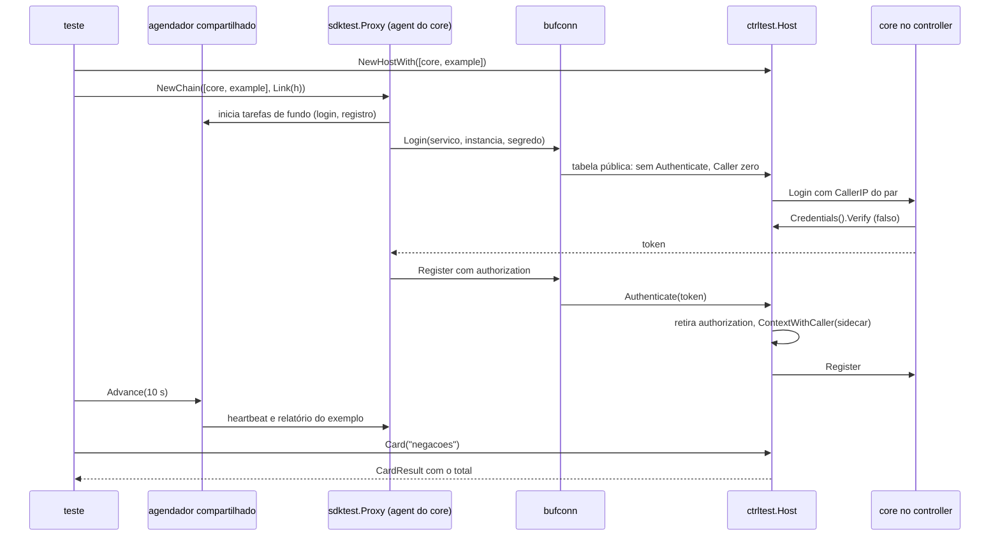
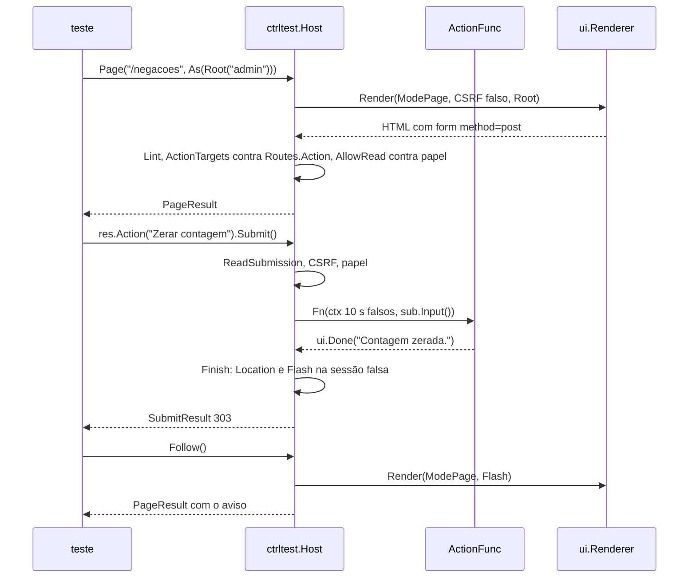
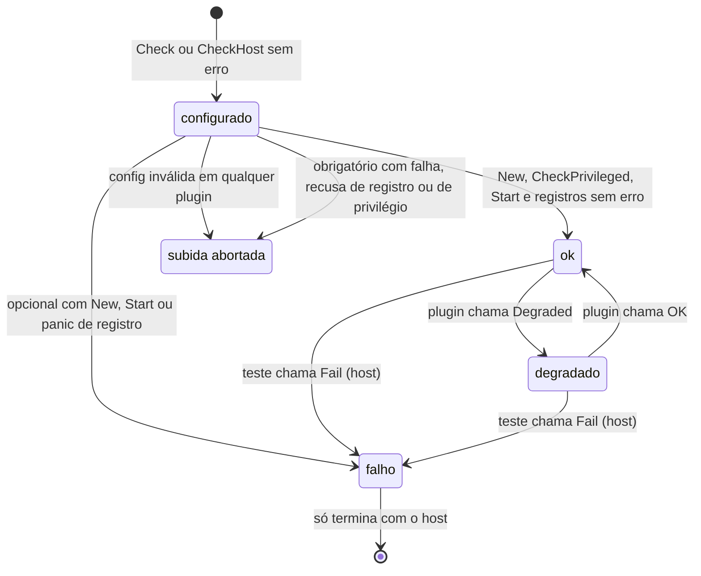

### FDD: Kit de testes da metade de controller (host falso e `bufconn`) (SDK-12)

Versão: 1.0
Data: 2026-10-21
Responsável: Guilherme Giusti

---

### 1. Contexto e motivação técnica

**Problema técnico.** O PRD exige que o autor teste a metade de controller com um host falso e um servidor gRPC em memória, tudo com `go test -race`, sem Envoy e sem controller (FR-013 e FR-014). O HLD do `n3x-sdk` reservou duas peças do `sdktest` (`NewHost` e `bufconn`) e o marco M1 pede o core e o exemplo testados ponta a ponta entre as metades antes de existir o controller real. As FDDs 08 a 11 deixaram para cá pedidos explícitos (host falso com o `Registrar` e o `StateCell` reais, vetores de conformidade, falsos de `ctrl.CoreEnv`, renderização real, simulação de envio, exportação e polling). Faltava o comportamento verificável:

- quais regras do host real (FDD 32 a 35) o host falso reproduz, e como garantir que as duas implementações não divirjam, já que o SDK não importa o `n3x-controller` (ADR-011)
- como o teste do core libera as capacidades privilegiadas sem abrir um atalho que um plugin copie para produção
- se o host falso renderiza HTML de verdade e confere acessibilidade estrutural sem navegador
- como os prazos do host (30 s, 10 s, 1 s, 5 s) rodam no relógio falso da FDD 07
- como uma tarefa de fundo da metade de proxy (FDD 07) fala com a metade de controller pelo `bufconn` no mesmo teste, com o mesmo agendador
- como simular `Start` com falha, plugin opcional `falho`, estado `degradado` e o banner
- como envio de `Form` e `Action`, exportação e polling (FDD 11) são exercitados no teste

Esta entrevista achou seis problemas novos:

- **Goroutines do grpc-go fora do agendador.** Com `bufconn`, o handler roda numa goroutine criada pelo grpc-go e a leitura de stream bloqueia num canal real. Sem tratamento, cada espera vira "goroutine opaca" da FDD 07 (200 ms reais de espera) e o teste de heartbeat do core fica lento e instável.
- **Prazo real do grpc-go contra o relógio falso.** O cliente grpc-go transforma `ctx.Deadline()` em `grpc-timeout` real. Um prazo falso de 10 s nunca venceria no tempo falso, e um teste lento com `-race` poderia receber `DEADLINE_EXCEEDED` espúrio.
- **Plugin opcional `falho` passa em silêncio.** No host real, um opcional com `Start` falhando sobe `falho` e o controller segue (FDD 08). Num teste, isso esconderia o erro do autor.
- **Destinos negados no controller divergem.** A FDD 06 diz que a lista de destinos negados é vazia no controller; a FDD 08 nega as portas `17443`, `17444` e `17091` do próprio processo e põe isso como critério da suíte deste kit (I-02).
- **Login do core no teste ligado.** O falso da visão `Sidecar` (FDD 07) usa um canário aleatório como `controller.secret`. Sem o host falso conhecer esse segredo, o login do core nunca passaria num teste com as duas metades.
- **Forma dos vetores de paridade.** A FDD 08 previu "vetores publicados pelo kit e rodados pelo host", sem dizer a forma nem como o host real, com relógio real e TLS, roda os mesmos casos.

**Encaixe no HLD.** Esta FDD especifica a metade de controller do kit de testes do módulo `github.com/giustech/n3x-sdk` (HLD do `n3x-sdk`: linha `sdktest/` de "Componentes e responsabilidades" e tabela "Kit de testes", peças `NewHost` e `bufconn`) e cria três pacotes (nomes e divisão são hipótese):

- `sdktest/ctrltest`: o host falso, o `bufconn`, os falsos do lado controller das capacidades privilegiadas e as asserções. Fica num subpacote (pedido da FDD 07, P-04) para um plugin só de proxy testar sem compilar `controller/` nem o renderizador
- `sdktest/hostconformance`: as suítes de conformidade do host, com harness, rodadas pelo kit e pelo `n3x-controller`
- `controller/hostrules`: regras puras do host (ordem de subida, efeito de cada falha, mapeamento de status, falha de cartão, escolha do modo do painel e entrega do aviso), usadas pelo host falso e pelo real, no mesmo padrão do `chain` da FDD 07

O HLD do `n3x-sdk` e o ASSUNTO grafam `sdktest.NewHost`; aqui a função é `ctrltest.NewHost`, no subpacote, para `go list -deps ./sdktest` continuar sem `controller/` (pedido P-04 da FDD 07; inconsistência I-01, reflexo pendente no HLD e no ADR-011).

Acrescenta ainda ao pacote `sdktest` (FDD 07) o agendador compartilhado entre os dois kits e o registro do hash da config efetiva da FDD 37. Consumidores:

- FDD 13: testes do `n3x.example`, inclusive o cartão de negações com as duas metades ligadas
- FDD 14: o `n3x-new` gera os testes da metade de controller
- FDD 24: regras de análise estática ligadas aos pacotes novos
- FDDs 32, 33, 34 e 35: o host real usa `hostrules` e roda as suítes de `hostconformance` com o próprio harness
- FDDs 36 a 45: testes da metade de controller do core e das duas metades ligadas (login, registro, heartbeat, eventos, saída, telas); em particular, a FDD 37 confere o `SetConfigHash` pelo falso da visão `Sidecar`, a FDD 38 confere a ordem dos interceptors com `Link` e a FDD 41 usa o `StateCell` e as contas de memória do host falso nos testes de estado e da L-15
- FDD 48: reaproveita os casos da suíte como dados nos testes de ponta a ponta

**Atores.** Autor de plugin (escreve testes com o kit), plugin core (maior usuário: login, `Authenticate`, `CheckUser`, telas e cartões), plugin de exemplo (FDD 13), host real (FDDs 32 a 35, que roda as mesmas suítes), CI do plugin e do SDK (portões) e mantenedor do SDK.

**Limites.** O kit é uma biblioteca de teste que roda dentro do processo do `go test`. Não sobe o controller, não abre porta TCP, não usa TLS e não lê variável de ambiente; os únicos dados do ambiente que lê são o `n3x-plugin.yaml` do repositório e o build info do binário de teste. Ele reaproveita as implementações reais do SDK (`ctrl.Registrar`, `ctrl.StateCell`, `ctrl.CheckPrivileged`, `ctrl.CapabilitiesOf`, `ui.NewRenderer`, `ui.ReadSubmission`, `uitest.Lint`, `telemetry.Registry`, `memory.Runtime`, `plugin.DecodeConfig`, `hostrules`) e só simula o que depende do processo hospedeiro: goroutines, relógio, rede, servidor gRPC, roteador do painel, sessão e o verificador de credencial.

**Suposições**
- Go 1.26 ou superior (ADR-021); `net/http.ServeMux` com padrões `{nome}` (Go 1.22)
- O pacote `google.golang.org/grpc/test/bufconn` do grpc-go continua disponível na versão do `go.mod` do SDK
- O kit de proxy (FDD 07) já tem agendador, relógio falso, rede falsa, captura de logs, checagem de segredos, faltas e a opção `WithController`, e o motor do agendador mora num pacote interno do módulo que o `ctrltest` também pode usar
- `runtime/debug.ReadBuildInfo` devolve, num binário de `go test`, o módulo principal igual ao do pacote testado (hipótese herdada das FDDs 07 e 09; conferida por critério de aceite, seção 9)
- Plugins bloqueiam só por primitivas do SDK (`ctrl.Sleep`, `env.Dial`, clientes do SDK, conexões do kit), como exigem as FDDs 06 e 24; é nessa condição que o determinismo é pleno

**Restrições**
- O SDK não importa pacotes do `n3x-controller` nem do `n3x-sidecar` (ADR-011)
- O kit não importa `secret/` nem `secret/secrettest` (FDD 03)
- `sdktest` continua sem importar `controller/`; só `sdktest/ctrltest` e `sdktest/hostconformance` importam `controller/` e `controller/ui`
- `controller/hostrules` importa só a biblioteca padrão, `plugin/`, `controller/` e `controller/ui`
- O kit nunca chama `time.Sleep`; sem cgo
- Capacidades privilegiadas aceitas só de `n3x.core` vindo de `github.com/giustech/n3x-plugin-core` (ADR-019), sem chave para liberar
- Mensagens em pt-BR; identificadores, valores de rótulo e nomes de evento em inglês

**Rastreabilidade**
- PRD 1.5: FR-014 (host falso de controller e servidor gRPC em memória, tudo com `go test -race`), FR-013 (o autor testa a metade de controller com o host falso; recusa de namespace, rota e privilégio), FR-011 (obrigatório e opcional, panic contido, API pública entre plugins), FR-008 (banner, papel por rota, polling, ação com 403), FR-009 (só o root entra com o core degradado); critérios de aceite "plugin novo criado com o gerador e testado só com a documentação", "plugin novo com uma página e um cartão aparece sem mudar repositórios do core" e "nenhum segredo em logs, erros ou config enviada" (teste automatizado); "Testes e validação" (host falso de plugins, gRPC em memória, testes das telas e permissões)
- ADRs do `n3x-sdk`: ADR-004, ADR-009 (sem tracing na v1), ADR-011, ADR-015, ADR-017, ADR-018, ADR-019, ADR-020, ADR-021 e ADR-022; do `n3x-controller`: ADR-003, ADR-004, ADR-006, ADR-007 e ADR-008
- HLDs: `n3x-sdk/docs/HLD.md` ("Kit de testes", "Componentes", "Fluxo de requisições": subida no controller e página no painel); `n3x-controller/docs/HLD.md` ("Sequência de subida", desligamento, cadeias de interceptors e middlewares, fluxos do gRPC e do painel)
- FDDs usadas como contrato: 01 (`ID`, `RoutePrefix`, `FieldError`, notação L-34, `Manifest`), 02 (`SchemaOf`, `DecodeConfig`, `WithSecretOpener`, `PrefixErrors`), 03 (`plugin.Secret`, prefixo `n3x-canary-`), 04 (`memory.Runtime` com relógio), 06 (`telemetry/`, `internal/clock`, limites), 07 (agendador, rede falsa, faltas, captura, `WithController`, visão `Sidecar` falsa), 08 (`Define`, `Check`, capacidades, ordem, `Registrar`, `StateCell`, `Identity`, `Env`, `Dependency`, mapeamento de erro), 09 (`CheckPrivileged`, `CoreEnv`, `HostFacts`, `CheckHost`, tabela pública, regra do estado do core), 10 (`NewRenderer`, `Check`, modos, `uitest.Lint`), 11 (`Routes.Action`, `ReadSubmission`, `Finish`, `ActionTargets`, `ModeExport`, `Refresh`), 24 (tabelas F e M), 37 (`SetConfigHash`)
- Lacunas do README: **nenhuma lacuna é atribuída a esta FDD.** Aplicadas aqui, com a decisão já registrada:
  - **L-02 (FDD 09):** falsos de `ctrl.CoreEnv` com `Credentials`, `Sessions`, `ControllerManifest` e `CallerIP`; regra "só o root entra" sobre o `StateCell` do core (contrato 9)
  - **L-63 (FDD 09):** o host falso chama `CheckHost` com `ctrl.HostFacts{RootUser}` só para o core e recusa `HostValidator` fora dele (contratos 1 e 9)
  - **L-52 (FDD 08):** `env.Dependency` com transporte em processo serializado, `Caller` `{plugin, consumidor}` e provedor falso (contrato 7)
  - **L-53 (FDD 11):** `Routes.Action` montado como rota POST do host falso, com CSRF, papel zero como root e aviso de uso único (contrato 5)
  - **L-56 e L-22 (FDDs 08 e 10):** árvore de widgets entregue pelo plugin e HTML gerado pelo renderizador real (contrato 3)
  - **L-11 (FDD 36):** a rota pública é o serviço `n3x.plugins.n3x.core.v1.Login`, montada sem autenticação no servidor `bufconn` (contrato 6)
  - **L-13 (FDD 06):** `x-request-id` no metadado gRPC vira `request_id` no `ctx` e nos logs capturados
  - **L-34, L-46 e L-51:** caminhos `plugins["<id>"]`; config de teste em YAML passa por `yamlconv`; limites por plugin como opção, com os padrões da metade de controller
  - **L-36 (parcial, FDD 32):** o kit permite forçar `falho` em runtime (`Fail`), mas o critério de quando o host decide é da FDD 32
- Pedidos de FDDs anteriores atendidos:
  - FDD 02: falha de `ConfigSchema()` reprova a construção com os `FieldErrors`
  - FDD 03: canário `n3x-canary-` via `sdktest.Canary()` e `plugin.NewSecret`, procurado em toda a saída capturada (contrato 10)
  - FDD 04: `memory.Runtime` real com relógio falso e instância `""`; `Sweep` chamado pelo kit, nunca `Run`: a cada passagem do relógio falso por múltiplo de `memory.DefaultSweepInterval` e à mão por `SweepMemory` (contrato 8)
  - FDD 07: reaproveita o `Scheduler` e o `WithController` com `bufconn` (contratos 6 e acréscimos ao `sdktest`); host falso no subpacote `sdktest/ctrltest`; falsos do lado controller do `CoreEnv`, `HostFacts` e tabela pública (contrato 9); confirma a regra de origem por `debug.ReadBuildInfo`
  - FDD 08: host falso com o `Registrar` e o `StateCell` reais (contrato 1); vetores de conformidade de ordem, prazos, política de subida e `PluginAPI` (contrato 12); aviso de capacidade com receptor ponteiro (contrato 1); canário nos erros da `Validate` (contrato 10); `Dependency` falso (contrato 7)
  - FDD 09: falsos de `ctrl.CoreEnv` (contrato 9); origem por `debug.ReadBuildInfo` (contrato 1); recusa de hook na metade só de fundo, já aplicada pela FDD 07 no lado proxy (I-03); suítes de conformidade do lado controller (contrato 12); a suíte do lado sidecar (`proxy.Sidecar`) já é a `conformance.RunCore` da FDD 07 (I-04); `Authenticate` com 0 alocações medido no kit (contrato 9); vetor do panic de ponta a ponta até o handler `Core/Event` do host falso (seção 9)
  - FDD 41: `StateCell` e contas de memória do core consultáveis por `PluginView.State` e `PluginView.Memory` (contrato 8)
  - FDD 10: renderiza com `ui.NewRenderer`, falha o teste em `ErrInvalidTree` e roda `uitest.Lint` em toda saída (contrato 3)
  - FDD 11: simula envio com `ReadSubmission` e `Finish`, segue o 303 com o aviso, exportação em `ModeExport` e polling; confere que todo destino de `ui.ActionTargets` casa com um `Routes.Action` e que `AllowRead` bate com o papel registrado (contratos 3 e 5)
  - FDD 24: as APIs só de runtime criadas aqui ficam em pacotes que a análise estática proíbe por import (pedido na seção 8)
  - FDD 37: o falso da visão `proxy.Sidecar` ganha `SetConfigHash` e guarda o último valor para o teste conferir (acréscimos ao `sdktest`, contrato 6)

---

### 2. Objetivos técnicos

- **Mesmas recusas do host real por construção.** Invariante: o host falso usa o `ctrl.Registrar`, o `ctrl.StateCell`, `ctrl.CheckPrivileged`, `ctrl.CapabilitiesOf`, o renderizador e `ui.ReadSubmission` reais. Medida: 100% dos exemplos de recusa das FDDs 08, 09 e 11 (registro fora do namespace, rota fora do prefixo, papel inválido, privilégio fora do core, tabela pública) produzem no kit o mesmo `Path`, a mesma `Rule` e o mesmo texto do `Registrar.Close()`, prefixados com `plugins["<id>"]`.
- **Paridade verificada com o host real.** Medida: as suítes de `hostconformance` (no mínimo 79 casos) passam no harness do kit e são critério de aceite das FDDs 32 a 35 no harness do `n3x-controller`; as decisões de ordem, efeito de falha, status de página, falha de cartão, modo do painel e entrega do aviso existem só em `controller/hostrules` (busca na CI do SDK e revisão no controller).
- **Prazos exatos no relógio falso.** Medida: `Start` que ignora o `ctx` vira falha exatamente em 30 s falsos; página presa dá 504 em exatamente 10 s falsos; cartão preso fica "indisponível" em exatamente 1 s falso; `Stop` preso é abandonado em 5 s falsos; cada caso em menos de 300 ms de tempo real, em 100 de 100 execuções.
- **Duas metades no mesmo teste, sem espera real.** Medida: um stream bidirecional de 100 mensagens pelo `bufconn`, conduzido por uma tarefa de fundo da metade de proxy com `Advance`, termina em menos de 500 ms de tempo real e sem nenhuma goroutine marcada como opaca.
- **Erro de produção vira falha de teste.** Invariante: panic contido, violação de contrato, árvore inválida, destino de envio sem rota, `AllowRead` incoerente, plugin opcional `falho` sem `AllowFailed`, goroutine zumbi, uso indevido de métrica e segredo na saída reprovam o teste com mensagem que cita o plugin e a chamada. Medida: 100% dos casos de referência da seção 9 reprovam com a mensagem esperada.
- **Nenhum segredo na saída.** Invariante: logs, rótulos de métrica, textos de erro (inclusive da `Validate`), mensagens de status gRPC, HTML, cartões, arquivos exportados, avisos e motivos de estado são varridos atrás dos valores de segredo da config e do prefixo `n3x-canary-`; achado reprova sempre (ADR-020).
- **Privilégio só para a origem do core.** Invariante: `env.(ctrl.CoreEnv)` é falso para todo plugin que não é `n3x.core` do módulo oficial; não existe opção que libere privilégio para outro tipo. Medida: os 5 privilégios de controller da FDD 09 recusados com o `Path` do contrato 2 dela; `AsCore()` com tipo declarado fora do módulo do core recusado com `privileged_origin`.
- **Custo baixo.** Medida: `NewHost` com um plugin de 3 páginas e 2 cartões em menos de 20 ms de tempo real; 1.000 chamadas de `Page` a uma página com tabela de 50 linhas em menos de 1 s sem `-race` e menos de 10 s com `-race`, no runner da CI (hipótese de tempos, igual à FDD 07).

---

### 3. Escopo e exclusões

**Incluído**
- Construção do host falso: `ctrltest.NewHost`, `NewHostWith`, `Plug`, `FakeProvider`, `ExpectNewError`, `ExpectNewErrorWith`, `CheckConfig` e opções; descoberta do `n3x-plugin.yaml`; decodificação da config pelo schema; fase de config com `Check` e `CheckHost`; fase de instâncias com `Instantiate`, selo, `CheckPrivileged`, `Start` com prazo, `GRPC`, `PublicGRPC`, `PluginAPI`, `Routes`, `Cards` e `Close`; tarefas de fundo; desligamento com `Stop` em ordem inversa
- Identidades de teste (`Root`, `Read`, `Sidecar`, `FromPlugin`) e opções de chamada
- Páginas, fragmentos, polling e exportação pelo renderizador real, com `uitest.Lint` em toda saída HTML e acesso à árvore, ao HTML, ao texto visível e ao `ui.Result`
- Cartões e visão geral com prazo de 1 s, em paralelo
- Envio de `Form` e `Action` pela página renderizada (POST, 303 e GET com o aviso), conferência dos destinos e de `AllowRead`
- Servidor gRPC em memória (`bufconn`) com a cadeia de interceptors do host, nos modos sem core (identidade da conexão) e com core (login e `Authenticate`); ligação com a metade de proxy (`Link`) com agendador compartilhado
- API entre plugins em processo (`env.Dependency`) com provedor real ou falso
- Estado, banner, menu, registros e registro do ciclo de vida
- Falsos do lado controller das capacidades privilegiadas: `ctrl.CoreEnv` (`Credentials`, `Sessions`, `ControllerManifest`, `CallerIP`), `HostFacts`, tabela pública, `Authenticate` e login do painel com `CheckUser` e a regra "só o root entra"
- Métricas e logs capturados, `AssertCounter`, checagem de segredos, faltas, `AssertGolden`
- Pacote `controller/hostrules` com as regras puras do host
- Pacote `sdktest/hostconformance` com harness, suítes, casos como dados e `ScriptPlugin` de controller; `ctrltest.Harness()`
- Acréscimos ao `sdktest`: `WithScheduler`, `Options` e `Proxy.ConfigHash` (falso de `SetConfigHash`, FDD 37)
- Plugin de teste interno `denycount`, cópia das duas metades do exemplo do HLD, para os testes de aceite do kit antes da FDD 13

**Excluído**
- Kit da metade de proxy (`NewProxy`, agendador em si, `Stream` falso, `AssertHonorsCancel`, `AssertZeroAllocs`, alvos simulados, `FakeController`, falsos de `proxy.CoreEnv` e `proxy.Sidecar`, `RunCore`): FDD 07 (SDK-07); aqui só os acréscimos listados acima
- Host real e as checagens dele: FDD 32 (CTL-03); servidor gRPC real com TLS, limites de conexão e resolução de IP com `grpc.trusted_proxies`: FDD 33 (CTL-04); sessão real, bloqueio de login e guarda do aviso: FDD 34 (CTL-05); layout, menu, banner e cabeçalhos HTTP do painel: FDD 35 (CTL-06)
- Verificação de acessibilidade com axe, contraste e foco no navegador: CI do controller, FDD 35 (CTL-06)
- Regra de bloqueio do verificador de credencial (5 falhas em 15 min, 2 bcrypt simultâneos, cache): FDD 31 (CTL-02); o falso só simula os resultados
- Testes de integração com Envoy real e controller real: FDD 48 (SDK-16)
- Layout do painel (`<head>`, menu e banner renderizados): o kit devolve o conteúdo do plugin e os dados de menu e banner, não o HTML do host
- Métricas e logs do painel propostos pela FDD 11 (`n3x_controller_panel_actions_total` e outros): simulados só depois que a FDD 35 confirmar os nomes (P-04)
- Teto de 1 s por mensagem em stream gRPC: simulado só depois que a FDD 33 definir a semântica (P-02)
- Fora da v1 (hipótese): dump estável da árvore de widgets para golden, fuzzing de envio pelo kit, TLS no `bufconn`, simulação de `x-forwarded-for`

---

### 4. Fluxos detalhados e diagramas

**Fluxo de construção (`NewHost` e `NewHostWith`)**
1. O kit marca `t.Helper()` e registra a limpeza com `t.Cleanup`.
2. Agendador: o de `WithScheduler` (compartilhado com um `sdktest.Proxy`) ou um novo, com `StartTime`, `SettleWindow` e `Jitter`. O agendador traz junto o relógio falso, a rede falsa, o contador de `request_id` e o conjunto de marcadores de segredo.
3. Identidade de cada plugin, nesta ordem: opções (`ID`, `Module`, `AsCore`, `Required`, `DependsOn`); manifesto `n3x-plugin.yaml` achado subindo do diretório do pacote até o do `go.mod`, como na FDD 07 (precisa ter a metade `controller`; senão, `Fatal`); padrões (`sdktest.DefaultID`, `required` falso, sem dependências). O módulo vem de `Module` ou do módulo principal de `debug.ReadBuildInfo`.
4. Schema: `p.ConfigSchema()`; erro reprova com `Fatal` e os `FieldErrors` (pedido da FDD 02). O kit confere a ida e volta `MarshalJSON` e `plugin.ParseSchema`.
5. Config: texto que começa com `{` vai como JSON; o resto passa por `yamlconv.ToJSON`; texto vazio vale seção ausente (bytes vazios), como no host real (FDD 08).
6. Ordem: `hostrules.Order` com o core primeiro e as dependências antes de quem depende; dependência declarada que não está no host reprova com `Fatal` ("use `Plug` ou `FakeProvider`").
7. **Fase de config, em ordem de ID:** `ctrl.PrivilegesOf(p, nil)` (`HostValidator` fora do core recusa); `CheckHost(config, ctrl.HostFacts{RootUser}, opener)` para o core e `Check(config, opener)` para os demais. O opener do kit devolve o texto como recebido (sem `ENC[...]`, FDD 03) e grava o valor de cada campo segredo como marcador. Erros prefixados com `plugin.PrefixErrors(err, plugin.PathKey("plugins", id))`, juntados, varridos atrás de segredos e, se houver algum, nenhum `New` roda.
8. **Fase de instâncias, na ordem de `hostrules.Order`, para cada plugin:**
   - conta e escopo de memória (`memory.Runtime` real, instância `""`, cota de `Limits` ou `memory.DefaultControllerMaxBytes`), conta de métricas (`telemetry.Registry` real, `OnMisuse` ligado ao kit), logger (`telemetry.PluginLogger` com o relógio falso), `ctrl.NewStateCell(id, agoraFalso)` com o observador do kit, contadores de tarefas e conexões e a visão de `Dependency`
   - `Env` comum, ou `ctrl.CoreEnv` falso só para a origem do core (contrato 9)
   - `Instantiate` numa goroutine rastreada, sob `recover`, vigiada por `StartTimeout`; selo de memória, métricas e tarefas
   - `ctrl.CheckPrivileged(id, módulo, p, inst)`; core aprovado loga `privileged_granted`
   - `ctrl.CapabilitiesOf(p, inst)`; se a instância é um valor e o ponteiro para ela teria capacidades que o valor não tem, falta `violation` com a regra `capability_pointer_receiver` ("devolva `&T{}` no `New`")
   - `Start(ctx)` com prazo de `StartTimeout` no relógio falso, em goroutine rastreada, avançando o relógio só o necessário
   - `ctrl.NewRegistrar(id)` e, nesta ordem e só se existirem, `GRPC`, `PublicGRPC` (só o core), `PluginAPI`, `Routes` e `Cards`, sob `recover`; depois `Close()`
   - cada falha passa por `hostrules.OnFailure(estágio, obrigatório)`: aborta a subida, marca `falho` ou marca `falho` e chama `Stop`
9. **Depois de todos:** o kit inicia as tarefas de fundo dos plugins que não ficaram `falho`, uma vez, na ordem de subida e de registro; monta as tabelas `sidecar` e pública num servidor `bufconn`, a tabela `plugin` no transporte em processo, as páginas e ações num `net/http.ServeMux` por método e padrão e a lista de cartões; assenta o agendador.
10. **Abortou:** `Stop` dos plugins cujo `Start` terminou com sucesso, em ordem inversa; `NewHost` reprova com `Fatal` e a mensagem completa; `ExpectNewError` devolve um `*StartupError`.
11. **Plugin terminou `falho` na subida:** sem `AllowFailed`, `NewHost` reprova com `Fatal` ("o host real subiria com este plugin desligado"); com a opção, o host segue como o real.

**Fluxo de uma página (`Page`)**
1. O kit separa path e query, limita a query bruta a 4 KiB (400 acima, FDD 08) e acha o padrão GET no `ServeMux` do plugin (sem padrão: 404; padrão só de ação: 405).
2. Sessão falsa do chamador (`As`, padrão `Read(DefaultReader)`); com `SessionExpired`, responde 303 para `/login?next=<path e query>` (página) ou `HX-Redirect` (polling).
3. Papel: `Caller.Role.Meets(papel da rota)`; sem papel, 403.
4. `ui.NewQuery(curingas, valores)`; fora dos limites, 400.
5. `PageFunc` numa goroutine rastreada, sob `recover`, com `ctx` de `CallTimeout` no relógio falso, `request_id` novo e `Caller`; o kit avança o relógio só o necessário para ela terminar.
6. Status por `hostrules.HandlerStatus` (`ErrNotFound` 404, `ErrBadRequest` 400, prazo 504, outro erro, panic ou `(nil, nil)` 500); erro e panic geram `page_failed` e `plugin_panic` como o host.
7. Modo por `hostrules.PanelMode` (exportação, fragmento ou página); `ui.Request` com o token CSRF da sessão falsa, `Root`, `RefreshInterval`, `Path` e, se `hostrules.FlashAllowed`, o aviso guardado.
8. `ui.NewRenderer(...).Render`. `ErrInvalidTree` reprova com os `FieldErrors` (falta `violation`, liberável) e o resultado fica 500; `ErrOutputTooLarge` dá 500 (422 em exportação, como a FDD 11 pede à FDD 35).
9. Conferências do kit sobre a árvore e a saída: `uitest.Lint` no HTML (página, fragmento ou cartão); `ui.ActionTargets` contra os `Routes.Action` registrados e `AllowRead` contra o papel registrado (pedido da FDD 11); varredura de segredos.
10. Devolve o `*PageResult` com status, modo, árvore, corpo, texto visível, `ui.Result`, avisos e tempo falso.

**Fluxo de um cartão (`Card` e `Overview`)**
- Cartão invisível para o papel do chamador volta com `Visible() == false`, sem chamar a função
- `CardFunc` em goroutine rastreada com `ctx` de `ctrl.CardTimeout` (1 s falso), `request_id` e `Caller`; `Overview` chama todos os cartões visíveis em paralelo, como o host (ADR-018)
- Falha classificada por `hostrules.CardFailure` (`timeout`, `error`, `panic`, `nil_widget`); árvore inválida conta como `error` e gera a falta `violation`; o cartão aparece "indisponível" e os outros seguem; `card_failed`, `n3x_controller_card_failures_total` e `n3x_controller_card_duration_seconds`
- Renderização em `ModeCard` com `HeadingBase` 3 e `uitest.Lint`

**Fluxo de um envio (`FormDriver.Submit` e `Submit`)**
1. O teste renderiza a página, pega o formulário (`res.Form(id)` ou `res.Action(rótulo)`) e preenche campos; o kit lê `action`, os campos ocultos (`_csrf`, `_form`, `_return`, `Param`) e os valores iniciais direto do HTML gerado.
2. `POST` no padrão de `Routes.Action` (sem padrão: 404; padrão só de página: 405); sessão (expirada: 303 para o login com `next` igual a `_return`); corpo acima de `ui.MaxSubmitBytes` (64 KiB): 413.
3. `ui.ReadSubmission(id, curingas, corpo)`; erro: 400.
4. CSRF comparado com o token da sessão falsa em tempo constante; ausente ou diferente: 403 com "O formulário expirou. Volte à página e tente de novo." e `panel_action_refused` com `reason=csrf`.
5. Papel: `Caller.Role.Meets(entry.Role)`; sem papel: 403 com "Esta ação exige o papel root." (ou "leitura").
6. `ActionFunc` com `ctx` de `CallTimeout`, `Caller` e `request_id`, sob `recover`; erro mapeado por `hostrules.HandlerStatus`.
7. `sub.Finish(reply)`; o kit guarda o aviso na sessão falsa (um por sessão, por `ui.FlashTTL` no relógio falso) e devolve 303 com `Location`.
8. `Follow` faz o GET de `Location` como página inteira; o aviso é entregue só se `hostrules.FlashAllowed` disser sim, e sai da sessão.

**Fluxo gRPC pelo `bufconn`**
- `h.Dial(opções)` cria um `*grpc.ClientConn` sobre o `bufconn` do host, com interceptors de cliente do kit; a conexão leva uma identidade (`As`, padrão `Sidecar(sdktest.DefaultService, "sdktest-0")`) e um IP de par (`PeerIP`, padrão `DefaultPeerIP`)
- Interceptors de cliente do kit: tiram o prazo real do `ctx` antes do grpc-go e levam o prazo falso, a identidade da conexão e a marca de voo em metadados internos; cancelamento do `ctx` (inclusive no prazo falso) cancela a chamada
- Cadeia do servidor, na ordem do HLD do `n3x-controller`: recover (panic vira `INTERNAL` com mensagem genérica e `kind="grpc"`), registro e métricas, limites (mensagens até 4 MiB, 16 streams por conexão), autenticação, autorização (só `RoleSidecar` na v1, ADR-007), estado do plugin dono (`falho` ou host desligado: `UNAVAILABLE`), prazo (`min(prazo falso do cliente, CallTimeout)` em unária; stream sem teto total) e handler
- **Modo sem core** (o core não está no host): a autenticação usa a identidade da conexão; o metadado `authorization`, se vier, é retirado
- **Modo com core:** métodos da tabela pública passam sem autenticação, com `Caller` zero; os demais exigem `authorization`; ausente dá `UNAUTHENTICATED` sem chamar o core; core `falho` dá `UNAVAILABLE` sem chamar; o kit chama `Authenticate(ctx, valor)`; identidade que não é `RoleSidecar` válida dá `UNAUTHENTICATED` e `privileged_misbehavior`; o valor do token entra nos marcadores de segredo; `authorization` é retirado antes de qualquer handler (FDD 09)
- O host põe `request_id` (de `x-request-id`, ou um novo determinístico) e `ctrl.ContextWithCaller` em todo handler; a identidade e os metadados internos do kit nunca chegam ao plugin

**Fluxo do agendador com o `bufconn`**
- O handler de cada chamada e de cada stream roda como goroutine rastreada do tipo `handler` enquanto durar a chamada
- Leitura e escrita de stream, dos dois lados, são primitivas do kit: uma leitura conta como estacionada só quando o outro lado não tem mensagem em trânsito
- Uma chamada em voo conta como trabalho rastreado até voltar, a menos que o handler dela esteja estacionado numa primitiva do kit (por exemplo, `ctrl.Sleep`)
- Chamada feita por goroutine não rastreada (o próprio teste) roda em modo automático: o kit avança o relógio só o necessário para ela terminar ou vencer o prazo, como o `Request` da FDD 07. Chamada feita por goroutine rastreada (tarefa de fundo do kit de proxy) nunca avança o relógio sozinha
- Goroutine que bloqueia fora dessas primitivas continua virando opaca depois de `SettleWindow`, como na FDD 07

**Fluxo de ligação com a metade de proxy (`Link`)**
1. O teste cria o host e depois o kit de proxy com `ctrltest.Link(h, opções)`, que junta `sdktest.WithController(h.Dial(opções))`, `sdktest.WithScheduler(h.Scheduler())` e, para o login do core, `sdktest.ControllerSettings` com um segredo conhecido, que o kit registra em `h.Credentials()` para o serviço da conexão.
2. O `NewProxy` sobe as instâncias com o mesmo relógio, a mesma rede falsa e os mesmos marcadores de segredo; as tarefas de fundo começam ao fim dele.
3. `p.Scheduler().Advance(d)` dispara os timers das duas metades; uma chamada da tarefa de fundo atravessa a visão do controller da FDD 07 (`ErrRequestPath`, `ErrForeignService`, teto e `x-request-id`), os interceptors do core (se houver) e o `bufconn` até o handler do host.
4. A limpeza segue a ordem inversa da criação (`t.Cleanup`): o kit de proxy desliga primeiro, então o `Exit` do core chega a um host vivo; criado na outra ordem, o `Exit` recebe `UNAVAILABLE` e o kit avisa no log do teste.

**Fluxo da API entre plugins (`env.Dependency`)**
- Só para IDs em `depends_on` do consumidor (senão `ErrNotDependency`); dependência sem `PluginAPI` dá `ErrNoPluginAPI`; dependência `falho` dá `ErrDependencyFailed`
- A conexão confere que o método pertence a um serviço da tabela `plugin` do provedor (senão `Unimplemented`, sem tocar o provedor); serializa a mensagem; o provedor recebe `ctx` novo com prazo `min(prazo falso, CallTimeout)`, cancelamento, `request_id` e `Caller` `{plugin, consumidor}`; recover (`Internal`, `kind="plugin_api"`), métricas e log como no gRPC
- `FakeProvider(id, registra)` cria um provedor só com `PluginAPI`, para testar o consumidor sem o plugin real; `h.For(id).Fail(motivo)` simula a dependência `falho`

**Fluxo de desligamento (`Close` e limpeza do teste)**
1. `GracefulStop` do servidor `bufconn`; o que não terminou em `ShutdownTimeout` (20 s falsos) é cortado com `Stop`.
2. Cancela o `ctx` das tarefas de fundo e espera `ctrl.ShutdownGrace` (2 s falsos); tarefa que não terminou vira falta `zombie`.
3. `Stop(ctx)` de cada plugin cujo `Start` terminou com sucesso, em ordem inversa da subida, com `ctrl.StopTimeout` (5 s falsos); quem estoura é abandonado, com `plugin_stop_failed`, e o kit segue.
4. Varredura de segredos em toda a saída capturada e relato das faltas pendentes; devolve o `ShutdownReport`.

**Fluxos alternativos e exceções**
- **Plugin opcional com `Start` falhando:** com `AllowFailed`, fica `falho`, sem `Start` repetido, sem registros e sem `Stop`; páginas dele dão 503 (hipótese, P-04), chamadas gRPC dão `UNAVAILABLE`, `Dependency` dá `ErrDependencyFailed`, o banner aparece com o motivo
- **Plugin obrigatório com `Start` falhando:** a subida aborta, os que já tinham subido recebem `Stop` em ordem inversa e `NewHost` reprova (`ExpectNewError` devolve `StartupError` com `Stage` igual a `start`)
- **Registro fora do namespace ou da rota, mesmo em opcional:** aborta, com a mesma mensagem do `Registrar.Close()` prefixada (FDD 08)
- **`HostValidator` em plugin que não é o core:** aborta na fase de config com `privileged_capability` em `privileged.host_validator`
- **Core fingido** (ID `n3x.core` de outro módulo, ou `AsCore()` com tipo declarado fora do módulo do core): `privileged_origin`, mesmo com `AsCore()`
- **`Degraded` no `New` ou no `Start`:** sobe degradado; o banner aparece; páginas, cartões e gRPC seguem
- **Core `degraded` ou `failed` no login do painel:** `PanelLogin` aceita só o root e loga `auth_core_unavailable` (FDD 09, contrato 16)
- **Registrador guardado e usado depois do `Close`:** panic com `ErrRegistrationClosed`, contido no handler (500 ou `INTERNAL`), falta `violation`
- **Polling com sessão expirada:** `PageResult.HXRedirect()` com `/login?next=...`, como a FDD 11 pede à FDD 34
- **Exportação indisponível:** página com o aviso `export_unavailable`; acima de 16 MiB: 422
- **`SetDown(true)`:** toda chamada gRPC dá `UNAVAILABLE` e os streams abertos fecham com `UNAVAILABLE`, para testar reconexão e reabertura de stream (FDD 42)
- **Host criado sem core:** não há tabela pública nem `Authenticate`; a identidade vem da conexão (desvio declarado do host real, onde o core é obrigatório)

**Diagramas**

Onde mora cada parte:



Duas metades ligadas pelo `bufconn`, com o core:



Envio de uma `Action` no host falso:



Estados de um plugin no host falso:



---

### 5. Contratos públicos (assinaturas, endpoints, headers, exemplos)

**Contrato 1: construção do host falso (`NewHost`, `NewHostWith`, `Plug`, `ExpectNewError`, `CheckConfig`) e opções**
- Tipo: sdk (API Go de teste)
- Assinatura/Rota:
  ```go
  package ctrltest // github.com/giustech/n3x-sdk/sdktest/ctrltest

  // Um plugin; atalho para NewHostWith com um único Plug.
  func NewHost(t testing.TB, p ctrl.Plugin, config string, opts ...Option) *Host
  // Vários plugins, com a ordem e as políticas do host real (core primeiro, dependências antes).
  func NewHostWith(t testing.TB, plugins []PluginSpec, opts ...Option) *Host
  func Plug(p ctrl.Plugin, config string, opts ...PluginOption) PluginSpec
  // Confere que a subida falha e devolve o erro (*StartupError).
  func ExpectNewError(t testing.TB, p ctrl.Plugin, config string, opts ...Option) error
  func ExpectNewErrorWith(t testing.TB, plugins []PluginSpec, opts ...Option) error
  // Só a fase de config (schema, Validate e ValidateHost), como o n3x-controller validate.
  func CheckConfig(t testing.TB, p ctrl.Plugin, config string, opts ...Option) error

  type Option interface{ /* opção do host ou do plugin */ }
  type PluginOption interface{ Option /* opção só de plugin */ }
  type PluginSpec struct{ /* opaco */ }

  // Opções de plugin
  func ID(id string) PluginOption               // padrão: manifesto descoberto, senão sdktest.DefaultID
  func Module(path string) PluginOption         // padrão: módulo principal de debug.ReadBuildInfo
  func AsCore() PluginOption                    // ID(n3x.core) e Module(plugin.CoreModule); CheckPrivileged continua valendo
  func Required(required bool) PluginOption     // padrão: controller.required do manifesto, senão falso
  func DependsOn(ids ...string) PluginOption    // padrão: controller.depends_on do manifesto
  func Manifest(path string) PluginOption       // caminho explícito; "" desliga a descoberta

  // Opções do host
  func WithScheduler(s *sdktest.Scheduler) Option   // agendador compartilhado com um sdktest.Proxy
  func StartTime(t0 time.Time) Option               // padrão sdktest.DefaultStartTime
  func SettleWindow(d time.Duration) Option         // padrão sdktest.DefaultSettleWindow
  func Jitter(seed uint64) Option                   // backoff das tarefas com semente; padrão u = 0,5
  func StartTimeout(d time.Duration) Option         // runtime.plugin_start_timeout; padrão ctrl.DefaultStartTimeout
  func CallTimeout(d time.Duration) Option          // runtime.plugin_call_timeout; padrão ctrl.DefaultCallTimeout
  func ShutdownTimeout(d time.Duration) Option      // runtime.shutdown_timeout; padrão DefaultShutdownTimeout
  func RefreshInterval(d time.Duration) Option      // panel.refresh_interval; padrão DefaultRefreshInterval
  func RootName(name string) Option                 // root.user; vai em HostFacts.RootUser; padrão DefaultRoot
  func RootPassword(password string) Option         // senha do root no PanelLogin; padrão sdktest.Canary()
  func ControllerManifest(b []byte) Option          // bytes de CoreEnv.ControllerManifest()
  func Limits(id string, l sdktest.PluginLimits) Option // memória padrão memory.DefaultControllerMaxBytes
  func DialDeny(l proxy.DialDenyList) Option        // padrão DefaultDialDeny
  func WithDialer(d func(ctx context.Context, network, address string) (net.Conn, error)) Option
  func LogLevel(l slog.Level) Option                // padrão slog.LevelDebug
  func AllowFaults(kinds ...sdktest.FaultKind) Option
  func AllowFailed(ids ...string) Option            // plugins que podem terminar a subida em falho; vazio = todos
  func NoLint() Option                              // desliga o uitest.Lint automático

  type StartupError struct {
      Plugin plugin.ID       // zero quando a fase de config junta vários plugins
      Stage  hostrules.Stage // config, new, privileged, start, register_panic, registration
      Err    error           // embrulha plugin.ErrInvalidConfig, ctrl.ErrRegistration, ctrl.ErrPrivileged ou o erro do plugin
  }
  func (e *StartupError) Error() string
  func (e *StartupError) Unwrap() error

  const (
      DefaultRoot            = "admin"
      DefaultReader          = "leitura"
      DefaultShutdownTimeout = 20 * time.Second
      DefaultRefreshInterval = 5 * time.Second
  )

  // Destinos negados ao Dial da metade de controller: portas do próprio controller (FDD 08, hipótese).
  var DefaultDialDeny = proxy.DialDenyList{LoopbackPorts: []int{17091, 17443, 17444}}
  ```
- Método: n/a (chamada local no teste)
- Semântica:
  - **Mesmas regras do host real:** fases, ordem e efeitos da seção 4, com o `Registrar`, o `StateCell`, `CheckPrivileged` e `hostrules` reais; o texto do erro é o mesmo do `Registrar.Close()` e do `CheckPrivileged`, prefixado com `plugins["<id>"]`
  - **Config:** JSON ou YAML (`yamlconv`); vazio é seção ausente. Decodificada sem abrir `ENC[...]`: o texto do segredo é o valor (FDD 03)
  - **Origem e privilégios:** o módulo vem de `Module` ou do módulo principal de `debug.ReadBuildInfo`; `AsCore()` só troca o par (ID, módulo) que o builder gravaria; a regra do tipo dinâmico da FDD 09 continua, então só um tipo declarado em `github.com/giustech/n3x-plugin-core` ganha privilégio. Sem build info, o módulo fica vazio e o core é recusado com `privileged_origin` (mesma regra da FDD 07)
  - **Core:** criado primeiro; `CheckHost` com `HostFacts{RootUser: RootName}`; recebe o `ctrl.CoreEnv` falso (contrato 9). O kit não acrescenta o core sozinho: quem quer o core no teste o põe em `NewHostWith` (hipótese, igual à FDD 07)
  - **Plugin `falho` na subida:** reprova sem `AllowFailed` (problema novo 3 da seção 1; hipótese)
  - **Receptor ponteiro:** instância por valor que perde capacidades declaradas com receptor ponteiro reprova com `capability_pointer_receiver` (pedido da FDD 08)
  - **Concorrência:** `*Host` é seguro entre goroutines; `Overview` chama os cartões em paralelo
  - **`WithScheduler`:** com agendador compartilhado, `StartTime`, `SettleWindow` e `Jitter` vêm dele; passar as duas coisas reprova com `Fatal`

**Exemplo de requisição**
```go
func TestSobe(t *testing.T) {
    h := ctrltest.NewHost(t, controller.Plugin(), `{}`)
    h.AssertCounter(t, "n3x_controller_plugin_state", sdktest.Labels{"state": "ok"}, 1)
}

func TestRotaForaDoPrefixo(t *testing.T) {
    err := ctrltest.ExpectNewError(t, quota.Plugin(), `{}`, ctrltest.ID("giustech.quota"))
    var se *ctrltest.StartupError
    if !errors.As(err, &se) || se.Stage != hostrules.StageRegistration || !errors.Is(err, ctrl.ErrRegistration) {
        t.Fatalf("erro inesperado: %v", err)
    }
}

func TestStartOpcionalFalha(t *testing.T) {
    h := ctrltest.NewHost(t, flaky.Plugin(), `{"fail_start":true}`, ctrltest.AllowFailed())
    _ = h.State()
}
```

**Exemplo de resposta**
```json
{
  "TestSobe": "ok; manifesto achado em ../n3x-plugin.yaml; ID n3x.example; capacidades start,grpc,routes,cards; 3 páginas, 1 cartão",
  "TestRotaForaDoPrefixo": "ok; erro: subida recusada em registration de giustech.quota: plugins[\"giustech.quota\"].routes[\"/../core/usuarios\"]: padrão /plugins/giustech/quota/../core/usuarios fora de /plugins/giustech/quota/ [foreign_route]",
  "TestStartOpcionalFalha": { "h.State()": { "State": "failed", "Reason": "start: banco indisponível", "Since": "2026-01-01T00:00:00Z" } },
  "sem AllowFailed": "Fatal: ctrltest: giustech.flaky terminou a subida em falho (start: banco indisponível); o host real subiria com este plugin desligado; use AllowFailed para testar esse caso"
}
```

---

**Contrato 2: identidades de teste e opções de chamada e de conexão**
- Tipo: sdk (API Go de teste)
- Assinatura/Rota:
  ```go
  func Root(user string) ctrl.Identity                // {RoleRoot, User}
  func Read(user string) ctrl.Identity                // {RoleRead, User}
  func Sidecar(service, instance string) ctrl.Identity // {RoleSidecar, Service, Instance}
  func FromPlugin(id string) ctrl.Identity            // {RolePlugin, Plugin}; panic se o ID é inválido

  type CallOption interface{ /* opção de Page, Card, Submit, Overview e Menu */ }
  type ConnOption interface{ /* opção de Dial e Link */ }

  // As vale nas duas: quem chama a página ou o cartão, ou a identidade da conexão gRPC.
  func As(id ctrl.Identity) interface{ CallOption; ConnOption }
  func PeerIP(addr netip.Addr) ConnOption   // IP do par; zero = sem IP (CallerIP devolve false)
  func Target(elementID string) CallOption  // fragmento: HX-Request e HX-Target (ex.: "n3x-p-sidecars")
  func Polling(refreshID string) CallOption // relógio do Refresh: HX-Target n3x-p-<id> e N3X-Refresh: 1
  func SessionExpired() CallOption          // sessão vencida: 303 para o login, ou HX-Redirect no polling
  func CSRF(token string) CallOption        // troca o token enviado no Submit
  func NoCSRF() CallOption                  // envia sem _csrf

  var DefaultPeerIP = netip.MustParseAddr("192.0.2.10") // TEST-NET-1, RFC 5737 (hipótese)
  ```
- Método: n/a
- Semântica:
  - Os construtores devolvem `ctrl.Identity` válidas (`Valid()` verdadeiro); usuário ou serviço vazios fazem panic com mensagem `ctrltest:`
  - Chamador padrão de página, cartão e envio: `Read(DefaultReader)` (menor privilégio, para o teste mostrar quando uma tela exige root; hipótese)
  - Identidade padrão da conexão: `Sidecar(sdktest.DefaultService, "sdktest-0")`, igual à `sdktest.DefaultSidecarIdentity` da FDD 07
  - O kit cria uma sessão falsa por identidade de painel, com token CSRF determinístico `sdktest-csrf-<16 hex do contador>` (formato aceito pela FDD 11)
  - A identidade de `As` numa conexão vale só no host sem core; com o core, a identidade vem do `Authenticate` (seção 4)

**Exemplo de requisição**
```go
h.Page("/usuarios", ctrltest.As(ctrltest.Root("admin")))
h.Page("/sidecars?sidecars.page=2", ctrltest.Target("n3x-p-sidecars"))
conn := h.Dial(ctrltest.As(ctrltest.Sidecar("pedidos", "pedidos-7d9f-xk2lp")), ctrltest.PeerIP(netip.MustParseAddr("10.42.3.17")))
```

**Exemplo de resposta**
```json
{
  "Root(\"admin\")": { "Role": "root", "User": "admin" },
  "sessão de admin": { "csrf": "sdktest-csrf-0000000000000001" },
  "Caller visto pelo handler gRPC": { "Role": "sidecar", "Service": "pedidos", "Instance": "pedidos-7d9f-xk2lp", "Session": "" }
}
```

---

**Contrato 3: páginas, fragmentos, polling e exportação (`Page` e `PageResult`)**
- Tipo: sdk (API Go de teste)
- Assinatura/Rota:
  ```go
  // path relativo ao prefixo do plugin principal, com query: "/limites/pedidos?periodo=24h".
  func (h *Host) Page(path string, opts ...CallOption) *PageResult
  func (h *Host) For(id string) *PluginView // outro plugin do host; contrato 8

  type PageResult struct{ /* cópia; válido depois da chamada */ }
  func (r *PageResult) Status() int               // 200, 303, 400, 403, 404, 405, 422, 500, 503 ou 504
  func (r *PageResult) Mode() ui.Mode             // ModePage, ModeFragment ou ModeExport
  func (r *PageResult) Tree() ui.Widget           // árvore devolvida pela PageFunc; nil sem árvore
  func (r *PageResult) Body() []byte              // HTML do conteúdo (sem layout) ou o arquivo exportado
  func (r *PageResult) Text() string              // texto visível do HTML, espaços normalizados
  func (r *PageResult) Render() ui.Result         // Result do renderizador (Title, Notices, Rows, MediaType, Filename)
  func (r *PageResult) Err() error                // erro da PageFunc ou do renderizador
  func (r *PageResult) Location() string          // 303 de sessão vencida
  func (r *PageResult) HXRedirect() string        // polling com sessão vencida
  func (r *PageResult) RefreshEvery(id string) (time.Duration, bool) // intervalo emitido no relógio do bloco
  func (r *PageResult) Elapsed() time.Duration    // relógio falso
  func (r *PageResult) HasForm(id string) bool
  func (r *PageResult) HasAction(label string) bool
  func (r *PageResult) Form(id string) *FormDriver       // contrato 5
  func (r *PageResult) Action(label string) *FormDriver  // contrato 5

  func (r *PageResult) AssertOK(t testing.TB) *PageResult
  func (r *PageResult) AssertStatus(t testing.TB, status int) *PageResult
  func (r *PageResult) AssertContains(t testing.TB, texts ...string) *PageResult // no Text()
  func (r *PageResult) AssertNotice(t testing.TB, kind string) *PageResult

  func AssertGolden(t testing.TB, path string, got []byte) // compara com o arquivo; -ctrltest.update regrava

  const MaxQueryBytes = 4 << 10 // query bruta (FDD 08, hipótese)
  ```
- Método: `GET` simulado
- Semântica de status e cabeçalhos simulados:
  - **Renderização real (pergunta do ASSUNTO):** o host falso renderiza HTML de verdade com `ui.NewRenderer` em toda chamada e também devolve a árvore (`Tree`). A árvore serve a asserções por tipo; o HTML serve ao texto visível, ao `Lint` e a golden. O HTML é só o conteúdo do plugin, sem o layout do host (FDD 35)
  - **`ErrInvalidTree`:** falta `violation` com a lista de `FieldErrors` (pedido da FDD 10); com `AllowFaults(sdktest.FaultViolation)`, o teste segue e vê 500
  - **Acessibilidade estrutural (pergunta do ASSUNTO):** `uitest.Lint` roda em toda página, fragmento e cartão (rótulos, `caption`, `scope`, IDs referenciados, ordem de headings, URLs, atributos, CSRF em POST). Problema reprova com `Errorf` e a dica "provável defeito do SDK; reporte", porque o renderizador já impede pela estrutura o que depende do plugin. `NoLint()` desliga. Contraste, foco e leitor de tela ficam com o axe da FDD 35
  - **Modo:** `hostrules.PanelMode`: chave `<id>.export` válida na query dá `ModeExport`; `Target` ou `Polling` com alvo `n3x-p-...` dá `ModeFragment`; senão `ModePage`. Alvo que sumiu da árvore devolve a página com `Retargeted` (o host real mandaria `HX-Retarget`)
  - **Polling:** `Polling(id)` não consome o aviso de uso único e não renova a sessão falsa; com `SessionExpired`, `HXRedirect()` traz `/login?next=<path e query>`
  - **Exportação:** `Body()` é o arquivo; `Render().MediaType` e `Render().Filename` iguais à tabela do contrato 8 da FDD 11; indisponível dá a página com `export_unavailable`; acima de `ui.DefaultMaxExportBytes`, 422
  - **Plugin `falho`:** 503 com página genérica (hipótese; a FDD 35 confirma, P-04)
  - **Golden:** `AssertGolden` compara bytes com `testdata/<arquivo>`; a flag `-ctrltest.update` do binário de teste regrava. A marcação pode mudar em patch do SDK (FDD 11); golden do `Text()` é mais estável que do `Body()`

**Exemplo de requisição**
```go
res := h.Page("/negacoes?periodo=24h", ctrltest.As(ctrltest.Root("admin"))).
    AssertOK(t).AssertContains(t, "Negações", "pedidos")
if st, ok := res.Tree().(ui.Page); !ok || st.Title != "Negações" {
    t.Fatal("árvore inesperada")
}
exp := h.Page("/negacoes?servicos.export=csv")
poll := h.Page("/negacoes", ctrltest.Polling("resumo"))
ctrltest.AssertGolden(t, "testdata/negacoes.txt", []byte(res.Text()))
```

**Exemplo de resposta**
```json
{
  "res": { "Status": 200, "Mode": "page", "Render": { "Title": "Negações", "Rows": 2, "Notices": [] }, "Elapsed": "0s", "RefreshEvery(resumo)": "5s" },
  "exp": { "Status": 200, "Mode": "export", "MediaType": "text/csv; charset=utf-8; header=present", "Filename": "n3x-example-servicos.csv", "Rows": 2 },
  "poll": { "Status": 200, "Mode": "fragment", "Body": "<div id=\"n3x-p-resumo\" class=\"n3x-refresh\">..." },
  "árvore inválida": "sdktest: violação em n3x.example página /negacoes (GET, request_id 00000000-0000-4000-8000-000000000003): Page.Body.Children[1].Caption: obrigatório [required]; o host real responderia 500"
}
```

---

**Contrato 4: cartões e visão geral (`Card`, `Overview` e `CardResult`)**
- Tipo: sdk (API Go de teste)
- Assinatura/Rota:
  ```go
  func (h *Host) Card(id string, opts ...CallOption) *CardResult   // cartão do plugin principal
  func (h *Host) Overview(opts ...CallOption) []*CardResult        // todos os cartões visíveis, em paralelo

  type CardResult struct{ /* cópia */ }
  func (c *CardResult) Plugin() plugin.ID
  func (c *CardResult) ID() string
  func (c *CardResult) ContainerID() string     // ui.CardContainerID(plugin, id)
  func (c *CardResult) Visible() bool           // o papel do chamador atende ao do cartão
  func (c *CardResult) Available() bool         // falso = "indisponível"
  func (c *CardResult) Reason() string          // timeout, error, panic, nil_widget; "" se disponível
  func (c *CardResult) Tree() ui.Widget
  func (c *CardResult) Body() []byte
  func (c *CardResult) Text() string
  func (c *CardResult) Elapsed() time.Duration

  func (c *CardResult) AssertAvailable(t testing.TB) *CardResult
  func (c *CardResult) AssertContains(t testing.TB, texts ...string) *CardResult
  ```
- Método: n/a
- Semântica:
  - Prazo `ctrl.CardTimeout` (1 s falso); `Overview` roda cada cartão numa goroutine rastreada, ao mesmo tempo, para o `-race` ver acesso concorrente
  - Ordem de `Overview`: por ID de plugin e, dentro dele, ordem de registro (hipótese; a FDD 35 decide a ordem da tela, P-04)
  - Falha: `Available()` falso, `Reason()` de `hostrules.CardFailure`, `card_failed`, `n3x_controller_card_failures_total{plugin,card,reason}`; panic gera também a falta `panic` (liberável)
  - Cartão de root para leitura: `Visible()` falso, função não chamada

**Exemplo de requisição**
```go
h.Card("negacoes").AssertAvailable(t).AssertContains(t, "3")
for _, c := range h.Overview(ctrltest.As(ctrltest.Root("admin"))) {
    t.Log(c.Plugin(), c.ID(), c.Available(), c.Reason())
}
```

**Exemplo de resposta**
```json
[
  { "Plugin": "giustech.lento", "ID": "fila", "Available": false, "Reason": "timeout", "Elapsed": "1s" },
  { "Plugin": "n3x.example", "ID": "negacoes", "Available": true, "ContainerID": "n3x-c-n3x-example-negacoes", "Text": "Negações 3" }
]
```

---

**Contrato 5: envio de `Form` e `Action` (`FormDriver`, `Submit` e `SubmitResult`)**
- Tipo: sdk (API Go de teste)
- Assinatura/Rota:
  ```go
  type FormDriver struct{ /* lê action e campos do HTML gerado */ }
  func (f *FormDriver) Set(name, value string) *FormDriver
  func (f *FormDriver) Check(name string, on bool) *FormDriver
  func (f *FormDriver) Values() url.Values
  func (f *FormDriver) Submit(opts ...CallOption) *SubmitResult // mesma sessão da página

  // Envio cru: path relativo ao plugin principal; o kit põe o _csrf da sessão, salvo NoCSRF ou CSRF.
  func (h *Host) Submit(path string, form url.Values, opts ...CallOption) *SubmitResult

  type SubmitResult struct{ /* cópia */ }
  func (s *SubmitResult) Status() int       // 303, 400, 403, 404, 405, 413, 500 ou 504
  func (s *SubmitResult) Location() string
  func (s *SubmitResult) Message() string   // texto da página de 403 ou genérica
  func (s *SubmitResult) Flash() ui.Flash   // aviso guardado na sessão falsa
  func (s *SubmitResult) Err() error        // erro da ActionFunc
  func (s *SubmitResult) Follow(opts ...CallOption) *PageResult // GET de Location com a mesma sessão
  func (s *SubmitResult) AssertStatus(t testing.TB, status int) *SubmitResult
  ```
- Método: `POST` simulado, `application/x-www-form-urlencoded`
- Semântica de status e cabeçalhos simulados (FDD 11, contrato 6):

| Situação | Status | `Location` ou mensagem |
| --- | --- | --- |
| `Done`, `DoneAt` ou `Rejected` | 303 | destino de `Finish` |
| Sessão vencida (`SessionExpired`) | 303 | `/login?next=<_return ou />` |
| `_csrf` ausente ou diferente | 403 | "O formulário expirou. Volte à página e tente de novo." |
| Papel insuficiente | 403 | "Esta ação exige o papel root." (ou "leitura") |
| Corpo acima de 64 KiB | 413 | página genérica |
| Campos fora dos limites | 400 | página genérica |
| Sem padrão POST; padrão só de página | 404; 405 | vazio |
| Handler: `ErrNotFound`, `ErrBadRequest`, prazo, outro erro ou panic | 404, 400, 504, 500 | página genérica; erro só no log |

  - **Formulário escondido:** `Form(id)` de um formulário que não saiu (leitura sem `AllowRead`) devolve um driver que reprova no `Submit` com "formulário <id> não saiu na página para o papel read"; `HasForm` e `HasAction` permitem afirmar a ausência
  - **Destinos (pedido da FDD 11):** em toda renderização, cada `ui.ActionRef` de `ui.ActionTargets(árvore)` precisa casar com um padrão de `Routes.Action` do plugin; senão, falta `violation` ("destino /x sem Routes.Action; o host real responderia 404 ou 405")
  - **`AllowRead` (pedido da FDD 11):** `AllowRead` verdadeiro exige papel registrado `RoleRead`; falso exige `RoleRoot` (o zero já vira `RoleRoot`, FDD 11). Diferença reprova com falta `violation` (hipótese: "bate" lido como igualdade)
  - **Aviso:** um por sessão, o mais novo vence, por `ui.FlashTTL` no relógio falso; entregue só por `hostrules.FlashAllowed` (página inteira, sem `HX-Request`, sem `N3X-Refresh`, mesmo path) e apagado depois

**Exemplo de requisição**
```go
pg := h.Page("/limites/pedidos?periodo=24h", ctrltest.As(ctrltest.Root("admin")))
r := pg.Form("limite").Set("limit", "0").Submit()
r.AssertStatus(t, 303)
r.Follow().AssertContains(t, "Use um inteiro de 1 a 100.000.")

leitor := h.Submit("/negacoes/zerar", nil)                  // chamador padrão: leitura
semToken := h.Submit("/negacoes/zerar", nil, ctrltest.As(ctrltest.Root("admin")), ctrltest.NoCSRF())
```

**Exemplo de resposta**
```json
{
  "r": { "Status": 303, "Location": "/plugins/giustech/quota/limites/pedidos?periodo=24h", "Flash.Path()": "/plugins/giustech/quota/limites/pedidos" },
  "r.Follow()": { "Status": 200, "Text contém": "Revise os campos destacados. Requisições por minuto: Use um inteiro de 1 a 100.000." },
  "leitor": { "Status": 403, "Message": "Esta ação exige o papel root." },
  "semToken": { "Status": 403, "Message": "O formulário expirou. Volte à página e tente de novo." }
}
```

---

**Contrato 6: gRPC por `bufconn`, ligação com a metade de proxy (`Dial`, `Link`, `SetDown`) e acréscimos ao `sdktest`**
- Tipo: sdk (API Go de teste) e servidor gRPC em memória
- Assinatura/Rota:
  ```go
  func (h *Host) Dial(opts ...ConnOption) *grpc.ClientConn // fechada na limpeza
  func (h *Host) SetDown(down bool)                        // UNAVAILABLE em tudo; fecha os streams abertos
  // Liga um sdktest.Proxy a este host: conexão bufconn, agendador compartilhado e
  // ControllerSettings com um segredo que o host aceita para o serviço da conexão.
  func Link(h *Host, opts ...ConnOption) sdktest.Option

  const (
      BufconnSize       = 1 << 20 // buffer do bufconn (hipótese)
      MaxMessageBytes   = 4 << 20 // HLD do n3x-controller
      MaxStreamsPerConn = 16      // HLD do n3x-controller
  )
  ```
  ```go
  package sdktest // acréscimos ao pacote da FDD 07

  // WithScheduler usa o agendador de outro objeto do kit: relógio, rede falsa, contador de
  // request_id e marcadores de segredo passam a ser os mesmos.
  func WithScheduler(s *Scheduler) Option
  // Options junta várias opções numa só.
  func Options(opts ...Option) Option
  // ConfigHash devolve o último valor recebido por Sidecar.SetConfigHash e quantas chamadas houve (FDD 37).
  func (p *Proxy) ConfigHash() (hash string, calls int)
  ```
- Método: chamadas gRPC unárias e de stream pelo nome do método (`/n3x.plugins.<namespace>.<nome>.v<N>.<Servico>/<Metodo>`)
- Semântica de status e metadados:
  - **Servidor:** um `grpc.Server` real sobre `bufconn`, sem TLS, com a cadeia da seção 4, mensagens até 4 MiB e 16 streams por conexão; reflection e health desligados (hipótese da L-25)
  - **Metadados que o handler vê:** os do cliente, menos `authorization` e os internos do kit; `x-request-id` vira `request_id` no `ctx`
  - **Status:** serviço ou método desconhecido `UNIMPLEMENTED`; token ausente ou inválido `UNAUTHENTICATED` com "sessão ausente, inválida ou expirada"; papel diferente de `sidecar` `PERMISSION_DENIED`; plugin `falho` ou `SetDown` `UNAVAILABLE`; panic `INTERNAL` com mensagem genérica; prazo `DEADLINE_EXCEEDED`; mensagem grande `RESOURCE_EXHAUSTED`
  - **Prazos:** o cliente do kit leva o prazo falso num metadado interno e tira o prazo real do grpc-go; o handler recebe `min(prazo falso do cliente, CallTimeout)` em unária e só cancelamento em stream (o teto de 1 s por mensagem espera a FDD 33, P-02). Complementa a FDD 07, cujo `ctx` informa em `Deadline()` um prazo real equivalente: nas conexões de `h.Dial`, esse prazo real nunca chega ao grpc-go. `ctx` que não é do kit (por exemplo, `context.WithTimeout` do próprio teste) tem o prazo real restante convertido em prazo falso na hora da chamada (hipótese)
  - **Reconexão:** a conexão usa backoff curto de tempo real (10 ms a 100 ms, hipótese), para o teste de reabertura não esperar segundos reais
  - **`Link`:** equivale a `sdktest.Options(sdktest.WithController(h.Dial(opts...)), sdktest.WithScheduler(h.Scheduler()), sdktest.ControllerSettings(...))`, com `Secret` igual a um canário que `Link` registra em `h.Credentials().Allow(serviço da conexão, canário)`. A identidade da conexão deve bater com `sdktest.Service`; o padrão das duas é `sdktest`/`sdktest-0` (hipótese, problema novo 5 da seção 1)
  - **`WithScheduler` no `sdktest`:** passar também `StartTime`, `SettleWindow` ou `Jitter` ao `NewProxy` reprova com `Fatal`; o `Proxy` e o `Host` passam a ter o mesmo `Scheduler()` e o mesmo `Net()`
  - **`SetConfigHash` (FDD 37):** o falso da visão `proxy.Sidecar` da FDD 07 implementa o método acrescentado à interface pela FDD 09 a pedido da FDD 37; guarda o último valor e conta as chamadas; valor fora de `^sha256:[0-9a-f]{64}$` gera a falta `violation` (hipótese, formato da FDD 37); vale também no standalone

**Exemplo de requisição**
```go
func TestCartaoComAsDuasMetades(t *testing.T) {
    h := ctrltest.NewHost(t, controller.Plugin(), `{}`)
    p := sdktest.NewProxy(t, agent.Plugin(), `{"header":"X-N3X","deny_path":"/admin"}`,
        sdktest.Service("pedidos"), ctrltest.Link(h, ctrltest.As(ctrltest.Sidecar("pedidos", "pedidos-0"))))
    for i := 0; i < 3; i++ {
        p.Request(sdktest.GET("/admin")).AssertDenied(t, 403)
    }
    p.Scheduler().Advance(10 * time.Second)
    h.Card("negacoes").AssertAvailable(t).AssertContains(t, "3")
}
```

**Exemplo de resposta**
```json
{
  "chamadas ao handler Report": 1,
  "Caller no handler": { "Role": "sidecar", "Service": "pedidos", "Instance": "pedidos-0" },
  "metadados no handler": { "x-request-id": "00000000-0000-4000-8000-000000000004" },
  "n3x_controller_grpc_calls_total": { "method": "/n3x.plugins.n3x.example.v1.Example/Report", "code": "OK", "valor": 1 },
  "goroutines opacas": 0,
  "tempo real": "menos de 20 ms"
}
```

---

**Contrato 7: API entre plugins (`FakeProvider` e `env.Dependency`)**
- Tipo: sdk (API Go de teste; o contrato do plugin é o 8 da FDD 08)
- Assinatura/Rota:
  ```go
  // Provedor falso: plugin com só PluginAPI, registrado pela função dada.
  func FakeProvider(id string, register func(r ctrl.GRPCRegistrar), opts ...PluginOption) PluginSpec
  ```
- Método: chamadas gRPC unárias e de stream, em processo, pelo client gerado do provedor
- Semântica (FDD 08, contrato 8, as mesmas regras):
  - `Dependency(id)` só para IDs de `depends_on` (`ErrNotDependency`, também para o próprio ID); dependência sem `PluginAPI`: `ErrNoPluginAPI`; dependência `falho`: `ErrDependencyFailed`; o mesmo valor por ID
  - Método fora da tabela `plugin` do provedor: `Unimplemented`, sem chamar o provedor; mensagens serializadas nos dois sentidos; `Caller` `{plugin, consumidor}` sobrescrito; prazo `min(prazo falso, CallTimeout)`; `Unavailable` com provedor `falho` ou parado; `Internal` com panic (`kind="plugin_api"`); `n3x_controller_plugin_api_calls_total{plugin,dependency,code}`; `dependency_refused` nas recusas
  - O provedor falso passa pelo mesmo `Registrar` (namespace e duplicidade valem); com `h.For(id).Fail(motivo)` vira dependência `falho`
  - Dependência declarada e ausente do host reprova a construção com `Fatal`

**Exemplo de requisição**
```go
h := ctrltest.NewHostWith(t, []ctrltest.PluginSpec{
    ctrltest.Plug(quota.Plugin(), `{}`, ctrltest.ID("giustech.quota"), ctrltest.DependsOn("giustech.ratelimit")),
    ctrltest.FakeProvider("giustech.ratelimit", func(r ctrl.GRPCRegistrar) {
        ratelimitv1.RegisterLimitsServer(r, fakeLimits{})
    }),
})
h.For("giustech.ratelimit").Fail("teste")
```

**Exemplo de resposta**
```json
{
  "Start de giustech.quota": "Dependency devolveu ctrl: dependência em estado falho; quota sobe degradado (escolha do plugin)",
  "Caller visto por fakeLimits antes do Fail": { "Role": "plugin", "Plugin": "giustech.quota" },
  "n3x_controller_plugin_api_calls_total": { "plugin": "giustech.quota", "dependency": "giustech.ratelimit", "code": "OK", "valor": 1 }
}
```

---

**Contrato 8: estado, banner, menu, registros, ciclo de vida e desligamento**
- Tipo: sdk (API Go de teste)
- Assinatura/Rota:
  ```go
  func (h *Host) State() ctrl.StateInfo        // plugin principal
  func (h *Host) Banners() []Banner            // plugins fora de ok, na ordem de ID
  func (h *Host) Menu(opts ...CallOption) []MenuItem
  func (h *Host) Lifecycle() []LifecycleCall
  func (h *Host) Scheduler() *sdktest.Scheduler
  func (h *Host) Net() *sdktest.Net
  func (h *Host) SweepMemory()
  func (h *Host) Close() ShutdownReport        // também na limpeza do teste

  type PluginView struct{ /* um plugin do host */ }
  func (v *PluginView) ID() plugin.ID
  func (v *PluginView) Page(path string, opts ...CallOption) *PageResult
  func (v *PluginView) Submit(path string, form url.Values, opts ...CallOption) *SubmitResult
  func (v *PluginView) Card(id string, opts ...CallOption) *CardResult
  func (v *PluginView) State() ctrl.StateInfo
  func (v *PluginView) StateChanges() []StateChange
  func (v *PluginView) Reporter() ctrl.StateReporter // a mesma visão entregue ao plugin
  func (v *PluginView) Fail(reason string)           // só o host; terminal
  func (v *PluginView) Registered() Registrations
  func (v *PluginView) Instance() ctrl.Instance      // caixa branca
  func (v *PluginView) Memory() memory.Stats

  type Banner struct {
      Plugin plugin.ID
      State  ctrl.State
      Reason string
      Since  time.Time
  }
  type MenuItem struct {
      Plugin plugin.ID
      Label  string
      Path   string // padrão montado: "/plugins/n3x/example/negacoes"
  }
  type StateChange struct{ From, To ctrl.StateInfo }
  type Registrations struct {
      Services map[ctrl.Table][]string // nomes completos, ordem de registro
      Pages    []ctrl.PageEntry
      Actions  []ctrl.ActionEntry
      Cards    []ctrl.CardEntry
  }
  type LifecycleCall struct {
      Plugin plugin.ID
      Step   string    // check, check_host, new, check_privileged, start, grpc, public_grpc, plugin_api,
                       // routes, cards, close, background, stop
      Result string    // ok, error, panic, timeout, skipped
      At     time.Time // relógio falso
  }
  type ShutdownReport struct {
      Stopped, Abandoned []plugin.ID
      Zombies            []string // tarefas de fundo sem retorno
      Took               time.Duration
  }
  ```
- Método: n/a
- Semântica (responde à pergunta de falha de `Start`, `falho` e banner):
  - **Ler e mudar o estado no teste:** `State()` lê o `StateCell` (0 alocações, como o host); `Reporter()` permite ao teste declarar `degradado` e `ok` como o plugin faria; `Fail(motivo)` é o `StateCell.Fail` do host. Toda transição passa pelo observador do kit, que loga `plugin_state_changed` e atualiza `n3x_controller_plugin_state` e `n3x_controller_plugin_state_changes_total`
  - **Banner:** um item por plugin cujo estado não é `ok`, com o motivo saneado do `StateCell`; o HTML do banner é da FDD 35
  - **Menu:** páginas com `InMenu`, visíveis para o papel do chamador, por ID de plugin e ordem de registro (hipótese, FDD 08)
  - **`Lifecycle`:** registro do que o host chamou, na ordem, base dos vetores de ordem da suíte
  - **Memória (pedido da FDD 04):** um `memory.Runtime` real por host, com `RuntimeOptions{DefaultMaxBytes: memory.DefaultControllerMaxBytes, Clock: monotônico falso}`; `Sweep` a cada passagem do relógio falso por múltiplo de `memory.DefaultSweepInterval` e em `SweepMemory`; `Run` nunca é chamado. Com agendador compartilhado, o `Proxy` e o `Host` têm cada um o seu `Runtime` (são processos diferentes na produção), varridos pelo mesmo relógio. `PluginView.Memory()` devolve `Account.Stats()`; o Store do core fica fora da conta (L-15, FDD 41)
  - **`Registered`:** cópia das tabelas do `Registrar` depois do `Close` (`Services` por `ctrl.Table`, `Pages`, `Actions` e `CardEntries`), para o teste do core conferir, por exemplo, `Services[ctrl.TablePublic]` igual a `["n3x.plugins.n3x.core.v1.Login"]` (FDD 36)
  - **Falha de `Start` num teste:** o próprio plugin falha (config de teste, dependência falsa fora do ar, rede falsa sem regra); obrigatório reprova a construção (`ExpectNewError` devolve `Stage` `start`); opcional exige `AllowFailed` e mostra `falho` em `State`, `Banners` e `Lifecycle`

**Exemplo de requisição**
```go
v := h.For("n3x.example")
v.Reporter().Degraded("banco fora do ar")
b := h.Banners()
v.Fail("teste de falha em runtime")
rep := h.Close()
```

**Exemplo de resposta**
```json
{
  "b": [{ "Plugin": "n3x.example", "State": "degraded", "Reason": "banco fora do ar", "Since": "2026-01-01T00:00:00Z" }],
  "Lifecycle": [
    { "Plugin": "n3x.example", "Step": "check", "Result": "ok" },
    { "Plugin": "n3x.example", "Step": "new", "Result": "ok" },
    { "Plugin": "n3x.example", "Step": "check_privileged", "Result": "ok" },
    { "Plugin": "n3x.example", "Step": "start", "Result": "ok" },
    { "Plugin": "n3x.example", "Step": "grpc", "Result": "ok" },
    { "Plugin": "n3x.example", "Step": "routes", "Result": "ok" },
    { "Plugin": "n3x.example", "Step": "cards", "Result": "ok" },
    { "Plugin": "n3x.example", "Step": "close", "Result": "ok" },
    { "Plugin": "n3x.example", "Step": "background", "Result": "ok" }
  ],
  "rep": { "Stopped": ["n3x.example"], "Abandoned": [], "Zombies": [], "Took": "0s" },
  "log": "{\"level\":\"error\",\"component\":\"host\",\"msg\":\"plugin_state_changed\",\"plugin_id\":\"n3x.example\",\"from\":\"degraded\",\"to\":\"failed\",\"reason\":\"teste de falha em runtime\"}"
}
```

---

**Contrato 9: falsos do lado controller das capacidades privilegiadas (`CoreEnv`, verificador, sessões, manifesto, IP e login do painel)**
- Tipo: sdk (API Go de teste; os tipos `ctrl.CoreEnv`, `CredentialVerifier` e `SessionRevoker` são da FDD 09)
- Assinatura/Rota:
  ```go
  func (h *Host) Credentials() *FakeCredentials
  func (h *Host) Revocations() []Revocation
  // Login do painel como a FDD 34 fará: root conferido pela opção; demais pelo CheckUser do core.
  func (h *Host) PanelLogin(user string, password plugin.Secret) (ctrl.Identity, error)

  type FakeCredentials struct{ /* implementa ctrl.CredentialVerifier entregue ao core */ }
  func (c *FakeCredentials) Allow(service, secret string)         // o segredo entra nos marcadores
  func (c *FakeCredentials) Block(service string, ip netip.Addr)   // força ErrLoginBlocked; ip zero = qualquer
  func (c *FakeCredentials) SetBusy(busy bool)                     // força ErrVerifierBusy
  func (c *FakeCredentials) Calls() []VerifyCall

  type VerifyCall struct {
      Service string
      IP      netip.Addr
      Result  string    // ok, invalid, blocked, busy, timeout
      At      time.Time
  }
  type Revocation struct {
      User string
      Cut  int // sessões falsas do painel cortadas
      At   time.Time
  }
  ```
- Método: chamadas locais feitas pelo core através do `CoreEnv`
- Semântica (FDD 09, contratos 14 a 17, as mesmas regras):
  - **Entrega:** o `CoreEnv` falso é montado só para a origem do core aprovada; para os demais, `env.(ctrl.CoreEnv)` é falso, sem log
  - **`Credentials().Verify`:** `nil` para par aceito por `Allow` (comparação com `plugin.Secret.Equal`); `ErrInvalidCredentials` para serviço desconhecido ou segredo errado, sem distinguir; `ErrLoginBlocked` com `Block`; `ErrVerifierBusy` com `SetBusy`; `ctx.Err()` no prazo. A regra de contagem de falhas e o cache são da FDD 31 e não são simulados (P-10). `Calls()` nunca traz o segredo
  - **`Sessions().Revoke`:** corta as sessões falsas abertas por `PanelLogin` daquele usuário e devolve quantas
  - **`ControllerManifest()`:** bytes de `ControllerManifest` ou, sem a opção, um JSON mínimo do kit com ID, módulo e versão de cada plugin do host, marcado como não normativo (o formato é da FDD 22, hipótese); cópia nova a cada chamada
  - **`CallerIP(ctx)`:** o `PeerIP` da conexão por onde chegou a chamada gRPC em curso; `false` fora de handler gRPC (página, cartão, `Start`, tarefa) ou com `PeerIP` zero; IPv4 mapeado em IPv6 é convertido. `x-forwarded-for` com `grpc.trusted_proxies` não é simulado (FDD 33, P-02)
  - **`HostFacts` e `CheckHost`:** só o core, com `RootName`; `HostValidator` fora do core recusa na fase de config
  - **Tabela pública:** montada sem autenticação; `Caller` zero no handler; regras do `Registrar` (`public_method`, `public_overlap`, `too_many`)
  - **`Authenticate`:** chamado pelo interceptor do kit (seção 4), com as respostas da tabela do contrato 17 da FDD 09 e `n3x_controller_auth_total{result}`
  - **`PanelLogin`:** usuário igual a `RootName`: confere `RootPassword` e devolve `Root(user)`, sem tocar o core. Outro usuário: sem core, `ErrInvalidCredentials`; com o `StateCell` do core fora de `ok`, recusa com `ErrInvalidCredentials` e loga `auth_core_unavailable` (FDD 09, contrato 16); senão chama `CheckUser` com prazo de `CallTimeout` e aceita só `Identity{RoleRead, user}` (outra identidade dá falha e `privileged_misbehavior`). O bloqueio por tentativas é da FDD 34 e não é simulado. A senha entra nos marcadores de segredo
  - **`WriteAudit`:** se o core implementar, o kit aceita, loga `capability_unused` uma vez e nunca chama (FDD 09)
  - **Custo do `Authenticate` (pedido da FDD 09):** o kit não cria asserção nova; o teste do core mede com `sdktest.AssertZeroAllocsFunc(t, "authenticate", fn)` da FDD 07, sobre `h.For("n3x.core").Instance().(ctrl.Authenticator)` e um token obtido por `Login` no `bufconn`. Como na FDD 07, a contagem roda no passo sem `-race` da CI; a meta de p99 fica no benchmark da FDD 39
  - **Lado sidecar:** os falsos de `proxy.CoreEnv` e `proxy.Sidecar` são os da FDD 07 (contrato 12 dela), mais `SetConfigHash` (contrato 6 desta FDD); o kit não tem outro "sidecar falso" (pergunta do ASSUNTO)

**Exemplo de requisição** (teste no `n3x-plugin-core`, cujo módulo principal já é o oficial)
```go
h := ctrltest.NewHost(t, controller.Plugin(), `{"users":[{"name":"ana","password_hash":"$2b$12$..."}]}`)
h.Credentials().Allow("pedidos", "segredo-do-servico-123")
cli := corev1.NewLoginClient(h.Dial(ctrltest.PeerIP(netip.MustParseAddr("10.42.3.17"))))
resp, err := cli.Login(context.Background(), &corev1.LoginRequest{Service: "pedidos", Instance: "pedidos-0", Secret: "segredo-do-servico-123"})
_, errErrado := cli.Login(context.Background(), &corev1.LoginRequest{Service: "pedidos", Instance: "pedidos-0", Secret: "errado"})
h.For("n3x.core").Reporter().Degraded("teto de memória")
_, errAna := h.PanelLogin("ana", plugin.NewSecret("senha-da-ana"))
```

**Exemplo de resposta**
```json
{
  "resp": "token emitido pelo core",
  "errErrado": "rpc error: code = Unauthenticated desc = credencial inválida",
  "Credentials().Calls()": [
    { "Service": "pedidos", "IP": "10.42.3.17", "Result": "ok" },
    { "Service": "pedidos", "IP": "10.42.3.17", "Result": "invalid" }
  ],
  "errAna": "ctrl: credencial inválida",
  "log": "{\"level\":\"warn\",\"component\":\"host\",\"msg\":\"auth_core_unavailable\",\"plugin_id\":\"n3x.core\",\"state\":\"degraded\",\"count\":1}"
}
```

---

**Contrato 10: métricas, logs, segredos, faltas e golden**
- Tipo: sdk (API Go de teste; tipos de `sdktest` reaproveitados)
- Assinatura/Rota:
  ```go
  func (h *Host) Counter(name string, l sdktest.Labels) float64
  func (h *Host) Gauge(name string, l sdktest.Labels) float64
  func (h *Host) Histogram(name string, l sdktest.Labels) sdktest.HistogramValue
  func (h *Host) AssertCounter(t testing.TB, name string, l sdktest.Labels, want float64)
  func (h *Host) MetricNames() []string
  func (h *Host) Logs() []sdktest.LogLine
  func (h *Host) AssertLogged(t testing.TB, m sdktest.LogMatch)
  func (h *Host) AssertNotLogged(t testing.TB, m sdktest.LogMatch)
  func (h *Host) AssertNoSecrets(t testing.TB)
  func (h *Host) Faults() []Fault

  type Fault struct {
      Kind      sdktest.FaultKind // FaultPanic, FaultViolation, FaultZombie, FaultMetricMisuse, FaultSecretLeak
      Plugin    plugin.ID
      Where     string // "start", "page /negacoes", "card negacoes", "grpc /pacote.Servico/Metodo", "task report"
      RequestID string
      Detail    string
      Stack     string // só panic
  }
  ```
- Método: n/a
- Semântica:
  - **Métricas:** as do plugin no `telemetry.Registry` real, com prefixo `n3x_<namespace>_<nome>_`, rótulo `plugin` e `instance` vazio (omitido, FDD 08); as de plataforma simuladas na seção 7, com os mesmos nomes e rótulos do host. `AssertCounter` com nome desconhecido reprova listando os parecidos; uso indevido de métrica reprova sempre (FDD 06)
  - **Logs:** linhas do `env.Log()` com `component=plugin`, `plugin_id` e `request_id` quando o `ctx` traz, e eventos do host com `component=host` e os nomes das FDDs 08, 09 e 11 (seção 7); `ts` no relógio falso; sem amostragem (hipótese, igual à FDD 07)
  - **Segredos (ADR-020, pedidos das FDDs 03 e 08):** marcadores: valor de cada campo segredo das configs com pelo menos `sdktest.MinSecretScanLen` bytes, segredos de `Credentials().Allow`, `RootPassword`, senhas de `PanelLogin`, tokens vistos em `authorization` e qualquer texto com o prefixo `n3x-canary-`. Saídas varridas: logs, rótulos de métrica, textos de erro de `Check`, `CheckHost`, `New`, `Start`, `Stop` e handlers (inclusive os `Detail` da `Validate`), mensagens de status gRPC devolvidas por handlers, HTML de páginas, fragmentos e cartões, arquivos exportados, mensagens de aviso e motivos de estado. Fora da varredura: payload de respostas gRPC e de chamadas entre plugins (fluxo legítimo de dado). Achado reprova sempre, com o caminho do campo e a linha mascarada; com agendador compartilhado, os marcadores das duas metades são os mesmos
  - **Faltas:** a falta não muda o resultado (que é o do host real); só reprova. `AllowFaults` libera `FaultPanic`, `FaultViolation` e `FaultZombie`; `FaultMetricMisuse` e `FaultSecretLeak` nunca
  - **Mensagem:** `sdktest: <o que aconteceu> em <plugin> <onde> (request_id <id>): <detalhe>; <o que o host real faria>; dica: <ação>`, sem valor de segredo, de campo ou de query

**Exemplo de requisição**
```go
c := sdktest.Canary()
h := ctrltest.NewHost(t, quota.Plugin(), `{"db":{"addr":"pg:5432","password":"`+c+`"}}`, ctrltest.ID("giustech.quota"))
h.Page("/")
h.AssertCounter(t, "n3x_giustech_quota_checks_total", sdktest.Labels{"result": "ok"}, 1)
// no plugin, por engano: return fmt.Errorf("conexão recusada com %s", cfg.DB.Password.Reveal())
```

**Exemplo de resposta**
```text
--- FAIL: TestQuota
    quota_test.go:3: sdktest: segredo da config apareceu no erro da Validate (campo plugins["giustech.quota"].config.db.password):
        plugins["giustech.quota"].db: conexão recusada com *** [validate]
        dica: nunca passe .Reveal() para mensagens de erro; plugin.Secret já sai como *** sozinho
```

---

**Contrato 11: regras puras do host (`controller/hostrules`)**
- Tipo: sdk (API Go da plataforma: usada pelo host real e pelo kit; plugins não importam)
- Assinatura/Rota:
  ```go
  package hostrules // github.com/giustech/n3x-sdk/controller/hostrules

  type Node struct {
      ID        plugin.ID
      DependsOn []plugin.ID
  }

  // Order devolve a ordem de subida: o core primeiro, depois cada plugin depois das
  // dependências dele, com empate pelo ID em ordem de bytes. Stop usa a ordem inversa.
  func Order(nodes []Node) ([]plugin.ID, error) // ErrInvalidGraph com plugin.FieldErrors

  type Stage uint8

  const (
      StageConfig        Stage = iota + 1 // Check, CheckHost, PrivilegesOf(p, nil)
      StageNew                            // Instantiate: erro, panic ou (nil, nil)
      StagePrivileged                     // CheckPrivileged depois do New
      StageStart                          // erro, panic ou prazo
      StageRegisterPanic                  // panic dentro de GRPC, PublicGRPC, PluginAPI, Routes ou Cards
      StageRegistration                   // Registrar.Close com erro
  )
  func (s Stage) String() string // "config", "new", "privileged", "start", "register_panic", "registration"

  type Effect uint8

  const (
      EffectAbort      Effect = iota + 1 // o controller não sobe; Stop dos que já subiram, em ordem inversa
      EffectFailed                       // falho: sem os passos seguintes, sem registros, sem Stop
      EffectFailedStop                   // falho e Stop, para liberar o que o Start abriu
  )
  func OnFailure(s Stage, required bool) Effect

  // HandlerStatus mapeia o fim de uma PageFunc ou ActionFunc: 0 sem falha; senão 400, 404, 500 ou 504.
  // O chamador passa ctrl.ErrNilWidget quando a página devolve (nil, nil).
  func HandlerStatus(err, ctxErr error, panicked bool) int

  // CardFailure classifica a falha de um cartão: "" sem falha; "timeout", "panic", "error" ou "nil_widget".
  func CardFailure(w ui.Widget, err, ctxErr error, panicked bool) string

  // PanelMode escolhe o modo de renderização (FDD 11, contrato 9).
  func PanelMode(q ui.Query, hxRequest bool, hxTarget string) (mode ui.Mode, target string)

  // FlashAllowed diz se o aviso de uso único vai nesta resposta (FDD 11, contrato 6).
  func FlashAllowed(mode ui.Mode, hxRequest, refresh bool, path string, f ui.Flash) bool

  var ErrInvalidGraph = errors.New("hostrules: grafo de dependências inválido")
  ```
- Método: n/a (funções puras: sem I/O, sem goroutine, sem estado; 0 alocações em `OnFailure`, `HandlerStatus`, `CardFailure`, `PanelMode` e `FlashAllowed`)
- Semântica:
  - **`Order`:** regras `duplicate` (`plugins["<id>"]`), `depends_missing` (`plugins["<id>"].depends_on[<i>]`), `depends_cycle` (caminho do ciclo no `Detail`, como a FDD 20) e `core_depends` (core com dependências; hipótese). O build já recusa os três primeiros (`N3X-B005` e `N3X-B006`); o host confere de novo (HLD do `n3x-controller`, subida passo 2)
  - **Tabela de `OnFailure`** (FDD 08, "Regras de falha da subida"):

| `Stage` | Obrigatório | Opcional |
| --- | --- | --- |
| `config` | `EffectAbort` | `EffectAbort` |
| `privileged` | `EffectAbort` | `EffectAbort` |
| `registration` | `EffectAbort` | `EffectAbort` |
| `new` | `EffectAbort` | `EffectFailed` |
| `start` | `EffectAbort` | `EffectFailed` |
| `register_panic` | `EffectAbort` | `EffectFailedStop` |

  - **`HandlerStatus`:** panic dá 500; `ctxErr` igual a `context.DeadlineExceeded` dá 504, qualquer que seja o erro devolvido (hipótese); `ErrNotFound` 404; `ErrBadRequest` 400; outro erro (inclusive `ErrNilWidget`) 500
  - **`CardFailure`:** a mesma precedência (panic, prazo, erro, widget nulo)
  - **Plataforma, não plugin:** a doc do pacote diz isso, e a FDD 24 recusa o import em código de plugin (pedido). Mudança de regra muda o host e o kit juntos
  - **Pedido às FDDs 32, 34 e 35:** o host real chama estas funções em vez de reescrever as regras

**Exemplo de requisição**
```go
ord, err := hostrules.Order([]hostrules.Node{
    {ID: plugin.MustParseID("giustech.c"), DependsOn: []plugin.ID{plugin.MustParseID("giustech.b")}},
    {ID: plugin.MustParseID("giustech.a")},
    {ID: plugin.CoreID()},
    {ID: plugin.MustParseID("giustech.b"), DependsOn: []plugin.ID{plugin.MustParseID("giustech.a")}},
})
e := hostrules.OnFailure(hostrules.StageStart, false)
s := hostrules.HandlerStatus(fmt.Errorf("serviço: %w", ctrl.ErrNotFound), nil, false)
m, tg := hostrules.PanelMode(q /* servicos.export=csv */, true, "n3x-p-servicos")
```

**Exemplo de resposta**
```json
{ "ord": ["n3x.core", "giustech.a", "giustech.b", "giustech.c"], "err": null, "e": "EffectFailed", "s": 404, "m": "export", "tg": "" }
```

---

**Contrato 12: suítes de conformidade do host (`sdktest/hostconformance`) e `ctrltest.Harness`**
- Tipo: sdk (API Go de teste, rodada pelo kit e pelo `n3x-controller`)
- Assinatura/Rota:
  ```go
  package hostconformance // github.com/giustech/n3x-sdk/sdktest/hostconformance

  type Harness interface {
      Name() string                         // "ctrltest", "n3x-controller"
      Start(t testing.TB, s Setup) Runtime
  }

  type Setup struct {
      Plugins            []Plugin
      Core               ctrl.Plugin       // core real (WithCore); nil = sem core, quando o harness permite
      RootName           string
      StartTimeout       time.Duration     // 0 = ctrl.DefaultStartTimeout
      CallTimeout        time.Duration     // 0 = ctrl.DefaultCallTimeout
      RefreshInterval    time.Duration     // 0 = 5 s
      Limits             map[plugin.ID]Limits
      Credentials        map[string]string // serviço: segredo aceito
      ControllerManifest []byte
  }

  type Plugin struct {
      Plugin    ctrl.Plugin
      ID        plugin.ID
      Module    string
      Required  bool
      DependsOn []plugin.ID
      Config    []byte // JSON da seção; nil = seção ausente
  }

  type Limits struct {
      MaxTasks, MaxConns int
      MemoryMaxBytes     int64
  }

  type Runtime interface {
      Err() error                                            // erro da subida; nil se subiu
      Lifecycle() []string                                   // "giustech.a:start:ok", na ordem
      State(id plugin.ID) ctrl.StateInfo
      Page(r PageRequest) PageOutcome
      Card(id plugin.ID, card string, caller ctrl.Identity) CardOutcome
      Submit(r SubmitRequest) SubmitOutcome
      Dial(caller ctrl.Identity, peer netip.Addr) grpc.ClientConnInterface // já autenticada como o sidecar
      CoreEnv() (ctrl.CoreEnv, bool)                         // a visão que o host entregaria ao core
      Fail(id plugin.ID, reason string)
      Advance(d time.Duration)                               // kit: relógio falso; host real: espera real
      Metric(name string, labels map[string]string) (float64, bool)
      Logs() []map[string]any
      Shutdown() ShutdownReport
      Close()
  }

  type PageRequest struct {
      Plugin      plugin.ID
      Path        string // relativo ao prefixo, com query
      Caller      ctrl.Identity
      Target      string // fragmento
      Refresh     bool
  }
  type PageOutcome struct {
      Status     int
      Mode       ui.Mode
      Body       []byte
      Notices    []string
      MediaType  string
      Filename   string
      HXRedirect string
  }
  type CardOutcome struct {
      Visible, Available bool
      Reason             string
      Body               []byte
  }
  type SubmitRequest struct {
      Plugin plugin.ID
      Path   string
      Form   url.Values // inclui _csrf quando o caso quer
      Caller ctrl.Identity
      CSRF   bool       // o harness põe o token certo da sessão
  }
  type SubmitOutcome struct {
      Status   int
      Location string
      Message  string
  }
  type ShutdownReport struct {
      Stopped, Abandoned []plugin.ID
      Took               time.Duration
  }

  type RunOption func(*runOptions)
  func WithCore(p ctrl.Plugin) RunOption // casos que precisam do core real (repositórios do core e do controller)

  func Run(t *testing.T, h Harness, opts ...RunOption) // todas as suítes
  func RunLifecycle(t *testing.T, h Harness, opts ...RunOption)
  func RunCalls(t *testing.T, h Harness, opts ...RunOption)
  func RunPanel(t *testing.T, h Harness, opts ...RunOption)
  func RunPluginAPI(t *testing.T, h Harness, opts ...RunOption)
  func RunEnv(t *testing.T, h Harness, opts ...RunOption)
  func RunCoreEnv(t *testing.T, h Harness, opts ...RunOption)
  func Cases() []Case            // casos como dados (FDD 48)
  func ScriptPlugin() ctrl.Plugin // plugin de controller guiado por um roteiro JSON

  type Case struct {
      Suite string
      Name  string
      Setup Setup
      Slow  bool // depende de mais de 1 s de espera real no harness com relógio real
  }
  ```
  ```go
  package ctrltest

  // Harness do kit, para outros repositórios rodarem as suítes contra o host falso (ex.: com o core real).
  func Harness() hostconformance.Harness
  ```
- Método: n/a
- Semântica (responde à pergunta de paridade do ASSUNTO):
  - **As duas coisas, em camadas:** (1) o que é regra pura fica em código único do SDK (`Registrar`, `StateCell`, `CheckPrivileged`, `CapabilitiesOf`, renderizador, `ReadSubmission`, `Finish`, `hostrules`); (2) o que depende do processo (goroutines, prazos reais, servidor gRPC, roteador, sessão, transporte em processo) é conferido por suítes publicadas pelo SDK e rodadas nos dois harnesses: o do kit (`ctrltest.Harness()`) na CI do SDK e o do host real na CI do `n3x-controller` (FDDs 32 a 35). Um caso que passa num e falha no outro é bug de uma das implementações, e a correção vem com um caso novo
  - **`ScriptPlugin`:** config JSON com o roteiro de cada capacidade (`validate` com erros, `new`, `start` e `stop` com `ok`, `error`, `panic`, `sleep` ou `ignore_ctx`; serviços, páginas, ações e cartões a registrar, com comportamento `ok`, `not_found`, `bad_request`, `slow`, `panic`, `nil` ou `invalid_tree`; chamadas a dependências; `degraded`), e um gravador do ciclo de vida identificado na config. Os serviços são montados a partir do ID, com mensagens `google.protobuf.Struct` (hipótese), para cada plugin do caso ter o próprio namespace
  - **Mínimos:** `RunLifecycle` 14 casos, `RunCalls` 19, `RunPanel` 12, `RunPluginAPI` 8, `RunEnv` 12, `RunCoreEnv` 14 (8 sem o core real); total de 79 (73 sem o core real)
  - **`RunLifecycle`:** ordem com `a`, `b` dependendo de `a` e `c` de `b` (e com o core, se `WithCore`); `Check` de todos antes de qualquer `New`; `CheckHost` só no core; `HostValidator` fora do core recusado; config inválida de opcional impede a subida; registro fora do namespace e rota fora do prefixo de opcional impedem, com `Path` e `Rule` iguais; `New` com erro em opcional dá `falho` sem `Start`; `Start` com erro em opcional dá `falho` sem registros e sem `Stop`; `Start` que ignora o `ctx` vira falha no prazo e o retorno tardio é ignorado; panic em `Routes` de opcional dá `falho` e `Stop`; obrigatório com `Start` falhando aborta e chama `Stop` dos já subidos em ordem inversa; `Stop` em ordem inversa com 5 s cada e abandono; tarefas de fundo só depois de todos e nunca de `falho`; dependência `falho` dá `ErrDependencyFailed`
  - **`RunCalls`:** página com papel insuficiente 403; query fora dos limites 400; `ErrNotFound` 404; `ErrBadRequest` 400; prazo 504 em `CallTimeout`; panic 500 com `kind="panel"`; widget nulo 500; árvore inválida 500; cartão com prazo de 1 s "indisponível" e outros seguem; cartão com panic; cartão de root invisível para leitura; gRPC com `Caller` `sidecar`; `authorization` ausente no handler; `request_id` igual ao `x-request-id`; prazo unário `min(cliente, CallTimeout)`; panic gRPC `INTERNAL` com `kind="grpc"`; plugin `falho` `UNAVAILABLE`; serviço desconhecido `UNIMPLEMENTED`; curinga `{id}` e literal no mesmo nível (`/s/novo` vence `/s/{id}`)
  - **`RunPanel`:** POST sem `_csrf` 403 com a mensagem; papel insuficiente 403 com a mensagem; `Done` 303 com `Location` e aviso entregue na página seguinte; `Rejected` com os problemas; aviso só na página inteira do mesmo path; polling não consome o aviso; polling com sessão vencida dá `HX-Redirect`; exportação CSV com `MediaType` e `Filename`; exportação indisponível com aviso; exportação acima de 16 MiB 422; POST em padrão só de página 405; corpo acima de 64 KiB 413
  - **`RunPluginAPI`:** os 8 casos da FDD 08 (`ErrNotDependency` para fora de `depends_on` e para o próprio ID, `ErrNoPluginAPI`, `ErrDependencyFailed`, método da tabela `sidecar` dá `Unimplemented`, `Caller` imposto, cópia da mensagem, prazo, panic `Internal`)
  - **`RunEnv`:** `Background` depois do `New` faz panic com `ErrSealed`; 9ª tarefa `ErrTooManyTasks`; tarefas depois da subida; desligamento em 2 s; 17ª conexão `ErrTooManyConns`; `Dial` para a `17443` em loopback `ErrDialDenied`; memória com instância vazia e cota de 64 MiB; métricas com `plugin` e sem `instance`; campos fixos do log; `plugin.Secret` mascarado; transição de estado com log e métrica; `state_ignored` depois de `Fail`
  - **`RunCoreEnv`:** `env.(ctrl.CoreEnv)` falso para não core; os 5 privilégios de controller recusados em `acme.x` com o `Path` da FDD 09; `CallerIP` falso fora de handler gRPC; `CallerIP` igual ao par; `ControllerManifest` com cópia nova; `Verify` com os erros e mensagens genéricas da FDD 09; tabela pública sem `Authenticate` e com `Caller` zero; `HostValidator` com `root_name`; e, com `WithCore`: `authorization` retirado; identidade inválida de `Authenticate` dá `UNAUTHENTICATED` e `privileged_misbehavior`; core `failed` dá `UNAVAILABLE` sem chamar `Authenticate`; core `degraded` deixa só o root entrar; `CheckUser` que devolve identidade diferente de `{read, usuário}` recusado com `privileged_misbehavior`; `capability_unused` com `WriteAudit`
  - **Core real:** um core válido só existe com o tipo em `github.com/giustech/n3x-plugin-core`, que o SDK não importa; por isso os casos positivos sem o core usam `Runtime.CoreEnv()`, e os casos com `WithCore` rodam no `n3x-plugin-core` (contra `ctrltest.Harness()`) e no `n3x-controller` (contra o host real)
  - **Tempo:** no harness com relógio real, casos `Slow` são pulados com `-short`; a tolerância de prazo no host real é de 50 ms (FDD 08)

**Exemplo de requisição** (no `n3x-controller`, FDD 32)
```go
func TestConformidadeHost(t *testing.T) {
    hostconformance.Run(t, hostHarness{}, hostconformance.WithCore(corectl.Plugin()))
}
```

**Exemplo de resposta**
```text
=== RUN   TestConformidadeHost/lifecycle/ordem_core_a_b_c
=== RUN   TestConformidadeHost/calls/pagina_prazo_504
    hostconformance.go:91: pulado com -short: caso lento no harness n3x-controller (10 s reais)
=== RUN   TestConformidadeHost/core/authorization_retirado
--- PASS: TestConformidadeHost (6.82s)
    PASS: 14 de ciclo de vida, 19 de chamadas, 12 de painel, 8 de API entre plugins, 12 de Env, 14 de core; 3 pulados
```

---

**Contrato 13: compatibilidade e superfície**
- Tipo: sdk (política de versão, ADR-021)
- Assinatura/Rota: semver do módulo `github.com/giustech/n3x-sdk`
- Método: n/a
- Semântica:
  - `sdktest/ctrltest`, `sdktest/hostconformance` e `controller/hostrules` seguem o semver do módulo; antes da `v1.0.0`, `v0.x` pode mudar
  - Por minor: opção nova, asserção nova, caso novo na suíte (que pode reprovar uma implementação divergente, de propósito), regra nova em `hostrules` que acompanha regra nova de FDD do host
  - Checagem automática nova que pode reprovar teste de plugin que antes passava entra desligada numa minor e ligada na major seguinte (hipótese, igual à FDD 07); exceção: segredo na saída, que entra ligada por ser segurança
  - Mudança de regra em `hostrules` muda o host real e o kit na mesma versão do SDK (o host é compilado com o SDK do binário, FDD 08)
  - Superfície pública dos três pacotes e dos acréscimos ao `sdktest` congelada por golden de `go doc -all`

| Mudança | Versão |
| --- | --- |
| Opção, asserção, falso ou caso de conformidade novo | Minor |
| Simulação nova de métrica ou log do host confirmados por FDD do controller | Minor |
| Mudar a assinatura de `NewHost`, `Page`, `Card`, `Submit`, `Dial` ou `Link` | Major |
| Mudar o padrão de um prazo, do chamador ou da identidade da conexão | Minor com nota de versão (hipótese, igual às FDDs 06 e 08) |
| Corrigir divergência com o host real | Patch, com caso novo na suíte |

**Exemplo de requisição**
```text
SDK 0.3.0 acrescenta RunPanel com o caso "aviso some depois de 60 s".
O n3x-controller atualiza o SDK; o harness dele ainda guarda o aviso por 120 s.
```

**Exemplo de resposta**
```json
{
  "CI do SDK": "passa: o kit guarda por ui.FlashTTL (60 s)",
  "CI do n3x-controller": "falha em panel/aviso_expira; correção no host (FDD 34), sem mudar o SDK"
}
```

---

### 6. Erros, exceções e fallback

**Matriz de erros previstos e tratamentos**

| Condição | Tratamento | Observações |
| --- | --- | --- |
| `ConfigSchema()` falha | `Fatal` com os `FieldErrors` | Pedido da FDD 02 |
| Manifesto inválido ou sem metade `controller` | `Fatal` com o caminho | Regras da FDD 01 |
| Dependência declarada fora do host; ciclo | `Fatal` com `depends_missing` ou `depends_cycle` | `hostrules.Order` |
| Config inválida ou `Validate` com erro, em qualquer plugin | `Fatal`; nenhum `New`; `ExpectNewError` devolve `Stage` `config` | Igual ao host (FDD 08) |
| `HostValidator` fora do core; privilégio fora do core; core fingido ou incompleto | `Fatal` com `ctrl.ErrPrivileged` e a regra da FDD 09 | Inclusive com `AsCore()` |
| Recusa de registro (namespace, rota, papel, menu, cartão, tabela pública, ação) | `Fatal` com `ctrl.ErrRegistration` e o texto do `Close()` | Obrigatório e opcional |
| `New`, `Start` ou panic de registro em obrigatório | `Fatal`; `Stop` dos já subidos em ordem inversa | `Stage` correspondente |
| Idem em opcional | Sem `AllowFailed`: `Fatal`; com: `falho` pelo `hostrules.OnFailure` | Problema novo 3 |
| `Start`, `New` ou registro que ignora o prazo | Falha da etapa no prazo falso; retorno tardio ignorado; goroutine viva vira `zombie` na limpeza | Go não mata goroutine |
| Instância por valor perde capacidades de receptor ponteiro | Falta `violation` (`capability_pointer_receiver`) | Pedido da FDD 08 |
| Página: papel, query, `ErrNotFound`, `ErrBadRequest`, prazo, erro, panic, nulo | 403, 400, 404, 400, 504, 500, 500, 500 | `hostrules.HandlerStatus`; panic também gera falta |
| `ErrInvalidTree` em página ou cartão | Falta `violation` (liberável); status 500 ou cartão indisponível | Pedido da FDD 10 |
| `uitest.Lint` com problema | `Errorf` com "provável defeito do SDK"; `NoLint()` desliga | Pedido da FDD 10 |
| Destino de `Form` ou `Action` sem `Routes.Action`; `AllowRead` diferente do papel | Falta `violation` | Pedido da FDD 11 |
| Envio sem CSRF, sem papel, corpo grande, campos fora dos limites | 403, 403, 413, 400 com as mensagens da FDD 11 | Igual ao host |
| Exportação indisponível ou grande demais | Página com `export_unavailable`; 422 | FDD 11 |
| Plugin `falho`: página, gRPC, dependência | 503 (hipótese, P-04), `UNAVAILABLE`, `ErrDependencyFailed` | |
| gRPC sem `authorization` com core; identidade inválida; core `failed` | `UNAUTHENTICATED`; `UNAUTHENTICATED` e `privileged_misbehavior`; `UNAVAILABLE` | FDD 09 |
| Panic em handler gRPC, `PluginAPI`, cartão, página ou tarefa | `INTERNAL`, `Internal`, indisponível, 500, reinício com backoff; falta `panic` | `n3x_controller_plugin_panics_total{kind}` |
| Registrador usado depois do `Close` | Panic `ErrRegistrationClosed` contido; falta `violation` | |
| `Degraded` ou `OK` depois de `Fail` | Sem efeito; `state_ignored` uma vez | FDD 08 |
| Uso indevido de métrica | `Errorf` sempre | FDD 06 |
| Segredo ou canário na saída | `Errorf` sempre, com a linha mascarada | ADR-020 |
| `debug.ReadBuildInfo` sem módulo principal | Módulo vazio: core recusado com `privileged_origin`; os demais seguem | Use `Module`; contingência na seção 10 |
| `WithScheduler` com `StartTime`, `SettleWindow` ou `Jitter` | `Fatal` | Contrato 6 |
| `SetConfigHash` fora de `sha256:<64 hex>` | Falta `violation` (hipótese) | FDD 37 |
| Host criado depois do `Proxy` ligado | Aviso no log do teste; `Exit` do core recebe `UNAVAILABLE` na limpeza | Ordem do `t.Cleanup` |
| Goroutine bloqueada fora das primitivas | Opaca depois de `SettleWindow`; aviso no log do teste | FDD 07 |

**Estratégias de resiliência**
- **Timeouts:** todos os prazos do host no relógio falso (`StartTimeout`, `CallTimeout`, `CardTimeout`, `StopTimeout`, `ShutdownGrace`, `ShutdownTimeout`, `FlashTTL`); esperas reais só em `SettleWindow`, `sdktest.CancelGrace` e no backoff curto de reconexão do `bufconn`. O `-timeout` do `go test` continua sendo a proteção final
- **Retries e backoff:** o kit não repete nada; tarefas de fundo reiniciam com o backoff da FDD 06 no relógio falso
- **Circuit breaker:** não há no controller (FDD 08)
- **Estruturais:** código único para as regras puras; harness único para as regras de processo; grpc-go real sobre `bufconn`; renderizador real

**Política de fallback**
- O kit nunca esconde um problema: o que não consegue garantir (goroutine opaca, desvio do modo sem core) aparece no log do teste
- O resultado de cada chamada é o que o host real daria; as faltas só reprovam o teste

**Invariantes**
- Nenhuma recusa, ordem, efeito de falha, status de página ou modo de painel é decidido fora do código do SDK compartilhado com o host real
- Nenhum `New` roda se algum `Check` ou `CheckHost` falhou
- Nenhum `ctrl.CoreEnv` é montado para quem não é o core; não existe opção que libere privilégio para outro tipo
- Nenhum handler de plugin vê `authorization` nem os metadados internos do kit
- O kit nunca chama `time.Sleep`, nunca abre socket real sem `WithDialer` e não lê variável de ambiente
- Toda saída capturada passa pela checagem de segredos antes do fim do teste
- Toda tarefa de fundo, `Start` e `Stop` retornam ou são relatados como zumbi até a limpeza

---

### 7. Observabilidade

**Métricas** (consultáveis no teste; o kit não publica nada para fora)
- Do plugin: as do `env.Metrics()`, no `telemetry.Registry` real, com nome completo, rótulo `plugin` e `instance` vazio (omitido)
- De plataforma, simuladas pelo kit com os nomes e rótulos das FDDs 04, 06, 08 e 09 e do HLD do `n3x-controller`:
  - `n3x_controller_plugin_state{plugin,state}` (gauge 0 ou 1, lido do `StateCell`)
  - `n3x_controller_plugin_state_changes_total{plugin,state}`
  - `n3x_controller_plugin_panics_total{plugin,kind}` com `kind` em `grpc`, `panel`, `plugin_api`, `background`, `lifecycle` e `auth`
  - `n3x_controller_card_duration_seconds{plugin,card}` e `n3x_controller_card_failures_total{plugin,card,reason}`
  - `n3x_controller_plugin_api_calls_total{plugin,dependency,code}`
  - `n3x_controller_grpc_calls_total{method,code}` e `n3x_controller_panel_requests_total{route,status}` (rótulo `route` com o padrão `{nome}`, FDD 08)
  - `n3x_controller_auth_total{result}` (só com o core)
  - `n3x_plugin_memory_bytes`, `n3x_plugin_memory_max_bytes`, `n3x_plugin_memory_evictions_total`, `n3x_plugin_background_tasks`, `n3x_plugin_background_restarts_total{task}`, `n3x_plugin_dial_conns`, `n3x_plugin_dial_max_conns`, `n3x_plugin_dial_failures_total{reason}` e `n3x_plugin_metric_series`, com rótulo `plugin`
- Durações (`_duration_seconds`) no relógio falso: a contagem vale, a duração costuma ser 0
- Não simuladas: `n3x_controller_grpc_duration_seconds` e `n3x_controller_panel_duration_seconds` (só tempo real), as métricas do painel propostas pela FDD 11 (até a FDD 35, P-04), sessão e bloqueio (FDDs 31 e 34), conexões
- Cardinalidade: sem limite (ADR-022); `n3x_plugin_metric_series` permite afirmar no teste quantas séries o plugin cria

**Logs**
- Captura com o handler do SDK (`telemetry.NewLogHandler`): campos fixos na ordem da FDD 06, `ts` no relógio falso; logs do plugin com `component=plugin`, `plugin_id` e `request_id` quando o `ctx` traz; sem `service` nem `instance` no controller (FDD 08)
- Eventos do host com `component=host`: `config_problem`, `plugin_registration_refused`, `plugin_started`, `plugin_start_failed`, `plugin_state_changed`, `state_ignored`, `plugin_stopped`, `plugin_stop_failed`, `card_failed`, `page_failed`, `dependency_refused`, `plugin_panic`, `privileged_granted`, `privileged_refused`, `privileged_misbehavior`, `capability_unused`, `auth_failed`, `auth_core_unavailable`, `panel_action_refused`, e os de tarefas, conexões e métricas da FDD 06 (`background_panic`, `dial_slot_timeout`, `metric_misuse` e os demais); sem amostragem (hipótese): o host real amostra `card_failed`, `page_failed`, `dependency_refused`, `plugin_panic` e `auth_core_unavailable` (FDDs 08 e 09), e por isso nenhum caso de `hostconformance` confere a quantidade de linhas desses eventos, só a presença
- Mensagens do próprio kit (goroutine opaca, desvio do modo sem core, ordem de limpeza) vão para `t.Logf`, nunca para a saída capturada
- Proteção de dados: checagem de segredos em toda a saída (contrato 10); mensagens de falha nunca trazem valor de segredo, de campo, de query ou de célula

**Tracing**
- Sem tracing (ADR-009 do `n3x-sdk`). Correlação pelo `request_id` determinístico de cada chamada de teste, presente nos logs capturados, nas faltas e no `x-request-id` do gRPC
- Goroutines rastreadas com rótulos de pprof `plugin` e `kind` (`start`, `stop`, `page`, `card`, `action`, `grpc`, `plugin_api`, `background`), para investigar um teste preso pelo perfil de goroutines

**Dashboards e alertas**
- Não se aplicam a uma biblioteca de teste. Os sinais equivalentes são os portões de CI: `go test -race ./...` nos plugins, no core e no SDK; `hostconformance.Run` na CI do SDK (harness do kit) e na do `n3x-controller` (harness real)
- Na CI do SDK: tempo total da suíte do kit e taxa de testes instáveis (teste do kit que falha e passa na repetição sem mudança de código é bug do agendador ou do `bufconn`)

---

### 8. Dependências e compatibilidade

| Componente | Versão mínima | Observações |
| --- | --- | --- |
| Go | 1.26 | `net/http.ServeMux` com `{nome}`, `testing`, `runtime/debug.ReadBuildInfo`, `net/netip`, `encoding/xml` (leitura do HTML para formulários e texto) |
| grpc-go | a do `go.mod` do SDK | `grpc.Server`, `grpc.ClientConn`, interceptors, `google.golang.org/grpc/test/bufconn`, `codes`, `status`, `metadata` |
| `google.golang.org/protobuf` | a do `go.mod` do SDK | Serialização da API entre plugins; `structpb` no `ScriptPlugin` |
| `plugin/` (FDDs 01, 02 e 03) | mesma versão do SDK | `ID`, `Manifest`, `DecodeConfig`, `WithSecretOpener`, `PrefixErrors`, `Secret`, `CoreID`, `IsCoreOrigin` |
| `controller/` (FDDs 08, 09 e 11) | mesma versão do SDK | `Plugin`, `Check`, `CheckHost`, capacidades, `Registrar`, `StateCell`, `Identity`, `ContextWithCaller`, `Env`, `CoreEnv`, `CheckPrivileged`, `PrivilegesOf`, sentinelas, `Routes.Action` |
| `controller/ui` e `uitest` (FDDs 10 e 11) | mesma versão do SDK | `NewRenderer`, `Check`, modos, `NewQuery`, `ReadSubmission`, `Finish`, `Flash`, `ActionTargets`, `Lint` |
| `memory/` (FDD 04) | mesma versão do SDK | `Runtime` real com `Clock` falso, `DefaultControllerMaxBytes` |
| `telemetry/` e `internal/clock` (FDD 06) | mesma versão do SDK | `Registry`, `NewLogHandler`, `PluginLogger`, `ContextWithRequestID`, relógio falso |
| `sdktest` (FDD 07) | mesma versão do SDK | `Scheduler`, `Net`, `Labels`, `LogLine`, `LogMatch`, `FaultKind`, `PluginLimits`, `Canary`, `WithController`, `ControllerSettings`; acréscimos `WithScheduler`, `Options`, `Proxy.ConfigHash` |
| `yamlconv` (FDD 01) | mesma versão do SDK | Config em YAML |
| `n3x-controller` (FDDs 32 a 35) | compilado com o SDK do binário | Usa `hostrules`; implementa `hostconformance.Harness` e roda as suítes |
| `n3x-plugin-core` (FDDs 36 a 45) | consumidor | Testes do core com `ctrltest`, `Link` e `hostconformance.RunCoreEnv` com `WithCore` |
| `n3x-builder` (FDD 24) | consumidor | Pedido: `controller/hostrules` na lista F2 (import proibido em código de plugin) e a entrada `sdktest` da F2 valendo por prefixo, para cobrir `sdktest/ctrltest` e `sdktest/hostconformance`; o kit não cria API só de runtime fora desses pacotes, então a tabela M não muda |

**Garantias de compatibilidade**
- Semver estrito do módulo desde a `v1.0.0`; antes disso, `v0.x` pode mudar `ctrltest`, `hostconformance` e `hostrules` (ADR-021)
- `go list -deps ./sdktest` continua sem `controller/` (um plugin só de proxy não compila o renderizador); só `./sdktest/ctrltest` e `./sdktest/hostconformance` importam `controller/`
- Host real e kit usam o mesmo `Registrar`, o mesmo `StateCell`, o mesmo `CheckPrivileged`, o mesmo renderizador e as mesmas `hostrules`; as recusas, as transições, os status e os modos são idênticos por construção, e o resto é conferido pelas suítes
- `sdktest` e subpacotes nunca entram no binário: só arquivos `_test.go` os importam (FDD 24, lista F2)
- Os acréscimos ao `sdktest` são por adição: nenhum teste da FDD 07 muda de comportamento sem `WithScheduler`
- Superfície pública dos pacotes novos e dos acréscimos congelada por golden de `go doc -all`

---

### 9. Critérios de aceite técnicos

- **Duas metades ligadas:** o plugin interno `denycount` (cópia das duas metades do exemplo do HLD) com `Link`: 3 negações na metade de proxy, `Advance(10 * time.Second)` e o cartão `negacoes` com o texto "3"; passa com `go test -race -count=100` sem falha e em menos de 50 ms de tempo real por execução
- **Recusas idênticas:** para cada regra de registro das FDDs 08 (contratos 3 e 4), 09 (contrato 10) e 11 (contrato 5), um plugin de teste produz em `ExpectNewError` o texto do `Registrar.Close()` prefixado com `plugins["<id>"]`; os exemplos dos contratos 3 e 4 da FDD 08 e 5 da FDD 11 dão exatamente as linhas mostradas lá
- **Privilégios:** `acme.x` com cada um dos 5 privilégios de controller recusado com `privileged_capability` no `Path` do contrato 2 da FDD 09; `HostValidator` fora do core recusado na fase de config; `n3x.core` de módulo de fora recusado com `privileged_origin` em `module`; `AsCore()` com tipo declarado no pacote do teste recusado com `privileged_origin`; `env.(ctrl.CoreEnv)` falso para o `denycount`
- **Origem por build info (P-10 da FDD 09):** um teste no módulo do SDK lê `github.com/giustech/n3x-sdk` como módulo principal por `debug.ReadBuildInfo`; o mesmo teste no `n3x-plugin-core` lê `plugin.CoreModule` e o core sobe com `CoreEnv`
- **Ordem e política:** com `a`, `b` (depende de `a`) e `c` (depende de `b`), `Lifecycle()` dá `check` de todos antes de qualquer `new` e depois `new`, `check_privileged`, `start`, `grpc`, `plugin_api`, `routes`, `cards` e `close` de `a`, `b` e `c`, e no fim `stop` de `c`, `b` e `a`; opcional com `Start` falhando e `AllowFailed` fica `falho`, sem `stop`, e `c` recebe `ErrDependencyFailed`; os 6 estágios de `hostrules.OnFailure` dão a tabela do contrato 11 nos dois valores de obrigatoriedade
- **Prazos exatos:** `Start` que ignora o `ctx` falha em 30 s falsos; página presa dá 504 em 10 s falsos; cartão preso fica "indisponível" em 1 s falso enquanto outros 2 cartões renderizam; `Stop` preso é abandonado em 5 s falsos; provedor de `PluginAPI` preso dá `DeadlineExceeded` em 10 s falsos; cada um em menos de 300 ms de tempo real, 100 de 100 execuções
- **Renderização e acessibilidade:** toda página, fragmento e cartão do `denycount` e das 14 páginas novas da galeria da FDD 11, montadas como páginas de um plugin de teste, passam no `uitest.Lint` automático; uma árvore sem `Caption` em `Table` reprova com o `FieldError` do `required`; com `AllowFaults(sdktest.FaultViolation)`, o mesmo caso vê 500
- **Envio:** formulário renderizado para root, `Set("limit", "0")` e `Submit()` dão 303 com `Location` igual ao `_return`; `Follow()` mostra o resumo com o problema; envio sem `_csrf` e envio de leitura dão 403 com as mensagens da FDD 11; destino de `Action` sem `Routes.Action` reprova; `AllowRead` verdadeiro com ação de papel root reprova; o aviso não é entregue num `Polling` nem em outro path
- **Exportação e polling:** exportação CSV da tabela de 437 linhas com filtro que deixa 412 dá 412 linhas de dados, `MediaType` e `Filename` da FDD 11; 10.001 linhas dão `export_unavailable`; `Polling("resumo")` devolve o fragmento igual ao trecho da página e `RefreshEvery("resumo")` igual a 5 s; com `SessionExpired`, `HXRedirect()` começa com `/login?next=`
- **gRPC e `bufconn`:** sem core, o handler vê `Caller` `{sidecar, pedidos, pedidos-0}` e não vê `authorization` enviada pelo cliente; `x-request-id` vira `request_id`; panic dá `INTERNAL` e falta `panic`; `SetDown(true)` dá `UNAVAILABLE` e fecha o stream aberto; mensagem de 5 MiB dá `RESOURCE_EXHAUSTED`
- **Streams sem espera real:** stream bidirecional de 100 mensagens conduzido por tarefa de fundo do kit de proxy com `Advance` termina em menos de 500 ms de tempo real, com 0 goroutines opacas no log do teste
- **Token invisível (FDD 09):** com o core real (no `n3x-plugin-core`) e `Link`, uma chamada do `n3x.example` chega ao host com `authorization`; o handler do `n3x.example` não vê `authorization`; o token nunca aparece nos logs capturados das duas metades
- **Login do core ponta a ponta:** no `n3x-plugin-core`, `NewChain` com o core e `Link` fazem login, registro e heartbeat; `PanelLogin` de usuário de leitura com o core `degraded` é recusado e loga `auth_core_unavailable`; `Credentials().Calls()` nunca traz o segredo
- **Panic de ponta a ponta (vetor pedido pela FDD 09):** no `n3x-plugin-core`, com `Link`, `p.PushEvent` de um `panic` seguido de `p.Scheduler().Advance(100 * time.Millisecond)` (o prazo de 100 ms da FDD 09) faz o handler `Core/Event` do host falso receber exatamente 1 evento, com o `id` derivado do `Seq` (regra da FDD 42), e o log do teste mostra 0 goroutines opacas
- **Custo do `Authenticate`:** no `n3x-plugin-core`, `sdktest.AssertZeroAllocsFunc` sobre `Authenticate` com token válido obtido pelo `bufconn` passa no passo sem `-race` da CI
- **Segredos:** plugin que loga `cfg.Password.Reveal()` reprova; `Validate` que põe o canário no erro reprova; página que mostra um segredo reprova; motivo de `Degraded` com o canário reprova; status gRPC com o canário reprova; segredo no payload de resposta gRPC passa; a linha mostrada na falha nunca contém o valor
- **Receptor ponteiro:** `New` que devolve `Example{}` com `Routes` de receptor ponteiro reprova com `capability_pointer_receiver`
- **`SetConfigHash` (FDD 37):** com o falso da visão `Sidecar`, um core de teste que chama `SetConfigHash("sha256:" + 64 hex)` uma vez dá `p.ConfigHash()` igual a esse valor e `calls` igual a 1, com e sem controller; valor mal formado gera a falta `violation`
- **Corridas:** um plugin de teste com contador sem trava num cartão, chamado por `Overview` em 8 goroutines com 1.000 repetições, faz `go test -race` falhar (teste da CI que espera a falha do processo filho)
- **Conformidade:** `hostconformance.Run` com `ctrltest.Harness()` passa com no mínimo 79 casos (73 sem o core real) na CI do SDK; a mesma suíte é critério de aceite das FDDs 32, 33, 34 e 35 no harness do host real e das FDDs 36 a 45 no harness do kit com `WithCore`
- **`hostrules`:** exemplo do contrato 11 com o resultado mostrado; `Order` com ciclo, dependência ausente, ID duplicado e core com dependência dá as 4 regras; `HandlerStatus`, `CardFailure`, `PanelMode` e `FlashAllowed` com 0 alocações (`testing.AllocsPerRun(1000, ...)`); `go list -deps ./controller/hostrules` só com biblioteca padrão, `plugin/`, `controller/` e `controller/ui`
- **Memória:** um plugin de teste que grava com `SetWithTTL(..., 2 * time.Second)` vê `Len()` igual a 0 depois de `h.Scheduler().Advance(3 * time.Second)`, sem `SweepMemory`; `PluginView.Memory()` mostra a cota de 64 MiB por padrão e a de `Limits` quando passada
- **Dependências:** `go list -deps ./sdktest` sem `controller/`; `go list -deps ./sdktest/ctrltest ./sdktest/hostconformance` sem pacotes do `n3x-controller` nem do `n3x-sidecar`, sem `secret/`; busca na CI não acha `time.Sleep` no código do kit; `go vet` e `go test -race ./sdktest/... ./controller/hostrules/...` passam
- **Custo:** `NewHost` com 3 páginas e 2 cartões em menos de 20 ms de tempo real; 1.000 chamadas de `Page` com tabela de 50 linhas em menos de 1 s sem `-race` e menos de 10 s com `-race` (hipótese de tempos)
- **Superfície:** golden de `go doc -all` de `./sdktest/ctrltest`, `./sdktest/hostconformance`, `./controller/hostrules` e dos acréscimos de `./sdktest` igual ao versionado
- **Cobertura:** no mínimo 90% de linhas em `sdktest/ctrltest` e `controller/hostrules` (hipótese, igual às FDDs anteriores)

---

### 10. Riscos e mitigação

### Host falso diverge do host real e o plugin passa no kit e falha no controller

- **Probabilidade:** média
- **Impacto:** a promessa do FR-014 cai; o autor descobre o erro só na integração (FDD 48) ou em produção
- **Mitigação:**
    - Regras puras em código único (`Registrar`, `StateCell`, `CheckPrivileged`, renderizador, `ReadSubmission`, `hostrules`), usado pelos dois
    - Suítes de `hostconformance` como critério de aceite das FDDs 32 a 35, rodadas na CI do `n3x-controller` a cada atualização do SDK
    - Casos reaproveitados nos testes de ponta a ponta (FDD 48)
- **Plano de contingência:** corrigir o lado divergente e acrescentar o caso à suíte; regra que só existe no host vira função de `hostrules` numa minor

### Liberar privilégio nos testes abre um atalho que um plugin copia para produção

- **Probabilidade:** baixa
- **Impacto:** um plugin de terceiro ganharia `CoreEnv`, verificaria credenciais ou registraria a rota pública
- **Mitigação:**
    - Não há chave para ligar: `AsCore()` e `Module` só trocam o par (ID, módulo), e a regra do tipo dinâmico da FDD 09 continua recusando tipo fora de `github.com/giustech/n3x-plugin-core`
    - `sdktest` e subpacotes só em `_test.go` (FDD 24, lista F2); em produção o módulo vem do registro gerado pelo builder
- **Plano de contingência:** patch do kit e do SDK, com o caso de abuso acrescentado a `RunCoreEnv`

### Agendador e grpc-go real se desentendem (testes lentos ou instáveis)

- **Probabilidade:** média
- **Impacto:** testes intermitentes ou com esperas de 200 ms por chamada; o autor perde a confiança no kit
- **Mitigação:**
    - Handlers como goroutines rastreadas e leitura e escrita de stream como primitivas do kit, com conta de mensagens em trânsito
    - Prazo real do grpc-go desligado; prazo falso em metadado interno
    - Teste instável no SDK tratado como bug; critério de 0 goroutines opacas no stream de 100 mensagens
- **Plano de contingência:** trocar o motor do agendador por `testing/synctest` numa minor (contingência da FDD 07), mantendo a API

### `debug.ReadBuildInfo` não traz o módulo principal num binário de teste

- **Probabilidade:** baixa
- **Impacto:** o core não sobe no próprio repositório sem a opção `Module`
- **Mitigação:**
    - Critério de aceite que confere no SDK e no `n3x-plugin-core`
    - Opção `Module` sempre disponível
- **Plano de contingência:** ler o `module` do `go.mod` achado subindo do diretório do pacote (o kit já sobe até ele para achar o `n3x-plugin.yaml`), nos dois kits ao mesmo tempo, numa minor

### Roteador do kit (`net/http.ServeMux`) casa diferente do roteador do painel real

- **Probabilidade:** média
- **Impacto:** uma página com curinga funciona no kit e dá 404 no painel (ou o contrário)
- **Mitigação:**
    - Gramática de path da FDD 08 baseada na sintaxe do `net/http`, com literal vencendo curinga
    - Casos de curinga e de literal contra curinga em `RunCalls`
- **Plano de contingência:** o host real (FDD 35) usa o mesmo `ServeMux` para os slots de plugin, embrulhado pelo Echo

### Escopo grande para uma pessoa e uma sessão de tamanho médio

- **Probabilidade:** alta
- **Impacto:** a `v0.1.0` (M1) atrasa ou sai com o kit incompleto
- **Mitigação:**
    - Reaproveitar o motor do agendador, a captura, a varredura de segredos e as faltas da FDD 07 por um pacote interno
    - Guiar pelos testes do exemplo (FDD 13) e do core
- **Plano de contingência:** adiar para uma minor depois da `v0.1.0`: `PanelLogin`, `AssertGolden`, `RunPanel` e `RunCoreEnv` com `WithCore`, mantendo `NewHost`, páginas, cartões, `bufconn`, `Link`, `CoreEnv` falso e `RunLifecycle`, `RunCalls`, `RunPluginAPI` e `RunEnv`

### Falsos simples demais escondem regras do host (verificador, sessão, IP)

- **Probabilidade:** média
- **Impacto:** o core passa no kit e reage mal ao bloqueio real por tentativas ou ao IP de um proxy L7
- **Mitigação:**
    - Resultados forçáveis (`Block`, `SetBusy`, `PeerIP`) para o core testar o mapeamento de cada erro
    - Regras de contagem e de `x-forwarded-for` testadas nas FDDs 31 e 33 e nos casos com `WithCore` no host real
- **Plano de contingência:** se a FDD 31 ou a 33 expuser a regra como função pura do SDK, o falso passa a usá-la numa minor

### Varredura de segredos com falso positivo

- **Probabilidade:** baixa
- **Impacto:** teste reprova por um valor de segredo curto ou comum que aparece por acaso numa página
- **Mitigação:**
    - Valores abaixo de `sdktest.MinSecretScanLen` (8 bytes) não são procurados literalmente; o guia recomenda o canário nos testes
    - Payload de resposta gRPC fora da varredura
- **Plano de contingência:** ajustar o mínimo numa minor; nunca oferecer opção para desligar a checagem
