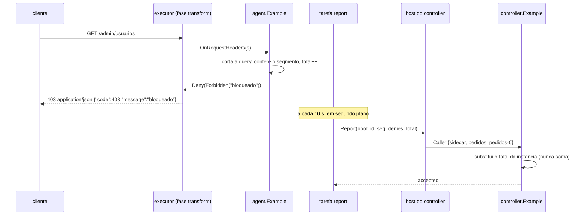
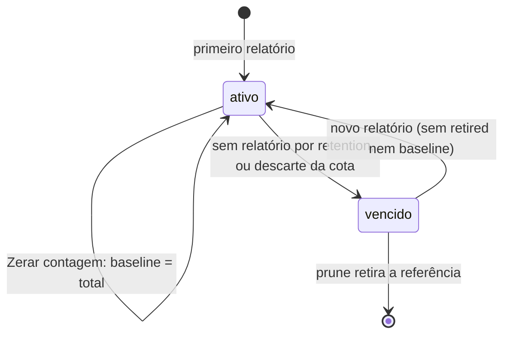
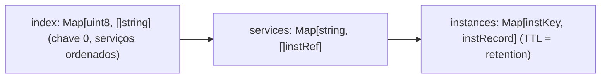

### FDD: Plugin de exemplo `n3x.example` (SDK-13)

Versão: 1.0
Data: 2026-10-21
Responsável: Guilherme Giusti

---

### 1. Contexto e motivação técnica

**Problema técnico.** O PRD usa o plugin de exemplo como régua em quatro critérios de aceite: o mesmo resultado em aplicações de pelo menos duas linguagens, a negação gRPC como `PERMISSION_DENIED` em `envoy-1.40` e `istio-1.31`, o panic contido e o plugin novo criado a partir dele que aparece no painel com página e cartão (FR-014). O HLD do `n3x-sdk` já mostra o código das duas metades, mas com seis defeitos que impedem a implementação sem ambiguidade:

- **Contagem em dobro (L-55):** a metade de proxy envia o total acumulado e a metade de controller soma esse total a cada relatório (código do HLD e exemplo do contrato 6 da FDD 08, `p.soma(who.Service, r.Denies)`)
- **Config divergente (L-54):** o HLD do SDK usa `header` e `deny_path` com valor fixo `"1"`, e o HLD do sidecar usa `name` e `value`
- **Semântica do `deny_path` aberta:** o código usa `strings.HasPrefix(s.Path(), ...)`, mas `Path()` traz a query (FDD 05), `/admin` casaria `/administrator`, e a FDD 17 deixou para esta FDD a semântica e um caso gRPC (P-11 da FDD 17)
- **Memória sem uso real:** o código cria `memory.NewMap[string, int64]` e não o usa; o `Map` não tem incremento atômico nem `Range` (FDD 04), e o HLD pede `AssertZeroAllocs` no `Map.Get` do exemplo
- **Lugar do código:** o HLD põe o exemplo em `example/` dentro do módulo do SDK, mas o `n3x-plugin add` exige `n3x-plugin.yaml` na raiz de um módulo (FDD 19, I-05), e as FDDs 16, 17 e 21 usam um caminho ilustrativo `github.com/giustech/n3x-example`
- **Telas incompletas:** cartão como valor fixo, `Table` sem `ID` e `Caption`, `Refresh` sem `ID`, e nenhuma decisão sobre a `Action` "Zerar contagem" pedida pela FDD 11

**Encaixe no HLD.** Esta FDD especifica o diretório `example/` do repositório `n3x-sdk` (HLD do `n3x-sdk`, linha `example/` de "Componentes": "adiciona header e nega um path em HTTP e gRPC, conta as negações e as envia ao controller, que mostra um cartão"), que passa a ser um **módulo Go próprio**, `github.com/giustech/n3x-sdk/example`, com a estrutura padrão de repositório de plugin do FR-014. Ele é ao mesmo tempo:

- **Prova do contrato:** primeiro plugin de duas metades sem os privilégios do core; usa `plugin/`, `proxy/`, `memory/`, `telemetry/`, `controller/` (`ctrl`), `controller/ui`, `sdktest` e `sdktest/ctrltest` como um autor de fora usaria
- **Molde do `n3x-new`** (ADR-013, FDD 14): o gerador copia a árvore e troca o ID nos lugares inventariados aqui (contrato 12)
- **Carga da plataforma:** o executor, o adaptador, a contenção e o benchmark (FDDs 16, 17, 18 e 50), o builder (FDDs 19 a 23) e a integração ponta a ponta nos dois alvos e em duas linguagens (FDD 48) rodam com ele; a ele pertence o arquivo de casos `testdata/cases.json`, a fonte única do comportamento esperado (contrato 11)

**O que o exemplo expõe para as FDDs 14 e 48** (resumo; detalhes nos contratos):
- Para o `n3x-new` (FDD 14): a árvore do módulo como molde, com as metades independentes (apagar `controller/` e `proto/` dá um plugin só de proxy que compila e testa); o inventário de toda forma do ID com a derivação de cada uma (contrato 12); testes que já passam com o kit; nenhum atalho de teste
- Para a integração ponta a ponta (FDD 48): o módulo resolvível por `n3x-plugin add github.com/giustech/n3x-sdk/example@<tag>` (contrato 1); os fragmentos de referência do `n3x.yaml` do sidecar e do controller (`testdata/n3x/`); o arquivo `testdata/cases.json`, sem dependência de Go, com requisição e resultado esperado em HTTP/1.1, HTTP/2 e gRPC, inclusive o que a aplicação de teste precisa receber (`x-n3x: 1`) e os deltas de métrica; o serviço gRPC de teste `pedidos.v1.Pedidos` (`Obter` segue, `Excluir` é negado antes da aplicação); o cartão `negacoes` e a página `/negacoes` com textos e IDs estáveis para conferir o painel; os nomes de métrica e de evento de log (contratos 4, 5 e 8)
- O que fica com a FDD 48: as aplicações de teste em Go e Python que implementam `pedidos.v1.Pedidos/Obter` e devolvem os headers recebidos, o plugin só de teste de panic e atraso (L-43) e a orquestração nos dois alvos

**Atores.** Autor de plugin (lê como referência e parte dele pelo `n3x-new`), `n3x-new` (copia), executor e adaptador do sidecar (rodam a metade de proxy), host do controller (roda a metade de controller), builder (`add`, análise, compilação), CI cruzada e integração ponta a ponta (FDD 48), mantenedor do SDK (valida as pré-releases `v0.x` com ele, ADR-021).

**Limites.** O exemplo é um plugin comum: não tem capacidade privilegiada, não importa `secret/`, não usa `env.Dial` nem `HTTPClient`, não lê o inventário do core e não tem nenhum campo, build tag ou atalho só de teste. A injeção de panic e de atraso dos testes de plataforma fica num plugin só de teste fora do exemplo (L-43, FDD 48). A execução no Envoy real, o Dockerfile, o gerador e o guia do autor ficam nas FDDs 16 a 18, 19 a 23, 14 e 47.

**Suposições**
- Go 1.26 ou superior, `buf` v2, `protoc-gen-go` e `protoc-gen-go-grpc` fixados num módulo `tools/` aninhado (mesmo padrão da FDD 36)
- O Go proxy e o `go mod download` aceitam módulo aninhado com tag prefixada (`example/v0.3.0` resolve `github.com/giustech/n3x-sdk/example@v0.3.0`); comportamento documentado do `go` desde a 1.13
- O `go.work` na raiz do `n3x-sdk` faz os testes do exemplo rodarem contra o SDK do mesmo commit, o que permite validar as pré-releases antes da tag (ADR-021)
- 500 sidecars com uma ou duas instâncias do exemplo geram até 100 relatórios por segundo no controller (intervalo de 10 s), carga desprezível para a metade de controller (confirmado)

**Restrições**
- `agent/` não importa `controller/` nem `controller/ui` (ADR-011; P-10 da FDD 08; regra da FDD 24); `types/` importa só a biblioteca padrão e `github.com/giustech/n3x-sdk/plugin`; `proto/` importa só biblioteca padrão, protobuf e grpc
- Sem `go` cru, sem `time.Sleep`, sem `context.Background()`, sem `init()` com efeito colateral, sem `unsafe` e sem `fmt` no caminho quente (FDD 24 e HLD do `n3x-sdk`)
- Namespace `n3x` reservado a módulos `github.com/giustech/` (ADR-012); o caminho do módulo escolhido passa no `plugin.CheckNamespace`
- Mensagens e telas em pt-BR; identificadores, rótulos de métrica e nomes de evento em inglês

**Rastreabilidade**
- PRD 1.5: FR-014 (exemplo com as duas metades, nos testes de integração, molde do gerador), FR-012 (hooks, negação ciente de gRPC, memória com cota, controller só em segundo plano, kit), FR-013 (gRPC próprio, páginas e cartões em widgets, `Caller`), FR-004 (política de falha e panic contido), FR-008 (polling, ação de root, exportação); meta "agnóstico de linguagem"; critérios de aceite das linhas 789, 790, 791, 804 e 807; "Testes e validação"
- ADRs do `n3x-sdk`: ADR-011, ADR-012, ADR-013, ADR-015, ADR-016, ADR-017, ADR-018, ADR-020, ADR-021 e ADR-022; ADR-009 de plataforma (sem tracing na v1)
- HLDs: `n3x-sdk/docs/HLD.md` ("Componentes", "Contrato de proxy", "Contrato de controller", "Kit de testes", "Estrutura padrão de um repositório de plugin", "Manifesto `n3x-plugin.yaml`", portões de CI); `n3x-sidecar/docs/HLD.md` (instância `n3x.example` do `n3x.yaml` v1, orçamento com core mais exemplo)
- FDDs usadas como contrato: 01 (manifesto literal do exemplo, derivações do ID), 02 (tags, `SchemaOf`, golden), 04 (`memory.NewMap`, sem `Range`, cópia no `Set`), 05 (`OnRequestHeaders`, `Forbidden`, `Headers().Set`, `CheckHeader`, `CheckRoute`, `Path()` com query), 06 (`Env`, `Background`, `Controller`, `ErrStandalone`, `Sleep`, `telemetry`), 07 (`sdktest`), 08 (`ctrl.Define`, capacidades, `Caller`, `Routes`, `Cards`, `InMenu`, `StateReporter`), 10 (`Page`, `Stat`, `Table`, `FormatInt`, `ConfigDetail`), 11 (`Refresh`, `Action`, `Routes.Action`, `Export`, `PluginPath`, `LinkCell`), 12 (`ctrltest`), 15 (instância de referência e `match`), 17 (casos de executor), 18 (efeitos da política), 19 (requisitos do `add`), 36 (convenções de `buf`, golden e layout)
- Lacunas do README:
  - **L-54 fechada aqui (confirmado):** a config é `header` (padrão `X-N3X`) e `deny_path` (padrão vazio, que não nega nada); o valor do header é fixo, `"1"`; a fase permitida é só `transform`, como já fixado pelo manifesto literal da FDD 01 e usado pelas FDDs 07, 15 e 17. O HLD do sidecar (`name` e `value`) está desatualizado (I-01)
  - **L-55 fechada aqui (confirmado):** o relatório é **absoluto e idempotente**: cada instância de plugin envia o total desde a própria subida, com `boot_id` e `seq`; o controller guarda o último valor por instância e **substitui**, nunca soma; troca de `boot_id` acumula o valor anterior; zerar é uma linha de base no controller (contrato 6)
  - **L-43 fechada na parte da FDD 13 (confirmado):** a injeção de panic e de atraso não fica no exemplo. Ela usa um plugin só de teste da FDD 48 (por exemplo o `conformance.ScriptPlugin`, como já faz a FDD 18), para nenhum atalho de teste ir parar no molde do `n3x-new` nem no exemplo publicado
- Pedidos de FDDs anteriores atendidos:
  - FDD 04: nenhuma leitura depende de iteração; índices explícitos guardados no próprio `memory.Map` (contrato 8)
  - FDDs 02 e 36: golden dos schemas reais em `types/testdata/schema/proxy.json` e `controller.json` (contrato 2)
  - FDD 05: `proxy.CheckHeader(cfg.Header, "1")` no `New` (contrato 3)
  - FDD 19: módulo próprio `github.com/giustech/n3x-sdk/example` com `n3x-plugin.yaml` na raiz e tags `example/vX.Y.Z` (P-07 da FDD 19 resolvido com a sugestão dela)
  - FDD 08: cartão como função e `InMenu("Negações")` (contrato 9)
  - FDD 10: `Table` com `ID` e `Caption`; `Stat` com `ui.FormatInt` (contrato 9)
  - FDD 11: `Refresh` com `ID` (`resumo`), `Table.Export` (`servicos`) e a `Action` "Zerar contagem" de root: a L-55 fechada com linha de base permite zerar sem mensagem ao sidecar (contrato 10)
  - FDD 07: testes do exemplo com `sdktest`, inclusive `AssertZeroAllocsFunc` no `Map.Get` (seção 9)
  - FDD 17: semântica do `deny_path` por segmento, sem a query, e a instância `deny-grpc` na config de referência (contratos 3 e 11)
  - FDD 12: testes da metade de controller com `ctrltest.NewHost`, `Link` e o cartão `negacoes`; `res.Action("Zerar contagem").Submit()` (seção 9)

**Decisões aprovadas na clarificação**
- Config do `n3x.example` (L-54, confirmado): `header` e `deny_path`, com o valor do header fixo `"1"`; não há `name` nem `value`, e o HLD do sidecar (que usa `name`/`value`) é tratado como desatualizado
- Contagem de negações (L-55 e objetivo 1, confirmados): total absoluto e idempotente por instância (`boot_id`, `seq`, `denies_total`, com `baseline` e `retired`); o controller substitui e nunca soma
- A negação HTTP do exemplo usa o corpo JSON da FDD 05 (`{"code":403,"message":"bloqueado"}`, `application/json; charset=utf-8`); a exportação das tabelas do exemplo exige root (padrão da FDD 11), sem `ExportAllowRead`
- O `example/` é módulo Go aninhado (`github.com/giustech/n3x-sdk/example`) com `go.mod` próprio, `go.work` e tags `example/vX.Y.Z`; o HLD (L53/L150) e a ADR-011 devem registrar isso, e o código de exemplo do HLD (`ReportReq`/`Ok`, `c.Add(id, widget)`, soma a cada relatório) deve ser atualizado para `ReportRequest`/`ReportResponse` com `boot_id`/`seq`, `Cards.Add(id, papel, fn)` e contagem absoluta
- As demais hipóteses numéricas, de teste e de baixo risco ficam aceitas como padrão, sem bloqueio

**Pendências não bloqueantes**
- Uma instância cujo registro venceu ou foi descartado pela cota recontabiliza tudo desde a subida quando volta a reportar, apesar de a tela dizer "desde a última zeragem": a página traz a ressalva no texto (contrato 9); tratar de outra forma fica para depois
- A tarefa `report` lê `total` e `seq` em dois atômicos separados: o controller só exige monotonicidade (contrato 5)
- Premissa do Go proxy: `example/vX.Y.Z` resolve para `github.com/giustech/n3x-sdk/example@vX.Y.Z` e o `require` do `example/go.mod` precisa apontar para um SDK já publicado
- Dependem de outros repositórios: FDD 14 e 19 (`n3x-new`, `n3x-plugin add` com módulo aninhado e tag prefixada), 15 e 30 (`testdata/n3x/*.yaml` em `validate`), 16, 17, 18 e 49 (negação e alvos), 24, 26 (`normalize_path`), 32 a 36, 47, 48 (aplicações Go e Python, plugin de teste de panic) e 50; as FDDs 16, 17 e 21 citam o caminho ilustrativo `github.com/giustech/n3x-example`, que esta FDD substitui
- Divergências para o Workflow 3: HLD do sidecar (`name`/`value`), HLD do SDK (exemplo de código) e ADR-011 (módulo aninhado)
- Receber da FDD 14 os marcadores `noproto` (quarta combinação do molde com `--no-proto`: duas metades sem `proto/` nem tarefa `report`).

---

### 2. Objetivos técnicos

- **Contagem exata e idempotente (confirmado).** Invariante: o total mostrado para uma instância é igual ao número de negações dela desde a subida (menos a linha de base de "Zerar contagem"), qualquer que seja o número de relatórios repetidos, perdidos ou fora de ordem. Medida: 1.000 relatórios aleatórios repetidos, embaralhados e com 10% de perda dão no cartão o mesmo valor que o último total enviado, em 100 de 100 execuções.
- **Mesmo resultado em todos os lugares.** Invariante: o kit (`sdktest`), o executor do sidecar e o Envoy real nos dois alvos produzem o resultado de cada caso de `testdata/cases.json`. Medida: os casos passam no `go test` do exemplo e são consumidos pela FDD 48 em aplicações Go e Python, em HTTP/1.1, HTTP/2 e gRPC, sem mudança no arquivo.
- **Negação gRPC nunca como sucesso.** Medida: os casos gRPC negados terminam com HTTP 200, `grpc-status: 7`, `grpc-message: bloqueado`, trailers-only, em 100% das execuções do kit e da FDD 48; nenhum caso termina com `grpc-status: 0`.
- **Caminho quente sem custo.** Medida: `OnRequestHeaders` com 0 alocações nos três caminhos (nega, adiciona header, `deny_path` vazio) e `Map.Get` com 0 alocações nas duas metades, medidos por `AssertZeroAllocs` e `AssertZeroAllocsFunc` sem `-race`; p50 do hook até 0,05 ms dentro do orçamento "core mais exemplo" do HLD do sidecar (confirmado pela FDD 50).
- **Controller só em segundo plano e modo standalone.** Invariante: nenhuma chamada ao controller sai de um hook; sem bloco `controller` no `n3x.yaml`, o exemplo sobe, nega e adiciona o header sem tarefa de fundo. Medida: teste de standalone com 0 chamadas e o log `report_disabled` exatamente uma vez por instância.
- **Cancelamento respeitado.** Medida: `sdktest.AssertHonorsCancel` aprova; a tarefa `report` termina em até 1 s de tempo real depois do cancelamento, com o controller falso sem responder.
- **Molde limpo.** Invariante: nenhum campo, rótulo, rota ou arquivo só de teste. Medida: o teste `TestInventarioDoID` falha se uma forma do ID aparecer fora da tabela do contrato 12, e a análise estática da FDD 24 dá 0 violações e 0 exceções `//n3x:allow` no módulo.

---

### 3. Escopo e exclusões

**Incluído**
- Módulo `github.com/giustech/n3x-sdk/example` em `n3x-sdk/example/`, com `go.mod`, `n3x-plugin.yaml`, `agent/`, `controller/`, `types/`, `proto/`, `internal/repotest/`, `testdata/`, `tools/`, `buf.yaml`, `buf.gen.yaml`, `Makefile` e `README.md`; `go.work` na raiz do `n3x-sdk`; esquema de tags e de versões
- Manifesto `n3x-plugin.yaml` (contrato 1)
- `types/`: `ProxyConfig`, `ControllerConfig`, constantes compartilhadas e golden dos dois schemas (contrato 2)
- Metade de proxy `agent/`: `Plugin()`, `New` com as validações, `OnRequestHeaders`, contagem em `sync/atomic`, estado do relatório em `memory.Map`, métrica de negações e tarefa `report` (contratos 3 a 5)
- `proto/`: serviço `n3x.plugins.n3x.example.v1.Example` com o RPC `Report`, stubs versionados, `buf lint` e `buf breaking` (contrato 6)
- Metade de controller `controller/`: handler `Report` com a semântica absoluta, agregação em `memory.Map` com índices explícitos, tarefa `prune`, estado degradado no limite, cartão `negacoes`, páginas `/negacoes`, `/negacoes/{servico}` e `/sobre`, `Action` `/negacoes/zerar` (contratos 7 a 10)
- Arquivo de casos `testdata/cases.json` e fragmentos de referência do `n3x.yaml` do sidecar e do controller em `testdata/n3x/` (contrato 11)
- Inventário das ocorrências do ID para o `n3x-new` (contrato 12)
- Testes das duas metades com o kit, testes do repositório, fuzzing e portões de CI (seção 9)

**Excluído**
- Gerador `n3x-new` e `schema-check`, inclusive o mecanismo de troca do ID: FDD 14 (SDK-14)
- Execução no Envoy real, adaptador, executor e contenção: FDDs 16 (SID-02), 17 (SID-03) e 18 (SID-04); alvo Istio: FDD 49 (SID-11)
- Suíte ponta a ponta, aplicações de teste em Go e Python, plugin só de teste de panic e atraso (L-43) e CI cruzada: FDD 48 (SDK-16)
- Dockerfiles, `n3x-plugin add`, build do `.so` e do controller: FDDs 19 a 23
- Topologias de deploy e guia do autor: FDD 47 (SDK-15); os fragmentos de `testdata/n3x/` são dados de teste, não exemplos de deploy (ADR-008)
- Banco, `Starter`, `Stopper`, `PluginAPI`, `Dial` e `HTTPClient`: o exemplo não precisa deles; o guia da FDD 47 mostra esses casos com outros plugins (confirmado)
- Dependência do inventário do core: o exemplo não declara `depends_on` e não sabe se uma instância saiu do inventário; usa retenção própria (contrato 7)

---

### 4. Fluxos detalhados e diagramas

**Fluxo principal: requisição na metade de proxy**
- O executor chama `OnRequestHeaders(s)` da instância (fase `transform`, padrão `order` 50 e política `open`, salvo o `n3x.yaml`)
- Se `deny_path` não é vazio, o hook corta `s.Path()` no primeiro `?` (sem alocar) e confere por segmento contra o prefixo normalizado no `New` (contrato 3):
  - casa: soma 1 no contador atômico da instância, soma 1 na série `n3x_n3x_example_denies_total{path=<deny_path>}` resolvida no `New` e devolve `s.Deny(e.deny)` com a resposta `proxy.Forbidden("bloqueado")` montada no `New`
  - não casa: segue
- `s.Headers().Set(cfg.Header, "1")`, que troca qualquer valor que o cliente tenha mandado no mesmo header, e `proxy.Continue`
- O executor renderiza a negação: HTTP 403 `application/json; charset=utf-8` com corpo `{"code":403,"message":"bloqueado"}`, ou gRPC com HTTP 200, `grpc-status: 7` e `grpc-message: bloqueado` em trailers-only; conta `n3x_plugin_denies_total{code="403"}` (FDDs 05 e 17)

**Fluxo da tarefa `report` (metade de proxy, em segundo plano)**
- No `New`: `env.Controller()`; com `ErrStandalone`, loga `report_disabled` (`reason=standalone`) e não registra tarefa; senão cria o client `examplev1.NewExampleClient(conn)` e registra `env.Background("report", e.report)`
- `boot_id`: 16 hexadecimais de `crypto/rand`, gerados no `New` (um por instância de plugin por processo)
- A tarefa começa depois da subida inteira (FDD 06) e envia o primeiro relatório na hora; depois, um a cada `types.ReportInterval` (10 s), com `proxy.Sleep(ctx, ...)`; `Sleep` devolvendo erro encerra a tarefa
- Cada envio: `seq` sobe 1 (contador atômico da instância, que sobrevive ao reinício da tarefa depois de panic), `ReportRequest{plugin_instance: env.Instance(), boot_id, seq, denies_total: total atual, deny_path: cfg.DenyPath}`, `cli.Report(ctx, req)` com o teto de 5 s do SDK (`proxy.DefaultControllerCallTimeout`, aplicado pela visão do `Env`)
- Resultado: conta `n3x_n3x_example_reports_sent_total{result="ok"|"error"}` e atualiza o estado `report` no `memory.Map` (último sucesso, falhas seguidas, último código); o log de falha é amostrado por esse estado (contrato 5)
- Sem nova tentativa no mesmo ciclo e sem `proxy.Buffered`: o próximo relatório leva o total novo, que substitui o anterior; guardar relatórios velhos não acrescenta nada (confirmado)
- `UNIMPLEMENTED` (controller sem a metade de controller do exemplo, permitido porque `controller.required: false`): o intervalo passa a `types.ReportIdleInterval` (60 s) e sai o log `report_unimplemented` uma vez; volta a 10 s no primeiro sucesso

**Fluxo do `Report` na metade de controller**
- O host autentica a conexão do sidecar e põe `Caller` `{sidecar, serviço, instância, sessão}` (FDDs 08 e 33); o handler lê `serviço` e `instância` do `Caller`, nunca da mensagem
- Valida a mensagem (contrato 6); erro dá `INVALID_ARGUMENT`, conta `reports_received_total{result="invalid"}` e loga `report_rejected` amostrado
- Sob a trava de escrita da instância do plugin (um `sync.Mutex`, porque o par `Get` e `Set` do `Map` não é atômico):
  - chave `{serviço, instância do sidecar, plugin_instance}` no mapa `instances`
  - sem registro: confere os limites (contrato 7); acima, `RESOURCE_EXHAUSTED`, estado `degraded` e `tracking_limit`; dentro, cria o registro e acrescenta a referência ao mapa `services` e, se for serviço novo, o nome ao índice ordenado `index`
  - mesmo `boot_id` e `seq` menor ou igual ao guardado: nada muda, resposta `accepted: false` (`result="stale"`)
  - mesmo `boot_id` e total menor que o guardado: `INVALID_ARGUMENT` (contador não volta na mesma subida)
  - `boot_id` novo: `retired += max(total_guardado - baseline, 0)`, `baseline = 0`, depois grava o total novo
  - sempre: grava `seq`, total, `deny_path` e a hora do controller, com `SetWithTTL(retention)`; garante que o serviço está no índice (o índice pode ter sido descartado pela cota)
- Resposta `ReportResponse{accepted: true}`

**Fluxo de leitura (cartão e páginas)**
- Sem trava: lê `index`, depois `services[s]` de cada serviço e `instances[k]` de cada referência; referência sem registro (vencido ou descartado) é pulada
- Valor de uma instância: `retired + total - baseline`; de um serviço: soma das instâncias; do cartão: soma dos serviços
- Nenhuma leitura itera o `Map`; o custo é proporcional às referências guardadas, limitado pelo contrato 7

**Fluxo de "Zerar contagem"**
- A página `/negacoes` mostra a `ui.Action` só para root (`AllowRead` falso); o host confere CSRF e papel (FDD 11)
- `ActionFunc` sob a trava: para cada registro alcançável, `baseline = total` e `retired = 0`; conta `n3x_n3x_example_resets_total`; loga `counts_reset` com o usuário do `Caller`, o número de serviços e de instâncias
- Devolve `ui.Done("Contagem zerada.")`; o host responde 303 para `_return`, com o aviso no GET seguinte
- Idempotente: dois envios seguidos dão o mesmo estado; nada é enviado aos sidecars

**Fluxo da tarefa `prune` (metade de controller)**
- `env.Background("prune", ...)` com `ctrl.Sleep(ctx, types.PruneInterval)` (1 min)
- Sob a trava: remove de `services` as referências sem registro e do `index` os serviços sem referência; atualiza `n3x_n3x_example_tracked_instances` e `n3x_n3x_example_tracked_services`; se estava `degraded` por limite e voltou a 90% ou menos dos limites, chama `env.State().OK()`

**Fluxos alternativos e exceções**
- **Sidecar reiniciado:** a instância volta com `boot_id` novo e total 0; o controller acumula o valor anterior em `retired`, então o total do serviço não cai
- **Instância some (pod removido, escala para baixo):** sem relatório, o registro vence depois de `retention` (padrão 24 h) e sai do total; a tela diz "instâncias com relatório nas últimas 24 h". O exemplo não lê o inventário do core (confirmado)
- **Controller reiniciado:** a memória é volátil (ADR-017); depois do primeiro ciclo de 10 s cada instância ativa reaparece com o total desde a própria subida; `retired` e linhas de base anteriores se perdem
- **Registro descartado pela cota de memória:** igual ao caso anterior, só para aquela instância; o índice descartado é refeito pelos relatórios seguintes
- **Duas instâncias do exemplo no mesmo sidecar** (`add-header` e `deny-grpc`): cada uma tem contador, `boot_id`, tarefa e registro próprios; somam no mesmo serviço
- **Header vindo do cliente:** `Set` troca o valor; a aplicação só vê `X-N3X: 1`
- **`deny_path` vazio:** o exemplo só adiciona o header e não cria série de negação
- **Alvo `istio-1.31`:** o exemplo usa só o contrato obrigatório (nenhuma capacidade opcional), então o resultado é o mesmo nos dois alvos (FDD 05, L-20)
- **Panic no hook:** não há caminho de panic no código; se houver (defeito), vale a política da instância (FDD 18). A injeção de panic dos testes fica no plugin só de teste da FDD 48

**Diagramas**

Sequência das duas metades:



Estado de um registro de instância no controller:



Mapas da metade de controller, sem iteração:



---

### 5. Contratos públicos (assinaturas, endpoints, headers, exemplos)

**Contrato 1: módulo, versões e manifesto `n3x-plugin.yaml`**
- Tipo: sdk (manifesto e layout de repositório)
- Assinatura/Rota:
  ```text
  n3x-sdk/
  ├── go.work                        use . e ./example (só desenvolvimento e CI)
  └── example/                       module github.com/giustech/n3x-sdk/example
      ├── n3x-plugin.yaml            manifesto (FDD 01)
      ├── go.mod, go.sum             go 1.26; SDK igual ao limite inferior da faixa sdk
      ├── buf.yaml, buf.gen.yaml     buf v2 (contrato 6)
      ├── Makefile                   tools, generate, lint, breaking, test, test-norace, check
      ├── README.md                  o que o exemplo faz e como rodar
      ├── agent/                     metade de proxy
      ├── controller/                metade de controller
      ├── types/                     configs, constantes e testdata/schema/*.json
      ├── proto/n3x/plugins/n3x/example/v1/   .proto, .pb.go e _grpc.pb.go versionados
      ├── internal/repotest/         testes do repositório (manifesto, pastas, tag, inventário)
      ├── testdata/cases.json        casos de comportamento (contrato 11)
      ├── testdata/n3x/              fragmentos de n3x.yaml de referência (contrato 11)
      └── tools/go.mod               buf, protoc-gen-go, protoc-gen-go-grpc (fora do .zip)
  ```
  ```yaml
  # n3x-plugin.yaml na série estável (forma literal da FDD 01, contrato 7)
  # Os valores abaixo (version 1.0.0, sdk ">=1.0.0 <2.0.0") são ilustrativos da série estável.
  # Na série 0 (primeira release v0.1.0) vale version: 0.1.0 e sdk: ">=0.1.0 <0.2.0".
  id: n3x.example
  version: 1.0.0
  sdk: ">=1.0.0 <2.0.0"
  halves: [proxy, controller]
  proxy: { phases: [transform], default_phase: transform, default_order: 50, default_failure: open }
  controller: { required: false, depends_on: [] }
  ```
- Método: n/a
- Semântica:
  - **Módulo aninhado:** o `example/` tem `go.mod` próprio, então sai do `.zip` do módulo do SDK (regra do Go usada pela FDD 19) e o `n3x-plugin add github.com/giustech/n3x-sdk/example@v1.0.0` acha o manifesto na raiz do módulo. O caminho começa com `github.com/giustech/`, então passa no `CheckNamespace` do namespace `n3x`
  - **Tags e versões:** o exemplo é lançado com o mesmo número do SDK, em tag prefixada `example/vX.Y.Z` criada depois da tag `vX.Y.Z` do SDK e de um commit que sobe o `require` do `example/go.mod` para `vX.Y.Z` (confirmado). `version` do manifesto é `X.Y.Z` (sem `v`), igual à tag, como exige a FDD 19
  - **Manifesto literal e série 0:** o bloco acima, com `version: 1.0.0` e `sdk: ">=1.0.0 <2.0.0"`, é ilustrativo da série estável. Na série 0, cuja primeira release é `v0.1.0`, o manifesto publicado traz `version: 0.1.0` e `sdk: ">=0.1.0 <0.2.0"`, e o `add` dos exemplos usa `@v0.1.0`
  - **Faixa `sdk`:** na série estável, `>=X.0.0 <(X+1).0.0` com o limite inferior igual ao SDK do `go.mod` (pedido da FDD 20 à 14); na série 0, `>=0.N.0 <0.(N+1).0`, porque a faixa não atravessa minor (FDD 01)
  - **Desenvolvimento:** o `go.work` da raiz liga o exemplo ao SDK do mesmo commit; a CI do SDK roda os testes do exemplo nesse modo em todo PR (validação das pré-releases, ADR-021) e, na tag, de novo com `GOWORK=off` contra o SDK publicado
  - **Manifesto:** fase só `transform` (o hook só adiciona header e nega; não altera rota); `default_order: 50`; `default_failure: open` (o header não é essencial; quem usa o `deny_path` como controle de acesso põe `failure: closed` na instância, como faz o `n3x.yaml` de referência do HLD do sidecar); sem dependências; metade de controller opcional

**Exemplo de requisição**
```bash
n3x-plugin add github.com/giustech/n3x-sdk/example@v1.0.0
GOWORK=off go test -race ./...    # dentro de example/, na tag
```

**Exemplo de resposta**
```json
{
  "add": "ok; manifesto n3x.example 1.0.0 na raiz do módulo; halves proxy,controller; agent/ e controller/ com código",
  "derivações": { "GRPCPackage(1)": "n3x.plugins.n3x.example.v1", "RoutePrefix()": "/plugins/n3x/example/", "MetricPrefix()": "n3x_n3x_example_" },
  "manifesto canônico": "{\"id\":\"n3x.example\",\"version\":\"1.0.0\",\"sdk\":\">=1.0.0 <2.0.0\",\"halves\":[\"proxy\",\"controller\"],\"proxy\":{\"phases\":[\"transform\"],\"default_phase\":\"transform\",\"default_order\":50,\"default_failure\":\"open\"},\"controller\":{\"required\":false,\"depends_on\":[]}}"
}
```

---

**Contrato 2: `types/` (configs, constantes e golden dos schemas)**
- Tipo: sdk (structs Go, fonte do schema)
- Assinatura/Rota:
  ```go
  package types // github.com/giustech/n3x-sdk/example/types

  // Config da metade de proxy (plugins[].config no n3x.yaml do serviço).
  type ProxyConfig struct {
      Header   string `json:"header" n3x:"min=1,max=256" default:"X-N3X" desc:"Nome do header adicionado às requisições que seguem; o valor é sempre 1"`
      DenyPath string `json:"deny_path" n3x:"max=1024" default:"" desc:"Prefixo de path negado com 403 (gRPC PERMISSION_DENIED), comparado por segmento e sem a query; vazio não nega nada"`
  }

  // Config da metade de controller (seção do plugin no n3x.yaml do controller).
  type ControllerConfig struct {
      Retention time.Duration `json:"retention" n3x:"min=1m,max=168h" default:"24h" desc:"Por quanto tempo uma instância sem relatório continua contando no total"`
  }

  const (
      HeaderValue        = "1"              // valor fixo do header (L-54)
      DenyMessage        = "bloqueado"      // "message" do corpo JSON HTTP (FDD 05) e grpc-message da negação
      ReportInterval     = 10 * time.Second // entre relatórios
      ReportIdleInterval = 60 * time.Second // depois de UNIMPLEMENTED
      PruneInterval      = 1 * time.Minute  // tarefa prune do controller
      MaxDenyPathLen     = 1024
  )
  ```
- Método: n/a
- Semântica:
  - **Defaults válidos:** `header` tem default (`X-N3X`), então não é `required`; `deny_path` vazio é o default e passa no `max`. Isso mantém o resultado do exemplo de erros da FDD 15 (config com campo desconhecido dá só `unknown_field`)
  - **Sem segredo:** nenhum campo `plugin.Secret`; `ENC[...]` em qualquer campo dá `secret_unexpected` no host (FDD 03)
  - **Validações que não cabem em tag** ficam no `New` (contrato 3): nome de header protegido ou inválido e forma do `deny_path`
  - **`types/` só com dados:** biblioteca padrão e `plugin/` (FDD 36)
  - **Golden:** `types/testdata/schema/proxy.json` = `plugin.SchemaOf[types.ProxyConfig]()` e `controller.json` = `plugin.SchemaOf[types.ControllerConfig]()`, em bytes; os bytes reais são os do SDK, e o texto abaixo é a leitura esperada pelas regras da FDD 02 (se divergir em forma, vale o SDK e o golden é regravado com nota, como na FDD 36)

**Exemplo de requisição**
```go
func TestSchemaGolden(t *testing.T) {
    b := mustSchema(t, plugin.SchemaOf[types.ProxyConfig]())
    golden(t, "testdata/schema/proxy.json", b)
    if got := mustSchema(t, agent.Plugin().ConfigSchema()); !bytes.Equal(got, b) {
        t.Fatal("agent.Plugin().ConfigSchema() difere do golden")
    }
}
```

**Exemplo de resposta** (`proxy.json` e `controller.json`, compactos no arquivo; quebrados aqui para leitura)
```json
{"$schema":"https://json-schema.org/draft/2020-12/schema","x-n3x-schema":1,"type":"object","properties":{
  "deny_path":{"type":"string","description":"Prefixo de path negado com 403 (gRPC PERMISSION_DENIED), comparado por segmento e sem a query; vazio não nega nada","maxLength":1024,"default":""},
  "header":{"type":"string","description":"Nome do header adicionado às requisições que seguem; o valor é sempre 1","minLength":1,"maxLength":256,"default":"X-N3X"}},
 "additionalProperties":false}

{"$schema":"https://json-schema.org/draft/2020-12/schema","x-n3x-schema":1,"type":"object","properties":{
  "retention":{"type":"string","description":"Por quanto tempo uma instância sem relatório continua contando no total","x-n3x-format":"duration","x-n3x-minimum":"1m","x-n3x-maximum":"168h","default":"24h"}},
 "additionalProperties":false}
```

---

**Contrato 3: metade de proxy, `Plugin`, `New` e `OnRequestHeaders`**
- Tipo: sdk (código do plugin, chamado pelo registro gerado e pelo executor)
- Assinatura/Rota:
  ```go
  package agent // github.com/giustech/n3x-sdk/example/agent

  func Plugin() proxy.Plugin { return proxy.Define[types.ProxyConfig](New) }

  func New(cfg types.ProxyConfig, env proxy.Env) (proxy.Instance, error)

  type Example struct{ /* campos só de leitura depois do New, mais contadores atômicos */ }
  func (e *Example) OnRequestHeaders(s proxy.Stream) proxy.Action

  var ErrInvalidDenyPath = errors.New("example: deny_path inválido")
  ```
  ```go
  // Forma de referência do caminho quente (0 alocações).
  func (e *Example) OnRequestHeaders(s proxy.Stream) proxy.Action {
      if e.prefix != "" && deniedPath(s.Path(), e.prefix) {
          e.denies.Add(1)
          e.deniesSeries.Inc()
          return s.Deny(e.deny)
      }
      s.Headers().Set(e.header, types.HeaderValue)
      return proxy.Continue
  }

  // deniedPath: igual ao prefixo ou prefixo seguido de "/", sem a query.
  func deniedPath(path, prefix string) bool {
      if i := strings.IndexByte(path, '?'); i >= 0 {
          path = path[:i]
      }
      if prefix == "/" {
          return true
      }
      return strings.HasPrefix(path, prefix) && (len(path) == len(prefix) || path[len(prefix)] == '/')
  }
  ```
- Método: n/a
- Semântica do `New` (nesta ordem; qualquer erro impede a instância, e o executor reporta `instance_failed`):
  1. `proxy.CheckHeader(cfg.Header, types.HeaderValue)`; erro devolvido como `fmt.Errorf("header %q: %w", cfg.Header, err)`, preservando `proxy.ErrProtectedHeader` ou `proxy.ErrInvalidHeader` (pedido da FDD 05)
  2. `deny_path` não vazio: começa com `/`; passa em `proxy.CheckRoute(proxy.Route{Path: p})`; não tem `?` nem `#` (as regras de `match.paths` da FDD 15); erro embrulha `ErrInvalidDenyPath`
  3. Normaliza o prefixo: tira a `/` final, menos em `/` sozinho (`/admin/` e `/admin` ficam iguais)
  4. Monta `e.deny = proxy.Forbidden(types.DenyMessage)` e resolve `e.deniesSeries = counter.With(cfg.DenyPath)` (só se `deny_path` não é vazio)
  5. Cria a família `denies_total` (rótulo `path`), a família `reports_sent_total` (rótulo `result`) e o mapa `memory.NewMap[uint8, reportState](env.Memory(), "report")`
  6. Gera o `boot_id`; trata `env.Controller()` e registra a tarefa `report` (contrato 5)
- Semântica do `deny_path` (pedido da FDD 17):
  - comparado com o `:path` já normalizado pelo Envoy (`normalize_path`, `merge_slashes`, `UNESCAPE_AND_REDIRECT`, FDD 26), sem a query, diferenciando maiúsculas
  - casa o próprio prefixo e tudo que vem depois de uma `/`: `/admin` nega `/admin`, `/admin/`, `/admin/usuarios` e `/admin?x=1`, e não nega `/administrador`
  - gRPC: o `:path` é `/<pacote.Serviço>/<Método>`; `deny_path: /pedidos.v1.Pedidos/Excluir` nega só esse método; `deny_path: /pedidos.v1.Pedidos` nega o serviço inteiro
  - `/` nega tudo; vazio não nega nada
  - a negação descarta a mudança de header da própria instância (FDD 05)
  - corpo da negação em HTTP (FDD 05): JSON `{"code":403,"message":"bloqueado"}` (34 bytes) com `content-type: application/json; charset=utf-8`; em gRPC o formato no fio não muda (trailers-only, `grpc-status: 7`, `grpc-message: bloqueado`)
- Concorrência: o hook roda em paralelo nos workers do Envoy; estado mutável só em `sync/atomic` e na métrica; a instância nunca guarda o `Stream`

**Exemplo de requisição**
```go
p := sdktest.NewProxy(t, agent.Plugin(), `{"header":"X-N3X","deny_path":"/admin/"}`)
p.Request(sdktest.GET("/admin?x=1")).AssertDenied(t, 403)
p.Request(sdktest.GET("/administrador")).AssertHeader(t, "X-N3X", "1")
p.Request(sdktest.GET("/pedidos/7").WithHeader("X-N3X", "forjado")).AssertHeader(t, "X-N3X", "1")
g := sdktest.NewProxy(t, agent.Plugin(), `{"deny_path":"/pedidos.v1.Pedidos/Excluir"}`, sdktest.Name("deny-grpc"))
g.Request(sdktest.GRPC("/pedidos.v1.Pedidos/Excluir")).AssertGRPCStatus(t, codes.PermissionDenied, "bloqueado")
g.Request(sdktest.GRPC("/pedidos.v1.Pedidos/Obter")).AssertHeader(t, "X-N3X", "1")
_ = sdktest.ExpectNewError(t, agent.Plugin(), `{"deny_path":"/a/../b"}`)
```

**Exemplo de resposta**
```json
{
  "GET /admin?x=1": { "Status": 403, "content-type": "application/json; charset=utf-8", "content-length": 34, "Body": "{\"code\":403,\"message\":\"bloqueado\"}" },
  "GET /administrador": { "Forwarded": true, "x-n3x": "1" },
  "GET /pedidos/7 com X-N3X forjado": { "Forwarded": true, "x-n3x": "1" },
  "gRPC Excluir": { "Status": 200, "grpc-status": 7, "grpc-message": "bloqueado", "TrailersOnly": true, "DenyStatus": 403 },
  "gRPC Obter": { "Forwarded": true, "x-n3x": "1" },
  "ExpectNewError": "config da instância example: example: deny_path inválido: proxy: rota inválida"
}
```

---

**Contrato 4: métricas da metade de proxy**
- Tipo: sdk (métricas publicadas pelo `telemetry` do SDK nas stats do Envoy, FDD 16)
- Assinatura/Rota:
  ```go
  denies := env.Metrics().Counter("denies_total", "Negações feitas pelo deny_path da instância", "path")
  sent := env.Metrics().Counter("reports_sent_total", "Relatórios enviados ao controller, por resultado", "result")
  ```
- Método: n/a
- Semântica:
  - `n3x_n3x_example_denies_total{plugin,instance,path}`: `path` é o `deny_path` da config (como escrito), nunca o path da requisição; cardinalidade igual ao número de instâncias com `deny_path` (exemplo certo do ADR-022, citado pela FDD 06)
  - `n3x_n3x_example_reports_sent_total{plugin,instance,result}`: `result` em `ok` ou `error`; só existe com controller configurado
  - Duplicação proposital: o executor já publica `n3x_plugin_denies_total{plugin,instance,code}`; o counter do exemplo existe para demonstrar a API de métricas com rótulo da config, e os dois têm de bater (critério da seção 9)
  - Métricas que o SDK publica sozinho para o exemplo: `n3x_plugin_duration_seconds{hook="request_headers"}`, `n3x_plugin_memory_bytes`, `n3x_plugin_memory_max_bytes`, `n3x_plugin_memory_evictions_total`, `n3x_plugin_background_restarts_total{task="report"}`, `n3x_plugin_controller_calls_total`

**Exemplo de requisição**
```go
p.AssertCounter(t, "n3x_n3x_example_denies_total", sdktest.Labels{"path": "/admin/"}, 3)
p.AssertCounter(t, "n3x_plugin_denies_total", sdktest.Labels{"code": "403"}, 3)
```

**Exemplo de resposta**
```text
n3x_n3x_example_denies_total{plugin="n3x.example",instance="add-header",path="/admin/"} 3
n3x_plugin_denies_total{plugin="n3x.example",instance="add-header",code="403"} 3
n3x_n3x_example_reports_sent_total{plugin="n3x.example",instance="add-header",result="ok"} 7
```

---

**Contrato 5: tarefa `report`, estado em `memory.Map` e logs da metade de proxy**
- Tipo: sdk (comportamento em segundo plano)
- Assinatura/Rota:
  ```go
  type reportState struct {
      LastOKUnixNano int64  // último sucesso, relógio do processo
      LastLogUnixNano int64 // último log de falha
      Failures       uint32 // falhas seguidas
      LastCode       uint32 // codes.Code da última falha
  }
  const stateKey uint8 = 0 // um item por instância (o escopo do Map já é por instância)
  ```
- Método: gRPC unário `/n3x.plugins.n3x.example.v1.Example/Report`, só da tarefa
- Semântica:
  - **Contagem fora do `Map`:** o total e o `seq` ficam em `sync/atomic.Uint64` da instância, porque o `Map` não tem incremento atômico e pode descartar itens (FDD 04); o `Map` guarda só o estado volátil do relatório, que tolera descarte: sem o item, a tarefa age como se fosse o primeiro envio e, no máximo, sai um log a mais
  - **Leitura em dois atômicos:** a tarefa lê `total` e `seq` em dois atômicos separados, então um relatório pode levar um `total` um pouco mais novo que o `seq`; o controller só exige monotonicidade de `seq` e de `total` dentro do `boot_id`, o que continua valendo
  - **0 alocações no `Get` e no `Set`:** `K` e `V` de tamanho fixo; sobrescrever a mesma chave não aloca (FDD 04); portão `AssertZeroAllocsFunc` no `Get` (seção 9)
  - **Laço:** envia, atualiza o estado e espera; erro de `proxy.Sleep` (cancelamento) encerra; panic reinicia com o backoff do SDK e o `seq` continua do contador atômico
  - **Logs** (pelo `env.Log()`, com `plugin_id` e `instance`; nunca com header, path da requisição ou corpo):

| Evento | Nível | Quando | Campos |
| --- | --- | --- | --- |
| `report_disabled` | info | no `New`, sem controller | `reason=standalone` |
| `report_failed` | warn | falha, no máximo 1 a cada 60 s por instância | `code`, `failures` |
| `report_recovered` | info | primeiro sucesso depois de falhas | `failures`, `down_for` |
| `report_unimplemented` | info | primeiro `UNIMPLEMENTED` | `next_interval=60s` |

**Exemplo de requisição**
```go
p := sdktest.NewProxy(t, agent.Plugin(), cfg, sdktest.Name("add-header"), sdktest.WithFakeController())
p.Controller().Handle("/n3x.plugins.n3x.example.v1.Example/Report", reportOK)
p.Request(sdktest.GET("/admin/x"))
p.Scheduler().Advance(10 * time.Second)
calls := p.Controller().Calls("/n3x.plugins.n3x.example.v1.Example/Report")
p.Controller().SetDown(true)
p.Scheduler().Advance(2 * time.Minute)
```

**Exemplo de resposta**
```json
{
  "calls": [
    { "Req": { "plugin_instance": "add-header", "boot_id": "9f2c41d07a5be318", "seq": 1, "denies_total": 0, "deny_path": "/admin/" }, "At": "2026-01-01T00:00:00Z", "Code": "OK" },
    { "Req": { "plugin_instance": "add-header", "boot_id": "9f2c41d07a5be318", "seq": 2, "denies_total": 1, "deny_path": "/admin/" }, "At": "2026-01-01T00:00:10Z", "Code": "OK" }
  ],
  "logs depois do SetDown": [
    "{\"level\":\"warn\",\"component\":\"plugin\",\"msg\":\"report_failed\",\"plugin_id\":\"n3x.example\",\"instance\":\"add-header\",\"code\":\"Unavailable\",\"failures\":1}",
    "{\"level\":\"warn\",\"component\":\"plugin\",\"msg\":\"report_failed\",\"plugin_id\":\"n3x.example\",\"instance\":\"add-header\",\"code\":\"Unavailable\",\"failures\":7}"
  ],
  "n3x_n3x_example_reports_sent_total{result=\"error\"}": 12
}
```

---

**Contrato 6: serviço gRPC `n3x.plugins.n3x.example.v1.Example` (semântica do relatório, L-55)**
- Tipo: endpoint gRPC na porta `17443`, tabela `sidecar`, papel `sidecar`
- Assinatura/Rota:
  ```proto
  syntax = "proto3";

  package n3x.plugins.n3x.example.v1;

  option go_package = "github.com/giustech/n3x-sdk/example/proto/n3x/plugins/n3x/example/v1;examplev1";

  // Relatório periódico da metade de proxy. Absoluto e idempotente: o controller
  // substitui o valor guardado da instância, nunca soma.
  service Example {
    rpc Report(ReportRequest) returns (ReportResponse);
  }

  message ReportRequest {
    string plugin_instance = 1; // instance do n3x.yaml do serviço
    string boot_id = 2;         // 16 hex, um por instância de plugin por processo
    uint64 seq = 3;             // começa em 1 e só cresce dentro do boot_id
    uint64 denies_total = 4;    // negações desde a subida da instância
    string deny_path = 5;       // deny_path da config, para exibição
  }

  message ReportResponse {
    bool accepted = 1;          // false: seq já visto (repetição ou fora de ordem)
  }
  ```
  ```yaml
  # buf.yaml
  version: v2
  modules:
    - path: proto
  lint:
    use:
      - STANDARD
    except:
      - SERVICE_SUFFIX   # nome Example fixado pelo HLD e pelas FDDs 06, 07 e 12
  breaking:
    use:
      - FILE
  ```
  `buf.gen.yaml` igual ao da FDD 36 (`protoc-gen-go` e `protoc-gen-go-grpc` com `paths=source_relative`, saída em `proto/`).
- Método: unário `/n3x.plugins.n3x.example.v1.Example/Report`
- Semântica de status:

| Situação | Status | Efeito |
| --- | --- | --- |
| Relatório novo válido | `OK`, `accepted: true` | substitui o registro da instância |
| `seq` menor ou igual ao guardado, mesmo `boot_id` | `OK`, `accepted: false` | nada muda (`result="stale"`) |
| `plugin_instance` fora de `^[a-z0-9]([a-z0-9_-]{0,61}[a-z0-9])?$`, `boot_id` fora de `^[0-9a-f]{16}$`, `seq` 0, `deny_path` acima de 1.024 bytes, ou total menor que o guardado no mesmo `boot_id` | `INVALID_ARGUMENT` | nada muda (`result="invalid"`) |
| Chave nova acima dos limites do contrato 7 | `RESOURCE_EXHAUSTED` | nada muda; estado `degraded` (`result="exhausted"`) |
| Chamador sem papel `sidecar`, sem sessão, controller sem a metade do exemplo, prazo | `PERMISSION_DENIED`, `UNAUTHENTICATED`, `UNIMPLEMENTED`, `DEADLINE_EXCEEDED` | dados pelo host (FDDs 08 e 33) |

- Identidade: `serviço` e instância do sidecar vêm só de `ctrl.Caller(ctx)`; a mensagem não tem campo de serviço, então um sidecar não escreve no contador de outro
- Tamanho: menos de 1,2 KiB por mensagem (com `deny_path` no máximo); prazo do SDK de 5 s no sidecar e de 10 s no host
- Evolução: campo novo só por adição; `buf breaking` em `FILE` contra a última tag `example/v*` (só aviso antes da primeira tag estável, como na FDD 36); a major do pacote é a do `.proto`, independente da `version` do plugin (FDD 01)
- Stubs gerados versionados (o builder não roda `buf`); `make check` falha com `git diff --exit-code` se o stub estiver velho (FR-014)

**Exemplo de requisição**
```json
{ "plugin_instance": "add-header", "boot_id": "9f2c41d07a5be318", "seq": 42, "denies_total": 17, "deny_path": "/admin/" }
```

**Exemplo de resposta**
```json
{ "accepted": true }
```

---

**Contrato 7: metade de controller, `Plugin`, `New`, capacidades e memória**
- Tipo: sdk (código do plugin, chamado pelo host)
- Assinatura/Rota:
  ```go
  package controller // github.com/giustech/n3x-sdk/example/controller

  type Config types.ControllerConfig

  func Plugin() ctrl.Plugin { return ctrl.Define[Config](New) }
  func New(cfg Config, env ctrl.Env) (ctrl.Instance, error)

  type Example struct{ /* mapas, trava de escrita, métricas, env */ }
  func (e *Example) GRPC(r ctrl.GRPCRegistrar)   // examplev1.RegisterExampleServer(r, e)
  func (e *Example) Routes(r ctrl.Routes)        // contratos 9 e 10
  func (e *Example) Cards(c ctrl.Cards)          // contrato 9
  func (e *Example) Report(ctx context.Context, req *examplev1.ReportRequest) (*examplev1.ReportResponse, error)

  type instKey struct{ Service, Sidecar, Plugin string }
  type instRef struct{ Sidecar, Plugin string }
  type instRecord struct {
      BootID          string
      Seq             uint64
      Total           uint64
      Baseline        uint64
      Retired         uint64
      DenyPath        string
      LastAtUnixNano  int64
  }

  const (
      MaxTrackedServices     = 1024 // confirmado
      MaxInstancesPerService = 1024 // confirmado
      MaxTrackedInstances    = 4096 // confirmado
  )
  ```
- Método: n/a
- Semântica:
  - **Capacidades:** `grpc`, `routes` e `cards`, com receptor ponteiro e `New` devolvendo ponteiro; sem `Starter`, `Stopper` nem `PluginAPI`; uma única tarefa de fundo, `prune` (fluxo da seção 4)
  - **`New`:** cria os mapas `index` (`Map[uint8, []string]`), `services` (`Map[string, []instRef]`) e `instances` (`Map[instKey, instRecord]`) com `env.Memory()` (instância `""`, cota de 64 MiB), as métricas do contrato 8 e a tarefa `prune`; não faz I/O
  - **Sem iteração:** toda listagem parte da chave fixa `0` de `index` (pedido da FDD 04)
  - **Retenção:** `instances` gravado com `SetWithTTL(cfg.Retention)` a cada relatório
  - **Limites:** `MaxTrackedServices`, `MaxInstancesPerService` e `MaxTrackedInstances` (contados pelos índices); acima, `RESOURCE_EXHAUSTED` e `env.State().Degraded("limite de instâncias acompanhadas atingido")`; volta a `OK()` no `prune` quando o uso cai a 90% ou menos
  - **Concorrência:** escrita (`Report`, `zerar`, `prune`) sob um `sync.Mutex`; leitura (cartão, páginas) sem trava, aceitando um retrato levemente atrasado
  - **Memória estimada:** cerca de 400 bytes por instância acompanhada (chave e registro com textos curtos) mais as listas; 4.096 instâncias cabem em menos de 4 MiB (confirmado, conferida em teste com `PluginView.Memory()`)

**Exemplo de requisição**
```go
h := ctrltest.NewHost(t, controller.Plugin(), `{}`)
conn := h.Dial(ctrltest.As(ctrltest.Sidecar("pedidos", "pedidos-0")))
cli := examplev1.NewExampleClient(conn)
r1, _ := cli.Report(ctx, &examplev1.ReportRequest{PluginInstance: "add-header", BootId: "9f2c41d07a5be318", Seq: 1, DeniesTotal: 3})
r2, _ := cli.Report(ctx, &examplev1.ReportRequest{PluginInstance: "add-header", BootId: "9f2c41d07a5be318", Seq: 1, DeniesTotal: 3})
r3, _ := cli.Report(ctx, &examplev1.ReportRequest{PluginInstance: "add-header", BootId: "0000aaaa1111bbbb", Seq: 1, DeniesTotal: 2})
```

**Exemplo de resposta**
```json
{
  "r1": { "accepted": true },  "cartão depois de r1": "Negações 3",
  "r2": { "accepted": false }, "cartão depois de r2": "Negações 3",
  "r3": { "accepted": true },  "cartão depois de r3": "Negações 5",
  "registro": { "BootID": "0000aaaa1111bbbb", "Seq": 1, "Total": 2, "Baseline": 0, "Retired": 3 }
}
```

---

**Contrato 8: métricas e logs da metade de controller**
- Tipo: sdk (métricas no `17091` do controller, logs do `ctrl.Env.Log()`)
- Assinatura/Rota:
  ```go
  recv := env.Metrics().Counter("reports_received_total", "Relatórios recebidos dos sidecars, por resultado", "result")
  resets := env.Metrics().Counter("resets_total", "Envios de Zerar contagem")
  inst := env.Metrics().Gauge("tracked_instances", "Instâncias com relatório dentro da retenção")
  svcs := env.Metrics().Gauge("tracked_services", "Serviços com ao menos uma instância acompanhada")
  ```
- Método: n/a
- Semântica:
  - `n3x_n3x_example_reports_received_total{plugin,result}` com `result` em `accepted`, `stale`, `invalid` e `exhausted`
  - `n3x_n3x_example_resets_total{plugin}`; `n3x_n3x_example_tracked_instances{plugin}` e `n3x_n3x_example_tracked_services{plugin}` atualizados no `prune` e na criação de registro
  - Nenhum rótulo com serviço ou instância: o número de serviços não é limitado pelo autor, e esse dado fica na página, não na métrica (ADR-022)
  - Logs: `report_rejected` (warn, no máximo 1 a cada 60 s por motivo, com `rule` e `caller` sem a sessão), `tracking_limit` (warn, na entrada em `degraded`), `counts_reset` (info, com `user`, `services`, `instances`)

**Exemplo de requisição**
```go
h.AssertCounter(t, "n3x_n3x_example_reports_received_total", sdktest.Labels{"result": "stale"}, 1)
```

**Exemplo de resposta**
```text
n3x_n3x_example_reports_received_total{plugin="n3x.example",result="accepted"} 2
n3x_n3x_example_reports_received_total{plugin="n3x.example",result="stale"} 1
n3x_n3x_example_tracked_instances{plugin="n3x.example"} 1
{"level":"info","component":"plugin","msg":"counts_reset","plugin_id":"n3x.example","user":"admin","services":2,"instances":3}
```

---

**Contrato 9: cartão `negacoes` e páginas**
- Tipo: endpoints HTTP do painel (`17444`), sob `/plugins/n3x/example/`
- Assinatura/Rota:
  ```go
  func (e *Example) Cards(c ctrl.Cards) {
      c.Add("negacoes", ctrl.RoleRead, e.cardNegacoes) // função, nunca valor fixo (FDD 08)
  }

  func (e *Example) cardNegacoes(ctx context.Context) (ui.Widget, error) {
      return ui.Stat{Label: "Negações", Value: ui.FormatInt(int64(e.snapshot().Total)),
          Hint: e.hint}, nil // texto montado no New a partir de cfg.Retention, ex.: "instâncias com relatório nas últimas 24 h"
  }

  func (e *Example) Routes(r ctrl.Routes) {
      r.Page("/negacoes", ctrl.RoleRead, e.paginaNegacoes, ctrl.InMenu("Negações"))
      r.Page("/negacoes/{servico}", ctrl.RoleRead, e.paginaServico)
      r.Page("/sobre", ctrl.RoleRead, e.paginaSobre)
      r.Action("/negacoes/zerar", ctrl.RoleRoot, e.zerar) // contrato 10
  }
  ```
  ```go
  // Árvore de /negacoes (forma de referência)
  ui.Page{Title: "Negações", Description: "Negações do deny_path por serviço, desde a última zeragem (instância que voltou depois de vencer ou ser descartada recontabiliza desde a subida).",
      Body: ui.Column{Children: []ui.Widget{
          ui.Refresh{ID: "resumo", Label: "Resumo", Child: ui.Column{Children: []ui.Widget{
              ui.Row{Children: []ui.Widget{
                  ui.Stat{Label: "Total", Value: ui.FormatInt(total)},
                  ui.Stat{Label: "Serviços", Value: ui.FormatInt(nServicos)},
                  ui.Stat{Label: "Instâncias", Value: ui.FormatInt(nInstancias)},
              }},
              ui.Table{ID: "servicos", Caption: "Negações por serviço",
                  Columns: []ui.TableColumn{
                      {Key: "servico", Label: "Serviço", Sortable: true},
                      {Key: "negacoes", Label: "Negações", Sortable: true},
                      {Key: "instancias", Label: "Instâncias", Sortable: true},
                      {Key: "ultimo", Label: "Último relatório", Sortable: true},
                  },
                  Rows: linhas, // RowOf(LinkCell(s, ui.PluginPath("negacoes", s)), IntCell(n), IntCell(k), TimeCell(t))
                  Sort: ui.SortBy{Column: "negacoes", Desc: true},
                  Export: []ui.Format{ui.CSV, ui.JSON}, // sem ExportAllowRead: exportar exige root (padrão da FDD 11)
                  EmptyText: "Nenhum relatório recebido ainda."},
          }}},
          ui.Action{Label: "Zerar contagem", To: ui.PluginPath("negacoes", "zerar"), Tone: ui.ToneDanger,
              Confirm: "Zerar a contagem de todos os serviços? Os sidecars continuam contando a partir de agora."},
      }}}
  ```
- Método: `GET`
- Semântica:

| Rota (montada) | Papel | Conteúdo | Erros |
| --- | --- | --- | --- |
| cartão `negacoes` (`n3x-c-n3x-example-negacoes`) | read | `Stat` "Negações" com o total | prazo de 1 s do host; erro vira "indisponível" |
| `/plugins/n3x/example/negacoes` (menu "Negações") | read | `Refresh` `resumo` (intervalo do painel, 5 s) com 3 `Stat` e a `Table` `servicos` (sem filtro, porque está dentro do `Refresh`); `Action` fora do `Refresh` | parâmetros sem `.` desconhecidos (por exemplo `periodo`) são ignorados |
| `/plugins/n3x/example/negacoes/{servico}` | read | `Table` `instancias` ("Instâncias de <serviço>") com sidecar, instância do plugin, `deny_path`, negações, último relatório, `boot_id` (monoespaçado) e `FilterText` | serviço fora da gramática de `service` da FDD 15: `ErrBadRequest` (400); serviço sem registro: `ErrNotFound` (404) |
| `/plugins/n3x/example/sobre` | read | `ui.ConfigDetail` da config do controller, intervalo de relatório, retenção, limites e pacote gRPC | nenhum |

  - Exportação: `?servicos.export=csv|json` e `?instancias.export=csv|json`, arquivos `n3x-example-servicos.csv` e `n3x-example-instancias.json` (FDD 11). Exportar `Table` exige root por padrão e as tabelas `servicos` e `instancias` do exemplo **não** habilitam `ExportAllowRead`, para o exemplo mostrar o padrão seguro: o papel de leitura recebe 403 na exportação e a página dele não traz o link de exportação
  - O texto "últimas 24 h" do cartão e da tela deriva de `cfg.Retention` (montado no `New`); com `retention: 6h` o texto muda para 6 h
  - Ressalva de tela: uma instância cujo registro venceu ou foi descartado pela cota recontabiliza tudo desde a subida quando volta a reportar, apesar de a tela dizer "desde a última zeragem" (pendência não bloqueante; a ressalva fica no texto de ajuda da página)
  - O cartão e as páginas leem o mesmo retrato (`snapshot`), calculado na hora a partir dos índices (fluxo de leitura); nenhuma escrita na leitura

**Exemplo de requisição**
```text
GET /plugins/n3x/example/negacoes?servicos.export=csv    (sessão root, por exemplo ctrltest.As(ctrltest.Root("admin")))
```

**Exemplo de resposta**
```text
HTTP/1.1 200 OK
Content-Type: text/csv; charset=utf-8; header=present
Content-Disposition: attachment; filename="n3x-example-servicos.csv"

servico,negacoes,instancias,ultimo
pedidos,3,2,2026-01-01 00:00:10 UTC
estoque,0,1,2026-01-01 00:00:10 UTC
```

Para o papel de leitura, a mesma requisição (`?servicos.export=csv` ou `?instancias.export=csv`) devolve 403 e a página não traz o link de exportação (as tabelas não habilitam `ExportAllowRead`, FDD 11).

---

**Contrato 10: `Action` "Zerar contagem"**
- Tipo: endpoint HTTP do painel
- Assinatura/Rota:
  ```go
  func (e *Example) zerar(ctx context.Context, in ui.Query) (ui.Reply, error)
  ```
- Método: `POST /plugins/n3x/example/negacoes/zerar` (`application/x-www-form-urlencoded`, `_csrf`, `_return`)
- Semântica de status (aplicada pelo host, FDD 11):
  - 303 para `_return` com o aviso "Contagem zerada." no GET seguinte
  - 403 "Esta ação exige o papel root." para usuário de leitura; 403 "O formulário expirou. Volte à página e tente de novo." sem `_csrf` válido
  - O botão não sai para leitura (`AllowRead` falso)
  - A ação não recebe campo: o corpo vazio basta; prazo de 10 s do host
  - Efeito: `baseline = total` e `retired = 0` em todo registro alcançável; registro que chegar depois com `boot_id` novo começa do zero; a ação é idempotente

**Exemplo de requisição**
```text
POST /plugins/n3x/example/negacoes/zerar
Content-Type: application/x-www-form-urlencoded

_csrf=sdktest-csrf-0000000000000001&_return=%2Fplugins%2Fn3x%2Fexample%2Fnegacoes
```

**Exemplo de resposta**
```text
HTTP/1.1 303 See Other
Location: /plugins/n3x/example/negacoes
(GET seguinte: aviso role="status" "Contagem zerada."; cartão "Negações 0")
```

---

**Contrato 11: casos de comportamento (`testdata/cases.json`) e fragmentos de `n3x.yaml`**
- Tipo: arquivo de dados versionado, consumido pelo `go test` do exemplo e pela FDD 48 (qualquer linguagem)
- Assinatura/Rota:
  ```yaml
  # testdata/n3x/sidecar-plugins.yaml: seção plugins do n3x.yaml do serviço (formato da FDD 15)
  plugins:
    - id: n3x.example
      instance: add-header
      config:
        header: X-N3X
        deny_path: /admin/
    - id: n3x.example
      instance: deny-grpc
      config:
        header: X-N3X
        deny_path: /pedidos.v1.Pedidos/Excluir
  ```
  ```yaml
  # testdata/n3x/controller-plugins.yaml: seção do plugin no n3x.yaml do controller (formato da FDD 30)
  plugins:
    n3x.example:
      retention: 24h
  ```
- Método: n/a
- Semântica:
  - `format: 1`; cada caso tem `name`, `request` (`protocol` em `http1`, `http2` ou `grpc`; `method`; `path`; `headers`), `instances` (nomes do fragmento que precisam estar ativos) e `expect`: `denied` (bool), `status`, `content_type`, `body`, `grpc_status`, `grpc_message`, `trailers_only`, `upstream_headers` (o que a aplicação precisa receber) e `metrics` (deltas)
  - Os casos usam só o fragmento acima e o serviço de teste gRPC `pedidos.v1.Pedidos` com os métodos `Obter` (encaminhado) e `Excluir` (negado antes da aplicação), os mesmos da FDD 17
  - O que a aplicação de teste precisa expor para a FDD 48 conferir `upstream_headers`: devolver os headers recebidos (eco), em HTTP e em gRPC; a forma do eco é da FDD 48
  - O `go test` do exemplo roda todos os casos no kit (`sdktest`), com o mesmo fragmento lido por `yamlconv`; mudar um caso exige mudar o comportamento, e vice-versa
  - Os dois fragmentos passam em `n3x validate` e `n3x-controller validate` sem aviso (critério para as FDDs 15 e 30, que usam o próprio formato)

**Exemplo de requisição**
```json
{ "format": 1, "cases": [
  { "name": "http1-segue", "request": { "protocol": "http1", "method": "GET", "path": "/pedidos/7" },
    "expect": { "denied": false, "status": 200, "upstream_headers": { "x-n3x": "1" } } },
  { "name": "http2-nega-com-query", "request": { "protocol": "http2", "method": "GET", "path": "/admin/usuarios?x=1" },
    "expect": { "denied": true, "status": 403, "content_type": "application/json; charset=utf-8", "body": "{\"code\":403,\"message\":\"bloqueado\"}",
      "metrics": { "n3x_plugin_denies_total{instance=\"add-header\",code=\"403\"}": 1 } } },
  { "name": "http1-fronteira", "request": { "protocol": "http1", "method": "GET", "path": "/administrador" },
    "expect": { "denied": false, "status": 200, "upstream_headers": { "x-n3x": "1" } } },
  { "name": "grpc-segue", "request": { "protocol": "grpc", "method": "POST", "path": "/pedidos.v1.Pedidos/Obter" },
    "expect": { "denied": false, "grpc_status": 0, "upstream_headers": { "x-n3x": "1" } } },
  { "name": "grpc-nega", "request": { "protocol": "grpc", "method": "POST", "path": "/pedidos.v1.Pedidos/Excluir" },
    "expect": { "denied": true, "status": 200, "grpc_status": 7, "grpc_message": "bloqueado", "trailers_only": true,
      "metrics": { "n3x_plugin_denies_total{instance=\"deny-grpc\",code=\"403\"}": 1 } } }
] }
```

**Exemplo de resposta** (`go test -run TestCasos -v`)
```text
=== RUN   TestCasos/http1-segue          --- PASS
=== RUN   TestCasos/http2-nega-com-query --- PASS
=== RUN   TestCasos/http1-fronteira      --- PASS
=== RUN   TestCasos/grpc-segue           --- PASS
=== RUN   TestCasos/grpc-nega            --- PASS
```

---

**Contrato 12: inventário do ID para o `n3x-new` (o que o molde expõe)**
- Tipo: sdk (convenção de repositório, conferida por teste)
- Assinatura/Rota (todas as formas do ID no módulo; nenhuma outra é permitida):

| Forma | Onde | Derivação a partir de `<ns>.<nome>` |
| --- | --- | --- |
| `n3x.example` | `n3x-plugin.yaml` (`id`), `testdata/n3x/*.yaml`, testes | ID |
| `github.com/giustech/n3x-sdk/example` | `go.mod`, imports | caminho do módulo (no plugin gerado, o do autor) |
| `n3x.plugins.n3x.example.v1` | `.proto` (`package`), testes | `GRPCPackage(1)` |
| `proto/n3x/plugins/n3x/example/v1` | diretório e `go_package` | pacote gRPC com `.` trocado por `/` |
| `examplev1` | nome do pacote Go do stub e imports | `<nome>v1` |
| `/plugins/n3x/example/` | só em testes e `README.md` (o código usa paths relativos) | `RoutePrefix()` |
| `n3x_n3x_example_` | só em testes e `README.md` (o código usa nomes curtos) | `MetricPrefix()` |
| `n3x-example-` | nomes de arquivo exportado em testes | `<ns>-<nome>-` |
| `n3x-c-n3x-example-` | ID de contêiner de cartão em testes | `CardContainerID` |

- Método: n/a
- Semântica:
  - `internal/repotest.TestInventarioDoID` procura as formas `example`, `Example` e as da tabela em todo arquivo do módulo; ocorrência fora da tabela ou de uma lista curta de palavras do domínio (`Example` como nome de tipo, documentação) reprova
  - O tipo Go se chama `Example` nas duas metades, e o serviço gRPC também; o `n3x-new` decide se renomeia (FDD 14)
  - O que o molde garante ao `n3x-new`: as metades são independentes (`agent/` compila e testa sem `controller/`, que pode ser apagado junto com `proto/` num plugin só de proxy; `controller/` não depende de `agent/`); nenhum campo, rota, métrica ou arquivo só de teste; `testdata/cases.json` e `testdata/n3x/` são do exemplo e o gerador os troca pela versão mínima dele
  - `internal/repotest` também confere: manifesto decodificado com o SDK do `go.mod`, `CheckNamespace`, pastas das metades com código, na tag `version` igual à tag sem `v` e o limite inferior da faixa `sdk` igual ao SDK do `go.mod`

**Exemplo de requisição**
```bash
go test ./internal/repotest/ -run TestInventarioDoID
```

**Exemplo de resposta**
```text
--- FAIL: TestInventarioDoID
    repotest: controller/telas.go:31: forma "n3x_n3x_example_" fora do inventário; o código usa o nome curto da métrica e o SDK põe o prefixo
```

---

### 6. Erros, exceções e fallback

**Matriz de erros previstos e tratamentos**

| Condição | Tratamento | Observação |
| --- | --- | --- |
| `header` protegido ou inválido | `New` falha com `ErrProtectedHeader` ou `ErrInvalidHeader` embrulhado | a instância não sobe (FDD 17) |
| `deny_path` sem `/` inicial, com `?`, `#`, `..`, `//`, `%2F` ou acima de 1.024 bytes | `New` falha com `ErrInvalidDenyPath`; acima de 1.024, o schema recusa antes (`max`) | |
| Sem bloco `controller` | `ErrStandalone`: sem tarefa, log `report_disabled` | tráfego normal |
| Controller fora do ar, prazo, sessão inválida | `report_failed` amostrado; próximo ciclo em 10 s | nenhum efeito no tráfego |
| Controller sem a metade de controller do exemplo | `UNIMPLEMENTED`: intervalo de 60 s e `report_unimplemented` uma vez | `controller.required: false` |
| `RESOURCE_EXHAUSTED` | tratado como falha comum no sidecar | o controller fica `degraded` |
| Panic na tarefa `report` ou `prune` | contido pelo SDK, reinício com backoff de 1 s a 60 s | `seq` continua do contador atômico |
| Relatório repetido ou fora de ordem | `accepted: false`, nada muda | idempotência |
| Relatório inválido | `INVALID_ARGUMENT`, `report_rejected` amostrado | |
| Limite de instâncias | `RESOURCE_EXHAUSTED` e `degraded`; volta a `ok` no `prune` | |
| Item descartado pela cota de memória | lido como ausente; refeito no próximo relatório | contagem anterior daquela instância perdida |
| Serviço inválido ou desconhecido na página | 400 ou 404 | |
| Leitura enviando "Zerar contagem" | 403 do host | o botão nem aparece |

**Estratégias de resiliência**
- Timeouts: teto de 5 s por relatório no sidecar (SDK); 10 s no host; cartão com 1 s e página com 10 s (FDD 08)
- Retries: nenhum dentro do ciclo; o próximo relatório absoluto substitui o perdido
- Backoff: só o do SDK para tarefa que dá panic; `UNIMPLEMENTED` estica o intervalo para 60 s
- Circuit breaker: o disjuntor do sidecar vale para os hooks (FDD 18); o exemplo não tem um próprio

**Política de fallback**
- Sem controller, o exemplo funciona por inteiro no sidecar
- Política padrão `open`: se o hook falhar por defeito, a requisição segue sem o header; quem usa o `deny_path` como proteção configura `failure: closed` na instância e recebe 503 nesse caso (FDD 18)
- O controller sem dados mostra "Nenhum relatório recebido ainda." e o cartão "0"

**Invariantes**
- O controller nunca soma um relatório ao valor anterior da mesma instância
- O valor de uma instância só diminui por "Zerar contagem", vencimento da retenção ou descarte da cota
- Nenhum hook chama o controller, aloca ou guarda o `Stream`
- A negação nunca sai com `grpc-status 0`
- Nenhum dado da requisição vai para rótulo de métrica, log, mensagem de negação ou relatório
- O código publicado não tem nenhum atalho de teste

---

### 7. Observabilidade

**Métricas**

- Sidecar: `n3x_n3x_example_denies_total{plugin,instance,path}` e `n3x_n3x_example_reports_sent_total{plugin,instance,result}` (contrato 4)
- Controller: `n3x_n3x_example_reports_received_total{plugin,result}`, `n3x_n3x_example_resets_total{plugin}`, `n3x_n3x_example_tracked_instances{plugin}`, `n3x_n3x_example_tracked_services{plugin}` (contrato 8)
- Publicadas pelo SDK e pelos hosts para o exemplo: `n3x_plugin_denies_total{code}`, `n3x_plugin_duration_seconds{hook="request_headers"}`, `n3x_plugin_memory_bytes`, `n3x_plugin_memory_max_bytes`, `n3x_plugin_memory_evictions_total`, `n3x_plugin_background_restarts_total{task}`, `n3x_plugin_controller_calls_total`, `n3x_controller_grpc_calls_total{method="/n3x.plugins.n3x.example.v1.Example/Report"}`, `n3x_controller_card_duration_seconds{card="negacoes"}`, `n3x_controller_plugin_state`
- Cardinalidade: no sidecar, uma série de negação por instância com `deny_path`; no controller, nenhuma série por serviço ou instância

**Logs**

- JSON do handler do SDK, campos fixos `ts`, `level`, `component`, `service`, `msg`, `plugin_id`, `instance` (FDD 06)
- Sidecar: `report_disabled`, `report_failed` (amostrado, 1 a cada 60 s por instância), `report_recovered`, `report_unimplemented`
- Controller: `report_rejected` (amostrado), `tracking_limit`, `counts_reset`
- Nunca: header, path ou corpo da requisição, `boot_id` em nível acima de debug, sessão do `Caller`

**Tracing**

- Nenhum span na v1 (ADR-009 de plataforma); a correlação é pelo `request_id` dos logs do executor nas negações (log `request_denied` amostrado da FDD 17)

**Dashboards e alertas**

- Painel: cartão `negacoes` na visão geral e página `/negacoes` com `Refresh` de 5 s (critério do ASSUNTO)
- Alerta sugerido (guia da FDD 47): `rate(n3x_n3x_example_reports_sent_total{result="error"}[5m]) > 0` por 15 min; `n3x_controller_plugin_state{plugin="n3x.example",state="degraded"} == 1`
- Conferência de consistência: `n3x_n3x_example_denies_total` igual a `n3x_plugin_denies_total{plugin="n3x.example"}` por instância

---

### 8. Dependências e compatibilidade

| Componente | Versão mínima | Observações |
| --- | --- | --- |
| Go | 1.26 | ADR-021 |
| `github.com/giustech/n3x-sdk` | a da série lançada junto (primeira: `v0.1.0`) | contratos das FDDs 01 a 12; `go.work` no desenvolvimento |
| `google.golang.org/grpc` e `google.golang.org/protobuf` | as do `go.mod` do SDK | stubs gerados versionados |
| `buf` v2, `protoc-gen-go`, `protoc-gen-go-grpc` | fixados em `tools/go.mod` | mesmo conjunto da FDD 36 |
| `n3x-plugin add` | builder da FDD 19 | módulo aninhado, tag `example/vX.Y.Z` |
| Alvos do sidecar | `envoy-1.40` e `istio-1.31` | só o contrato obrigatório; nenhuma capacidade opcional |
| Controller | host das FDDs 30 a 35 | metade opcional |

**Garantias de compatibilidade**

- O exemplo segue a mesma versão do SDK; cada pré-release `v0.x` do SDK só sai com o exemplo verde no `go.work` (ADR-021)
- Proto: só adição de campo dentro da major; `buf breaking` em `FILE`; o sidecar de uma versão fala com o controller da versão anterior e da seguinte (campos desconhecidos ignorados pelo protobuf)
- Config: campos novos só com default; nenhum campo removido ou tornado obrigatório na major (verificado pelo `schema-check` da FDD 14 contra a última tag)
- Semântica do relatório (absoluto, substitui) congelada na major do `.proto`
- Mudança de comportamento em `cases.json` é mudança de contrato: exige nota de versão

---

### 9. Critérios de aceite técnicos

- **Negação e header (kit):** `TestNegaPath` do HLD passa (`GET /admin` com `deny_path: /admin` dá 403 com `content-type: application/json; charset=utf-8` e corpo `{"code":403,"message":"bloqueado"}` (34 bytes); `GRPC /pedidos.v1.Pedidos/Criar` recebe `X-N3X: 1`); com `deny_path: /admin/`, `/admin`, `/admin/`, `/admin/x` e `/admin?x=1` negados e `/administrador` seguido; header enviado pelo cliente trocado por `1`; `deny_path` vazio nunca nega
- **gRPC:** `deny-grpc` nega `/pedidos.v1.Pedidos/Excluir` com HTTP 200, `grpc-status: 7`, `grpc-message: bloqueado` e trailers-only, e encaminha `/pedidos.v1.Pedidos/Obter` com o header; `Status()` no fim da requisição é 403; o mesmo resultado com `sdktest.Target(sdktest.Istio131)`
- **Casos:** os 5 casos de `testdata/cases.json` (no mínimo; o arquivo pode crescer) passam no kit com o fragmento `testdata/n3x/sidecar-plugins.yaml`
- **`New`:** `header: host` dá erro com `errors.Is(err, proxy.ErrProtectedHeader)`; `header: x_n3x` dá `proxy.ErrInvalidHeader`; `deny_path` `admin`, `/a/../b`, `/a//b`, `/a?x` e `/a%2Fb` dão `ErrInvalidDenyPath`; config com campo desconhecido dá só `unknown_field`
- **Portões de alocação (sem `-race`):** `p.AssertZeroAllocs` em `GET /admin/x` (nega), `GET /pedidos/7` (segue) e `GRPC /pedidos.v1.Pedidos/Obter`; `sdktest.AssertZeroAllocsFunc(t, "Map.Get", ...)` no `Get` do mapa `report` (metade de proxy) e no `Get` do mapa `instances` (metade de controller), com 0 alocações
- **Cancelamento:** `sdktest.AssertHonorsCancel(t, agent.Plugin(), cfg, sdktest.WithFakeController())` aprova; a tarefa `report` termina em até 1 s de tempo real depois do cancelamento
- **Relatório (kit de proxy):** com `WithFakeController`, 1 chamada logo depois de assentar e 1 a cada 10 s falsos; `seq` estritamente crescente; `denies_total` igual ao número de negações; com `SetDown(true)` por 2 min falsos, `report_failed` aparece 2 vezes (amostragem de 60 s) e `reports_sent_total{result="error"}` vale 12; ao religar, `report_recovered` uma vez; `UNIMPLEMENTED` estica o intervalo para 60 s
- **Standalone:** sem controller, 0 chamadas, `report_disabled` uma vez por instância, nenhuma tarefa em `p.Scheduler().Pending()` e o tráfego igual ao dos casos
- **Idempotência no controller:** com `h.Dial` como `Sidecar("pedidos","pedidos-0")`, um relatório repetido dá `accepted: false` e o cartão não muda; 1.000 relatórios repetidos e embaralhados de 3 instâncias, com 10% descartados, dão no cartão a soma dos últimos totais enviados, em 100 de 100 execuções; `boot_id` novo acumula o valor anterior; total menor no mesmo `boot_id` dá `INVALID_ARGUMENT`; `plugin_instance` inválido dá `INVALID_ARGUMENT`
- **Duas metades ligadas (FDD 12):** o teste fica em `internal/repotest` (pacote neutro, que pode importar `agent/` e `controller/` sem que `controller/` passe a depender de `agent/`; a regra de dependência vale para o código, não para este pacote de teste); `ctrltest.NewHost` mais `sdktest.NewProxy(..., ctrltest.Link(h, ctrltest.As(ctrltest.Sidecar("pedidos", "pedidos-0"))))`: 3 negações, `Advance(10 * time.Second)` e `h.Card("negacoes")` com o texto "Negações 3"; passa com `go test -race -count=100` e em menos de 50 ms de tempo real por execução
- **Registro no host:** `Registered()` com `Services[ctrl.TableSidecar]` igual a `["n3x.plugins.n3x.example.v1.Example"]`, 3 páginas, 1 ação e 1 cartão; `Menu()` com "Negações" em `/plugins/n3x/example/negacoes`; `env.(ctrl.CoreEnv)` falso
- **Páginas:** `/negacoes` com `Text()` contendo "Negações" e "pedidos" e golden em `controller/testdata/negacoes.txt`; `Polling("resumo")` devolve o fragmento e `RefreshEvery("resumo")` igual a 5 s; `?servicos.export=csv` como root (`ctrltest.As(ctrltest.Root("admin"))`) com `Filename` `n3x-example-servicos.csv` e uma linha por serviço, e `?instancias.export=json` como root com `n3x-example-instancias.json`; para o papel de leitura, `?servicos.export=csv` dá 403 e a página não contém o link de exportação (as tabelas não habilitam `ExportAllowRead`, FDD 11); `/negacoes/inexistente` dá 404 e `/negacoes/Pedidos!` dá 400; `uitest.Lint` sem problema em toda saída
- **Zerar contagem:** `h.Page("/negacoes", ctrltest.As(ctrltest.Root("admin"))).Action("Zerar contagem").Submit()` dá 303; `Follow()` contém "Contagem zerada."; o cartão mostra "Negações 0" e, depois de mais 2 negações e 10 s, "Negações 2"; envio de leitura e sem `_csrf` dão 403 com as mensagens da FDD 11; `HasAction("Zerar contagem")` é falso para leitura
- **Retenção e limites:** sem relatório por 24 h falsos mais 1 min, o cartão volta a 0 e `tracked_instances` a 0; com `MaxTrackedInstances` reduzido por teste interno, a instância seguinte recebe `RESOURCE_EXHAUSTED`, o estado vira `degraded` e volta a `ok` depois do `prune`
- **Métricas:** `n3x_n3x_example_denies_total{path="/admin/"}` igual a `n3x_plugin_denies_total{code="403"}` da mesma instância depois de 1.000 negações; nenhum rótulo com path da requisição (conferido por `p.MetricNames()` e valores de rótulo)
- **Segredos e dados da requisição:** `p.AssertNoSecrets(t)` e a varredura do `ctrltest` passam; nenhum log contém o path da requisição negada
- **Schemas:** `types/testdata/schema/proxy.json` e `controller.json` iguais ao gerado em 100 execuções, em amd64 e arm64; `agent.Plugin().ConfigSchema()` e `controller.Plugin().ConfigSchema()` com os mesmos bytes; `ParseSchema(b).MarshalJSON() == b`
- **Proto:** `buf lint` sem erro; `buf breaking` contra a última tag `example/v*` (aviso antes da primeira tag estável); `make check` sem diferença em `git diff --exit-code`
- **Repositório e molde:** `internal/repotest` aprova manifesto, namespace, pastas, versão igual à tag e faixa `sdk` igual ao `go.mod`; `TestInventarioDoID` aprova; `go list -deps ./agent/...` sem `controller/` nem `controller/ui`; `go list -deps ./types/...` só com biblioteca padrão e `plugin/`; apagar `controller/` e `proto/` numa cópia deixa `go test ./agent/...` verde
- **Builder:** `n3x-plugin add github.com/giustech/n3x-sdk/example@<tag>` passa (FDD 19); a análise estática da FDD 24 dá 0 violações e 0 `//n3x:allow`
- **Fuzzing:** `FuzzPlugin` com `sdktest.AddFuzzSeeds` por 5 minutos na CI noturna sem panic nem falta (confirmado, igual às FDDs anteriores)
- **CI:** `go test -race ./...` e o passo sem `-race` dos portões de alocação (FDD 07) verdes no `go.work` em todo PR do SDK e com `GOWORK=off` na tag; cobertura mínima de 85% de linhas em `agent/` e `controller/` (confirmado)

---

### 10. Riscos e mitigação

### Contagem errada no controller (dupla, perdida ou fora de ordem)

- **Probabilidade:** alta, sem a semântica fixada (era o caso do HLD)
- **Impacto:** o cartão, que é a régua visível do critério "plugin aparece no painel", mostra números errados e o molde ensina o erro a todo plugin novo
- **Mitigação:**
    - relatório absoluto com `boot_id` e `seq`, substituição no controller e acumulação só na troca de `boot_id` (L-55)
    - teste de propriedade com 1.000 relatórios repetidos, embaralhados e perdidos
    - escrita sob trava única no controller
- **Plano de contingência:** se a substituição não bastar em algum caso (por exemplo, dois processos com o mesmo `boot_id` por falha de aleatoriedade), passar a chave a incluir o `boot_id` e somar por `boot_id` distinto dentro da retenção

### Atalho de teste copiado pelo `n3x-new` para plugins reais

- **Probabilidade:** média
- **Impacto:** um plugin de produção com uma opção que provoca panic ou atraso, acionável pela config
- **Mitigação:**
    - nenhuma injeção de falha no exemplo; plugin só de teste na FDD 48 (L-43)
    - `TestInventarioDoID` e revisão do molde na CI do SDK
    - análise estática com 0 exceções no módulo
- **Plano de contingência:** se a FDD 48 precisar do próprio exemplo com falha, usar um embrulho de teste que envolve `agent.Plugin()` num pacote `_test` da FDD 48, nunca código no exemplo

### Comportamento diferente entre `envoy-1.40` e `istio-1.31`

- **Probabilidade:** média
- **Impacto:** o critério "negação gRPC como `PERMISSION_DENIED` nos dois alvos" falha e bloqueia a release (PRD)
- **Mitigação:**
    - o exemplo usa só o contrato obrigatório (nenhuma capacidade opcional)
    - `cases.json` como fonte única para o kit, o executor e os dois alvos reais (FDDs 17, 48 e 49)
    - casos gRPC negados com conferência de trailers-only
- **Plano de contingência:** bloquear a release do alvo que falhar (PRD) e registrar o caso divergente no `cases.json` como esperado só depois da correção no adaptador

### Módulo aninhado e tags prefixadas confundem o Go proxy ou o `add`

- **Probabilidade:** baixa
- **Impacto:** o M2 não consegue adicionar o exemplo pelo builder
- **Mitigação:**
    - teste do `add` com a tag `example/v0.1.0` antes da primeira pré-release (FDD 19)
    - `GOWORK=off` na CI da tag
    - versão do exemplo igual à do SDK, para não haver matriz de combinações
- **Plano de contingência:** mover o exemplo para o repositório próprio `github.com/giustech/n3x-example` (forma ilustrativa já usada pelas FDDs 16, 17 e 21), mantendo o ID, o pacote gRPC e o conteúdo

### Molde diverge do que o `n3x-new` espera

- **Probabilidade:** média
- **Impacto:** plugins gerados que não compilam ou que mantêm restos do ID `n3x.example`
- **Mitigação:**
    - inventário do ID como contrato (contrato 12) e teste que falha com forma nova
    - CI do SDK gera um plugin com o `n3x-new` a partir do exemplo e roda os testes dele (pedido à FDD 14)
- **Plano de contingência:** congelar o molde numa cópia embutida no `n3x-new` até a correção

### Números do painel caem depois de reinício do controller ou descarte da cota

- **Probabilidade:** alta (é o comportamento definido)
- **Impacto:** operador interpreta a queda como falha
- **Mitigação:**
    - textos de tela explícitos ("desde a última zeragem", "instâncias com relatório nas últimas 24 h")
    - `n3x_plugin_memory_evictions_total` e `tracked_instances` mostram o descarte
    - guia do autor explica que o `memory.Map` é cache (FDD 47)
- **Plano de contingência:** se o uso real pedir histórico durável, isso vira um plugin com banco (fora do exemplo)
