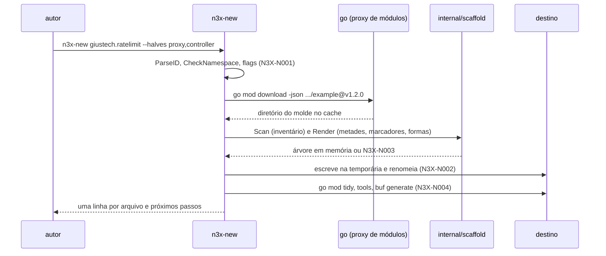
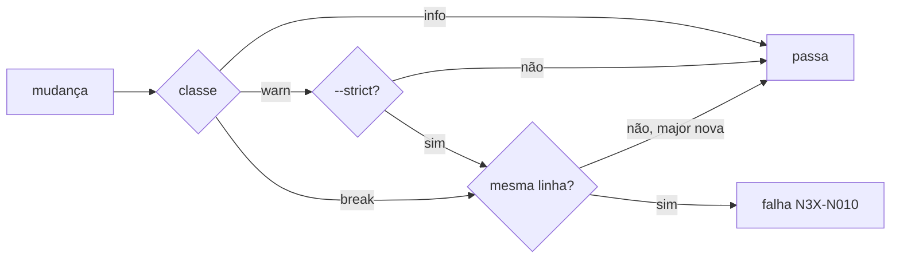

### FDD: Gerador `n3x-new` e checagem `schema-check` (SDK-14)

Versão: 1.0
Data: 2026-10-21
Responsável: Guilherme Giusti

---

### 1. Contexto e motivação técnica

**Problema técnico.** Criar um plugin à mão exige escrever o ID em vários lugares que precisam bater entre si: manifesto, `go.mod`, pacote e serviço gRPC, diretório e `go_package` do `.proto`, nome do pacote Go dos stubs, rotas, prefixo de métrica, IDs de cartão e nomes de arquivo exportado. O ADR-013 do `n3x-sdk` aponta o esquecimento de um deles como o erro mais comum do primeiro build. A FDD 13 transformou o plugin de exemplo num módulo próprio (`github.com/giustech/n3x-sdk/example`) com um inventário fechado de nove formas do ID (contrato 12 dela), conferido por `TestInventarioDoID`, mas deixou para esta FDD o mecanismo de troca, a decisão de renomear o tipo e o serviço `Example` (P-03 dela) e a prova de que o molde gera plugins que compilam e testam. Do lado da evolução, o ADR-020 diz que a config só muda por adição dentro da major do plugin, mas não diz como a CI do plugin descobre a versão anterior, o que conta como quebra (endurecer um limite? mudar um default?) nem o que acontece na série `0.x`. Sem isso, um operador atualiza a imagem e o `n3x.yaml` que funcionava deixa de validar.

**Encaixe no HLD.** Esta FDD especifica o componente `cmd/n3x-new` do `n3x-sdk` (HLD do `n3x-sdk`, "Componentes": "`n3x-new <id>` cria a estrutura a partir do `example/`; `schema-check --against <tag>` confere a evolução da config"; "Interfaces públicas", linha `n3x-new`; "Fluxo de requisições", ciclo do autor; "Versionamento e retenção"). Ela acrescenta dois pacotes internos ao módulo do SDK, sem API pública nova:

- `internal/scaffold`: tabela de transformação derivada do inventário da FDD 13, regras de pasta por metade, marcadores e montagem da árvore. É também o que o `TestInventarioDoID` do exemplo usa, para o inventário e o gerador terem uma fonte só
- `internal/schemadiff`: comparação semântica de dois schemas (`plugin.Schema` da FDD 02) e de dois manifestos, com a classificação de cada mudança

Consome, sem redefinir: `plugin.ParseID`, `CheckNamespace`, `DecodeManifest`, `ParseVersion`, `ParseSDKRange` e as derivações do ID (FDD 01); `plugin.ParseSchema`, `Node`, `Kind` e o pacote `schemagen` (FDD 02); `yamlconv` (FDD 01); o molde `example/` com o manifesto, os goldens `types/testdata/schema/{proxy,controller}.json`, o `Makefile`, o `buf.yaml` e o `internal/repotest` (FDD 13); os kits `sdktest` (FDD 07) e `sdktest/ctrltest` (FDD 12), que os testes copiados do molde já usam.

**Atores.** Autor de plugin (cria o repositório e roda o `schema-check` localmente), CI do plugin (roda `schema-check`, testes nos dois modos, `buf` e a checagem de tag), CI do SDK (gera plugins a partir do exemplo em todo PR e confere que passam), mantenedor do SDK (publica o SDK e o exemplo na mesma versão), builder (aceita o repositório gerado no `n3x-plugin add`, FDD 19) e plugin core (roda o `schema-check` na própria CI, FDD 36).

**Limites.** O `n3x-new` é uma ferramenta de linha de comando do autor: não roda no sidecar, no controller nem no builder, não abre porta e não tem estado entre execuções. Ele chama ferramentas externas (`go`, `git` e o `buf` compilado do módulo `tools/` do próprio repositório gerado), sempre com prazo. O que ele não faz: atualizar um plugin já gerado para um molde novo, publicar tag, rodar o builder ou o Envoy, e checar a evolução do `.proto` (isso é o `buf breaking`, configurado pelo `Makefile` do molde).

**Suposições**
- Go 1.26 ou superior e `git` 2.31 ou superior na máquina do autor e na CI (ADR-021; mesma versão mínima de `git` da imagem de desenvolvimento da FDD 21)
- O exemplo é publicado com o mesmo número do SDK, em tag `example/vX.Y.Z` criada logo depois da tag `vX.Y.Z` do SDK (FDD 13, contrato 1)
- `go mod download -json <módulo>@<versão>` devolve o diretório do módulo no cache, respeitando `GOPROXY`, `GOPRIVATE` e `GOFLAGS` do autor
- Um diretório cujo nome começa com `_` é ignorado pelos padrões `./...` e pelo `go mod tidy`, e um `main.go` dentro dele pode ser compilado em modo de arquivo (`go run _n3x/schemacheck/main.go`) com o `go.mod` do módulo (comportamento documentado do `go`; confirmado no primeiro teste da implementação)

**Restrições**
- `cmd/n3x-new` não acrescenta dependência ao `go.mod` do SDK: importa só a biblioteca padrão e pacotes do próprio SDK (`plugin/`, `yamlconv`, `schemagen`, `internal/scaffold` e `internal/schemadiff`). Toda dependência do SDK entra no MVS de todo plugin e do build (FDD 20, L-57), por isso o `buf` nunca é importado: é compilado do `tools/go.mod` do repositório gerado
- Sem cgo; funciona em Linux, macOS e Windows (o autor pode não usar Linux)
- Mensagens em pt-BR; flags, códigos de regra e campos do JSON em inglês
- Caminhos de config nas mensagens seguem a convenção da L-34 (FDD 01)

**Rastreabilidade**
- PRD 1.5: FR-014 (gerador `n3x-new <namespace>.<nome>` a partir do `n3x.example`; estrutura do repositório; metades omitidas; `proto/` dispensado sem conversa com o controller; checagem de schema na CI do plugin que falha ao remover, renomear ou tornar obrigatório um campo); FR-015 (`add` exige a estrutura); requisito de compatibilidade "config evolui só por adição"; critério de aceite "plugin novo criado com o `n3x-new` a partir do exemplo, seguindo só a documentação, é adicionado via Dockerfile e aparece no painel com uma página e um cartão"
- ADRs do `n3x-sdk`: ADR-011 (módulo único e dependências), ADR-012 (formas do ID), ADR-013 (manifesto e gerador), ADR-020 (evolução por adição), ADR-021 (semver e série `0.x`); ADR-005 e ADR-006 do `n3x-builder` (`add` por linha e espírito dos códigos de erro)
- HLD: `n3x-sdk/docs/HLD.md` ("Componentes", "Estrutura padrão de um repositório de plugin", "Fluxo de requisições", "Interfaces públicas", "Versionamento e retenção")
- FDDs usadas como contrato: 01 (ID, derivações, `CheckNamespace`, faixa `sdk`, L-34), 02 (`SchemaOf`, `ParseSchema`, `Node`, `schemagen`, regras de default e ordem do schema), 07 e 12 (kits usados pelos testes copiados; CI em dois passos), 13 (molde, inventário, goldens, `Makefile`, `repotest`), 19 (estrutura exigida pelo `add`, `version` igual à tag), 20 (SDK do `go.mod` igual ao limite inferior da faixa), 22 (um schema por metade no manifesto embutido), 24 (análise estática que o plugin gerado precisa passar), 36 (`schema-check` na CI do core)
- Lacunas do README: nenhuma atribuída a esta FDD. Aplicadas: L-34 (caminhos nas mensagens e no README gerado), L-46 (`yamlconv` para ler o manifesto), L-58 (`schemagen` também no auxiliar do `schema-check`) e L-43 (nenhum atalho de teste chega ao plugin gerado, porque o molde não tem nenhum)
- Pedidos de FDDs anteriores atendidos:
  - FDD 02: o `schema-check` lê e compara schemas com `ParseSchema` e `Node`, e gera o schema atual com `schemagen` (contratos 4, 5 e 8)
  - FDD 07: a CI gerada roda os testes em dois passos, com e sem `-race` (contrato 9)
  - FDD 12: os testes da metade de controller do plugin gerado usam `ctrltest.NewHost` (herdados do molde; critério da seção 9)
  - FDD 13: molde lido do módulo `github.com/giustech/n3x-sdk/example`, com a tabela de troca derivada do inventário dela; CI do SDK gera plugins a partir do exemplo e roda os testes deles; P-03 dela fechado (tipo e serviço renomeados, contrato 2); metades independentes por marcadores (contrato 2)
  - FDD 19: a CI gerada confere, na tag, que a tag é igual a `version` do manifesto (contrato 9)
  - FDD 20: `go.mod` gerado com o SDK igual ao limite inferior da faixa `sdk`, e a checagem que mantém os dois iguais na CI do plugin (contratos 3 e 9)

**Decisões aprovadas na clarificação**
- `schema-check --against latest` usa como base a maior tag menor ou igual à versão atual do manifesto, exceto quando a tag igual aponta para o próprio HEAD (push da tag), caso em que usa a anterior; assim detecta quebra feita depois da publicação na mesma versão
- Na série `0.x` do plugin, "mesma linha = mesma minor": a quebra de config é permitida de `0.3.x` para `0.4.0`, não dentro de `0.3.x`; isso estende o texto do PRD e do ADR-020 ("mesma major") para a série 0 (confirmado)
- Licença do molde: o `LICENSE` Apache 2.0 é copiado por padrão e o `README.md` gerado leva a atribuição; `--license none` desliga as duas coisas (a flag passa a ter padrão `apache-2.0`)
- Nova flag `--no-proto` para o plugin de duas metades sem conversa com o controller: omite `proto/` e a tarefa `report`/stubs, com a nova condição `noproto` nos marcadores do molde; exige os marcadores no exemplo (FDD 13) e uma quarta combinação testada na CI do SDK (proxy; controller; duas metades; duas metades com `--no-proto`)
- O `cmd/n3x-new` passa a depender também de `yamlconv`, `schemagen`, `internal/scaffold` e `internal/schemadiff`; HLD (L151/L54) e ADR-011 devem registrar esses pacotes; ADR-013 fala em "cinco lugares" e a FDD trata nove formas de ID
- As demais hipóteses numéricas, de teste e de baixo risco ficam aceitas como padrão, sem bloqueio

**Pendências não bloqueantes**
- A faixa de códigos B001 a B014 do PRD (B014 aceito) não cobre o `N3X-B016` citado no contrato 3 (sobre a diretiva `go`, FDD 20) nem o `B015` da mesma série; a numeração a registrar fica para o PRD/HLD, sem invenção aqui
- A família `N3X-N` (`N3X-N001` a `N3X-N004` e `N3X-N010` a `N3X-N013`, com `docs/n3x-new-erros.md`) precisa ser registrada no PRD/HLD
- A FDD 13 deve receber os marcadores `noproto`, o `LICENSE`, a variável `N3X_RELEASE_TAG`, os alvos do `Makefile`, o `TestInventarioDoID` com `scaffold.Scan` e o `.gitignore` e o `buf.yaml` sem o nome do tipo
- A premissa técnica do modo arquivo `go run _n3x/schemacheck/main.go` com `-mod=readonly` e o `go.work` do `--dev-sdk` é confirmada no primeiro teste da implementação
- Divergências para o Workflow 3: PRD FR-014 (`proto/` dispensável também com duas metades, via `--no-proto`); PRD, ADR-020 e ADR-021 (série `0.x` do plugin, mesma minor); PRD (família `N3X-N` e faixa de códigos); HLD l.279/283 (`latest` e códigos de saída)
- Dependem de outros repositórios: FDD 19 (`add`, `version` igual à tag, N3X-B002/B003), 20, 17/21, 22, 24, 36, 47, 48

---

### 2. Objetivos técnicos

- **Nenhum resto do molde.** Invariante: no plugin gerado com um ID diferente de `n3x.example`, `grep -rIi example` não encontra nenhuma linha (fora o `LICENSE`, copiado sem troca, e fora as ocorrências que fazem parte do ID, do módulo ou do nome do tipo novos quando estes contêm "example"), e toda forma do ID novo bate com as derivações de `plugin.ID` (FDD 01). Medida: conferido pelo próprio gerador antes de escrever (regra `template_residue`) e por teste na CI do SDK para as quatro combinações (proxy; controller; duas metades; duas metades com `--no-proto`).
- **Plugin gerado verde de saída.** Medida: para cada combinação (`--halves proxy,controller`, `--halves proxy`, `--halves controller` e `--halves proxy,controller --no-proto`), o plugin gerado passa em `go vet ./...`, `go test -race ./...`, `go test ./...` sem `-race`, `buf lint` e `buf generate` sem diferença (quando tem `proto/`) e `schema-check --against latest`, em 100% dos PRs do SDK.
- **Molde e exemplo sem divergência.** Invariante: gerar o próprio `n3x.example` com o módulo `github.com/giustech/n3x-sdk/example` a partir do `example/` reproduz byte a byte todos os arquivos copiados do molde. Medida: teste de identidade na CI do SDK; qualquer diferença reprova o PR.
- **Saída atômica.** Invariante: o gerador nunca deixa uma árvore parcial no destino; ou a árvore inteira aparece, ou nada aparece. Medida: teste com falha injetada em cada etapa de escrita.
- **Determinismo.** Invariante: mesma versão da ferramenta, mesmo molde e mesmos argumentos geram os mesmos bytes, em qualquer sistema operacional. Medida: duas gerações seguidas em Linux e Windows dão árvores com o mesmo SHA-256 por arquivo (fora os stubs gerados pelo `buf`, que têm o próprio determinismo).
- **Sem falso negativo nas quebras do PRD.** Medida: o `schema-check` reprova 100% dos casos do corpus de quebra (remover, renomear, tornar obrigatório, mudar tipo, endurecer limite, tirar valor de `enum`, deixar de ser segredo, tirar metade, tirar fase do manifesto) e aprova 100% do corpus compatível (campo novo com default ou ponteiro, afrouxar limite, acrescentar valor de `enum`), com no mínimo 60 pares de schema (confirmado).
- **Rápido o bastante para a CI.** Medida, no runner da CI com cache quente (confirmado): a montagem da árvore sem os passos externos em até 2 s; a geração completa com `go mod tidy` e `buf generate` em até 90 s; o `schema-check` com o auxiliar em até 20 s.

---

### 3. Escopo e exclusões

**Incluído**
- Comando de criação `n3x-new <id>`: argumentos, flags (inclusive `--no-proto`, para duas metades sem conversa com o controller), padrões, validação do ID e do namespace, nome do tipo, versão inicial e fase (contrato 1)
- Origem do molde (download do módulo do exemplo na mesma versão da ferramenta, ou pasta local), validação do molde e montagem atômica da árvore (contratos 1 e 2)
- Tabela de transformação derivada do inventário da FDD 13, regras de pasta por metade, marcadores de região e de arquivo, renomeação de caminhos e formatação do Go (contrato 2)
- Árvore gerada para cada combinação de `--halves`, manifesto, `go.mod` com o SDK no limite inferior da faixa, arquivos próprios do gerador (`README.md`, `.gitignore`, `.github/workflows/ci.yml`, `LICENSE`, copiado por padrão) (contrato 3)
- Passos depois da escrita: `go mod tidy`, compilação das ferramentas do `tools/` e `buf generate`, e verificação opcional (contrato 1)
- Comando `schema-check`: resolução da linha de base pela tag, prefixo de tag de módulo aninhado, schema atual gerado da struct e conferido contra o golden, comparação semântica, regras de mudança, regra da série `0.x` e da major nova, relatório em texto e JSON (contratos 4 a 7)
- Programa auxiliar do `schema-check` (contrato 8)
- Alvos do `Makefile` e CI gerada que usam as duas ferramentas (contrato 9)
- Catálogo de códigos `N3X-Nxxx` e códigos de saída (contrato 7)
- Jobs da CI do SDK que provam o gerador (seção 9)

**Excluído**
- O plugin de exemplo em si e o inventário: FDD 13 (SDK-13); aqui só o pedido dos marcadores e dos ajustes listados na seção 8
- Geração do JSON Schema a partir das tags: FDD 02 (SDK-02)
- Validação da estrutura no build (`N3X-B002` e `N3X-B003`): FDD 19 (BLD-01)
- Guia do autor com o ciclo completo: FDD 47 (SDK-15)
- `buf breaking` dos protos: configurado no `Makefile` do molde e chamado pela CI gerada, sem lógica nesta ferramenta
- Atualizar um plugin já gerado para um molde mais novo (sem `n3x-new upgrade` na v1) (confirmado)
- Gerar `connectors/`: a pasta só existe quando o plugin tem clients próprios, e o exemplo não tem (FDD 13)
- Rodar o plugin gerado no builder e no painel de verdade: CI cruzada da FDD 48, que recebe o pedido

---

### 4. Fluxos detalhados e diagramas

**Fluxo principal: criação (`n3x-new giustech.ratelimit --halves proxy,controller`)**
1. **Argumentos.** Lê o ID e as flags. Valida tudo antes de qualquer rede ou escrita, juntando os problemas numa passada:
   - `plugin.ParseID(id)`; namespace fora dos reservados às famílias da plataforma (`plugin`, `controller`, `sidecar`, `build` e `config`, FDD 06); ID diferente de `n3x.core`
   - módulo: o de `--module` ou o padrão `github.com/<namespace>/n3x-plugin-<nome com _ trocado por ->` (no namespace `n3x`, `github.com/giustech/n3x-plugin-<nome>`, porque `github.com/n3x/...` é recusado por `CheckNamespace`); sintaxe de caminho de módulo Go; `plugin.CheckNamespace(id, módulo)` (namespace `n3x` só com módulo `github.com/giustech/`)
   - `--halves` com `proxy`, `controller` ou os dois, sem repetição; `--no-proto` só com as duas metades; `--phase` por `plugin.ParsePhase`; `--version` por `plugin.ParseVersion`
   - nome do tipo: o de `--type-name` ou `scaffold.PascalName(id)`; casa com `^[A-Z][A-Za-z0-9]{0,63}$`
   - destino: o de `--dir` ou o último elemento do módulo; não existe ou é diretório vazio
2. **Molde.** Com `--template-dir`, usa a pasta. Senão, lê a própria versão (`debug.ReadBuildInfo().Main.Version`) e roda `go mod download -json github.com/giustech/n3x-sdk/example@<versão>` (prazo de 120 s). Versão `(devel)` sem `--template-dir` é erro de uso.
3. **Validação do molde.** Confere que o `n3x-plugin.yaml` do molde decodifica com `DecodeManifest` e tem ID `n3x.example`, que o `go.mod` declara `github.com/giustech/n3x-sdk/example`, que todo arquivo tem extensão da lista de texto, que os limites de tamanho valem, que os marcadores estão balanceados e que `scaffold.Scan` não acha nenhuma forma de `example` fora da tabela (a mesma conferência do `TestInventarioDoID`). Confere também que o nome do tipo não colide com um identificador de topo dos pacotes do molde.
4. **Montagem em memória** (`scaffold.Render`, sem I/O de escrita):
   - filtra arquivos e pastas pelas regras de metade (contrato 2) e pelo marcador de arquivo
   - remove as regiões cuja condição não vale e todas as linhas de marcador
   - aplica a tabela de formas numa passada só, da forma mais longa para a mais curta, nos conteúdos e nos caminhos
   - escreve o `n3x-plugin.yaml` a partir dos valores (não por troca de texto) e o valida de novo com `DecodeManifest` e `CheckNamespace`
   - troca só a linha `module` do `go.mod`; o `require` do SDK fica o do molde, que vira o limite inferior da faixa `sdk` do manifesto
   - acrescenta os arquivos próprios do gerador (`README.md` com a atribuição ao molde, `.gitignore`, `.github/workflows/ci.yml` e, salvo com `--license none`, o `LICENSE` Apache 2.0 do molde)
   - formata todo `.go` com `go/format`; um arquivo que não analisa é erro do molde (`template_marker`)
   - confere a ausência de resto (`template_residue`)
5. **Escrita atômica.** Grava a árvore numa pasta temporária irmã do destino (`.<destino>.n3x-new-<aleatório>`) e renomeia para o destino; com destino vazio já existente, move o conteúdo e remove a temporária. No Windows, `rename` sobre diretório existente falha, então a alternativa segura é copiar o conteúdo da temporária para o destino vazio e só então remover a temporária. Qualquer falha remove a temporária.
6. **Passos externos** (no destino, cada um com prazo, saída capturada e mostrada só em falha):
   - `go mod tidy -go=<diretiva go do molde>` com `GOTOOLCHAIN=local` (120 s)
   - com `proto/` (não com `--no-proto`): `go -C tools build -o ../bin/` do `buf`, `protoc-gen-go` e `protoc-gen-go-grpc` (300 s) e `bin/buf generate` com `bin/` à frente no `PATH` (60 s); `--no-generate` pula e avisa
   - com `--verify`: `go vet ./...` e `go test ./...` sem `-race` (600 s)
7. **Resumo.** Uma linha por arquivo criado (`criado agent/agent.go`), depois as derivações do ID e os próximos passos (`make check`, `git init`, primeira tag `v<versão>`).

**Fluxo principal: `schema-check --against latest` na CI do plugin**
1. Acha a raiz do módulo (`--dir`, padrão `.`), lê `n3x-plugin.yaml` com `yamlconv` e `DecodeManifest` (versão atual, metades e fases).
2. Acha a raiz do git e o prefixo do módulo (`git rev-parse --show-toplevel` e `--show-prefix`); o prefixo de tag é esse prefixo (vazio na raiz; `example/` para o exemplo dentro do SDK; regra de tag de módulo aninhado do Go).
3. Resolve a linha de base: com tag explícita, confere que existe; com `latest`, lista `git tag --list '<prefixo>v*'`, descarta o que não é semver, e escolhe a maior versão menor ou igual à atual, exceto quando a tag igual aponta para o próprio HEAD (caso do push da tag), em que usa a anterior; assim a quebra feita depois da publicação, na mesma versão, é detectada. Pré-release é ignorado como base, salvo quando a versão atual também é pré-release; a base não precisa ser ancestral do HEAD (as tags só são listadas). Sem nenhuma: relatório "sem versão anterior" e saída 0.
4. Lê da tag o manifesto (`git show <tag>:<prefixo>n3x-plugin.yaml`) e, para cada metade dele, o golden (`git show <tag>:<prefixo>types/testdata/schema/<metade>.json`); cada golden passa por `plugin.ParseSchema`. Golden ausente na tag: gera o schema da tag num `git worktree` temporário com o auxiliar do contrato 8 (aviso `baseline_generated`), salvo `--no-baseline-generate`.
5. Schema atual: roda o auxiliar do contrato 8 no módulo e compara os bytes com o golden do diretório de trabalho; diferença é `golden_stale` (ou, com `--update-golden`, regrava o golden e segue). Com `--no-generate`, usa o golden sem compilar nada.
6. Classifica a linha: mesma major (na série `0.x`, mesma minor: a quebra de config é permitida de `0.3.x` para `0.4.0`, não dentro de `0.3.x`) é "mesma linha"; major maior (na série `0.x`, minor maior) é "linha nova"; versão atual menor que a base é erro (`version_regressed`).
7. Compara, com `schemadiff`, o manifesto (metades, fases e padrões) e cada metade presente nos dois lados, nó a nó (contrato 5).
8. Escreve o relatório (contrato 6) e sai com 0 (compatível), 2 (quebra na mesma linha) ou o código do problema de ambiente.

**Fluxos alternativos e exceções**
- **Plugin só de proxy (`--halves proxy`):** saem `controller/`, `proto/`, `buf.yaml`, `buf.gen.yaml`, `tools/`, `types/testdata/schema/controller.json`, `testdata/n3x/controller-plugins.yaml` e as regiões `controller` e `proxy+controller` (tarefa `report`, imports dos stubs, `ControllerConfig`, testes com controller falso); manifesto `halves: [proxy]`, sem bloco `controller`; nenhum passo de `buf`
- **Plugin só de controller (`--halves controller`):** saem `agent/`, `proto/`, `buf.yaml`, `buf.gen.yaml`, `tools/`, `types/testdata/schema/proxy.json`, `testdata/cases.json`, `testdata/n3x/sidecar-plugins.yaml` e as regiões `proxy` e `proxy+controller` (capacidade `GRPC`, handler `Report`, testes que mandam relatório); ficam as páginas, o cartão e a ação, sem fonte de dados (o `README.md` gerado diz isso); manifesto `halves: [controller]`
- **Duas metades sem conversa com o controller (`--halves proxy,controller --no-proto`):** saem `proto/`, `buf.yaml`, `buf.gen.yaml`, `tools/` e as regiões e arquivos marcados `noproto` (tarefa `report`, imports dos stubs, handler `Report` e os testes que mandam relatório); ficam as duas metades, o cartão e as páginas, sem relatório do proxy; nenhum passo de `buf`. Cobre literalmente o fluxo alternativo do PRD FR-014 (`proto/` dispensável sem conversa com o controller); `--no-proto` com uma metade só é erro de entrada (`halves`), porque nela `proto/` já não existe
- **Namespace `n3x` com módulo de fora de `github.com/giustech/`:** recusado com `N3X-N001` (`reserved_namespace`), a mesma regra que o build aplica com `N3X-B007`; não há flag para forçar, porque o build falharia de qualquer jeito (confirmado: sem flag para forçar)
- **Ferramenta rodando de um commit (`@<hash>` ou pseudo-versão):** não existe `example@<pseudo-versão>`; erro `N3X-N003` (`template_version`) com a sugestão de `--template-dir` ou de uma tag
- **Tag do SDK publicada antes da tag do exemplo:** na janela entre as duas, o download falha com `template_version` e a mensagem "molde da versão X ainda não publicado"; a CI de release do SDK fecha a janela (seção 10)
- **Sem rede depois do download:** `go mod tidy` ou a compilação do `buf` falham; a árvore já está no destino, a saída é 5 (`N3X-N004`) e a mensagem traz o comando para terminar (`make tools generate`)
- **`schema-check` numa major nova:** as quebras aparecem no relatório como "permitida (major nova)" e a saída é 0
- **`schema-check` sem histórico de tags na CI (clone raso):** `latest` não acha tag; a mensagem lembra `fetch-depth: 0`. Para não passar em silêncio, a saída é 3 (`baseline_unreachable`) só quando o clone é raso (`git rev-parse --is-shallow-repository` verdadeiro) e não há nenhuma tag `<prefixo>v*`; clone raso que já traz alguma tag segue a regra normal (confirmado). Clone completo sem tag dá saída 0
- **Golden desatualizado:** saída 4 (`golden_stale`) com o caminho do golden e o comando `make schema` (que roda `--update-golden`)
- **Metade nova numa versão:** `half_added` (informação); metade retirada: `half_removed` (quebra na mesma linha)

**Diagramas**

Sequência da criação:



Sequência do `schema-check`:

```mermaid
sequenceDiagram
    participant C as CI do plugin
    participant N as n3x-new schema-check
    participant Git as git
    participant H as auxiliar (schemagen)
    participant X as internal/schemadiff
    C->>N: schema-check --against latest
    N->>Git: rev-parse, tag --list, show tag:manifesto e goldens
    Git-->>N: linha de base (N3X-N011 se faltar)
    N->>H: go run _n3x/schemacheck/main.go
    H-->>N: schemas atuais
    N->>N: compara com o golden do diretório (N3X-N012)
    N->>X: Compare(base, atual), CompareManifest
    X-->>N: mudanças classificadas
    N-->>C: relatório; saída 0 ou 2 (N3X-N010)
```

Decisão por mudança:



---

### 5. Contratos públicos (assinaturas, endpoints, headers, exemplos)

**Contrato 1: CLI `n3x-new <id>` (criação)**
- Tipo: sdk (CLI)
- Assinatura/Rota:
  ```text
  go run github.com/giustech/n3x-sdk/cmd/n3x-new@<versão> <id> [flags]

  <id>                     ID do plugin, <namespace>.<nome> (FDD 01); obrigatório
  --halves proxy,controller  metades; padrão proxy,controller
  --no-proto               com as duas metades, omite proto/, buf.* , tools/ e a tarefa report
  --module <caminho>       módulo Go; padrão github.com/<namespace>/n3x-plugin-<nome, _ vira ->
                           (namespace n3x: github.com/giustech/n3x-plugin-<nome>)
  --dir <pasta>            destino; padrão o último elemento do módulo; não pode ter conteúdo
  --type-name <Nome>       tipo Go das metades e serviço gRPC; padrão PascalName(<nome>)
  --version <semver>       version inicial do manifesto, sem v; padrão 0.1.0
  --phase <fase>           fase única permitida e padrão; padrão transform (a do molde)
  --ci github|none         gera .github/workflows/ci.yml; padrão github
  --license apache-2.0|none  copia o LICENSE Apache 2.0 do molde e põe a atribuição no README; padrão apache-2.0; none desliga
  --template-dir <pasta>   molde local em vez do módulo baixado (CI do SDK, sem rede)
  --dev-sdk <pasta>        grava go.work com use . e use <pasta> (só desenvolvimento do SDK)
  --no-generate            não compila as ferramentas nem roda buf generate
  --verify                 roda go vet e go test (sem -race) no plugin gerado
  --quiet                  só erros e o resumo final
  ```
- Método: processo local; lê do proxy de módulos Go e escreve no sistema de arquivos
- Semântica:
  - **Versão do molde:** sempre a versão da própria ferramenta. `go run .../cmd/n3x-new@v1.2.0` usa `example@v1.2.0`; `@v1` resolve a maior `v1.x.y` (depois da `v1.0.0`; na série `0.x`, `@v0` pode atravessar minors, que quebram entre si, então prefira a tag exata). Não existe flag para misturar versões, porque o `go.mod` do molde fixa o SDK que o plugin vai exigir
  - **Ordem de validação:** argumentos, molde, montagem, escrita, passos externos. Os quatro primeiros não deixam nada no destino quando falham
  - **ID recusado além do `ParseID`:** `n3x.core` (`core_id`); namespaces `plugin`, `controller`, `sidecar`, `build` e `config` (`reserved_metric_namespace`, FDD 06)
  - **`--version` e o `add`:** o `n3x-plugin add` exige a tag igual a `version` (FDD 19); a primeira tag do repositório gerado é `v0.1.0` por padrão
  - **`--phase`:** gera `phases: [<fase>]`, `default_phase: <fase>`; `default_order: 50` e `default_failure: open` vêm do molde. O código do molde não depende da fase (o hook só lê path e escreve header)
  - **Passos externos:** usam o `go` do `PATH`, herdam `GOPROXY`, `GOPRIVATE`, `GOFLAGS` e `GOMODCACHE` do autor e fixam `GOTOOLCHAIN=local`; a saída de cada passo só aparece em falha, cortada em 64 KiB
  - **Saída:** stdout com uma linha por arquivo criado, em ordem de caminho, e um bloco final; stderr só para avisos e erros
  - **Limites:** molde com até 500 arquivos, 1 MiB por arquivo e 4 MiB no total; extensões aceitas `.go`, `.proto`, `.yaml`, `.yml`, `.json`, `.txt`, `.md`, `.mod`, `.sum`, `Makefile` e `LICENSE`; qualquer outra é `template_file_type` (confirmado)

**Exemplo de requisição**
```bash
go run github.com/giustech/n3x-sdk/cmd/n3x-new@v1.2.0 giustech.ratelimit --halves proxy,controller --phase traffic
```

**Exemplo de resposta**
```text
molde: github.com/giustech/n3x-sdk/example@v1.2.0
módulo: github.com/giustech/n3x-plugin-ratelimit (use --module para outro)
criado .github/workflows/ci.yml
criado .gitignore
criado Makefile
criado README.md
criado agent/agent.go
criado agent/agent_test.go
criado agent/report.go
criado agent/report_test.go
criado buf.gen.yaml
criado buf.yaml
criado controller/controller.go
criado controller/controller_test.go
criado controller/telas.go
criado go.mod
criado go.sum
criado internal/repotest/repo_test.go
criado n3x-plugin.yaml
criado proto/n3x/plugins/giustech/ratelimit/v1/ratelimit.proto
criado testdata/cases.json
criado testdata/n3x/controller-plugins.yaml
criado testdata/n3x/sidecar-plugins.yaml
criado tools/go.mod
criado tools/go.sum
criado types/testdata/schema/controller.json
criado types/testdata/schema/proxy.json
criado types/types.go
ok go mod tidy (3,1 s)
ok ferramentas de tools/ (41,7 s)
ok buf generate: proto/n3x/plugins/giustech/ratelimit/v1/ratelimit.pb.go, ratelimit_grpc.pb.go (0,8 s)

plugin giustech.ratelimit 0.1.0 em ./n3x-plugin-ratelimit
  serviço gRPC  n3x.plugins.giustech.ratelimit.v1.Ratelimit
  rotas         /plugins/giustech/ratelimit/
  métricas      n3x_giustech_ratelimit_*
  sdk           >=1.2.0 <2.0.0 (go.mod: github.com/giustech/n3x-sdk v1.2.0)
próximos passos: cd n3x-plugin-ratelimit && git init && make check
```

Os nomes de arquivo de `agent/`, `controller/` e `types/` acima são ilustrativos: o gerador cria exatamente os arquivos do molde publicado.

---

**Contrato 2: tabela de transformação, regras de metade e marcadores (`internal/scaffold`)**
- Tipo: sdk (pacote interno do módulo do SDK; usado por `cmd/n3x-new` e pelo `TestInventarioDoID` do exemplo)
- Assinatura/Rota:
  ```go
  package scaffold // github.com/giustech/n3x-sdk/internal/scaffold; biblioteca padrão e plugin/

  const (
      TemplateID     = "n3x.example"
      TemplateModule = "github.com/giustech/n3x-sdk/example"
      TemplateType   = "Example"
  )

  type Cond uint8

  const (
      CondProxy      Cond = 1 << iota // metade de proxy presente
      CondController                  // metade de controller presente
      CondNoProto                     // --no-proto: sem proto/ nem tarefa report
      CondBoth       = CondProxy | CondController
  )

  type Target struct {
      ID       plugin.ID
      Module   string
      TypeName string
      Halves   []plugin.Half
      NoProto  bool // só com as duas metades
  }

  type Form struct {
      Name string // id, module, grpc_package, proto_dir, go_package_name, route_prefix,
                  // metric_prefix, card_prefix, file_prefix, type_name, word
      Old  string
      New  string
  }

  type Occurrence struct{ Path string; Line, Column int; Text string }

  func PascalName(id plugin.ID) string               // "rate_limit" -> "RateLimit"; "ratelimit" -> "Ratelimit"
  func Inventory(t Target) []Form                    // ordem de substituição
  func Scan(fsys fs.FS) ([]Occurrence, error)        // formas de example fora do inventário
  func Render(fsys fs.FS, t Target, extra []File) (*Tree, error)

  type File struct{ Path string; Data []byte }       // Path com "/", relativo à raiz
  type Tree struct{ Files []File }                   // em ordem de Path
  func (t *Tree) Write(dir string) error             // temporária irmã e rename
  ```
- Método: n/a
- Semântica da tabela (aplicada nesta ordem, da mais longa para a mais curta; uma passada só, sem reprocessar o texto já trocado):

| `Name` | Forma no molde | Forma gerada (`giustech.rate_limit`, módulo `github.com/acme/n3x-plugin-rate-limit`) | Fronteira |
| --- | --- | --- | --- |
| `module` | `github.com/giustech/n3x-sdk/example` | `github.com/acme/n3x-plugin-rate-limit` | depois: fim, `/`, `"`, `;`, espaço |
| `grpc_package` | `n3x.plugins.n3x.example.v1` | `n3x.plugins.giustech.rate_limit.v1` | `GRPCPackage(1)` |
| `proto_dir` | `proto/n3x/plugins/n3x/example/v1` | `proto/n3x/plugins/giustech/rate_limit/v1` | pacote com `.` trocado por `/` |
| `route_prefix` | `/plugins/n3x/example/` | `/plugins/giustech/rate_limit/` | `RoutePrefix()` |
| `metric_prefix` | `n3x_n3x_example_` | `n3x_giustech_rate_limit_` | `MetricPrefix()` |
| `card_prefix` | `n3x-c-n3x-example-` | `n3x-c-giustech-rate_limit-` | mesma regra de `CardContainerID` (FDD 10) |
| `file_prefix` | `n3x-example-` | `giustech-rate_limit-` | mesma regra do nome de exportação (FDD 11) |
| `go_package_name` | `examplev1` | `rate_limitv1` | identificador inteiro |
| `id` | `n3x.example` | `giustech.rate_limit` | antes e depois: nem letra, nem dígito, nem `_`, nem `.` |
| `type_name` | `Example` | `RateLimit` | qualquer ocorrência (inclusive `ExampleClient`, `RegisterExampleServer`) |
| `word` | `example` | `rate_limit` | palavra inteira (`_` e `.` contam como fronteira: `example.proto`, `example_grpc.pb.go`, `example:`) |

- **Fonte única com o inventário:** `Inventory` é a tabela do contrato 12 da FDD 13 mais as duas palavras de domínio (`type_name` e `word`). `Scan` usa a mesma tabela para dizer o que está fora dela, e o `TestInventarioDoID` do exemplo passa a chamar `scaffold.Scan` (pedido à FDD 13). O exemplo pode importar o pacote porque o caminho dele (`github.com/giustech/n3x-sdk/example`) fica dentro da árvore de `github.com/giustech/n3x-sdk/`, que a regra de `internal` do Go permite (confirmado)
- **Por que texto e não AST:** as formas aparecem em Go, `.proto`, YAML, JSON, `Makefile`, strings e comentários. A troca por texto é exata porque o molde garante, por teste, que toda ocorrência é uma forma da tabela; a AST só cobriria o Go. Depois da troca, todo `.go` é analisado e formatado com `go/format`, e o gerador procura resto de `example` sem diferenciar maiúsculas (`template_residue`), ignorando as ocorrências que fazem parte do ID, do módulo ou do nome do tipo novos quando estes contêm "example"
- **Stubs gerados:** `*.pb.go` e `*_grpc.pb.go` do molde nunca são copiados nem transformados: o descritor embutido neles tem tamanhos codificados que a troca de texto corromperia. O gerador escreve o `.proto` transformado e roda `buf generate` (contrato 1, passo 6)
- **Nome do tipo (P-03 da FDD 13 fechado):** o tipo `Example` das duas metades e o serviço gRPC `Example` viram `PascalName(id)`, ou o valor de `--type-name`. `PascalName` divide o nome por `_` e põe a primeira letra de cada parte em maiúscula. Colisão com identificador de topo dos pacotes do molde (por exemplo `giustech.config` daria `Config`, que já existe em `controller/`) ou com nome de mensagem do `.proto` é `type_name_conflict`, com a sugestão `--type-name ConfigPlugin` (confirmado)
- **Regras de pasta por metade** (fixas no pacote, não no molde):

| Caminho no molde | Condição para existir no gerado |
| --- | --- |
| `agent/`, `testdata/cases.json`, `testdata/n3x/sidecar-plugins.yaml`, `types/testdata/schema/proxy.json` | `CondProxy` |
| `controller/`, `testdata/n3x/controller-plugins.yaml`, `types/testdata/schema/controller.json` | `CondController` |
| `proto/` (sem os stubs), `buf.yaml`, `buf.gen.yaml`, `tools/` | `CondBoth` e não `CondNoProto` |
| `README.md`, `internal/repotest/inventory_test.go`, stubs `*.pb.go` | nunca (o `README.md` é do gerador) |
| `LICENSE` | por padrão (`--license apache-2.0`); não existe com `--license none`; copiado byte a byte, fora da troca, do `Scan` e da conferência de resto (o texto da Apache 2.0 tem a palavra "example") |
| demais arquivos | sempre |

- **Marcadores** (pedido à FDD 13): linhas inteiras, sem espaço depois de `//` ou `#`, removidas da saída em todos os casos:
  - região: `//n3x-new:if <cond>` até `//n3x-new:end` em `.go` e `.proto`; `#n3x-new:if <cond>` até `#n3x-new:end` em `Makefile` e YAML; `<cond>` é `proxy`, `controller`, `proxy+controller` ou `noproto`; `proxy+controller` vale só com as duas metades e com `proto/` (sem `--no-proto`), e é a condição da tarefa `report`, dos imports dos stubs e dos testes do `Report`; `noproto` vale só com as duas metades e `--no-proto`, para o que substitui esse código (se algo for preciso); sem aninhamento
  - arquivo: `//n3x-new:file <cond>` ou `#n3x-new:file <cond>` na primeira linha; o arquivo só existe se a condição vale
  - JSON não tem marcador; os arquivos JSON seguem só as regras de pasta
  - marcador desbalanceado, aninhado, com condição desconhecida ou fora do tipo de arquivo é `template_marker`
- **Arquivos do gerador** (`extra`): `README.md`, `.gitignore` e `.github/workflows/ci.yml` são modelos embutidos em `cmd/n3x-new` com `go:embed`, porque o exemplo vive dentro do repositório do SDK e não tem CI própria. O `go:embed` não pode copiar o `example/`, que é outro módulo, porque ele não alcança arquivos de fora da pasta do pacote nem atravessa a fronteira de um `go.mod` aninhado

**Exemplo de requisição** (trecho do molde `agent/agent.go`, já com os marcadores pedidos)
```go
import (
    "errors"

    "github.com/giustech/n3x-sdk/example/types"
    "github.com/giustech/n3x-sdk/proxy"

    //n3x-new:if controller
    examplev1 "github.com/giustech/n3x-sdk/example/proto/n3x/plugins/n3x/example/v1"
    //n3x-new:end
)

var ErrInvalidDenyPath = errors.New("example: deny_path inválido")
```

**Exemplo de resposta** (mesmo trecho gerado para `giustech.rate_limit`, com e sem a metade de controller)
```go
// --halves proxy,controller
import (
    "errors"

    "github.com/acme/n3x-plugin-rate-limit/types"
    "github.com/giustech/n3x-sdk/proxy"

    rate_limitv1 "github.com/acme/n3x-plugin-rate-limit/proto/n3x/plugins/giustech/rate_limit/v1"
)

var ErrInvalidDenyPath = errors.New("rate_limit: deny_path inválido")

// --halves proxy
import (
    "errors"

    "github.com/acme/n3x-plugin-rate-limit/types"
    "github.com/giustech/n3x-sdk/proxy"
)
```

A região de import condicional fica num grupo próprio, separado por linha em branco, para o `go/format` não reordená-la junto com os outros; quando a região sai, a linha em branco que sobra antes do `)` também sai. O `go/format` ordena dentro de cada grupo depois da troca, então um módulo novo com outro prefixo continua com o arquivo estável.

---

**Contrato 3: árvore gerada, manifesto, `go.mod` e arquivos do gerador**
- Tipo: sdk (layout de repositório)
- Assinatura/Rota:
  ```text
  n3x-plugin-ratelimit/                        --halves proxy,controller
  ├── n3x-plugin.yaml                          escrito a partir dos valores
  ├── go.mod, go.sum                           module trocado; require do SDK do molde; go mod tidy
  ├── Makefile                                 do molde (contrato 9)
  ├── README.md, .gitignore                    do gerador
  ├── .github/workflows/ci.yml                 do gerador (--ci github)
  ├── LICENSE                                  Apache 2.0 do molde, salvo com --license none
  ├── buf.yaml, buf.gen.yaml                   do molde
  ├── agent/                                   metade de proxy (com a tarefa report)
  ├── controller/                              metade de controller (Report, páginas, cartão, ação)
  ├── types/                                   ProxyConfig, ControllerConfig e goldens
  ├── proto/n3x/plugins/giustech/ratelimit/v1/ ratelimit.proto e stubs do buf generate
  ├── internal/repotest/                       testes de manifesto, pastas, tag e faixa (sem o de inventário)
  ├── testdata/cases.json, testdata/n3x/       casos e fragmentos do molde, com o ID trocado
  └── tools/go.mod, tools/go.sum               buf, protoc-gen-go, protoc-gen-go-grpc

  --halves proxy       sem controller/, proto/, buf.*, tools/, controller.json, controller-plugins.yaml
  --halves controller  sem agent/, proto/, buf.*, tools/, proxy.json, cases.json, sidecar-plugins.yaml
  --no-proto           (duas metades) sem proto/, buf.*, tools/ e sem a tarefa report
  ```
  ```yaml
  # n3x-plugin.yaml gerado (--halves proxy,controller --phase traffic; SDK do molde v1.2.0)
  id: giustech.ratelimit
  version: 0.1.0
  sdk: ">=1.2.0 <2.0.0"
  halves: [proxy, controller]
  proxy: { phases: [traffic], default_phase: traffic, default_order: 50, default_failure: open }
  controller: { required: false, depends_on: [] }
  ```
- Método: n/a
- Semântica:
  - **Faixa `sdk` (pedido da FDD 20):** o limite inferior é a versão do SDK exigida pelo `go.mod` do molde, sem o `v`. Superior: na série estável, a próxima major (`<2.0.0`); na série `0.x`, a próxima minor (`>=0.3.1 <0.4.0`), porque a faixa não atravessa minor na série 0 (FDD 01). Faixa e `go.mod` iguais por construção; o `repotest` copiado do molde mantém os dois iguais depois
  - **`go.mod`:** só a linha `module` muda; a diretiva `go` e os `require` vêm do molde; o `go mod tidy -go=<diretiva>` com `GOTOOLCHAIN=local` não sobe a diretiva nem acrescenta `toolchain` (uma linha `toolchain` que aparecer é retirada, confirmado). Assim a diretiva `go` nunca passa da imagem do builder (erro `N3X-B016` da FDD 20; o código não está na faixa B001 a B014 do PRD, ver pendências da seção 1)
  - **`go.sum`:** copiado do molde e ajustado pelo `go mod tidy`; plugin só de controller ou só de proxy perde as entradas que não usa
  - **Testes copiados:** os testes do molde passam a valer para o plugin gerado, com o ID trocado: `sdktest` na metade de proxy (FDD 07) e `ctrltest.NewHost`, `Link` e o cartão `negacoes` na de controller (FDD 12). O plugin gerado faz o mesmo que o exemplo (header, `deny_path`, relatório absoluto, cartão e páginas) até o autor trocar o comportamento
  - **`testdata/`:** `cases.json` e os fragmentos de `n3x.yaml` são mantidos com o ID trocado, porque descrevem o comportamento copiado e alimentam o `TestCasos`; a FDD 13 previa trocá-los por uma "versão mínima", e a mínima que mantém os testes verdes é a própria cópia filtrada pelas metades
  - **`internal/repotest/`:** fica sem o `inventory_test.go`, que é só higiene do molde; os testes de manifesto, `CheckNamespace`, pastas das metades, `version` igual à tag (variável `N3X_RELEASE_TAG`) e faixa igual ao `go.mod` continuam
  - **`README.md` gerado** (em pt-BR): o que o plugin faz hoje, as derivações do ID, como testar (`make check`), a atribuição ao molde (salvo com `--license none`), o trecho do Dockerfile (`RUN n3x-plugin add <módulo>@v<versão>`) e os trechos de `n3x.yaml` do serviço e do controller, com caminhos na convenção da L-34 (`plugins["giustech.ratelimit"]`); no plugin só de controller, um aviso de que as páginas não têm fonte de dados
  - **`.gitignore`:** `bin/`, `/_n3x/` e `go.work` (o `go.work` só existe com `--dev-sdk`)
  - **Licença (confirmado):** nenhum arquivo recebe cabeçalho de licença. Por padrão (`--license apache-2.0`), o `LICENSE` Apache 2.0 do molde (pedido à FDD 13) é copiado e o `README.md` gerado leva a atribuição ao molde; `--license none` desliga as duas coisas, e o autor então escolhe a licença dele
  - **Estrutura aceita pelo `add`:** manifesto na raiz, cada metade de `halves` com a pasta e pelo menos um `.go` que não é teste, nenhuma pasta de metade não declarada (FDD 19, `N3X-B002` e `N3X-B003`)

**Exemplo de requisição**
```bash
go run github.com/giustech/n3x-sdk/cmd/n3x-new@v0.3.1 giustech.ratelimit --halves proxy --quiet
```

**Exemplo de resposta**
```text
plugin giustech.ratelimit 0.1.0 em ./n3x-plugin-ratelimit
  rotas         (sem metade de controller)
  métricas      n3x_giustech_ratelimit_*
  sdk           >=0.3.1 <0.4.0 (go.mod: github.com/giustech/n3x-sdk v0.3.1)
próximos passos: cd n3x-plugin-ratelimit && git init && make check
```
```yaml
# n3x-plugin.yaml correspondente
id: giustech.ratelimit
version: 0.1.0
sdk: ">=0.3.1 <0.4.0"
halves: [proxy]
proxy: { phases: [transform], default_phase: transform, default_order: 50, default_failure: open }
```

---

**Contrato 4: CLI `n3x-new schema-check`**
- Tipo: sdk (CLI usada na CI do plugin)
- Assinatura/Rota:
  ```text
  n3x-new schema-check --against <tag>|latest [flags]

  --against <tag>|latest   tag da linha de base (com ou sem o prefixo do módulo) ou a maior tag <= versão atual (a anterior se a igual é o HEAD); obrigatório
  --dir <pasta>            raiz do módulo do plugin; padrão .
  --format text|json       formato do relatório; padrão text
  --strict                 avisos (classe warn) também reprovam
  --no-generate            não compila o auxiliar; usa o golden do diretório como schema atual
  --update-golden          regrava o golden quando o schema gerado difere, e segue
  --no-baseline-generate   golden ausente na tag é erro, sem gerar da fonte da tag
  --timeout <duração>      prazo do auxiliar; padrão 120s, de 10s a 30m
  ```
- Método: processo local; lê o git e o módulo, escreve só com `--update-golden`
- Semântica:
  - **Linha de base:** o manifesto e os goldens commitados na tag, lidos com `git show`, sem rede e sem checkout. O golden é a fonte porque o `TestSchemaGolden` do molde garante, em todo commit, que ele é igual ao schema gerado da struct (FDDs 02 e 13). Só quando a tag não tem golden (plugin anterior a esta convenção) o schema da tag é gerado num `git worktree --detach` temporário, com o auxiliar do contrato 8 e prazo de 180 s, e o relatório avisa `baseline_generated`
  - **Schema atual:** gerado da struct pelo auxiliar e comparado byte a byte com o golden do diretório; é a parte "schema gerado da struct contra o golden". O relatório compara o gerado com a base
  - **Prefixo de tag:** `git rev-parse --show-prefix` da raiz do módulo; `--against v1.2.0` vale `example/v1.2.0` dentro de `example/`; tag que não casa com `<prefixo>v<semver>` é ignorada por `latest`
  - **Escolha de `latest`:** a maior tag `<prefixo>v<semver>` menor ou igual à `version` atual do manifesto; se a tag igual aponta para o próprio HEAD (push da tag), usa a anterior. Assim, manifesto `1.2.0`, tag `v1.2.0` já publicada em outro commit e uma quebra feita depois da publicação compara contra `v1.2.0` e reprova (mesma linha); no push da própria tag `v1.2.0`, a base é a tag anterior. Pré-release só entra como base se a versão atual também for pré-release; a base não precisa ser ancestral do HEAD (confirmado)
  - **Linha:** compara `version` da base e a atual: mesma major é a mesma linha, onde quebra reprova; major maior é linha nova, onde quebra é permitida e só relatada (ADR-020 e ADR-021). Na série `0.x` do plugin vale "mesma linha = mesma minor": a quebra de config é permitida de `0.3.x` para `0.4.0`, não dentro de `0.3.x` (confirmado; estende o texto do PRD e do ADR-020, "mesma major", para a série 0, a registrar no Workflow 3; é a mesma regra da faixa `sdk` da FDD 01). Pré-release conta pela parte `MAJOR.MINOR.PATCH`
  - **Metades:** compara as metades presentes nos dois lados; metade nova é `half_added`; metade retirada é `half_removed`
  - **Manifesto (confirmado):** além dos schemas, compara o que o operador escreve no `n3x.yaml` do serviço: fase retirada de `proxy.phases` é quebra (`phase_removed`, uma instância com essa `phase` deixa de validar); mudança de `default_phase`, `default_order` ou `default_failure` é aviso; `controller.required` de falso para verdadeiro e `depends_on` novo são avisos
  - **Sem efeito colateral:** sem `--update-golden`, nada no módulo é alterado; a pasta `_n3x/` e o `worktree` temporário são removidos no fim, inclusive em SIGINT

**Exemplo de requisição**
```bash
n3x-new schema-check --against latest
```

**Exemplo de resposta**
```text
schema-check giustech.ratelimit 1.3.0 contra v1.2.0 (mesma major 1; fonte: golden da tag)
QUEBRA  proxy  limit         max_lowered      máximo baixou de 100000 para 1000
QUEBRA  proxy  mode          enum_value_removed  valor "redis" retirado do enum
AVISO   proxy  window        default_changed  default mudou de "1m0s" para "30s"
INFO    proxy  burst         field_added      campo novo opcional, default 0
INFO    controller retention desc_changed     descrição mudou
resultado: incompatível (2 quebras, 1 aviso, 2 informações)
erro N3X-N010: a config muda de forma incompatível dentro da major 1
  o que fazer: desfaça as quebras ou suba a major (version: 2.0.0) e anote a mudança para o operador
```

---

**Contrato 5: regras de mudança (`internal/schemadiff`)**
- Tipo: sdk (pacote interno; regras estáveis na major do SDK)
- Assinatura/Rota:
  ```go
  package schemadiff // github.com/giustech/n3x-sdk/internal/schemadiff; biblioteca padrão e plugin/

  type Class uint8

  const (
      ClassInfo  Class = iota + 1 // compatível
      ClassWarn                   // compatível, muda o comportamento para quem omite o campo
      ClassBreak                  // pode invalidar um n3x.yaml que validava
  )

  type Change struct {
      Half   string          // "proxy", "controller" ou "manifest"
      Path   string          // caminho na config (L-34), "" na raiz; [] item de lista, [*] valor de map
      Rule   string          // código estável da tabela abaixo
      Class  Class
      Old    json.RawMessage // valor anterior quando houver (limite, default, tipo)
      New    json.RawMessage
      Detail string          // pt-BR, sem valor de config do operador (só dado do schema)
  }

  func Compare(half plugin.Half, base, cur *plugin.Schema) []Change
  func CompareManifest(base, cur plugin.Manifest) []Change
  ```
- Método: n/a
- Semântica:
  - Percorre os dois schemas pela API de leitura da FDD 02 (`Root`, `Fields`, `Field`, `Elem`, `Kind`, `Required`, `Secret`, `Default`, `Min`, `Max`, `Enum`, `Desc`, `Version`), nunca pelos bytes; dois schemas que só diferem em forma (ordem de propriedades, versão do gerador) não geram mudança
  - Nó com `Kind` diferente gera só `kind_changed` e não desce
  - Limites ausentes valem o neutro do tipo: mínimo 0 para comprimento, itens e entradas; máximo infinito; duração e tamanho comparados pelo valor (`plugin.ParseDuration` e `plugin.ParseSize`), inteiros por valor exato (sem `float64`), números por valor decimal
  - `enum` é comparado como conjunto
  - Campo removido e campo novo no mesmo objeto com o mesmo `Kind` e a mesma `desc` ganham no `Detail` a dica "parece renomeação de X para Y", sem mudar a classe
  - Saída em ordem determinística: metade (`manifest`, `proxy`, `controller`), depois caminho na ordem de declaração do schema atual, com os removidos na posição da base

| `Rule` | Classe | Condição |
| --- | --- | --- |
| `field_removed` | break | propriedade da base ausente na atual (inclui renomeação) |
| `required_added` | break | propriedade nova obrigatória |
| `became_required` | break | propriedade opcional passou a obrigatória |
| `kind_changed` | break | tipo do nó mudou (inclui texto para inteiro, struct para map) |
| `min_raised` | break | mínimo subiu ou apareceu (endurecimento) |
| `max_lowered` | break | máximo desceu ou apareceu (endurecimento) |
| `enum_added` | break | campo sem `enum` passou a ter |
| `enum_value_removed` | break | valor saiu do `enum` |
| `secret_removed` | break | segredo virou campo comum (`ENC[...]` existente passa a dar `secret_unexpected`, FDD 03) |
| `half_removed` | break | metade da base ausente na atual |
| `phase_removed` | break | fase saiu de `proxy.phases` do manifesto |
| `default_changed` | warn | default mudou de valor |
| `default_added` | warn | campo ponteiro (ausente vira `nil`) passou a ter default |
| `default_removed` | warn | campo com default virou ponteiro |
| `secret_added` | warn | campo comum virou segredo (valor em claro passa a gerar `secret_in_clear` no sidecar, FDD 03) |
| `schema_version_raised` | warn | `x-n3x-schema` subiu; exige imagem com SDK mais novo |
| `manifest_default_changed` | warn | `default_phase`, `default_order` ou `default_failure` mudou |
| `controller_required` | warn | `controller.required` passou a verdadeiro |
| `depends_on_added` | warn | ID novo em `controller.depends_on` |
| `field_added` | info | propriedade nova opcional (com default ou ponteiro) |
| `became_optional` | info | obrigatória passou a opcional |
| `min_lowered`, `max_raised` | info | afrouxamento |
| `enum_removed`, `enum_value_added` | info | afrouxamento do `enum` |
| `desc_changed` | info | descrição mudou |
| `half_added` | info | metade nova |
| `phase_added` | info | fase nova em `proxy.phases` |

  - **Endurecimento conta como quebra (confirmado):** reduzir `max`, aumentar `min`, introduzir ou reduzir `enum` pode invalidar um `n3x.yaml` que validava, que é exatamente o que o ADR-020 quer evitar ("o operador atualiza a imagem sem precisar mudar o `n3x.yaml`")
  - **Mudar o default é aviso (confirmado):** o `n3x.yaml` continua válido; muda só o valor efetivo de quem omitiu o campo. `--strict` transforma o aviso em reprovação
  - **Mudança de inteiro de 8 para 64 bits** aparece como `min_lowered` e `max_raised` (os limites do tipo vão no schema, FDD 02) e passa; de `int64` para `uint64` aparece como `min_raised` e reprova

**Exemplo de requisição**
```json
{
  "base":  {"$schema":"https://json-schema.org/draft/2020-12/schema","x-n3x-schema":1,"type":"object","properties":{"limit":{"type":"integer","description":"Requisições por janela","minimum":1,"maximum":100000},"mode":{"type":"string","description":"Onde o contador fica","enum":["local","redis"],"default":"local"}},"required":["limit"],"additionalProperties":false},
  "atual": {"$schema":"https://json-schema.org/draft/2020-12/schema","x-n3x-schema":1,"type":"object","properties":{"limit":{"type":"integer","description":"Requisições por janela","minimum":1,"maximum":1000},"mode":{"type":"string","description":"Onde o contador fica","enum":["local"],"default":"local"},"burst":{"type":"integer","description":"Rajada","minimum":0,"maximum":1000,"default":0}},"required":["limit"],"additionalProperties":false}
}
```

**Exemplo de resposta**
```json
[
  {"Half":"proxy","Path":"limit","Rule":"max_lowered","Class":"break","Old":100000,"New":1000,"Detail":"máximo baixou de 100000 para 1000"},
  {"Half":"proxy","Path":"mode","Rule":"enum_value_removed","Class":"break","Old":"redis","New":null,"Detail":"valor \"redis\" retirado do enum"},
  {"Half":"proxy","Path":"burst","Rule":"field_added","Class":"info","Old":null,"New":0,"Detail":"campo novo opcional, default 0"}
]
```

---

**Contrato 6: relatório do `schema-check` (texto e JSON)**
- Tipo: sdk (formato de saída)
- Assinatura/Rota:
  ```text
  texto: linha de cabeçalho; uma linha por mudança "<CLASSE>  <metade>  <caminho>  <regra>  <detalhe>";
         linha "resultado: ..."; em falha, "erro N3X-Nxxx: ..." e "  o que fazer: ..."
  json:  um único objeto em stdout, terminado em quebra de linha
  ```
- Método: n/a
- Semântica:
  - Classes no texto: `QUEBRA`, `AVISO`, `INFO`; com linha nova, `QUEBRA` vira `QUEBRA (major nova, permitida)`
  - `result`: `compatible`, `compatible_new_major`, `incompatible`, `no_baseline`; os erros de ambiente não produzem relatório de mudanças, só a linha de erro (texto) ou o objeto com `error` (JSON)
  - `baseline.source`: `golden` ou `generated`; `line`: `same` ou `new`
  - `format: 1`; campo novo só por adição; o JSON não traz valor de config do operador (o `schema-check` só lê schemas e manifestos)
  - Caminho com a convenção da L-34; nomes de propriedade de config casam com `^[a-z][a-z0-9_]{0,63}$` (FDD 02), então nunca precisam de colchetes com aspas

**Exemplo de requisição**
```bash
n3x-new schema-check --against latest --format json
```

**Exemplo de resposta**
```json
{"format":1,"id":"giustech.ratelimit","module":"github.com/giustech/n3x-plugin-ratelimit","tool":"v1.2.0","current":{"version":"1.3.0","halves":["proxy","controller"]},"baseline":{"tag":"v1.2.0","version":"1.2.0","source":"golden"},"line":"same","result":"incompatible","changes":[{"half":"proxy","path":"limit","rule":"max_lowered","class":"break","old":100000,"new":1000,"detail":"máximo baixou de 100000 para 1000"},{"half":"proxy","path":"window","rule":"default_changed","class":"warn","old":"1m0s","new":"30s","detail":"default mudou de \"1m0s\" para \"30s\""}],"summary":{"break":1,"warn":1,"info":0},"error":{"code":"N3X-N010","exit":2,"rule":"incompatible","detail":"a config muda de forma incompatível dentro da major 1"}}
```

---

**Contrato 7: códigos de erro e de saída**
- Tipo: sdk (catálogo da CLI)
- Assinatura/Rota: tabela abaixo; catálogo em `cmd/n3x-new/errors.go` e documento `docs/n3x-new-erros.md` gerado dele por `go generate` (confirmado, no espírito do `docs/erros.md` do builder, FDD 20); a família `N3X-N` ainda precisa ser registrada no PRD/HLD (pendências da seção 1)
- Método: n/a
- Semântica:

| Saída | Código | Comando | Significado | Regras |
| --- | --- | --- | --- | --- |
| 0 | n/a | ambos | sucesso (no `schema-check`, compatível, major nova ou sem base) | n/a |
| 1 | sem código | ambos | uso: flag desconhecida, argumento faltando, valor de flag inválido, `(devel)` sem `--template-dir` | `usage`, `template_devel` |
| 2 | `N3X-N001` | criação | entrada recusada | `id_format`, `id_part_length`, `id_part_start`, `reserved_namespace`, `reserved_metric_namespace`, `core_id`, `module_format`, `halves`, `phase`, `version_format`, `type_name`, `type_name_conflict` |
| 3 | `N3X-N002` | criação | destino ou escrita | `dir_not_empty`, `dir_not_dir`, `write`, `rename` |
| 4 | `N3X-N003` | criação | molde indisponível ou inválido | `template_download`, `template_version`, `template_module`, `template_manifest`, `template_file_type`, `template_size`, `template_inventory`, `template_marker`, `template_residue` |
| 5 | `N3X-N004` | criação | passo externo depois da escrita (a árvore fica) | `go_mod_tidy`, `tools_build`, `buf_generate`, `verify_vet`, `verify_test`, `timeout`, `go_missing` |
| 2 | `N3X-N010` | `schema-check` | mudança incompatível na mesma linha (ou aviso com `--strict`) | `incompatible`, `strict` |
| 3 | `N3X-N011` | `schema-check` | linha de base indisponível | `not_git_repo`, `tag_not_found`, `baseline_unreachable`, `baseline_manifest`, `baseline_schema`, `baseline_generate`, `baseline_newer_schema` |
| 4 | `N3X-N012` | `schema-check` | schema atual inválido | `manifest`, `golden_missing`, `golden_stale`, `schema_generate`, `schema_invalid`, `version_regressed` |
| 5 | `N3X-N013` | `schema-check` | ferramenta externa | `git_missing`, `go_missing`, `timeout` |

  - Formato da linha: `erro <código>: <onde>: <o que aconteceu> [<regra>]`, seguida de `  o que fazer: <ação>`; vários problemas do mesmo grupo saem juntos, um por linha, e o código de saída é o do primeiro grupo que falhou
  - `Rule` é estável na major do SDK; o texto pode melhorar em patch; testes conferem código, regra e saída, nunca o texto
  - A mensagem nunca traz conteúdo de arquivo do autor além do caminho e da linha; a saída de `go` e `buf` é repassada só em falha, cortada em 64 KiB
  - `baseline_newer_schema`: o golden da tag tem `x-n3x-schema` maior que o da ferramenta; o que fazer: rodar o `n3x-new` da versão do SDK do `go.mod`

**Exemplo de requisição**
```bash
go run github.com/giustech/n3x-sdk/cmd/n3x-new@v1.2.0 n3x.metrics --module github.com/outra-org/n3x-metrics
```

**Exemplo de resposta**
```text
erro N3X-N001: id: namespace n3x é reservado a módulos github.com/giustech/; módulo github.com/outra-org/n3x-metrics [reserved_namespace]
  o que fazer: use um namespace próprio (ex.: outraorg.metrics); o build recusaria este plugin com N3X-B007
saída 2
```

---

**Contrato 8: programa auxiliar do `schema-check`**
- Tipo: sdk (código gerado e executado pelo `schema-check`)
- Assinatura/Rota:
  ```go
  // Code generated by n3x-new schema-check. DO NOT EDIT.
  package main

  import (
      "os"

      agent "github.com/giustech/n3x-plugin-ratelimit/agent"
      controller "github.com/giustech/n3x-plugin-ratelimit/controller"
      "github.com/giustech/n3x-sdk/plugin"
      "github.com/giustech/n3x-sdk/schemagen"
  )

  func main() {
      err := schemagen.Run(os.Stdout, []schemagen.Entry{
          {ID: "giustech.ratelimit", Half: plugin.HalfProxy, Plugin: agent.Plugin()},
          {ID: "giustech.ratelimit", Half: plugin.HalfController, Plugin: controller.Plugin()},
      })
      if err != nil {
          os.Stderr.WriteString(err.Error() + "\n")
          os.Exit(1)
      }
  }
  ```
- Método: `go run -mod=readonly _n3x/schemacheck/main.go` na raiz do módulo, com `CGO_ENABLED=0`, `GOTOOLCHAIN=local` e o prazo de `--timeout`
- Semântica:
  - Só as metades declaradas no manifesto atual entram; os pacotes são `<módulo>/agent` e `<módulo>/controller` com `Plugin()`, a mesma convenção que o builder usa no registro gerado (FDDs 17 e 21)
  - A saída é a do `schemagen.Run` da FDD 02 (`{"<id>":{"proxy":...,"controller":...}}`); o `schema-check` separa cada metade sem reformatar e compara com `types/testdata/schema/<metade>.json`
  - Erro do auxiliar (compilação ou `schemagen`) vira `N3X-N012` `schema_generate`, com o stderr dele, que já traz `<id> <metade>:` e as regras do gerador (contrato 8 da FDD 02)
  - O diretório `_n3x/` começa com `_`, então `./...`, `go mod tidy` e `go vet ./...` o ignoram mesmo se sobrar; o `.gitignore` gerado o exclui
  - Executar o auxiliar roda o código de pacote do próprio plugin na máquina do autor, como o `go test` já faz; não há secret montado nem sandbox (diferente do passo 5 do builder, FDD 21)

**Exemplo de requisição**
```bash
n3x-new schema-check --against latest --update-golden
```

**Exemplo de resposta**
```text
golden types/testdata/schema/proxy.json regravado (o schema gerado da struct mudou)
schema-check giustech.ratelimit 1.3.0 contra v1.2.0 (mesma major 1; fonte: golden da tag)
INFO    proxy  burst  field_added  campo novo opcional, default 0
resultado: compatível (0 quebras, 0 avisos, 1 informação)
```

---

**Contrato 9: alvos do `Makefile` e CI gerada**
- Tipo: sdk (arquivos do repositório gerado)
- Assinatura/Rota:
  ```make
  # alvos que o Makefile do molde precisa ter (pedido à FDD 13); demais alvos como na FDD 13
  SDK_VERSION := $(shell go list -m -f '{{.Version}}' github.com/giustech/n3x-sdk)
  N3X_NEW ?= go run github.com/giustech/n3x-sdk/cmd/n3x-new@$(SDK_VERSION)
  TAG_PREFIX := $(shell git rev-parse --show-prefix 2>/dev/null)   # usado pelo alvo breaking: .git#tag=$(TAG_PREFIX)v<última>,subdir=$(TAG_PREFIX)

  schema:        ## regrava os goldens a partir das structs
  	$(N3X_NEW) schema-check --against latest --update-golden
  schema-check:  ## evolução da config contra a última tag
  	$(N3X_NEW) schema-check --against latest
  ```
  ```yaml
  # .github/workflows/ci.yml gerado (com proto/; os passos de buf saem sem proto/)
  name: ci
  on:
    push: { branches: [main], tags: ["v*"] }
    pull_request: {}
  permissions: { contents: read }
  jobs:
    check:
      runs-on: ubuntu-latest
      steps:
        - uses: actions/checkout@v4
          with: { fetch-depth: 0 }
        - uses: actions/setup-go@v5
          with: { go-version-file: go.mod }
        - run: make test          # go test -race ./...
        - run: make test-norace   # portões de alocação sem -race (FDD 07)
        - run: make tools lint breaking
        - run: make generate && git diff --exit-code
        - run: make schema-check
        - if: startsWith(github.ref, 'refs/tags/v')
          run: N3X_RELEASE_TAG="${GITHUB_REF_NAME}" go test ./internal/repotest/...
  ```
- Método: `make <alvo>`; GitHub Actions
- Semântica:
  - **Versão da ferramenta presa ao `go.mod`:** `N3X_NEW` usa o `n3x-new` da mesma versão do SDK que o plugin exige, para a CI ser reproduzível e o schema lido ser o do mesmo gerador. Na CI do SDK, o exemplo sobrescreve `N3X_NEW='go -C .. run ./cmd/n3x-new'`
  - **Prefixo de tag sem literal:** `git rev-parse --show-prefix` dá `example/` no exemplo e vazio no plugin gerado; nenhum `Makefile` do molde escreve `example/` (pedido à FDD 13), senão a troca de palavra o renomearia
  - **Dois passos de teste:** com `-race` e sem `-race` (pedido da FDD 07)
  - **Tag igual a `version` (pedido da FDD 19):** no push de tag, o `repotest` recebe a tag em `N3X_RELEASE_TAG` e reprova se ela não for `v<version>`; sem a variável, o teste é pulado
  - **SDK igual ao limite inferior (pedido da FDD 20):** conferido pelo `repotest` em todo PR
  - **Ações fixadas por versão maior** (`actions/checkout@v4`, `actions/setup-go@v5`); fixar por SHA fica para o autor (confirmado)
  - `--ci none` não gera o workflow; o `Makefile` continua com os mesmos alvos

**Exemplo de requisição**
```bash
make schema-check
```

**Exemplo de resposta**
```text
go run github.com/giustech/n3x-sdk/cmd/n3x-new@v1.2.0 schema-check --against latest
schema-check giustech.ratelimit 0.1.0: sem versão anterior (nenhuma tag v* menor que 0.1.0); nada a comparar
resultado: sem base
```

---

### 6. Erros, exceções e fallback

**Matriz de erros previstos e tratamentos**

| Condição | Tratamento | Observações |
| --- | --- | --- |
| ID inválido, namespace reservado, `n3x.core`, módulo fora de `github.com/giustech/` no namespace `n3x` | `N3X-N001`, saída 2, todos os problemas de entrada juntos | nada é baixado nem escrito |
| Destino com conteúdo, arquivo no lugar do diretório, sem permissão | `N3X-N002`, saída 3 | nunca sobrescreve; não há `--force` (confirmado) |
| Ferramenta `(devel)` sem `--template-dir` | uso, saída 1 | caso do `go run ./cmd/n3x-new` no próprio SDK |
| Molde não baixa (rede, `GOPRIVATE`, versão sem tag do exemplo) | `N3X-N003` `template_download` ou `template_version`, saída 4 | mensagem com a versão tentada e a alternativa `--template-dir` |
| Molde com forma fora do inventário, marcador ruim, resto de `example` depois da troca | `N3X-N003`, saída 4 | defeito do SDK; a CI do SDK pega antes da release |
| Nome do tipo colide com identificador do molde | `N3X-N001` `type_name_conflict` | sugestão de `--type-name` |
| Falha na escrita no meio | remove a pasta temporária; `N3X-N002` | o destino fica como estava |
| `go mod tidy`, ferramentas ou `buf generate` falham ou estouram o prazo | `N3X-N004`, saída 5; a árvore fica | mensagem com o comando para terminar (`make tools generate`) |
| `--verify` reprova | `N3X-N004` `verify_vet` ou `verify_test`, saída 5 | indica defeito do molde; a CI do SDK prova as quatro combinações |
| `schema-check` fora de repositório git | `N3X-N011` `not_git_repo`, saída 3 | |
| Tag pedida não existe | `N3X-N011` `tag_not_found`, saída 3 | lista as 5 tags mais próximas |
| `latest` sem nenhuma tag `<prefixo>v*` num clone raso | `N3X-N011` `baseline_unreachable`, saída 3 | lembra `fetch-depth: 0`; clone raso com alguma tag segue a regra normal; clone completo sem tag dá saída 0 |
| Golden ausente na tag e geração da fonte falha | `N3X-N011` `baseline_generate`, saída 3 | com `--no-baseline-generate`, `baseline_schema` direto |
| Golden atual diferente do schema da struct | `N3X-N012` `golden_stale`, saída 4 | `make schema` regrava |
| Auxiliar não compila ou `schemagen` recusa a struct | `N3X-N012` `schema_generate`, saída 4 | stderr do auxiliar repassado |
| Versão atual menor que a base | `N3X-N012` `version_regressed`, saída 4 | |
| Quebra na mesma linha | `N3X-N010`, saída 2 | relatório completo antes da linha de erro |
| `git` ou `go` ausentes; prazo do auxiliar estourado | `N3X-N013`, saída 5 | |
| SIGINT ou SIGTERM | remove temporária, `_n3x/` e `worktree`; saída 130 ou 143 | |

**Estratégias de resiliência**
- Timeouts: download do molde 120 s; `go mod tidy` 120 s; ferramentas de `tools/` 300 s; `buf generate` 60 s; `--verify` 600 s; cada chamada `git` 30 s; auxiliar do `schema-check` 120 s (configurável); geração da base pela fonte 180 s (prazos confirmados)
- Retries: nenhum; o `go` já repete o download pelo próprio mecanismo, e uma falha de rede vira mensagem com o comando a repetir
- Backoff e circuit breaker: não se aplicam a uma CLI de execução única

**Política de fallback**
- Sem fallback silencioso: molde de outra versão nunca é usado no lugar do pedido; golden ausente na tag só é gerado da fonte com aviso explícito no relatório (`baseline_generated`), e `--no-baseline-generate` desliga isso
- Passos externos que falham não desfazem a árvore, porque os arquivos do molde já estão certos e só falta o derivado; o resumo diz exatamente o que faltou

**Invariantes**
- O destino recebe a árvore inteira ou nada (passos 1 a 5 do fluxo)
- Nenhum arquivo gerado contém forma do molde (`example`, sem diferenciar maiúsculas) quando o ID é outro
- Stubs `*.pb.go` nunca são transformados por texto
- O manifesto gerado passa em `DecodeManifest` e `CheckNamespace`, e a faixa `sdk` tem o limite inferior igual ao SDK do `go.mod`
- O `schema-check` nunca altera o módulo sem `--update-golden` e nunca aprova uma quebra da tabela na mesma linha
- Toda mudança detectada tem `Rule` da tabela do contrato 5; não existe mudança sem classe

---

### 7. Observabilidade

**Métricas**
- A ferramenta não expõe métricas (CLI de execução única, como o builder, que também não tem endpoint de métricas, FDD 22)
- Na CI do SDK, o job `n3x-new` publica no resumo do job a duração de cada etapa por combinação de metades (`render_ms`, `write_ms`, `tidy_ms`, `tools_ms`, `buf_ms`, `test_ms`) e o tamanho da árvore (`files`, `bytes`), para acompanhar as metas da seção 2
- Na CI do plugin, o relatório JSON do `schema-check` (`summary.break`, `summary.warn`, `summary.info`) pode ser guardado como artefato

**Logs**
- Texto em pt-BR, uma linha por arquivo criado (`criado <caminho>`), uma por passo externo (`ok <passo> (<duração>)` ou o erro), uma por mudança de schema; erros no formato do contrato 7
- Com `--format json` no `schema-check`, um único objeto (contrato 6); a criação não tem JSON (confirmado)
- Variável `N3X_NEW_DEBUG=1` mostra cada comando externo com a linha de comando, o diretório e a duração, sem variáveis de ambiente (que podem ter token de `GOPRIVATE`)
- Nunca aparece: conteúdo de arquivo do autor além de caminho e linha, variável de ambiente, credencial de `git` ou do proxy de módulos

**Tracing**
- Nenhum (ADR-009 de plataforma)

**Dashboards e alertas**
- Na CI do SDK: o job `n3x-new` vermelho bloqueia o merge e a release (seção 9); o job `release-template` vermelho depois da tag do exemplo dispara issue automática "molde da versão X não publicado" (confirmado)
- Sem painel em runtime

---

### 8. Dependências e compatibilidade

| Componente | Versão mínima | Observações |
| --- | --- | --- |
| Go | 1.26 | ADR-021; o `n3x-new` usa o `go` do `PATH` para download, `tidy`, auxiliar e testes |
| git | 2.31 | `schema-check` (`rev-parse --show-prefix`, `show`, `tag --list`, `worktree`) |
| `github.com/giustech/n3x-sdk` | a mesma versão da ferramenta | `plugin/`, `yamlconv`, `schemagen`, `internal/scaffold`, `internal/schemadiff`; nenhuma dependência nova no `go.mod` do SDK |
| `github.com/giustech/n3x-sdk/example` | igual à versão da ferramenta | molde; FDD 13 |
| buf, `protoc-gen-go`, `protoc-gen-go-grpc` | os do `tools/go.mod` do molde | compilados no repositório gerado, nunca importados |
| `n3x-plugin add` | builder da FDD 19 | aceita a árvore gerada sem `N3X-B002` e `N3X-B003` |
| Análise estática | FDD 24 | o plugin gerado herda 0 violações do molde |

**Garantias de compatibilidade**
- Flags, códigos `N3X-Nxxx`, códigos de saída, regras do contrato 5 e o `format: 1` do relatório JSON são estáveis na major do SDK; flag e regra novas só em minor
- O `n3x-new` da versão N lê schemas de qualquer SDK da mesma major com `x-n3x-schema` menor ou igual ao dele; schema mais novo dá `baseline_newer_schema`
- A comparação é semântica (contrato 5), então uma mudança de forma do gerador entre minors do SDK não aparece como mudança de config
- A árvore gerada por uma versão do `n3x-new` segue a estrutura do FR-014 da mesma major; plugin gerado numa versão antiga não precisa ser regerado para compilar com SDK mais novo da mesma major (semver do SDK, ADR-021)
- O molde muda junto com o exemplo, que segue a versão do SDK; mudança no molde que quebre um plugin já gerado não existe, porque o plugin gerado não depende do molde depois de criado
- Pedidos para outras FDDs (registrados no `REGISTRO-DE-DECISOES.md` pelo orquestrador):
  - FDD 13: marcadores `//n3x-new:if` e `//n3x-new:file` nas partes que dependem das duas metades (tarefa `report`, imports dos stubs, testes do `Report`, `ControllerConfig` e constantes de cada metade), inclusive a condição `noproto` da quarta combinação (`--no-proto`); `example/LICENSE` é copiado por padrão; `TestInventarioDoID` em `internal/repotest/inventory_test.go` com `scaffold.Scan`; alvos `schema` e `schema-check` com `N3X_NEW` e prefixo de tag por `git rev-parse --show-prefix`, sem literal `example/`; comentário do `buf.yaml` sem o nome do tipo; `example/LICENSE`; `repotest` lendo a tag de `N3X_RELEASE_TAG`; `.gitignore` com `bin/` e `/_n3x/`
  - FDD 36: alvos `schema` e `schema-check` iguais aos do molde no `Makefile` do core
  - FDD 48: gerar `giustech.ratelimit` com as quatro combinações (inclusive `--no-proto`), passar pelo `n3x-plugin add` e pelo build nas imagens de build e conferir no painel a página e o cartão (critério do PRD)
  - FDD 47: guia do autor com o ciclo do `n3x-new`, as flags, a tabela de regras do `schema-check`, a regra da série `0.x` (mesma linha = mesma minor, confirmado), a escolha de `latest` (maior tag menor ou igual à versão atual), `fetch-depth: 0`, `--no-proto` e a licença (`LICENSE` Apache 2.0 por padrão, `--license none` para desligar)

---

### 9. Critérios de aceite técnicos

- **Quatro combinações verdes (job `n3x-new` da CI do SDK, em todo PR):** `go run ./cmd/n3x-new giustech.ratelimit --module github.com/giustech/n3x-plugin-ratelimit --halves <h> --template-dir ./example --dev-sdk . --verify` para `proxy,controller`, `proxy` e `controller`, mais `proxy,controller` com `--no-proto` (sem `proto/`, `buf.*`, `tools/` nem tarefa `report`); em cada saída, `go vet ./...`, `go test -race ./...`, `go test ./...` sem `-race`, `make lint` e `make generate` seguido de `git diff --exit-code` (quando há `proto/`) passam. O job executa `git init` na saída antes do `schema-check --against latest` (o gerador não faz `git init`), de modo que o resultado é `no_baseline` com saída 0 e não `not_git_repo`
- **Identidade:** `n3x-new n3x.example --module github.com/giustech/n3x-sdk/example --template-dir ./example` reproduz byte a byte cada arquivo copiado do molde (todos fora `README.md`, `inventory_test.go`, os arquivos do gerador e os stubs, que o `buf` regera iguais aos versionados)
- **Sem resto:** nas quatro saídas com `giustech.ratelimit` e numa com `acme.rate_limit` (nome com `_`), `grep -rIi --exclude=LICENSE example` devolve 0 linhas (um ID, módulo ou nome de tipo novo que contenha "example" não conta como resto); as formas de `GRPCPackage(1)`, `RoutePrefix()`, `MetricPrefix()`, `CardContainerID` e o nome de exportação conferem com as funções do SDK
- **Testes herdados:** a metade de proxy gerada usa `sdktest` com `AssertZeroAllocs` e `AssertHonorsCancel`; a de controller usa `ctrltest.NewHost` e `Link`; o teste do cartão do plugin gerado mostra "Negações 3" depois de 3 negações e 10 s falsos
- **Estrutura do `add`:** a árvore gerada passa nas regras de estrutura da FDD 19 conferidas por um teste do SDK (manifesto na raiz, `DecodeManifest`, cada metade com `.go` que não é teste, nenhuma pasta de metade não declarada); o `n3x-plugin add` real roda na FDD 48
- **Manifesto e `go.mod`:** em todas as saídas, `version` igual a `--version`, faixa `sdk` com o limite inferior igual ao `require` do SDK, diretiva `go` igual à do molde e sem linha `toolchain`
- **Atomicidade:** com falha injetada (disco cheio simulado) em cada um dos 5 primeiros passos, o destino continua inexistente ou vazio e nenhuma pasta temporária sobra
- **Determinismo:** duas gerações seguidas em Linux e em Windows dão o mesmo SHA-256 em cada arquivo fora os stubs
- **Validação de entrada:** cada regra do `N3X-N001` tem um caso de teste com a saída 2 e a regra certa; `n3x.metrics` com módulo de fora dá `reserved_namespace`; `giustech.config` dá `type_name_conflict`; `config.metrics` dá `reserved_metric_namespace`
- **Molde ruim:** um molde de teste com `example.com` num comentário dá `template_inventory`; um com marcador sem `end` dá `template_marker`; nenhum dos dois escreve no destino
- **Corpus do `schema-check`:** no mínimo 60 pares de schema (confirmado), com pelo menos um por regra do contrato 5; cada um dá exatamente a `Rule` e a `Class` esperadas; os casos de quebra do PRD (remover, renomear, tornar obrigatório) reprovam com saída 2 na mesma major e passam com saída 0 na major nova; campo novo com default passa
- **Escolha da base (`latest`):** manifesto `1.2.0` com tag `v1.2.0` em outro commit e uma quebra depois da publicação reprova (saída 2) contra `v1.2.0`; o mesmo manifesto no commit que a tag `v1.2.0` aponta (HEAD) usa a tag anterior; pré-release como base só com versão atual também pré-release
- **Série 0 (confirmado: mesma linha = mesma minor):** de `0.3.0` para `0.3.1` com campo removido reprova; de `0.3.1` para `0.4.0` passa como `compatible_new_major`
- **Golden:** golden alterado à mão dá `golden_stale` com saída 4; `--update-golden` regrava e segue; `--no-generate` não compila nada (sem diretório `_n3x/` criado)
- **Linha de base:** tag com prefixo (`example/v0.1.0`) resolvida dentro de `example/`; tag sem golden gera a base no `worktree` com o aviso `baseline_generated` e remove o `worktree`; clone raso sem nenhuma tag dá `baseline_unreachable`
- **Exemplo e core:** `make -C example schema-check N3X_NEW='go -C .. run ./cmd/n3x-new'` roda em todo PR do SDK; a CI do core roda `make schema-check` (FDD 36)
- **Desempenho (confirmado, runner da CI com cache quente):** montagem e escrita em até 2 s; geração completa em até 90 s; `schema-check` com auxiliar em até 20 s
- **Dependências:** `go list -deps ./cmd/n3x-new` só lista a biblioteca padrão e pacotes `github.com/giustech/n3x-sdk/...`; o `go.mod` do SDK não ganha `require` por causa desta FDD
- **Release:** depois da tag `example/vX.Y.Z`, o job `release-template` roda `go run github.com/giustech/n3x-sdk/cmd/n3x-new@vX.Y.Z giustech.ratelimit --dir $(mktemp -d)/p` com `GOWORK=off` e `GOFLAGS=-mod=mod`, e a geração passa
- **Cobertura:** no mínimo 85% de linhas em `internal/scaffold`, `internal/schemadiff` e `cmd/n3x-new` (confirmado); fuzzing de `scaffold.Render` sobre o molde com IDs aleatórios válidos e de `schemadiff.Compare` com pares de schemas gerados, 5 minutos por alvo na CI noturna, sem panic (duração confirmada, igual às FDDs anteriores)

---

### 10. Riscos e mitigação

### Molde divergente do exemplo gera plugins que não compilam com o SDK novo

- **Probabilidade:** média
- **Impacto:** o autor recebe um plugin quebrado no primeiro comando e desiste; o critério do PRD (plugin novo seguindo só a documentação) falha
- **Mitigação:**
    - o molde é o próprio módulo do exemplo, baixado na versão da ferramenta; não existe cópia para divergir
    - inventário e gerador usam a mesma tabela (`internal/scaffold`)
    - CI do SDK gera as quatro combinações e o teste de identidade em todo PR; job de release confere a tag publicada
- **Plano de contingência:** publicar patch do SDK e do exemplo juntos; o autor regera com a versão nova (`@vX.Y.Z+1`)

### Falso negativo no `schema-check` quebra o `n3x.yaml` do operador

- **Probabilidade:** baixa
- **Impacto:** o operador atualiza a imagem e o sidecar ou o controller não sobem (FR-001), em produção
- **Mitigação:**
    - comparação pela API de leitura da FDD 02, nó a nó, com todas as palavras-chave do subconjunto cobertas por regra
    - endurecimento conta como quebra; segredo virando campo comum conta como quebra
    - corpus com pelo menos uma entrada por regra e fuzzing da comparação
    - fases retiradas do manifesto também conferidas
- **Plano de contingência:** regra nova em patch do SDK como `warn` e, na minor seguinte, como `break` (mesma política de evolução de regras da FDD 24)

### Troca de texto pega uma ocorrência que não é o ID

- **Probabilidade:** baixa
- **Impacto:** URL, palavra ou identificador renomeado por engano no plugin gerado
- **Mitigação:**
    - o molde não pode ter `example` fora da tabela (`TestInventarioDoID` com `scaffold.Scan`), e o gerador repete a conferência antes de trocar
    - fronteiras por forma e uma passada só, da mais longa para a mais curta
    - stubs nunca trocados por texto; `go/format` e compilação nas quatro combinações
- **Plano de contingência:** trocar a forma problemática no molde por uma do inventário e publicar patch

### Janela entre a tag do SDK e a tag do exemplo

- **Probabilidade:** média
- **Impacto:** quem roda `@v1` logo depois da tag do SDK recebe `template_version`
- **Mitigação:**
    - as duas tags saem do mesmo job de release, em sequência, e o job `release-template` confere a geração
    - mensagem clara com a versão anterior como alternativa
- **Plano de contingência:** a tag do SDK só é anunciada depois do `release-template` verde; se o exemplo falhar, publica-se patch do SDK e do exemplo

### Passos externos lentos ou sem rede (buf, `go mod tidy`)

- **Probabilidade:** média
- **Impacto:** primeira geração demora minutos, ou falha em rede restrita
- **Mitigação:**
    - árvore escrita antes dos passos externos, com saída 5 e o comando para terminar
    - `--no-generate` para gerar sem `buf`; plugin sem `proto/` não compila ferramenta nenhuma
    - prazos explícitos e saída do comando só em falha
- **Plano de contingência:** documentar no guia (FDD 47) o uso com `GOPROXY` interno e `--template-dir` a partir de um clone do SDK

### Marcadores poluem o exemplo e se desbalanceiam

- **Probabilidade:** média
- **Impacto:** o exemplo fica menos legível como referência; uma edição esquece um `end`
- **Mitigação:**
    - marcadores só onde as metades se cruzam (tarefa `report`, imports e testes do `Report`), poucos por arquivo
    - `template_marker` no gerador e nas quatro combinações da CI do SDK
- **Plano de contingência:** mover o código que cruza as metades para arquivos próprios com o marcador de arquivo, eliminando as regiões

### Licença do molde copiada para plugins de terceiros

- **Probabilidade:** baixa
- **Impacto:** o autor de um plugin derivado do exemplo pode não querer a Apache 2.0 no repositório dele, ou ignorar a obrigação de manter os avisos em código derivado
- **Mitigação:**
    - decisão confirmada (antes P-02): o `LICENSE` Apache 2.0 do molde é copiado por padrão e o `README.md` gerado leva a atribuição, o que cumpre a obrigação de manter os avisos; nenhum cabeçalho de licença nos arquivos gerados
    - `--license none` desliga o `LICENSE` e a atribuição para quem escolher outra licença, e o guia (FDD 47) explica a escolha
- **Plano de contingência:** nenhum necessário; se o mantenedor mudar a licença do exemplo, o `LICENSE` copiado muda junto com o molde
