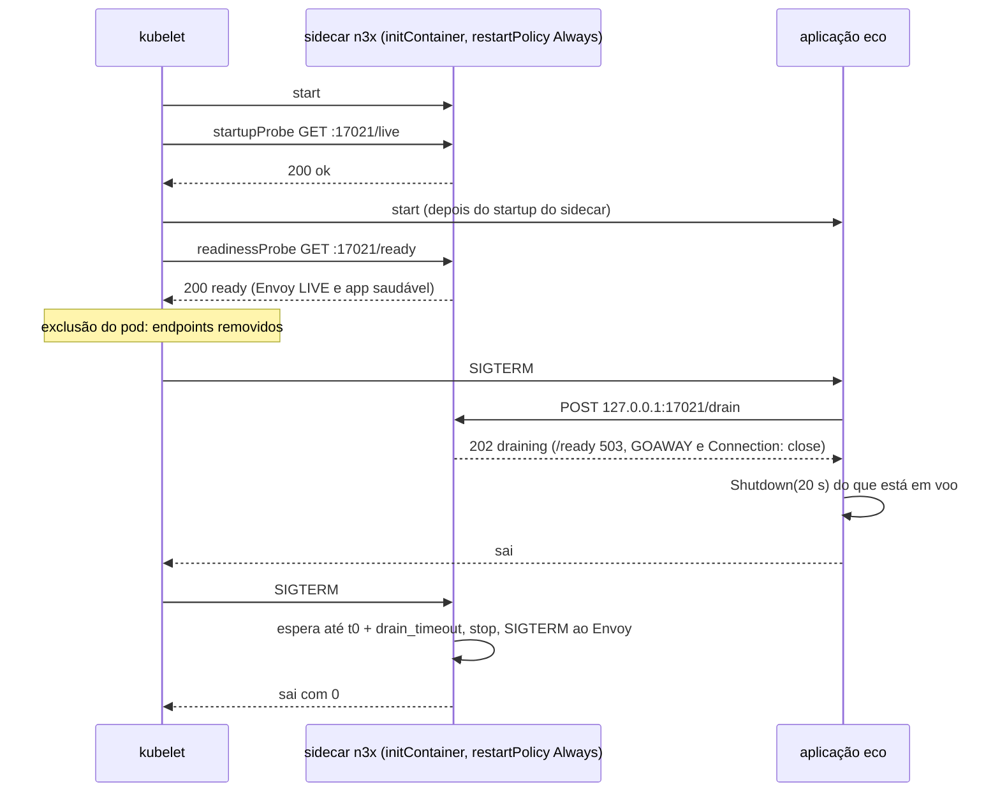
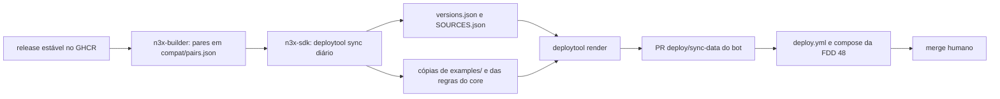

### FDD: Topologias de deploy e guias do operador e do autor (SDK-15)

Versão: 1.0
Data: 2026-10-21
Responsável: Guilherme Giusti

---

### 1. Contexto e motivação técnica

**Problema técnico.** A v1 é medida por critérios de ambiente e de jornada do PRD 1.5: um serviço novo em docker compose registrado no painel em até 30 minutos seguindo só a documentação, controller, sidecar e aplicação de pé com um único compose em até 5 minutos, a mesma imagem e o mesmo `n3x.yaml` em Kubernetes e em compose na CI e em ECS num teste manual guiado, e um plugin novo criado só com a documentação. As 46 FDDs anteriores fixaram o comportamento de cada processo, mas deixaram para esta FDD dezenas de decisões de implantação que só existem na combinação com o orquestrador: onde a chave AES e a CA são montadas, como o `n3x.yaml` é montado sem esconder `/etc/n3x/target`, quais probes usar sem criar impasse na subida, qual prazo de parada não corta a drenagem, como o IP de origem chega ao controller, como as regras de alerta viram `PrometheusRule` e o que o operador e o autor precisam ler, em que ordem. Errar qualquer um desses detalhes quebra a promessa de "só configurar os containers", e o erro só aparece em produção (saídas 3, 5, 6 ou 7 na subida, drenagem cortada, bloqueio de login do balanceador inteiro).

**Encaixe no HLD.** O HLD de plataforma (`n3x-sdk/docs/HLD-plataforma.md`, "Ambiente de implantação", "Interfaces públicas" e "Dashboards e alertas") e o ADR-008 do `n3x-sdk` colocam em `n3x-sdk/deploy/` os exemplos de referência de cada topologia e a CI cruzada, para não existir um sexto repositório. Esta FDD especifica:

- a estrutura de `n3x-sdk/deploy/` e os nomes de arquivo que a FDD 48 consome
- as topologias docker compose, Kubernetes 1.29 ou superior com sidecar nativo (ADR-007 do `n3x-sdk`) e ECS `awsvpc`, e a seção reservada do Istio (FDD 49)
- os modelos de `n3x.yaml` do serviço e do controller, o script de preparo de chaves e credenciais e a aplicação de teste
- a coleta Prometheus, o catálogo de alertas da plataforma, a transformação do contrato 13 da FDD 45 em `PrometheusRule` e os 12 painéis de referência
- os dois guias da v1 em `n3x-sdk/docs/` (operador e autor) e os três roteiros manuais guiados
- a ferramenta `deploytool` e o workflow que validam cada artefato estaticamente na CI do `n3x-sdk`

**Atores.** Operador de plataforma (lê o guia do operador e aplica os exemplos), autor de plugin (segue o guia do autor), mantenedor do N3X (roda os roteiros manuais antes do release e revisa os PRs de atualização de versão), bot `n3x-ci-bot` (abre o PR de atualização de versões, FDD 46), CI do `n3x-sdk` (valida os artefatos) e CI cruzada da FDD 48 (sobe os exemplos).

**Limites.** Esta FDD não muda o comportamento de nenhum processo: ela só consome os contratos das FDDs 15, 25 a 30, 33 a 35, 38, 39, 45 e 46. Rodar os exemplos na CI (compose no PR, kind à noite, kind com Istio) e os testes de ponta a ponta são da FDD 48. O conteúdo do modo Istio é da FDD 49; aqui ele só tem a seção reservada e os nomes de arquivo. Os números finais de dimensionamento vêm das FDDs 50 (sidecar) e 51 (controller).

**Suposições**
- As imagens `ghcr.io/giustech/n3x/{sidecar-builder,sidecar,controller-builder,controller}` existem por tag imutável e digest, com a tabela de pares em `n3x-builder/compat/pairs.json` (FDD 46)
- O plugin de exemplo `github.com/giustech/n3x-sdk/example` (FDD 13) é o único plugin além do core nos exemplos; o `n3x-plugin add` o resolve pelo proxy de módulos público
- O operador tem Docker Engine 24 ou superior com BuildKit e Docker Compose v2.20 ou superior (hipótese de versão mínima, H-21)
- O kind usa o domínio de cluster padrão `cluster.local` (hipótese usada pelo endereço do controller, H-05)

**Restrições**
- Chave AES sempre em arquivo montado, nunca em variável de ambiente; nenhum comportamento do N3X por variável de ambiente (FR-001)
- Aplicação nunca exposta: fora do Istio, escuta só em `127.0.0.1` (HLD de plataforma)
- Portas `17000`, `17021`, `17090`, `17443`, `17444` e `17091`; o admin do Envoy fica no socket `/tmp/n3x/admin.sock` e a `17001` não aparece em nenhum exemplo (L-16 aplicada, FDD 26)
- Controller em instância única por ambiente (ADR-001 do `n3x-sdk`); sidecar recusa subir sem limite de memória (ADR-008 do `n3x-sidecar`)
- Lista de plugins só por `RUN n3x-plugin add` nos dois Dockerfiles (ADR-005 do `n3x-builder`)
- Documentos em pt-BR, sem travessões; identificadores em inglês

**Rastreabilidade**
- PRD 1.5: objetivos "Acelerar a entrega" (30 minutos) e "Manter a infraestrutura leve" (5 minutos); FR-001 e FR-003 (montagem do `n3x.yaml`, chave, health e drenagem), FR-014 (documentação do ciclo do autor), FR-015 (Dockerfiles); critérios de aceitação de ambiente, de serviço novo e de plugin novo; testes por ambiente e roteiros manuais
- HLDs: plataforma ("Ambiente de implantação", "Interfaces públicas", "Dashboards e alertas", riscos de força bruta no login e de matriz cara); `n3x-sidecar` ("Modo Istio", "Ambiente de implantação"); `n3x-controller` ("Ambiente de implantação", "Desenvolvimento local"); `n3x-builder` (Dockerfiles de exemplo)
- ADRs: ADR-006, ADR-007 e ADR-008 do `n3x-sdk`; ADR-002 e ADR-008 do `n3x-sidecar`; ADR-009 do `n3x-controller`; ADR-005 e ADR-009 do `n3x-builder`
- Lacunas fechadas aqui: **L-28** (chave AES no ECS) e **L-42** (local do `EnvoyFilter`). Lacunas aplicadas: L-16 (admin em socket), L-17 (`n3x probe`), L-31 (dimensionamento até a FDD 50), L-24 (imagem do controller e `GOMEMLIMIT`). Lacuna documentada como reservada: **L-27** (hipóteses do Istio, decididas na FDD 49, que depende desta)
- FDDs consumidas: 15, 25, 26, 27, 28, 29 e 30 (contratos de execução), 33, 34, 35, 38 e 39 (rede, TLS e sessão), 45 (contrato 13 e painéis), 46 (imagens, pares e `examples/`), 14 (ciclo do autor), 51 (dimensionamento)

**Tabela de rastreabilidade dos pedidos (pedido → destino)**

Todo pedido dirigido à FDD 47 no `REGISTRO-DE-DECISOES.md` e nas FDDs tem destino abaixo. Destinos: `op/` é `n3x-sdk/docs/operador/`, `au/` é `n3x-sdk/docs/autor/`, `dep/` é `n3x-sdk/deploy/`, e `Cn` é o contrato da seção 5.

| # | Origem | Pedido | Destino |
| --- | --- | --- | --- |
| R-01 | FDD 01 | gramática da faixa `sdk` com exemplos | `au/evolucao-e-versoes.md` (C16) |
| R-02 | FDD 02 | nunca usar segredo como chave de map; erro do `New` aponta o campo; exemplos de `n3x.yaml` com aspas | `au/config-e-segredos.md`; modelos do C3 com aspas |
| R-03 | FDD 03 | `defaultMode: 0440` com `fsGroup`; sem core dump e sem swap | C6, C7, C8 e regras `k8s_key_mount`, `compose_no_core`, `compose_no_swap` (C10); `op/seguranca.md` |
| R-04 | FDD 03 | alertas de log `secret_decrypt`, `key_format` e chave com permissão aberta | AL-02 e AL-03 (C12) |
| R-05 | FDD 03 | ferramentas fora da garantia de mascaramento; `Equal` em vez de diff de structs | `au/config-e-segredos.md` |
| R-06 | FDD 04 | alerta de descartes de memória; painel de memória por plugin; `n3x_plugin_memory_max_bytes` e guia de dimensionamento | AS-18, AC-10 (C12); PR-07 e PR-10 (C13); `op/dimensionamento.md` (C14) |
| R-07 | FDD 05 | hook de body e gRPC de streaming; mensagem de negação sem dado da requisição; `strings.Clone` antes do `Go()`; alertas e painel | `au/metade-proxy.md`; AS-08 a AS-10; PR-07 |
| R-08 | FDD 06 | `honor_labels`; rótulo `instance` do scrape; rótulos certos e errados; receitas de connector (L-23); `n3x_controller_logins_total` filtrado por `job`; histogram sem `_sum`; alertas e painel | C11; `au/metricas-e-logs.md`; `au/recursos-externos.md`; AS-26, AS-29 a AS-31; PR-07 |
| R-09 | FDD 07 e 16 | representação inteira das métricas do sidecar (sem `_sum`, counter truncado, gauge arredondado) | `op/observabilidade.md` (C11); `au/metricas-e-logs.md` |
| R-10 | FDD 08 | `Validate` não depende do valor aberto (com a exceção de formato da FDD 40); painel | `au/metade-controller.md`; PR-10 |
| R-11 | FDD 09 | balanceador L4 que preserva o IP de origem; painel de eventos e sessão | `op/controller.md`; PR-09 |
| R-12 | FDD 09 | `ExitContext()` só para a saída do core | não se aplica ao guia público: uso interno do core, documentado no `n3x-plugin-core` (justificativa: nenhum autor recebe a capacidade, FDD 09) |
| R-13 | FDDs 10 e 11 | guia do autor: pré-filtrar tabela com `q.Table(id).Filter`, handler idempotente, exportação e IP | `au/telas.md` |
| R-14 | FDD 12 | guia do autor com o kit de controller (`ctrltest`, `Link`) | `au/testes.md` |
| R-15 | FDD 13 | `Dial`, banco e `Starter` em outros plugins; `memory.Map` é cache; alertas do exemplo | `au/recursos-externos.md`; AS-34, AC-34 |
| R-16 | FDD 14 | ciclo do `n3x-new`, flags, tabela de regras do `schema-check`, série `0.x`, `fetch-depth: 0`, `@latest` antes da v1.0.0, licença; `GOPROXY` interno e `--template-dir` | `au/ciclo.md`, `au/evolucao-e-versoes.md` (C16) |
| R-17 | FDD 15 | alertas `config_rejected`, `n3x_config_secrets_in_clear` e `key_too_open`; validação completa na imagem final | AL-01, AL-02, AS-16; `op/imagens-e-build.md`; job `config` (C18) |
| R-18 | FDD 16 | `metric_relabel_configs` se o Envoy prefixar `envoy_`; alertas e painel | C11; AS-01, AS-26 a AS-28, AS-35; PR-08 |
| R-19 | FDD 17 | alertas de log `filter_config_rejected`, `instance_failed`, `privileged_refused`; painel | AL-10; AS-32, AS-33; PR-07 |
| R-20 | FDD 18 | textos de panic e erro vão ao log; `failure: closed` para plugin de segurança; reiniciar com rolling restart depois de corrigir; alertas | `au/armadilhas.md`; `op/operacao.md`; AS-02 a AS-07 |
| R-21 | FDD 20 | guia de exit codes do builder; `GOPRIVATE`; secret nas linhas `add` e `build`; token só de leitura; alerta de `N3X-B015` | `op/imagens-e-build.md`, `op/erros.md`; AL-13 |
| R-22 | FDD 20 | contingência "aviso de listas diferentes vira erro se a FDD 47 mostrar que são raras" | sem destino nesta FDD: não há dado de uso antes do release; o sinal fica no alerta A-13 e a decisão volta à FDD 20 depois (justificativa) |
| R-23 | FDD 21 | Dockerfile recomendado; `docker build --target build` para depurar; exit 5 do `N3X-B010`; nenhum build constraint em `types/` | C5; `op/imagens-e-build.md`; `au/estrutura.md` |
| R-24 | FDD 22 | `jq` sobre `/out/manifest.json`; mensagem de incompatibilidade; tabela de pares; `manifest_rejected` em laço | C5 (estágio `out`); `op/imagens-e-build.md`; AL-07 |
| R-25 | FDD 23 | exit 6 com `N3X-B011` ou `N3X-B012`; `load_test_skipped` e runner arm64 nativo; `/n3x/build/verify` para depurar | `op/imagens-e-build.md` |
| R-26 | FDD 24 | catálogo das 18 regras, `//n3x:allow`, modelo de ameaça, token só de leitura, teste de `docker build` na CI do plugin, plugin lê arquivo da chave (risco residual) | `au/build-e-analise.md`; `op/seguranca.md` |
| R-27 | FDD 25 | `spec.hostname` proibido com mais de uma réplica; variáveis do ECS; alerta `preflight_failed` | C7 (`k8s_no_hostname`); C8; AL-06 |
| R-28 | FDD 26 | `/tmp` em `tmpfs` ou `emptyDir`, não compartilhado; aplicação sem root com volume compartilhado; prazo em streams gRPC; alertas e painel | C6, C7, C8 (`*_private_volumes`, `*_tmp*`); `op/configuracao.md`; AS-23, AS-24; AL-05; PR-08 |
| R-29 | FDD 27 | limites por orquestrador; tabela de saídas; `resources.cpus` ou `limits.cpu`; alertas e painel | C14; `op/erros.md`; AS-19 a AS-22; AL-08, AL-09; PR-08 |
| R-30 | FDD 28 | `subPath`, `/run/n3x` com `fsGroup: 17000` e `defaultMode: 0440`, `readOnlyRootFilesystem`, `emptyDir` `Memory`, `drop: ALL`, `allowPrivilegeEscalation: false`, `runAsNonRoot`, seccomp `RuntimeDefault`, imagens por digest; `user:` no compose; alertas `hardening_warning` | C6, C7, C8 e regras do C10; AL-11 |
| R-31 | FDD 29 | readiness em `/ready`, liveness e startup em `/live`; ECS e compose com `n3x probe live`; ALB em `17021/ready`; prazos; gatilho `POST /drain` | C6, C7, C8 (`*_probes`, `*_grace*`, `ecs_*`); C4 (aplicação `eco`); `op/operacao.md`; AS-25; AL-12 |
| R-32 | FDD 30 | `terminationGracePeriodSeconds >= shutdown_timeout + 2 s + 5 s x plugins + 1 s`; `startupProbe`; healthcheck do compose com `probe`; alertas e painel | C6, C7 (`k8s_grace_period`, `k8s_controller_probes`); AC-01 a AC-05; AL-14; PR-10 |
| R-33 | FDD 31 | IP de origem no L4; `bcrypt_concurrency` até o número de vCPUs; não fazer segredo à mão; sem core dump e swap; alertas | `op/controller.md`, `op/dimensionamento.md`, `op/segredos.md`; AC-19 a AC-23 |
| R-34 | FDD 32 | alertas de `failed` (crítico para o core), zumbis e panics; erros fatais do runtime Go; armadilhas que `recover` não pega | AC-06 a AC-11 (A-41 para o core); `au/armadilhas.md` |
| R-35 | FDD 33 | IP preservado no L4; `grpc.trusted_proxies` só com proxy L7; health só na `17091`; política de rede da `17443`; mensagens de `INVALID_ARGUMENT` sem dado sensível; handler de stream respeita o `ctx`; alertas | `op/controller.md`; C7 (`NetworkPolicy`); `au/metade-controller.md`; AC-12 a AC-18 |
| R-36 | FDD 34 | `panel.trusted_proxies`, NAT, rede da `17444`, senha do root, custo igual para root e leitura, restart limpa bloqueios; alertas | `op/controller.md`, `op/segredos.md`, `op/operacao.md`; AC-24 a AC-27 |
| R-37 | FDD 35 | proxy reverso não reescreve `Origin` nem `Host`; cabeçalhos; alertas; painel de referência | `op/controller.md`; AC-28 a AC-33; PR-12 |
| R-38 | FDD 37 | cifrar uma vez e versionar o envelope; inteiros acima de 2^53 viram texto; texto ou `plugin.Size` para valores enormes | `op/segredos.md`; `au/config-e-segredos.md` |
| R-39 | FDD 38 | SAN igual ao host de `controller.address`; rotação de CA em bundle; `Buffered` só com método idempotente; alertas e painel | `op/controller.md`, `op/operacao.md`; `au/recursos-externos.md`; AS-11 a AS-15; PR-09 |
| R-40 | FDD 39 | `keygen` mais `encrypt --plugin n3x.core` para a `hmac_key`; rotação; `verified_cache_ttl >= 0,88 x session.ttl`; NTP no controller | `op/segredos.md`, `op/dimensionamento.md`, `op/seguranca.md` |
| R-41 | FDD 40 | `n3x-controller hash --cost` igual para todos; `ENC[...]` opcional no `password_hash`; restart para aplicar | `op/segredos.md`, `op/operacao.md` |
| R-42 | FDD 41 | `n3x_plugin_memory_bytes` do core não inclui o Store; dimensionamento; painel "Store do core" | `op/dimensionamento.md`; PR-03 |
| R-43 | FDD 42 | `heartbeat_interval` e `max_tasks` (core precisa de 6) | `op/configuracao.md`, `op/dimensionamento.md` |
| R-44 | FDD 43 | sentido de `inventory_retention`; conflito de identidade; ordem de atualização (controller primeiro); alertas | `op/operacao.md`; A-05 em `op/alertas.md` |
| R-45 | FDD 44 | cifrar uma vez; trecho com `ENC[...]`; sentido de "recente" e "persistente" | `op/segredos.md`, `op/operacao.md`; A-15 |
| R-46 | FDD 45 | contrato 13 como `PrometheusRule`; 6 painéis de referência; guia de cada alerta A-xx; `honor_labels` e rótulo `pod` | C12, C13, C11; `op/alertas.md` |
| R-47 | FDD 45 | avaliar se o caminho do segredo em claro é sensível (risco da FDD 45) | decidido: o caminho não é sensível (H-24); `op/segredos.md` |
| R-48 | FDD 45 | ajustar limiares com os números da FDD 51 | C14 (`sizing.json`) e C12 (`params.yaml`) |
| R-49 | FDD 46 | tabela de pares; Dockerfiles de `examples/`; espelho por digest (`imagetools create`); política `candidate` e `-rc`; limites do GHCR | C2, C5; `op/imagens-e-build.md` |
| R-50 | FDD 51 | tabela de dimensionamento (serviços sem chave por vCPU, `hmac_key`, 1 GB); Prometheus local com `--hold`; pedir `effective_config_bytes` e tamanho do manifesto | C14; `op/dimensionamento.md`, `op/observabilidade.md` |
| R-51 | ASSUNTO, L-28 | chave AES no ECS | C8 (contêiner `n3x-files`) |
| R-52 | ASSUNTO, L-42 | local do `EnvoyFilter` | C9 (cópia byte a byte com `SOURCES.json`) |
| R-53 | ASSUNTO, L-27 | `pathNormalization`, `proxyStatsMatcher` e `userVolumeMount` | C9 e `op/istio.md` (reservados à FDD 49) |
| R-54 | ASSUNTO, L-16 e L-17 | admin em socket; comando de health | nenhum exemplo cita `17001`; `n3x probe live` no compose e no ECS |
| R-55 | ASSUNTO | certificado do controller nos exemplos | C3 (`dev-cert` no compose e no kind); C7 (Secret do operador, `cert-manager` opcional) |
| R-56 | ASSUNTO | tags exatas e atualização a cada release | C2 |
| R-57 | ASSUNTO | painel pronto ou lista de consultas | C13 (arquivos do Grafana e consultas no guia) |
| R-58 | ASSUNTO | restrição de rede para a `17443` | C7 (`NetworkPolicy`), C8 (grupo de segurança) |
| R-59 | ASSUNTO | cronometragem dos 30 minutos | C17 |
| R-60 | ASSUNTO | formato dos guias | C15 e C16 (Markdown no repositório) |

---

### 2. Objetivos técnicos

- **Serviço novo em até 30 minutos só com o guia.** Medida: no roteiro `op/roteiros/servico-novo-30min.md`, a partir de uma máquina com Docker e sem imagens N3X baixadas, o operador chega ao sidecar `pedidos` em estado `connected` na tela `/plugins/n3x/core/sidecars` em no máximo 1.800 s, sem editar o código da aplicação (critério do PRD; cronometragem no contrato 17).
- **Compose do zero em até 5 minutos.** Medida: `docker compose build`, `bootstrap.sh` e `docker compose up -d --wait` somam no máximo 300 s num runner `ubuntu-24.04` de 4 vCPUs com o cache de build vazio e as imagens base já baixadas (hipótese de condição, H-18); medido pela FDD 48 a cada PR.
- **Mesma imagem e mesmo `n3x.yaml` nas três topologias.** Invariante: o `n3x.yaml` do sidecar montado no compose, no kind e no ECS é o mesmo arquivo, byte a byte (SHA-256 igual), gerado uma vez pelo `bootstrap.sh`; as diferenças entre orquestradores ficam só nos manifestos (H-04, H-05).
- **Todo artefato validado sem subir nada.** Medida: em todo PR que toca `deploy/` ou `docs/`, o workflow `deploy.yml` roda `kubeconform` (Kubernetes 1.29.0 e a mais nova de `versions.json`), `docker compose config`, as 58 regras de política do `deploytool check`, `promtool check rules` e `promtool test rules`, a checagem das consultas dos painéis, o lint de Markdown sem travessões e de links internos, e `n3x validate` e `n3x-controller validate` completos sobre a saída do `bootstrap.sh`; 0 erros para o merge.
- **Exemplos nunca atrás das imagens publicadas.** Medida: até 2 dias úteis entre um par novo `ok` nas duas arquiteturas em `compat/pairs.json` e o PR de atualização de `deploy/versions.json` (bot); `deploytool render --check` e a checagem de fonte (`src_drift`) zeram a deriva entre cópias e originais.
- **Todo alerta com guia.** Invariante: cada alerta de `deploy/observability/` (A-01 a A-43, AS-01 a AS-35, AC-01 a AC-34) tem anotação `runbook` apontando para um título `### <ID>` existente em `op/alertas.md`, e cada título tem o alerta (regra `obs_runbook`).
- **Plugin novo só com o guia do autor.** Medida: no roteiro `op/roteiros/plugin-novo.md`, o plugin `giustech.ratelimit` sai do `n3x-new` até a página e o cartão no painel, sem mudar nenhum repositório do core, seguindo só `docs/autor/` (critério do PRD).

---

### 3. Escopo e exclusões

**Incluído**
- Estrutura de `n3x-sdk/deploy/` e de `n3x-sdk/docs/operador/` e `docs/autor/`, com os nomes estáveis consumidos pela FDD 48 (contrato 1)
- Arquivo de versões fixadas `deploy/versions.json`, registro de cópias `deploy/SOURCES.json` e o fluxo de atualização por release (contrato 2)
- Modelos do `n3x.yaml` do serviço e do controller e o script `deploy/config/bootstrap.sh` que gera chaves, credencial, hashes, `hmac_key` e certificado de desenvolvimento (contrato 3)
- Aplicação de teste `eco` em Go, com o gatilho de drenagem do contrato 10 da FDD 29 (contrato 4)
- Dockerfiles do operador como cópias dos `examples/` do `n3x-builder`, com o estágio `out` para ler o manifesto (contrato 5)
- Topologias docker compose (contrato 6), Kubernetes com sidecar nativo, controller, `NetworkPolicy` e overlays `kind` e `exemplo` (contrato 7) e ECS com o contêiner de preparo de arquivos (contrato 8, L-28)
- Seção reservada do modo Istio e a decisão do local do `EnvoyFilter` (contrato 9, L-42)
- Ferramenta `deploytool` (módulo Go aninhado em `deploy/tools`) com `render`, `sync`, `check`, `rules` e `sizing` (contratos 2, 10, 12 e 14)
- Coleta Prometheus para Kubernetes, compose e ECS, com `honor_labels` e rótulo `pod` (contrato 11)
- Catálogo de alertas da plataforma (sidecar, controller e logs), cópia das regras do core e geração de `PrometheusRule` (contrato 12)
- 12 painéis de referência do Grafana e as consultas equivalentes no guia (contrato 13)
- Tabela de dimensionamento gerada de `deploy/sizing.json` (contrato 14)
- Guia do operador (contrato 15), guia do autor (contrato 16) e roteiros manuais guiados (contrato 17)
- Workflow `deploy.yml` da CI do `n3x-sdk` e a lista do que a FDD 48 consome (contrato 18)

**Excluído**
- Subir os exemplos na CI (compose no PR, kind à noite, kind com Istio), medir os 5 minutos, rolling update sem requisição cortada e testes de ponta a ponta: FDD 48 (SDK-16)
- Conteúdo do `EnvoyFilter`, imagem `istio-1.31`, modo Istio do entrypoint e as decisões da L-27: FDD 49 (SID-11)
- Números finais de dimensionamento do sidecar e do controller: FDDs 50 (SID-12) e 51 (CTL-07)
- Imagens de runtime e de build, tabela de pares e o render dos `examples/`: FDDs 28, 30 e 46
- Ferramentas `n3x-new` e `schema-check`: FDD 14
- Injeção automática do sidecar e interceptação por iptables: fora da v1 (PRD)
- Helm chart, operador Kubernetes, módulo Terraform e CloudFormation: fora da v1 (hipótese; os exemplos são kustomize, compose e JSON de task definition)
- Site de documentação gerado: fora da v1 (H-16)

---

### 4. Fluxos detalhados e diagramas

**Fluxo principal: serviço novo em docker compose (o roteiro dos 30 minutos)**
1. O operador clona o `n3x-sdk` na tag do release e abre `docs/operador/inicio-rapido.md`
2. `cd deploy/compose && docker compose build`: constrói o sidecar (`deploy/images/sidecar/Dockerfile`, core e `n3x.example`), o controller (`deploy/images/controller/Dockerfile`) e a aplicação `eco`; as imagens base vêm por tag e digest de `versions.json`
3. `../config/bootstrap.sh --out .n3x`: com as imagens recém-construídas, gera em `.n3x/` as chaves AES do sidecar e do controller (`keygen`), a credencial do serviço `pedidos` (`credential new pedidos --key`, com o segredo já cifrado para o sidecar), os hashes do root e do usuário de leitura (`hash --cost 12`), a `hmac_key` cifrada (`keygen` mais `encrypt --plugin n3x.core`), o certificado de desenvolvimento (`dev-cert` com o nome do controller) e os dois `n3x.yaml` preenchidos a partir dos modelos de `deploy/config/`
4. `docker compose up -d --wait`: sobe o controller (healthcheck `probe ready`), o sidecar (healthcheck `probe live`) e a aplicação, que entra no namespace de rede do sidecar e escuta em `127.0.0.1:3000`
5. `curl -si localhost:17000/eco` responde 200 com `x-n3x: 1` no eco; `curl -si localhost:17000/admin` responde 403 `bloqueado`
6. O operador abre `https://localhost:17444`, entra como `admin` com a senha de `.n3x/root-password.txt` e vê o sidecar `pedidos` em `connected` com o hash da config; o cronômetro para aqui
7. Para um serviço que não é o de exemplo, o guia troca o nome do serviço no `bootstrap.sh --service <nome>`, o `app.address` e a imagem da aplicação no `compose.yaml`; nenhuma linha do código da aplicação muda

**Fluxo Kubernetes (kind ou cluster 1.29 ou superior)**
1. O operador publica as imagens do sidecar e do controller no registro dele (de preferência por digest) e roda o `bootstrap.sh` (ou os comandos manuais do guia)
2. Cria os namespaces e os objetos de configuração por comando: `ConfigMap` `pedidos-n3x` (o `n3x.yaml`), `Secret` `pedidos-n3x-key` (a chave AES do sidecar), `ConfigMap` `n3x-ca` (a CA), `Secret` `n3x-controller-config` (o `n3x.yaml` do controller, H-10), `Secret` `n3x-controller-aes` e `Secret` do tipo `kubernetes.io/tls` `n3x-controller-tls`
3. `kubectl apply -k deploy/kubernetes/overlays/<overlay>`: controller com 1 réplica e estratégia `Recreate`, `Service` `n3x-controller`, `NetworkPolicy`; `Deployment` `pedidos` com o sidecar nativo e `Service` apontando para a `17000`
4. O kubelet sobe o sidecar primeiro (sidecar nativo): `startupProbe` em `/live` passa em cerca de 1 s, a aplicação sobe, `/ready` vai a 200 quando o Envoy e a aplicação estão prontos, e o pod entra nos endpoints
5. Na exclusão do pod, a aplicação recebe SIGTERM primeiro; com o gatilho, ela chama `POST 127.0.0.1:17021/drain` e continua atendendo enquanto o sidecar fecha as conexões dos clientes; depois que a aplicação sai, o sidecar recebe SIGTERM e termina a drenagem dentro do `terminationGracePeriodSeconds`

**Fluxo ECS (roteiro manual guiado)**
1. O operador grava a chave AES do sidecar no Secrets Manager e o `n3x.yaml` e a CA no Parameter Store (ou S3), e registra a task definition `deploy/ecs/pedidos-task.json` com o papel de task da política `n3x-files-policy.json`
2. O contêiner `n3x-files` (não essencial) roda primeiro, lê os três itens com o papel da task e grava `aes.key`, `n3x.yaml` e `ca.pem` no volume efêmero `n3x-run`, com dono 17000 e modo 0440, e sai com 0
3. O sidecar (`dependsOn` `n3x-files` `SUCCESS`) sobe com `run --config /run/n3x/n3x.yaml`; o health check do contêiner é `n3x probe live`; a aplicação (`dependsOn` sidecar `HEALTHY`) sobe depois
4. O ALB manda tráfego para a `17000` e confere `17021/ready`; o sidecar aparece no painel com a instância igual ao `DockerId`
5. Na parada, o ECS tira o alvo do ALB (`deregistration_delay`), para a aplicação e depois o sidecar (ordem inversa do `dependsOn`), com `stopTimeout` de 30 s no sidecar

**Fluxo do autor (guia do autor e roteiro do plugin novo)**
1. `go run github.com/giustech/n3x-sdk/cmd/n3x-new@<versão> giustech.ratelimit --phase traffic` (na série `0.x`, `@latest` ou a tag exata, nunca `@v1`)
2. `make test` e `make test-norace`; escreve os hooks, a config, a página e o cartão; `make schema` grava os goldens
3. Commit, `git tag v0.1.0` (igual à `version` do manifesto), push; a CI gerada roda com `fetch-depth: 0` e o `schema-check`
4. Acrescenta `RUN n3x-plugin add github.com/giustech/n3x-plugin-ratelimit@v0.1.0` nos dois Dockerfiles, a instância em `plugins` do `n3x.yaml` do serviço e a seção `plugins["giustech.ratelimit"]` do controller
5. Reconstrói, faz o redeploy do controller e do serviço e confere a página e o cartão no painel

**Fluxo de atualização dos exemplos a cada release (contrato 2)**
1. Um release estável de qualquer imagem N3X entra em `compat/images.json` e o fluxo de pares da FDD 46 grava os resultados em `compat/pairs.json`
2. O job diário `deploy-sync` do `n3x-sdk` (e o evento `runtime-published`, se a FDD 46 o enviar também ao `n3x-sdk`) roda `deploytool sync`: escolhe o par mais novo `ok` nas duas arquiteturas, canal `stable`, para o sidecar e para o controller; copia os `examples/` da tag do par e as regras do core da tag do core embutido; atualiza `versions.json` e `SOURCES.json`; roda `deploytool render`
3. Se algo mudou, o bot abre o PR `deploy/sync-<data>`; o PR roda o `deploy.yml` inteiro e o compose da FDD 48; o merge é humano

**Fluxos alternativos e exceções**
- **Aplicação que não pode mudar o código (sem gatilho):** no Kubernetes, `preStop` no contêiner da aplicação com `curl -fsS -X POST http://127.0.0.1:17021/drain; sleep <drain_timeout>`, se a imagem tiver `curl` ou `wget` (H-20); sem nada, vale o risco residual da FDD 29 (I-02 dela): conexões persistentes que chegam entre a saída da aplicação e o SIGTERM do sidecar recebem 503
- **Arquivo de chave sem leitura para o UID 17000 no compose:** saída 3 (`key_read`, com UID e GID no texto, FDD 28); o guia manda `chown 17000:17000` e `chmod 0440`, ou `user: "17000:<gid do arquivo>"`
- **ConfigMap montado como diretório em `/etc/n3x`:** saída 5 `image_target` (FDD 25); a regra `k8s_config_subpath` recusa antes, na CI
- **Pod sem `limits.memory`:** saída 7 `memory_unlimited` (FDD 27); a regra `k8s_memory_limit` recusa antes
- **Certificado sem o nome de `controller.address` no SAN:** `n3x_controller_connect_failures_total{reason="tls"}` sobe e o alerta crítico AS-12 dispara; o tráfego continua (FDD 38)
- **Balanceador L7 ou NAT na frente da `17443`:** todos os sidecars parecem vir de um IP; o bloqueio por IP passa a bloquear o balanceador; o guia exige L4 com IP preservado (`externalTrafficPolicy: Local`, NLB com preservação) e `grpc.trusted_proxies` só para proxy L7 que põe `x-forwarded-for`
- **Fargate:** sem `linuxParameters.tmpfs`; o `/tmp` é um volume efêmero só do sidecar e o aviso `tmp_not_tmpfs` (FDD 28) é esperado e documentado
- **Imagem pré-release (`-rc.N`) ou alvo `candidate`:** nunca entra em `versions.json` da `main`; só a FDD 48 usa, por pedido manual
- **Istio:** os arquivos de `deploy/istio/` ficam reservados até a FDD 49; a regra `src_drift` passa a valer para o `EnvoyFilter` quando o arquivo existir

**Diagramas**

Subida e parada no Kubernetes com sidecar nativo e o gatilho pela aplicação:



Atualização dos exemplos depois de um release:



---
### 5. Contratos públicos (assinaturas, endpoints, headers, exemplos)

**Contrato 1: layout de `deploy/` e `docs/` (nomes consumidos pela FDD 48)**
- Tipo: estrutura de arquivos do repositório `n3x-sdk`
- Assinatura/Rota:
  ```text
  n3x-sdk/
  ├── deploy/
  │   ├── README.md                     mapa dos exemplos para os guias
  │   ├── versions.json                 versões e digests fixados (contrato 2)
  │   ├── SOURCES.json                  cópias de outros repositórios com ref e sha256 (contrato 2)
  │   ├── sizing.json                   dados da tabela de dimensionamento (contrato 14)
  │   ├── config/
  │   │   ├── sidecar.yaml              modelo do n3x.yaml do serviço pedidos (contrato 3)
  │   │   ├── controller.yaml           modelo do n3x.yaml do controller (contrato 3)
  │   │   └── bootstrap.sh              preparo de chaves, credencial, hashes e certificado (contrato 3)
  │   ├── images/
  │   │   ├── sidecar/Dockerfile        cópia de n3x-builder/examples/sidecar/Dockerfile (contrato 5)
  │   │   └── controller/Dockerfile     cópia de n3x-builder/examples/controller/Dockerfile (contrato 5)
  │   ├── apps/eco/                     aplicação de teste: main.go, go.mod, Dockerfile (contrato 4)
  │   ├── compose/
  │   │   ├── compose.yaml              topologia docker compose (contrato 6)
  │   │   └── prometheus.yml            coleta do perfil observabilidade (contrato 11)
  │   ├── kubernetes/
  │   │   ├── base/controller/          namespace, deployment, service, networkpolicy, kustomization
  │   │   ├── base/pedidos/             namespace, deployment, service, networkpolicy, kustomization
  │   │   ├── overlays/kind/            consumido pela FDD 48 (imagens definidas na execução)
  │   │   ├── overlays/exemplo/         produção ilustrativa: digests, recursos, cert-manager opcional
  │   │   └── observability/            podmonitor, servicemonitor e prometheusrule-*.yaml (gerados)
  │   ├── ecs/
  │   │   ├── pedidos-task.json         task definition Fargate do serviço (contrato 8)
  │   │   ├── controller-task.json      task definition Fargate do controller (contrato 8)
  │   │   ├── n3x-files.sh              script do contêiner de preparo (contrato 8)
  │   │   └── n3x-files-policy.json     política IAM mínima do papel da task
  │   ├── istio/README.md               reservado à FDD 49 (contrato 9)
  │   ├── observability/
  │   │   ├── params.yaml               parâmetros das regras (contrato 12)
  │   │   ├── rules/                    n3x-sidecar.rules.yaml, n3x-controller.rules.yaml e *_test.yaml
  │   │   ├── sources/                  n3x-core.rules.yaml e n3x-core.rules_test.yaml (cópias do core)
  │   │   ├── prometheus/               scrape-kubernetes.yaml e scrape-static.yaml (contrato 11)
  │   │   ├── grafana/                  pr-01-inventario-core.json até pr-12-controller-painel.json
  │   │   └── series.txt                séries conhecidas citadas por regras e painéis
  │   └── tools/                        módulo Go github.com/giustech/n3x-sdk/deploy/tools (deploytool)
  ├── docs/
  │   ├── operador/                     guia do operador (contrato 15) e roteiros/ (contrato 17)
  │   └── autor/                        guia do autor (contrato 16)
  └── .github/workflows/deploy.yml      validação estática (contrato 18)
  ```
- Método: n/a
- Semântica:
  - Os nomes acima são contrato com a FDD 48 e com o guia: mudam só por adição; renomear exige mudar a FDD 48 no mesmo PR (hipótese H-01)
  - `deploy/compose/.n3x/` e `deploy/kubernetes/overlays/*/.n3x/` são saídas do `bootstrap.sh` e ficam no `.gitignore`; nenhum segredo é versionado
  - `deploy/tools` é um módulo Go aninhado (`github.com/giustech/n3x-sdk/deploy/tools`, hipótese H-03): as dependências dele (YAML, JSON Schema) não entram no `go.mod` do SDK (ADR-011)
  - Os arquivos marcados como cópia (Dockerfiles, regras do core e, depois da FDD 49, o `EnvoyFilter`) nunca são editados à mão: a regra `src_drift` recusa

**Exemplo de requisição**
```text
$ go run ./deploy/tools/cmd/deploytool check --only layout
```

**Exemplo de resposta**
```text
ok: layout de deploy/ e docs/ confere (47 arquivos esperados, 0 ausentes, 0 inesperados fora das pastas livres)
```

---

**Contrato 2: `deploy/versions.json`, `deploy/SOURCES.json`, `deploytool render` e `deploytool sync`**
- Tipo: formato de dados e CLI
- Assinatura/Rota:
  ```text
  deploytool render [--check]
  deploytool sync [--write] [--builder-repo <caminho|url>] [--core-repo <caminho|url>] [--sidecar-repo <caminho|url>]
  ```
- Método: processo (Go); `sync` lê os repositórios pela API do GitHub ou por clone local
- Semântica:
  - **`versions.json` (`format: 1`)** é a fonte única das versões que aparecem em `deploy/` e nos guias: as quatro imagens N3X (`tag` e `digest`), a versão do `n3x.example`, as imagens de terceiros (`aws_cli`, `golang` e `distroless_static` da aplicação `eco`, `prometheus`, `grafana`) e as versões de Kubernetes usadas na validação (`kubernetes.min = 1.29.0` e `kubernetes.latest`)
  - **Escolha do par (H-02):** o par mais novo de `compat/pairs.json` com `results.amd64 == "ok"`, `results.arm64 == "ok"` e `channel == "stable"`, um para `kind: sidecar` (alvo `envoy-1.40`) e um para `kind: controller`; a versão do `n3x.example` é a do SDK da `sidecar-builder` do par (os `examples/` da FDD 46 já usam essa versão). Pré-release (`-rc.N`) e alvo `candidate` nunca entram na `main`
  - **Tags e digests:** toda imagem aparece como `<repositório>:<tag>@sha256:<digest>`; a tag é para leitura humana e o digest é o que vale (ADR-009 do `n3x-builder`)
  - **`SOURCES.json` (`format: 1`):** uma linha por arquivo copiado, com `path` local, `repo`, `ref` (tag), `source` (caminho na origem) e `sha256`; `sync` só copia de tag, nunca de branch
  - **`render`** escreve, a partir de `versions.json`, `sizing.json` e `params.yaml`: as imagens de terceiros do `compose.yaml` e das task definitions do ECS, o `images:` do overlay `exemplo`, os `PrometheusRule` gerados (contrato 12), a tabela de versões e a de dimensionamento nos guias (entre marcadores `<!-- n3x:versions:begin -->` e `<!-- n3x:sizing:begin -->`); `--check` não escreve e sai com 3 se algum arquivo ficaria diferente
  - **`sync`** consulta os pares, baixa os arquivos das tags escolhidas, atualiza `versions.json` e `SOURCES.json` e roda `render`; sem `--write`, só mostra o plano. O job diário `deploy-sync` roda com `--write` e o bot abre o PR `deploy/sync-<AAAA-MM-DD>`
  - **Saídas:** 0 sem mudança ou escrita feita; 1 uso; 3 deriva (`render --check`); 4 ferramenta externa; 5 rede ou API do GitHub indisponível
  - Campos desconhecidos são erro na leitura (o arquivo é nosso); campo novo só por adição com `format` igual

**Exemplo de requisição** (`deploy/versions.json`, digests encurtados)
```json
{
  "format": 1,
  "images": {
    "sidecar_builder":    { "ref": "ghcr.io/giustech/n3x/sidecar-builder:1.0.3-envoy-1.40", "digest": "sha256:5d0e9a71c3b8..." },
    "sidecar":            { "ref": "ghcr.io/giustech/n3x/sidecar:1.0.4-envoy-1.40",         "digest": "sha256:7e0c5a91d2b4..." },
    "controller_builder": { "ref": "ghcr.io/giustech/n3x/controller-builder:1.0.1",         "digest": "sha256:0a4f8c2e9b61..." },
    "controller":         { "ref": "ghcr.io/giustech/n3x/controller:1.0.2",                 "digest": "sha256:91ab3d7e0c55..." },
    "aws_cli":            { "ref": "public.ecr.aws/aws-cli/aws-cli:2.22.35",                "digest": "sha256:c3f1..." },
    "golang":             { "ref": "golang:1.26.1-trixie",                                  "digest": "sha256:4e2a..." },
    "distroless_static":  { "ref": "gcr.io/distroless/static-debian12:nonroot",            "digest": "sha256:8b1d..." },
    "prometheus":         { "ref": "quay.io/prometheus/prometheus:v2.53.3",                 "digest": "sha256:a9c0..." },
    "grafana":            { "ref": "docker.io/grafana/grafana:10.4.14",                     "digest": "sha256:61fe..." }
  },
  "plugins": { "n3x.example": "github.com/giustech/n3x-sdk/example@v1.2.0" },
  "kubernetes": { "min": "1.29.0", "latest": "1.31.4" },
  "pairs": { "sidecar": "1.0.3-envoy-1.40 + 1.0.4-envoy-1.40 (2026-10-21)", "controller": "1.0.1 + 1.0.2 (2026-10-21)" }
}
```
```text
$ go run ./deploy/tools/cmd/deploytool sync
```

**Exemplo de resposta**
```text
par sidecar: sidecar-builder 1.0.3-envoy-1.40 + sidecar 1.0.4-envoy-1.40 (ok em amd64 e arm64, 2026-10-21)
par controller: controller-builder 1.0.1 + controller 1.0.2 (ok em amd64 e arm64, 2026-10-21)
copiar: images/sidecar/Dockerfile de giustech/n3x-builder@sidecar-builder/v1.0.3 (examples/sidecar/Dockerfile)
copiar: observability/sources/n3x-core.rules.yaml de giustech/n3x-plugin-core@v1.0.0 (docs/alertas/n3x-core.rules.yaml)
render: 6 arquivos mudariam (compose.yaml, ecs/pedidos-task.json, ecs/controller-task.json, overlays/exemplo/kustomization.yaml, docs/operador/imagens-e-build.md, docs/operador/README.md)
plano apenas; use --write para aplicar
```

---

**Contrato 3: modelos do `n3x.yaml` e `deploy/config/bootstrap.sh`**
- Tipo: arquivos de configuração (YAML 1.2, FDDs 15 e 30) e script POSIX `sh`
- Assinatura/Rota:
  ```text
  deploy/config/bootstrap.sh --out <dir> [--service <nome>] [--sidecar-image <ref>] [--controller-image <ref>]
                             [--controller-name <dns>]... [--force]
  ```
- Método: processo; chama as imagens com `docker run --rm` (`keygen`, `encrypt`, `credential new`, `hash`, `dev-cert`), sem instalar nada no host
- Semântica:
  - **Caminhos fixos dentro dos contêineres (H-04):** o `n3x.yaml` do serviço em `/etc/n3x/n3x.yaml` (Kubernetes com `subPath`, compose com bind de arquivo) ou em `/run/n3x/n3x.yaml` no ECS (`run --config`); o do controller em `/etc/n3x/controller.yaml`; tudo o que é segredo ou certificado em `/run/n3x/`: `aes.key`, `ca.pem` (sidecar), `tls.crt` e `tls.key` (controller). Assim o mesmo arquivo serve às três topologias e nada é montado como diretório em `/etc/n3x` (FDD 28)
  - **Endereço do controller (H-05):** `n3x-controller.n3x.svc.cluster.local:17443` em todas as topologias: no Kubernetes é o nome do `Service` `n3x-controller` do namespace `n3x`; no compose é um alias de rede do serviço; no ECS é o nome do serviço `n3x-controller` num namespace privado do Cloud Map chamado `n3x.svc.cluster.local`. O certificado tem esse nome no SAN (FDD 38: o `ServerName` é o host exatamente como escrito)
  - **Marcadores** substituídos de forma literal (sem expressão regular): `@@CONTROLLER_SECRET@@`, `@@SERVICE_SECRET_HASH@@`, `@@ROOT_PASSWORD_HASH@@`, `@@READER_PASSWORD_HASH@@` e `@@HMAC_KEY@@`; `--service` troca também `pedidos` nos dois arquivos
  - **Saída em `<dir>`:** `sidecar.yaml` e `controller.yaml` (0644), `sidecar-aes.key` e `controller-aes.key` (0440, dono 17000:17000 quando o processo tem permissão; senão aviso com o comando `chown`), `ca.pem` (cópia do `tls.crt`, 0444), `tls.crt` (0444), `tls.key` (0440, dono 17000), `root-password.txt` e `reader-password.txt` (0600, do usuário que rodou); nada é impresso em stdout além dos caminhos; senhas geradas com `n3x-controller keygen` (44 caracteres)
  - **Uso só para desenvolvimento e para a CI:** o certificado vem do `dev-cert` (30 dias, aviso `tls_dev_cert` no controller); em produção o guia mostra os mesmos comandos um a um, com a senha do root lida por `read -rs` e o certificado da PKI do operador
  - **Saídas:** 0 ok; 1 uso; 2 imagem ou `docker` indisponível ou comando N3X falhou (repassa o código N3X na mensagem); 3 `<dir>` já tem arquivos e falta `--force`
  - Os modelos usam aspas em todo texto que o YAML 1.1 poderia ler como outro tipo (pedido da FDD 02)

**Exemplo de requisição** (`deploy/config/sidecar.yaml` e `deploy/config/controller.yaml`)
```yaml
# n3x.yaml do serviço pedidos: o mesmo arquivo no compose, no Kubernetes e no ECS
version: 1
service: "pedidos"
controller:
  address: "n3x-controller.n3x.svc.cluster.local:17443"
  ca_file: "/run/n3x/ca.pem"
  secret: "@@CONTROLLER_SECRET@@"
keys:
  aes_file: "/run/n3x/aes.key"
app:
  address: "127.0.0.1:3000"
  protocol: "http1"
  health:
    type: "http"
    path: "/healthz"
runtime:
  drain_timeout: 20s
plugins:
  - id: "n3x.example"
    instance: "add-header"
    config:
      header: "X-N3X"
      deny_path: "/admin"
```
```yaml
# n3x.yaml do controller
version: 1
tls:
  cert_file: "/run/n3x/tls.crt"
  key_file: "/run/n3x/tls.key"
keys:
  aes_file: "/run/n3x/aes.key"
root:
  user: "admin"
  password_hash: "@@ROOT_PASSWORD_HASH@@"
services:
  pedidos:
    secret_hash: "@@SERVICE_SECRET_HASH@@"
runtime:
  shutdown_timeout: 20s
plugins:
  n3x.core:
    session:
      hmac_key: "@@HMAC_KEY@@"
    users:
      - name: "leitura"
        password_hash: "@@READER_PASSWORD_HASH@@"
  n3x.example:
    retention: 24h
```
```text
$ deploy/config/bootstrap.sh --out deploy/compose/.n3x
```

**Exemplo de resposta**
```text
chaves: deploy/compose/.n3x/sidecar-aes.key, deploy/compose/.n3x/controller-aes.key (0440, 17000:17000)
credencial: services.pedidos.secret_hash e controller.secret (cifrado com n3x:v1:pedidos)
root e leitura: hashes bcrypt custo 12; senhas em deploy/compose/.n3x/root-password.txt e reader-password.txt (0600)
hmac_key: cifrada com n3x:v1:controller:n3x.core
certificado: dev-cert com SANs localhost, 127.0.0.1, ::1, n3x-controller, n3x-controller.n3x.svc, n3x-controller.n3x.svc.cluster.local (30 dias; só desenvolvimento)
configs: deploy/compose/.n3x/sidecar.yaml (sha256 3c9e...), deploy/compose/.n3x/controller.yaml
ok
```

---

**Contrato 4: aplicação de teste `eco` (`deploy/apps/eco`)**
- Tipo: http_endpoint (aplicação atrás do sidecar) e imagem local
- Assinatura/Rota: `GET /healthz`, `GET /eco`, `GET /admin`, qualquer outro caminho; flag `--listen` (padrão `127.0.0.1:3000`); `--drain-trigger` (padrão `http://127.0.0.1:17021/drain`, vazio desliga); `--shutdown` (padrão `20s`)
- Método: `GET`, `HEAD`, `POST`
- Semântica de status/headers:
  - `/healthz`: 200 `ok`; vira 503 depois do SIGTERM
  - `/eco`: 200 com JSON `{"method","path","headers"}`, os cabeçalhos recebidos em ordem alfabética (é como o teste confere o `x-n3x: 1` posto pelo `n3x.example`)
  - `/admin`: 200 `admin` na aplicação; atrás do sidecar, o `n3x.example` nega antes com 403 `bloqueado` (FDD 13)
  - **SIGTERM (contrato 10 da FDD 29):** chama `POST` no `--drain-trigger` (espera 202 ou 409; falha só é logada), continua atendendo e faz `Shutdown` com o prazo `--shutdown`; sai com 0
  - Imagem: Go da `versions.json` (`FROM --platform=$BUILDPLATFORM` no build), final `distroless_static:nonroot` por digest, UID 65532, `CGO_ENABLED=0`; só biblioteca padrão; sem porta exposta além da de `--listen`
  - HTTP/1.1 e h2c na mesma porta (`http.Server` com `Protocols` HTTP/1 e HTTP/2 sem TLS); gRPC e a aplicação Python ficam com a FDD 48, por adição nesta pasta (pedido à FDD 48)

**Exemplo de requisição**
```text
GET /eco HTTP/1.1
Host: localhost:17000
User-Agent: curl/8.5.0
```

**Exemplo de resposta** (vista pelo cliente, passando pelo sidecar)
```text
HTTP/1.1 200 OK
content-type: application/json

{"method":"GET","path":"/eco","headers":{"accept":["*/*"],"user-agent":["curl/8.5.0"],"x-forwarded-proto":["http"],"x-n3x":["1"],"x-request-id":["0f9b2c4e-..."]}}
```

---

**Contrato 5: Dockerfiles do operador (`deploy/images/`)**
- Tipo: Docker BuildKit (forma do contrato 8 da FDD 21 e do contrato 4 da FDD 46)
- Assinatura/Rota: `deploy/images/sidecar/Dockerfile` e `deploy/images/controller/Dockerfile`, cópias byte a byte de `n3x-builder/examples/{sidecar,controller}/Dockerfile` na tag do par de `versions.json`
- Método: `docker buildx build` ou `docker compose build`
- Semântica:
  - Três estágios: `build` (`FROM --platform=$BUILDPLATFORM` da imagem de build, `RUN n3x-plugin add` por plugin, `ARG TARGETARCH`, `RUN n3x-plugin build`), `out` (`FROM scratch`, `COPY --from=build /out/ /`, para ler `manifest.json` sem exportar o estágio inteiro) e o final (imagem de runtime por digest, só `COPY` do artefato). O estágio final continua o último, então é o alvo padrão. O estágio `out` é pedido à FDD 46 (H-23)
  - Leitura do manifesto na CI do operador (FDD 22): `docker buildx build --target out -o type=local,dest=out .` e depois `jq` sobre `out/manifest.json`
  - Depuração (FDD 21 e 23): `docker buildx build --target build --load -t dbg .` e `docker run --rm -it --entrypoint sh dbg` para ver `/n3x/build` e `/n3x/build/verify`
  - Plugin privado: `ARG GOPRIVATE=github.com/<org>/*` antes dos `add`; `--mount=type=secret,id=git_auth` na linha `add` do módulo privado e na linha `build`; `--secret id=git_auth,env=GITHUB_TOKEN` com token só de leitura, escopo mínimo e vida curta (FDDs 20, 21 e 24)
  - Espelho por limite do GHCR (FDD 46, ADR-009): `docker buildx imagetools create --tag <registro>/<nome>:<tag> ghcr.io/giustech/n3x/<imagem>@sha256:<digest>` e trocar o `FROM` pelo espelho com o mesmo digest
  - Mesma lista de plugins nos dois Dockerfiles; diferença só aparece depois do deploy, no alerta A-13 (ADR-005 do `n3x-builder`)

**Exemplo de requisição** (`deploy/images/sidecar/Dockerfile`, digests encurtados)
```dockerfile
# syntax=docker/dockerfile:1
# Cópia de n3x-builder/examples/sidecar/Dockerfile (sidecar-builder/v1.0.3); não edite: deploytool sync
FROM --platform=$BUILDPLATFORM ghcr.io/giustech/n3x/sidecar-builder:1.0.3-envoy-1.40@sha256:5d0e9a71c3b8... AS build
RUN --mount=type=cache,target=/go/pkg/mod \
    n3x-plugin add github.com/giustech/n3x-sdk/example@v1.2.0
ARG TARGETARCH
RUN --mount=type=secret,id=git_auth \
    --mount=type=cache,target=/go/pkg/mod \
    --mount=type=cache,target=/root/.cache \
    n3x-plugin build

FROM scratch AS out
COPY --from=build /out/ /

FROM ghcr.io/giustech/n3x/sidecar:1.0.4-envoy-1.40@sha256:7e0c5a91d2b4...
COPY --from=build /out/libn3x.so /usr/lib/n3x/libn3x.so
```
```text
$ docker buildx build --target out -o type=local,dest=out -f deploy/images/sidecar/Dockerfile deploy/images/sidecar
$ jq -e '[.warnings[] | select(.kind=="vuln" and .called)] | length == 0' out/manifest.json
$ jq -r '.warnings[] | select(.kind=="vuln_scan") | "\(.source) \(.db_updated)"' out/manifest.json
```

**Exemplo de resposta**
```text
true
online 2026-10-20T03:11:09Z
```

---

**Contrato 6: topologia docker compose (`deploy/compose/compose.yaml`)**
- Tipo: arquivo Compose Specification (Docker Compose v2.20 ou superior)
- Assinatura/Rota: projeto `n3x-exemplo` com os serviços `n3x-controller`, `pedidos-n3x` (sidecar) e `pedidos` (aplicação); perfil `observabilidade` com `prometheus` e `grafana`
- Método: `docker compose build`, `docker compose up -d --wait`, `docker compose down`
- Semântica:
  - **Aplicação no namespace de rede do sidecar:** `network_mode: "service:pedidos-n3x"`, sem `ports`; ela escuta em `127.0.0.1:3000` e só o sidecar publica `17000`
  - **Controller:** só `127.0.0.1:17444` publicado no host (painel); `17443` e `17091` ficam na rede do projeto; alias de rede `n3x-controller.n3x.svc.cluster.local` (H-05)
  - **Health (contrato 10 da FDD 29 e contrato 8 da FDD 30):** sidecar `["CMD","/usr/local/bin/n3x","probe","live"]`; controller `["CMD","/usr/local/bin/n3x-controller","probe","ready"]` (nada depende dele com `service_healthy`, então o `ready` só informa o `--wait`); a aplicação usa `depends_on` `service_healthy` no sidecar, que só olha o `/live`, nunca o `/ready` (impasse da FDD 29)
  - **Prazos:** `stop_grace_period` do sidecar 30 s (`drain_timeout` 20 s mais 10 s); da aplicação 25 s (`--shutdown` 20 s mais folga); do controller 40 s (`shutdown_timeout` 20 s + 2 s + 5 s x 2 plugins + 1 s = 33 s, arredondado para cima). O compose para a aplicação primeiro (ela depende do sidecar)
  - **Endurecimento (contrato 4 da FDD 28):** `read_only: true`, `cap_drop: [ALL]`, `security_opt: ["no-new-privileges:true"]`, `ulimits: {core: 0}`, `memswap_limit` igual a `mem_limit` (sem swap); sidecar com `tmpfs: ["/tmp:size=16m,mode=1777"]` (H-11), que conta no limite de memória
  - **Recursos (H-12, até as FDDs 50 e 51):** sidecar `mem_limit: 256m` e `cpus: 1`; controller `mem_limit: 512m` e `cpus: 1`; aplicação `mem_limit: 128m`
  - **Arquivos:** bind de arquivo de `.n3x/` para os caminhos do contrato 3, todos `:ro`; o host precisa dar leitura ao UID 17000 (dono 17000 ou grupo com 0440); `user: "17000:<gid>"` é a contingência documentada
  - **Identidade:** o sidecar se identifica pelo ID curto do contêiner (FDD 25); `hostname:` fixo no compose dá a mesma instância a duas réplicas e é proibido pela regra `compose_no_hostname` quando há `deploy.replicas` maior que 1
  - Nenhuma variável `N3X_*`, `GOMEMLIMIT`, `GOMAXPROCS`, `GODEBUG` ou `GOGC` nos serviços N3X (regra `compose_no_env`)

**Exemplo de requisição** (trecho de `deploy/compose/compose.yaml`)
```yaml
name: n3x-exemplo
services:
  n3x-controller:
    build: { context: ../images/controller }
    image: n3x-local/n3x-controller:exemplo
    read_only: true
    cap_drop: [ALL]
    security_opt: ["no-new-privileges:true"]
    ulimits: { core: 0 }
    mem_limit: 512m
    memswap_limit: 512m
    cpus: 1
    stop_grace_period: 40s
    ports: ["127.0.0.1:17444:17444"]
    networks:
      default:
        aliases: ["n3x-controller.n3x.svc.cluster.local"]
    volumes:
      - ./.n3x/controller.yaml:/etc/n3x/controller.yaml:ro
      - ./.n3x/controller-aes.key:/run/n3x/aes.key:ro
      - ./.n3x/tls.crt:/run/n3x/tls.crt:ro
      - ./.n3x/tls.key:/run/n3x/tls.key:ro
    healthcheck:
      test: ["CMD", "/usr/local/bin/n3x-controller", "probe", "ready"]
      interval: 5s
      timeout: 3s
      retries: 3
      start_period: 60s
  pedidos-n3x:
    build: { context: ../images/sidecar }
    image: n3x-local/pedidos-sidecar:exemplo
    read_only: true
    tmpfs: ["/tmp:size=16m,mode=1777"]
    cap_drop: [ALL]
    security_opt: ["no-new-privileges:true"]
    ulimits: { core: 0 }
    mem_limit: 256m
    memswap_limit: 256m
    cpus: 1
    stop_grace_period: 30s
    ports: ["17000:17000"]
    volumes:
      - ./.n3x/sidecar.yaml:/etc/n3x/n3x.yaml:ro
      - ./.n3x/sidecar-aes.key:/run/n3x/aes.key:ro
      - ./.n3x/ca.pem:/run/n3x/ca.pem:ro
    healthcheck:
      test: ["CMD", "/usr/local/bin/n3x", "probe", "live"]
      interval: 5s
      timeout: 3s
      retries: 3
      start_period: 10s
  pedidos:
    build: { context: ../apps/eco }
    image: n3x-local/eco:exemplo
    network_mode: "service:pedidos-n3x"
    depends_on:
      pedidos-n3x: { condition: service_healthy }
    read_only: true
    cap_drop: [ALL]
    security_opt: ["no-new-privileges:true"]
    mem_limit: 128m
    stop_grace_period: 25s
```
```text
$ docker compose up -d --wait && docker compose ps --format '{{.Service}} {{.Health}}'
```

**Exemplo de resposta**
```text
 ✔ Container n3x-exemplo-n3x-controller-1  Healthy
 ✔ Container n3x-exemplo-pedidos-n3x-1     Healthy
 ✔ Container n3x-exemplo-pedidos-1         Started
n3x-controller healthy
pedidos-n3x healthy
pedidos
```

---

**Contrato 7: topologia Kubernetes 1.29 ou superior (`deploy/kubernetes/`)**
- Tipo: manifestos Kubernetes com kustomize (kubectl 1.29 ou superior)
- Assinatura/Rota: `kubectl apply -k deploy/kubernetes/overlays/<kind|exemplo>`; objetos `Namespace` `n3x` e `pedidos`; `Deployment`, `Service` e `NetworkPolicy` em cada um; `PodMonitor`, `ServiceMonitor` e `PrometheusRule` em `observability/` (contrato 11)
- Método: n/a
- Semântica do serviço `pedidos`:
  - **Sidecar nativo (ADR-007):** contêiner `n3x` em `initContainers` com `restartPolicy: Always`; portas nomeadas `http` (17000), `health` (17021) e `n3x-metrics` (17090); a aplicação é um contêiner comum sem `ports`
  - **Probes (contrato 10 da FDD 29):** `startupProbe` `GET /live` em `health` (`periodSeconds: 1`, `failureThreshold: 30`), `livenessProbe` `GET /live` (10 s, 3 falhas), `readinessProbe` `GET /ready` (5 s, 1 falha); nunca `/ready` no `startupProbe`
  - **Prazo:** `terminationGracePeriodSeconds` maior ou igual à parada da aplicação mais `drain_timeout` mais 10 s, mais o `sleep` do `preStop` quando houver (45 s no exemplo: 15 s, 20 s e 10 s); a anotação `n3x.io/app-stop-seconds` (padrão 15) alimenta a regra `k8s_grace_period`
  - **Segurança (contrato 4 da FDD 28):** no pod, `runAsNonRoot: true`, `runAsUser: 17000`, `runAsGroup: 17000`, `fsGroup: 17000`, `seccompProfile: {type: RuntimeDefault}`; no contêiner `n3x`, `readOnlyRootFilesystem: true`, `allowPrivilegeEscalation: false`, `capabilities: {drop: [ALL]}`
  - **Volumes:** `n3x.yaml` do `ConfigMap` `pedidos-n3x` montado com `subPath: n3x.yaml` em `/etc/n3x/n3x.yaml`; volume `projected` em `/run/n3x` com o `Secret` `pedidos-n3x-key` (`aes.key`) e o `ConfigMap` `n3x-ca` (`ca.pem`), `defaultMode: 0440`; `/tmp` em `emptyDir` com `medium: Memory` e `sizeLimit: 16Mi`; os três só no contêiner `n3x` (regra `k8s_private_volumes`)
  - **Recursos (H-12):** `n3x` com `requests` e `limits` de `memory: 256Mi` e `limits.cpu: 1` (`requests.cpu: 250m`); sem `limits.memory` o sidecar sai com 7
  - **Identidade:** nome do pod (FDD 25); `spec.hostname` é proibido com mais de uma réplica (`k8s_no_hostname`)
  - **Rede (H-19):** `Service` `pedidos` só com `targetPort: http`; `NetworkPolicy` do namespace `pedidos` aceita entrada só nas portas 17000 (qualquer origem) e 17090 (namespace com rótulo `n3x.io/monitoring: "true"`), o que bloqueia a porta da aplicação mesmo se ela escutar em `0.0.0.0`; saída livre (o sidecar precisa do controller e a aplicação das dependências dela)
  - **Aplicação sem mudar código:** `preStop` opcional com `curl -fsS -X POST http://127.0.0.1:17021/drain; sleep 20` quando a imagem tem `curl` (H-20), somado ao prazo
- Semântica do controller:
  - `Deployment` `n3x-controller` com `replicas: 1` e `strategy: {type: Recreate}` (instância única, ADR-001); sem `PodDisruptionBudget` (com uma réplica, ele travaria o dreno do nó)
  - Probes na porta `ops` (17091): `startupProbe` `/live` (1 s, 30 falhas), `livenessProbe` `/live`, `readinessProbe` `/ready`; a `17091` abre antes dos plugins, então subida lenta de plugin não reinicia o pod (FDD 30)
  - `terminationGracePeriodSeconds` maior ou igual a `shutdown_timeout + 2 s + 5 s x N + 1 s`, com `N` igual ao número de plugins com metade de controller (40 s no exemplo, com N = 2); a anotação `n3x.io/controller-plugins` alimenta a regra
  - Mesmo `securityContext` do sidecar; não precisa de `/tmp` (contrato 13 da FDD 30); `resources` 1 vCPU e `512Mi` (H-12); `GOMEMLIMIT` é calculado pelo host (80%), nunca por variável
  - Volumes: `Secret` `n3x-controller-config` com `subPath: controller.yaml` em `/etc/n3x/controller.yaml` (H-10: tem hashes bcrypt, então `Secret` e não `ConfigMap`); `projected` em `/run/n3x` com `n3x-controller-aes` (`aes.key`) e `n3x-controller-tls` (`tls.crt`, `tls.key`), `defaultMode: 0440`
  - `Service` `n3x-controller` (`ClusterIP`) com as portas `grpc` 17443 e `panel` 17444; a `17091` não entra no `Service` (só o Prometheus pela descoberta de pods); o `ClusterIP` preserva o IP do pod de origem
  - `NetworkPolicy` do namespace `n3x` (H-19): `17443` só de pods com rótulo `n3x.io/sidecar: "true"` em namespaces com `n3x.io/sidecars: "true"`; `17444` só do namespace do ingress (rótulo `n3x.io/panel-ingress: "true"`) ou de uma faixa do operador; `17091` só do namespace de monitoramento; a regra é um exemplo e o guia explica como adaptar
  - Certificado (H-09): `Secret` `kubernetes.io/tls` criado pelo operador, com SAN `n3x-controller`, `n3x-controller.n3x.svc` e `n3x-controller.n3x.svc.cluster.local`; no overlay `kind`, vem do `bootstrap.sh` (`dev-cert`); no overlay `exemplo`, um `Certificate` do cert-manager opcional, comentado
  - Exposição fora do cluster: a `17443` só por L4 que preserva o IP (`type: LoadBalancer` com `externalTrafficPolicy: Local`, ou NLB com preservação do IP do cliente); nunca por Ingress L7 sem `grpc.trusted_proxies` (FDD 33); o painel por Ingress com backend HTTPS, sem reescrever `Host` nem `Origin`, com `panel.trusted_proxies` igual à faixa do controlador de Ingress (FDDs 34 e 35)
- Overlays: `kind` (imagens sem digest no arquivo; a FDD 48 define na execução com `kustomize edit set image`; arquivos de `.n3x/` locais) e `exemplo` (imagens do registro do operador por digest, `images:` gerado pelo `render` para as imagens de terceiros); a base nunca é aplicada sozinha

**Exemplo de requisição** (trecho de `base/pedidos/deployment.yaml`)
```yaml
apiVersion: apps/v1
kind: Deployment
metadata: { name: pedidos, namespace: pedidos }
spec:
  replicas: 2
  selector: { matchLabels: { app.kubernetes.io/name: pedidos } }
  template:
    metadata:
      labels: { app.kubernetes.io/name: pedidos, n3x.io/sidecar: "true" }
      annotations: { n3x.io/app-stop-seconds: "15" }
    spec:
      terminationGracePeriodSeconds: 45
      securityContext:
        runAsNonRoot: true
        runAsUser: 17000
        runAsGroup: 17000
        fsGroup: 17000
        seccompProfile: { type: RuntimeDefault }
      initContainers:
        - name: n3x
          image: pedidos-sidecar
          restartPolicy: Always
          ports:
            - { name: http, containerPort: 17000 }
            - { name: health, containerPort: 17021 }
            - { name: n3x-metrics, containerPort: 17090 }
          startupProbe: { httpGet: { path: /live, port: health }, periodSeconds: 1, failureThreshold: 30 }
          livenessProbe: { httpGet: { path: /live, port: health }, periodSeconds: 10, failureThreshold: 3 }
          readinessProbe: { httpGet: { path: /ready, port: health }, periodSeconds: 5, failureThreshold: 1 }
          resources:
            requests: { cpu: 250m, memory: 256Mi }
            limits: { cpu: "1", memory: 256Mi }
          securityContext:
            readOnlyRootFilesystem: true
            allowPrivilegeEscalation: false
            capabilities: { drop: [ALL] }
          volumeMounts:
            - { name: n3x-config, mountPath: /etc/n3x/n3x.yaml, subPath: n3x.yaml, readOnly: true }
            - { name: n3x-run, mountPath: /run/n3x, readOnly: true }
            - { name: n3x-tmp, mountPath: /tmp }
      containers:
        - name: app
          image: eco
          args: ["--listen", "127.0.0.1:3000"]
          resources: { limits: { memory: 128Mi } }
          securityContext:
            readOnlyRootFilesystem: true
            allowPrivilegeEscalation: false
            capabilities: { drop: [ALL] }
      volumes:
        - name: n3x-config
          configMap: { name: pedidos-n3x }
        - name: n3x-run
          projected:
            defaultMode: 0440
            sources:
              - secret: { name: pedidos-n3x-key, items: [{ key: aes.key, path: aes.key }] }
              - configMap: { name: n3x-ca, items: [{ key: ca.pem, path: ca.pem }] }
        - name: n3x-tmp
          emptyDir: { medium: Memory, sizeLimit: 16Mi }
```
```text
$ kubectl -n pedidos create configmap pedidos-n3x --from-file=n3x.yaml=.n3x/sidecar.yaml
$ kubectl -n pedidos create secret generic pedidos-n3x-key --from-file=aes.key=.n3x/sidecar-aes.key
$ kubectl -n pedidos create configmap n3x-ca --from-file=ca.pem=.n3x/ca.pem
$ kubectl apply -k deploy/kubernetes/overlays/kind && kubectl -n pedidos rollout status deploy/pedidos
```

**Exemplo de resposta**
```text
deployment "pedidos" successfully rolled out
$ kubectl -n pedidos get pods
NAME                       READY   STATUS    RESTARTS   AGE
pedidos-6d9c7b8f5d-2xkqp   2/2     Running   0          41s
pedidos-6d9c7b8f5d-v8mzt   2/2     Running   0          41s
```

---

**Contrato 8: topologia ECS `awsvpc` e a chave AES por arquivo (L-28)**
- Tipo: task definitions JSON (`aws ecs register-task-definition --cli-input-json`), script e política IAM
- Assinatura/Rota: `deploy/ecs/pedidos-task.json`, `deploy/ecs/controller-task.json`, `deploy/ecs/n3x-files.sh`, `deploy/ecs/n3x-files-policy.json`
- Método: n/a (registro manual no roteiro do contrato 17)
- Semântica:
  - **L-28 fechada (H-07):** o ECS só entrega segredo como variável de ambiente (`secrets`), o que a regra do FR-001 proíbe para a chave. A task tem um contêiner `n3x-files` com `essential: false`, a imagem `aws_cli` de `versions.json` por digest e `entryPoint: ["sh","-c"]`, com o texto de `deploy/ecs/n3x-files.sh` copiado para o `command` pelo `deploytool render` (o ECS não monta arquivo do repositório); ele lê com o papel da task a chave do Secrets Manager (`secretsmanager:GetSecretValue` só no ARN dela) e o `n3x.yaml` e a CA do Parameter Store (`ssm:GetParameter`; S3 como alternativa para arquivo acima de 8 KiB), grava em `/run/n3x` no volume efêmero `n3x-run` com `umask 0227`, `chown 17000:17000` e `chmod 0440`, e sai com 0. O valor nunca passa por variável de ambiente, log ou task definition; o script roda com `set -eu`, sem `-x`
  - **Ordem:** `n3x` com `dependsOn` `[{"containerName":"n3x-files","condition":"SUCCESS"}]`; aplicação com `dependsOn` `[{"containerName":"n3x","condition":"HEALTHY"}]`; o health do sidecar é `["CMD","/usr/local/bin/n3x","probe","live"]` (intervalo 10 s, prazo 3 s, 3 tentativas, `startPeriod` 10 s); nunca `probe ready` no health usado por `dependsOn` `HEALTHY` (impasse da FDD 29)
  - **`n3x`:** `command: ["run","--config","/run/n3x/n3x.yaml"]` (o ECS não monta arquivo isolado, e um volume em `/etc/n3x` esconderia `/etc/n3x/target`); `user: "17000:17000"`; `readonlyRootFilesystem: true`; `linuxParameters.capabilities.drop: ["ALL"]`; `initProcessEnabled: false` (o `n3x` é o PID 1, FDD 27); `memory: 256` (limite rígido do contêiner; sem ele o cgroup pode ficar sem limite e o sidecar sai com 7); `cpu: 1024`; `stopTimeout: 30` (`drain_timeout` mais 10 s); `portMappings` 17000, 17021 e 17090; `/tmp` no volume efêmero `n3x-tmp` só do sidecar (Fargate não aceita `tmpfs`; aviso `tmp_not_tmpfs` esperado; no EC2, `linuxParameters.tmpfs` e `maxSwap: 0`)
  - **Aplicação:** sem `portMappings` além do que ela mesma precisa; escuta em `127.0.0.1:3000`; não monta `n3x-run` nem `n3x-tmp` (`ecs_private_volumes`); `stopTimeout` de 25 s; o ECS para a aplicação antes do sidecar (ordem inversa do `dependsOn`)
  - **Identidade (FDD 25):** o agente injeta `ECS_CONTAINER_METADATA_URI_V4`; a task definition nunca define essa variável, nem `KUBERNETES_SERVICE_HOST`; a instância é o `DockerId` (12 hex no EC2, inteiro no Fargate)
  - **Balanceador (H-26):** target group `ip` na porta 17000, health check na porta 17021, caminho `/ready`, `matcher` 200, intervalo 5 s, 2 sucessos e 2 falhas; `deregistration_delay.timeout_seconds` 15; grupo de segurança da task aceita 17000 e 17021 só do ALB e 17090 só do coletor
  - **Controller no ECS (H-27):** `controller-task.json` com o mesmo `n3x-files` (chave, `controller.yaml` do Secrets Manager por ter hashes, `tls.crt` e `tls.key`), `command: ["run","--config","/run/n3x/controller.yaml"]`, `stopTimeout: 40`, health `["CMD","/usr/local/bin/n3x-controller","probe","live"]`, `memory: 512`, `desiredCount: 1` com `deploymentConfiguration` `maximumPercent: 100` e `minimumHealthyPercent: 0` (instância única); descoberta pelo Cloud Map (namespace privado `n3x.svc.cluster.local`, serviço `n3x-controller`, registro A), que entrega o IP da task e preserva o IP de origem; nunca Service Connect na `17443`, porque o proxy dele troca o IP de origem e o bloqueio por IP passaria a valer para o proxy
  - **Logs:** `awslogs` em JSON (stderr dos processos); o roteiro confere que o canário não aparece no CloudWatch

**Exemplo de requisição** (trecho de `deploy/ecs/pedidos-task.json`)
```json
{
  "family": "pedidos",
  "networkMode": "awsvpc",
  "requiresCompatibilities": ["FARGATE"],
  "cpu": "2048", "memory": "1024",
  "taskRoleArn": "arn:aws:iam::<conta>:role/pedidos-n3x-files",
  "volumes": [{ "name": "n3x-run" }, { "name": "n3x-tmp" }],
  "containerDefinitions": [
    {
      "name": "n3x-files", "essential": false,
      "image": "public.ecr.aws/aws-cli/aws-cli:2.22.35@sha256:c3f1...",
      "entryPoint": ["sh", "-c"],
      "command": ["set -eu; umask 0227; aws secretsmanager get-secret-value --secret-id pedidos/n3x/aes-key --query SecretString --output text > /run/n3x/aes.key; aws ssm get-parameter --name /pedidos/n3x/n3x.yaml --query Parameter.Value --output text > /run/n3x/n3x.yaml; aws ssm get-parameter --name /n3x/ca.pem --query Parameter.Value --output text > /run/n3x/ca.pem; chown 17000:17000 /run/n3x/*; chmod 0440 /run/n3x/*"],
      "mountPoints": [{ "sourceVolume": "n3x-run", "containerPath": "/run/n3x" }]
    },
    {
      "name": "n3x", "essential": true,
      "image": "<registro>/pedidos-sidecar@sha256:<digest>",
      "command": ["run", "--config", "/run/n3x/n3x.yaml"],
      "user": "17000:17000", "readonlyRootFilesystem": true,
      "memory": 256, "cpu": 1024, "stopTimeout": 30,
      "linuxParameters": { "capabilities": { "drop": ["ALL"] }, "initProcessEnabled": false },
      "portMappings": [{ "containerPort": 17000 }, { "containerPort": 17021 }, { "containerPort": 17090 }],
      "dependsOn": [{ "containerName": "n3x-files", "condition": "SUCCESS" }],
      "healthCheck": { "command": ["CMD", "/usr/local/bin/n3x", "probe", "live"], "interval": 10, "timeout": 3, "retries": 3, "startPeriod": 10 },
      "mountPoints": [
        { "sourceVolume": "n3x-run", "containerPath": "/run/n3x", "readOnly": true },
        { "sourceVolume": "n3x-tmp", "containerPath": "/tmp" }
      ],
      "logConfiguration": { "logDriver": "awslogs", "options": { "awslogs-group": "/n3x/pedidos", "awslogs-region": "<região>", "awslogs-stream-prefix": "n3x" } }
    },
    {
      "name": "app", "essential": true,
      "image": "<registro>/eco@sha256:<digest>",
      "command": ["--listen", "127.0.0.1:3000"],
      "readonlyRootFilesystem": true, "memory": 128, "stopTimeout": 25,
      "linuxParameters": { "capabilities": { "drop": ["ALL"] } },
      "dependsOn": [{ "containerName": "n3x", "condition": "HEALTHY" }]
    }
  ]
}
```

**Exemplo de resposta** (`aws ecs describe-tasks`, trecho, e o log do sidecar no CloudWatch)
```json
{"containers":[{"name":"n3x-files","lastStatus":"STOPPED","exitCode":0},{"name":"n3x","lastStatus":"RUNNING","healthStatus":"HEALTHY"},{"name":"app","lastStatus":"RUNNING"}]}
{"level":"info","component":"entrypoint","service":"pedidos","msg":"container_environment","uid":17000,"gid":17000,"rootfs_readonly":true,"tmp_tmpfs":false,"cap_eff":"0000000000000000","no_new_privs":true}
{"level":"warn","component":"entrypoint","service":"pedidos","msg":"hardening_warning","code":"tmp_not_tmpfs","detail":"/tmp não é tmpfs"}
```

---

**Contrato 9: modo Istio (seção reservada; L-42 fechada, L-27 documentada para a FDD 49)**
- Tipo: estrutura reservada e regra de origem do `EnvoyFilter`
- Assinatura/Rota: `deploy/istio/` com os nomes reservados `envoyfilter.yaml` (cópia), `kustomization.yaml`, `pedidos-deployment.yaml`, `mesh-config.yaml` e `README.md`; `docs/operador/istio.md`
- Método: n/a
- Semântica:
  - **L-42 fechada (H-08):** o `EnvoyFilter` canônico fica em `n3x-sidecar/deploy/istio/envoyfilter.yaml`, gerado pela FDD 49 a partir do `HTTPFilter` do `core/envoycfg` (pedido da FDD 26), perto do código que ele precisa acompanhar; o `n3x-sdk/deploy/istio/envoyfilter.yaml` é cópia byte a byte na tag da imagem `istio-1.31` do par, registrada em `SOURCES.json` e conferida por `src_drift`, no mesmo padrão da cópia do catálogo da FDD 28. Assim o exemplo funciona sem rede e a origem continua única
  - **Reservado à FDD 49 (L-27):** troca da imagem injetada pela anotação `sidecar.istio.io/proxyImage`; rótulo `n3x.io/enabled`; montagem do `n3x.yaml` e da chave no contêiner do proxy (hipótese do HLD: `sidecar.istio.io/userVolume` e `userVolumeMount`, com o `subPath` e o `0440` deste guia); `meshConfig.pathNormalization` exigida (hipótese do HLD: `MERGE_SLASHES` ou mais restrita); métricas `n3x_` pelo merge do Istio na 15020 (hipótese: `proxyStatsMatcher.inclusionPrefixes: ["n3x_"]`); UID 1337; health e drenagem do Istio
  - Até a FDD 49 ser gerada, `deploy/istio/README.md` só lista os itens acima, marcados como pendentes, e `docs/operador/istio.md` diz que o modo Istio não está pronto para uso; as regras de política do Istio entram no contrato 10 por adição
  - O `n3x.yaml` é o mesmo do contrato 3: no Istio, `listener` e `app` são ignorados com aviso (HLD do `n3x-sidecar`)

**Exemplo de requisição** (`deploy/istio/README.md` enquanto reservado)
```text
# Modo Istio (reservado à FDD 49)
Pendente: envoyfilter.yaml (cópia de n3x-sidecar/deploy/istio na tag istio-1.31 do par), anotações de imagem e de volume,
pathNormalization, proxyStatsMatcher, kustomization.yaml e pedidos-deployment.yaml.
```

**Exemplo de resposta** (`deploytool check --only sources` antes da FDD 49)
```text
ok: 4 cópias conferidas (2 Dockerfiles, regras e testes do core); istio/envoyfilter.yaml reservado, ausente (aceito até a FDD 49)
```

---
**Contrato 10: regras de política do `deploytool check`**
- Tipo: CLI (processo) e catálogo de regras
- Assinatura/Rota:
  ```text
  deploytool check [--only layout|kubernetes|compose|ecs|config|observability|docs|sources]... [--format text|json]
                   [--remote]
  ```
- Método: processo; lê os arquivos de `deploy/` e `docs/`; para Kubernetes, roda sobre a saída de `kustomize build` de cada overlay; para compose, sobre `docker compose config --format json`; `--remote` confere as cópias contra a origem (rede)
- Semântica:
  - Uma linha por problema: `<arquivo>:<caminho>: <detalhe> [<regra>]`, na ordem arquivo, caminho e regra; em JSON, um objeto por linha com `file`, `path`, `rule`, `severity` e `detail`, e o resumo no fim; nenhum valor de segredo é lido (os modelos só têm marcadores)
  - Severidade: `erro` reprova; `aviso` só informa (marcado com `(aviso)` na tabela)
  - **Saídas:** 0 sem erro; 1 uso; 2 violação de política; 3 deriva (`render_drift`, `src_drift`); 4 ferramenta externa ausente ou com falha (`kustomize`, `kubeconform`, `docker`, `promtool`)
  - Toda regra tem uma pasta em `deploy/tools/testdata/violations/<regra>/` com um caso que viola só ela (critério da seção 9)

| Regra | Alvo | Exige |
| --- | --- | --- |
| `layout` | todos | os arquivos do contrato 1 existem; nada fora das pastas livres |
| `k8s_schema` | Kubernetes | `kubeconform -strict` sem erro nas versões `kubernetes.min` e `kubernetes.latest`, com os esquemas de CRD vendorizados em `deploy/tools/schemas/` |
| `k8s_sidecar_native` | Kubernetes | contêiner `n3x` em `initContainers` com `restartPolicy: Always` |
| `k8s_probes` | Kubernetes | `readinessProbe` `/ready`, `livenessProbe` `/live`, `startupProbe` `/live` ou ausente, todos na 17021; nunca `/ready` no `startupProbe` |
| `k8s_memory_limit` | Kubernetes | `limits.memory` no sidecar e no controller |
| `k8s_cpu_limit` (aviso) | Kubernetes | `limits.cpu` no sidecar (sem ele, a CPU fica em 2 com aviso `cpu_unlimited`, FDD 27) |
| `k8s_non_root` | Kubernetes | `runAsNonRoot: true` no pod; `runAsUser` 17000 ou ausente nos contêineres N3X |
| `k8s_readonly_rootfs` | Kubernetes | `readOnlyRootFilesystem: true` nos contêineres N3X |
| `k8s_no_escalation` | Kubernetes | `allowPrivilegeEscalation: false` |
| `k8s_drop_all` | Kubernetes | `capabilities.drop` contém `ALL` e `add` vazio |
| `k8s_seccomp` | Kubernetes | `seccompProfile.type: RuntimeDefault` no pod ou no contêiner |
| `k8s_config_subpath` | Kubernetes | `n3x.yaml` e `controller.yaml` montados com `subPath`; nenhum volume em `/etc/n3x` como diretório |
| `k8s_key_mount` | Kubernetes | `/run/n3x` com `defaultMode` igual ou mais restrito que `0440` e `fsGroup: 17000` no pod |
| `k8s_tmp_memory` | Kubernetes | `/tmp` do sidecar em `emptyDir` com `medium: Memory` e `sizeLimit` |
| `k8s_private_volumes` | Kubernetes | os volumes de `/tmp` e `/run/n3x` do sidecar não aparecem em outro contêiner |
| `k8s_grace_period` | Kubernetes | sidecar: `terminationGracePeriodSeconds >= app_stop + drain_timeout + 10 + sleep do preStop`; controller: `>= shutdown_timeout + 2 + 5 x N + 1` (valores lidos dos modelos do contrato 3 e das anotações) |
| `k8s_service_port` | Kubernetes | o `Service` da aplicação aponta só para a porta `http` (17000) |
| `k8s_no_hostname` | Kubernetes | sem `spec.hostname` quando `replicas` é maior que 1 (FDD 25) |
| `k8s_no_env` | Kubernetes | contêineres N3X sem `N3X_*`, `GOMEMLIMIT`, `GOMAXPROCS`, `GODEBUG`, `GOGC`, `KUBERNETES_SERVICE_HOST` e sem `env` vindo de `secretKeyRef` |
| `k8s_controller_single` | Kubernetes | controller com `replicas: 1` e `strategy.type: Recreate` |
| `k8s_controller_probes` | Kubernetes | controller com `startupProbe` e `livenessProbe` em `/live` e `readinessProbe` em `/ready` na 17091 |
| `k8s_networkpolicy` | Kubernetes | os namespaces `n3x` e `pedidos` têm as `NetworkPolicy` do contrato 7 |
| `k8s_port_names` | Kubernetes | portas `http`, `health`, `n3x-metrics`, `grpc`, `panel` e `ops` com esses nomes |
| `image_digest` | todos | toda imagem de terceiros e todo `FROM` tem `@sha256:` igual ao de `versions.json` |
| `compose_schema` | compose | `docker compose config --quiet` sem erro |
| `compose_network_mode` | compose | aplicação com `network_mode: "service:<sidecar>"` e sem `ports` |
| `compose_healthcheck` | compose | sidecar com `probe live`; controller com `probe ready` ou `probe live` |
| `compose_stop_grace` | compose | `stop_grace_period` pela mesma fórmula da `k8s_grace_period` |
| `compose_mem_limit` | compose | `mem_limit` (ou `deploy.resources.limits.memory`) no sidecar e no controller |
| `compose_hardening` | compose | `read_only: true`, `cap_drop: [ALL]` e `no-new-privileges:true` nos serviços N3X |
| `compose_tmpfs` | compose | sidecar com `tmpfs` em `/tmp` |
| `compose_no_swap` | compose | `memswap_limit` igual a `mem_limit` |
| `compose_no_core` | compose | `ulimits.core: 0` nos serviços N3X |
| `compose_ports` | compose | só `17000` e `127.0.0.1:17444` publicados |
| `compose_no_hostname` | compose | sem `hostname:` fixo em serviço com mais de uma réplica |
| `compose_no_env` | compose | serviços N3X sem as variáveis da `k8s_no_env` |
| `ecs_schema` | ECS | campos conhecidos do `RegisterTaskDefinition` (subconjunto usado), sem campo desconhecido |
| `ecs_awsvpc` | ECS | `networkMode: awsvpc` |
| `ecs_depends_on` | ECS | sidecar depende de `n3x-files` com `SUCCESS`; aplicação depende do sidecar com `HEALTHY` |
| `ecs_healthcheck` | ECS | sidecar com `probe live`; controller com `probe live` |
| `ecs_stop_timeout` | ECS | `stopTimeout` do sidecar `>= drain_timeout + 10`; do controller pela fórmula; no máximo 120 |
| `ecs_memory` | ECS | `memory` no contêiner do sidecar e do controller |
| `ecs_hardening` | ECS | `readonlyRootFilesystem: true`, `drop: ["ALL"]`, `user` 17000 nos contêineres N3X |
| `ecs_no_secret_env` | ECS | contêineres N3X sem `secrets` e sem `environment`; o `n3x-files` sem `secrets` |
| `ecs_private_volumes` | ECS | `n3x-run` e `n3x-tmp` não montados na aplicação |
| `ecs_init` | ECS | `n3x-files` com `essential: false` e imagem por digest |
| `cfg_paths` | config | modelos com `ca_file`, `aes_file`, `tls.*` em `/run/n3x/` e marcadores do contrato 3 |
| `cfg_same_file` | config | compose, overlays e ECS montam o mesmo arquivo de saída do `bootstrap.sh` (mesmo nome de origem) |
| `cfg_controller_address` | config | `controller.address` do modelo coberto pelos `--controller-name` do `bootstrap.sh` |
| `obs_rules` | observabilidade | `promtool check rules` e `promtool test rules` sem erro; cada alerta AS e AC com ao menos um caso que dispara e um que não dispara |
| `obs_runbook` | observabilidade | anotação `runbook` de todo alerta aponta para um título `### <ID>` de `docs/operador/alertas.md`, e todo título tem alerta |
| `obs_dashboards` | observabilidade | JSON válido, `uid` único, toda consulta passa no `promtool` (extraída como regra de gravação) e só cita séries de `series.txt` |
| `obs_prometheusrule` | observabilidade | `PrometheusRule` gerado igual ao `render` (cobre também a `render_drift`) |
| `doc_dash` | docs | nenhum U+2014 nem U+2013 em `docs/**/*.md`, `deploy/**/*.md` e comentários de `deploy/**` |
| `doc_links` | docs | todo link relativo aponta para arquivo existente e toda âncora existe (regra de âncora do GitHub) |
| `doc_markers` | docs | blocos `<!-- n3x:versions:begin -->` e `<!-- n3x:sizing:begin -->` iguais ao `render` |
| `src_drift` | sources | toda cópia de `SOURCES.json` tem o `sha256` registrado; com `--remote`, igual à origem na `ref` |
| `render_drift` | todos | `deploytool render --check` sem diferença |

**Exemplo de requisição**
```text
$ go run ./deploy/tools/cmd/deploytool check --only kubernetes
```

**Exemplo de resposta** (caso com dois erros; saída 2)
```text
deploy/kubernetes/overlays/exemplo (Deployment pedidos/pedidos): spec.template.spec.initContainers[0].volumeMounts[0]: n3x.yaml montado como diretório em /etc/n3x esconde /etc/n3x/target; use subPath: n3x.yaml [k8s_config_subpath]
deploy/kubernetes/overlays/exemplo (Deployment pedidos/pedidos): spec.template.spec.terminationGracePeriodSeconds: 30 é menor que 45 (app_stop 15 s + drain_timeout 20 s + 10 s) [k8s_grace_period]
erro: 2 problemas em 1 overlay (kubernetes); 0 avisos
```

---

**Contrato 11: coleta Prometheus**
- Tipo: configuração do Prometheus (`scrape_configs`) e CRDs do prometheus-operator (`PodMonitor`, `ServiceMonitor`)
- Assinatura/Rota: `deploy/observability/prometheus/scrape-kubernetes.yaml`, `scrape-static.yaml`, `deploy/kubernetes/observability/podmonitor.yaml`, `servicemonitor.yaml`, `deploy/compose/prometheus.yml`
- Método: `GET /metrics` na `17091` do controller e `GET /stats/prometheus` servido na `17090` do sidecar (FDD 26; no Istio, pelo merge da 15020, FDD 49)
- Semântica:
  - **Jobs com nome fixo:** `n3x-sidecar` e `n3x-controller` (as regras da FDD 45 usam `job="n3x-controller"`; `n3x_controller_logins_total` existe nos dois processos com sentidos diferentes e é sempre filtrado por `job`, I-05 da FDD 06)
  - **`honor_labels: true` nos dois jobs:** as métricas N3X têm o rótulo `instance` da instância de plugin (ADR-022); sem `honor_labels`, o Prometheus o renomeia para `exported_instance`. Com `honor_labels`, o `instance` do alvo some dessas séries, então todo job acrescenta `pod` (e `namespace` no Kubernetes) por relabel, e as regras de sidecar agregam por `pod` (FDD 45)
  - **Kubernetes:** descoberta de pods, mantendo o contêiner com a porta `n3x-metrics` (sidecar) ou a porta `ops` de pods com `app.kubernetes.io/name: n3x-controller`; com o operador, `PodMonitor` com `honorLabels: true` (o operador já põe `pod` e `namespace`)
  - **Compose:** alvos estáticos `pedidos-n3x:17090` com `pod: pedidos-n3x` e `n3x-controller:17091` com `pod: n3x-controller`; perfil `observabilidade` (`docker compose --profile observabilidade up -d`), fora do caminho dos 5 minutos
  - **ECS:** o Prometheus não tem descoberta de ECS; o guia mostra o coletor do operador (por exemplo ADOT) com os mesmos `job`, `honor_labels` e `pod` igual ao ID da task (hipótese, sem arquivo de exemplo além do trecho no guia)
  - **Intervalo:** 15 s com prazo de 5 s (hipótese); a FDD 51 mede o scrape do controller (meta G15, p99 até 20 ms)
  - **Representação (FDD 16):** no sidecar, histogram sai só com `_bucket` e `_count`, sem `_sum`; counter é inteiro truncado e gauge é inteiro arredondado; médias saem dos buckets. No controller, com `_sum` normal
  - **Prefixo `envoy_` (contingência da FDD 16):** se o spike mostrar as stats do módulo com prefixo, o job do sidecar recebe `metric_relabel_configs` que tira o prefixo de `envoy_n3x_.*`; o trecho fica comentado no arquivo até lá
  - **Regras e painéis** usam só os nomes de `series.txt`; a FDD 48 confere que cada nome aparece num scrape real ou está marcado como condicional (pedido à FDD 48)

**Exemplo de requisição** (`scrape-kubernetes.yaml`)
```yaml
scrape_configs:
  - job_name: n3x-sidecar
    honor_labels: true
    scrape_interval: 15s
    scrape_timeout: 5s
    metrics_path: /stats/prometheus
    kubernetes_sd_configs: [{ role: pod }]
    relabel_configs:
      - { source_labels: [__meta_kubernetes_pod_container_port_name], regex: n3x-metrics, action: keep }
      - { source_labels: [__meta_kubernetes_namespace], target_label: namespace }
      - { source_labels: [__meta_kubernetes_pod_name], target_label: pod }
    # metric_relabel_configs:   # só se o Envoy prefixar as stats do módulo (FDD 16)
    #   - { source_labels: [__name__], regex: "envoy_(n3x_.*)", target_label: __name__, replacement: "$1" }
  - job_name: n3x-controller
    honor_labels: true
    scrape_interval: 15s
    scrape_timeout: 5s
    kubernetes_sd_configs: [{ role: pod }]
    relabel_configs:
      - { source_labels: [__meta_kubernetes_pod_label_app_kubernetes_io_name], regex: n3x-controller, action: keep }
      - { source_labels: [__meta_kubernetes_pod_container_port_name], regex: ops, action: keep }
      - { source_labels: [__meta_kubernetes_namespace], target_label: namespace }
      - { source_labels: [__meta_kubernetes_pod_name], target_label: pod }
```

**Exemplo de resposta** (série de sidecar como chega ao Prometheus)
```text
n3x_plugin_denies_total{job="n3x-sidecar",namespace="pedidos",pod="pedidos-6d9c7b8f5d-2xkqp",plugin="n3x.example",instance="add-header",code="403"} 12
up{job="n3x-sidecar",namespace="pedidos",pod="pedidos-6d9c7b8f5d-2xkqp",instance="10.244.1.7:17090"} 1
```

---

**Contrato 12: catálogo de alertas, `params.yaml` e `PrometheusRule`**
- Tipo: regras do Prometheus, CRD `monitoring.coreos.com/v1` `PrometheusRule` e CLI
- Assinatura/Rota:
  ```text
  deploy/observability/sources/n3x-core.rules.yaml          cópia do contrato 13 da FDD 45 (A-01 a A-43, grupo n3x-core)
  deploy/observability/rules/n3x-sidecar.rules.yaml         AS-01 a AS-35 (grupo n3x-sidecar)
  deploy/observability/rules/n3x-controller.rules.yaml      AC-01 a AC-34 (grupo n3x-controller)
  deploy/observability/rules/*.rules_test.yaml              testes do promtool
  deploy/kubernetes/observability/prometheusrule-{core,sidecar,controller}.yaml   gerados
  deploytool rules [--params deploy/observability/params.yaml] [--check]
  ```
- Método: processo; o Prometheus do operador carrega os arquivos de regras, ou o prometheus-operator carrega os `PrometheusRule`
- Semântica:
  - Rótulos de todo alerta: `severity` (`critical`, `warning`, `info`), `component` (`core`, `sidecar` ou `controller`) e `n3x_alert` (o ID); anotações `summary` (pt-BR, sem valor de config nem segredo) e `runbook` = `https://github.com/giustech/n3x-sdk/blob/main/docs/operador/alertas.md#<id em minúsculas>` (por exemplo `#as-12`); as regras do core já trazem essa URL (pedido à FDD 45 para confirmar o formato)
  - **`params.yaml` (H-14):** `session_ttl_seconds` (3600), `drain_timeout_seconds` (20), `grpc_max_connections` (1000), `expected_plugins_hash` (vazio desliga o AC-04), `exclude` (lista de IDs a omitir, por exemplo os do `n3x.example`); o `rules` só substitui marcadores `{{ .param }}` nas regras da plataforma; as regras do core são copiadas sem mudança (o A-26 usa 3960, valor de `session.ttl` padrão; o guia manda ajustar se o TTL mudar)
  - O `PrometheusRule` é o arquivo de regras dentro de `spec.groups`, com `metadata.labels` `app.kubernetes.io/part-of: n3x` e `role: alert-rules`; validado pelo `kubeconform` com o esquema do CRD vendorizado
  - Alertas por log (AL-01 a AL-14) não têm regra Prometheus: são consultas sobre os campos JSON (`msg`, `code`, `reason`, `rule`), escritas no guia sem amarrar a um coletor
  - Severidade: crítico pede ação imediata (segurança, perda de tráfego ou de dados); aviso, ação no dia; info, tendência (FDD 45)

Alertas de sidecar (job `n3x-sidecar`, agregados por `namespace` e `pod`):

| ID | Alerta | Expressão | Por | Severidade | Origem |
| --- | --- | --- | --- | --- | --- |
| AS-01 | SidecarCoreErrors | `rate(n3x_sidecar_core_errors_total[5m]) > 0` | | crítico | FDDs 16 e 17 |
| AS-02 | SidecarPluginDisabled | `min by (namespace, pod, plugin) (n3x_plugin_breaker_open) == 1` | | crítico | FDD 18 |
| AS-03 | SidecarBreakerOpen | `max by (namespace, pod, plugin, instance) (n3x_plugin_breaker_open) == 1` | | aviso | FDD 18 (I-03) |
| AS-04 | SidecarPluginPanics | `increase(n3x_plugin_panics_total[5m]) > 0` | | aviso | FDD 18 |
| AS-05 | SidecarAsyncZombies | `n3x_plugin_async_zombies > 0` | 5m | aviso | FDD 18 |
| AS-06 | SidecarAsyncOverflow | `rate(n3x_plugin_failures_total{reason="overflow"}[5m]) > 0` | | aviso | FDD 18 |
| AS-07 | SidecarAsyncTimeouts | `rate(n3x_plugin_failures_total{reason="timeout"}[5m]) / rate(n3x_plugin_duration_seconds_count{hook="async"}[5m]) > 0.01` | 10m | aviso | FDD 18 |
| AS-08 | SidecarHookSlow | `histogram_quantile(0.99, sum by (namespace, pod, plugin, le) (rate(n3x_plugin_duration_seconds_bucket{hook!="async"}[5m]))) > 0.0001` | 15m | aviso | FDDs 05 e 06 |
| AS-09 | SidecarPluginErrors | `rate(n3x_plugin_failures_total{reason="error"}[5m]) > 0` | | aviso | FDD 05 |
| AS-10 | SidecarBodyLimit | `rate(n3x_plugin_failures_total{reason="body_limit"}[5m]) > 0` | | info | FDD 05 |
| AS-11 | SidecarControllerDisconnected | `n3x_controller_connected == 0` | 5m | aviso | FDD 38 |
| AS-12 | SidecarControllerTLS | `increase(n3x_controller_connect_failures_total{reason="tls"}[15m]) > 0` | | crítico | FDD 38 |
| AS-13 | SidecarBufferDropped | `rate(n3x_controller_buffer_dropped_total[5m]) > 0` | | aviso | FDD 38 |
| AS-14 | SidecarPluginContractBug | `rate(n3x_plugin_controller_calls_total{code=~"RequestPath\|ForeignService\|TooManyStreams\|BufferedStream"}[5m]) > 0` | | aviso | FDDs 06 e 38 |
| AS-15 | SidecarCorePanics | `rate(n3x_plugin_panics_total{plugin="n3x.core"}[5m]) > 0` | | crítico | FDD 38 |
| AS-16 | SidecarSecretsInClear | `n3x_config_secrets_in_clear > 0` | 10m | aviso | FDD 15 |
| AS-17 | SidecarPluginMemoryHigh | `n3x_plugin_memory_bytes / n3x_plugin_memory_max_bytes > 0.9` | 15m | info | FDD 17 |
| AS-18 | SidecarPluginMemoryEvictions | `rate(n3x_plugin_memory_evictions_total[5m]) > 0` | 15m | aviso | FDD 04 |
| AS-19 | SidecarGoMemoryPressure | `n3x_sidecar_go_memory_bytes / n3x_sidecar_go_memory_limit_bytes > 0.9` | 10m | aviso | FDD 27 |
| AS-20 | SidecarCgroupPressure | `envoy_overload_envoy_resource_monitors_cgroup_memory_pressure > 0.85` | 5m | aviso | FDD 27 (nome conferido no spike) |
| AS-21 | SidecarOverloadRefusing | `envoy_overload_envoy_overload_actions_stop_accepting_connections_active > 0` | | crítico | FDD 26 (nome conferido no spike) |
| AS-22 | SidecarMaxprocsBelowConcurrency | `n3x_sidecar_go_maxprocs < on (namespace, pod) envoy_server_concurrency` | | crítico | FDD 27 |
| AS-23 | SidecarAppConnectFail | `rate(envoy_cluster_upstream_cx_connect_fail{envoy_cluster_name="app"}[5m]) > 0` | 5m | aviso | FDD 26 |
| AS-24 | SidecarStreamDeadlines | `increase(envoy_http_downstream_rq_max_duration_reached[15m]) > 0 or increase(envoy_http_downstream_rq_idle_timeout[15m]) > 0` | | info | FDD 26 |
| AS-25 | SidecarStuckDraining | `envoy_server_state == 1` | `{{ .drain_timeout_seconds }}s + 60s` (80s no padrão) | aviso | FDD 29 |
| AS-26 | SidecarLogDropped | `rate(n3x_sidecar_log_dropped_total[5m]) > 0 or rate(n3x_plugin_log_dropped_total[5m]) > 0` | | aviso | FDDs 06 e 16 |
| AS-27 | SidecarEnvoyStatsHigh | `n3x_sidecar_envoy_stats > 20000` | 15m | aviso | FDD 16 |
| AS-28 | SidecarConfigHashMissing | `n3x_build_info{config_hash=""} == 1` | 5m | aviso | FDD 16 |
| AS-29 | SidecarMetricCardinality | `n3x_plugin_metric_series > 1000` | 15m | aviso | FDD 06 |
| AS-30 | SidecarBackgroundRestarts | `increase(n3x_plugin_background_restarts_total[15m]) > 0` | | info | FDDs 06 e 18 |
| AS-31 | SidecarDialConnsTight | `n3x_plugin_dial_conns / n3x_plugin_dial_max_conns > 0.9 or rate(n3x_plugin_dial_failures_total{reason="slot_timeout"}[5m]) > 0` | 10m | aviso | FDD 06 |
| AS-32 | SidecarCoreEventsDropped | `rate(n3x_sidecar_events_dropped_total[5m]) > 0` | | aviso | FDD 17 |
| AS-33 | SidecarChainStateLeak | `n3x_sidecar_chain_inflight > 0 and on (namespace, pod) sum by (namespace, pod) (rate(n3x_sidecar_entries_total{event="filter_new"}[10m])) == 0` | 10m | aviso | FDD 17 |
| AS-34 | ExampleReportsFailing | `rate(n3x_n3x_example_reports_sent_total{result="error"}[5m]) > 0` | 15m | info | FDD 13 (só com o `n3x.example`) |
| AS-35 | SidecarCrossingsHigh | `sum by (namespace, pod) (rate(n3x_sidecar_entries_total{kind="chain"}[15m])) / sum by (namespace, pod) (rate(n3x_sidecar_entries_total{event="filter_new"}[15m])) > 5` | 15m | info | FDD 16 (valores de rótulo hipótese) |

Alertas de controller (job `n3x-controller`; os do core, A-01 a A-43, vêm da FDD 45 e não se repetem):

| ID | Alerta | Expressão | Por | Severidade | Origem |
| --- | --- | --- | --- | --- | --- |
| AC-01 | ControllerNotReady | `n3x_controller_ready == 0` | 1m | crítico | FDD 30 |
| AC-02 | ControllerDown | `up{job="n3x-controller"} == 0` | 1m | crítico | HLD |
| AC-03 | ControllerTLSExpiring | `n3x_controller_tls_not_after_timestamp_seconds - time() < 7 * 86400` | | aviso | FDD 30 |
| AC-04 | ControllerPluginsHashUnexpected | `n3x_controller_build_info{plugins_hash!="{{ .expected_plugins_hash }}"} == 1` | 5m | aviso | FDD 30 (omitido sem o parâmetro) |
| AC-05 | ControllerMemoryOverBudget | `process_resident_memory_bytes{job="n3x-controller"} / n3x_controller_go_memory_limit_bytes > 1.1` | 10m | aviso | FDDs 30 e 51 |
| AC-06 | ControllerPluginFailed | `n3x_controller_plugin_state{state="failed",plugin!="n3x.core"} == 1` | | aviso | FDD 32 (o core é o A-41) |
| AC-07 | ControllerPluginDegraded | `n3x_controller_plugin_state{state="degraded"} == 1` | 5m | aviso | FDD 32, HLD |
| AC-08 | ControllerPluginPanics | `rate(n3x_controller_plugin_panics_total{kind!="background"}[5m]) > 0` | | aviso | FDD 32 |
| AC-09 | ControllerPluginZombies | `n3x_controller_plugin_zombies > 10` | 5m | aviso | FDD 32 |
| AC-10 | ControllerPluginMemoryHigh | `n3x_plugin_memory_bytes{job="n3x-controller"} / n3x_plugin_memory_max_bytes{job="n3x-controller"} > 0.9` | 15m | aviso | FDDs 04 e 32 |
| AC-11 | ControllerPluginAPIErrors | `rate(n3x_controller_plugin_api_calls_total{code=~"Unavailable\|DeadlineExceeded\|Internal"}[5m]) > 0` | 10m | aviso | FDDs 08 e 32 |
| AC-12 | ControllerGrpcInternal | `sum(rate(n3x_controller_grpc_calls_total{code="Internal"}[5m])) > 0` | 5m | aviso | FDD 33 |
| AC-13 | ControllerGrpcConnectionsHigh | `n3x_controller_grpc_connections > 0.9 * {{ .grpc_max_connections }}` | 10m | aviso | FDD 33 |
| AC-14 | ControllerGrpcLimitRejections | `rate(n3x_controller_grpc_limit_rejections_total[5m]) > 0` | | aviso | FDD 33 |
| AC-15 | ControllerAuthFailures | `sum(rate(n3x_controller_auth_total{result=~"unauthenticated\|missing_token"}[5m])) > 1` | 10m | aviso | FDD 33 |
| AC-16 | ControllerAuthCoreUnavailable | `rate(n3x_controller_auth_total{result="core_unavailable"}[5m]) > 0` | | crítico | FDD 33 |
| AC-17 | ControllerHandshakeFailures | `rate(n3x_controller_grpc_handshake_failures_total[5m]) > 0.1` | 15m | aviso | FDD 33 |
| AC-18 | ControllerGrpcSlow | `histogram_quantile(0.99, sum by (le, method) (rate(n3x_controller_grpc_duration_seconds_bucket[5m]))) > 1` | 10m | aviso | FDD 33 |
| AC-19 | ControllerSidecarLoginBlocked | `rate(n3x_controller_login_blocked_total{kind="sidecar"}[5m]) > 0` | | aviso | FDD 31, HLD |
| AC-20 | ControllerServiceLockout | `n3x_controller_login_lockouts_active{scope="service"} > 0` | | aviso | FDD 31 |
| AC-21 | ControllerLoginFlood | `n3x_controller_login_lockouts_active{scope="overflow"} > 0 or n3x_controller_login_tracked_ips > 14745` | | aviso | FDD 31 |
| AC-22 | ControllerBcryptBusy | `sum(rate(n3x_controller_logins_total{job="n3x-controller",result="busy"}[5m])) > 0` | 10m | aviso | FDD 31 |
| AC-23 | ControllerBcryptSlow | `histogram_quantile(0.95, sum by (le) (rate(n3x_controller_bcrypt_duration_seconds_bucket[5m]))) > 1` | 10m | aviso | FDD 31 |
| AC-24 | ControllerPanelLoginBlocked | `rate(n3x_controller_login_blocked_total{kind="panel"}[5m]) > 0` | | aviso | FDD 34, HLD |
| AC-25 | ControllerPanelCoreUnavailable | `increase(n3x_controller_panel_logins_total{result="core_unavailable"}[10m]) > 0` | | aviso | FDD 34 |
| AC-26 | ControllerPanelLoginBusy | `rate(n3x_controller_panel_logins_total{result=~"busy\|timeout"}[5m]) > 0` | | aviso | FDD 34 |
| AC-27 | ControllerPanelSessionsHigh | `n3x_controller_panel_sessions > 900` | 10m | aviso | FDD 34 |
| AC-28 | ControllerPanelSlow | `histogram_quantile(0.95, sum by (le) (rate(n3x_controller_panel_duration_seconds_bucket[5m]))) > 0.3` | 10m | aviso | FDD 35, HLD |
| AC-29 | ControllerPanel5xx | `sum(rate(n3x_controller_panel_requests_total{status=~"5.."}[5m])) / sum(rate(n3x_controller_panel_requests_total[5m])) > 0.05` | 10m | aviso | FDD 35 |
| AC-30 | ControllerPanelRenderFailures | `rate(n3x_controller_panel_render_failures_total[5m]) > 0` | 10m | aviso | FDDs 10 e 35 |
| AC-31 | ControllerPanelHostPanics | `increase(n3x_controller_panel_host_panics_total[10m]) > 0` | | aviso | FDD 35 |
| AC-32 | ControllerPanelActionErrors | `sum by (plugin, route) (rate(n3x_controller_panel_actions_total{result=~"error\|panic\|timeout"}[5m])) > 0` | | aviso | FDDs 11 e 35 |
| AC-33 | ControllerPanelConnectionsFull | `n3x_controller_panel_connections >= 256` | 5m | aviso | FDD 35 |
| AC-34 | ExamplePluginDegraded | `n3x_controller_plugin_state{plugin="n3x.example",state="degraded"} == 1` | 5m | info | FDD 13 (só com o `n3x.example`) |

Alertas por log (consulta no coletor; campos JSON das FDDs 15 a 30):

| ID | Condição | Severidade | Origem |
| --- | --- | --- | --- |
| AL-01 | contêiner em reinício com `msg="config_rejected"` (sidecar ou controller) | crítico | FDDs 15 e 30 |
| AL-02 | qualquer `code="key_too_open"` em produção | aviso | FDDs 03 e 15 |
| AL-03 | reinício com `rule="secret_decrypt"` ou `rule="key_format"` (chave ou escopo errados) | crítico | FDD 03 |
| AL-04 | `msg="config_warning"` com `code="secret_in_clear"` em produção | aviso | FDD 15 |
| AL-05 | reinício com `msg="bootstrap_failed"` | crítico | FDD 26 |
| AL-06 | `msg="preflight_failed"` agrupado por `codes` e `rule` em 10 minutos | crítico | FDD 25 |
| AL-07 | reinício em laço com `msg="manifest_rejected"` (sidecar ou controller) | crítico | FDDs 22 e 30 |
| AL-08 | `msg="supervisor_failed"` por `reason`; `msg="envoy_exited"` com `phase="serving"` | crítico | FDD 27 |
| AL-09 | `msg="runtime_warning"` com `code` `memory_quota_budget` ou `cpu_unlimited` em produção; `go_runtime_mismatch` | aviso | FDD 27 |
| AL-10 | reinício com `msg` `filter_config_rejected`, `instance_failed` ou `privileged_refused` | crítico | FDD 17 |
| AL-11 | `msg="hardening_warning"` por `code` (exceto `tmp_not_tmpfs` no Fargate); `msg="environment_rejected"` | aviso | FDD 28 |
| AL-12 | `msg="drain_completed"` com `exit_code` 9 por `reasons`; `drain_wait_finished` com `reason="timeout"` e conexões em mais de 10% das paradas; `ready_changed` para `app_unhealthy` mais de 3 vezes em 10 minutos; `health_failed` | aviso | FDD 29 |
| AL-13 | na CI do operador: `level=error` com `code="N3X-B015"` (possível adulteração de módulo); `vuln` com `called: true` no manifesto; avisos `vuln_db_fallback`, `vuln_db_stale` ou `vuln_scan_failed` | crítico para B015, aviso para os demais | FDDs 20, 22 e 24 |
| AL-14 | controller com `msg="startup_failed"` ou `msg="shutdown_forced"` | aviso | FDD 30 |

**Exemplo de requisição** (trecho de `n3x-sidecar.rules.yaml` e do teste)
```yaml
groups:
  - name: n3x-sidecar
    rules:
      - alert: SidecarControllerTLS
        expr: increase(n3x_controller_connect_failures_total{job="n3x-sidecar",reason="tls"}[15m]) > 0
        labels: { severity: critical, component: sidecar, n3x_alert: AS-12 }
        annotations:
          summary: "Sidecar {{ $labels.pod }} não fecha TLS com o controller (CA, SAN ou certificado)"
          runbook: "https://github.com/giustech/n3x-sdk/blob/main/docs/operador/alertas.md#as-12"
```
```yaml
tests:
  - interval: 1m
    input_series:
      - series: 'n3x_controller_connect_failures_total{job="n3x-sidecar",namespace="pedidos",pod="p-1",reason="tls"}'
        values: '0 1 2 3'
    alert_rule_test:
      - eval_time: 3m
        alertname: SidecarControllerTLS
        exp_alerts:
          - exp_labels: { severity: critical, component: sidecar, n3x_alert: AS-12, job: n3x-sidecar, namespace: pedidos, pod: p-1, reason: tls }
```

**Exemplo de resposta**
```text
$ promtool test rules deploy/observability/rules/n3x-sidecar.rules_test.yaml
Unit Testing:  deploy/observability/rules/n3x-sidecar.rules_test.yaml
  SUCCESS
$ go run ./deploy/tools/cmd/deploytool rules --check
ok: 3 PrometheusRule (core 43 alertas e 4 gravações, sidecar 35, controller 33 com AC-04 omitido)
```

---

**Contrato 13: painéis de referência (Grafana) e consultas no guia**
- Tipo: arquivos JSON de dashboard do Grafana 10.4 ou superior (H-15) e lista de consultas em `docs/operador/observabilidade.md`
- Assinatura/Rota: `deploy/observability/grafana/pr-NN-<nome>.json`; variáveis `datasource`, `namespace`, `pod` e `plugin`
- Método: importação no Grafana do operador (ou provisionamento no perfil `observabilidade` do compose)
- Semântica:
  - Arquivo pronto e lista de consultas: cada painel do JSON tem a mesma consulta listada no guia, para quem não usa Grafana (pergunta do ASSUNTO)
  - `uid` estável `n3x-pr-NN`; sem dados de exemplo; sem fonte de dados fixa (`${datasource}`)
  - Toda consulta só usa séries de `series.txt` e passa no `promtool` (regra `obs_dashboards`)

| ID | Painel | Conteúdo mínimo | Origem |
| --- | --- | --- | --- |
| PR-01 | Inventário do core | sidecars por estado, `registers_total` por resultado, conflitos, ack e lag p99, streams, eventos por tipo, divergências | FDDs 43 e 45 |
| PR-02 | Configs do core | divergências por serviço, mudanças por classe, marcas, versões, diff p99, acerto do cache | FDDs 44 e 45 |
| PR-03 | Store do core | uso contra o teto, bytes por tipo, descartes por tipo e motivo, recusas, duração do passe; memória total do core | FDDs 41 e 45 |
| PR-04 | Sessão e login | logins nos dois lados (filtrados por `job`), recusas de token, invalidações, idade da sessão, usuários | FDDs 39, 40 e 45 |
| PR-05 | Agente do core (por sidecar) | `agent_registered`, registros por resultado, fins de stream, RTT p99, eventos, saídas | FDDs 42 e 45 |
| PR-06 | Painel do core | p95 por rota, `panel_build_seconds` por página, falhas de cartão | FDD 45 |
| PR-07 | Sidecar: cadeia e plugins | negações por `code` e instância, p50 e p99 por `hook`, falhas por `reason`, panics, disjuntores, zumbis, `inflight`, memória contra a cota, séries por plugin, tarefas, conexões | FDDs 04, 05, 06, 17 e 18 |
| PR-08 | Sidecar: runtime, Envoy e drenagem | memória do Go contra o `GOMEMLIMIT`, pressão do cgroup, 5xx da entrada por causa, entradas por requisição, erros do core, stats do Envoy, descartes de log, drenagens e conexões ativas, tempo de subida | FDDs 16, 26, 27 e 29 |
| PR-09 | Conexão com o controller | `n3x_controller_connected`, falhas por `reason`, buffer e descartes, chamadas por `plugin` e `code`, streams, eventos aceitos, suprimidos e descartados, idade da sessão | FDDs 09 e 38 |
| PR-10 | Controller: host e plugins | prontidão, tempo de subida, memória contra o `GOMEMLIMIT`, validade do certificado, estado e transições por plugin, panics por tipo, zumbis, chamadas em curso, cartões, API entre plugins, memória por plugin | FDDs 04, 08, 30 e 32 |
| PR-11 | Controller: gRPC e credenciais | chamadas por código e método, p95 e p99, conexões e streams contra os limites, autenticação, recusas, handshakes, logins por resultado e serviço, bloqueios, bcrypt em andamento e esperando, cache | FDDs 31 e 33 |
| PR-12 | Controller: painel e sessões | latência e status por rota, polling, envios, exportações, avisos e falhas de renderização, conexões, logins do painel, bloqueios, sessões e fins de sessão | FDDs 10, 11, 34 e 35 |

**Exemplo de requisição** (trecho de `pr-09-conexao-controller.json`)
```json
{
  "uid": "n3x-pr-09", "title": "N3X: conexão com o controller", "schemaVersion": 39,
  "templating": { "list": [ { "name": "datasource", "type": "datasource", "query": "prometheus" }, { "name": "pod", "type": "query", "query": "label_values(n3x_controller_connected, pod)", "includeAll": true } ] },
  "panels": [
    { "title": "Conectado por sidecar", "type": "state-timeline", "targets": [ { "expr": "n3x_controller_connected{job=\"n3x-sidecar\",pod=~\"$pod\"}" } ] },
    { "title": "Falhas de conexão por motivo", "type": "timeseries", "targets": [ { "expr": "sum by (reason) (rate(n3x_controller_connect_failures_total{job=\"n3x-sidecar\",pod=~\"$pod\"}[5m]))" } ] }
  ]
}
```

**Exemplo de resposta** (`deploytool check --only observability`)
```text
ok: 12 painéis, 141 consultas válidas no promtool, 0 séries fora de series.txt
```

---

**Contrato 14: tabela de dimensionamento (`deploy/sizing.json` e `docs/operador/dimensionamento.md`)**
- Tipo: formato de dados e CLI
- Assinatura/Rota:
  ```text
  deploytool sizing import --load <relatório da FDD 51> [--bench <relatório da FDD 50>]
  deploytool render      (escreve a tabela entre <!-- n3x:sizing:begin --> e <!-- n3x:sizing:end -->)
  ```
- Método: processo; `import` lê o envelope `format: 1` das FDDs 50 e 51 (`recommendations[]`, metas G01 a G17) e grava só os valores e a origem em `sizing.json`
- Semântica:
  - Até os relatórios existirem, a tabela mostra os valores de hipótese abaixo, com a coluna "Origem" dizendo de onde vêm; cada `import` troca a linha e a origem passa a ser o relatório e a data (pedido da FDD 51 e da FDD 45 para ajustar limiares)
  - O guia explica ao lado: `GOMEMLIMIT` calculado (45% no sidecar, 80% no controller), nunca por variável; `resources.memory` e `resources.cpus` do `n3x.yaml` só para ajustar abaixo do cgroup; a memória total do core no controller é `n3x_n3x_core_memory_bytes` mais `n3x_plugin_memory_bytes{plugin="n3x.core"}` mais o resto do processo (o Store não entra na cota do SDK, FDD 41); a soma das cotas de plugin acima de 50% do `GOMEMLIMIT` gera `memory_quota_budget` (FDD 27) e `plugin_quota_high` (FDD 30); o `tmpfs` do `/tmp` conta no limite do contêiner
  - Pedido da FDD 51 ao operador: informar o `n3x_n3x_core_effective_config_bytes` e o tamanho do manifesto quando abrir issue de desempenho, para um perfil novo de carga

| Item | Valor inicial | Origem | Observação |
| --- | --- | --- | --- |
| Sidecar por pod | 1 vCPU (`limits.cpu`) e 256 MiB (`limits.memory`) | L-31, hipótese até a FDD 50 | `GOMEMLIMIT` 115 MiB; abaixo de 128 MiB não sobe; de 128 a 256 MiB, aviso |
| Controller com 500 sidecars | 1 vCPU e 512 MiB | HLD; metas G01 e G02 da FDD 51 | regra R7 da FDD 51 pode recomendar 1 GB ou 2 vCPUs |
| Teto do Store do core | `memory_limit` 128MiB | FDD 36 | degradado acima do teto; uso no painel PR-03 |
| Serviços sem `session.hmac_key` por vCPU | cerca de 100 (estimativa) | I-09 da FDD 31; valor final pela regra R3 da FDD 51 | recomendação: `hmac_key` sempre em produção |
| `grpc.login.bcrypt_concurrency` | 2, nunca acima do número de vCPUs | FDD 31; regra R2 da FDD 51 | até 5 bcrypt simultâneos no processo (FDDs 31, 34 e 40) |
| `grpc.login.verified_cache_ttl` e `session.ttl` | 1 h e 1 h | FDD 39 | manter `verified_cache_ttl >= 0,88 x session.ttl` |
| `controller.heartbeat_interval` | 10 s | FDD 15 | 500 sidecars dão 50 pings por segundo; intervalo menor aumenta a CPU do controller |
| `runtime.plugin_limits["n3x.core"].background.max_tasks` | 8 (mínimo 6) | FDD 42 | abaixo de 6, o core não sobe |
| Cota de memória por plugin | 16 MiB no sidecar, 64 MiB no controller | FDD 04 | ajuste por `runtime.plugin_limits["<id>"].memory.max_bytes` |

**Exemplo de requisição** (`deploy/sizing.json`, trecho)
```json
{
  "format": 1,
  "rows": [
    { "id": "sidecar", "cpu": "1", "memory": "256Mi", "source": "hipótese L-31 (FDD 27)", "report": null },
    { "id": "controller_500", "cpu": "1", "memory": "512Mi", "source": "HLD de plataforma", "report": null },
    { "id": "services_without_hmac_per_vcpu", "value": "100", "source": "estimativa I-09 (FDD 31)", "report": null }
  ]
}
```

**Exemplo de resposta** (`deploytool sizing import --load prerelease-2026-11-02.json`)
```text
controller_500: 1 vCPU e 512Mi mantidos (R7: folga 141 MiB e 0,55 vCPU)
services_without_hmac_per_vcpu: 100 para 96 (R3, scale-nokey)
bcrypt_concurrency: 2 mantido (R2)
sizing.json atualizado; rode deploytool render
```

---

**Contrato 15: guia do operador (`docs/operador/`)**
- Tipo: documentação em Markdown no repositório, lida no GitHub (H-16)
- Assinatura/Rota: arquivos e conteúdo obrigatório abaixo
- Método: n/a
- Semântica:
  - Cada arquivo abre com "Para quem" e "Antes de começar", usa os nomes e caminhos dos contratos 1 a 14 e cita o comando exato; nenhum segredo de exemplo é real
  - Versões citadas só pelo bloco gerado de `versions.json`; o guia da `main` vale para o último release, e o da tag vale para aquela versão

| Arquivo | Conteúdo obrigatório |
| --- | --- |
| `README.md` | índice; caminho dos 30 minutos; tabela de versões gerada; mapa de portas (17000, 17021, 17090, 17443, 17444, 17091) e o que cada uma aceita |
| `inicio-rapido.md` | o roteiro de compose do zero (fluxo principal da seção 4), com tempo esperado por passo e como trocar o serviço de exemplo |
| `conceitos.md` | sidecar e controller, `n3x.yaml` do serviço e do controller, caminhos `/etc/n3x` e `/run/n3x`, identidade da instância por orquestrador (FDD 25), standalone, o que acontece quando o controller cai |
| `imagens-e-build.md` | Dockerfiles do contrato 5, `add` e `build`, `GOPRIVATE` e `git_auth` com token só de leitura, tabela de pares e regra de compatibilidade (mesma major, minor da runtime igual ou maior; série 0 com minor igual), mensagem de incompatibilidade, espelho por digest e limites do GHCR, política `candidate` e `-rc` (nunca em produção), `jq` no manifesto, depuração com `--target build`, exit codes do builder (1 ambiente ou ferramenta, 2 acesso ou rede, 3 a 7 plugin ou combinação; 5 com `N3X-B010` `toolchain` ou `timeout` é o runner; 6 com `N3X-B011` ou `N3X-B012` é a imagem; `load_test_skipped` e runner arm64 nativo) |
| `configuracao.md` | referência mínima do `n3x.yaml` com link para `docs/n3x-yaml.md` dos repositórios donos; aspas; `drain_timeout`; `app.health`; streams gRPC com deadline e mensagem a cada 5 min (`idle_below_request`); `heartbeat_interval`; `max_tasks` do core; validação completa na imagem final na CI do serviço |
| `segredos.md` | chave AES (`n3x keygen`), cifrar uma vez e versionar o envelope (nunca recifrar por pod ou deploy, senão vira "troca de segredo ou recifragem" no painel), `credential new --key` (nunca segredo à mão), `hash --cost` igual para todos, `ENC[...]` opcional no `password_hash`, `hmac_key` por `keygen` mais `encrypt --plugin n3x.core`, trecho com `ENC[...]` baixado do painel, rotação da chave AES, da credencial (um hash por serviço: troca, restart do controller, redeploy), da `hmac_key` (sessões caem, novo login com jitter) e da CA (bundle com a antiga e a nova); o caminho de um segredo em claro no painel não é segredo (H-24) |
| `docker-compose.md` | contrato 6 linha a linha; permissões dos arquivos no host; `user:`; `stop_grace_period`; o perfil `observabilidade` |
| `kubernetes.md` | contrato 7 linha a linha; criação dos `ConfigMap` e `Secret`; `subPath` não recebe atualização (mudança de config é rollout); `spec.hostname`; gatilho e `preStop`; prazos; `NetworkPolicy`; recursos |
| `ecs.md` | contrato 8; papel e política IAM; Secrets Manager e Parameter Store; ALB; Cloud Map; Fargate e EC2; variáveis que o agente injeta e que a task nunca define |
| `istio.md` | reservado à FDD 49 (contrato 9) |
| `controller.md` | instância única e `Recreate`; TLS com SAN igual ao host de `controller.address`; certificado do `dev-cert` só em desenvolvimento; IP de origem preservado no L4 e o efeito no bloqueio; `grpc.trusted_proxies` só para proxy L7 que põe `x-forwarded-for`; health só na `17091` (a `17443` não tem health gRPC nem reflection, L-25); painel atrás de proxy reverso sem reescrever `Host` nem `Origin`, com `panel.trusted_proxies`; NAT e o contador por IP; rede da `17443` e da `17444`; prazo de parada pela fórmula |
| `seguranca.md` | endurecimento por orquestrador (contrato 4 da FDD 28), sem core dump (no Kubernetes, configuração do nó) e sem swap, NTP no controller (tokens com `iat` e `exp`), senha forte do root (12 bytes ou mais; aviso `root_password_weak`), aplicação sem root com volume compartilhado, `/tmp` do sidecar nunca compartilhado, modelo de ameaça do build (a análise não é sandbox; um plugin consegue ler o arquivo da chave AES), token só de leitura |
| `dimensionamento.md` | contrato 14 |
| `observabilidade.md` | contrato 11; representação inteira; consultas dos 12 painéis; Prometheus local com o simulador (`n3x-load --hold --metrics-listen`, FDD 51) |
| `alertas.md` | um título `### <ID>` por alerta (A-01 a A-43, AS-01 a AS-35, AC-01 a AC-34, AL-01 a AL-14), com: o que significa, impacto no tráfego, causas prováveis, primeira checagem (consulta ou comando), ação e logs relacionados; texto do panic e do erro saem no log, cortados e sem segredo (FDD 18) |
| `operacao.md` | ordem de atualização (controller primeiro, depois os sidecars); rolling restart depois de corrigir um plugin desligado pelo disjuntor; restart do controller (limpa bloqueios de login; sem `hmac_key`, todos refazem login); sentido de `inventory_retention` (tempo desconectado antes do histórico e tempo no histórico); conflito de identidade; divergência "recente" (até 30 min, possível rollout) e "persistente" (possível drift); drenagem e o gatilho |
| `erros.md` | tabelas de saída do `n3x run` (0 a 9 e o repasse do Envoy), do `n3x-controller` (0 a 8), do builder (`N3X-B001` a `N3X-B016`) e do `deploytool`, com link para o `docs/erros.md` de cada repositório |
| `roteiros/*.md` | contrato 17 |

**Exemplo de requisição** (trecho de `docs/operador/alertas.md`)
```text
### AS-12

**SidecarControllerTLS** (crítico). O sidecar não fecha TLS com o controller.
- Impacto: nenhum no tráfego; o sidecar some do painel e os plugins ficam sem o controller.
- Causas prováveis: CA do sidecar diferente da do certificado; nome de controller.address fora do SAN; certificado vencido.
- Primeira checagem: `sum by (pod) (increase(n3x_controller_connect_failures_total{reason="tls"}[15m]))` e o log `controller_connect_failed`.
- Ação: confira o SAN com `openssl x509 -noout -ext subjectAltName -in tls.crt`; na troca de CA, monte um bundle com a antiga e a nova.
```

**Exemplo de resposta** (`deploytool check --only docs`)
```text
ok: 34 arquivos de guia, 0 travessões, 412 links internos e 157 âncoras conferidos; 126 alertas com título em alertas.md
```

---

**Contrato 16: guia do autor (`docs/autor/`)**
- Tipo: documentação em Markdown no repositório
- Assinatura/Rota: arquivos e conteúdo obrigatório abaixo
- Método: n/a
- Semântica: o guia segue o ciclo do FR-014 (criar, testar, adicionar ao Dockerfile, configurar no `n3x.yaml`) e cada página aponta o pacote do SDK e a FDD que fixou o comportamento

| Arquivo | Conteúdo obrigatório |
| --- | --- |
| `README.md` | índice; o ciclo em 10 passos (seção 4); link para o roteiro do plugin novo |
| `ciclo.md` | `n3x-new` com as flags e padrões (FDD 14); `@<versão>`, e na série `0.x` `@latest` ou a tag exata, nunca `@v1`; `--template-dir` e `GOPROXY` interno; licença (`--license none` ou `apache-2.0`, decisão do autor); tag igual à `version`; os dois Dockerfiles; as duas seções de `n3x.yaml`; redeploy |
| `estrutura.md` | árvore gerada, metades, `types/` só com dados e sem build constraint (FDD 21), `proto/` e `buf` (`lint`, `breaking`), `connectors/` |
| `metade-proxy.md` | hooks, `Stream` e ações; o hook de body bufferiza (fora de gRPC de streaming do cliente); mensagem de negação nunca com dado da requisição; `strings.Clone` antes do `Go()`; `failure: closed` para plugin de segurança; `memory.Map` é cache que pode descartar |
| `metade-controller.md` | `Define`, `Validate` que não depende do valor aberto de segredo (exceto a conferência de formato, FDD 40), capacidades (`Starter`, `Stopper`, `GRPC`, `PluginAPI`, `Routes`, `Cards`), `Caller`, estado do plugin; mensagens de `INVALID_ARGUMENT` sem valor sensível; handler de stream respeita o `ctx` |
| `config-e-segredos.md` | tags e schema (FDD 02), `plugin.Secret` e `Equal`, ferramentas que imprimem por reflexão fora da garantia, nunca segredo como chave de map, inteiros acima de 2^53 viram texto na config efetiva (use texto ou `plugin.Size`), aspas no YAML |
| `telas.md` | widgets, `Table` com `ID` e `Caption`, pré-filtro por `q.Table(id).Filter` acima de 10.000 linhas, `Form` e `Action` com handler idempotente (duplo clique), `Refresh`, exportação e dado pessoal (IP) |
| `recursos-externos.md` | `env.Dial` e `env.HTTPClient`; receitas com `go-redis/v9` (`Dialer: env.Dial`, `PoolSize` até `dial.max_conns`, `ContextTimeoutEnabled: true`) e `pgx/v5` (`DialFunc: env.Dial`, `MaxConns` até `dial.max_conns`); banco próprio do plugin no controller com migrations no `Starter`; `proxy.Buffered` só com método idempotente; exemplo com um plugin `giustech.ratelimit` (Redis) e um plugin de controller com Postgres, que o `n3x.example` não cobre |
| `metricas-e-logs.md` | prefixo e rótulos; certo `With(cfg.DenyPath)`, `With("hit")`; errado `With(s.Path())`, IP, usuário ou `request_id`; cardinalidade (`n3x_plugin_metric_series`); histogram sem `_sum` no sidecar; logs sem segredo |
| `testes.md` | `sdktest` e `ctrltest` (host falso, `Link` com as duas metades), `conformance`, `-race` e sem `-race`, canário `n3x-canary-`, golden de schema |
| `evolucao-e-versoes.md` | semver do plugin, faixa `sdk` (`>=X.Y.Z <A.B.C`, sem atravessar major; na série 0, sem atravessar minor; exemplos), `schema-check` com as 27 regras em 3 classes (quebra, aviso, info), mesma linha na mesma major (na série `0.x`, na mesma minor), `fetch-depth: 0`, `buf breaking` |
| `build-e-analise.md` | o que o `add` e o `build` conferem; as 18 regras do `N3X-B009`; `//n3x:allow <regra> <motivo>` só para `loop_no_ctx` e `chan_no_ctx`; modelo de ameaça; `docker build` de teste na CI do plugin (não há subcomando de análise local na v1) |
| `armadilhas.md` | erros fatais do runtime Go que `recover` não pega (escrita concorrente em map, estouro de pilha, falta de memória): no sidecar derrubam o Envoy e o pod reinicia; no controller, o processo; panics e erros vão ao log cortados; sempre respeitar o `ctx`; sem `init()` com efeito colateral |

**Exemplo de requisição** (trecho de `docs/autor/ciclo.md`)
```text
1. go run github.com/giustech/n3x-sdk/cmd/n3x-new@v1.2.0 giustech.ratelimit --phase traffic
2. cd n3x-plugin-ratelimit && make test && make test-norace
3. (escreva o plugin) make schema
4. git commit -am "primeira versão" && git tag v0.1.0 && git push --follow-tags
5. Dockerfile do sidecar e do controller: RUN n3x-plugin add github.com/giustech/n3x-plugin-ratelimit@v0.1.0
```

**Exemplo de resposta** (fim do passo 1)
```text
molde: github.com/giustech/n3x-sdk/example@v1.2.0
módulo: github.com/giustech/n3x-plugin-ratelimit (use --module para outro)
pronto: 41 arquivos; próximos passos em README.md
```

---

**Contrato 17: roteiros manuais guiados (`docs/operador/roteiros/`)**
- Tipo: documentação com checklist e registro de execução
- Assinatura/Rota: `servico-novo-30min.md`, `ecs.md`, `plugin-novo.md` e `registro.md` (uma linha por execução)
- Método: execução humana antes de cada release estável do `n3x-sdk` que mude `deploy/` ou `docs/`, e pelo menos uma vez antes da v1.0.0
- Semântica:
  - **Cronometragem dos 30 minutos (H-17):** começa quando a pessoa abre `docs/operador/inicio-rapido.md` numa máquina com Docker 24 ou superior, rede e o repositório clonado, sem imagens N3X baixadas; termina quando a linha do sidecar `pedidos` aparece em `connected`, com o hash da config, na tela `/plugins/n3x/core/sidecars`, e `curl -si localhost:17000/eco` mostra `x-n3x: 1`. Conta tudo (leitura, downloads, build); pausas da pessoa não contam. Passa com até 1.800 s. De preferência, quem roda não escreveu o guia
  - **ECS:** checklist de 12 itens: task `RUNNING`; `n3x-files` com saída 0; sidecar `HEALTHY`; alvo do ALB `healthy`; `GET /eco` pelo ALB com `x-n3x: 1`; `GET /admin` com 403; sidecar no painel com a instância igual ao `DockerId`; `container_environment` com `rootfs_readonly: true` e `cap_eff` zero; nenhum `key_too_open`; o canário de segredo ausente no CloudWatch; parada da task com um laço de requisições pelo ALB sem 5xx; mesmo SHA-256 do `n3x.yaml` usado no compose
  - **Plugin novo:** a partir do `docs/autor/README.md`, `giustech.ratelimit` gerado pelo `n3x-new`, publicado com tag, adicionado aos dois Dockerfiles e configurado; passa quando a página do plugin abre e o cartão aparece na visão geral, sem PR em nenhum repositório N3X
  - **`registro.md`:** data, roteiro, versão do `n3x-sdk`, pares de imagem, quem rodou, tempo total, resultado e link de issue para cada desvio; um roteiro que falha bloqueia o release até a correção do guia ou do exemplo

**Exemplo de requisição** (linha nova de `registro.md`)
```text
| 2026-11-03 | servico-novo-30min | n3x-sdk 1.0.0-rc.2 | sidecar 1.0.4-envoy-1.40, controller 1.0.2 | (nome) | 1.412 s | passou | #88 (passo 3 sem dica de chown) |
```

**Exemplo de resposta** (`deploytool check --only docs`, conferência do registro)
```text
ok: registro.md com as 3 execuções exigidas para a tag 1.0.0 (último resultado: passou)
```

---

**Contrato 18: workflow `deploy.yml` da CI do `n3x-sdk` e o que a FDD 48 consome**
- Tipo: GitHub Actions
- Assinatura/Rota: `.github/workflows/deploy.yml` com os jobs `static`, `config`, `links` (noturno) e `sync` (diário)
- Método: `pull_request` e `push` em `main` com mudança em `deploy/**`, `docs/**` ou no próprio workflow; `schedule`; `workflow_dispatch`; `repository_dispatch` `runtime-published` (se a FDD 46 enviar ao `n3x-sdk`)
- Semântica:
  - **`static`** (todo PR, até 5 min, hipótese): `go test ./deploy/tools/...`; `deploytool check` inteiro, com `kustomize build`, `kubeconform` (versões fixadas em `deploy/tools/tools.lock`: kubeconform 0.6.x, kustomize 5.x, promtool 2.53.x, H-21), `docker compose config`, `promtool check rules` e `promtool test rules`; sem rede além do proxy de módulos Go
  - **`config`** (todo PR que muda `deploy/config`, `deploy/images` ou `versions.json`; noturno): `docker compose build`, `bootstrap.sh --out` numa pasta temporária, `n3x validate` completo (com `.so` e chave) no sidecar e `n3x-controller validate` completo no controller, dentro das imagens construídas; confere o SHA-256 do `n3x.yaml` gerado e publica a pasta (sem as chaves) como artefato para a FDD 48
  - **`links`** (noturno): links externos com `lychee` fixado; falha abre issue, não bloqueia PR; `deploytool check --remote` (deriva contra a origem)
  - **`sync`** (diário): `deploytool sync --write` e PR do bot (contrato 2)
  - **Consumido pela FDD 48:** `deploy/compose/compose.yaml`, `deploy/kubernetes/overlays/kind`, `deploy/config/bootstrap.sh` e os modelos, `deploy/apps/eco`, `deploy/images/*/Dockerfile`, `deploy/versions.json` (imagens e versões de Kubernetes), `deploy/observability/` (regras, painéis e `series.txt`), `deploy/ecs/*.json` só como referência do roteiro, `deploy/istio/` quando a FDD 49 preencher; e as saídas 0 a 4 do `deploytool`
  - Nada aqui sobe contêiner de serviço nem cluster: isso é da FDD 48

**Exemplo de requisição**
```yaml
on:
  pull_request: { paths: ["deploy/**", "docs/**", ".github/workflows/deploy.yml"] }
  schedule: [{ cron: "40 4 * * *" }]
jobs:
  static:
    runs-on: ubuntu-24.04
    steps:
      - uses: actions/checkout@v4
      - uses: actions/setup-go@v5
        with: { go-version-file: deploy/tools/go.mod }
      - run: go run ./deploy/tools/cmd/deploytool tools install
      - run: go test ./deploy/tools/...
      - run: go run ./deploy/tools/cmd/deploytool check
```

**Exemplo de resposta** (resumo do job `static`)
```text
layout ok | kubernetes ok (2 overlays x 2 versões) | compose ok | ecs ok | config ok | observability ok (3 grupos, 111 alertas com AC-04 omitido, 12 painéis) | docs ok | sources ok | render sem deriva
```

---
### 6. Erros, exceções e fallback

**Matriz de erros previstos e tratamentos**

| Condição | Onde aparece | Tratamento | Observações |
| --- | --- | --- | --- |
| Chave ou CA sem leitura para o UID 17000 (arquivo do host com 0400 de outro dono) | subida do sidecar ou do controller: saída 3 `key_read` ou 2 `file_read`, texto com UID e GID (FDDs 15 e 28) | guia: `chown 17000:17000` e `chmod 0440`, `fsGroup: 17000` com `defaultMode: 0440`, `chown` no `n3x-files` do ECS; contingência `user: "17000:<gid>"` no compose | `bootstrap.sh` já grava com dono e modo certos quando pode |
| `ConfigMap` ou volume montado como diretório em `/etc/n3x` | saída 5 `image_target` (FDD 25) | regra `k8s_config_subpath` recusa na CI; o ECS usa `--config /run/n3x/n3x.yaml` | o texto do erro sugere `subPath` (FDD 28) |
| Contêiner sem limite de memória | saída 7 `memory_unlimited` (FDD 27) | regras `k8s_memory_limit`, `compose_mem_limit`, `ecs_memory` | no ECS, `memory` do contêiner, não só da task |
| `/tmp` sem escrita ou compartilhado com a aplicação | saída 6 `write` (FDD 26) ou risco de a aplicação alcançar o socket do admin | regras `k8s_tmp_memory`, `k8s_private_volumes`, `compose_tmpfs`, `ecs_private_volumes` | no Fargate, aviso `tmp_not_tmpfs` esperado |
| Contêiner rodando como root | saída 8 `run_as_root` (FDD 28) | regras `k8s_non_root`, `ecs_hardening` | |
| `/ready` no `startupProbe` ou no health usado por `dependsOn` `HEALTHY` | impasse: a aplicação não sobe e o sidecar nunca fica pronto | regras `k8s_probes`, `compose_healthcheck`, `ecs_healthcheck` | contrato 10 da FDD 29 |
| Prazo de parada curto | SIGKILL no meio da drenagem (requisições cortadas) ou do `Stop` do controller (saída forçada) | regras `*_grace*` e `ecs_stop_timeout` com as fórmulas; alerta AL-12 | ECS aceita no máximo 120 s |
| Nome do `controller.address` fora do SAN, CA errada ou certificado vencido | `n3x_controller_connect_failures_total{reason="tls"}`; sidecar fora do painel; tráfego normal | AS-12 crítico; AC-03 antes de vencer; `cfg_controller_address` confere o modelo | rotação de CA com bundle (FDD 38) |
| Balanceador L7, NAT ou Service Connect na frente da `17443` | todos os logins parecem vir de um IP; bloqueio por IP passa a bloquear todos | guia exige L4 com IP preservado; `grpc.trusted_proxies` só para L7 que põe `x-forwarded-for`; AC-19 e AC-21 | o bloqueio por serviço continua protegendo (FDD 31) |
| Proxy reverso do painel reescrevendo `Host` ou `Origin` | todo POST do painel recusado com 403 (`CheckOrigin`, FDD 34) | guia do proxy; AC-29 | `Referrer-Policy: same-origin` (FDD 35) |
| `n3x-files` do ECS sem permissão IAM ou com o nome errado do segredo | `n3x-files` sai diferente de 0; o sidecar não sobe (`dependsOn` `SUCCESS`); a task para | roteiro do ECS confere a política mínima; log do `n3x-files` no CloudWatch mostra o erro da AWS CLI, sem valor | o valor nunca é impresso (`set -eu` sem `-x`) |
| `n3x.yaml` com marcador `@@...@@` não substituído | saída 3 (`secret_format`) ou 2 (`bcrypt_format`) | `bootstrap.sh` confere que nenhum marcador sobrou antes de sair com 0 | |
| Imagem de exemplo atrás do release ou cópia editada à mão | `render_drift` ou `src_drift` com saída 3 | job `sync` diário e PR do bot; CI recusa o merge | |
| Par de imagens incompatível escolhido à mão | saída 5 do pré-voo com a imagem indicada (FDD 25) ou `N3X-C004` | `versions.json` só aceita pares `ok` de `compat/pairs.json` | |
| Alerta sem guia ou guia sem alerta | `obs_runbook` reprova | escrever o título `### <ID>` com o conteúdo do contrato 15 | |
| Consulta de painel com série inexistente | `obs_dashboards` reprova (fora de `series.txt`); série de `series.txt` que some do scrape real é pega pela FDD 48 | atualizar a consulta e o `series.txt` no mesmo PR | |
| Ferramenta externa ausente ou com versão diferente da fixada | saída 4 do `deploytool` | `deploytool tools install` baixa as versões de `tools.lock` com SHA-256 conferido | |
| API do GitHub indisponível no `sync` | saída 5 | o job tenta no dia seguinte; nada é escrito pela metade (escrita atômica numa pasta temporária) | |
| Aplicação que não pode mudar o código e não tem `curl` | conexões persistentes podem receber 503 entre a saída da aplicação e o SIGTERM do sidecar | risco residual documentado (FDD 29, I-02 dela); clientes sem conexão persistente não sofrem | a FDD 48 mede sem o gatilho, de forma informativa |

**Estratégias de resiliência:** não há tráfego de produção nesta FDD. A resiliência está em validar tudo antes do merge (regras do contrato 10, `n3x validate` completo), em copiar só de tags com SHA-256 registrado, na escrita atômica do `sync` e do `bootstrap.sh`, e em prazos de parada calculados pela mesma fórmula nos três orquestradores. As ferramentas externas são fixadas por versão e hash; o `sync` tenta de novo no dia seguinte, sem backoff dentro do job.

**Política de fallback:** nenhum exemplo cai para um padrão inseguro. Sem par `ok` novo, `versions.json` fica no par anterior. Sem o relatório das FDDs 50 e 51, a tabela de dimensionamento fica com os valores de hipótese e a origem dita. Sem a FDD 49, o Istio fica marcado como não pronto. Sem `curl` na imagem da aplicação, o guia aceita o risco residual em vez de propor um contêiner extra.

**Invariantes**
- Nenhum arquivo versionado em `deploy/` ou `docs/` contém chave, segredo em claro, envelope `ENC[...]` real, hash bcrypt real ou certificado privado
- O `n3x.yaml` do sidecar é o mesmo arquivo nas três topologias (mesmo SHA-256 na saída do `bootstrap.sh`)
- Toda imagem N3X e de terceiros em `deploy/` tem digest igual ao de `versions.json`
- Nenhum exemplo publica a porta da aplicação nem cita a `17001`
- Toda regra de alerta tem um título de guia e um teste que dispara e outro que não dispara
- Nenhum documento tem U+2014 nem U+2013
- `versions.json` da `main` nunca tem pré-release nem alvo `candidate`

---

### 7. Observabilidade

**Métricas**
- Esta FDD não cria métrica de processo: ela publica a coleta (contrato 11), as regras (contrato 12) e os painéis (contrato 13) das métricas definidas nas FDDs 04 a 45. Os nomes citados são os dos donos, conferidos contra `series.txt` e, na FDD 48, contra um scrape real
- Indicadores de SLO herdados da FDD 45 (gravações `n3x:core_connected:sum`, `n3x:core_connected:ratio`, `n3x:core_panel_p95:5m`, `n3x:core_register_ok:ratio`) entram no `PrometheusRule` do core sem mudança
- Na CI do `n3x-sdk`: duração de cada job do `deploy.yml` no resumo do GitHub Actions; contagens do `deploytool check` (regras, arquivos, alertas, painéis, consultas) no texto do resumo; tamanho do `n3x.yaml` gerado e o SHA-256 dele no job `config`

**Logs**
- `deploytool`: texto em stderr com o formato `<arquivo>:<caminho>: <detalhe> [<regra>]`, ou JSON por linha com `file`, `path`, `rule`, `severity`, `detail` e o resumo `{"ok":false,"errors":2,"warnings":0,"checks":{...}}`; nunca lê valores dos arquivos `.n3x/`
- `bootstrap.sh`: só caminhos, escopos de AAD e SHA-256 em stdout; nada de segredo, senha, hash ou chave; erros repassam o código N3X do comando que falhou
- Os guias documentam os eventos de log que o operador procura no coletor (alertas AL-01 a AL-14), com os campos JSON das FDDs 15, 25 a 30

**Tracing**
- Sem tracing (ADR-009 do `n3x-sdk`). Correlação por `request_id`, explicada no `docs/operador/observabilidade.md`

**Dashboards e alertas**
- 12 painéis de referência (contrato 13) e 126 alertas com guia (contrato 12: 43 do core, 35 de sidecar, 34 de controller e 14 por log)
- Alertas da própria CI do `n3x-sdk`: falha do job `links` ou do `sync` abre issue com o rótulo `deploy` (deduplicada pelo título, fechada depois de 3 execuções verdes, como na FDD 46)

---

### 8. Dependências e compatibilidade

| Componente | Versão mínima | Observações |
| --- | --- | --- |
| Kubernetes | 1.29 | sidecar nativo (ADR-007); `kubeconform` confere `kubernetes.min` e `kubernetes.latest` de `versions.json` |
| kubectl e kustomize | kubectl 1.29 (kustomize 5.x embutido) | `kubectl apply -k`; na CI, `kustomize` fixado em `tools.lock` |
| kubeconform | 0.6.x (hipótese) | com esquemas de CRD vendorizados (`PodMonitor`, `ServiceMonitor`, `PrometheusRule`, `Certificate`) |
| Docker Engine e Docker Compose | Engine 24 e Compose v2.20 (hipótese) | BuildKit, `--wait`, `network_mode: service:` |
| Prometheus e promtool | 2.53 LTS (hipótese) | regras válidas também no 3.x; `promtool` 2.53.x na CI |
| prometheus-operator | CRDs `monitoring.coreos.com/v1` | opcional; sem ele, os arquivos de regras e `scrape-kubernetes.yaml` |
| Grafana | 10.4 (hipótese) | `schemaVersion` 39 |
| ECS | Fargate 1.4.0 ou EC2 com o agente com metadata v4 | Secrets Manager, Parameter Store, Cloud Map, ALB |
| AWS CLI (imagem do `n3x-files`) | 2.x por digest | só no contêiner de preparo |
| Imagens N3X | as de `versions.json` | pares `ok` de `n3x-builder/compat/pairs.json` (FDD 46) |
| `n3x-builder/examples/` | tag do par | copiados byte a byte; estágio `out` pedido à FDD 46 |
| `n3x-plugin-core/docs/alertas/` | tag do core embutido | cópia das regras e testes (FDD 45) |
| `n3x-sidecar/deploy/istio/` | tag `istio-1.31` do par | cópia do `EnvoyFilter` depois da FDD 49 |
| Go | 1.26 | `deploy/tools` e a aplicação `eco` |
| lychee | fixado em `tools.lock` | só no job noturno de links |

**Garantias de compatibilidade**
- Os nomes do contrato 1 só mudam por adição; a FDD 48 e os guias dependem deles
- `versions.json`, `SOURCES.json` e `sizing.json` têm `format: 1` e crescem por adição de campo; o `deploytool` recusa campo desconhecido
- Os IDs de alerta (A, AS, AC e AL) e de painel (PR) são estáveis: um alerta retirado deixa o ID sem reuso e o título no guia com "retirado em <versão>"
- O guia na tag de release vale para as versões daquele `versions.json`; o operador lê o guia da tag que usa
- Os exemplos seguem os contratos dos donos (FDDs 15, 25 a 30, 33 a 35, 38); quando um dono muda o contrato numa minor, o PR do dono que quebrar um exemplo aparece no `deploy.yml` do PR de sync seguinte

---

### 9. Critérios de aceite técnicos

- **Layout:** `deploytool check --only layout` sai com 0 e lista os arquivos do contrato 1; `deploy/compose/.n3x/` e `deploy/kubernetes/overlays/*/.n3x/` estão no `.gitignore`
- **Kubernetes:** `kustomize build` dos overlays `kind` e `exemplo` passa no `kubeconform -strict` com Kubernetes 1.29.0 e com `kubernetes.latest`, 0 erros, incluindo os CRDs de observabilidade
- **Compose:** `docker compose -f deploy/compose/compose.yaml config --quiet` sai com 0, com e sem o perfil `observabilidade`
- **Política:** as 58 regras do contrato 10 passam sobre os exemplos; cada regra tem em `deploy/tools/testdata/violations/<regra>/` um caso que viola só ela e o `deploytool check` sobre esse caso devolve exatamente aquela regra (58 de 58)
- **Configuração:** o job `config` gera os dois `n3x.yaml` com o `bootstrap.sh`, e `n3x validate` (com `.so` e chave) e `n3x-controller validate` (com chave e par TLS) saem com 0, sem `--skip`; nenhum marcador `@@` sobra; o SHA-256 do `n3x.yaml` do sidecar é o mesmo usado pelo compose e pelo overlay `kind`
- **Segredos:** busca na árvore versionada por `ENC[v1:` com carga base64 válida, por `$2a$`, `$2b$`, `$2y$` seguidos de 53 caracteres e por `BEGIN .*PRIVATE KEY` dá 0 resultados; o canário de `secrettest` não aparece na saída do `bootstrap.sh` nem do `deploytool`
- **Regras:** `promtool check rules` e `promtool test rules` passam nos 3 grupos; cada um dos 69 alertas AS e AC tem ao menos um caso que dispara e um que não dispara; os 43 alertas e as 4 gravações do core vêm da cópia sem diferença de SHA-256
- **`PrometheusRule`:** os 3 arquivos gerados são iguais à saída de `deploytool rules` e passam no `kubeconform` com o esquema do CRD
- **Painéis:** 12 arquivos JSON válidos, `uid` de `n3x-pr-01` a `n3x-pr-12`, toda consulta aceita pelo `promtool` e com séries de `series.txt`; cada painel do contrato 13 tem as consultas listadas em `docs/operador/observabilidade.md`
- **Guias:** 0 ocorrências de U+2014 e U+2013 em `docs/` e `deploy/`; 0 link relativo quebrado e 0 âncora inexistente; 126 títulos de alerta em `alertas.md`, um por alerta, conferidos pela `obs_runbook`; todo pedido R-01 a R-60 da seção 1 tem o conteúdo no arquivo indicado (revisão com a tabela como checklist)
- **Versões:** `deploytool render --check` sem diferença; nenhuma imagem sem digest; `versions.json` sem pré-release e sem alvo `candidate`; o PR do bot sai em até 2 dias úteis depois de um par `ok` novo (medido nos primeiros 3 releases)
- **Roteiros:** antes da v1.0.0, `registro.md` tem uma execução que passou de cada roteiro: serviço novo em até 1.800 s, ECS com os 12 itens do checklist e plugin novo com página e cartão, sem PR em repositório N3X
- **Tempo de CI:** job `static` em até 5 min e job `config` em até 12 min no `ubuntu-24.04` (hipótese)
- **Entregues à FDD 48:** os arquivos listados no contrato 18 existem e o artefato do job `config` (sem chaves) é publicado em todo PR que o roda

---

### 10. Riscos e mitigação

### Exemplos desatualizados em relação ao código dos outros repositórios

- **Probabilidade:** alta
- **Impacto:** o guia manda o operador para uma imagem ou campo que já mudou; o critério dos 30 minutos falha no release
- **Mitigação:**
    - `versions.json` como fonte única, `sync` diário com PR do bot e `render --check` em todo PR
    - Cópias só de tag com SHA-256 (`src_drift`), conferidas contra a origem toda noite (`--remote`)
    - `n3x validate` completo sobre os modelos na CI, que pega campo novo ou removido no `n3x.yaml`
    - A FDD 48 sobe o compose em todo PR do sync
- **Plano de contingência:** congelar `versions.json` no último par bom e abrir issue no repositório dono do contrato que mudou

### Guia incompleto faz o critério dos 30 minutos falhar

- **Probabilidade:** média
- **Impacto:** release adiado ou critério do PRD sem prova
- **Mitigação:**
    - `bootstrap.sh` automatiza a parte mais propensa a erro (chaves, credencial, hashes, certificado)
    - Roteiro cronometrado antes de cada release, de preferência por quem não escreveu o guia, com registro de cada desvio
    - Tabela de rastreabilidade R-01 a R-60 usada como checklist da revisão
- **Plano de contingência:** corrigir o guia e repetir o roteiro; o release espera

### Suporte ao Istio frágil e dependência circular com a FDD 49

- **Probabilidade:** alta
- **Impacto:** a seção Istio fica vazia até a FDD 49; um patch do Istio pode ignorar o `EnvoyFilter` ou as anotações
- **Mitigação:**
    - Seção reservada com nomes de arquivo fixos e a regra de cópia já definida (L-42)
    - O guia diz explicitamente que o modo Istio não está pronto até a FDD 49
    - CI por patch do Istio no builder (FDD 46) e kind com Istio na FDD 48
- **Plano de contingência:** adiar o alvo `istio-1.31` (contingência do PRD) e manter o `envoy-1.40` como caminho suportado

### Montagem errada da chave ou da CA no ECS só aparece no teste manual

- **Probabilidade:** média
- **Impacto:** a task não sobe ou o sidecar não conecta, descoberto só no roteiro
- **Mitigação:**
    - Contêiner `n3x-files` com o mesmo layout de `/run/n3x` das outras topologias e `chown` e `chmod` explícitos
    - Regras `ecs_*` no JSON da task e política IAM mínima versionada
    - Checklist de 12 itens no roteiro, com o SHA-256 do `n3x.yaml`
- **Plano de contingência:** EFS com ponto de acesso de UID 17000 como alternativa documentada (hipótese), sem mudar o `n3x.yaml`

### Endereço FQDN do controller não serve a todo cluster

- **Probabilidade:** média
- **Impacto:** em cluster com domínio diferente de `cluster.local` ou sem permissão para criar o namespace do Cloud Map com esse nome, o `n3x.yaml` de referência não resolve
- **Mitigação:**
    - O endereço é só do exemplo; o guia explica como trocar o nome no modelo e no `--controller-name` do certificado
    - `cfg_controller_address` confere modelo e certificado juntos
- **Plano de contingência:** usar o nome curto `n3x-controller` com `Service` do tipo `ExternalName` no namespace da aplicação e aceitar um `n3x.yaml` diferente no ECS (ponto P-01)

### Painéis e regras apodrecem quando uma métrica muda de nome

- **Probabilidade:** média
- **Impacto:** alerta que nunca dispara ou painel vazio, sem ninguém notar
- **Mitigação:**
    - `series.txt` como lista explícita, conferida contra um scrape real pela FDD 48
    - Teste de cada alerta com séries sintéticas no `promtool`
    - Registro único de métricas do core (FDD 45) como fonte das séries do core
- **Plano de contingência:** retirar o painel ou o alerta afetado numa minor, com o ID mantido e marcado como retirado

### Volume de material para uma pessoa manter

- **Probabilidade:** alta
- **Impacto:** 126 alertas, 12 painéis, 34 páginas de guia e 3 topologias ficam desatualizados
- **Mitigação:**
    - Tudo que pode ser gerado é gerado (`render`, `rules`, `sizing`) e conferido por regra
    - As regras do core ficam no repositório do core; aqui só a cópia
    - Painéis por área, não por FDD
- **Plano de contingência:** reduzir os painéis da plataforma aos 6 do core mais um painel geral (ponto P-05)

### `tmpfs` do `/tmp` e cotas somados levam o sidecar ao OOM com 256 MiB

- **Probabilidade:** baixa
- **Impacto:** reinício do pod sob carga
- **Mitigação:**
    - `sizeLimit` de 16 MiB no `/tmp`, `GOMEMLIMIT` de 45% e o aviso `memory_quota_budget` (FDD 27)
    - Alertas AS-19 e AS-20 antes do overload manager
- **Plano de contingência:** subir para 384 MiB na tabela de dimensionamento até a FDD 50 confirmar o orçamento
