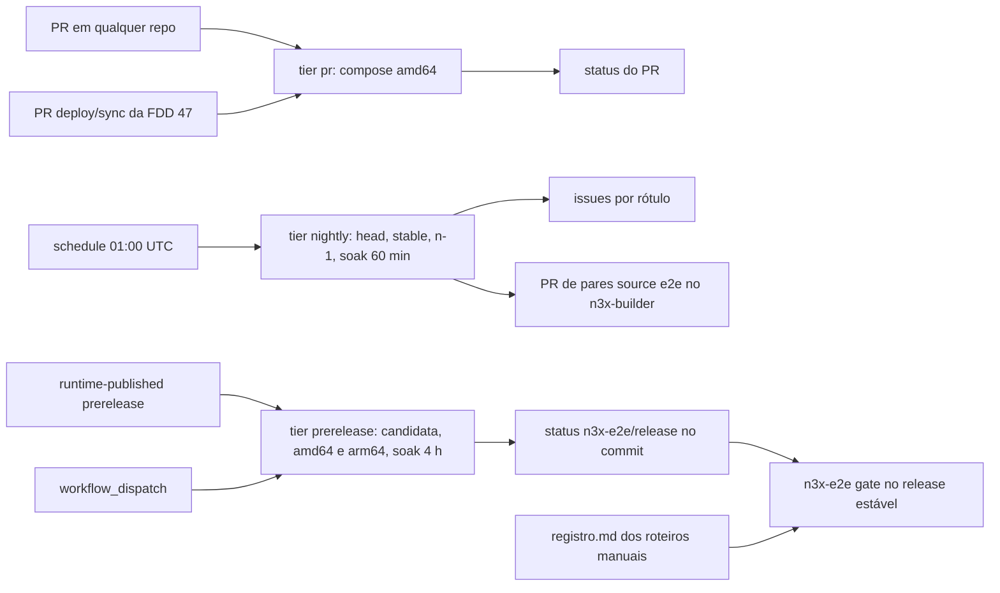
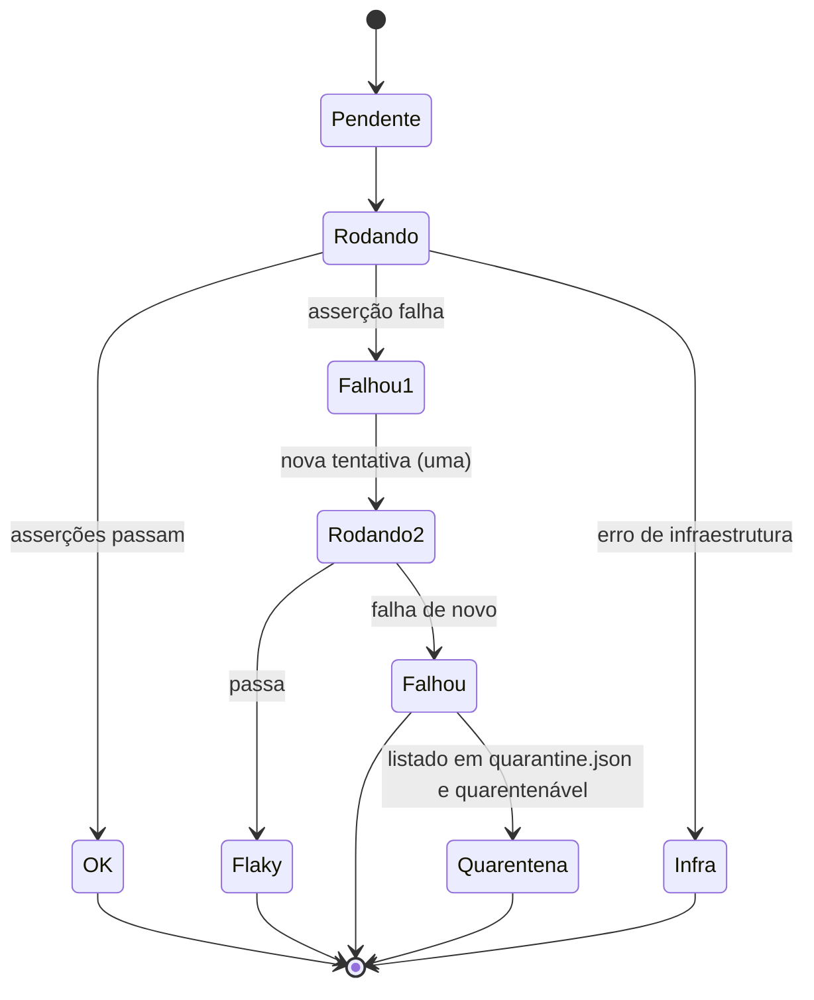

### FDD: Integração ponta a ponta e CI cruzada (SDK-16)

Versão: 1.0
Data: 2026-10-21
Responsável: Guilherme Giusti

---

### 1. Contexto e motivação técnica

**Problema técnico.** As 47 FDDs anteriores provam cada componente isolado: o kit de testes do SDK (FDDs 07 e 12), o executor com um adaptador falso (FDD 17), o teste de carga do `.so` no builder (FDD 23), o harness do host real (FDDs 32 a 35) e o agente do core contra um host falso (FDDs 39 a 45). Os riscos mais graves do PRD só aparecem com os cinco repositórios juntos, em processos reais: uma negação gRPC que chega ao cliente como `OK`, um panic que derruba o Envoy, o controller fora do ar gerando erro no tráfego, uma requisição cortada no rolling update, um segredo que vaza num log que só existe no processo real. O HLD de plataforma define uma matriz de CI entre os repositórios, mas não diz como ela é disparada, quais versões combina, onde o harness mora, como o resultado vira portão de release, nem como uma pessoa mantém tudo isso. Dezenas de FDDs anteriores deixaram pedidos de teste de ponta a ponta para esta FDD; sem um destino único, cada um viraria um script solto.

**Encaixe no HLD.** O HLD de plataforma ("Matriz de CI entre repositórios", "Regras de versionamento entre repositórios", "Ambiente de implantação") e o ADR-008 do `n3x-sdk` colocam a CI cruzada em `n3x-sdk/deploy/`. A FDD 47 entregou os exemplos de deploy (contrato 1 e contrato 18 dela) e a FDD 46 entregou as imagens publicadas, o registro `compat/images.json`, a tabela `compat/pairs.json` e o evento `runtime-published`. Esta FDD especifica:

- o harness de ponta a ponta em `n3x-sdk/deploy/e2e/` (módulo Go aninhado), que sobe docker compose e kind a partir dos arquivos da FDD 47, contra imagens publicadas por digest ou contra imagens de desenvolvimento construídas do código-fonte
- o catálogo de cenários com identificador estável, critério do PRD atendido, onde roda e se bloqueia o release
- o plugin só de teste `n3xtest.faults` (injeção de panic, atraso, falha e roteiro de conformidade; L-43) e as aplicações de teste em Go e Python com o serviço `pedidos.v1.Pedidos`
- a matriz da CI cruzada entre os cinco repositórios: gatilhos, combinação de versões, arquiteturas, ambientes e frequência
- o relatório, os artefatos de falha, a política de testes instáveis, o portão de release e as linhas `source: e2e` em `compat/pairs.json`
- os critérios dos marcos M2 (regressão), M3 (repetição de ponta a ponta) e M4 (fechamento), e a tabela que mostra como cada critério de aceite do PRD é provado

**Atores.** CI de cada um dos cinco repositórios (chama o workflow reutilizável no PR), workflows centrais do `n3x-sdk` (noturno, pré-release, despacho), harness `n3x-e2e`, aplicações de teste `eco` (Go) e `eco-py` (Python), plugin só de teste `n3xtest.faults`, simulador `n3x-load` da FDD 51 (só no cenário de paridade e no teto de memória do core), bot `n3x-ci-bot` (PR de pares e comentários), mantenedor do N3X (revisa falhas, quarentena e o portão de release).

**Limites.** Esta FDD não muda o comportamento de nenhum processo do N3X: ela consome contratos. Ficam fora: os exemplos de deploy e os guias (FDD 47), os testes unitários e as suítes de conformidade de cada componente (FDDs 07, 12, 16, 17, 18 e 32 a 35, aqui só reaproveitadas como dados), a matriz das imagens de build e os cenários de falha do `n3x-plugin build` (FDDs 19 a 24 e 46), o benchmark open-loop (FDD 50, que depende desta), o simulador de 500 sidecars (FDD 51) e o conteúdo dos cenários Istio (FDD 49; aqui os cenários bloqueantes existem no catálogo e o conteúdo é pendência externa dela).

**Suposições**
- As imagens `ghcr.io/giustech/n3x/{sidecar-builder,sidecar,controller-builder,controller}` existem por tag imutável e digest, registradas em `n3x-builder/compat/images.json` (FDD 46)
- Os repositórios são públicos no GitHub, com runners hospedados `ubuntu-24.04` (4 vCPU, 16 GiB) e `ubuntu-24.04-arm` sem custo (H-01 da FDD 46)
- Os arquivos do contrato 18 da FDD 47 existem com os nomes estáveis do contrato 1 dela
- O spike da fase 0 confirmou a carga do `.so` no `envoyproxy/envoy:v1.40.x` em amd64 e arm64 (FDDs 16 e 23)

**Restrições**
- Sem tracing; correlação por `request_id` nos logs dos dois lados (ADR-009 do `n3x-sdk`)
- PR só em amd64 com testes rápidos; arm64, kind, carga e longa duração à noite (HLD de plataforma)
- Compose no PR, kind à noite, ECS manual guiado (HLD de plataforma)
- Reprodutibilidade conferida compilando duas vezes (ADR-007 do `n3x-builder`)
- Release bloqueado se o teste de negação gRPC falhar (PRD, risco "Negação gRPC chega ao cliente como sucesso")
- Nenhum código de teste dentro do `n3x.example` nem do molde do `n3x-new` (FDDs 13 e 14)
- Documentos em pt-BR, sem travessões; identificadores em inglês

**Rastreabilidade**
- PRD 1.5: FR-001 a FR-004, FR-006, FR-007, FR-015 e FR-016 nos cenários; "Testes e validação" (integração com Envoy real, conformidade por alvo, segurança, por ambiente, longa duração, acessibilidade); disponibilidade (zero erros por causa do controller, zero requisições cortadas, volta ao painel em até 30 s); os 22 critérios de aceitação (numerados CA-01 a CA-22 na ordem do PRD, tabela da seção 9)
- HLDs: plataforma ("Matriz de CI entre repositórios", "Regras de versionamento", riscos "Matriz cara demais" e "Versões desencontradas"); `n3x-sidecar` (riscos de negação gRPC e de iteração de filtros); `n3x-plugin-core` (teste de restart e teste cruzado sidecar N-1 contra controller N)
- ADRs: ADR-008 e ADR-009 do `n3x-sdk`; ADR-007 do `n3x-builder`; ADR-004 e ADR-007 do `n3x-plugin-core`; ADR-004 do `n3x-controller`
- Lacunas fechadas aqui: **L-41** (dono do teste de longa duração: esta FDD, cenários `E2E-SOAK-01` e `E2E-SOAK-02`, H-14, confirmado) e **L-43** (parte da 48: plugin só de teste `n3xtest.faults`, H-07, confirmado; a parte da 13 já foi fechada lá). Lacunas aplicadas: L-16 (nada escuta na `17001`), L-17 (`n3x probe`), L-18 (gatilho `POST /drain`), L-42 (cópia do `EnvoyFilter`, consumida quando a FDD 49 preencher). Lacuna reservada: L-27 (FDD 49)
- Marcos: fecha o **M4**; repete o M2 como regressão e o M3 de ponta a ponta (seção 9)
- FDDs consumidas: 03, 07, 12, 13, 14, 15, 16, 18, 23, 25 a 29, 31 a 47 e 51
- Numeração: este arquivo é o SDK-16 (global "FDD 48") e a FDD-SDK-15 é a global "FDD 47". "FDD NN" sem prefixo é numeração global; "FDD 15" e "FDD 16" podem ser FDDs externas do sidecar (outro repositório), não do SDK

**Tabela de rastreabilidade dos pedidos (pedido → cenário ou contrato)**

Todo pedido dirigido à FDD 48 no `REGISTRO-DE-DECISOES.md`, nas FDDs e no ASSUNTO tem destino abaixo. `Cn` é o contrato da seção 5; `E2E-*` é o identificador do cenário (contrato 2).

| # | Origem | Pedido | Destino |
| --- | --- | --- | --- |
| R-01 | FDDs 03 e 37 | usar `secrettest.Leaks` sobre logs, erros e a config enviada (`RegisterRequest.config`) | `E2E-SEC-01` (C8, C10) |
| R-02 | FDD 06 | longa duração com os connectors recomendados (L-23) | `E2E-SOAK-01`, `E2E-SOAK-02` (L-41; `n3xtest.faults` com `env.HTTPClient`, go-redis v9 e pgx v5, C6) |
| R-03 | FDD 06 | controller desligado sem erro atribuível a ele | `E2E-CTL-01`, `E2E-CTL-02` (definição em C9) |
| R-04 | FDD 07 | reaproveitar `conformance.Cases()` contra o Envoy real | `E2E-CNF-01` (roteiro do `n3xtest.faults`, C6) |
| R-05 | FDD 11 | ponta a ponta do polling e da exportação; envio com e sem CSRF | `E2E-PNL-02`, `E2E-PNL-03`, `E2E-SEC-07` |
| R-06 | FDD 12 | reaproveitar `hostconformance.Cases()` | `E2E-CNF-02` |
| R-07 | FDD 13 | plugin só de teste de panic e atraso (L-43) | C6 (`n3xtest.faults`); `E2E-FLT-01` a `E2E-FLT-06` |
| R-08 | FDD 13 | consumir `testdata/cases.json` | `E2E-TRF-01` a `E2E-TRF-03` e `E2E-TRF-05` (`E2E-TRF-04` fica registrado como `removed: true`, ID nunca reaproveitado, contrato 2) |
| R-09 | FDD 13 | aplicações Go e Python com `pedidos.v1.Pedidos/Obter` e eco de headers (P-02 da 13) | C7 |
| R-10 | FDD 13 | `n3x-plugin add` do exemplo a partir da árvore | C4 (proxy de módulos local); `E2E-BLD-01` |
| R-11 | FDD 14 | gerar `giustech.ratelimit` nas 4 combinações (proxy; controller; duas metades; duas metades com `--no-proto`), `add`, build e página e cartão no painel | `E2E-BLD-06` |
| R-12 | FDDs 16 e 46 | comparar capacidades pelo log `adapter_loaded` | `E2E-BLD-03` |
| R-13 | FDDs 17 e 50 | medir o executor no Envoy real; contingência de rodar os golden com o `.so` do builder | `E2E-CNF-01` (comportamento); `n3x_plugin_duration_seconds` como medida informativa no relatório (C10); latência como portão fica na FDD 50 |
| R-14 | FDD 18 | longa duração (L-41) e injeção de panic ponta a ponta | `E2E-SOAK-*`; `E2E-FLT-01` a `E2E-FLT-05` |
| R-15 | FDD 20 | testes da CI cruzada com as versões da imagem | C4 (combinação exata) |
| R-16 | FDD 21 | testes de ponta a ponta com o `.so` gerado pelo builder | todos os cenários (C4); `E2E-BLD-01` |
| R-17 | FDD 23 | golden do bloco do filtro | `E2E-BLD-04` |
| R-18 | FDD 24 | `gosec` e `govulncheck` nas CIs dos outros repositórios | workflow reutilizável `security.yml` (C5) |
| R-19 | FDD 26 | golden e `--mode validate` em amd64 e arm64, falhando com `deprecated` | `E2E-BLD-05` (I-02) |
| R-20 | FDD 27 | testes de ponta a ponta com e sem limite de memória | `E2E-CFG-04` |
| R-21 | FDD 28 | reaproveitar `images/test/compose.yaml` e a fumaça nas duas arquiteturas | `E2E-BLD-07` |
| R-22 | FDD 29 | rolling update em kind (3 réplicas, 10 rollouts, 200 rps, HTTP/1.1 com keep-alive, HTTP/2 e gRPC) com 0 cortada; definição de "cortada"; medida sem o gatilho; compose com 50 em voo | `E2E-DRN-01` a `E2E-DRN-03`; definição em C9 |
| R-23 | FDD 31 | credencial errada dá `UNAUTHENTICATED` e a sexta tentativa `RESOURCE_EXHAUSTED` | `E2E-SEC-04` |
| R-24 | FDD 32 | plugin de teste com panic repetido vira `falho` de ponta a ponta | `E2E-FLT-06` |
| R-25 | FDD 33 | TLS 1.2 recusado, `UNAUTHENTICATED`, canário e a 1.001ª conexão | `E2E-SEC-02`, `E2E-SEC-03`, `E2E-SEC-01`, `E2E-SEC-05` |
| R-26 | FDD 34 | bloqueio do painel, root com o core degradado, canário | `E2E-SEC-06`, `E2E-PNL-06`, `E2E-SEC-01` |
| R-27 | FDD 35 | painel de ponta a ponta com `n3x.example` (menu, cartão, exportação, ação de root, 403 de leitura) | `E2E-PNL-02` |
| R-28 | FDD 36 | teste cruzado sidecar N-1 contra controller N | `E2E-XV-01` |
| R-29 | FDD 38 | igualdade de `LoginMethod` com o stub do core; conexão de pé 10 min sem `GOAWAY`; volta ao painel conferida com as FDDs 39 e 42 | `E2E-XV-02`, `E2E-CTL-05`, `E2E-CTL-03` |
| R-30 | FDD 39 | restart com e sem `hmac_key` medindo os 30 s; teste cruzado de `RejectedMessage` | `E2E-CTL-03`, `E2E-CTL-04` |
| R-31 | FDD 40 | login de leitura de ponta a ponta com canário | `E2E-PNL-05` |
| R-32 | FDD 42 | restart com e sem chave, volta em 30 s, panic de ponta a ponta; medir perda de `plugin_disabled` (contingência) | `E2E-CTL-03`, `E2E-CTL-04`, `E2E-FLT-05`, `E2E-FLT-04` |
| R-33 | FDD 43 | restart com sidecars reais; conflito com dois pods do mesmo nome; `Exit` de ponta a ponta; medir conflito falso (P-01 da 43) | `E2E-CTL-03`, `E2E-INV-01`, `E2E-INV-02` |
| R-34 | FDD 44 | rollout com duas configs mostrando divergência e diff; canário no diff | `E2E-INV-03` |
| R-35 | FDD 45 | M3 em docker compose, 403 em `/usuarios`, diff visível, exportação sem IP; reconstrução em até 30 s (SLO) | `E2E-PNL-01` (M3), `E2E-INV-03`, `E2E-CTL-03` |
| R-36 | FDD 46 | consumir `compat/images.json`; linhas `source: e2e` em `compat/pairs.json`; usar o `runtime-published`; publicação dos pares na FDD 46 (I-03 dela) | C4, C5, C11 |
| R-37 | FDD 47 | consumir os arquivos do contrato 18 | C1, C4 |
| R-38 | FDD 47 | rodar o `bootstrap.sh` uma vez e conferir o mesmo SHA-256 no compose e no kind | `E2E-ENV-02` |
| R-39 | FDD 47 | digests do overlay `kind` com `kustomize edit set image` | `E2E-ENV-03` |
| R-40 | FDD 47 | medir os 5 minutos (P-04 da 47) | `E2E-ENV-01`; P-04 respondido em C9 (inclui o build) |
| R-41 | FDD 47 | conferir cada série de `series.txt` contra um scrape real | `E2E-OBS-01` |
| R-42 | FDD 47 | gRPC e Python na `deploy/apps/eco` (H-22 da 47) | C7 (`eco` com gRPC na mesma porta; `deploy/apps/eco-py`) |
| R-43 | FDD 47 | compose da FDD 48 no PR do `deploy/sync-<data>`; pré-release e `candidate` só por pedido | C5 (gatilho `pull_request` em `deploy/**`; `workflow_dispatch`) |
| R-44 | FDD 51 | o mesmo restart com 10 sidecars reais e 10 simulados, volta dentro de 20% | `E2E-CTL-06` |
| R-45 | FDD 51 | restart de ponta a ponta, rolling update e limites (1.001ª conexão, 17º stream, mensagem grande) | `E2E-CTL-03`, `E2E-DRN-02`, `E2E-SEC-05` |
| R-46 | ASSUNTO | casos golden HTTP/1.1, HTTP/2 e gRPC com o exemplo, inclusive a negação gRPC | `E2E-TRF-*`, `E2E-GRPC-DENY` |
| R-47 | ASSUNTO | `n3x.yaml` inválido (campo ausente, config de plugin inválida, `ENC[...]` que não decifra) | `E2E-CFG-01` a `E2E-CFG-03` |
| R-48 | ASSUNTO | varredura de segredos e TLS 1.3 nas duas portas | `E2E-SEC-01`, `E2E-SEC-02` |
| R-49 | ASSUNTO | acessibilidade do painel com axe | `E2E-PNL-07` |
| R-50 | ASSUNTO | matriz: amd64 em todo PR; arm64 e kind à noite; ECS manual pré-release; execução agendada contra candidatos | C5 (seção "Matriz"); `MAN-02`; I-06 |
| R-51 | ASSUNTO | gatilhos entre repositórios, combinação testada e publicação dos pares | C4, C5, C11 |
| R-52 | ASSUNTO | artefatos em falha: logs JSON, snapshot de métricas, perfil de goroutines e core dump | C10 |
| R-53 | ASSUNTO | ECS manual: onde mora o roteiro e como o resultado é registrado | roteiro e `registro.md` da FDD 47 (contrato 17 dela); portão `MAN-02` em C11 |

**Decisões aprovadas na clarificação**
- `E2E-GRPC-DENY` tem `retries: 0` em todos os tiers: qualquer falha é `failed` e reprova PR, noturno e release; os demais cenários bloqueantes mantêm uma nova tentativa, e o gate aceita `flaky` neles só uma vez por candidata
- Não há contingência de release manual com a célula arm64 de uma noite verde: o `prerelease` espera o runner arm64 com prazo e, se estourar, o mantenedor reexecuta; o status só sai `success` com as duas arquiteturas
- Core dump de erro fatal do Go (PRD): pede-se ao sidecar (FDDs 25 a 30, outro repositório) um campo ou repasse ativável de `GOTRACEBACK=crash` nas imagens `*-e2e` e no soak
- CA-06 (volta ao painel em até 30 s com cerca de 200 serviços sem `session.hmac_key`): dono da prova dos 200 serviços é a FDD 51 (`n3x-load sim`, ancorado pela paridade do `E2E-CTL-06`); aqui a frota de 10 sidecars em 5 serviços prova só a parte até 30 s
- Istio bloqueia a v1.0.0 (cenários `E2E-IS-*` e `kind-istio` bloqueantes no M4 e no gate); molde do `n3x-new` com quatro combinações; corpo JSON da negação HTTP (`{"code":<status>,"message":"<mensagem>"}`); FQDN fixo do controller `n3x-controller.n3x.svc.cluster.local:17443` em todas as topologias; entrega de chave por volume nomeado (compose e kind) e risco residual no ECS
- O harness `n3x-e2e` (`deploy/e2e/`, `deploy/e2e/plugins/faults`) e `deploy/apps/eco` são módulos aninhados e devem constar no HLD e no ADR-011
- As demais hipóteses numéricas, de CI e de baixo risco ficam aceitas como padrão, sem bloqueio

**Pendências não bloqueantes**
- Captura da config enviada ao controller (`RegisterRequest.config`, TLS 1.3) para `secrettest.Leaks` em `E2E-SEC-01`: a forma está em aberto (por exemplo, log ou captura no controller de teste)
- `E2E-SEC-06` prova o 429 com `Retry-After`, não o desbloqueio após 15 min: lacuna do CA-13
- `prerelease` para tags de `n3x-sidecar/core` e `n3x-controller/host`: o `e2e-dispatch` só lista `n3x-sdk` e `n3x-plugin-core`
- Válvula de escape para `timeout-minutes: 40` e para o status obrigatório quando `infra` se repete: hoje só reexecutar
- Onde fica o contador de `flaky` "uma vez por candidata" do gate: não definido
- `Real bool` em `conformance.Case` e `hostconformance.Case`: acréscimo pendente nas FDDs 07 e 12
- Dependência do módulo raiz pelos módulos aninhados: decidido apenas o uso de `replace ../..` no PR do SDK e da versão publicada nos demais usos (contrato 1); se `yamlconv` é importado de `deploy/e2e` fica em aberto
- Divergências para o Workflow 3: PRD e HLD ("conformidade do SDK em todo PR nos dois alvos e nas duas arquiteturas") versus esta FDD (conformidade real só noturna e só `envoy-1.40`; no PR vem do adaptador falso da FDD 17); HLD ("próxima candidata do Envoy e cada patch do Istio: agendado") versus imagens `-rc` publicadas; "Testes por ambiente: Kubernetes com Istio" até a FDD 49; PRD (core dump no soak, via repasse de `GOTRACEBACK=crash`); marcos M2 a M4 não estão no PRD nem no HLD (fonte provável: registro de decisões)
- Critérios de aceite do PRD sem prova completa nesta FDD (dono em outra): CA-09 (FDDs 19 a 24 e 46), CA-18 (FDD 50), CA-19 (FDD 51), CA-06 com 200 serviços (FDD 51), CA-17 (config enviada, ver a primeira pendência), CA-13 (desbloqueio em 15 min, ver a segunda)
- Dependem de outros repositórios: FDD 49 (`E2E-IS-*`, imagem `istio-1.31`, `EnvoyFilter`), FDD 46 (`compat/images.json`, `pairs.json`, `runtime-published`, `N3X_DEV_MODULES`, `release check`, gate do `oci-publish.yml`, `n3xci alert`), FDD 51 (`n3x-load sim`), FDD 45, FDD 35 (axe), FDDs 25 a 30 (repasse de `GOTRACEBACK=crash`) e `make e2e-artifacts` nos cinco repositórios

---

### 2. Objetivos técnicos

- **Todo critério de aceite multi-repositório vira teste automático.** Medida: cada um dos 22 critérios do PRD tem pelo menos um cenário do catálogo, um dono em outra FDD ou um roteiro manual da FDD 47 (tabela da seção 9); nenhum critério sem destino. Os cenários com `blocks_release: true` reprovam o portão de release quando falham.
- **Negação gRPC nunca como sucesso.** Invariante: em 100% das execuções de `E2E-GRPC-DENY`, o cliente gRPC em Go e em Python recebe `PERMISSION_DENIED` (`grpc-status: 7`, `grpc-message: bloqueado`, trailers-only, HTTP 200) e a aplicação não recebe a chamada; nenhuma execução observa `grpc-status: 0`. O cenário nunca entra em quarentena e tem `retries: 0` em todos os tiers: qualquer falha é `failed` e reprova PR, noturno e release.
- **Mesmo resultado em duas linguagens.** Medida: o resultado normalizado de cada caso de `cases.json` (contrato 9) é igual entre a aplicação Go e a Python e igual ao `expect` do arquivo, em HTTP/1.1, HTTP/2 e gRPC.
- **Controller fora não causa erro.** Medida: 0 respostas inesperadas e 0 erros de conexão em 3.000 requisições (50 rps por 60 s) com o controller desligado na subida e em 3.000 requisições durante uma derrubada por `SIGKILL`.
- **Volta ao painel em até 30 s.** Medida com 10 sidecars reais (5 serviços, 2 instâncias cada), do primeiro `200` de `/ready` do controller novo até as 10 instâncias `connected`: com `session.hmac_key`, mediana até 12 s e máximo até 30 s, sem nenhum `Login` novo; sem a chave, máximo até 30 s com no máximo um bcrypt por serviço (limiares H-16, confirmados).
- **Zero requisição cortada.** Medida: 0 cortadas (definição do contrato 9) em 10 rollouts de 3 réplicas sob 200 rps contínuos no kind e em 50 requisições de 2 s em voo no `docker compose stop`.
- **PR cabe na rotina de uma pessoa.** Medida: o job de PR (`tier: pr`, compose, amd64) termina em até 25 min no p95 das últimas 30 execuções, incluindo o build das imagens de desenvolvimento (H-02, confirmado); a matriz noturna cabe em 3 h de relógio com jobs em paralelo.
- **Compose do zero em até 5 minutos.** Medida: `docker compose build`, `bootstrap.sh` e `docker compose up -d --wait` somam no máximo 300 s num runner `ubuntu-24.04` com o cache de build vazio e as imagens base já baixadas (P-04 da FDD 47 respondido: inclui o build).
- **Mesma imagem e mesmo `n3x.yaml` em compose e kind.** Invariante: o `n3x.yaml` gerado por uma única execução do `bootstrap.sh` tem o mesmo SHA-256 no compose e no kind, e o sidecar roda pelo mesmo digest nos dois.
- **Nenhum segredo fora do lugar.** Medida: `secrettest.Leaks` encontra 0 marcadores em todos os logs, mensagens de erro, páginas, downloads e exportações capturados numa execução noturna completa.
- **Resultado reproduzível e explicável.** Invariante: toda execução grava `e2e-report.json` com a combinação exata (fonte, versão e digest de cada componente); toda falha deixa os artefatos do contrato 10; uma reexecução com o mesmo `combo.json` usa os mesmos digests.

---

### 3. Escopo e exclusões

**Incluído**
- Harness `n3x-e2e` em `n3x-sdk/deploy/e2e/` (módulo Go aninhado), com `go test` controlando `docker compose`, `kind` e `kubectl` pela linha de comando (contratos 1 e 3)
- Catálogo de cenários `deploy/e2e/catalog.yaml` com identificador estável, critério do PRD, tiers, ambientes, arquiteturas e `blocks_release` (contrato 2)
- Combinação de versões (`combo.json`), fontes de cada componente (publicada ou código-fonte), versões `-e2e.<sha>` e proxy de módulos local para `add` a partir da árvore (contrato 4)
- Workflows `e2e.yml` (reutilizável), `e2e-nightly.yml`, `e2e-dispatch.yml` e `security.yml` (reutilizável), gatilhos entre repositórios e a matriz (contrato 5)
- Plugin só de teste `n3xtest.faults` com as duas metades (contrato 6, L-43)
- Aplicações de teste `eco` (Go, acréscimo de gRPC e atraso) e `eco-py` (Python), o proto `pedidos.v1.Pedidos` e a forma do eco (contrato 7, P-02 da FDD 13, H-22 da FDD 47)
- Perfis de `n3x.yaml` do e2e, preparo de segredos com canário e frota de 10 sidecars (contrato 8)
- Definições de medida: requisição cortada, erro atribuível ao controller, volta ao painel, mesmo resultado, 5 minutos e mesma imagem (contrato 9)
- Relatório `e2e-report.json`, artefatos de falha e retenção (contrato 10)
- Portão de release, status de commit `n3x-e2e/release`, linhas `source: e2e` em `compat/pairs.json` e o portão dos roteiros manuais (contrato 11)
- Política de testes instáveis e quarentena (contrato 12)
- Teste de longa duração (L-41) noturno e de pré-release
- Cenários Istio `E2E-IS-*` (bloqueantes no M4, no `prerelease` e no gate) e ambiente `kind-istio` (contrato 13); o conteúdo deles depende da FDD 49

**Excluído**
- Exemplos de deploy, guias e roteiros manuais (conteúdo): FDD 47 (SDK-15)
- Testes unitários e suítes de conformidade de cada componente, que continuam na CI do dono: FDDs 07, 12, 16, 17, 18 e 32 a 35
- Cenários de falha do `n3x-plugin build` (`N3X-B001` a `N3X-B016`), matriz das imagens de build, reprodutibilidade entre as 4 combinações de host, ABI adiante e próximo candidato do Envoy: FDDs 19 a 24 e 46
- Benchmark open-loop, latência adicionada, orçamento ocioso e tempo até pronto como portão: FDD 50 (SID-12), que reaproveita peças deste harness
- 500 sidecars simulados e orçamento do controller: FDD 51 (CTL-07)
- Conteúdo dos cenários Istio, adaptador `istio131`, `EnvoyFilter` e imagem `istio-1.31`: FDD 49 (SID-11)
- Execução do ECS: roteiro manual da FDD 47; aqui só o portão sobre o `registro.md`
- Runner próprio ou máquina dedicada: não usados nesta FDD (o `n3x-perf` é das FDDs 50 e 51)

---

### 4. Fluxos detalhados e diagramas

**Fluxo principal: PR em qualquer um dos cinco repositórios (tier `pr`)**
1. O PR abre ou recebe commit no repositório X. O `ci.yml` de X tem o job `e2e`, que chama o workflow reutilizável `giustech/n3x-sdk/.github/workflows/e2e.yml@<sha fixado>` com `repo: X`, `ref: <sha do PR>`, `tier: pr`, `env: compose`, `arch: amd64`, `target: envoy-1.40` (contrato 5). O SHA do workflow é atualizado por PR do bot quando o `n3x-sdk` muda o harness (H-03, confirmado)
2. `n3x-e2e plan` monta o `combo.json` (contrato 4): X vem do código-fonte no `ref` do PR; os outros quatro vêm da combinação estável publicada, lida de `n3x-sdk/deploy/versions.json` (par mais novo `ok` nas duas arquiteturas) e de `n3x-builder/compat/images.json` (tags e digests). Uma linha `n3x-e2e: <repo>#<número>` no corpo do PR troca outro repositório pelo head daquele PR, para mudanças coordenadas
3. `n3x-e2e prepare`:
   - clona as fontes do combo e roda o alvo `make e2e-artifacts` de cada repositório que vem do código-fonte (módulos em zip para o proxy local e imagens de desenvolvimento; contrato 4)
   - monta o proxy de módulos local `file://` com o `n3x.example` da árvore, o `n3xtest.faults` e o que vier do código-fonte, cada um numa versão `X.Y.Z-e2e.<12 hex>` (ou `v0.1.0` fixa para os plugins só de teste)
   - se X é `n3x-sdk`, `n3x-sidecar`, `n3x-controller` ou `n3x-plugin-core`, constrói as imagens de build de desenvolvimento com os módulos do proxy local; se X é `n3x-builder`, constrói as imagens de build do código-fonte com os módulos publicados
   - constrói, pelos Dockerfiles do operador (`deploy/images/*/Dockerfile`, FDD 47) e pela variante `e2e` (mais `n3xtest.faults`), as imagens `n3x-e2e/sidecar:<run>`, `n3x-e2e/sidecar-e2e:<run>`, `n3x-e2e/controller:<run>`, `n3x-e2e/controller-e2e:<run>`, `n3x-e2e/eco:<run>` e `n3x-e2e/eco-py:<run>`; todo `.so` e todo binário saem do `n3x-plugin build`
   - roda o `deploy/config/bootstrap.sh --out .n3x/exemplo` uma vez e o preparo do e2e (`n3x-e2e prepare secrets`) para os perfis com canário (contrato 8)
   - as imagens construídas no job de preparo seguem para os jobs de execução por artefato `docker save` (jobs hospedados não compartilham estado Docker); o mesmo vale para o soak de 4 h, que usa a pilha construída no job anterior
4. `n3x-e2e run --tier pr --env compose --arch amd64` seleciona do catálogo os cenários com `pr` em `tiers`, agrupa por pilha (`exemplo`, `standalone`, `e2e`) para subir cada pilha uma vez e roda cada cenário como subteste de `go test`, na ordem do catálogo, deixando por último os que reiniciam o controller
5. Em cada cenário: prepara o estado (pilha de pé, contadores lidos no scrape), executa, confere as asserções e as medidas; em falha, coleta os artefatos (contrato 10) e aplica a política de nova tentativa (contrato 12)
6. `n3x-e2e report` grava `e2e-report.json`, escreve a tabela no `GITHUB_STEP_SUMMARY`, publica os artefatos e sai com o código do contrato 3. O job `e2e` é um status obrigatório na proteção da `main` dos cinco repositórios

**Fluxo noturno (tier `nightly`, `e2e-nightly.yml` no `n3x-sdk`, 01:00 UTC)**
1. `n3x-e2e plan --tier nightly` gera a matriz: combinações `head` (os cinco na `main`) e `stable` (as imagens publicadas de `versions.json`), mais `n-1` (sidecar com o core da minor anterior) e as células de reprodutibilidade, soak e `giustech.ratelimit` (seção "Matriz" do contrato 5)
2. Cada célula roda num job próprio: compose em amd64 e arm64 nativos, kind só em amd64 (Kubernetes `min` e `latest` de `versions.json`), com o catálogo completo do tier
3. `n3x-e2e report merge` junta os relatórios; `n3x-e2e alert` abre ou comenta issues por rótulo (contrato 10); na combinação `head`, grava o status `n3x-e2e/nightly` no commit da `main` de cada repositório; na combinação `stable` verde nas duas arquiteturas, abre o PR de linhas `source: e2e` no `n3x-builder` (contrato 11)

**Fluxo de pré-release e portão de release**
1. Uma imagem é publicada em pré-release (`-rc.N`, canal `prerelease`) pelo `oci-publish.yml` da FDD 46, que envia `repository_dispatch` `runtime-published` também ao `n3x-sdk` (pedido da FDD 47); ou o mantenedor dispara `e2e-dispatch.yml` à mão para uma tag de módulo candidata (`n3x-sdk`, `n3x-plugin-core`)
2. `n3x-e2e plan --tier prerelease` usa a candidata e o estável dos outros; roda o catálogo `prerelease` em amd64 e arm64, compose e kind, inclusive `E2E-SOAK-02` (4 h)
3. Com todos os cenários `blocks_release` verdes nas duas arquiteturas, grava o status `n3x-e2e/release` em `success` no commit da candidata; senão `failure` com o link do relatório
4. O workflow de release estável do repositório (FDD 46 para imagens; `release.yml` dos módulos) chama `n3x-e2e gate --repo <repo> --commit <sha>` antes de criar a tag; sem `success`, o release para com saída 5. Para tags do `n3x-sdk` que mudam `deploy/`, `docs/operador/` ou `docs/autor/`, o portão também exige as três linhas `passou` no `registro.md` dos roteiros manuais (`MAN-01` a `MAN-03`)

**Fluxos alternativos e exceções**
- **Patch do Envoy ou do Istio:** o `upstream.yml` da FDD 46 abre o PR `candidate`; o merge cria a `-rc` automática, que dispara o pré-release daqui. O próximo candidato do Envoy (`envoy-dev`, sem imagem publicada) continua só na FDD 46 (teste negativo); aqui só entram imagens publicadas
- **PR do bot `deploy/sync-<data>` (FDD 47):** roda o tier `pr` com o combo vindo do `versions.json` do próprio PR (a combinação nova), em compose amd64; o merge humano só acontece com o e2e verde
- **Infraestrutura falhou** (rede do GHCR, Docker Hub com limite, runner sem disco, kind não sobe): o cenário termina `infra` (não `failed`), a execução sai com 3 (inconclusiva), o job tenta uma vez de novo; se repetir, issue `e2e-infra` e o status do PR fica `error`, nunca `success` (o status é obrigatório e o job tem `timeout-minutes: 40`; uma válvula de escape para infraestrutura repetidamente fora do ar fica como pendência, hoje só reexecutar)
- **Combinação impossível** (nenhum par compatível em `compat/pairs.json` para a candidata): saída 4 antes de construir qualquer imagem, com a regra do ADR-001 do `n3x-builder` que recusou
- **Fila do runner arm64 acima de 60 min à noite:** a célula sai `skipped` com o motivo e conta como falha de infraestrutura; no pré-release, a célula espera com prazo (o status só sai com as duas arquiteturas) e, se o prazo estourar, o mantenedor reexecuta
- **Cenário que falha e passa na nova tentativa:** resultado `flaky`, o relatório guarda as duas tentativas e a issue `e2e-flaky` recebe um comentário (contrato 12)
- **Cenário em quarentena:** roda e é relatado, mas não reprova; cenários `blocks_release` e `E2E-GRPC-DENY` nunca entram em quarentena
- **Istio:** os cenários `E2E-IS-*` e a célula `kind-istio` são bloqueantes no M4, no `prerelease` e no gate (decisão da FDD 15 do SDK); dependem da FDD 49 e do kind com Istio, e o conteúdo deles é pendência externa. Se o alvo `istio-1.31` for adiado, isso é decisão registrada no PRD (contingência do PRD), não da CI

**Diagramas**

PR em um repositório, com o workflow reutilizável do `n3x-sdk`:

```mermaid
sequenceDiagram
    participant PR as PR no repositório X
    participant W as e2e.yml (n3x-sdk, SHA fixado)
    participant P as n3x-e2e plan/prepare
    participant B as imagens de build (publicadas ou dev)
    participant C as docker compose (pilhas)
    participant R as n3x-e2e run/report
    PR->>W: workflow_call (repo X, ref, tier pr, compose, amd64)
    W->>P: plan: X do código-fonte, outros do par estável
    P->>P: make e2e-artifacts de X; proxy de módulos local
    P->>B: n3x-plugin add e build (exemplo da árvore, n3xtest.faults)
    B-->>P: imagens n3x-e2e/* com .so e controller
    P->>P: bootstrap.sh uma vez; preparo com canário
    W->>R: run: pilhas exemplo, standalone, e2e
    R->>C: up --wait; cenários; scrape; logs
    C-->>R: resultados, medidas, artefatos
    R-->>PR: e2e-report.json, resumo, saída 0 ou 2
```

Tiers, gatilhos e destino dos resultados:



Estados de um cenário numa execução:



---

### 5. Contratos públicos (assinaturas, endpoints, headers, exemplos)

**Contrato 1: layout de `deploy/e2e/` e acréscimos ao layout da FDD 47**
- Tipo: estrutura de arquivos do repositório `n3x-sdk`
- Assinatura/Rota:
  ```text
  n3x-sdk/
  ├── deploy/
  │   ├── apps/
  │   │   ├── eco/                      FDD 47; acréscimo de gRPC, atraso e streaming (contrato 7)
  │   │   ├── eco-py/                   aplicação Python: Dockerfile, requirements.txt com hashes, eco/http.py, eco/grpc.py (contrato 7)
  │   │   └── proto/pedidos/v1/         pedidos.proto e buf.yaml; stubs Go em eco/internal/pedidosv1 e Python em eco-py/pedidos/v1
  │   └── e2e/                          módulo Go github.com/giustech/n3x-sdk/deploy/e2e
  │       ├── go.mod
  │       ├── catalog.yaml              catálogo de cenários (contrato 2)
  │       ├── quarantine.json           quarentena com prazo (contrato 12)
  │       ├── cmd/n3x-e2e/              CLI do harness (contrato 3)
  │       ├── harness/                  compose, kind, images, sources, modproxy, scrape, logs, panel, grpcx, load, secrets, report
  │       ├── scenarios/                um pacote de teste por família: env, trf, flt, ctl, cfg, drn, sec, pnl, inv, xv, cnf, bld, obs, soak, istio
  │       ├── stacks/compose/           compose.e2e.yaml, compose.standalone.yaml, compose.fleet.yaml, compose.soak.yaml (sobrepostos ao da FDD 47)
  │       ├── stacks/kubernetes/        overlays e2e, conflict e rollout, sobre deploy/kubernetes/overlays/kind
  │       ├── images/sidecar-e2e/       Dockerfile do operador mais a linha add do n3xtest.faults
  │       ├── images/controller-e2e/    idem para o controller
  │       ├── config/                   patches dos perfis de n3x.yaml (contrato 8)
  │       ├── plugins/faults/           módulo github.com/giustech/n3x-sdk/deploy/e2e/plugins/faults (contrato 6)
  │       └── testdata/                 goldens do bloco do filtro, vetores e páginas do painel
  └── .github/workflows/
      ├── e2e.yml                       reutilizável, chamado pelo PR de cada repositório (contrato 5)
      ├── e2e-nightly.yml               noturno (contrato 5)
      ├── e2e-dispatch.yml              runtime-published, workflow_dispatch (contrato 5)
      └── security.yml                  reutilizável: govulncheck, gosec e varredura do repositório (contrato 5)
  ```
- Método: n/a
- Semântica:
  - Consome, sem copiar, os arquivos do contrato 18 da FDD 47: `deploy/compose/compose.yaml`, `deploy/kubernetes/overlays/kind`, `deploy/config/bootstrap.sh` e os modelos, `deploy/apps/eco`, `deploy/images/*/Dockerfile`, `deploy/versions.json`, `deploy/observability/` (regras, painéis e `series.txt`) e, quando a FDD 49 preencher, `deploy/istio/`. As pilhas do e2e são arquivos de sobreposição (`docker compose -f ../../compose/compose.yaml -f compose.e2e.yaml`) e overlays kustomize que têm o overlay `kind` como base; o arquivo da FDD 47 nunca é editado pelo harness
  - `deploy/e2e` é módulo aninhado (mesmo padrão do `deploy/tools` da FDD 47): grpc-go, protobuf, `golang.org/x/mod`, `golang.org/x/net/html` e os stubs dos outros repositórios não entram no `go.mod` do SDK (ADR-011)
  - `plugins/faults` é outro módulo, nunca publicado por tag; o ruleset de tags do `n3x-sdk` recusa qualquer tag com prefixo `deploy/` (H-08, confirmado)
  - Dependência do módulo raiz: no PR do próprio SDK, `deploy/e2e`, `deploy/e2e/plugins/faults` e `deploy/apps/eco` usam `replace ../..` (caminho relativo até o módulo raiz); nos demais usos, a versão publicada do SDK do combo. Os três módulos aninhados devem constar no HLD e no ADR-011. Se `yamlconv` é importado de `deploy/e2e` fica como pendência
  - Todas as pilhas do e2e alcançam o controller pelo FQDN fixo `n3x-controller.n3x.svc.cluster.local:17443`: no Kubernetes é o nome do `Service` no namespace `n3x`, e no compose é um alias de rede do serviço do controller, de modo que o `n3x.yaml` seja idêntico byte a byte nas duas topologias (`E2E-ENV-02`)
  - Os nomes acima são contrato com as FDDs 49 (cenários Istio) e 50 (reaproveita `harness/images`, `harness/scrape` e as aplicações): mudam só por adição
  - Pedido à FDD 47 (pendente na consolidação): acrescentar ao contrato 1 dela as pastas `deploy/e2e/`, `deploy/apps/eco-py/`, `deploy/apps/proto/` e os quatro workflows, para a regra `layout` do `deploytool check` aceitar (I-05)

**Exemplo de requisição**
```text
$ go run ./deploy/e2e/cmd/n3x-e2e plan --tier pr --repo n3x-sdk --ref HEAD --list
```

**Exemplo de resposta**
```text
combo pr:n3x-sdk@HEAD (n3x-sdk do código; sidecar 1.0.4-envoy-1.40, controller 1.0.2, builder 1.0.3, core 1.0.0 publicados)
pilhas: exemplo, standalone, e2e | cenários: 22 | estimativa: 17 min
```

---

**Contrato 2: catálogo de cenários (`deploy/e2e/catalog.yaml`)**
- Tipo: arquivo de dados versionado (YAML 1.2, lido por `yamlconv` e decodificado de forma estrita)
- Assinatura/Rota: `format: 1`; lista `scenarios[]` com `id`, `title`, `prd` (critérios `CA-xx`, `FR-xxx`, `NFR` ou `M2`/`M3`/`M4`), `fdds` (donos do comportamento), `tiers` (`pr`, `nightly`, `prerelease`, `manual`, `istio`), `envs` (`compose`, `kind`, `kind-istio`), `archs`, `apps` (`go`, `python`), `stack`, `blocks_release`, `quarantinable`, `timeout`, `retries` (0 ou 1)
- Método: n/a
- Semântica:
  - `id` casa com `^(E2E|MAN)-[A-Z0-9]+(-[A-Z0-9]+)?$`, é único, nunca é reaproveitado depois de removido (o arquivo guarda `removed: true`) e aparece no nome do subteste do `go test`, no relatório e nas issues
  - `blocks_release: true` exige `quarantinable: false`; todo critério `CA-xx` coberto por cenário tem pelo menos um cenário com `blocks_release: true`, menos os critérios cujo dono é outra FDD (tabela da seção 9)
  - Um teste de `catalog_test.go` confere: cada `id` tem exatamente um subteste com o mesmo nome em `scenarios/`; cada subteste está no catálogo; `tiers` e `envs` válidos; `timeout` dentro de 1 min a 300 min
  - Mudança de comportamento de um cenário que bloqueia o release é mudança de contrato: o PR cita o critério e a FDD dona
  - Os cenários `E2E-IS-*` são bloqueantes (contrato 13; conteúdo dependente da FDD 49) e os `MAN-*` são os roteiros manuais da FDD 47, que só entram no portão (contrato 11)

| ID | O que prova | Critério | Tiers | Ambiente e arquitetura | Bloqueia |
| --- | --- | --- | --- | --- | --- |
| `E2E-ENV-01` | compose do zero em até 300 s (build, `bootstrap.sh`, `up --wait`) | objetivo do PRD; FDD 47 P-04 | pr, nightly | compose amd64 | sim |
| `E2E-ENV-02` | mesmo `n3x.yaml` (SHA-256, com o FQDN fixo do controller `n3x-controller.n3x.svc.cluster.local:17443` nas duas topologias) e mesmo digest do sidecar no compose e no kind, com o mesmo `config_hash` em `n3x_build_info`; a chave AES chega por volume nomeado preenchido pelo serviço inicial `n3x-files` (root, dono 17000:17000, modo 0440) | CA-02 | nightly, prerelease | compose e kind amd64 | sim |
| `E2E-ENV-03` | overlay `kind` com digests por `kustomize edit set image`; rollout completo e pods `2/2 Ready` nas versões `min` e `latest` do Kubernetes | CA-02 | nightly, prerelease | kind amd64 | sim |
| `E2E-ENV-04` | `/live` e `/ready` do sidecar e do controller; nada escuta em TCP `17001`; admin só no socket; aplicação inalcançável fora do sidecar; tempo até pronto registrado (informativo, meta da FDD 50) | FR-003, L-16 | pr, nightly | compose e kind | sim |
| `E2E-M2` | regressão do M2: sidecar sem bloco `controller`, `.so` do builder, header e negação, `probe live` e `probe ready` com 0, `docker compose stop` sai com 0 | M2 | pr | compose amd64 | sim |
| `E2E-TRF-01` | casos de `cases.json` com a aplicação Go em HTTP/1.1, HTTP/2 e gRPC | CA-03 | pr, nightly, prerelease | compose amd64 e arm64; kind amd64 | sim |
| `E2E-TRF-02` | os mesmos casos com a aplicação Python | CA-03 | pr, nightly, prerelease | compose amd64 e arm64 | sim |
| `E2E-TRF-03` | resultado normalizado igual entre Go e Python e igual ao `expect` (contrato 9) | CA-03 | pr, nightly, prerelease | compose | sim |
| `E2E-GRPC-DENY` | negação gRPC chega como `PERMISSION_DENIED` (HTTP 200, `grpc-status: 7`, `grpc-message: bloqueado`, trailers-only) nos clientes grpc-go e grpcio; a aplicação não recebe; nunca `grpc-status: 0`; `retries: 0` em todos os tiers | CA-04 (envoy-1.40) | pr, nightly, prerelease | compose amd64 e arm64; kind amd64 | sim, nunca em quarentena |
| `E2E-TRF-04` | removido (`removed: true`); o ID nunca é reaproveitado | n/a | n/a | n/a | n/a |
| `E2E-TRF-05` | deltas de métrica dos casos (`n3x_plugin_denies_total{instance,code}`, `n3x_n3x_example_denies_total`) iguais aos de `cases.json` | FR-004 | pr, nightly | compose | sim |
| `E2E-FLT-01` | panic síncrono com `failure: open`: a requisição segue com o header, `n3x_plugin_panics_total` sobe exatamente 1, o processo do Envoy é o mesmo (PID e `restart_count` iguais) | CA-05 | pr, nightly, prerelease | compose amd64 e arm64 | sim |
| `E2E-FLT-02` | panic com `failure: closed`: HTTP 503 com corpo JSON `{"code":503,"message":...}` e `content-type: application/json; charset=utf-8`; gRPC com HTTP 200, `grpc-status: 14` trailers-only; `panics_total` mais 1 | CA-05 | pr, nightly, prerelease | compose amd64 e arm64 | sim |
| `E2E-FLT-03` | panic no `Go()` e prazo do `Go()` estourado, com `open` e `closed`, conforme a tabela `chain.Effect` (FDDs 07 e 18); `n3x_plugin_failures_total{reason}` | FR-004 | nightly | compose | não |
| `E2E-FLT-04` | disjuntor: o 5º panic em 60 s abre (`n3x_plugin_breaker_open` 1); `breaker_open` e `plugin_disabled` chegam ao painel exatamente uma vez cada, sem perda | FR-004, FR-016 | nightly | compose | não |
| `E2E-FLT-05` | panic de ponta a ponta: o evento `panic` aparece no detalhe do sidecar no painel em até 15 s | FR-016 | nightly | compose | não |
| `E2E-FLT-06` | metade de controller do plugin de teste com 5 panics em 60 s vira `falho`: 503 com banner, sai do menu e dos cartões, core segue `ok` e `/ready` 200 | FR-011 | nightly | compose | não |
| `E2E-CTL-01` | sidecar sobe com o controller desligado e serve 3.000 requisições sem erro atribuível; `n3x_controller_connected` 0 | CA-06 | pr, nightly, prerelease | compose | sim |
| `E2E-CTL-02` | controller derrubado por `SIGKILL` sob tráfego e religado: 0 erro atribuível; sidecar de volta em até 30 s | CA-06 | pr, nightly, prerelease | compose | sim |
| `E2E-CTL-03` | restart com `session.hmac_key`, frota de 10 sidecars: mediana até 12 s, máximo até 30 s, 0 `Login` novo | CA-06, NFR | nightly, prerelease | compose amd64 | sim |
| `E2E-CTL-04` | restart sem `hmac_key`: máximo até 30 s; um `Login` por instância, no máximo 5 bcrypt (um por serviço); `n3x_n3x_core_session_invalidations_total{cause="rejected"}` mais 1 por instância, sem laço (teste cruzado do `RejectedMessage`) | CA-06 | nightly, prerelease | compose amd64 | sim |
| `E2E-CTL-05` | conexão de pé 10 min sem `GOAWAY`, sem reconexão e com um único stream de heartbeat | FDD 38 | nightly | compose | não |
| `E2E-CTL-06` | paridade do simulador: 10 sidecars reais e 10 simulados (`n3x-load sim`) no mesmo restart, medianas da volta dentro de 20% | FDD 51 | nightly | compose amd64 | não |
| `E2E-CFG-01` | `n3x.yaml` sem `service`: o contêiner sai com 2 (`N3X-S002`), a mensagem aponta `service`, sem canário no log | CA-07 | pr, nightly | compose | sim |
| `E2E-CFG-02` | config de plugin inválida: sai com 2 e a mensagem aponta `plugins[0].config.header` | CA-07 | pr, nightly | compose | sim |
| `E2E-CFG-03` | `ENC[...]` que não decifra (outra chave): sai com 3, regra `secret_decrypt`, caminho `controller.secret`, sem canário nem envelope no log | CA-07 | pr, nightly | compose | sim |
| `E2E-CFG-04` | sem limite de memória sai com 7 `memory_unlimited`; com 100 MiB sai com 7 `memory_too_low`; com 128 MiB sobe com aviso; com 256 MiB sobe sem aviso | FDD 27 | nightly | compose | não |
| `E2E-CFG-05` | controller com usuário duplicado ou igual ao root não sobe: saída 2 (`N3X-C002`) com `duplicate` ou `root_name`, sem hash no log | CA-13 | nightly | compose | sim |
| `E2E-DRN-01` | `docker compose stop` com 50 requisições de 2 s em voo: 50 respostas 200, `drain_completed` com `exit_code` 0, 0 cortada | CA-08 | pr, nightly | compose | sim |
| `E2E-DRN-02` | 10 rollouts de 3 réplicas (`maxUnavailable: 0`, `maxSurge: 1`, 45 s) sob 200 rps em HTTP/1.1 com keep-alive, HTTP/2 e gRPC unário pelo `Service`: 0 cortada e 0 erro de conexão | CA-08 | nightly, prerelease | kind amd64 (`latest`) | sim |
| `E2E-DRN-03` | a mesma carga com a aplicação saindo direto no SIGTERM (sem gatilho): cortadas medidas e relatadas | FDD 29 (I-02 dela) | nightly | kind amd64 | não (informativo) |
| `E2E-SEC-01` | `secrettest.Leaks` com 0 achados em logs, erros, páginas, downloads, exportações e saídas de `validate`; a captura da config enviada ao controller (`RegisterRequest.config`, sob TLS 1.3) para o `secrettest.Leaks` é pendência (por exemplo, log ou captura no controller de teste) | CA-17, CA-14, FR-007 | pr (logs), nightly, prerelease | compose e kind | sim |
| `E2E-SEC-02` | `17443` e `17444` só com TLS 1.3 (cliente TLS 1.2 recusado no handshake); sidecar conectado em TLS 1.3 | CA-17 | pr, nightly | compose | sim |
| `E2E-SEC-03` | chamada sem sessão e com token inválido recebe `UNAUTHENTICATED` com a mensagem genérica, sem o token no texto | CA-17 | nightly | compose | sim |
| `E2E-SEC-04` | credencial errada: 5 `UNAUTHENTICATED` e a 6ª `RESOURCE_EXHAUSTED`; sidecar real com credencial errada segue servindo e conta `n3x_controller_logins_total{result="fail"}` | CA-17, FR-002 | nightly | compose | sim |
| `E2E-SEC-05` | limites do gRPC: 1.001ª conexão recebe `RESOURCE_EXHAUSTED` e fecha em até 1 s; 17º stream `RESOURCE_EXHAUSTED`; mensagem acima de 4 MiB `RESOURCE_EXHAUSTED` | FDD 33 | nightly | compose amd64 | não |
| `E2E-SEC-06` | painel: 5 senhas erradas bloqueiam (429 com `Retry-After`); login, logout e bloqueio no log JSON sem senha; o desbloqueio após 15 min não é provado aqui (lacuna registrada) | CA-13, CA-14 | nightly | compose | sim |
| `E2E-SEC-07` | CSRF: ação sem `_csrf` 403, com `Origin` de fora 403, com o token 303 | FR-008 | nightly | compose | sim |
| `E2E-PNL-01` | M3: sidecar novo `connected` em `/plugins/n3x/core/sidecars` com serviço, instância, alvo, versão do Envoy, plugins e hash; leitura recebe 403 em `/usuarios`; exportação sem IP | M3, CA-11, CA-12 | pr, nightly, prerelease | compose | sim |
| `E2E-PNL-02` | `n3x.example` no painel: menu "Negações", cartão com a contagem igual ao delta de negações, exportação CSV e JSON, "Zerar contagem" só para root (leitura 403) | FR-008, FR-013 | nightly | compose | não |
| `E2E-PNL-03` | polling: `Refresh` atualiza com `N3X-Refresh: 1` sem renovar a sessão; sessão vencida recebe `HX-Redirect` | FR-008 | nightly | compose | não |
| `E2E-PNL-04` | nenhuma tela altera config nem usuários: varredura de todas as rotas do catálogo do host, só as ações registradas existem e nenhuma muda config | CA-12 | nightly | compose | sim |
| `E2E-PNL-05` | login de leitura com senha canário: entra, vê as telas, 403 em `/usuarios`, canário ausente | CA-13 | nightly | compose | sim |
| `E2E-PNL-06` | core no teto de memória (`memory_limit: 16Mi`, registros grandes do `n3x-load sim`): banner de degradado, heartbeats aceitos, config nova `RESOURCE_EXHAUSTED`, só o root entra | CA-16 | nightly | compose amd64 | sim |
| `E2E-PNL-07` | axe sem violação WCAG AA em todas as páginas do core e do exemplo, nos dois temas, no controller real | CA-22 | nightly | compose amd64 | sim |
| `E2E-INV-01` | conflito: duas réplicas com o mesmo `spec.hostname` viram conflito em até 3 intervalos; 10 rollouts normais geram 0 conflito falso | FR-006 | nightly | kind amd64 | não |
| `E2E-INV-02` | `Exit`: pod removido vai a `disconnected` em até 2 s depois do `Exit`, com `n3x_n3x_core_exits_total` | FR-016 | nightly | kind amd64 | não |
| `E2E-INV-03` | rollout com duas configs (`deny_path` diferente) mostra divergência `recente` e o diff com o caminho `plugins["add-header"].config.deny_path`; o segredo do plugin de teste só aparece como `***:<12 hex>` | CA-11, CA-15 | nightly | kind amd64 | sim |
| `E2E-INV-04` | `Register` com hash que não bate (`n3x-load sim`) recebe `DATA_LOSS`; o painel mantém a última config válida com o alerta | CA-15 | nightly | compose | sim |
| `E2E-XV-01` | sidecar com o core da minor estável anterior contra o controller atual: registra, mantém heartbeat e envia eventos | FDD 36 | nightly, prerelease | compose amd64 | sim |
| `E2E-XV-02` | compilação entre repositórios: `grpcconn.LoginMethod` igual a `corev1.Login_Login_FullMethodName` e às constantes exportadas usadas pelo agente | FDD 38 | pr, nightly | sem pilha | sim |
| `E2E-XV-03` | listas de plugins diferentes entre sidecar e controller geram `missing_in_controller` no painel | FR-006 | nightly | compose | não |
| `E2E-CNF-01` | `conformance.Cases()` elegíveis no Envoy real, pelo roteiro do `n3xtest.faults` | FR-004 | nightly, prerelease | compose amd64 e arm64 | sim |
| `E2E-CNF-02` | `hostconformance.Cases()` elegíveis no controller real, por gRPC com TLS e painel por HTTPS | FR-011 | nightly | compose amd64 | não |
| `E2E-BLD-01` | todo `.so` e binário do e2e sai do `n3x-plugin build` do combo; o manifesto lista o `n3x.example` da versão do combo (da árvore no PR do SDK) | CA-20, FR-015 | pr, nightly | compose | sim |
| `E2E-BLD-02` | a imagem publicada carrega o `.so` em amd64 e arm64 nativos: `validate --so` 0 e subida pronta | CA-20 | nightly, prerelease | compose amd64 e arm64 | sim |
| `E2E-BLD-03` | `adapter_loaded` com as capacidades de `targets/envoy-1.40.yaml` do combo | FDDs 16 e 46 | pr, nightly | compose | sim |
| `E2E-BLD-04` | bloco `http_filters[n3x]` do bootstrap real igual ao do bootstrap mínimo do builder e ao golden `minimal` | FDD 23 | nightly | compose | não |
| `E2E-BLD-05` | goldens do bootstrap em `envoy --mode validate` na imagem de runtime do combo, amd64 e arm64, saída sem `deprecated` | FDD 26 | nightly | compose amd64 e arm64 | não |
| `E2E-BLD-06` | `n3x-new giustech.ratelimit` nas 4 combinações (proxy; controller; duas metades; duas metades com `--no-proto`), `add` e build; página e cartão no painel e instância ativa no sidecar | CA-21 | nightly | compose amd64 | sim |
| `E2E-BLD-07` | fumaça de `n3x-sidecar/images/test/compose.yaml` contra o digest de runtime do combo | FDD 28 | nightly, prerelease | compose amd64 e arm64 | não |
| `E2E-BLD-08` | Dockerfile do operador compilado num host amd64 e num host arm64 para o mesmo destino dá o mesmo `integrity.value` | CA-10 | nightly | amd64 e arm64 | sim |
| `E2E-OBS-01` | cada série de `series.txt` aparece no scrape real ao fim da suíte, ou está marcada `condicional` | FDD 47 | nightly | compose | não |
| `E2E-OBS-02` | o `request_id` enviado pelo cliente aparece no log do sidecar; o `x-request-id` das chamadas ao controller aparece nos dois lados | NFR, ADR-009 | nightly | compose | não |
| `E2E-SOAK-01` | longa duração de 60 min (L-41): goroutines (do processo do `.so`, medidas pelo plugin de teste, não pelo supervisor nem pelo controller) e memória estáveis, 0 erro fatal | risco "goroutines" | nightly | compose amd64 | não (alerta `e2e-soak`) |
| `E2E-SOAK-02` | longa duração de 4 h com restart do controller a cada 30 min; "0 reinício do contêiner" vale só para o sidecar (o controller reinicia de propósito) | risco "goroutines" | prerelease | compose amd64 | sim |
| `E2E-IS-01` a `E2E-IS-05` | cenários Istio (contrato 13); o conteúdo de cada um depende da FDD 49 (pendência externa) | CA-04 (istio), CA-20 | istio, prerelease | kind-istio amd64 | sim |
| `MAN-01` a `MAN-03` | roteiros manuais da FDD 47: 30 minutos, ECS e plugin novo; no ECS, a chave AES compartilhada pelo papel da task é risco residual aceito (FDD 15 do SDK, em fechamento) | CA-01, CA-02 (ECS), CA-21 | manual | humano | sim, pelo `registro.md` |

**Exemplo de requisição** (entrada do catálogo)
```yaml
format: 1
scenarios:
  - id: E2E-GRPC-DENY
    title: "Negação gRPC chega como PERMISSION_DENIED"
    prd: [CA-04]
    fdds: [5, 13, 16, 17]
    tiers: [pr, nightly, prerelease]
    envs: [compose, kind]
    archs: [amd64, arm64]
    apps: [go, python]
    stack: e2e
    blocks_release: true
    quarantinable: false
    timeout: 5m
    retries: 0
```

**Exemplo de resposta** (`n3x-e2e plan --tier nightly --list --only E2E-GRPC-DENY`)
```text
E2E-GRPC-DENY  pilha e2e  células: compose/amd64/go, compose/amd64/python, compose/arm64/go, compose/arm64/python, kind/amd64/go  bloqueia: sim
```

---

**Contrato 3: CLI `n3x-e2e`**
- Tipo: CLI (processo Go do módulo `deploy/e2e`)
- Assinatura/Rota:
  ```text
  n3x-e2e plan    --tier pr|nightly|prerelease|manual [--repo <repo> --ref <sha>] [--with <repo>#<pr>]...
                  [--combo stable|head|n-1|<arquivo>] --out combo.json [--matrix matrix.json] [--list] [--only <id>]...
  n3x-e2e prepare --combo combo.json --work <dir> [--arch amd64|arm64] [--only proxy|images|secrets]...
  n3x-e2e run     --combo combo.json --work <dir> --tier <tier> --env compose|kind|kind-istio --arch amd64|arm64
                  [--app go|python|all] [--only <id>]... [--skip <id>]... [--keep] --out <dir>
  n3x-e2e report  --in <dir>... [--merge] --out e2e-report.json [--summary]
  n3x-e2e alert   --report e2e-report.json [--dry-run]
  n3x-e2e status  --report e2e-report.json --context n3x-e2e/pr|nightly|release
  n3x-e2e gate    --repo <repo> --commit <sha> [--tag <tag>]
  n3x-e2e pairs   --report e2e-report.json --out pairs-e2e.json [--open-pr]
  ```
- Método: processo; `run` chama `go test ./scenarios/... -json -run '<regex>' -args -n3x-e2e.run=<arquivo>` e transforma a saída em relatório
- Semântica:
  - **Saídas:** 0 tudo verde (`flaky` e `quarantined` não reprovam); 1 uso; 2 pelo menos um cenário `failed` fora da quarentena; 3 inconclusivo (infraestrutura); 4 combinação inválida ou imagem que não resolve para o digest registrado; 5 portão recusado
  - `run` nunca chama `docker push` para fora do registro local do kind (`localhost:5001`); imagem com o rótulo `io.n3x.e2e=true` enviada a outro registro é recusada com 1 (guarda contra vazamento do plugin de teste, H-08)
  - `--keep` deixa as pilhas de pé para depurar; sem ele, `run` derruba tudo (`docker compose down -v`, `kind delete cluster`) mesmo em falha, depois de coletar os artefatos
  - Todas as esperas têm prazo; nenhuma espera sem limite; o prazo do cenário vem do catálogo
  - `gate` lê, pela API do GitHub, o status `n3x-e2e/release` do commit e o relatório ligado a ele; confere que todo cenário `blocks_release` está `ok` ou `flaky` nas duas arquiteturas (`E2E-GRPC-DENY` só `ok`) e, para tags do `n3x-sdk` que mudam `deploy/`, `docs/operador/` ou `docs/autor/`, que `MAN-01` a `MAN-03` têm linha `passou` no `registro.md` para a tag
  - Nenhum comportamento por variável de ambiente; o token do GitHub vem do ambiente do Actions (`GITHUB_TOKEN` ou o token do app `n3x-ci-bot`), como qualquer ferramenta de CI

**Exemplo de requisição**
```text
$ n3x-e2e run --combo combo.json --work /tmp/e2e --tier pr --env compose --arch amd64 --app all --out out/
```

**Exemplo de resposta**
```text
pilha exemplo: up 41 s | pilha standalone: up 9 s | pilha e2e: up 38 s
E2E-ENV-01      ok      287 s (build 214 s, bootstrap 11 s, up 62 s)
E2E-GRPC-DENY   ok      go: grpc-status 7 "bloqueado" trailers-only; python: idem; app recebeu 0
E2E-FLT-02      flaky   tentativa 1: 502 (esperado 503); tentativa 2: ok  (issue #311)
E2E-CTL-02      ok      0 erro em 3.000 requisições; volta 6,8 s
resumo: 21 ok, 1 flaky, 0 failed, 0 quarentena | 16 min 42 s | saída 0
```

---

**Contrato 4: combinação de versões (`combo.json`), fontes e proxy de módulos local**
- Tipo: arquivo de dados (JSON `format: 1`) e convenção de build entre os cinco repositórios
- Assinatura/Rota: `combo.json` gerado por `n3x-e2e plan`; alvo `make e2e-artifacts OUT=<dir> VERSION=<versão e2e>` em cada repositório; proxy `file://<work>/modproxy` no formato `cache/download` do `GOPROXY`
- Método: n/a
- Semântica:
  - **Fonte de cada componente:** `published` (versão estável, imagens por digest) ou `code` (repositório, `ref` exato e versão e2e). No tier `pr`, só o repositório do PR (e os de `--with`) vêm de `code`; os outros vêm do par estável mais novo `ok` nas duas arquiteturas de `compat/pairs.json`, o mesmo de `deploy/versions.json` (H-02 da FDD 47). No `nightly`, combinações `head` (os cinco de `code` na `main`), `stable` (todos `published`) e `n-1`. No `prerelease`, a candidata e os outros `published`. Sem `go.work` na CI: `go.work` é só para desenvolvimento local (FDD 13)
  - **Versão e2e:** para componente de `code`, `<M>.<m>.<p+1>-e2e.<12 hex do commit>`, com `M.m.p` a última tag estável alcançável do `ref`; pré-release não conta na regra de compatibilidade (FDD 22), então a versão e2e passa nas mesmas checagens que a próxima patch passaria
  - **Proxy local:** `n3x-e2e prepare --only proxy` recebe os zips de `make e2e-artifacts` e acrescenta os módulos só de teste (`n3xtest.faults` em `v0.1.0`, `giustech.ratelimit` gerado em `v0.1.0`) e, no PR do SDK, o `n3x.example` da árvore na versão e2e (o `version` do `n3x-plugin.yaml` é trocado só dentro do zip, para bater com a regra `version_mismatch` da FDD 19; a árvore não muda). As imagens de build recebem o proxy por `--build-context n3x-modproxy=<dir>` e `ARG GOPROXY=file:///n3x-modproxy,https://proxy.golang.org,direct` com `GONOSUMDB` restrito aos módulos e2e (FDD 20 aceita esses `ARG`); o aviso `sumdb_off` não aparece porque o `GOSUMDB` continua ligado
  - **`make e2e-artifacts` por repositório** (pedidos pendentes na consolidação): `n3x-sdk` gera os zips do módulo raiz e do `example/`; `n3x-plugin-core` o zip do módulo; `n3x-sidecar` o zip de `core/` e a imagem `make runtime-image-dev` (FDD 28) retaguiada `n3x-e2e/sidecar:dev-<sha12>-envoy-1.40`; `n3x-controller` o zip de `host/` e a imagem de runtime de desenvolvimento; `n3x-builder` as imagens de build do código-fonte (`images/Dockerfile`)
  - **Imagens de build de desenvolvimento:** quando SDK, core, `core/` do sidecar ou `host/` vêm de `code`, o `images/Dockerfile` do `n3x-builder` é construído com `N3X_DEV_MODULES` (lista `<módulo>@<versão e2e>`) lida do proxy local pela ferramenta `pin`, rótulo `io.n3x.dev=true` e tag `n3x-e2e/<imagem>:dev-<sha12>`; o `n3xci release check` recusa essa imagem (pedido à FDD 46, pendente na consolidação)
  - **Digests:** toda imagem publicada do combo é baixada por digest e conferida contra `compat/images.json` (`imagetools inspect`); divergência sai com 4 (`digest_mismatch`)
  - **Consumidores:** a FDD 50 usa o mesmo `combo.json` para saber o que medir; campos novos só por adição com o mesmo `format`

**Exemplo de requisição** (`combo.json` de um PR do `n3x-plugin-core`, digests encurtados)
```json
{
  "format": 1,
  "name": "pr:n3x-plugin-core#212",
  "tier": "pr",
  "target": "envoy-1.40",
  "components": {
    "n3x-sdk":         { "source": "published", "version": "1.2.0" },
    "n3x-plugin-core": { "source": "code", "repo": "giustech/n3x-plugin-core", "ref": "5c1e9a0b7d2f4e61a3b8c9d0e1f2a3b4c5d6e7f8", "version": "1.0.1-e2e.5c1e9a0b7d2f" },
    "n3x-sidecar":     { "source": "published", "version": "1.0.4" },
    "n3x-controller":  { "source": "published", "version": "1.0.2" },
    "n3x-builder":     { "source": "published", "version": "1.0.3" }
  },
  "images": {
    "sidecar_builder":    { "ref": "n3x-e2e/sidecar-builder:dev-5c1e9a0b7d2f-envoy-1.40", "dev": true },
    "sidecar":            { "ref": "ghcr.io/giustech/n3x/sidecar:1.0.4-envoy-1.40", "digest": "sha256:7e0c5a91d2b4..." },
    "controller_builder": { "ref": "n3x-e2e/controller-builder:dev-5c1e9a0b7d2f", "dev": true },
    "controller":         { "ref": "ghcr.io/giustech/n3x/controller:1.0.2", "digest": "sha256:91ab3d7e0c55..." }
  },
  "plugins": {
    "n3x.example":    { "module": "github.com/giustech/n3x-sdk/example", "version": "v1.2.0", "from": "published" },
    "n3xtest.faults": { "module": "github.com/giustech/n3x-sdk/deploy/e2e/plugins/faults", "version": "v0.1.0", "from": "local" }
  },
  "kubernetes": { "min": "1.29.0", "latest": "1.31.4" }
}
```

**Exemplo de resposta** (`n3x-e2e prepare --only proxy`)
```text
proxy local: github.com/giustech/n3x-plugin-core@v1.0.1-e2e.5c1e9a0b7d2f (zip 412 KiB, h1:Qk3...)
proxy local: github.com/giustech/n3x-sdk/deploy/e2e/plugins/faults@v0.1.0 (zip 38 KiB, h1:9fA...)
imagens de build: n3x-e2e/sidecar-builder:dev-5c1e9a0b7d2f-envoy-1.40 (pin: core 1.0.1-e2e.5c1e9a0b7d2f; sdk 1.2.0; runtime 1.0.4)
```

---

**Contrato 5: workflows, gatilhos e matriz da CI cruzada**
- Tipo: GitHub Actions (workflows reutilizáveis e agendados no `n3x-sdk`)
- Assinatura/Rota:
  ```text
  .github/workflows/e2e.yml           on: workflow_call (inputs: repo, ref, tier, env, arch, target, with); pull_request no n3x-sdk
  .github/workflows/e2e-nightly.yml   on: schedule "0 1 * * *", workflow_dispatch
  .github/workflows/e2e-dispatch.yml  on: repository_dispatch [runtime-published], workflow_dispatch (inputs: combo, tier)
  .github/workflows/security.yml      on: workflow_call (inputs: go-dirs, gosec-config)
  ```
- Método: GitHub Actions; o PR de cada repositório chama `e2e.yml` e `security.yml` pelo SHA fixado
- Semântica:
  - **Entradas do `e2e.yml`:** `repo` (um dos cinco), `ref` (SHA de 40 hex), `tier` (padrão `pr`), `env` (padrão `compose`), `arch` (padrão `amd64`), `target` (padrão `envoy-1.40`), `with` (lista `<repo>#<pr>`, lida do corpo do PR pela linha `n3x-e2e:`); saídas `report-url` e `result`
  - **Permissões:** `contents: read` e `packages: read` no PR; o noturno e o despacho usam o token do app `n3x-ci-bot` só para `statuses: write` nos cinco repositórios, `issues: write` no `n3x-sdk` e `pull-requests: write` no `n3x-builder` (pares); PR de fork roda sem segredo nenhum (só imagens públicas)
  - **Concorrência:** `concurrency: e2e-<repo>-<pr>` com cancelamento do anterior no PR; `e2e-nightly` sem cancelamento; o pré-release por `e2e-prerelease-<imagem>-<tag>`
  - **`runtime-published`:** o `client_payload` é o da FDD 46 (`image`, `tag`, `index_digest`, `platforms`, `repository`, `commit`, `channel`); `channel: prerelease` dispara o tier `prerelease`; `channel: stable` dispara o tier `nightly` só da combinação `stable` nova, para gerar as linhas de pares em até 24 h (meta da FDD 46)
  - **`security.yml` (pedido da FDD 24):** `govulncheck` v1.1.4 (o mesmo da imagem de build) em cada `go-dirs`; `gosec` fixado (2.21.x, H-21, confirmado) com `-exclude-generated` e o arquivo de exceções do repositório; varredura do repositório que recusa a chave de teste do `secrettest` (bytes 0 a 31, em base64 e hex) fora de `*_test.go` e `testdata/` (confirmado, FDD 03) e qualquer texto `n3x-canary-` fora de teste; achado de severidade alta reprova
  - **Prazos:** job de PR com `timeout-minutes: 40` (meta p95 de 25 min); noturno 180 min por job; pré-release 330 min (o soak de 4 h cabe no limite de 6 h do runner hospedado)

**Matriz** (o que roda, onde e quando; resposta ao HLD de plataforma)

| Tier | Gatilho | Combinações | Ambientes e arquiteturas | Catálogo | Resultado |
| --- | --- | --- | --- | --- | --- |
| `pr` | PR de qualquer repositório (`workflow_call`); PR do `n3x-sdk` em `deploy/**`, `example/**` ou código do SDK; PR `deploy/sync-<data>` do bot | repositório do PR de `code` mais estáveis | compose amd64 | 22 cenários com `pr` | status do job no PR |
| `nightly` | 01:00 UTC; `workflow_dispatch`; `runtime-published` estável | `head`, `stable`, `n-1` (só `E2E-XV-01`) | compose amd64; compose arm64; kind amd64 (`min` só `E2E-ENV-03`, `latest` o resto); par amd64 e arm64 para `E2E-BLD-08` | tier `nightly`, mais `E2E-SOAK-01` em `stable` amd64 | issues, status `n3x-e2e/nightly` na `main`, PR de pares |
| `prerelease` | `runtime-published` com `channel: prerelease`; `workflow_dispatch` com a tag candidata | candidata mais estáveis | compose amd64 e arm64; kind amd64 | tier `prerelease`, mais `E2E-SOAK-02` (4 h) | status `n3x-e2e/release` no commit, PR de pares |
| `istio` | `prerelease` e noturno `stable` e `head` (contrato 13); nenhuma célula no `pr` | `stable` e `head` | kind-istio amd64 | `E2E-IS-*` (bloqueantes; conteúdo da FDD 49) | status `n3x-e2e/release`, issues |
| `manual` | `workflow_dispatch` com `combo.json` | qualquer, inclusive `-rc` e alvo `candidate` | qualquer | `--only` livre | relatório |

Linhas da matriz do HLD de plataforma e quem cobre: unitários, fuzzing e benchmarks de alocação ficam na CI de cada repositório; conformidade do SDK roda por PR com adaptador falso (FDD 17) e aqui no Envoy real à noite (`E2E-CNF-01`, I-06); build e carga do `.so` ficam na FDD 46, com `E2E-BLD-02` nas imagens publicadas; integração ponta a ponta e ambientes são desta FDD; `buf breaking` fica em cada repositório com proto; segurança combina o `security.yml` com `E2E-SEC-01`; carga e 500 sidecars são das FDDs 50 e 51; longa duração é desta FDD (L-41); candidatos do Envoy e do Istio entram como `-rc` publicada (FDD 46) e disparam o `prerelease`; ECS é manual (`MAN-02`).

**Exemplo de requisição** (job no `ci.yml` do `n3x-plugin-core`)
```yaml
jobs:
  e2e:
    uses: giustech/n3x-sdk/.github/workflows/e2e.yml@3f9c2a1e7b5d0c4e8a6f2b1d9e0c7a5b3d1f8e6c
    with:
      repo: n3x-plugin-core
      ref: ${{ github.event.pull_request.head.sha }}
      with: ${{ github.event.pull_request.body }}
  security:
    uses: giustech/n3x-sdk/.github/workflows/security.yml@3f9c2a1e7b5d0c4e8a6f2b1d9e0c7a5b3d1f8e6c
    with:
      go-dirs: ". ./types"
```

**Exemplo de resposta** (resumo do job no PR)
```text
n3x-e2e pr | combo pr:n3x-plugin-core#212 | compose amd64 | 22 cenários: 22 ok | 18 min 05 s
security | govulncheck: 0 chamadas vulneráveis | gosec: 0 altas | segredos no repositório: 0
```

---

**Contrato 6: plugin só de teste `n3xtest.faults` (L-43)**
- Tipo: plugin N3X de duas metades (sdk), compilado só nas imagens `*-e2e`
- Assinatura/Rota: módulo `github.com/giustech/n3x-sdk/deploy/e2e/plugins/faults`, ID `n3xtest.faults`, versão `0.1.0`; metade de proxy na fase `access`; metade de controller com páginas `/plugins/n3xtest/faults/` (menu "Falhas") e `/plugins/n3xtest/faults/panico`; sem gRPC próprio
- Método: na metade de proxy, header de requisição `x-n3xtest-fault`; na de controller, `GET` da página
- Semântica:
  - **Manifesto:** `phases: [access]`, `default_phase: access`, `default_order: 10` (roda antes do `n3x.example` em `transform`), `default_failure: open`; `controller.required: false`; a política de cada instância vem do `n3x.yaml` (`failure: open` ou `closed`)
  - **Config da metade de proxy:** `token` (`plugin.Secret`, recebe o canário selado ou em claro, para `E2E-SEC-01` e `E2E-INV-03`), `trigger_header` (padrão `x-n3xtest-fault`), `dump_path` (padrão `/tmp/n3xtest/goroutines.txt`), `script` (roteiro opcional) e `connectors` (opcional: `http_url`, `redis_addr`, `postgres_dsn` como `plugin.Secret`, intervalo)
  - **Gatilhos pelo header** (sem o header, `Continue` sem custo): `panic` (panic no hook), `panic-async` (panic dentro do `Go()`), `delay=<ms>` (`proxy.Sleep` no `Go()`, para estourar `async.timeout`), `fail` (`proxy.Fail`), `deny` (`proxy.Forbidden("teste")`, resposta 403 com corpo JSON `{"code":403,"message":"teste"}`), `dump-goroutines` (grava o perfil `goroutine` com `debug=2` em `dump_path` e segue). O valor do header é lido só com `strings.HasPrefix` e `strconv`, sem alocar no caminho sem header
  - **Roteiro (`script`):** subconjunto do formato do `conformance.ScriptPlugin` da FDD 07, com os mesmos nomes de passo: `set`, `add`, `del`, `copy`, `deny`, `fail`, `panic`, `go`, `sleep`, por hook (`request_headers`, `response_headers`). O plugin não importa `sdktest/conformance` (proibido a código de plugin, FDD 24); a equivalência é provada no `go test` do próprio módulo, que roda os casos elegíveis de `conformance.Cases()` no `sdktest` trocando o `ScriptPlugin` pelo `n3xtest.faults` e exige o mesmo `Outcome` (H-09, confirmado)
  - **Tarefas de fundo:** `probe` a cada 5 s publica `n3x_n3xtest_faults_goroutines` (gauge, `runtime.NumGoroutine()` do processo, que tem um único runtime Go); com `connectors`, a tarefa `connectors` faz a cada `interval` um GET pelo `env.HTTPClient()`, um `PING` no Redis e um `SELECT 1` no Postgres, ambos por `env.Dial` (receitas da L-23), e conta `n3x_n3xtest_faults_connector_calls_total{kind,result}`
  - **Metade de controller:** página `/` com um `Stat` e um `Table` mínimos; `/panico` dá panic na função da página (`kind="panel"`), para o 5º panic em 60 s deixar o plugin `falho` (L-36, FDD 32); config `{}`
  - **Guardas contra vazamento (risco do ASSUNTO):** o módulo fica fora do `example/` e do molde do `n3x-new`; nunca tem tag (ruleset recusa `deploy/**`); entra só pelo proxy local nas imagens `n3x-e2e/*-e2e:<run>`, que levam o rótulo `io.n3x.e2e=true` e nunca saem do runner; um teste do e2e confere que `go list -m all` do `example/` e da árvore gerada pelo `n3x-new` não contém `deploy/e2e`
  - **Análise estática:** passa nas 18 regras da FDD 24 sem `//n3x:allow`: usa `runtime.NumGoroutine`, `runtime/pprof` e `os.WriteFile` (fora das tabelas A e B), nenhum `go` cru e `ctx` respeitado em todo laço

**Exemplo de requisição** (instâncias no perfil `e2e` e uma requisição)
```yaml
plugins:
  - id: "n3xtest.faults"
    instance: "faults-open"
    failure: "open"
    config:
      token: "ENC[v1:...]"
  - id: "n3xtest.faults"
    instance: "faults-closed"
    failure: "closed"
    match:
      paths: ["/fechado"]
    config:
      token: "n3x-canary-plain-7f3a"
```
```text
GET /fechado/eco HTTP/1.1
Host: localhost:17000
x-n3xtest-fault: panic
x-request-id: e2e-E2E-FLT-02-0001
```

**Exemplo de resposta**
```text
HTTP/1.1 503 Service Unavailable
content-type: application/json; charset=utf-8

{"code":503,"message":"<mensagem>"}

n3x_plugin_panics_total{plugin="n3xtest.faults",instance="faults-closed"} 1
```

---

**Contrato 7: aplicações de teste `eco` (Go) e `eco-py` (Python) e o serviço `pedidos.v1.Pedidos` (P-02 da FDD 13, H-22 da FDD 47)**
- Tipo: http_endpoint e serviço gRPC (aplicações atrás do sidecar) e imagens locais
- Assinatura/Rota:
  ```proto
  syntax = "proto3";
  package pedidos.v1;
  option go_package = "github.com/giustech/n3x-sdk/deploy/apps/eco/internal/pedidosv1;pedidosv1";

  service Pedidos {
    rpc Obter(ObterRequest) returns (Pedido);                 // encaminhado; devolve os headers recebidos
    rpc Excluir(ExcluirRequest) returns (ExcluirResponse);    // negado antes da aplicação pela instância deny-grpc
    rpc Acompanhar(AcompanharRequest) returns (stream Evento); // stream de servidor, para a drenagem
  }
  message ObterRequest { string id = 1; uint32 atraso_ms = 2; }
  message Valores { repeated string valores = 1; }
  message Pedido { string id = 1; map<string, Valores> headers = 2; string app = 3; }
  message ExcluirRequest { string id = 1; }
  message ExcluirResponse { bool excluido = 1; }
  message AcompanharRequest { string id = 1; uint32 eventos = 2; uint32 intervalo_ms = 3; }
  message Evento { uint32 seq = 1; }
  ```
  ```text
  eco    [--listen 127.0.0.1:3000] [--drain-trigger http://127.0.0.1:17021/drain] [--shutdown 20s] [--name go]
  python -m eco http|grpc [--listen 127.0.0.1:3000] [--drain-trigger ...] [--shutdown 20s]
  ```
- Método: HTTP `GET`, `HEAD`, `POST`; gRPC unário e stream de servidor
- Semântica de status/headers:
  - **Forma do eco (HTTP):** a mesma do contrato 4 da FDD 47, com dois campos a mais: `{"app","proto","method","path","headers"}`; `headers` com nomes em minúsculas, ordem alfabética, valores em lista; `proto` é o que a aplicação recebeu do Envoy (`HTTP/2.0` com `app.protocol: http2`)
  - **Forma do eco (gRPC):** `Pedido.headers` com os metadados recebidos em minúsculas, sem pseudo-headers e sem `grpc-*`; `Pedido.app` com `go` ou `python`; `Excluir` responde `excluido: true` na aplicação, então um `OK` no cliente prova que a negação falhou
  - **Atraso:** `GET /eco?atraso_ms=<n>` e `ObterRequest.atraso_ms` (até 30.000) para as requisições longas da drenagem; `Acompanhar` envia `eventos` mensagens com `intervalo_ms`
  - **Go (`deploy/apps/eco`):** HTTP/1.1 e h2c na mesma porta (FDD 47) e gRPC pelo `grpc.Server.ServeHTTP` quando o `content-type` começa com `application/grpc`, mais `grpc.health.v1.Health`; o `go.mod` da `eco` ganha grpc-go e protobuf (I-04)
  - **Python (`deploy/apps/eco-py`):** Python 3.12 por digest em `versions.json` (entrada nova `python`, pedido à FDD 47), dependências com hash (`pip install --require-hashes`): `hypercorn` para HTTP/1.1 e h2c no modo `http` e `grpcio` com `grpcio-health-checking` no modo `grpc`; stubs gerados e versionados em `eco-py/pedidos/v1`; UID 65532; raiz só leitura
  - **SIGTERM nas duas:** `POST` no `--drain-trigger` (espera 202 ou 409, falha só é logada), continua atendendo e encerra com o prazo `--shutdown` (contrato 10 da FDD 29)
  - **Topologia no perfil `e2e`:** três sidecars com uma aplicação cada: `pedidos` (Go, `app.protocol: http2`, HTTP e gRPC), `pedidos-py` (Python `http`, `app.protocol: http2`) e `pedidos-pyg` (Python `grpc`, `app.protocol: grpc`); o harness manda cada caso de `cases.json` ao sidecar que atende o protocolo
  - **Lint do proto:** `buf lint` `STANDARD` com as exceções `RPC_REQUEST_STANDARD_NAME` e `RPC_RESPONSE_STANDARD_NAME` (o mesmo padrão da FDD 36), porque os nomes `Obter` e `Excluir` são os da FDD 13

**Exemplo de requisição**
```text
$ grpcurl -plaintext -d '{"id":"7"}' -H 'x-request-id: e2e-E2E-TRF-02-0004' localhost:17003 pedidos.v1.Pedidos/Obter
```

**Exemplo de resposta**
```json
{ "id": "7", "app": "python", "headers": { "content-type": { "valores": ["application/grpc"] }, "x-n3x": { "valores": ["1"] }, "x-request-id": { "valores": ["e2e-E2E-TRF-02-0004"] } } }
```

---

**Contrato 8: perfis de `n3x.yaml`, preparo de segredos com canário e frota**
- Tipo: arquivos gerados em `<work>/config/<perfil>/` e CLI `n3x-e2e prepare --only secrets`
- Assinatura/Rota: perfis `exemplo`, `standalone`, `e2e`, `fleet-key`, `fleet-nokey`, `invalid-missing`, `invalid-plugin`, `invalid-enc`, `degraded`, `n-1`, `ratelimit` e `soak`; patches em `deploy/e2e/config/<perfil>.patch.yaml` (merge de mapas, listas substituídas)
- Método: processo; chama as imagens do combo com `docker run --rm` (`keygen`, `encrypt --key --service`, `encrypt --key --plugin`, `hash --cost 12`, `dev-cert`), como o `bootstrap.sh`
- Semântica:
  - **`exemplo`:** a saída do `bootstrap.sh` da FDD 47, gerada uma vez por execução e reaproveitada pelo compose e pelo kind (`E2E-ENV-02`), com o controller sempre no FQDN fixo `n3x-controller.n3x.svc.cluster.local:17443` (no compose, um alias de rede), o que torna o `n3x.yaml` idêntico byte a byte nas duas topologias; o SHA-256 dele vai para o relatório. A chave AES não é entregue por arquivo no host: no compose e no kind ela vai para um volume nomeado preenchido por um serviço inicial `n3x-files` (como root, dono 17000:17000, modo 0440); no ECS aceita-se como risco residual que o papel da task é compartilhado (FDD 15 do SDK, em fechamento). Os detalhes além disso seguem a FDD 15 do SDK
  - **`fleet-*` e `n-1`:** usam o mesmo FQDN fixo do controller e a mesma entrega de chave por volume nomeado
  - **`standalone`:** o `sidecar.yaml` do `exemplo` sem o bloco `controller` (M2)
  - **`e2e`:** `app.protocol: "http2"` (ou `"grpc"` no `pedidos-pyg`); `plugins` igual ao fragmento `testdata/n3x/sidecar-plugins.yaml` da FDD 13 (`add-header` com `deny_path: /admin/` e `deny-grpc`), mais as instâncias `faults-open` e `faults-closed` do contrato 6; o `n3x.yaml` do controller com as seções do exemplo e do `n3xtest.faults` (I-03)
  - **Canários:** `n3x-e2e prepare --only secrets` gera um texto `n3x-canary-<uso>-<8 hex>` para o segredo de cada serviço, a senha do root, a do usuário `leitura`, a `hmac_key` (o base64 de 32 bytes do `keygen` é guardado como marcador) e o `token` do plugin de teste (uma instância selada, outra em claro, para `***:<12 hex>` e `***:plain`); grava `markers.json` (0600, nunca vai para artefato) com os textos, o conteúdo base64 das duas chaves AES e a carga de cada envelope gerado, que é a entrada de `secrettest.Leaks`
  - **Frota:** 5 serviços (`frota-1` a `frota-5`) com 2 instâncias cada, num arquivo `compose.fleet.yaml` gerado (um par sidecar e aplicação por instância, 256 MiB e 128 MiB), com um controller com `hmac_key` (`fleet-key`) ou sem (`fleet-nokey`); somados, cerca de 4,3 GiB, dentro dos 16 GiB do runner
  - **Inválidos:** `invalid-missing` sem `service`; `invalid-plugin` com `plugins[0].config.header: "x n3x"` (recusado por `proxy.CheckHeader`); `invalid-enc` com o `controller.secret` cifrado por outra chave
  - **`degraded`:** controller com `plugins["n3x.core"].memory_limit: "16Mi"` (mínimo da FDD 36)
  - Os perfis só existem no diretório de trabalho; nenhum segredo é versionado nem publicado

**Exemplo de requisição**
```text
$ n3x-e2e prepare --combo combo.json --work /tmp/e2e --only secrets
```

**Exemplo de resposta**
```text
perfis: exemplo (sha256 3c9e41...), standalone, e2e, fleet-key, fleet-nokey, invalid-missing, invalid-plugin, invalid-enc, degraded
canários: 9 serviços, root, leitura, hmac_key, token (selado e em claro); markers.json com 27 marcadores (0600)
```

---

**Contrato 9: definições de medida**
- Tipo: regras do harness (pacote `harness/measure`), citadas pelos cenários
- Assinatura/Rota: `measure.Cut(r Result) bool`, `measure.Attributable(w Window, r Result) bool`, `measure.Return(t0, poll) time.Duration`, `measure.Normalize(case, outcome) Outcome`
- Método: n/a
- Semântica:
  - **Requisição cortada (FDD 29):** aceita pelo sidecar (conexão estabelecida e requisição enviada) que termina sem resposta completa: reset, conexão fechada sem resposta, 503 gerado pelo Envoy por aplicação ausente ou corpo truncado. O cliente de carga confere o `content-length` ou o fim do stream, e em gRPC o status final; um erro de conexão antes do envio não é corte, mas conta como "erro de conexão", que também precisa ser 0 em `E2E-DRN-02`
  - **Erro atribuível ao controller:** numa janela em que o controller está parado, subindo ou caindo, qualquer resposta diferente da esperada pelo caso, qualquer erro de conexão ou qualquer requisição com latência acima da mediana da fase anterior mais 1 s. Como o controller está fora do caminho da requisição, a tolerância é 0. Nos logs do sidecar, eventos de conexão e de sessão com o controller são esperados; qualquer outro evento `error` reprova
  - **Volta ao painel:** `t0` é a primeira resposta 200 de `GET :17091/ready` do processo novo do controller, consultado a cada 100 ms; `t1` é a primeira consulta, a cada 250 ms, em que a exportação JSON da tabela de sidecars do core (FDD 45, sem IP) mostra todas as instâncias esperadas em `connected` e `n3x_n3x_core_sidecars{state="connected"}` é igual ao total; a medida é `t1 - t0`, com resolução de 250 ms (a origem em `/ready` é a mesma da FDD 51)
  - **Mesmo resultado:** para cada caso, o resultado normalizado tem `denied`, `status`, `grpc_status`, `grpc_message`, `trailers_only`, `body` (só em negação) e os `upstream_headers` pedidos pelo caso, lidos do eco; precisa ser igual ao `expect` de `cases.json` e igual entre Go e Python
  - **Compose do zero em 5 minutos (P-04 da FDD 47):** as imagens base são baixadas antes, fora do tempo; depois `docker buildx prune -af` e `docker compose down -v`; `t0` antes de `docker compose build`, `t1` quando `docker compose up -d --wait` sai com 0, com o `bootstrap.sh` no meio; limite 300 s num `ubuntu-24.04`; o relatório guarda as três parcelas
  - **Mesma imagem:** o digest do manifesto da imagem do sidecar usada no compose é o mesmo do `image:` aplicado no kind (registro local `localhost:5001`), conferido por `docker buildx imagetools inspect` e pelo `imageID` do pod
  - **Longa duração (L-41):** amostras a cada 15 s; depois de 10 min de aquecimento, a inclinação da regressão linear de `n3x_n3xtest_faults_goroutines` fica até 0,5 goroutine por minuto e o valor final até 1,1 vez o valor do minuto 10 mais 20; `n3x_sidecar_go_memory_bytes` final e `memory.current` do cgroup do contêiner até 1,15 vez o do minuto 10; 0 reinício do contêiner, 0 erro fatal e 0 resposta inesperada (H-14, confirmado). As goroutines medidas são as do processo do `.so` (pelo plugin de teste), não as do supervisor nem as do controller; "0 reinício do contêiner" vale só para o sidecar (no `E2E-SOAK-02` o controller reinicia de propósito)

**Exemplo de requisição** (medida da volta, trecho de relatório)
```json
{ "id": "E2E-CTL-03", "measures": { "ready_at": "2026-10-22T01:42:10.300Z", "instances": 10, "return_ms": { "p50": 6250, "max": 11750 }, "logins_delta": 0 } }
```

**Exemplo de resposta** (veredito do harness)
```text
E2E-CTL-03 ok: 10/10 connected; mediana 6,25 s (limite 12 s), máximo 11,75 s (limite 30 s); Login novo: 0
```

---

**Contrato 10: relatório `e2e-report.json`, artefatos de falha, retenção e alertas**
- Tipo: arquivo JSON (`format: 1`), artefatos do GitHub Actions e issues
- Assinatura/Rota: `e2e-report.json` por job e o consolidado do `report --merge`; artefatos `e2e-<tier>-<env>-<arch>-<run>`; issues no `n3x-sdk` com os rótulos `e2e`, `e2e-grpc-deny`, `e2e-flaky`, `e2e-soak`, `e2e-infra`, `e2e-pairs` e `reproducibility` (o mesmo rótulo da FDD 46)
- Método: n/a
- Semântica:
  - **Relatório:** `run` (id, tier, gatilho, URL, início e fim), `combo` (cópia do contrato 4, com digests), `env`, `arch`, `target`, `kubernetes`, `cells[]` e, por cenário, `id`, `app`, `result` (`ok`, `failed`, `flaky`, `skipped`, `quarantined`, `infra`), `attempts`, `duration_ms`, `measures`, `request_ids` das requisições que falharam e `artifacts`; `summary` com as contagens, `blocks_release_failed` e as medidas informativas (`n3x_plugin_duration_seconds` por hook, tempo até pronto do sidecar)
  - **Artefatos em falha (por cenário):** logs JSON de todos os contêineres (`docker compose logs --no-color --timestamps`, `kubectl logs --all-containers --previous`), separados por processo e indexados pelo `request_id` das requisições que falharam (correlação do ADR-009); snapshot de `/stats/prometheus` (17090) e `/metrics` (17091) no início e no momento da falha; perfil de goroutines do sidecar gravado pelo `n3xtest.faults` (`dump-goroutines`) quando a imagem `*-e2e` está em uso; `docker inspect` e `kubectl describe`; o `combo.json`; core dump do Envoy quando houver
  - **Core dump:** só nas pilhas do e2e, que sobrepõem `ulimits: core: -1` (os exemplos da FDD 47 têm `core: 0`); o runner usa `kernel.core_pattern=/var/tmp/n3x-cores/core.%e.%p`; até 2 dumps por execução, comprimidos com zstd. Erro fatal do runtime Go no `.so` sai como texto no stderr do Envoy (a pilha fica no log); o core dump de erro fatal Go exige `GOTRACEBACK=crash`, que o supervisor não passa hoje (P-03). Pedido ao sidecar (FDDs 25 a 30, outro repositório): um campo ou repasse ativável de `GOTRACEBACK=crash` nas imagens `*-e2e` e no soak, para gerar o core dump (PRD)
  - **Retenção (H-17, confirmado):** 14 dias no `pr`, 30 dias no `nightly`, 90 dias no `prerelease`; até 500 MiB por execução, com os logs cortados no fim de cada arquivo além de 50 MiB; `markers.json` e as chaves nunca entram
  - **Alertas por issue:** só no `nightly` e no `prerelease`, uma issue por (rótulo, cenário, célula), comentada nas repetições e fechada depois de 3 execuções verdes seguidas (a mesma política da FDD 46, reaproveitando o `n3xci alert`, pedido à FDD 46); `E2E-GRPC-DENY` falho abre `e2e-grpc-deny` com prioridade crítica e menciona o mantenedor; falha de reprodutibilidade abre `reproducibility`
  - **Painel:** a tabela do `GITHUB_STEP_SUMMARY` (cenário por célula) e uma issue fixada "Situação da CI cruzada" atualizada pelo noturno com a última matriz (confirmado)

**Exemplo de requisição**
```text
$ n3x-e2e report --in out/compose-amd64 --in out/compose-arm64 --in out/kind-amd64 --merge --out e2e-report.json --summary
```

**Exemplo de resposta** (trecho de `e2e-report.json`)
```json
{
  "format": 1,
  "run": { "id": "20261022-0100-1", "tier": "nightly", "trigger": "schedule", "url": "https://github.com/giustech/n3x-sdk/actions/runs/123456789" },
  "combo": { "name": "stable", "images": { "sidecar": { "ref": "ghcr.io/giustech/n3x/sidecar:1.0.4-envoy-1.40", "digest": "sha256:7e0c5a91d2b4..." } } },
  "cells": [
    { "env": "compose", "arch": "arm64", "scenarios": [
      { "id": "E2E-GRPC-DENY", "app": "python", "result": "ok", "attempts": 1, "duration_ms": 3910, "measures": { "grpc_status": 7, "trailers_only": true, "app_calls": 0 } },
      { "id": "E2E-FLT-02", "app": "go", "result": "failed", "attempts": 2, "request_ids": ["e2e-E2E-FLT-02-0001"],
        "artifacts": ["logs/pedidos-n3x.jsonl", "metrics/17090-falha.txt", "goroutines/pedidos-n3x.txt"] }
    ] }
  ],
  "summary": { "ok": 61, "failed": 1, "flaky": 2, "skipped": 0, "quarantined": 1, "infra": 0, "blocks_release_failed": 1 }
}
```

---

**Contrato 11: portão de release, status de commit e pares `source: e2e`**
- Tipo: status de commit do GitHub, CLI e linhas em `n3x-builder/compat/pairs.json`
- Assinatura/Rota: contextos `n3x-e2e/pr` (o próprio job), `n3x-e2e/nightly` e `n3x-e2e/release`; `n3x-e2e gate`; `n3x-e2e pairs --open-pr` (PR `compat/e2e-<data>` no `n3x-builder`)
- Método: API de status do GitHub; PR do bot
- Semântica:
  - **`n3x-e2e/release`:** `success` só quando todos os cenários `blocks_release` da célula `prerelease` estão `ok` ou `flaky` em amd64 e arm64, com `E2E-GRPC-DENY` `ok` nas duas (um `flaky` no cenário da negação gRPC já vale `failure`; H-18 deixa de ser hipótese para este cenário: `retries: 0` e `flaky` nunca aceito); `failure` com o link do relatório no resto; `pending` enquanto roda
  - **Portão:** os releases estáveis chamam `n3x-e2e gate` antes da tag: imagens pelo `gate` do `oci-publish.yml` da FDD 46 (pedido pendente na consolidação), módulos (`n3x-sdk`, `n3x-sdk/example`, `n3x-plugin-core`, `n3x-sidecar/core`, `n3x-controller/host`) pelo `release.yml` de cada repositório, único que pode criar tag pelo ruleset (H-19, confirmado); sem `success`, saída 5 e nada é publicado. O `prerelease` para tags de `n3x-sidecar/core` e `n3x-controller/host` é pendência: o `e2e-dispatch` só lista `n3x-sdk` e `n3x-plugin-core`
  - **Roteiros manuais (`MAN-01` a `MAN-03`):** para tags do `n3x-sdk` que mudam `deploy/`, `docs/operador/` ou `docs/autor/`, o `gate` exige linha `passou` para a mesma tag em `docs/operador/roteiros/registro.md` (contrato 17 da FDD 47); o ECS (`MAN-02`) fica só aqui, nunca no automático
  - **Pares `source: e2e` (I-03 da FDD 46):** a FDD 46 é dona do formato, do gerador do README e do teste de par mínimo. Depois de uma célula `stable` ou `prerelease` verde nas duas arquiteturas, `n3x-e2e pairs` escreve uma linha por (`kind`, `builder`, `runtime`) testada, no formato do contrato 11 da FDD 46, com `source: "e2e"`, `results.amd64` e `results.arm64` (`ok` ou `failed`), `rule` (o primeiro cenário `blocks_release` que falhou), `run` e `tested_at`; o bot abre o PR `compat/e2e-<data>` no `n3x-builder`, que segue a regra de merge automático de PR só com `compat/` da FDD 46. Linha falha também entra (o arquivo só cresce)
  - **`n3x-e2e/nightly`:** informativo nos commits da `main`; não bloqueia PR

**Exemplo de requisição**
```text
$ n3x-e2e gate --repo n3x-sidecar --commit 7d41c0e2b9a85f63e1d2c3b4a5968778695a4b3c --tag core/v1.0.5
```

**Exemplo de resposta**
```text
recusado: n3x-e2e/release = failure (https://github.com/giustech/n3x-sdk/actions/runs/123459999)
cenários bloqueantes com falha: E2E-DRN-02 (kind/amd64: 2 cortadas em 10 rollouts)
saída 5
```
```json
{ "kind": "sidecar", "target": "envoy-1.40",
  "builder": { "tag": "ghcr.io/giustech/n3x/sidecar-builder:1.0.3-envoy-1.40", "digest": "sha256:5d0e9a71c3b8..." },
  "runtime": { "tag": "ghcr.io/giustech/n3x/sidecar:1.0.5-rc.1-envoy-1.40", "digest": "sha256:aa41e0c9...", "base_digest": "sha256:3b1d6f0a..." },
  "results": { "amd64": "ok", "arm64": "failed" }, "rule": "E2E-DRN-02",
  "source": "e2e", "channel": "prerelease",
  "run": "https://github.com/giustech/n3x-sdk/actions/runs/123459999", "tested_at": "2026-10-22T05:12:40Z" }
```

---

**Contrato 12: testes instáveis e quarentena (`deploy/e2e/quarantine.json`)**
- Tipo: arquivo de dados versionado e política do harness
- Assinatura/Rota: `{"format":1,"entries":[{"id","cells","issue","reason","until"}]}`
- Método: n/a
- Semântica:
  - **Nova tentativa:** cada cenário com `retries: 1` roda de novo uma vez, do zero (estado da pilha refeito), quando falha; passou na segunda, `flaky`; falhou nas duas, `failed`. Nenhuma asserção individual é repetida, só o cenário inteiro. `E2E-GRPC-DENY` tem `retries: 0` em todos os tiers: qualquer falha é `failed` e reprova PR, noturno e release
  - **Contagem:** o noturno conta `flaky` por cenário nas últimas 14 execuções; 3 ou mais abrem ou atualizam a issue `e2e-flaky` com as tentativas
  - **Quarentena:** só por PR que edita `quarantine.json`, com issue aberta e `until` em no máximo 14 dias; vencido o prazo, a entrada deixa de valer sozinha e o `catalog_test.go` reprova o arquivo até alguém tirar a linha; cenário com `quarantinable: false` (todos os `blocks_release`, inclusive `E2E-GRPC-DENY`) é recusado no arquivo
  - **Instabilidade não esconde regressão:** `flaky` continua no relatório e no portão (contrato 11); o `n3x-e2e/release` aceita `flaky` em cenário bloqueante só uma vez por candidata (onde fica o contador dessa conta é pendência), e nunca na negação gRPC (`retries: 0` e `flaky` nunca aceito; H-18 deixa de ser hipótese para este cenário)
  - **Medidas de tempo com ruído** (`E2E-ENV-01`, `E2E-CTL-03`, `E2E-CTL-04`, `E2E-CTL-06`): a segunda tentativa vale se a primeira passou do limite em até 20%; acima disso, `failed` direto

**Exemplo de requisição**
```json
{ "format": 1, "entries": [
  { "id": "E2E-PNL-03", "cells": ["compose/arm64"], "issue": "https://github.com/giustech/n3x-sdk/issues/402",
    "reason": "polling do htmx com relógio do runner arm64 adiantado", "until": "2026-11-04" } ] }
```

**Exemplo de resposta** (`go test ./catalog/...` com uma entrada proibida)
```text
quarantine.json: entries[1].id: E2E-GRPC-DENY não pode entrar em quarentena (blocks_release) [quarantine_forbidden]
```

---

**Contrato 13: cenários Istio (bloqueantes; conteúdo da FDD 49)**
- Tipo: entradas do catálogo, ambiente `kind-istio` e pilha `istio`
- Assinatura/Rota: `E2E-IS-01` a `E2E-IS-05`; `n3x-e2e run --env kind-istio`; pacote `scenarios/istio`; pilha a partir de `deploy/istio/` (FDD 47, contrato 9 dela)
- Método: n/a
- Semântica:
  - **Bloqueante na v1.0.0:** o Istio bloqueia a v1.0.0 (decisão da FDD 15 do SDK). Os IDs `E2E-IS-01` a `E2E-IS-05`, o ambiente `kind-istio` e o tier `istio` têm `blocks_release: true` no M4, no `prerelease` e no gate. Dependem da FDD 49 e do kind com Istio; enquanto a FDD 49 não definir o conteúdo, `plan` não gera a célula e o gate trata a ausência como pendência externa, não como verde
  - **O que a FDD 49 precisa preencher** (pedido, pendência externa, sem casos novos inventados aqui): o que cada `E2E-IS-*` prova, no mínimo a negação gRPC como `PERMISSION_DENIED` no `istio-1.31` (CA-04), os casos de `cases.json`, o panic contido, o replay de conformidade com o alvo `Istio131` e a drenagem do Istio; a versão do Istio no kind; o tier por patch do Istio (dispara com a `-rc` da imagem `istio-1.31`)
  - **Regras que já valem:** os mesmos `combo.json`, `cases.json`, aplicações, plugin de teste, relatório e portão; nenhuma célula Istio no tier `pr` (custo, HLD de plataforma). Se o alvo `istio-1.31` for adiado, isso é decisão registrada no PRD (contingência do PRD), não da CI, e tira as células da matriz sem mexer no resto

**Exemplo de requisição**
```yaml
  - id: E2E-IS-01
    title: "Negação gRPC no istio-1.31 (definido pela FDD 49)"
    prd: [CA-04]
    blocks_release: true
    tiers: [istio, prerelease]
    envs: [kind-istio]
```

**Exemplo de resposta**
```text
E2E-IS-01  pendente: conteúdo da FDD 49 (bloqueante)
```

---

### 6. Erros, exceções e fallback

**Matriz de erros previstos e tratamentos**

| Condição | Tratamento | Observação |
| --- | --- | --- |
| Asserção de cenário falha | uma nova tentativa do cenário inteiro; `flaky` ou `failed`; artefatos coletados antes de derrubar a pilha | contrato 12 |
| `E2E-GRPC-DENY` falha em qualquer célula | `failed` sem nova tentativa (`retries: 0`) e sem quarentena; issue `e2e-grpc-deny` crítica; `n3x-e2e/release` em `failure` | risco do PRD: release bloqueado |
| Docker Hub ou GHCR com limite, rede fora, runner sem disco | resultado `infra`, saída 3, uma nova tentativa do job; issue `e2e-infra` se repetir | nunca vira `success` |
| Imagem publicada com digest diferente de `compat/images.json` | saída 4 (`digest_mismatch`) antes de subir qualquer pilha | a FDD 46 abre `registry` pela auditoria dela |
| Nenhum par compatível para a candidata | saída 4 com a regra do ADR-001 do `n3x-builder` | plano recusado sem build |
| `make e2e-artifacts` ausente ou com erro num repositório de `code` | saída 4 com o repositório e o alvo | pedido de contrato aos repositórios |
| Build do `.so` falha com `N3X-Bxxx` | `E2E-BLD-01` `failed` com o código e a regra do relatório do builder; os cenários dependentes `skipped` com o motivo | não é infraestrutura |
| Pilha não fica `healthy` no prazo | cenário `failed` com `docker compose ps` e logs; a pilha é refeita uma vez | em kind, `kubectl describe` dos pods |
| Contêiner sai com código inesperado | `failed`, com o código, o `N3X-Sxxx` lido do log e os últimos 200 eventos | `E2E-CFG-*` esperam códigos certos |
| Fila do runner arm64 acima de 60 min | `skipped` (noturno) ou espera com prazo (pré-release); se o prazo estourar, o mantenedor reexecuta | o status `release` só sai `success` com as duas arquiteturas, sem exceção |
| Prazo do cenário estourado | `failed` com `timeout`; o perfil de goroutines do harness (`go test` com `-timeout`) vai para o artefato | prazo vem do catálogo |
| Segredo encontrado por `Leaks` | `E2E-SEC-01` `failed` com o arquivo e a posição, nunca o valor | o relatório mostra só o nome do marcador |
| Quarentena vencida ou proibida | `catalog_test.go` reprova o PR | contrato 12 |
| Workflow reutilizável chamado com SHA antigo | o `plan` avisa `harness_outdated` quando o SHA está mais de 14 dias atrás da `main` do `n3x-sdk`; não reprova | o bot abre PR de atualização |

**Estratégias de resiliência**
- **Timeouts:** todo passo com prazo (subida de pilha 180 s, cenário pelo catálogo, job pelo workflow); nenhuma espera sem limite
- **Retries:** um por cenário (contrato 12, exceto `E2E-GRPC-DENY`, com zero) e um por job em `infra`; nenhum retry escondido dentro de uma asserção
- **Backoff:** consultas de estado a cada 100 ms ou 250 ms com prazo; baixa de imagem com 3 tentativas e espera de 5 s, 15 s e 45 s
- **Isolamento:** cada cenário destrutivo (restart do controller, frota, inválidos) usa a própria pilha ou refaz a pilha antes do próximo; cenários que não mudam estado compartilham a pilha para caber no prazo

**Política de fallback**
- Não há fallback que transforme falha em sucesso: `infra` fica inconclusivo e o status do PR fica `error`; o mantenedor pode reexecutar, nunca forçar verde
- Contingência do HLD de plataforma: se o custo da matriz passar do limite de uma pessoa, primeiro sai `E2E-CTL-06`, depois `E2E-CNF-02`, depois o kind `min`; nenhum cenário `blocks_release` sai sem mudar esta FDD
- Sem contingência de CI para o Istio: os `E2E-IS-*` bloqueiam a v1.0.0. Adiar o alvo `istio-1.31` é decisão registrada no PRD (contingência do PRD), não da CI

**Invariantes**
- Um verde no portão sempre corresponde a um `combo.json` com digests e um relatório guardado
- `E2E-GRPC-DENY` nunca fica em quarentena e nunca é `skipped` num `prerelease`
- O harness nunca publica imagem para fora do runner, nunca imprime marcador de segredo e nunca edita arquivo da FDD 47
- Toda falha tem artefatos coletados antes de a pilha cair
- O plugin `n3xtest.faults` nunca entra numa imagem que sai do runner

---

### 7. Observabilidade

**Métricas**
- O harness não expõe métricas próprias; ele lê as reais. Conferidas pelos cenários (nomes dos donos): `n3x_plugin_panics_total`, `n3x_plugin_failures_total{reason}`, `n3x_plugin_denies_total{plugin,instance,code}`, `n3x_plugin_breaker_open`, `n3x_plugin_duration_seconds`, `n3x_n3x_example_denies_total`, `n3x_controller_connected`, `n3x_controller_logins_total` (sempre filtrada por `job`, porque tem sentidos diferentes no sidecar e no controller, I-05 da FDD 06), `n3x_controller_connect_failures_total{reason}`, `n3x_controller_session_age_seconds`, `n3x_n3x_core_sidecars{state}`, `n3x_n3x_core_logins_total{result}`, `n3x_n3x_core_session_invalidations_total{cause}`, `n3x_n3x_core_exits_total`, `n3x_n3x_core_identity_conflicts`, `n3x_n3x_core_registers_total{result}`, `n3x_controller_plugin_state`, `n3x_controller_bcrypt_duration_seconds`, `n3x_controller_grpc_limit_rejections_total{limit}`, `n3x_build_info{config_hash,version,target}`, `n3x_sidecar_go_memory_bytes`, a stat nativa `listener.n3x_ingress.downstream_cx_active` e as do plugin de teste `n3x_n3xtest_faults_goroutines` e `n3x_n3xtest_faults_connector_calls_total{kind,result}`
- Toda série de `deploy/observability/series.txt` é conferida no scrape real ao fim do noturno (`E2E-OBS-01`); série nova sem linha em `series.txt` aparece como aviso no relatório
- Medidas informativas no relatório: tempo até pronto do sidecar (do `start` do contêiner ao primeiro `/ready` 200), `n3x_plugin_duration_seconds` por hook e as cortadas sem gatilho (`E2E-DRN-03`)

**Logs**
- Logs JSON de sidecar, entrypoint, controller e aplicações guardados por cenário, com os campos fixos da FDD 06 (`ts`, `level`, `component`, `service`, `msg`, `plugin_id`, `instance`, `request_id`)
- O harness põe `x-request-id: e2e-<cenário>-<seq de 4 dígitos>` em toda requisição; o relatório liga cada requisição que falhou às linhas de log com o mesmo `request_id` no sidecar e, quando houve chamada ao controller, às do controller (correlação do ADR-009, `E2E-OBS-02`)
- Eventos conferidos nos cenários: `adapter_loaded`, `startup_completed`, `config_rejected`, `preflight_failed`, `drain_completed`, `breaker_open`, `plugin_disabled`, `panel_login`, `panel_login_blocked`, `panel_logout`, `login_failed`, `register_sent` e `exit_sent`
- Log do próprio harness em JSON (`component: "e2e"`) com `scenario`, `cell`, `attempt`, `phase` e `result`; nunca com valor de marcador

**Tracing**
- Sem tracing distribuído (ADR-009); a correlação é o `request_id` acima

**Dashboards e alertas**
- `GITHUB_STEP_SUMMARY` com a tabela cenário por célula; issue fixada "Situação da CI cruzada" com a última matriz noturna
- Alertas por issue (contrato 10): falha da matriz (`e2e`), falha da negação gRPC (`e2e-grpc-deny`, crítica), reprodutibilidade quebrada (`reproducibility`, `E2E-BLD-08`), longa duração (`e2e-soak`), instabilidade (`e2e-flaky`), infraestrutura (`e2e-infra`) e pares (`e2e-pairs`, quando o PR de pares falha na CI do builder)
- Proteção de dados: os marcadores de `markers.json` nunca aparecem em log, relatório ou issue; a busca mostra só o nome do marcador e o arquivo

---

### 8. Dependências e compatibilidade

| Componente | Versão mínima | Observações |
| --- | --- | --- |
| Runners `ubuntu-24.04` e `ubuntu-24.04-arm` | 4 vCPU, 16 GiB | hospedados, sem custo em repositório público (H-01 da FDD 46); sem runner próprio |
| Docker Engine com BuildKit e buildx | 24 | o mesmo mínimo da FDD 47 (H-21 dela) |
| Docker Compose | v2.20 | `up --wait`, `network_mode: service:` |
| kind | v0.24 (confirmado) | registro local `localhost:5001`; nós `kindest/node` nas versões `min` e `latest` de `versions.json` |
| kubectl e kustomize | 1.29 e 5.x | `kustomize edit set image`; versões de `deploy/tools/tools.lock` (FDD 47) |
| Go | 1.26 | módulos `deploy/e2e`, `plugins/faults` e `apps/eco` |
| grpc-go e protobuf | os do `n3x-plugin-core` no combo | clientes de teste e a aplicação Go |
| Python, grpcio, hypercorn | 3.12, 1.6x, 0.17 (confirmado) | `eco-py`, com hashes |
| Redis e Postgres | 7.4 e 16 (confirmado) | só no perfil `soak`, por digest |
| `n3x-load` (FDD 51) | o do `n3x-controller` do combo | `E2E-CTL-06`, `E2E-PNL-06`, `E2E-INV-04` |
| Executor do axe (FDD 35, `ci/a11y`) | o do `n3x-controller` do combo | `E2E-PNL-07`, com a URL do controller do e2e |
| `govulncheck` e `gosec` | v1.1.4 e 2.21.x (confirmado) | `security.yml` |
| Imagens N3X | as do `combo.json` | por digest, de `compat/images.json` (FDD 46) |

**Pedidos de contrato a outras FDDs** (consolidados na seção 10 do checkpoint):
- FDD 46: `images/Dockerfile` com `N3X_DEV_MODULES` e o proxy local; `n3xci release check` recusando imagem `io.n3x.dev` e versão `-e2e.`; `gate` do `oci-publish.yml` chamando `n3x-e2e gate`; `n3xci alert` executável por outro repositório; aceitar linhas `source: e2e` no PR `compat/e2e-<data>`
- FDD 47: pastas e workflows novos no contrato 1; entrada `python` em `versions.json`; a `eco` com gRPC por adição
- FDDs 07 e 12: campo de elegibilidade para o Envoy e o controller reais em `Case` (`Real bool`, nome confirmado; acréscimo ainda pendente nelas)
- FDDs 28, 30, 36, 46 e o próprio SDK: alvo `make e2e-artifacts`; os cinco repositórios chamam `e2e.yml` e `security.yml` no PR
- FDD 45: a exportação JSON da tabela de sidecars traz `instance` e `state` (sem IP), para medir a volta por instância
- FDD 51: `n3x-load sim` com prefixo de serviço, contagem pequena, relatório da volta, registros grandes para o teto do core e `Register` com hash errado
- FDDs 25 a 30 (sidecar, outro repositório): campo ou repasse ativável de `GOTRACEBACK=crash` nas imagens `*-e2e` e no soak, para gerar o core dump de erro fatal do Go (contrato 10, P-03)
- FDD 49: preencher o contrato 13; FDD 50: reaproveitar `combo.json`, `harness/images` e as aplicações

**Garantias de compatibilidade**
- `catalog.yaml`, `combo.json`, `e2e-report.json` e `quarantine.json` evoluem por adição com `format: 1`; leitores ignoram campo desconhecido, exceto o próprio `catalog.yaml`, lido de forma estrita
- IDs de cenário são estáveis e nunca reaproveitados
- O workflow reutilizável é chamado por SHA fixado; mudança de entrada só por adição com padrão compatível
- As linhas `source: e2e` seguem exatamente o formato da FDD 46 e nunca são apagadas
- A ponta a ponta usa só contratos públicos dos componentes (CLI, portas, métricas, logs, painel); mudança de nome de métrica ou evento quebra o cenário de propósito e exige PR coordenado

---

### 9. Critérios de aceite técnicos

**Como esta FDD prova o PRD** (critérios de aceitação numerados na ordem do PRD)

| Critério | Prova | Bloqueia |
| --- | --- | --- |
| CA-01 serviço novo em compose em até 30 min só com a documentação | `MAN-01` (roteiro da FDD 47); `E2E-PNL-01` e `E2E-ENV-01` provam a parte automática | sim (portão do `n3x-sdk`) |
| CA-02 mesma imagem e mesmo `n3x.yaml` em Kubernetes e compose na CI, ECS manual | `E2E-ENV-02`, `E2E-ENV-03`; `MAN-02` | sim |
| CA-03 HTTP/1.1, HTTP/2 e gRPC em Go e Python com o mesmo resultado | `E2E-TRF-01` a `E2E-TRF-03` | sim |
| CA-04 negação gRPC como `PERMISSION_DENIED` em `envoy-1.40` e `istio-1.31` | `E2E-GRPC-DENY`; `E2E-IS-01` (conteúdo da FDD 49, bloqueante no M4) | sim |
| CA-05 panic contido, 503 com `grpc-status` certo ou segue, `panics_total` mais 1 | `E2E-FLT-01`, `E2E-FLT-02` | sim |
| CA-06 controller desligado sem erro; volta em até 30 s (até cerca de 200 serviços sem `session.hmac_key`) | `E2E-CTL-01` a `E2E-CTL-04` (frota de 10 sidecars em 5 serviços: só a parte até 30 s); dono da prova dos 200 serviços: FDD 51 (`n3x-load sim` com 200 serviços sem chave e restart do controller, ancorado pela paridade do `E2E-CTL-06`) | sim |
| CA-07 `n3x.yaml` inválido impede a subida, aponta o campo, sem segredo | `E2E-CFG-01` a `E2E-CFG-03` | sim |
| CA-08 rolling update sem requisição cortada | `E2E-DRN-01`, `E2E-DRN-02` | sim |
| CA-09 `n3x-plugin build` falha com o código de cada cenário | FDDs 19 a 24 e 46 (dono); `E2E-BLD-01` só confere o caminho feliz | na FDD 46 |
| CA-10 dois builds em máquinas diferentes com o mesmo hash | FDD 46 (4 combinações de host); `E2E-BLD-08` no Dockerfile do operador | sim |
| CA-11 painel mostra os campos do sidecar e o diff de divergência | `E2E-PNL-01`, `E2E-INV-03` | sim |
| CA-12 nenhuma tela altera config ou usuários; leitura 403 em usuários | `E2E-PNL-04`, `E2E-PNL-01` | sim |
| CA-13 root e leitura do `n3x.yaml`, duplicado impede, 5 erros bloqueiam 15 min | `E2E-CFG-05`, `E2E-PNL-05`, `E2E-SEC-06` (prova o 429 com `Retry-After`; o desbloqueio após 15 min é lacuna registrada) | sim |
| CA-14 login, logout e bloqueio no log sem segredo | `E2E-SEC-06`, `E2E-SEC-01` | sim |
| CA-15 config canônica mascarada; hash errado dá `DATA_LOSS` e o painel mantém a última | `E2E-INV-03`, `E2E-INV-04`, `E2E-SEC-01` | sim |
| CA-16 teto do core: banner, heartbeats aceitos, config nova `RESOURCE_EXHAUSTED` | `E2E-PNL-06` | sim |
| CA-17 credencial inválida `UNAUTHENTICATED`, TLS 1.3, nenhum segredo | `E2E-SEC-01` a `E2E-SEC-04` (a captura da config enviada ao controller é pendência) | sim |
| CA-18 benchmark open-loop, ocioso e pronto em 5 s | FDD 50 (dono); tempo até pronto aqui só informativo | na FDD 50 |
| CA-19 500 sidecars em 1 vCPU e 512 MB | FDD 51 (dono); `E2E-CTL-06` confere a paridade do simulador | na FDD 51 |
| CA-20 os mesmos plugins geram `.so` para os dois alvos e cada imagem carrega | FDD 46 (build); `E2E-BLD-01`, `E2E-BLD-02`; `istio-1.31` em `E2E-IS-*` (FDD 49) | sim |
| CA-21 plugin novo pelo `n3x-new` aparece no painel com página e cartão | `E2E-BLD-06` (4 combinações do molde); `MAN-03` | sim |
| CA-22 painel sem violação WCAG AA | `E2E-PNL-07` (e o job `panel-a11y` da FDD 35 por PR) | sim |

**Marcos**
- **M2 (regressão):** `E2E-M2` verde em todo PR, com o `.so` do `n3x-plugin build` do combo, alvo `envoy-1.40` e amd64; o marco continua fechado pela FDD 29
- **M3 (de ponta a ponta):** `E2E-PNL-01` verde em compose com o core real, o agente real e o controller real (o mesmo critério que a FDD 45 provou com `ctrltest.Link`), mais `E2E-PNL-05` (root e leitura entram)
- **M4 (fechado aqui):** (1) as quatro imagens publicadas no GHCR para amd64 e arm64, registradas em `compat/images.json`; (2) três execuções noturnas seguidas da combinação `stable` com todos os cenários `blocks_release` verdes (inclusive `E2E-IS-*` em `kind-istio` amd64, conteúdo da FDD 49) em compose amd64, compose arm64 e kind amd64; a negação gRPC tem o critério adicional de 30 noites (critérios técnicos); (3) um `prerelease` verde com `E2E-SOAK-02`, nas duas arquiteturas e com `E2E-IS-*`; (4) o `deploy.yml` da FDD 47 verde na mesma tag; (5) as linhas `source: e2e` publicadas no README do `n3x-builder`; (6) `MAN-01` a `MAN-03` com `passou` no `registro.md`; (7) o tier `pr` ligado como status obrigatório nos cinco repositórios

**Critérios técnicos desta FDD**
- O catálogo tem os cenários da tabela do contrato 2 (automáticos, os 5 do Istio com conteúdo da FDD 49 e `E2E-TRF-04` como `removed: true`) e os 3 manuais; `catalog_test.go` confere a ligação um a um com os subtestes e recusa cenário `blocks_release` quarentenável
- Os 53 pedidos da tabela da seção 1 têm cenário ou contrato; nenhum sem destino
- 3 noites seguidas para todos os bloqueantes no M4 (marco 2) e, como critério adicional, `E2E-GRPC-DENY` verde em 30 noites seguidas em compose amd64, compose arm64 e kind amd64 antes do M4, com `retries: 0`, nas duas linguagens, com 0 chamada recebida pela aplicação e 0 observação de `grpc-status: 0`
- Tier `pr` em até 25 min no p95 das últimas 30 execuções e em até 40 min no pior caso; noturno completo em até 3 h de relógio
- Taxa de `flaky` abaixo de 2% dos cenários-célula nas últimas 14 noites; nenhum cenário com mais de 3 `flaky` em 14 noites sem issue
- `E2E-ENV-01` em até 300 s em 9 de 10 execuções seguidas no `ubuntu-24.04`
- `E2E-DRN-02` com 0 cortada em 10 rollouts e 3 protocolos, em 5 noites seguidas
- `E2E-CTL-03` com mediana até 12 s e máximo até 30 s; `E2E-CTL-04` com máximo até 30 s e no máximo 5 bcrypt (um por serviço)
- `E2E-SEC-01` com 0 achado numa noite completa; uma injeção de teste (marcador escrito de propósito num log de cenário de controle) é encontrada com o arquivo e a linha, sem o valor no relatório
- `E2E-SOAK-02` (4 h) dentro dos limites do contrato 9 num `prerelease` antes do M4
- O plugin `n3xtest.faults` passa na análise estática da FDD 24 sem exceção; o teste de equivalência do roteiro com o `conformance.ScriptPlugin` passa em todos os casos elegíveis; `go list -m all` do `example/` e da árvore gerada pelo `n3x-new` não citam `deploy/e2e`; o molde gerado pelo `n3x-new` é testado nas quatro combinações (proxy; controller; duas metades; duas metades com `--no-proto`, CA-21)
- Um PR coordenado com `n3x-e2e: <repo>#<pr>` usa o head do outro PR (teste do `plan` com dois repositórios de `code`)
- `n3x-e2e gate` recusa com saída 5 um commit sem `n3x-e2e/release`, com `failure`, ou com `flaky` em `E2E-GRPC-DENY` (retries 0, `flaky` nunca aceito); aceita com `success`
- Uma linha `source: e2e` aberta pelo bot passa na CI do `n3x-builder` e aparece no README gerado pela FDD 46
- Toda falha de cenário deixa no artefato os logs por processo, os dois snapshots de métricas, o `combo.json` e, nas pilhas `*-e2e`, o perfil de goroutines
- Nenhum travessão nos documentos e relatórios gerados (lint de Markdown da FDD 47)

---

### 10. Riscos e mitigação

### Matriz cara demais para uma pessoa manter

- **Probabilidade:** alta
- **Impacto:** CI lenta, cenários desligados aos poucos e alvos sem teste
- **Mitigação:**
    - PR enxuto (22 cenários, compose, amd64); arm64, kind, longa duração e paridade só à noite (HLD de plataforma)
    - Um harness, um catálogo e um relatório para os cinco repositórios, chamados por workflow reutilizável com SHA fixado
    - Pilhas compartilhadas entre cenários que não mudam estado; cenários destrutivos agrupados
    - Reaproveitar o `n3xci alert` da FDD 46, o `n3x-load` da FDD 51 e o executor do axe da FDD 35, sem reescrever
- **Plano de contingência:** ordem de corte da seção 6 (paridade do simulador, replay do host, kind `min`); o Istio não é cortável pela CI (bloqueia a v1.0.0; adiar o alvo `istio-1.31` é decisão registrada no PRD)

### Versões desencontradas entre os cinco repositórios

- **Probabilidade:** média
- **Impacto:** verde no PR com uma combinação que nunca vai a produção, ou falha que só aparece no release
- **Mitigação:**
    - `combo.json` com digests em todo relatório; PR contra o par estável publicado, noturno `head` contra a `main` e `prerelease` contra a candidata
    - Versão e2e `-e2e.<sha>` que passa nas mesmas regras de compatibilidade da próxima patch
    - Portão de release ligado ao commit exato e linhas `source: e2e` na tabela de pares
- **Plano de contingência:** reexecutar com `--combo` manual a combinação de produção e publicar a linha `failed` do par

### Testes de ponta a ponta instáveis escondem regressões reais

- **Probabilidade:** alta
- **Impacto:** o mantenedor passa a ignorar vermelho, e uma regressão real (negação gRPC, corte) passa
- **Mitigação:**
    - Uma única nova tentativa por cenário, sempre relatada como `flaky`
    - Quarentena só por PR, com issue e prazo de 14 dias, e proibida para cenários que bloqueiam o release
    - Esperas por condição com prazo, nunca `sleep` fixo; isolamento de pilha nos cenários destrutivos
    - Limites de tempo com folga documentada e parcelas no relatório para separar ruído de regressão
- **Plano de contingência:** congelar merges no repositório afetado até a issue `e2e-flaky` do cenário bloqueante ser resolvida

### Código de teste (injeção de panic) vazando para o plugin de exemplo publicado

- **Probabilidade:** baixa
- **Impacto:** um atalho de panic ativável por header em produção, falha de segurança e de disponibilidade
- **Mitigação:**
    - Injeção num módulo próprio fora do `example/` e do molde do `n3x-new` (FDDs 13 e 14), sem tag e só no proxy local
    - Imagens `*-e2e` com rótulo `io.n3x.e2e=true` que o harness se recusa a enviar para fora do runner
    - Teste que confere `go list -m all` do exemplo e da árvore gerada sem `deploy/e2e`
    - Ruleset de tags do `n3x-sdk` recusando `deploy/**`
- **Plano de contingência:** revogar a imagem do operador afetado, publicar aviso e uma versão do exemplo sem a dependência

### Ruído dos runners hospedados nas medidas de tempo

- **Probabilidade:** média
- **Impacto:** `E2E-ENV-01` e as medidas de volta oscilam e reprovam sem regressão
- **Mitigação:**
    - Parcelas guardadas no relatório; segunda tentativa só quando a primeira passou do limite em até 20%
    - Limites de latência e de recursos como portão ficam nas FDDs 50 e 51, na máquina dedicada
- **Plano de contingência:** mover `E2E-ENV-01` para medida noturna com mediana de 5 execuções, mantendo o PR como aviso

### Runner arm64 indisponível ou lento

- **Probabilidade:** média
- **Impacto:** o status `n3x-e2e/release` não sai e o release atrasa
- **Mitigação:**
    - arm64 só à noite e no pré-release; espera com prazo e relato `skipped` no noturno
    - Mesmos runners da FDD 46 (`ubuntu-24.04-arm`), sem QEMU
- **Plano de contingência:** o `prerelease` espera o runner arm64 com prazo; se estourar, o mantenedor reexecuta. O status só sai `success` com as duas arquiteturas; não há release manual com a célula arm64 de uma noite (nunca forçar verde)

### Token do bot com permissão demais

- **Probabilidade:** baixa
- **Impacto:** um workflow comprometido marca status falso ou abre PR malicioso em outro repositório
- **Mitigação:**
    - App `n3x-ci-bot` com `statuses: write`, `issues: write` e `pull-requests: write` só onde precisa; PR de fork sem segredo
    - Workflows reutilizáveis e ações fixados por SHA
    - PR de pares só com `compat/`, conferido pela CI do `n3x-builder`
- **Plano de contingência:** revogar a chave do app e recalcular os status pelo histórico dos relatórios

### Longa duração não cabe no runner hospedado

- **Probabilidade:** baixa
- **Impacto:** `E2E-SOAK-02` cortado pelo limite de 6 h do job e o vazamento de goroutines passa sem detecção
- **Mitigação:**
    - 4 h dentro de um job de 330 min, com a pilha já construída no job anterior e transportada por artefato `docker save`; o soak mede as goroutines do processo do `.so` pelo plugin de teste
    - Noturno de 60 min com os mesmos critérios, para tendência
- **Plano de contingência:** dividir em duas janelas de 2 h com o mesmo processo de pé (`--keep` entre jobs não é possível no hospedado, então a contingência é a máquina `n3x-perf` da FDD 51, se o mantenedor aprovar)

### Dependências Python e imagens de terceiros na cadeia de suprimentos

- **Probabilidade:** baixa
- **Impacto:** uma dependência comprometida no `eco-py`, no Redis ou no Postgres afeta o runner
- **Mitigação:**
    - `--require-hashes`, imagens por digest em `versions.json`, nada disso entra em imagem publicada
    - Atualização pelo mesmo PR do bot de versões da FDD 47
- **Plano de contingência:** fixar a versão anterior pelo digest e abrir issue
